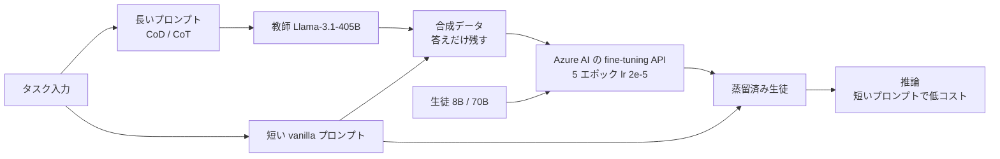

# Knowledge Distillation Using Frontier Open-source LLMs: Generalizability and the Role of Synthetic Data

- **Link**: <https://arxiv.org/abs/2410.18588>（HTML 版: <https://arxiv.org/html/2410.18588>）
- **Authors**: Anup Shirgaonkar, Nikhil Pandey, Nazmiye Ceren Abay, Tolga Aktas, Vijay Aski（Microsoft）
- **Year**: 2024（2024-10-24 投稿）
- **Venue**: arXiv（25 pages, 4 figures）
- **Type**: Academic Paper
- **取得状況**: abs ページと HTML 全文を取得して確認済み（2026-10-21）
- **証拠の質**: **一次資料**（論文）。ただし著者は Microsoft の Azure AI チームで、Azure のマネージド fine-tuning と価格を前提とした **ベンダー側の研究**

## Abstract

Leading open-source large language models (LLMs) such as Llama-3.1-Instruct-405B are extremely capable at generating text, answering questions, and solving a variety of natural language understanding tasks. However, they incur higher inference cost and latency compared to smaller LLMs. Knowledge distillation provides a way to use outputs from these large, capable teacher models to train smaller student models which can be used for inference at lower cost and latency, while retaining comparable accuracy. We investigate the efficacy of distillation using the Llama-3.1-405B-Instruct teacher and the smaller Llama-3.1-8B-Instruct and Llama-3.1-70B-Instruct student models. Contributions of this work include (a) We evaluate the generalizability of distillation with the above Llama-3.1 teacher-student pairs across different tasks and datasets (b) We show that using synthetic data during distillation significantly improves the accuracy of 8B and 70B models, and when used with reasoning chains, even matches or surpasses the zero-shot accuracy of 405B model on some datasets (c) We empirically show that distillation enables 8B and 70B models to internalize 405B's reasoning ability by using only standard fine-tuning (without customizing any loss function). This allows cost and latency-efficient student model inference. (d) We show pitfalls in evaluation of distillation, and present task-specific evaluation, including both human and LLM-grading, and ground-truth based traditional accuracy benchmarks. This methodical study brings out the fundamental importance of synthetic data quality in knowledge distillation, and of combining multiple, task-specific ways of accuracy and quality evaluation in assessing the effectiveness of distillation.

## Abstract (Japanese Translation)

Llama-3.1-Instruct-405B のような主要なオープンソース LLM は、文章生成・質問応答・さまざまな自然言語理解タスクで非常に高い能力を持ちます。しかし、小さな LLM に比べて推論コストとレイテンシが大きくなります。知識蒸留を使えば、大きく有能な教師モデルの出力で小さな生徒モデルを学習させ、精度を保ちながら低コスト・低レイテンシで推論できます。本研究では、Llama-3.1-405B-Instruct を教師、Llama-3.1-8B-Instruct と Llama-3.1-70B-Instruct を生徒として蒸留の効果を調べました。貢献は次の 4 点です。(a) この教師と生徒の組合せで、蒸留が異なるタスク・データセットにどこまで一般化するかを評価した。(b) 蒸留で合成データを使うと 8B と 70B の精度が大きく上がり、推論の連鎖（reasoning chains）と組み合わせると、一部のデータセットでは 405B のゼロショット精度に並ぶか上回ることを示した。(c) 損失関数を変えない標準的なファインチューニングだけで、8B と 70B が 405B の推論能力を取り込めることを実証した。これにより、生徒の推論をコスト・レイテンシの面で効率化できる。(d) 蒸留の評価の落とし穴を示し、人手評価・LLM による採点・正解ラベルに基づく従来の精度を組み合わせた、タスク別の評価を提示した。本研究は、知識蒸留における合成データの品質と、複数の評価方法を組み合わせることの重要性を明らかにしています。

## Overview

Azure のマネージド fine-tuning API（損失関数を変えられない）だけで、**405B → 8B / 70B の応答ベース蒸留** がどこまで効くかを、要約・会話・NLU（推論、数学、多肢選択 QA）で調べた論文です。

**要点は「教師に長く高品質なプロンプト（CoD / CoT）を使わせて合成データを作り、生徒は短いプロンプトで学習・推論する」こと** です。これで、生徒の推論は短いプロンプトのまま、教師の長いプロンプトの効果を重みに取り込めます（コンテキスト蒸留の一種）。

ビジネスの観点では、**Azure Marketplace の価格で推論コストを試算し、8B は 18 倍超、70B は 2 倍超安い** と示した点が重要です。マネージド蒸留の費用対効果を、価格表まで含めて公開している数少ない一次資料です。

## Problem

- **大型モデルの推論コストとレイテンシ**: 405B は高いし遅い。
- **商用 fine-tuning API の制約**: 損失関数を変えられないため、ロジットを使う蒸留や独自の損失（Distilling Step-by-Step のマルチタスク損失など）が使えない。
- **推論時の追加コスト**: 根拠（rationale）を入力に使う、または出力させる方式は、推論のトークンが増えてコストとレイテンシが上がる。
- **評価の難しさ**: 生成タスクでは、正解ラベルによる精度だけでは不十分。

## Proposed Method

**タスク別の合成データによる応答ベース蒸留**

1. **タスクごとにプロンプトを設計する**（プロンプトライブラリ $\Omega$）: 要約は Chain-of-Density（CoD）、会話は「helpful で harmless に」という system プロンプト、NLU は Chain-of-Thought（CoT）。
2. **教師（405B）で合成データを作る**: 設計したプロンプトで学習・検証データを生成。
3. **生徒を短いプロンプトで fine-tune**: 学習データには、教師の **最終的な答え（ラベル）だけ** を入れ、根拠は入れない。プロンプトは短い vanilla のもの。
4. **推論**: 生徒は短い vanilla プロンプトで推論する。

Azure AI 上での学習設定は、batch size multiplier 1、エポック数 5、学習率 2e-5 です。

**Key Formulas**:

要約の評価指標（重なったエンティティの密度）は次のとおりです。

$$
\text{Overlapped Entity Density} = \frac{1}{N}\sum_{i=1}^{N}\frac{|E_{\text{summ},i}\cap E_{\text{doc},i}|}{T_{\text{doc},i}}
$$

- $E_{\text{summ},i}$: $i$ 番目の生成要約に含まれるエンティティの集合
- $E_{\text{doc},i}$: $i$ 番目の元文書に含まれるエンティティの集合
- $T_{\text{doc},i}$: $i$ 番目の生成要約のトークン数（論文の定義のまま）
- $N$: テスト文書の数

論文は、従来の蒸留損失（ハードラベルとソフトラベルの重み付き和、式 1）が追加のハイパーパラメータ $\lambda$ を必要とし、商用 API では使えないことを指摘しています。

$$
\mathcal{L} = \lambda \cdot \mathcal{L}_{\text{hard}} + (1-\lambda)\cdot \mathcal{L}_{\text{soft}}
$$

（論文の式 1 の構造を一般形で示したもの。本手法はこれを使わず、$\mathcal{L}_{\text{hard}}$ にあたる通常の SFT だけを使う）

**Features**:

- 損失関数を変えないため、**どの商用 fine-tuning API でも使える**
- 生徒の推論は短いプロンプトなので、**モデルの小ささとプロンプトの短さの 2 つの面で** コストが下がる
- 根拠を学習しないため、学習も推論も速い

## Algorithm (Pseudocode)

```
Algorithm: Task-specific synthetic-data distillation
Input : 教師 T (405B), 生徒 S (8B/70B), タスク入力 X, タスク別プロンプト Ω_task, 短い vanilla プロンプト v
Output: 蒸留済み生徒 S*

1. for x in X:
2.     y_T ← T(Ω_task(x))           // CoD / CoT など長く高品質なプロンプトで教師が回答
3.     label ← extract_answer(y_T)  // NLU では根拠を捨てて最終答えだけ残す
4.     D ← D ∪ {(v(x), label)}      // 学習データには短いプロンプトを使う
5. S* ← FineTuneAPI(S, D, epochs=5, lr=2e-5)   // 標準の SFT。損失は変えない
6. 推論: ŷ ← S*(v(x_new))           // 短いプロンプトで推論
7. 評価: 正解ラベルの精度 + GPT-4 による採点 + 人手評価
```

## Architecture / Process Flow



## Figures & Tables

### 表 1: 要約のエンティティ密度（70B 生徒の部分、論文 Table 1 から抜粋）

| データセット | 70B（vanilla プロンプト） | 70B（vanilla 教師から蒸留） | 70B（CoD 教師から蒸留） |
|-------------|------------------------|-------------------------|----------------------|
| Griffin CoD | 0.0884 | 0.0819 | **0.0891*** |
| GovReport | 0.0515 | 0.0504 | **0.0627*** |
| BBCNews | 0.1035 | 0.0948 | **0.1033*** |

（* は vanilla プロンプトの教師を上回ったもの。HTML の表が崩れていて、8B と教師の列の対応は確実に読み取れなかったため、70B の列だけを載せています。論文は「CoD 教師から蒸留した生徒は vanilla 教師を最大 19% 上回る」と書いています）

### 表 2: 推論コストの試算（論文 Table 2、入力 1k トークン・出力 80 トークン、1,000 件あたり）

| モデル | コスト（$ / 1k 件） |
|--------|-------------------|
| 教師 405B（vanilla プロンプト） | 6.74 |
| 教師 405B（CoD プロンプト） | 8.74 |
| 蒸留生徒 70B | 3.03 |
| 蒸留生徒 8B | **0.36** |

```
推論コスト（$ / 1,000 件）
教師 405B CoD     |██████████████████████████████████████ 8.74
教師 405B vanilla |█████████████████████████████ 6.74
蒸留 70B          |█████████████ 3.03
蒸留 8B           |█▌ 0.36
```

前提とした Azure Marketplace の単価（1k トークンあたり）:

| モデル | 入力 | 出力 |
|--------|------|------|
| Llama-3.1-405B-Instruct | $0.00533 | $0.016 |
| fine-tuned Llama-3.1-70B-Instruct | $0.00268 | $0.00354 |
| fine-tuned Llama-3.1-8B-Instruct | $0.0003 | $0.00061 |

（文書の長さ 1k トークン、vanilla プロンプト 25 トークン、CoD プロンプト 400 トークンを仮定。fine-tuning は 1 回きりの費用として含めていない）

$$
\frac{6.74}{0.36} \approx 18.7 \ (\text{8B}), \qquad \frac{6.74}{3.03} \approx 2.2 \ (\text{70B})
$$

### 表 3: 会話の品質（GPT-4 による採点 HHH-MT、0〜6、論文 Table 3）

| データセット | 405B | 8B（蒸留なし） | 8B（蒸留） | 70B（蒸留なし） | 70B（蒸留） |
|-------------|------|-------------|-----------|---------------|-----------|
| Alpaca | 4.63 | 4.43 | 4.60 | 4.40 | **4.77*** |
| Quora | 4.59 | 4.19 | 4.27 | 4.55 | 4.37 |

（* は教師を上回ったもの。Quora の 70B だけ、蒸留なしの方が高い）

### 表 4: 人手評価（Quora、1〜5、評価者 3 名、論文 Table 4）

| 評価者 | 405B | 8B（蒸留なし） | 8B（蒸留） | 70B（蒸留なし） | 70B（蒸留） |
|-------|------|-------------|-----------|---------------|-----------|
| 1 | 3.95 | 3.83 | 3.90 | 4.01 | 3.98 |
| 2 | 3.27 | 3.66 | 3.74 | 3.82 | 3.63 |
| 3 | 3.90 | 3.86 | 3.98 | 4.01 | 3.98 |
| 平均 | 3.71 | 3.78 | **3.87*** | 3.95 | **3.86*** |

（教師の評価が低いのは評価者 2 の影響が大きい、と論文は述べています）

### 表 5: NLU タスクの結果の傾向（論文 Table 6 の本文の要約）

| タスク | 傾向 |
|--------|------|
| QA・NLI | 蒸留は、プロンプトだけの場合と同等以上。一部のデータセットで教師のゼロショット精度に並ぶか上回る |
| 数学（GSM8K・AQUA-RAT） | **蒸留より、生徒に直接 CoT プロンプトを使う方が精度が高い**。多段の推論は蒸留しにくい |
| CoT 蒸留と vanilla 蒸留 | 多くは CoT 蒸留が上。例外は AQUA-RAT（8B）と GSM8K（70B） |

## Experiments & Evaluation

### Setup

- 教師: Llama-3.1-405B-Instruct。生徒: Llama-3.1-8B-Instruct / 70B-Instruct
- 学習: Azure AI の fine-tuning（5 エポック、lr 2e-5）
- データ: 要約（Griffin CoD、GovReport、BBCNews ほか）、会話（Baize の Alpaca と Quora）、NLU（Table 5 のデータセット群）
- 評価: エンティティ密度、GPT-4 による HHH-MT、人手評価（3 名）、正解ラベルの精度

### Main Results

- 要約: CoD 教師から蒸留した生徒は、vanilla の教師を最大 19% 上回る
- コスト: 8B は 18 倍超、70B は 2 倍超の削減
- 会話: 蒸留した生徒は多くの場合、蒸留しない生徒より高評価。70B の Alpaca と 8B / 70B の人手評価では教師を上回った
- 数学: 蒸留は直接の CoT プロンプトに負ける

### Ablation Study

- **教師のプロンプトの効果**: vanilla 教師から蒸留しても、要約では蒸留しない生徒より改善しない。CoD 教師から蒸留して初めて改善する → **改善の源泉は合成データの品質**

## Notes

- **ビジネス上の意味**: 推論コストの削減（index の価値式の第 1 項）を、実際のクラウド価格で試算した数少ない資料です。ただし学習コストと教師推論コストは含まれていません。
- **蒸留の分類**: 応答ベース（ハードラベル）の黒箱蒸留。著者自身が「ソフトラベルより劣ることが多い」と認めたうえで、商用 API の制約の中でできることを示しています。
- **限界**: 結果は Llama 3.1 ファミリーだけです。「モデルの提供者による制約」があれば他のモデルには使えないと、著者が注記しています（H5 と関連）。
- **NVIDIA との対比**: NVIDIA の Minitron ブログ（[09](09-nvidia-minitron-nemo.md)）は、この方式（SDG finetuning）の例として「Azure AI Studio の Llama 3.1 Azure Distillation」を挙げ、ロジットを使う古典的な蒸留の方が有効だと主張しています。
- 関連: [06](06-azure-openai-foundry-distillation.md)（Azure の蒸留機能）
- **（2026-10-22 追記）数値の再照合**: 論文本文の表現は「The smaller student model (8B) gives over 18x cost reduction over the teacher」「70B and 8B … achieve more than 2x and 18x cost reductions, respectively」です。本レポートの「18.7 倍」「2.2 倍」は、論文に載る 1k トークンあたりの Azure Marketplace 価格から本レポートが計算した値で、論文の本文には出てきません。引用時は「18 倍超 / 2 倍超（論文）」を使い、18.7 / 2.2 は本レポートの試算と明記してください。
