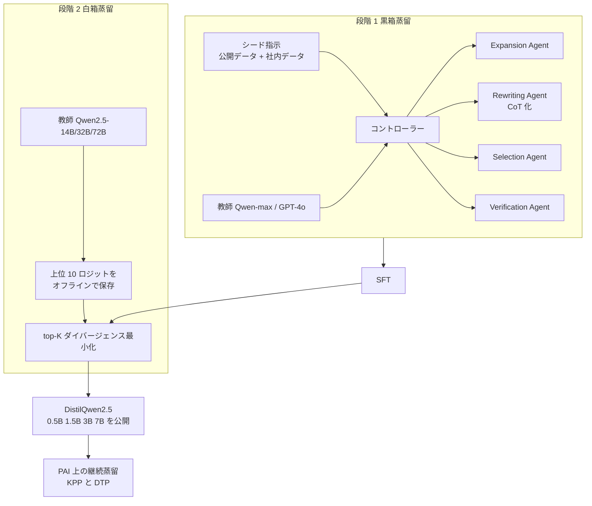

# DistilQwen2.5: Industrial Practices of Training Distilled Open Lightweight Language Models（+ EasyDistill / Alibaba Cloud PAI）

- **Link**: <https://arxiv.org/abs/2504.15027>（HTML 版: <https://arxiv.org/html/2504.15027>）
- **Authors**: Chengyu Wang, Junbing Yan, Yuanhao Yue, Jun Huang（Alibaba Cloud Computing の PAI チーム）
- **Year**: 2025（2025-04-21 投稿）
- **Venue**: arXiv
- **関連資料**:
  - EasyDistill: A Comprehensive Toolkit for Effective Knowledge Distillation of Large Language Models（arXiv 2505.20888、2025-05-27）: <https://arxiv.org/abs/2505.20888>
  - EasyDistill（GitHub）: <https://github.com/modelscope/easydistill>
  - Alibaba Cloud PAI ドキュメント（目次に Model Distillation / ModelDistill）: <https://www.alibabacloud.com/help/en/pai/>
  - Hugging Face alibaba-pai（DistilQwen_100k / DistilQwen_1M）: <https://huggingface.co/alibaba-pai>
- **Type**: Academic Paper（産業応用の報告を含む）
- **取得状況**: DistilQwen2.5 は abs と HTML 全文、EasyDistill は abs と GitHub README を取得して確認済み（2026-10-21）
- **証拠の質**: **一次資料**（論文）。社内の本番 A/B テストの結果を含む。ただし著者はクラウドベンダー（Alibaba Cloud）自身

## Abstract

Enhancing computational efficiency and reducing deployment costs for large language models (LLMs) have become critical challenges in various resource-constrained scenarios. In this work, we present DistilQwen2.5, a family of distilled, lightweight LLMs derived from the public Qwen2.5 models. These distilled models exhibit enhanced instruction-following capabilities compared to the original models based on a series of distillation techniques that incorporate knowledge from much larger LLMs. In our industrial practice, we first leverage powerful proprietary LLMs with varying capacities as multi-agent teachers to select, rewrite, and refine instruction-response pairs that are more suitable for student LLMs to learn. After standard fine-tuning, we further leverage a computationally efficient model fusion approach that enables student models to progressively integrate fine-grained hidden knowledge from their teachers. Experimental evaluations demonstrate that the distilled models possess significantly stronger capabilities than their original checkpoints. Additionally, we present use cases to illustrate the applications of our framework in real-world scenarios. To facilitate practical use, we have released all the DistilQwen2.5 models to the open-source community.

## Abstract (Japanese Translation)

計算効率を高め、LLM の運用コストを下げることは、リソースが限られたさまざまな場面で重要な課題になっています。本研究では、公開されている Qwen2.5 から派生した、蒸留による軽量 LLM のファミリー DistilQwen2.5 を紹介します。これらのモデルは、はるかに大きな LLM の知識を取り込む一連の蒸留技術によって、元のモデルより高い指示追従能力を持ちます。産業での実践として、まず能力の異なる強力なプロプライエタリ LLM を **複数エージェントの教師** として使い、生徒が学びやすい指示と応答の組を選び、書き換え、改良します。通常のファインチューニングの後には、計算効率の良い **モデル融合** の手法で、生徒が教師の細かな隠れた知識を段階的に取り込めるようにします。実験では、蒸留したモデルが元のチェックポイントより大幅に高い能力を持つことを示しました。さらに、実際の場面での応用例も紹介します。実用のため、DistilQwen2.5 のすべてのモデルをオープンソースで公開しています。

## Overview

Alibaba Cloud の機械学習基盤 **PAI（Platform for AI）** のチームが、(1) 公開モデル DistilQwen2.5（0.5B / 1.5B / 3B / 7B）の作り方と、(2) 社内の **ビッグデータ基盤での SQL 補完の本番 A/B テスト**、(3) **PAI 上で顧客が自分で蒸留できるパイプライン** を報告した論文です。

C2 で調べたクラウドベンダーの中で、**蒸留サービスの提供者が、自社の本番サービスでの A/B テストの数字まで公開している唯一の例** です。

- **黒箱蒸留**: Qwen-max（中国語）と GPT-4 / GPT-4o（その他の言語）を教師にして、エージェントが指示を拡張・書き換え・選別・検証する
- **白箱蒸留**: Qwen2.5-14B / 32B / 72B-Instruct を教師に、**上位 10 トークンのロジットだけ** を使う効率化した蒸留
- **本番**: SQL 補完で 7B（int4 量子化）→ 3B に蒸留し、**レイテンシ 384 ms → 148 ms、採用率 26.5% → 25.5%**

## Problem

- **計算コストと運用コスト**: 大型 LLM は、リソースが限られた場面では運用が難しい。
- **白箱蒸留の産業規模での実装の難しさ**:
  1. 教師（32B / 72B）の順伝播を生徒の学習と同時に行うと、GPU メモリが足りない
  2. 教師と生徒の語彙が違うと、ロジットのテンソルが合わない
- **ドメイン特化の必要性**: 汎用の DistilQwen2.5 だけでは、SQL 補完のような業務には足りない。

## Proposed Method

### 1. 複数エージェントによるデータ拡張（黒箱蒸留）

コントローラーが、教師から直接応答を生成する処理と、次のエージェントを呼び出してデータを増やす処理を調整します。

| エージェント | 役割 | 例 |
|------------|------|----|
| Expansion Agent | 元のタスクの種類を保ったまま、指示のバリエーションを作り、教師に応答させる | 「ニュートンの第一法則を説明して」→「ケプラーの第三法則の意味を説明して」（アインシュタインの生涯、は不可） |
| Rewriting Agent | 意図とタスクの種類を保って書き換える。推論・数学・コードなどの複雑なタスクは CoT 形式の応答にする | 「気候変動の経済的影響を要約して」→「気候変動が経済にどう影響するか説明して」 |
| Selection Agent | 情報量・有用性・汎化可能性などの基準で、学習に価値のある組を選ぶ。タスクのバランスも考える | — |
| Verification Agent | LLM が新しい指示と応答の組を生成するたびに呼ばれ、事実として正しいかを確認する（Selection Agent とは別） | — |

初期データは OpenHermes 2.5、Alpaca（cleaned）、LCCD などの公開データと社内データです。

### 2. 効率的なモデル融合（白箱蒸留）

**Key Formulas**:

教師 $p_T$ と生徒 $p_S^\theta$ のトークン単位の分布の差:

$$
D_{\theta}(x,y)=\frac{1}{L}\sum_{n=1}^{L}D_{\theta}\left(p_{T}(\cdot\mid y_{<n},x)\parallel p_{S}^{\theta}(\cdot\mid y_{<n},x)\right) \tag{1}
$$

- $x$: 入力列、$y$: 出力列、$L$: 系列の長さ
- $D_\theta(\cdot)$: 任意のダイバージェンス（KLD、逆 KLD など）

蒸留の損失:

$$
L(\theta)=\mathbb{E}_{(x,y)\sim(X,Y)}\left[D_{\theta}(x,y)\right] \tag{2}
$$

上位 $K$ 個のロジットだけで分布を作る（$K=10$ が既定）:

$$
\mathbf{p}_{T}=\frac{\exp(\mathbf{z}_{T}/\mathcal{T})}{\sum_{k=1}^{K}\exp(z_{T}^{(k)}/\mathcal{T})}, \qquad
\mathbf{p}_{S}=\frac{\exp(\mathbf{z}_{S}/\mathcal{T})}{\sum_{k=1}^{K}\exp(z_{S}^{(k)}/\mathcal{T})}
$$

- $\mathbf{z}_T = [z_T^{(1)},\dots,z_T^{(K)}]$: 教師の上位 $K$ 個のロジット
- $\mathbf{z}_S$: 生徒の、同じ語彙位置のロジット
- $\mathcal{T}$: 温度

**Features**:

- **上位 10 トークンの確率の合計がほぼ 1** という観察に基づき、教師のロジットを上位 10 個だけ **オフラインで分散計算して保存** します。
- 語彙が違う場合は、先にトークンの対応付け（token alignment）を行います。
- ロジットの生成は、素朴な実装より **3〜5 倍速い**（図 3）。ストレージの負荷も下がります。

## Algorithm (Pseudocode)

```
Algorithm: DistilQwen2.5 training pipeline
Input : シード指示 I, 黒箱教師 {Qwen-max, GPT-4/4o}, 白箱教師 T_w ∈ {Qwen2.5-14B/32B/72B}, 生徒 S ∈ {0.5B,1.5B,3B,7B}
Output: DistilQwen2.5 生徒 S*

// 段階 1: 黒箱蒸留（データ拡張）
1. I' ← ExpansionAgent(I)                 // タスクの種類を保って指示を増やす
2. I'' ← RewritingAgent(I')               // 意図を保って書き換え、複雑なタスクは CoT 応答に
3. R  ← BlackBoxTeacher(I'')              // 教師で応答を生成
4. D  ← SelectionAgent(VerificationAgent(I'', R))   // 検証して価値の高い組を選ぶ
5. S1 ← SFT(S, D, lr=1e-5, epochs=3)      // 8×A800 80GB

// 段階 2: 白箱蒸留（モデル融合）
6. if vocab(T_w) ≠ vocab(S): align_tokens(T_w, S)
7. Z_T ← offline_topK_logits(T_w, D, K=10)          // 分散処理で事前計算して保存
8. S* ← argmin_θ E[ D_θ(top-K p_T || top-K p_S) ]  // 式 (1)(2)
9. return S*
```

## Architecture / Process Flow



### PAI 上の継続蒸留パイプライン（図 7）

| パイプライン | 内容 |
|------------|------|
| Knowledge Production Pipeline（KPP） | 利用者のシード指示に、拡張と改良の手順を適用。教師が応答またはロジットを生成 |
| Distillation Training Pipeline（DTP） | 黒箱・白箱の学習設定を利用者が定義し、クラウドの資源で学習。その後、評価とデプロイ |

## Figures & Tables

### 表 1: 指示追従能力の比較（論文 Table 1）

| モデル | AlpacaEval 2.0（LC） | MT-Bench | MT-Bench（Single） | IFEval（instruct-loose） | IFEval（strict-prompt） |
|--------|-------------------|----------|-------------------|------------------------|----------------------|
| Qwen2.5-0.5B-Instruct | 2.46 | 5.49 | 6.26 | 42.81 | 30.31 |
| DistilQwen2.5-0.5B-Instruct* | 4.72 | 5.71 | 6.74 | 51.44 | 37.15 |
| DistilQwen2.5-0.5B-Instruct | **4.89** | **5.78** | **6.83** | **52.61** | **37.82** |
| Qwen2.5-1.5B-Instruct | 6.69 | 7.09 | 7.66 | 55.40 | 40.11 |
| DistilQwen2.5-1.5B-Instruct* | 13.30 | 7.27 | 7.90 | 60.63 | 73.02 |
| DistilQwen2.5-1.5B-Instruct | **13.69** | **7.35** | **7.99** | **61.10** | **74.49** |
| Qwen2.5-3B-Instruct | 17.98 | 7.92 | 8.40 | 61.18 | 74.58 |
| DistilQwen2.5-3B-Instruct* | 20.81 | 8.33 | 8.94 | 65.80 | 77.10 |
| DistilQwen2.5-3B-Instruct | **20.91** | **8.37** | **8.97** | **67.03** | **77.36** |
| Qwen2.5-7B-Instruct | 31.43 | 8.52 | 8.83 | 81.53 | 72.10 |
| DistilQwen2.5-7B-Instruct* | 34.78 | 8.75 | 9.19 | 83.41 | 73.20 |
| DistilQwen2.5-7B-Instruct | **34.86** | **8.76** | **9.22** | **83.48** | **73.27** |

（* は黒箱蒸留だけの版。* なしは白箱蒸留まで行った版。LC = length-controlled。1.5B の IFEval strict-prompt が 40.11 → 74.49 と大きく跳ねている点は原文のまま）

```
AlpacaEval 2.0 (LC) の伸び（元 → 蒸留）
0.5B |██▍ 2.46 → ████▉ 4.89   (約 2.0 倍)
1.5B |██████▋ 6.69 → █████████████▋ 13.69 (約 2.0 倍)
3B   |█████████████████▉ 17.98 → ████████████████████▉ 20.91
7B   |███████████████████████████████▍ 31.43 → ██████████████████████████████████▉ 34.86
```

論文は「小さい生徒ほど蒸留による改善が大きい」と述べています。

### 表 2: MT-Bench のタスク別スコア（論文 Table 2、0.5B と 1.5B）

| タスク | 0.5B | 0.5B（蒸留） | 1.5B | 1.5B（蒸留） |
|--------|------|------------|------|------------|
| Writing | 6.08 | 6.68 | 8.38 | 8.38 |
| Roleplay | 7.07 | 7.43 | 7.26 | 8.13 |
| Reasoning | 4 | 4.2 | 3.9 | 4.8 |
| Mathematics | 4.65 | 4.65 | 6.85 | 6.98 |
| Coding | 4 | 4.08 | 4.6 | 5.04 |
| Extraction | 3.55 | 4.5 | 6.4 | 6.6 |
| STEM | 6.55 | 6.83 | 9.65 | 9.28 |
| Humanity | 8.1 | 7.95 | 9.73 | 9.83 |

### 表 3: 本番の SQL 補完（論文 Table 3、採用率はオンライン A/B テスト）

| モデル | レイテンシ（ms） | Pass@1（%） | 採用率（%） |
|--------|---------------|-----------|-----------|
| 7B（教師、int4 量子化した fine-tuned Qwen2.5-7B） | 384 | 18.8 | 26.5 |
| 3B（生徒、社内 SQL コーパスで蒸留） | **148** | 17.9 | 25.5 |

```
レイテンシ（ms）
7B 教師 |██████████████████████████████████████ 384
3B 生徒 |███████████████ 148

採用率（%）
7B 教師 |██████████████████████████▌ 26.5
3B 生徒 |█████████████████████████▌ 25.5
```

$$
\frac{384}{148} \approx 2.6 \ \text{倍の高速化}, \qquad \Delta \text{採用率} = -1.0 \ \text{ポイント}, \qquad \Delta \text{Pass@1} = -0.9 \ \text{ポイント}
$$

> **本文と表の不一致**: 本文は「推論速度が 1.4 倍に上がった」と書いていますが、表の値（384 ms → 148 ms）からは約 2.6 倍になります。どちらが正しいかは論文からは判断できません。
>
> **（2026-10-22 訂正・補足）** arXiv の HTML 版（5.1 節）を再読し、各数値が何を指すかを整理しました。
>
> | 数値 | 出所 | 指すもの | 原文 |
> |------|------|---------|------|
> | **1.4×** | 5.1 節の本文 | 「推論速度（inference speed）」の向上倍率。測定方法（スループットか、レイテンシの逆数か、バッチ条件）は書かれていない | 「This model achieves a significant improvement, closely matching the performance of the 7B model, while increasing the inference speed by 1.4×.」 |
> | **384 ms → 148 ms** | Table 3 | 本番のリアルタイム補完の **レイテンシ**（「Latency measures the system's speed in generating real-time suggestions as users input queries」） | Table 3 |
> | **約 2.6 倍** | 本レポートの計算 | 384 / 148。レイテンシの比であり、論文の本文には出てこない | — |
> | **26.5% → 25.5%** | Table 3 | 採用率。「obtained through online A/B testing on the big data platform」 | Table 3 |
> | **18.8% → 17.9%** | Table 3 | Pass@1（自動評価） | Table 3 |
>
> したがって、「1.4 倍」は論文が述べた **推論速度** の値、「2.6 倍」は本レポートが Table 3 の **レイテンシ** から計算した値で、**同じ量を指しているとは限りません**（例: 1.4× がバッチ処理のスループット、レイテンシはリアルタイムの 1 件あたり、という可能性）。論文はどちらの測定条件も説明していないため、引用する際は「論文の本文は 1.4×、Table 3 のレイテンシ比は約 2.6×」と併記するのが安全です。また、教師の 7B は int4 量子化済みで、生徒 3B の精度（量子化の有無）は記載がありません。

### 図（原文）

- 図 1: DistilQwen2.5 の AlpacaEval 2.0（LC）と IFEval のスコア
- 図 2: データ拡張と黒箱蒸留に使う LLM / エージェントの機能
- 図 3: ロジット生成の速度の比較（提案手法と素朴な実装、1 サンプルあたりの平均秒数）
- 図 7: AI プラットフォーム上の継続蒸留パイプライン
- 表 4〜6: 元の Qwen2.5 と DistilQwen2.5 の出力例

### 表 4: EasyDistill（PAI に統合された蒸留ツールキット）の機能（GitHub README）

| 機能 | 内容 |
|------|------|
| 対応する教師の接続先 | OpenAI 互換のエンドポイント全般（OpenAI API、Azure OpenAI、vLLM、ローカル、**PAI-Token**、**PAI-EAS**） |
| 生成できるデータ | SFT データ、DPO の選好ペア、マルチモーダルデータ |
| 蒸留の種類 | 指示・CoT・長い CoT を短くする書き換え、マルチモーダル、**エージェント**、**検索エージェント**（多段の検索タスク）、テキストから画像・動画 |
| 構成 | 生成・評価・選別・書き換え・バランス調整・選好の採点などの部品を、設定ファイルで組み合わせる |

## Experiments & Evaluation

### Setup

- 生徒: Qwen2.5-0.5B / 1.5B / 3B / 7B-Instruct
- 黒箱教師: Qwen-max（中国語）、GPT-4 / GPT-4o（その他の言語）
- 白箱教師: Qwen2.5-14B / 32B / 72B-Instruct
- 学習: 学習率 1e-5、3 エポック、A800 80GB × 8
- 評価: AlpacaEval 2.0（LC）、MT-Bench、IFEval

### Main Results

- すべてのサイズ・すべてのベンチマークで、元の Qwen2.5 を上回る（表 1）
- 白箱蒸留は、黒箱蒸留の後にさらに上乗せする（* 版との差）
- 本番の SQL 補完では、7B → 3B でレイテンシ約 61% 減、採用率の低下は 1.0 ポイント

### Ablation Study

- 黒箱だけ（*）と黒箱 + 白箱の比較が、そのまま融合の寄与の分析になっています（表 1）。

## Notes

- **ビジネス上の意味**: index の価値式のうち、**レイテンシ（推論コストの代わり）と精度低下の項（採用率 -1.0 ポイント）を、本番の A/B テストで同時に報告している** 点が貴重です。Bedrock / OpenAI / Azure にはこの水準の顧客データがありません。
- **比較の前提に注意**: 教師の 7B は **int4 に量子化済み** です。比較は「量子化した 7B」対「蒸留した 3B」で、量子化と蒸留が混ざっています（C2 の論点: 蒸留と量子化の区別）。
- **規約との関係（H5）**: 黒箱教師に **GPT-4 / GPT-4o** を使っています。OpenAI の規約との関係は論文に書かれていません（C8 で扱う論点）。
- **限界（論文の記載）**: 教師の偏りや誤りが生徒に伝わる。他のドメインや言語への一般化は未評価。
- 関連: [09](09-nvidia-minitron-nemo.md)（白箱蒸留をマネージドで提供するもう一つの例）、C3 `open_distilled_models`（公開モデルとしての DistilQwen）
