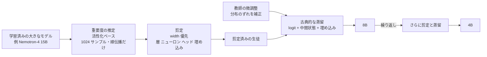

# NVIDIA NeMo の剪定 + 蒸留（Minitron）— Llama-3.1-Minitron 4B と Mistral-NeMo-Minitron 8B

- **Source**: NVIDIA（Technical Blog 2 本 / NeMo Framework User Guide / arXiv 論文 2 本）
- **Date**: 2024-08-14（Llama-3.1-Minitron 4B）、2024-10-08（Mistral-NeMo-Minitron 8B、2024-08-21 の初出を改訂）、ドキュメントは 2026-10 時点
- **Link**:
  - How to Prune and Distill Llama-3.1 8B to an NVIDIA Llama-3.1-Minitron 4B Model（Sharath Sreenivas, Vinh Nguyen, Saurav Muralidharan, Marcin Chochowski, Raviraj Joshi）: <https://developer.nvidia.com/blog/how-to-prune-and-distill-llama-3-1-8b-to-an-nvidia-llama-3-1-minitron-4b-model/>
  - Mistral-NeMo-Minitron 8B Model Delivers Unparalleled Accuracy: <https://developer.nvidia.com/blog/mistral-nemo-minitron-8b-foundation-model-delivers-unparalleled-accuracy/>
  - NeMo Framework User Guide — Distillation: <https://docs.nvidia.com/nemo-framework/user-guide/latest/model-optimization/distillation/distillation.html>
  - Compact Language Models via Pruning and Knowledge Distillation（arXiv 2407.14679）: <https://arxiv.org/abs/2407.14679>
  - LLM Pruning and Distillation in Practice: The Minitron Approach（arXiv 2408.11796）: <https://arxiv.org/abs/2408.11796>
- **Type**: Technical Article（技術ブログ + 論文 + 公式ドキュメント）
- **取得状況**: 5 件すべて取得して本文を確認済み（2026-10-21）
- **証拠の質**: **一次資料**（論文）+ **ベンダー申告**（ブログ）。**外部の顧客事例はなし**（NVIDIA 自身が作ったモデルの報告）

## Overview

NVIDIA は、**構造化した剪定（pruning）と、ロジットを使う古典的な知識蒸留** を組み合わせ、学習済みの大きなモデルから小さなモデルを安く作る手法 **Minitron** を、NeMo フレームワークの機能として提供しています。C2 の他のサービス（Bedrock / OpenAI / Azure / Vertex）が教師出力による SFT であるのに対し、NeMo は **白箱蒸留（ロジット・中間状態の模倣）** をツールとして提供する点が違います。

主な数値は次のとおりです。

- Nemotron-4 15B → 8B / 4B: モデルごとの学習トークンが **最大 40 分の 1**、モデル群（15B・8B・4B）の学習計算量が **1.8 倍の削減**、ゼロから学習した場合より **MMLU が最大 16% 高い**（論文 2407.14679）
- Llama 3.1 8B → 4B: **94B トークン** で作成。depth 剪定版はスループット **約 2.7 倍**、width 剪定版は **約 1.8 倍**（H100、TensorRT-LLM）
- Mistral NeMo 12B → 8B: **380B トークン** の蒸留で、ゼロから学習するより計算量が **40 分の 1 超**。モデル群（12B・8B・4B）の学習計算量は **最大 1.95 倍の削減**

ビジネスの観点では、これは **「モデルを作る側」のコスト削減**（公開モデルや自社基盤モデルのファミリー展開）です。推論 API の利用者のコスト削減とは種類が違います。

## Key Technical Content

### 2 種類の蒸留（NVIDIA ブログの整理）

| 種類 | 生徒が学ぶもの | 例（ブログの記載） | 必要なもの |
|------|-------------|-----------------|----------|
| **SDG finetuning**（合成データでのファインチューニング） | 教師が予測した **最後のトークン** だけ | Azure AI Studio の「Llama 3.1 Azure Distillation」、AWS の「Llama 3.1 405B で合成データを作り小型モデルを fine-tune」チュートリアル | 教師の出力テキスト |
| **古典的な知識蒸留** | 教師の **ロジット** と中間状態 | Minitron | 学習フレームワークの対応（ロジットは大きすぎて保存しにくい） |

NVIDIA は、2 つは排他的ではなく補完的だとしつつ、古典的な蒸留の方が「同じデータでも勾配の情報が豊かで、学習の精度と効率が上がる」と主張しています。**クラウドのマネージド蒸留（Bedrock / Azure）を「SDG finetuning」の例として名指ししている** 点は、C2 の比較で重要です。

### Architecture / Design



### Implementation Steps（Llama 3.1 8B → 4B）

1. **教師の微調整**: 元の学習データと分布が違うため、剪定前の 8B を NVIDIA のデータ（94B トークン）で微調整する。補正しないと教師の指導が最適にならない。
2. **depth 剪定**: 16 層（50%）を削除。LM の損失ではなく、下流タスク（Winogrande）の精度で判断し、**16〜31 層** を削除。
3. **width 剪定**: MLP の中間次元を 14336 → 9216、隠れ次元を 4096 → 3072 に削減。
4. **蒸留**: 最大学習率 1e-4、最小 1e-5、40 ステップの線形ウォームアップ、コサイン減衰、グローバルバッチサイズ 1152。
5. **整合（alignment）**: NeMo-Aligner で instruct 化し、IFEval・MT-Bench・ChatRAG・BFCL で評価。
6. **推論の最適化**: TensorRT-LLM で FP8 / BF16 を測定。

### ベストプラクティス（ブログの要約）

- **サイズ**:
  - モデル群を作るときは、最大のモデルを先に学習し、剪定と蒸留を繰り返して小さいモデルを作る
  - 最大のモデルを多段階で学習した場合は、最終段階のモデルを剪定する
  - 目標サイズに最も近い既存のモデルを剪定する
- **剪定**:
  - depth より width を優先する（15B 以下で有効）
  - 重要度の推定は 1 回でよい（繰り返しても効果なし）
- **再学習**:
  - 通常の学習ではなく、蒸留の損失だけで再学習する
  - depth を大きく減らした場合は、logit + 中間状態 + 埋め込みを蒸留する
  - depth をあまり減らさない場合は、logit だけを蒸留する

### Key Formulas / Metrics

蒸留の損失は、ブログの図 2 の説明によれば、埋め込みの出力の損失・logit の損失・Transformer ブロックごとの損失（生徒のブロック S と教師のブロック T を対応付けたもの）の組合せです。一般形で書くと次のようになります（本レポートでの整理）。

$$
\mathcal{L} = \alpha \, \mathcal{L}_{\text{logit}}\left(p_T \parallel p_S\right) + \beta \, \mathcal{L}_{\text{emb}} + \gamma \sum_{(s,t)} \mathcal{L}_{\text{block}}\left(h_s^{S}, h_t^{T}\right)
$$

- $p_T, p_S$: 教師と生徒の出力分布、$h_s^S, h_t^T$: 対応付けた生徒と教師のブロックの隠れ状態
- $\alpha, \beta, \gamma$: 重み（値はブログに記載なし）

## Figures & Tables

### 表 1: Llama-3.1-Minitron 4B（ベースモデル）の精度（ブログ Table 1）

| ベンチマーク | shot | 指標 | Llama-3.1 8B | Minitron 4B | Llama-3.1-Minitron 4B（depth） | Llama-3.1-Minitron 4B（width） | Phi-2 2.7B | Gemma2 2.6B† | Qwen2-1.5B† |
|-------------|------|------|------------|-------------|------------------------------|------------------------------|-----------|-------------|------------|
| winogrande | 5 | acc | 0.7727 | 0.7403* | 0.7214 | 0.7348 | 0.7400** | 0.709 | 0.662 |
| arc_challenge | 25 | acc_norm | 0.5794 | 0.5085 | 0.5256 | 0.5555** | 0.6100* | 0.554 | 0.439 |
| MMLU | 5 | acc | 0.6528 | 0.5860** | 0.5871 | 0.6053* | 0.5749 | 0.513 | 0.565 |
| hellaswag | 10 | acc_norm | 0.8180 | 0.7496 | 0.7321 | 0.7606* | 0.7524** | 0.73 | 0.666 |
| gsm8k | 5 | acc | 0.4860 | 0.2411 | 0.1676 | 0.4124 | 0.5500** | 0.239 | 0.585* |
| truthfulqa | 0 | mc2 | 0.4506 | 0.4288 | 0.3817 | 0.4289 | 0.4400** | – | 0.459* |
| XLSum en (20%) | 3 | rougeL | 0.3005 | 0.2954* | 0.2722 | 0.2867** | 0.0100 | – | – |
| MBPP | 0 | pass@1 | 0.4227 | 0.2817 | 0.3067 | 0.324 | 0.4700* | 0.29 | 0.374** |
| **学習トークン** | | | 15T | 94B | | | 1.4T | 3T | 7T |

（* は最良、** は次点。† は提供者の報告値。原文の表の学習トークンの行は列の対応が崩れており、本表では原文の並びのまま記載）

### 表 2: 整合後の instruct モデルの精度（ブログ Table 2）

| ベンチマーク | Minitron 4B | Llama-3.1-Minitron 4B（depth） | Llama-3.1-Minitron 4B（width） | Gemma 2B | Phi-2 2.7B | Gemma2 2.6B | Qwen2-1.5B |
|-------------|-------------|------------------------------|------------------------------|---------|-----------|------------|-----------|
| IFEval | 0.4484 | 0.4257 | 0.5239** | 0.4050 | 0.4400 | 0.6451* | 0.3981 |
| MT-Bench | 5.61 | 5.64 | 6.34** | 5.19 | 4.29 | 7.73* | 5.22 |
| ChatRAG† | 0.4111** | 0.4013 | 0.4399* | 0.3331 | 0.3760 | 0.3745 | 0.2908 |
| BFCL | 0.6423 | 0.6680* | 0.6493** | 0.4700 | 0.2305 | 0.3562 | 0.3275 |

（† は ChatRAG の代表的な部分集合での値）

### 表 3: Mistral-NeMo-Minitron-8B-Instruct の精度（ブログ Table 1）

| モデル | MMLU 5-shot | GSM8k 0-shot | GPQA 0-shot | HumanEval 0-shot | MBPP 0-shot | IFEval | MT-Bench（GPT4-Turbo） | BFCL v2 Live |
|--------|------------|-------------|------------|-----------------|------------|--------|---------------------|-------------|
| Mistral-NeMo-Minitron 8B Instruct | 70.4 | 87.1 | 31.5 | 71.3 | 72.5 | 84.4 | 7.86 | 67.6 |
| Llama-3.1-8B-Instruct | 69.4 | 83.9 | 30.4 | 72.6 | 72.8 | 79.7 | 7.78 | 44.3 |
| Mistral-NeMo-12B-Instruct（教師） | 68.4 | 79.8 | 28.6 | 68.3 | 66.7 | 64.7 | 8.10 | 47.9 |

### 表 4: Mistral-NeMo-Minitron-8B-Base の精度（ブログ Table 2）

| モデル | 学習トークン | Winogrande 5 | ARC-C 25 | MMLU 5 | HellaSwag 10 | GSM8K 5 | TruthfulQA 0 | XLSum en 3 | MBPP 0 | HumanEval 0 |
|--------|------------|-------------|---------|--------|-------------|--------|-------------|-----------|--------|------------|
| Llama-3.1-8B | 15T | 77.27 | 57.94 | 65.28 | 81.80 | 48.60 | 45.06 | 30.05 | 42.27 | 24.76 |
| Gemma-7B | 6T | 78 | 61 | 64 | 82 | 50 | 45 | 17 | 39 | 32 |
| Mistral-NeMo-Minitron-8B | **380B** | 80.35 | 64.42 | 69.51 | 83.03 | 58.45 | 47.56 | 31.94 | 43.77 | 36.22 |
| Mistral-NeMo-12B（教師） | N/A | 82.24 | 65.10 | 68.99 | 85.16 | 56.41 | 49.79 | 33.43 | 42.63 | 23.78 |

### 表 5: 推論スループット（H100 80GB × 1、TensorRT-LLM）

| モデル | 比較対象 | スループット |
|--------|---------|------------|
| Llama-3.1-Minitron-4B-Depth-Base | Llama 3.1 8B | 平均 約 2.7 倍 |
| Llama-3.1-Minitron-4B-Width-Base | Llama 3.1 8B | 平均 約 1.8 倍 |
| Mistral-NeMo-Minitron-8B-Base | Mistral-NeMo-12B | 1.2 倍 |
| Llama-3.1-8B | Mistral-NeMo-12B | 約 1.4 倍 |
| FP8（全モデル） | BF16 | 約 1.3 倍（4B のブログ）/ 約 1.4 倍（8B のブログ） |

（4B の測定は、8B がバッチサイズ 32、4B がバッチサイズ 64）

```
学習トークン（対数ではなく実数の比較）
Llama-3.1-8B         |████████████████████████████████████████ 15T
Gemma-7B             |████████████████ 6T
Mistral-NeMo-Minitron|█ 0.38T
Llama-3.1-Minitron 4B|▏ 0.094T
```

### 表 6: NeMo Framework の蒸留機能（ユーザーガイド）

| 項目 | 内容 |
|------|------|
| 位置づけ | NeMo 2.0 で KD の学習を簡単に設定できる |
| 利点（ガイドの記載） | 収束が速い、最終精度が高い |
| 制約 | **GPT 系の NeMo 2.0 チェックポイントのみ**。パイプライン並列のときは、中間状態の KD 損失は最終段でだけ使える |
| 用途 | 事前学習の蒸留に加え、チャットデータでの SFT 知識蒸留（`--use-chat-data`） |

## Practical Takeaways

1. **Minitron は「モデルを作る側」の蒸留**: 学習計算量の削減（40 倍・1.8〜1.95 倍）が主な価値です。API 利用者向けの蒸留サービス（Bedrock 等）とは、得をする主体が違います。
2. **白箱蒸留には重みが必要**: 教師の重みとロジットにアクセスできる必要があるため、使える教師はオープンモデルか自社モデルに限られます。商用 API のモデル（GPT-4o や Claude）は教師にできません（H5 の技術的な側面）。
3. **教師の微調整が重要**: 元の学習データがない場合、教師を蒸留用データで少し微調整すると良い（論文 2408.11796 の要旨）。
4. **小型化の効果は tool calling で特に大きい**: Mistral-NeMo-Minitron 8B Instruct の BFCL v2 Live は 67.6 で、教師の 12B（47.9）を大きく上回っています。整合データの違いも影響しているはずで、蒸留だけの効果ではありません。

## Notes

- **顧客事例**: NeMo の蒸留機能を使った外部企業の事例は、本調査では見つかりませんでした（検索の上限のため、追加の検索はしていません）。
- **蒸留と剪定の区別**: Minitron は「剪定 + 蒸留」です。剪定だけ、あるいは量子化だけ（FP8 の 1.3〜1.4 倍）の効果と区別する必要があります。表 5 のスループットには剪定によるモデルの縮小の効果が含まれ、FP8 は別の量子化の効果です。
- **他サービスとの関係**: Okoone の記事は、AWS の Bedrock 蒸留が NVIDIA の Llama-3.1-Minitron 4B などの「実績ある手法」に基づくと書いていますが、AWS の公式資料にはその記載がありません（二次報道の解釈）。
- 関連: [07](07-microsoft-llama-405b-distillation-paper.md)（SDG finetuning 側の代表例）、[08](08-distilqwen25-alibaba-pai.md)（もう一つの白箱蒸留の提供者）、C3 `open_distilled_models`
