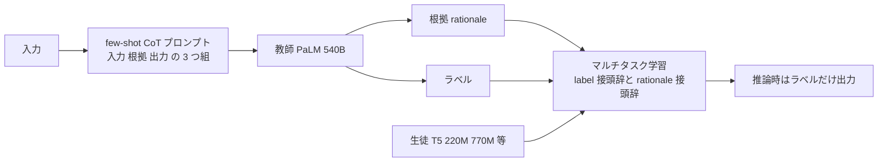
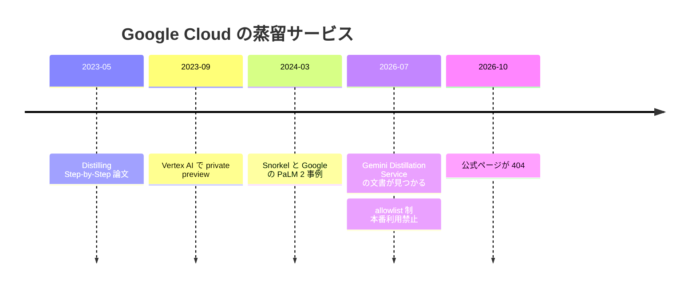

# Google Cloud の蒸留（Vertex AI の Distilling Step-by-Step → Gemini Distillation Service）と Snorkel × Google の事例

- **Company/Organization**: Google（Google Research / Google Cloud）、Snorkel AI、Wayfair（言及のみ）
- **Industry**: クラウド AI 基盤 / 金融（架空の銀行のデモ）/ EC
- **Date**: 2023-09-21（Google Research Blog）、2024-03-19（Snorkel × Google）、2025-02-18（Snorkel）、2026-07-28（RuntimeWire）
- **Link**:
  - Distilling step-by-step: Outperforming larger language models with less training data and smaller model sizes（Google Research Blog、Cheng-Yu Hsieh / Chen-Yu Lee）: <https://research.google/blog/distilling-step-by-step-outperforming-larger-language-models-with-less-training-data-and-smaller-model-sizes/>
  - 論文（ACL 2023 Findings）: <https://arxiv.org/abs/2305.02301>
  - Here's how Snorkel Flow + Google AI built an enterprise-ready model in a day（Ali Arsanjani / Paroma Varma）: <https://snorkel.ai/blog/snorkel-and-google-ai-enterprise-ready-model-in-a-day/>
  - Why enterprises should embrace LLM distillation（Snorkel、Shane Johnson）: <https://snorkel.ai/blog/why-enterprises-should-embrace-llm-distillation/>
  - LLM distillation demystified: a complete guide（Snorkel）: <https://snorkel.ai/blog/llm-distillation-demystified-a-complete-guide/>
  - Google Cloud page describes Gemini distillation service, but its release status is unclear（RuntimeWire、Ryan Merket）: <https://runtimewire.com/article/google-cloud-page-describes-gemini-distillation-service-but-its-release-status-i>
  - Gemini Distillation Service の公式ページ（**2026-10-21 時点で 404**）: <https://docs.cloud.google.com/gemini-enterprise-agent-platform/models/tuning/distillation>
  - Tune Gemini models（チューニング概要）: <https://cloud.google.com/vertex-ai/generative-ai/docs/models/tune-models>
- **Type**: Business Case（ベンダーの事例と、サービス提供状況の検証）
- **取得状況**: Gemini Distillation Service の公式ページと旧 PaLM 蒸留のページは 404 で取得できなかった。他は取得して確認済み
- **証拠の質**: Google Research Blog と論文は **一次資料**。Snorkel の事例は **ベンダー申告**（しかも銀行は架空）。RuntimeWire は **二次報道**

## Overview

Google Cloud の蒸留には、3 つの段階がありました。

1. **2023 年: Vertex AI の「Distilling step-by-step」（PaLM 向け、private preview）**。Google Research の論文の手法をそのまま製品にしたもの。教師の根拠（rationale）も学習に使う点で、他社より進んだ方式でした。
2. **2023〜2024 年: PaLM 2 向けの蒸留パイプライン**。旧ドキュメント（現在 404）。Snorkel が、PaLM 2 と Vertex AI を組み合わせた事例を公開しました。
3. **2026 年: Gemini Distillation Service（早期アクセス）**。gemini-3.1-pro を教師、gemini-2.5-flash を生徒とし、教師の **推論過程（reasoning）** も使うとされます。しかし公式ページは 2026-10 時点で 404 になっており、二次報道は「allowlist 制・本番利用禁止・最初の利用者は 30 日間のみ」と報じています。

**C2 の調査対象の中で、Google は名前の出た顧客の成果が最も少ないベンダー** でした。唯一の定量的な事例（Snorkel）は **架空の銀行** を使ったデモで、しかも最終的なモデルは **TF-IDF のロジスティック回帰** でした（LLM から LLM への蒸留ではありません）。

## Problem & Context

- 大きな LLM は、そのままでは運用が難しい（例: 175B のモデルの推論には少なくとも 350GB の GPU メモリが必要。Google Research Blog の記載）。
- 小さな専用モデルを作るには、**人手のラベルによる fine-tuning** か、**LLM のラベルによる蒸留** が必要ですが、前者はラベルが高く、後者はラベルなしデータを大量に要します。
- 企業の分類タスク（例: 77 クラスの意図分類）では、LLM そのままの精度は本番の基準に届きません。

## Solution

### 1. Distilling Step-by-Step（Google Research、Vertex AI の private preview）



**Key Formula**（論文の多タスク損失の一般形。ブログは式を示していないため、論文の構造に沿って記載）:

$$
\mathcal{L} = \mathcal{L}_{\text{label}} + \lambda \, \mathcal{L}_{\text{rationale}}
$$

- $\mathcal{L}_{\text{label}}$: 正解ラベルを予測する損失（入力の前に `[label]` を付ける）
- $\mathcal{L}_{\text{rationale}}$: 教師の根拠を生成する損失（入力の前に `[rationale]` を付ける）
- $\lambda$: 重み

ブログの最後には「Distilling step-by-step is available for private preview on Vertex AI」とあり、申し込みの連絡先も書かれています。

### 2. Snorkel Flow + PaLM 2 + Vertex AI（banking77 の意図分類）

| 手順 | 内容 | F1 |
|------|------|----|
| 1 | Snorkel Flow から Vertex AI Model Garden 経由で PaLM 2（Bison）を呼び、77 クラスに分類させる。範囲外の予測は「other」に割り当て | **50** |
| 2 | 誤り分析（Clarity Matrix）でよくある誤りを特定 | — |
| 3 | CoT などで高度なプロンプトにする。一時的に F1 が下がり、評価データの正解ラベルの誤りが見つかる。修正後 | **69** |
| 4 | プロンプトの予測をラベル関数の 1 つとして使い、埋め込みベースのラベル関数とキーワードのラベル関数を追加。弱教師あり学習で確率ラベルを作る | — |
| 5 | そのラベルで小さなモデル（**TF-IDF のロジスティック回帰**）を学習 | **88**（本番基準 85 を 3 ポイント上回る） |

## Results & Impact

### 表 1: Distilling Step-by-Step の主な結果（Google Research Blog）

| 比較 | 結果 |
|------|------|
| ANLI で 540B の PaLM（few-shot CoT）を上回るのに必要なモデル | **770M の T5**（700 倍超小さい）、データは全体の **80%** |
| 同じ 770M の T5 を通常の fine-tuning した場合 | 100% のデータでも PaLM に届かない |
| e-SNLI で通常の fine-tuning（全データ）を上回るのに必要なデータ | 全体の **12.5%** |
| データ削減（通常の fine-tuning と比べ） | ANLI 75%、CQA 25%、SVAMP 20% |
| e-SNLI で 540B の PaLM を上回るモデル | **220M の T5** |

```
同じ性能に必要なデータの割合（通常の fine-tuning = 100%）
e-SNLI |█████ 12.5%
SVAMP  |████████████████████████████████ 80%
CQA    |██████████████████████████████ 75%
ANLI   |██████████ 25%
```

（「75%、25%、20% のデータ削減」を「必要なデータ = 25%、75%、80%」に換算しています）

### 表 2: Snorkel × Google の事例の数値

| 指標 | 値 | 証拠の質 |
|------|----|---------|
| PaLM 2 そのまま | F1 50 | ベンダー申告 |
| 高度なプロンプト + 正解ラベルの修正 | F1 69 | ベンダー申告 |
| Snorkel Flow のデータ開発後（TF-IDF ロジスティック回帰） | **F1 88**（+38 ポイント） | ベンダー申告 |
| 本番の基準 | F1 85 | — |
| Vertex AI のレート制限で実験を並列化 | 反復が最大 10 倍速い | ベンダー申告 |
| 最初の Snorkel の案件の正解データのノイズ | 30% | ベンダー申告 |
| **Wayfair**（実在の顧客） | 商品タグ付けモデルの F1 +20 ポイント、データ開発の時間を約 90% 削減 | ベンダー申告（蒸留かどうか不明） |

```
F1（banking77、架空の銀行）
PaLM 2 そのまま     |█████████████████████████ 50
高度なプロンプト     |██████████████████████████████████▌ 69
Snorkel Flow 後      |████████████████████████████████████████████ 88
本番基準             |██████████████████████████████████████████▌ 85
```

### 表 3: Gemini Distillation Service の情報（2026）

| 項目 | 内容 | 出典 | 証拠の質 |
|------|------|------|---------|
| 教師 / 生徒 | gemini-3.1-pro → gemini-2.5-flash | 検索結果に出た公式ページの抜粋（現在 404） | 公式（現在は確認不可） |
| SFT との違い | 最終の出力だけでなく、教師の推論の過程も使う | 同上 | 公式（現在は確認不可） |
| 入力 | Cloud Storage 上の JSONL のプロンプト集（検証データは任意） | 同上 | 公式（現在は確認不可） |
| 出力 | Model Registry の蒸留モデル、中間チェックポイント 10 個、予測エンドポイントの自動作成 | 同上 | 公式（現在は確認不可） |
| 提供状況 | allowlist 制、本番利用禁止、最初の利用者は 30 日間のみ。モデル ID の表記が不一致（gemini-3.1-pro と gemini-3.1-pro-preview） | RuntimeWire（Wayback Machine のアーカイブを根拠） | 二次報道 |
| 2026-10-21 の状態 | 公式ページは 404。チューニング概要の目次には「Open models: Supervised and distillation fine-tuning」はあるが、Gemini の蒸留はない | 本調査での取得結果 | 一次（取得結果） |

## Figures & Tables

上記の表 1〜3、図に加え、Google 系の蒸留の変遷を示します。



### 表 4: Snorkel が挙げる「蒸留で失うもの・得るもの」（2025-02 のブログ）

| 観点 | 内容 |
|------|------|
| GPU メモリ | Llama 3.1 405B は推論だけで 800GB 超、8B は 16GB |
| コスト | 構成次第で、8B は 405B の約 2% のコストで動く |
| 速度（Artificial Analysis） | 8B は 405B の約 6 倍速く出力。Llama 3.2 1B は約 20 倍 |
| 失うもの | 汎化能力。学習した対象外のタスクでは性能が下がる |
| 生徒の大きさ | Snorkel などの経験では、企業の狙ったタスクには 7B 程度で十分なことが多い |
| ハードターゲットとソフトターゲット | ソフト（トークンの確率）の方が良いが、**OpenAI など一部の提供者は確率を見せない** |
| プロンプトの分解 | 教師には few-shot のプロンプトで答えさせ、生徒の学習データからは few-shot の部分を除く。生徒の 1-shot 性能が教師を上回ることもある |

## Lessons Learned

1. **Google は手法の面で先行していた**: 根拠付きの蒸留を 2023 年に製品化（private preview）したのは Google だけです。ただし GA の公式な蒸留サービスは、本調査の時点で確認できませんでした。
2. **最新の Gemini 蒸留は「本番利用禁止の早期アクセス」で、公式ページも消えている**: 本番での事例はまだありえない段階です。
3. **Snorkel の事例は「LLM → LLM」の蒸留ではない**: 最終モデルは TF-IDF のロジスティック回帰で、銀行も架空です。蒸留の事例として引用する場合は、「LLM のラベルで小さな分類器を作る（データ開発）」と書く必要があります。実在の Wayfair の数値も、蒸留によるものとは書かれていません。
4. **Distilling Step-by-Step の共著者に Snorkel の CEO（Alexander Ratner）がいる**: Google Research Blog の謝辞の研究者一覧に名前があります。Google と Snorkel の協業は、研究の段階からつながっています。

## Notes

- **H2 との関係**: Google には、ベンダー自身の顧客別の数値すらほとんどありません。Snorkel の事例は、架空の顧客によるパートナーのデモです。
- **H3 との関係**: Snorkel の事例は「LLM による弱教師あり学習 → 小さな古典モデル」で、狭義の LLM 蒸留とは別物です。
- **未確認**: Gemini Distillation Service の公式ページの本文（404）、旧 PaLM 蒸留のドキュメント（404）。Wayback Machine は、本調査では使っていません。
- 関連: [05](05-openai-model-distillation.md)、[06](06-azure-openai-foundry-distillation.md)（他社のサービスの縮小・統合）、C1 `kd_methods`（Distilling Step-by-Step の手法）

## 2026-10-22 追記・訂正

詳細は [13](13-google-agent-platform-open-model-distillation.md) にまとめました。

- **（2026-10-22 訂正）「Google Cloud には公開された蒸留機能がない」という印象は不正確でした**。Model tuning の目次「Open models: Supervised and distillation fine-tuning」の先に、**オープンモデル向けの distillation fine-tuning の公開ドキュメント** があります（<https://docs.cloud.google.com/gemini-enterprise-agent-platform/models/tuning/open-model-tuning>）。教師は DeepSeek R1 0528 / DeepSeek V3.2 / GLM 5.2 / Kimi K2 Thinking / Qwen 3 Next 80B A3B Thinking（MaaS）、生徒は Qwen 3 4B〜32B と Gemma 3 1B〜27B。方式は教師出力による SFT で、学習データはプロンプトのみで可、教師の API 呼び出しが別途課金されます。
- **（2026-10-22 追記）Gemini Distillation Service の公式ページは引き続き 404**（`.../vertex-ai/generative-ai/docs/models/tuning/distillation` も同じ）。Wayback Machine は本環境から取得できませんでした。Gemini を教師・生徒にする蒸留は、2026-10-22 時点で公開ドキュメントのある機能ではありません。表 3 の記述（allowlist 制・本番利用禁止・30 日）は二次報道のままです。
- **（2026-10-22 追記）料金**（Agent Platform Pricing）: Gemini 2.5 Flash の SFT は $0.005 / 1,000 トークン、2.5 Pro は $0.025 / 1,000 トークン、Gemma 3 1B〜27B は $0.47〜$6.83 / 1M トークン、Qwen 3 4B〜32B は $1.35〜$8.46 / 1M トークン。**「For model inference starting from Gemini 3, tuned model endpoint prediction price will be 1.5 times of the base model.」**（Gemini 3 以降はチューニング済みモデルの推論が 1.5 倍）。
- **（2026-10-22 追記）リージョン**: distillation fine-tuning は global エンドポイント推奨で、リージョン指定は us-central1 / europe-west4 / us-west1 / us-east5 / asia-southeast1 / asia-southeast2。**東京は非対応**。
- **（2026-10-22 追記）顧客事例**: 「Google Cloud customer distilled Gemini」で検索しましたが、Google の公式顧客事例は見つかりませんでした。Snorkel の「First cohort of Snorkel GenAI customers sees gains up to 54 points」という記事が検索結果に出ましたが、URL を特定できず本文は未確認です（[14](14-customer-cases-expanded-audit.md)）。
