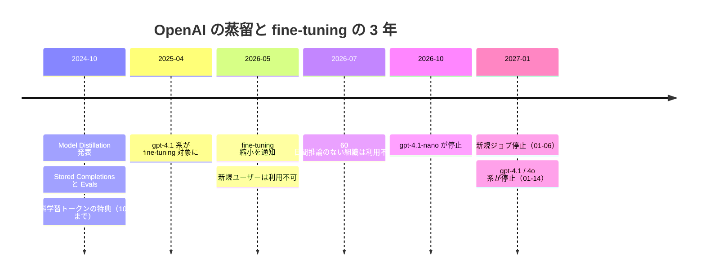

# OpenAI セルフサーブ fine-tuning の縮小（2026-05 通知 → 2027-01-06 新規ジョブ停止）と蒸留の料金

- **Source**: OpenAI（Developer Platform の Deprecations ページ / Supervised fine-tuning ガイド / Pricing ページ）、OpenAI 公式発表（検索スニペット）、OpenAI Developer Community
- **Date**: 2024-10-01（蒸留の発表）、2026-05-07（fine-tuning 縮小の通知）、ページは 2026-10-22 時点
- **Link**:
  - Deprecations（「Update to OpenAI's self-serve fine-tuning」節）: <https://developers.openai.com/api/docs/deprecations>
  - Supervised fine-tuning ガイド（`platform.openai.com/docs/guides/distillation` は `.../supervised-fine-tuning#distilling-from-a-larger-model` へ 301 リダイレクト）: <https://developers.openai.com/api/docs/guides/supervised-fine-tuning>
  - Pricing（fine-tuning の表）: <https://developers.openai.com/api/docs/pricing>
  - 公式発表（**本文は 403。検索スニペットのみ**）: <https://openai.com/index/api-model-distillation/>
  - 無料トークン特典に関するコミュニティスレッド: <https://community.openai.com/t/is-fine-tuning-of-the-gpt-40-mini-model-free-until-october-31st/975672>
- **Type**: Technical Article（公式ドキュメント）
- **取得状況**: Deprecations・SFT ガイド・Pricing は WebFetch で本文を確認（2026-10-22）。`openai.com` 配下（発表記事・旧 pricing ページ）は WebFetch・curl とも 403 のため、検索エンジンのスニペットで一部を補った
- **証拠の質**: **一次資料**（OpenAI 自身のドキュメント）。顧客事例は含まない

## Overview

[05](05-openai-model-distillation.md) では「蒸留ガイドは SFT ガイドに統合された」と記録しました。今回、その SFT ガイドと Deprecations ページを読み直したところ、統合どころか **セルフサーブの fine-tuning 基盤そのものが縮小中** であることが一次資料で確認できました。

- SFT ガイド冒頭: 「OpenAI is winding down the fine-tuning platform.」「The platform is no longer accessible to new users.」
- Deprecations ページ: 「On May 7th, 2026, we notified developers using OpenAI's self-serve fine-tuning platform of updates to availability.」
- 既存の利用者も **2027-01-06 以降は新しい fine-tuning ジョブを作れない**。fine-tune 済みモデルの推論は、ベースモデルが停止するまで使える。

OpenAI の「Model Distillation」は Stored Completions + Evals + fine-tuning の 3 点セットでしたが、最後の 1 つが閉じるため、**OpenAI 上でのマネージド蒸留は 2027 年 1 月で事実上終了** します。Azure の Stored Completions 廃止（2026-10-15、[06](06-azure-openai-foundry-distillation.md)）と合わせると、OpenAI 系の蒸留ワークフローは両方の経路で終わります。

## Key Technical Content

### 縮小のタイムライン（Deprecations ページ）

| 日付 | 内容 |
|------|------|
| 2026-05-07 | 通知。**fine-tuning を一度も実行したことのない組織** は、この日以降ジョブを作れない |
| 2026-07-02 | **過去 60 日間に fine-tune 済みモデルで推論していない組織** は、ジョブを作れなくなる |
| 2026-10-23 | `gpt-4.1-nano-2025-04-14`（と fine-tune 版）、`gpt-4o-2024-05-13` が停止 |
| 2027-01-06 | **アクティブな既存顧客も新規ジョブを作れなくなる** |
| 2027-01-14 | `gpt-4.1-2025-04-14`・`gpt-4.1-mini-2025-04-14`・`gpt-4o-2024-08-06`・`gpt-4o-2024-11-20`・`gpt-4o-mini-2024-07-18`（と fine-tune 版）が停止 |

ページの原文: 「Fine-tuned versions of these models follow the same shutdown schedule as their underlying base models.」「Inference on fine-tuned models will be disabled only when the underlying base model is deprecated.」



### 蒸留の手順（SFT ガイド「Distilling from a larger model」、2026-10-22 時点）

| 手順 | 内容 | 原文 |
|------|------|------|
| 1 | 大きいモデル（`gpt-4.1` など）でプロンプトを調整し、評価基準で高い性能を出す | — |
| 2 | 出力を保存する。Responses API は **既定で 30 日間** 応答を保存 | 「stores model responses for 30 days by default」 |
| 3 | 基準を満たす出力でデータセットを作る | — |
| 4 | 小さいモデル（`gpt-4.1-mini` など）を SFT する | 「This technique can enable you to train a small model to perform similarly on a specific task to a larger, more costly model.」 |

SFT の対応モデル表には `gpt-4.1-2025-04-14` / `gpt-4.1-mini-2025-04-14` / `gpt-4.1-nano-2025-04-14` の 3 つだけが載っています。**ガイド上の教師・生徒の例（gpt-4.1 → gpt-4.1-mini）は、どちらも 2027-01-14 に停止するモデル** です。

### 料金（Pricing ページ、2026-10-22 時点、1M トークンあたり USD）

| モデル | 学習 | 推論 入力 | 推論 出力 | キャッシュ入力 |
|--------|------|----------|----------|--------------|
| gpt-4.1-2025-04-14 | $25.00 | $3.00 | $12.00 | $0.75 |
| gpt-4.1-mini-2025-04-14 | $5.00 | $0.80 | $3.20 | $0.20 |
| gpt-4.1-nano-2025-04-14 | $1.50 | $0.20 | $0.80 | $0.05 |
| gpt-4o-2024-08-06 | $25.00 | $3.75 | $15.00 | $1.875 |
| gpt-4o-mini-2024-07-18 | $3.00 | $0.30 | $1.20 | $0.15 |
| o4-mini-2025-04-16（RFT） | $100.00 / 時間 | $4.00 | $16.00 | $1.00 |

- Batch 推論は入力・出力とも半額（例: gpt-4.1-mini $0.40 / $1.60）
- 「Inference discounts apply if you enable data sharing when creating the fine-tune job」（データ共有を有効にすると推論が割引）
- Stored Completions と Evals の料金は Pricing ページに記載なし

```
蒸留の例 gpt-4.1 → gpt-4.1-mini の推論単価（出力、1M トークン、USD）
gpt-4.1（教師）     |████████████████████████ 12.00
gpt-4.1-mini（生徒）|██████▍ 3.20  （教師の 26.7%）
gpt-4.1-nano        |█▌ 0.80       （教師の 6.7%）
```

$$
\frac{C_{\text{student}}}{C_{\text{teacher}}} = \frac{0.80 + 3.20}{3.00 + 12.00} \approx 0.27 \quad (\text{入力 1 : 出力 1 の場合、gpt-4.1 → gpt-4.1-mini})
$$

### 発表時の特典（2024-10-01、公式発表の検索スニペット + コミュニティ）

- 公式発表のスニペット: 「offering 2M free training tokens per day on GPT‑4o mini and 1M free training tokens per day on GPT‑4o until October 31」（2024 年）
- コミュニティのスレッドでは、無料枠を超えた分は GPT-4o mini で $3.00 / 1M トークンと説明されている
- **本文は 403 で読めていない** ため、特典以外の内容（顧客名の有無など）は未確認のまま

## Practical Takeaways

1. **OpenAI 上の蒸留は「期限付き」になった**: 新規ユーザーは既に使えず、既存ユーザーも 2027-01-06 までに学習を終える必要があります。生徒として使う gpt-4.1-mini 自体が 2027-01-14 に停止するため、蒸留した資産も作り直しになります。
2. **コスト式の $C_{\text{teacher}} - C_{\text{student}}$ は価格表から計算できる**（上式で約 73% 減）。ただし学習費（gpt-4.1-mini で $5.00 / 1M トークン × エポック数）と、保存・評価の運用費は別です。
3. **「ベンダー蒸留」の寿命リスクが数字で示された**: Azure（約 2 年で Stored Completions 廃止）、OpenAI（約 2 年 3 か月で新規ジョブ停止）。C2 の比較表（[index](index.md)）で「2026-10 の状態」を更新しました。
4. **顧客事例は引き続き 0 件**: 今回の一次資料にも顧客名はありません。

## Notes

- `platform.openai.com/docs/guides/distillation` は 2026-10-22 時点で `developers.openai.com/api/docs/guides/supervised-fine-tuning#distilling-from-a-larger-model` に 301 リダイレクトされます（[05](05-openai-model-distillation.md) の記述を裏付け）。
- Deprecations ページは後継モデルとして `gpt-5.6-luna` / `gpt-6-luna` / `gpt-5.6-sol` を挙げていますが、これらが fine-tuning に対応するかの記述はありません。
- 蒸留の分類: 教師出力による SFT（黒箱蒸留）。
