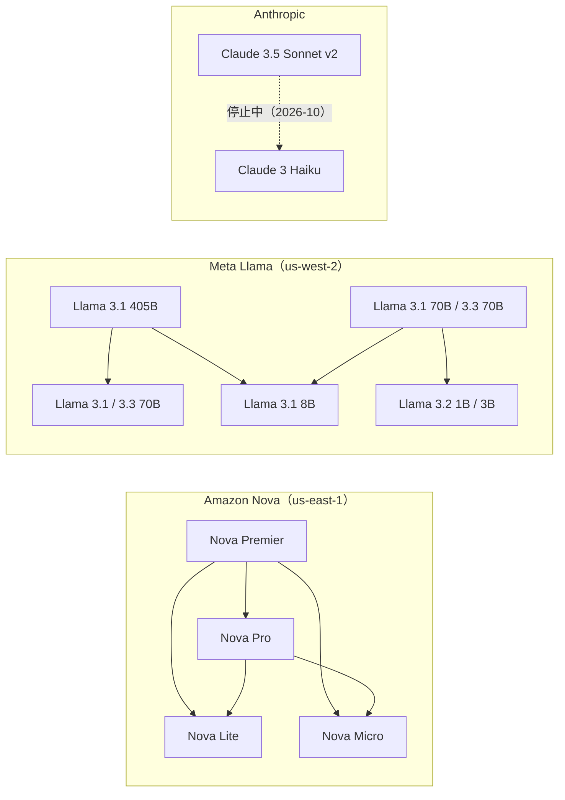

# Amazon Bedrock Model Distillation の 2026-10 時点の対応表 — Anthropic 蒸留の停止・リージョン・課金・国内ハンズオン

- **Source**: AWS（Bedrock ユーザーガイド「Prerequisites for model distillation」/「Prepare your training datasets」/ 価格ページ）、Anthropic 公式ブログ、クラスメソッド DevelopersIO、AWS ブログ（日本）
- **Date**: 2024-12-03（Anthropic ブログ）、2024-12-12 / 12-13 / 2025-05-02（クラスメソッド）、2025-09-04（AWS ブログ日本）、AWS ドキュメントは 2026-10-22 時点
- **Link**:
  - Prerequisites（対応モデルとリージョンの表）: <https://docs.aws.amazon.com/bedrock/latest/userguide/prequisites-model-distillation.html>
  - 学習データの準備: <https://docs.aws.amazon.com/bedrock/latest/userguide/distillation-prepare-datasets.html>
  - 価格ページ（Pricing for model customization）: <https://aws.amazon.com/bedrock/pricing/>
  - Anthropic「Claude 3.5 Haiku on AWS Trainium2 and model distillation in Amazon Bedrock」: <https://claude.com/blog/trainium2-and-distillation>
  - クラスメソッド「Amazon Nova で Bedrock Model Distillation を使ってみた」（2024-12-13）: <https://dev.classmethod.jp/articles/bedrock-model-distillation-basic/>
  - クラスメソッド「Amazon Bedrock Model Distillation が一般提供開始となりました」（2025-05-02）: <https://dev.classmethod.jp/articles/amazon-bedrock-model-distillation-generally-available/>
  - クラスメソッド re:Growth 2024 福岡 登壇記事（2024-12-12）: <https://dev.classmethod.jp/articles/bedrock-model-distillation-re-growth-2024-awsreinvent-regrowth-fukuoka>
  - AWS ブログ（日本）「第 4 回 AWS ジャパン 生成 AI Frontier Meetup」（2025-09-04）: <https://aws.amazon.com/jp/blogs/news/4th-gen-ai-frontier-meet-up>
  - AWS ML Blog「A guide to Amazon Bedrock Model Distillation (preview)」（2024-12-04）: <https://aws.amazon.com/blogs/machine-learning/a-guide-to-amazon-bedrock-model-distillation-preview>
- **Type**: Technical Article（公式ドキュメント + 国内ハンズオン）
- **取得状況**: 上記はすべて WebFetch または curl で本文を確認（2026-10-22）。Nova ユーザーガイドの蒸留ページ（`docs.aws.amazon.com/nova/.../customize-distill.html`）は JavaScript 描画のため本文を取得できず
- **証拠の質**: AWS ドキュメントと Anthropic ブログは **一次資料（ベンダー）**。クラスメソッドは **第三者のハンズオン**（成果の数値なし）

## Overview

[01](01-bedrock-model-distillation-service.md) は GA 発表（2025-05）時点の対応モデルを記録していました。2026-10-22 時点のユーザーガイドを読むと、対応表が大きく変わっています。

> **Important**: Distillation is not currently available for Anthropic models on Amazon Bedrock. There is no confirmed timeline for when Anthropic distillation will be restored.

つまり、GA で追加された **Claude 3.5 Sonnet v2 → Claude 3 Haiku の蒸留は現在使えません**（復旧時期も未定）。Anthropic 自身が 2024-12-03 に「Distillation for Claude 3 Haiku in Amazon Bedrock is now available in preview」と発表し、「Claude 3.5 Sonnet-like accuracy for specific tasks」「at the same price and speed of our most cost-effective model」と説明した機能です。停止の理由と時期は、AWS・Anthropic のどちらの資料にも書かれていません（検索でも見つからず）。

現在の対応は **Amazon Nova（バージニア北部）と Meta Llama（オレゴン）だけ** で、**東京リージョンでは蒸留ジョブを実行できません**。

## Key Technical Content

### 表 1: 対応する教師・生徒・リージョン（ユーザーガイド、2026-10-22 時点）

| 提供元 | 教師 | 推論プロファイル | 生徒 | ジョブのリージョン |
|--------|------|----------------|------|------------------|
| Amazon | Nova Pro（`amazon.nova-pro-v1:0`） | Both | Nova Lite / Nova Micro | US East (N. Virginia) |
| Amazon | Nova Premier（`amazon.nova-premier-v1:0`） | Inference profile only | Nova Lite / Nova Micro / Nova Pro | US East (N. Virginia) |
| Meta | Llama 3.1 405B | On demand | Llama 3.1 8B / 3.1 70B / 3.2 1B / 3.3 70B | US West (Oregon) |
| Meta | Llama 3.1 70B | Both | Llama 3.1 8B / 3.2 1B / 3.2 3B | US West (Oregon) |
| Meta | Llama 3.3 70B | Inference profile only | Llama 3.1 8B / 3.2 1B / 3.2 3B | US West (Oregon) |
| Anthropic | **（停止中）** | — | — | — |

注記（原文）: 「For Claude and Llama models, the distillation job is run in US West (Oregon). You can either buy provisioned throughput in US West (Oregon) or copy distilled model to another Region and then buy provisioned throughput.」— Claude の記述が残っていることから、停止は比較的最近と推測できますが、時期は未確認です。

### 表 2: 対応表の変遷

| 時点 | Amazon | Anthropic | Meta | 出典 |
|------|--------|-----------|------|------|
| 2024-12 プレビュー | Nova Pro → Micro / Lite（クラスメソッドの画面） | Claude 3.5 Sonnet → Claude 3 Haiku（プレビュー） | Llama 3.1 405B / 70B → 70B / 8B | [01](01-bedrock-model-distillation-service.md)、Anthropic ブログ、クラスメソッド |
| 2025-05 GA | Nova Premier → Pro / Lite / Micro を追加 | Claude 3.5 Sonnet v2 → Claude 3 Haiku | Llama 3.3 70B → 3.2 1B / 3B を追加 | GA 発表、クラスメソッド |
| 2026-10-22 | Nova Pro / Premier → Lite / Micro / Pro | **停止中・復旧未定** | 3.1 405B / 3.1 70B / 3.3 70B → 8B / 1B / 3B / 70B | ユーザーガイド |

### 表 3: データと課金の制約（ユーザーガイド・価格ページ・ハンズオン）

| 項目 | 内容 | 出典 |
|------|------|------|
| 入力形式 | `.jsonl`、`schemaVersion: bedrock-conversation-2024`。**text-to-text のみ** | 学習データの準備 |
| マルチターン | Amazon Nova のみ対応。Anthropic / Meta は単一ターン | AWS ML Blog（2024-12-04）、クラスメソッド |
| 最小件数 | ユーザーガイド本文には記載なし。クラスメソッドのハンズオンは「100 個以上」が必要と記載（コンソールの制約と推測） | クラスメソッド（2024-12-13） |
| 合成データの上限 | 「a maximum of 15k prompt-response pairs」 | ユーザーガイド |
| 教師推論の追加課金 | 独自のデータ合成を使うと「additional charges for inference calls to the teacher model」「billed at the on-demand inference rates of the teacher model」 | ユーザーガイド |
| 推論の課金 | 「For custom models developed with parameter-efficient training techniques (available for Fine-Tuning, Preference Optimization and Distillation), customers may choose between Provisioned Throughput (PT) or On Demand (OD)」「The prices are the same for custom models as base models」 | 価格ページ |
| Nova の学習単価 | 価格ページでは JavaScript で動的に描画され、本調査では **数値を取得できず** | 価格ページ |
| データの利用 | 「Only you can access the final distilled model. Amazon Bedrock doesn't use your data to train any other teacher or student model for public use」 | ユーザーガイド |
| 所要時間 | 100 件の学習で 1〜2 時間（ハンズオン）。10,000 件・Nova Micro で「数時間」（[03](03-bedrock-nova-video-search-distillation.md)） | クラスメソッド、AWS ML Blog |
| プレビュー時の推論 | Provisioned Throughput が必須、最小課金単位 1 時間 | クラスメソッド |

### 国内の資料で確認できたこと

| 資料 | 日付 | 内容 | 顧客事例 |
|------|------|------|---------|
| クラスメソッド（森田力）プレビュー解説 | 2024-12-03 頃 | 発表の紹介 | なし |
| クラスメソッド re:Growth 2024 福岡 登壇 | 2024-12-12 | 「新機能 Bedrock Model Distillation 基礎〜実践まで」。記事にスライドの内容はなし | なし |
| クラスメソッド ハンズオン | 2024-12-13 | 教師 Nova Pro → 生徒 Nova Micro / Lite。**データ形式で「結構ハマりました」**（`schemaVersion`、マルチターンは Nova のみ）。精度の記載なし | なし |
| クラスメソッド GA 解説 | 2025-05-02 | GA で追加された組合せ、ジョブステータス表示。「蒸留ジョブ実行は、時間がかかり、エラーも起こりやすいため、嬉しいアップデートですね」 | なし |
| AWS ブログ（日本）生成 AI Frontier Meetup | 2025-09-04 | AWS ジャパン 金杉有見子氏が Nova について「継続事前学習、ファインチューニング、アラインメント、蒸留といった多様な手法に対応し」と紹介 | なし |
| @IT（三木泉） | 2025-01-14 | Micro / Lite を生徒、Pro / Premier を教師とする位置づけ（[01](01-bedrock-model-distillation-service.md)） | なし |
| EnterpriseZine（news/detail/21352） | 不明 | 検索スニペットでは「AWS ジャパン」を出典に「コストを 75% 削減できる可能性」。**本文は bot 対策で取得できず** | 不明 |

Zenn / Qiita / note での「試してみた」記事は、2 回の検索では見つかりませんでした。clustering の調査戦略にあった「コスト面から蒸留への需要が高まる（AWS ジャパン）」という発言の出典は、本調査では特定できていません。

## Practical Takeaways

1. **東京リージョンでは蒸留ジョブを実行できない**（Nova は us-east-1、Llama は us-west-2）。国内の規制業種で「データを国内に置く」要件がある場合、本機能はそのままでは使えません。蒸留済みモデルを他リージョンにコピーして PT を買う手順は案内されています。
2. **Claude の蒸留は現在できない**。GA 時の目玉だった Claude 3.5 Sonnet v2 → Claude 3 Haiku は停止中で、復旧時期は未定です。Claude を使う場合の選択肢は、Haiku 系をそのまま使う（[03](03-bedrock-nova-video-search-distillation.md) では Haiku 4.5 が比較対象）か、Nova / Llama へ乗り換えて蒸留するかになります。
3. **「最大 75% 安価」の根拠となる学習単価は、価格ページから機械的に読めない**。稟議では AWS Pricing Calculator かコンソールで確認する必要があります。
4. **国内の資料はハンズオンと公式イベントのみ**で、成果の数値を伴う顧客事例はありませんでした（仮説 H4 を支持）。

## Notes

- Anthropic ブログ（2024-12-03）は、同時に Claude 3.5 Haiku の latency-optimized inference（Trainium2、「up to 60% faster」、$1 / $5 per 1M tokens）を発表しています。これは蒸留ではなく推論の高速化です（[index](index.md) の「蒸留かどうかの区別」に追加）。
- AWS ML Blog のプレビュー解説（2024-12-04、Yanyan Zhang ほか）には顧客名も精度の数値もありません。
- 関連: [01](01-bedrock-model-distillation-service.md)（GA 時点の仕組み）、[04](04-bedrock-named-customers-audit.md) と [14](14-customer-cases-expanded-audit.md)（顧客名の検証）。
