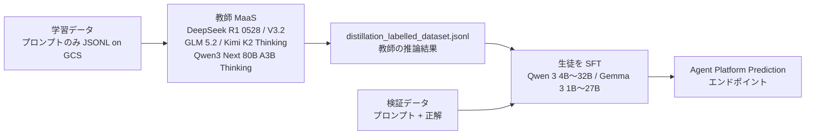

# Google Cloud（Gemini Enterprise Agent Platform / 旧 Vertex AI）のオープンモデル向け「distillation fine-tuning」 — Gemini 蒸留サービスの代わりに公開されている蒸留機能

- **Source**: Google Cloud Documentation（「Supervised and distillation fine-tuning for open models」/ Model tuning 一覧 / Agent Platform Pricing / リリースノート）
- **Date**: ページは 2026-10-22 時点（リリースノートでは 2025-08-07 にオープンモデルの SFT が追加。蒸留の追加日はリリースノートに見当たらず）
- **Link**:
  - Supervised and distillation fine-tuning for open models: <https://docs.cloud.google.com/gemini-enterprise-agent-platform/models/tuning/open-model-tuning>
  - Model tuning 一覧（Tune Gemini models）: <https://docs.cloud.google.com/vertex-ai/generative-ai/docs/models/tune-models>
  - Agent Platform Pricing（Model Tuning の表）: <https://docs.cloud.google.com/vertex-ai/generative-ai/pricing>
  - リリースノート: <https://docs.cloud.google.com/vertex-ai/generative-ai/docs/release-notes>
  - Gemini Distillation Service（**引き続き 404**）: <https://docs.cloud.google.com/vertex-ai/generative-ai/docs/models/tuning/distillation>
- **Type**: Technical Article（公式ドキュメント）
- **取得状況**: 上記 4 ページは WebFetch と curl で本文を確認（2026-10-22）。Gemini Distillation Service のページは 404 のまま。Wayback Machine は本環境から取得不可
- **証拠の質**: **一次資料**（Google のドキュメント）。顧客事例は含まない

## Overview

[10](10-google-vertex-snorkel-distillation.md) では「Gemini Distillation Service の公式ページは 404」とだけ記録していました。今回、Model tuning の目次にある「Open models: Supervised and distillation fine-tuning」を読んだところ、**Google Cloud には公開ドキュメント付きの蒸留機能が 1 つある** ことがわかりました。ただし対象は Gemini ではなく **オープンモデル**（生徒: Qwen 3 / Gemma 3、教師: DeepSeek / GLM / Kimi / Qwen の MaaS モデル）です。

原文: 「Distillation lets you tune a smaller student model using the outputs of a larger teacher model.」「Distillation fine-tuning uses the GenAI SDK, where you specify a teacher model to generate responses that are then used to tune a smaller student model.」

方式は Bedrock・OpenAI と同じ **教師出力による SFT（黒箱蒸留）** です。学習データはプロンプトだけでよく（教師が応答を生成）、検証データには正解が必要です。



## Key Technical Content

### 表 1: 対応モデル（ドキュメント、2026-10-22 時点）

| 役割 | モデル |
|------|--------|
| 教師（MaaS） | DeepSeek R1 0528、DeepSeek V3.2、GLM 5.2、Kimi K2 Thinking、Qwen 3 Next 80B A3B Thinking |
| 生徒 | Qwen 3 4B / 8B / 14B / 32B、Gemma 3 1B IT / 4B IT / 12B IT / 27B IT |

- **Gemini は教師にも生徒にも含まれない**。Gemini を教師にする「Gemini Distillation Service」は、二次報道（RuntimeWire、[10](10-google-vertex-snorkel-distillation.md)）にある allowlist 制の早期アクセスのままで、公開ドキュメントはない
- 教師は Google 以外（DeepSeek・智譜・Moonshot・Alibaba）のオープンモデルで、**自社モデルに閉じない点が Bedrock / OpenAI と異なる**（ただし教師の利用規約は各モデルの提供元に従う。C8 で確認）

### 表 2: 推奨用途（ドキュメントの記述）

| 蒸留が効く | 蒸留の効果が小さい |
|-----------|------------------|
| 数学・定量的推論 | 生徒が既に教師に近い性能のタスク |
| 科学・医療などの段階的推論が要る QA | 教師の推論トレースが価値を生まない短文の検索タスク |
| 「thinking」や chain-of-thought で教師が一貫して高品質な応答を出すタスク | — |

原文: 「Distillation fine-tuning is most effective when the teacher model is substantially more capable than the student on the target task.」

### 表 3: 制約と課金

| 項目 | 内容 | 原文 / 出典 |
|------|------|-----------|
| 学習データ | プロンプトのみで可（教師が応答を生成） | 「the training dataset can contain prompts only — the teacher model generates the completions」 |
| 検証データ | プロンプト + 正解が必要 | 「the validation dataset must contain both prompts and ground-truth completions」 |
| リージョン | global エンドポイントを「strongly recommended」。リージョン指定は us-central1 / europe-west4 / us-west1 / us-east5 / asia-southeast1 / asia-southeast2。**東京（asia-northeast1）は非対応** | open-model-tuning |
| 課金 | 学習トークン × エポック + **教師への API 呼び出し**（MaaS の料金）+ Cloud Storage + Prediction | 「For distillation tuning, you are also billed for the API calls made to the teacher model to generate responses」 |
| クォータ | 教師の呼び出しはプロジェクトの共有クォータを消費 | 「it consumes from the project's shared quota for that model」 |
| 出力 | `distillation_labelled_dataset.jsonl`（教師の推論結果）が出力ディレクトリに保存される | open-model-tuning |
| GA / Preview | ページに記載なし | — |

### 表 4: Model Tuning の料金（Agent Platform Pricing、2026-10-22 時点、USD）

| モデル | 種別 | 価格 |
|--------|------|------|
| Gemini 3.5 Flash Lite / 3.1 Flash Lite | SFT | $0.003 / 1,000 トークン |
| Gemini 3.5 Flash | SFT・RL fine-tuning | $0.01 / 1,000 トークン |
| Gemini 2.5 Pro | SFT | $0.025 / 1,000 トークン |
| Gemini 2.5 Flash | SFT・Preference tuning | $0.005 / 1,000 トークン |
| Gemini 2.5 Flash Lite | SFT・Preference tuning | $0.0015 / 1,000 トークン |
| Gemma 3 1B / 4B / 12B / 27B IT | SFT | $0.47 / $1.14 / $1.82 / $6.83 per 1M トークン |
| Qwen 3 4B / 8B / 14B / 32B | SFT | $1.35 / $4.18 / $8.46 / $6.57 per 1M トークン |
| Llama 3.1 8B / 3.2 1B / 3.2 3B / 3.3 70B | SFT | $0.67 / $0.28 / $0.61 / $6.72 per 1M トークン |

- 「Training tokens are calculated by the total number of tokens in your training dataset, multiplied by your number of epochs.」
- **「For model inference starting from Gemini 3, tuned model endpoint prediction price will be 1.5 times of the base model. Old Gemini models prediction price stays the same as the base model.」** — Gemini 3 以降は、チューニング済みモデルの推論単価がベースの 1.5 倍。蒸留で推論コストを下げる計算に直接効く条件
- 蒸留固有の価格項目はなく、教師の MaaS 料金が上乗せされる

```
生徒の SFT 単価（1M トークン、USD）
Gemma 3 1B  |▍ 0.47
Llama 3.2 1B|▎ 0.28
Qwen 3 4B   |█▍ 1.35
Gemma 3 4B  |█▏ 1.14
Qwen 3 8B   |████▏ 4.18
Gemma 3 27B |██████▊ 6.83
Qwen 3 32B  |██████▌ 6.57
Llama 3.3 70B|██████▋ 6.72
```

## Practical Takeaways

1. **Google の「蒸留」は 2 本立て**: (a) 公開済みのオープンモデル向け distillation fine-tuning、(b) 非公開（allowlist）の Gemini Distillation Service。本番で使えるのは (a) だけで、Gemini を小型化したい場合の公式ルートは 2026-10 時点で存在しません。
2. **教師がベンダー外のモデルでもよい**のは、Bedrock（同一ファミリー）・OpenAI / Azure（自社モデル）との最大の違いです。一方で、教師の推論費が別建てで乗る点は Bedrock の「独自のデータ合成」と同じ構造です。
3. **Gemini 3 以降のチューニング済みモデルは推論が 1.5 倍**。「小さい Gemini に SFT する」場合、価格差がベースモデル比で縮むため、価値式の $C_{\text{teacher}} - C_{\text{student}}$ はベース価格表だけでは計算できません。
4. 東京リージョンは非対応（global 推奨）。データレジデンシー要件がある場合は、Bedrock と同様に制約になります。

## Notes

- リリースノート（2026-10-22 時点、2024-07 以降）には「distillation」を含む項目が **Llama 3.1 405B の紹介文（2024-07-23、「synthetic data generation to model distillation」）しかなく**、distillation fine-tuning の追加日は特定できませんでした。
- Vertex AI の名称は Gemini Enterprise Agent Platform に変わっています（ドキュメントのバナー）。URL は旧パスからリダイレクトされます。
- 顧客事例: このページにも、Google Cloud の顧客事例ページの検索でも、Gemini / オープンモデルの蒸留を本番利用した顧客名は見つかりませんでした。
- 関連: [10](10-google-vertex-snorkel-distillation.md)（PaLM 時代の蒸留と Snorkel の事例）。
