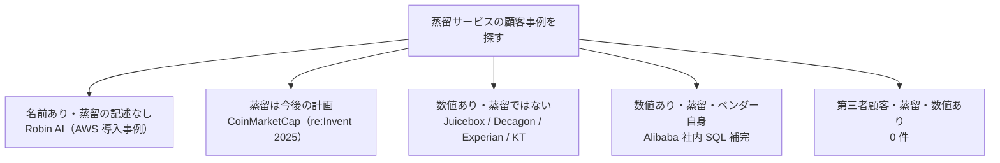

# 商用蒸留サービスの「顧客事例」を横断で検証する（2026-10-22 追加調査） — AWS / Azure / Google / NVIDIA / 独立系 / 国内

- **Company/Organization**: Robin AI（AWS 導入事例）、CoinMarketCap（re:Invent 2025 AIM391）、Juicebox（Fireworks、二次）、Decagon（Together、二次）、Experian（Databricks）、KT / JD / UF Health（NVIDIA）、クラスメソッド・AWS ジャパン（国内）
- **Industry**: 法務 / 暗号資産 / 採用 / カスタマーサポート / 与信 / 通信 ほか
- **Date**: 2024-08 〜 2025-12（各資料）
- **Link**（取得して確認したもの）:
  - AWS 導入事例「Robin AI」: <https://aws.amazon.com/solutions/case-studies/robin-ai-bedrock/>
  - Zenn（kiiwami）「re:Invent 2025: Mastering Model Choice with Amazon Bedrock's 3-Step Strategy and CoinMarketCap's Large-Scale Case Study」（AIM391 の要約）: <https://zenn.dev/kiiwami/articles/b2b6e155f6778173>
  - Fireworks AI Docs「Knowledge distillation」: <https://docs.fireworks.ai/examples/knowledge-distillation>
  - Anthropic「Claude 3.5 Haiku on AWS Trainium2 and model distillation in Amazon Bedrock」: <https://claude.com/blog/trainium2-and-distillation>
- **Link**（検索結果の要約だけで、本文は未取得）:
  - Fireworks の成長記事（Juicebox の AI 支出 $4M → $800K）: <https://www.startupriders.com/p/fireworks-ai-growth-playbook>
  - Databricks Mosaic AI Model Training（Experian の声）: <https://www.databricks.com/fr/blog/introducing-mosaic-ai-model-training-fine-tuning-genai-models>
  - NVIDIA「Generative AI in Practice」（KT / JD / UF Health）: <https://www.nvidia.com/en-us/data-center/generative-ai-in-practice/>
  - Predibase「12 Best Practices for Distilling Small LMs from GPT」（rubrik.com へ移転、**403**）: <https://www.rubrik.com/blog/ai/24/graduate-from-openai-to-open-source-12-best-practices-for-distilling-smaller>
- **Type**: Business Case（顧客の主張の検証）
- **取得状況**: 上記のとおり。検索は 22 回（本クラスタの再調査全体）
- **証拠の質**: 各表に明記（一次 / ベンダー / 二次）

## Overview

[04](04-bedrock-named-customers-audit.md) は Bedrock の発表資料に出た顧客名を検証しました。本レポートは、その範囲を **AWS の導入事例ページ・re:Invent 2025・Azure・Google・NVIDIA・独立系（Fireworks / Together / Predibase / Databricks / Snorkel / Arcee）・国内** に広げ、「蒸留を本番で使い、成果の数値を公開した顧客」を探した結果です。

結論は [04](04-bedrock-named-customers-audit.md) と同じです。**第三者の顧客が蒸留の成果を数値で公開した例は、今回も 0 件** でした。見つかったのは次の 3 種類だけです。

1. 名前は出るが **蒸留の記述がない**（Robin AI の AWS 導入事例）
2. 蒸留を **「今後の計画」として挙げた**（CoinMarketCap、re:Invent 2025）
3. コスト削減の数値はあるが **蒸留ではなく fine-tuning / モデル乗り換え**（Juicebox、Decagon、Experian、KT など）

## Problem & Context

前回の gather で「名前の出た Bedrock 蒸留の顧客は Robin AI だけ」と整理したうえで、残っていた疑問は次の 3 つでした。

- Robin AI は、その後どこかで蒸留の数値を話していないか
- re:Invent 2025 や Azure / Google / NVIDIA / 独立系に、蒸留の顧客事例はないか
- 国内の顧客事例、または「蒸留の需要」に関する AWS ジャパンの発言の出典は何か

## Solution（照合の結果）

### 表 1: 顧客名と「蒸留かどうか」の照合

| 顧客 | ベンダー | 資料に書かれた内容 | 蒸留か | 数値 | 証拠の質 | 出典 |
|------|---------|-----------------|-------|------|---------|------|
| Robin AI | AWS | Claude 3 を Bedrock 経由で利用。「process hundreds of pages of contracts in just a few seconds」（CTO James Clough） | **記述なし**（蒸留・Haiku・fine-tuning のいずれも出てこない） | なし | ベンダー（AWS 導入事例、日付の記載なし） | AWS 導入事例 |
| Robin AI | AWS | re:Invent 2024 プレスリリース「蒸留の顧客」 | 蒸留（とされる） | なし | ベンダー | [04](04-bedrock-named-customers-audit.md) |
| CoinMarketCap（Bryan Koh） | AWS | 毎日 100 億以上の LLM トークンを消費。2025 年の計画の「2 つ目は、Amazon Bedrock で利用可能なモデル蒸留です」 | **計画**（実施ではない） | 蒸留の数値なし | 二次（Zenn の要約、2025-12-03 公開） | Zenn |
| 無名の金融犯罪調査の顧客（John Liu の説明） | AWS | 「80% のコスト削減」、5 億 → 50 億リクエスト | **不明**（蒸留とは書かれていない。推論ティアとルーティングの文脈） | 80% | 二次 | Zenn |
| Juicebox | Fireworks | 「went from spending $4M a year on AI to $800K after switching to models tuned for its use case」 | **fine-tuning / 乗り換え**（蒸留の記述なし） | $4M → $800K | 二次（成長記事） | 検索結果のみ |
| Decagon | Together AI | 推論コストを 6 分の 1 に | **乗り換え**（蒸留の記述なし） | 6 倍 | 二次 | 検索結果のみ |
| Experian | Databricks | 「the fine-tuned model outperforms commercial models for our use cases, and costs us significantly less to operate」 | **fine-tuning** | なし | ベンダー（顧客の声） | 検索結果のみ |
| KT / JD / UF Health | NVIDIA NeMo | 学習・合成データ生成 | **蒸留ではない** | KT「2X faster training」（二次） | ベンダー | 検索結果のみ |
| Wayfair | Snorkel / Google | 商品タグ付けで F1 +20 ポイント | 不明 | +20 | ベンダー | [10](10-google-vertex-snorkel-distillation.md) |
| Alibaba 社内 | Alibaba PAI | SQL 補完の A/B テスト | **蒸留** | 384 → 148 ms、採用率 -1.0 pt | 一次（ベンダー自身の論文） | [08](08-distilqwen25-alibaba-pai.md) |



### 表 2: ベンダーごとの「蒸留の顧客事例」の有無（2026-10-22 時点）

| ベンダー | 公式の顧客事例ページでの蒸留事例 | ブログ・セッションでの顧客名 | 顧客の成果数値 |
|---------|------------------------------|--------------------------|--------------|
| AWS（Bedrock） | 導入事例ページに蒸留の記述なし（Robin AI を含む） | Robin AI（2024-12、数値なし）、CoinMarketCap（計画） | なし |
| Microsoft（Azure OpenAI / Foundry） | 検索で見つからず（製品ブログ 8 本に顧客名なし） | なし | なし |
| Google（Vertex / Agent Platform） | 見つからず | Wayfair（Snorkel 経由、蒸留かどうか不明） | F1 +20（蒸留かどうか不明） |
| NVIDIA（NeMo） | NeMo 全般の事例のみ（KT / JD / UF Health、蒸留ではない） | なし | なし |
| Fireworks | チュートリアル（DeepSeek-V3 → Qwen2.5-7B、GSM8K 52% → 70%、SFT + RFT） | Juicebox（二次、蒸留とは書かれていない） | なし |
| Together | 蒸留の専用機能なし | Decagon（二次、乗り換え） | なし |
| Predibase（Rubrik） | 蒸留のベストプラクティス記事（Jigsaw の検証、403 で未読） | なし | なし |
| Databricks | fine-tuning の顧客の声 | Experian / Celebal | なし |
| Snorkel / Arcee | 「First cohort … gains up to 54 points」（検索結果のみ、URL 未特定） | なし | 不明 |
| Alibaba PAI | 自社論文 | 社内 | あり（A/B テスト） |

```
蒸留の顧客事例（第三者・本番・数値あり）の件数
AWS       |  0
Azure     |  0
Google    |  0
NVIDIA    |  0
独立系     |  0
Alibaba   |█ 1（ベンダー自身の社内）
```

### Fireworks のチュートリアルの数値（ベンダー、参考）

| 項目 | 値 |
|------|----|
| 教師 / 生徒 | DeepSeek-V3（671B、37B active）/ Qwen2.5-7B |
| データ | GSM8K 学習 7,473 問から 6,000 問を抽出。教師の正答 5,700 件を採用（「5700/6000」） |
| 方式 | 段階 1: 教師出力で SFT（3 エポック、lr 1e-5）。段階 2: 正誤報酬で RFT |
| 結果 | ベース 52% → RFT 後 **70%**（「+18 percentage point improvement」）。書式遵守 約 95% |
| コスト・レイテンシ | 記載なし |

### 国内の資料

| 資料 | 日付 | 蒸留の記述 | 顧客事例 |
|------|------|-----------|---------|
| クラスメソッド（3 記事） | 2024-12 〜 2025-05 | ハンズオンと GA 解説（[12](12-bedrock-distillation-support-matrix-2026.md)） | なし |
| AWS ブログ（日本）生成 AI Frontier Meetup | 2025-09-04 | 金杉氏「継続事前学習、ファインチューニング、アラインメント、蒸留といった多様な手法に対応し」 | なし |
| AWS ブログ（日本）週刊生成 AI（2025-09-15、2025-10-27） | 2025 | 本文の取得範囲に「蒸留」の記述なし | なし |
| @IT | 2025-01-14 | Nova の教師・生徒の位置づけ | なし |
| EnterpriseZine | 不明 | スニペットのみ（「75% 削減」、出典 AWS ジャパン）。本文 403 | 不明 |
| Zenn / Qiita / note | — | OpenAI / Azure / Bedrock の蒸留の「試してみた」は 3 回の検索で 0 件 | なし |

## Results & Impact

- **仮説 H2（ベンダー集計のみで顧客別成果は非公開）**: 範囲を広げても結論は変わらず、**強く支持**。
- **仮説 H3（「90% 削減」の多くは蒸留ではない）**: Juicebox / Decagon / Experian / AFX が追加の例。コスト削減の見出しの多くは fine-tuning か乗り換えでした。
- **仮説 H4（国内は事例が少ない）**: 国内の顧客事例は引き続き 0 件。資料はハンズオンと公式イベント報告のみ。
- Robin AI については、**AWS 自身の導入事例ページに蒸留の記述がない** ため、「蒸留の顧客」という根拠は re:Invent 2024 のプレスリリース 1 本だけに依存しています。

## Lessons Learned

1. **「導入事例ページ」と「発表のプレスリリース」は別物**: 顧客名が発表に出ても、導入事例ページに同じ機能が書かれているとは限りません。
2. **re:Invent のセッションでは「今後使う」と「使った」を区別する**: CoinMarketCap は蒸留を 2025 年の計画として挙げていました。
3. **独立系の「コスト削減」は fine-tuning / 乗り換えの数値**: 蒸留（教師から学ぶ工程）が明記された顧客事例は、独立系にもありませんでした。
4. **検索語の罠**: 日本語の「蒸留」は化学プラントの事例が大量に混ざるため、「知識蒸留」「モデル蒸留」「LLM」を併記する必要があります。

## Notes

- 未取得: Predibase（rubrik.com、403）、EnterpriseZine（bot 対策）、Snorkel「54 points」記事（URL 未特定）、AIM391 の動画本体（Zenn の要約で代替）。
- 関連: [04](04-bedrock-named-customers-audit.md)（re:Invent 2024 の顧客名）、[12](12-bedrock-distillation-support-matrix-2026.md)（国内ハンズオンの詳細）。
