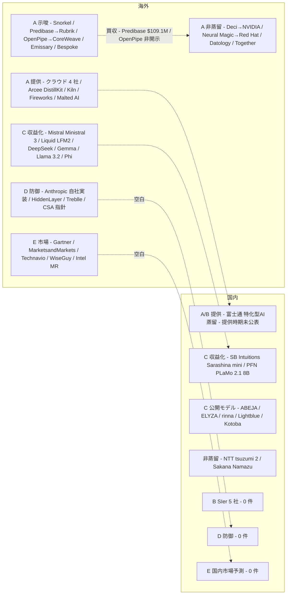
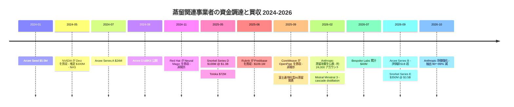

# LLM 蒸留を事業に組み込む企業の全体像（2026-10-22 追加調査） — 海外 vs 国内

- **Company/Organization**: 海外 26 社（Arcee AI / Snorkel AI / Predibase（Rubrik）/ OpenPipe（CoreWeave）/ Fireworks AI / Together AI / Kiln / Bespoke Labs / Malted AI / Emissary / Prime Intellect / Datology / Toloka / Scale AI / Deci（NVIDIA）/ Neural Magic（Red Hat）/ Nexa AI（Qualcomm AI Hub）/ Mistral AI / Liquid AI / Hugging Face / Anthropic / HiddenLayer / Treblle / Mindgard / Google ほか）、国内 18 社（富士通 / NTT / SB Intuitions / Sakana AI / PFN / ABEJA / ELYZA / rinna / Lightblue / サイバーエージェント / Kotoba Technologies / NEC / NTT データ / 日立 / 野村総合研究所 / アクセンチュア / クラスメソッド / 東芝）
- **Industry**: AI プラットフォーム / クラウド / モデル開発 / AI セキュリティ / 調査会社 / SIer
- **Date**: 2023-10 〜 2026-10（取得日 2026-10-22）
- **Link**（本文を取得して確認したもの）:
  - Rubrik 10-Q（Predibase 買収の対価）: <https://www.sec.gov/Archives/edgar/data/1943896/000194389625000042/rbrk-20250731.htm>
  - pulse2「CoreWeave To Buy OpenPipe」: <https://pulse2.com/coreweave-to-buy-openpipe-for-reinforcement-learning-platform>
  - Arcee AI ブログ一覧 / Series B 発表: <https://www.arcee.ai/blog> / <https://www.arcee.ai/blog/arcee-ai-raises-series-b-to-build-the-future-of-american-open-models>
  - Arcee DistillKit（GitHub）: <https://github.com/arcee-ai/DistillKit>
  - Snorkel AI プレス（Series E）: <https://snorkel.ai/press/snorkel-ai-valued-at-3-5-billion-amid-surging-demand-for-complex-ai-training-data/>
  - Snorkel AI「Two approaches to distill LLMs for better enterprise value」: <https://snorkel.ai/?p=13335>
  - Kiln Docs「Train a reasoning model」: <https://docs.kiln.tech/docs/guide-train-a-reasoning-model>
  - Bespoke-Stratos-32B モデルカード: <https://huggingface.co/bespokelabs/Bespoke-Stratos-32B>
  - Bespoke Curator（GitHub）: <https://github.com/bespokelabsai/curator>
  - Malted AI: <https://malted.ai/> / Hoxton Ventures: <https://hoxtonventures.com/portfolio/malted-ai/>
  - Emissary: <https://withemissary.com/>
  - Prime Intellect「SYNTHETIC-1」: <https://www.primeintellect.ai/blog/synthetic-1>
  - Datology: <https://www.datologyai.com/>
  - Together AI Fine-tuning: <https://www.together.ai/fine-tuning>
  - Constellation Research「Red Hat acquires Neural Magic」: <https://www.constellationr.com/insights/news/red-hat-acquires-neural-magic>
  - ATS「Nvidia to Acquire Deci for $300 Million」: <https://ats.org/ats-news/nvidia-to-acquire-deci-for-300-million/>
  - Qualcomm AI Hub（nexa.ai のリダイレクト先）: <https://aihub.qualcomm.com/genai>
  - The Batch「Mistral uses cascade distillation on Mistral 3 to build Ministral family」: <https://www.deeplearning.ai/the-batch/mistral-uses-cascade-distillation-on-mistral-3-to-build-ministral-family>
  - Liquid AI「LFM2」: <https://www.liquid.ai/blog/liquid-foundation-models-v2-our-second-series-of-generative-ai-models>
  - Hugging Face「SmolLM3」: <https://huggingface.co/blog/smollm3>
  - Anthropic「Detecting and preventing distillation attacks」: <https://www.anthropic.com/news/detecting-and-preventing-distillation-attacks>
  - Anthropic「Strengthening our defenses against distillation attacks」: <https://www.anthropic.com/research/distillation-defenses>
  - Cloud Security Alliance Research Note（2026-03-08）: <https://labs.cloudsecurityalliance.org/research/csa-research-note-llm-model-extraction-cloud-scale-20260308/>
  - HiddenLayer AISec Platform: <https://hiddenlayer.com/aisec-platform/>
  - Treblle ブログ（2026-02-24）: <https://treblle.com/blog/anthropic-distillation-breach-breakdown>
  - Mindgard: <https://mindgard.ai/>
  - Google DeepMind SynthID: <https://deepmind.google/technologies/synthid/>
  - MarketsandMarkets SLM 市場（PR Newswire 2025-03-26）: <https://prnewswire.co.uk/news-releases/small-language-model-slm-market-worth-5-45-billion-by-2032--exclusive-report-by-marketsandmarkets-302411715.html>
  - Technavio SLM 市場（@Press 2025-09-22）: <https://www.atpress.ne.jp/news/5317687>
  - WiseGuy Reports「Large Model Knowledge Distillation Solution Market」: <https://www.wiseguyreports.com/reports/large-model-knowledge-distillation-solution-market>
  - Intel Market Research「Large Model Knowledge Distillation Solution Market」: <https://www.intelmarketresearch.com/large-model-knowledge-distillation-solution-market-25844>
  - マイナビニュース「富士通 生成AI再構成技術」: <https://news.mynavi.jp/techplus/article/20250908-3442664/>
  - NTT「tsuzumi 2 Updated」（2026-05-19）: <https://group.ntt/en/newsrelease/2026/05/19/260519a.html>
  - ビジネス+IT「Sakana Namazu」: <https://www.sbbit.jp/article/cont1/186402>
- **Link**（検索結果の要約だけで本文は未取得、または取得失敗）:
  - Gartner プレスリリース（2025-04-09、403）: <https://www.gartner.com/en/newsroom/press-releases/2025-04-09-gartner-predicts-by-2027-organizations-will-use-small-task-specific-ai-models-three-times-more-than-general-purpose-large-language-models>
  - Axios「Bespoke Labs」（2026-07-06）: <https://axios.com/pro/enterprise-software-deals/2026/07/06/bespoke-labs-training-ai-agents>
  - AI Weekly（Fortune 転載）「Arcee AI Series B $150M」: <https://aiweekly.co/fr/alerts/arcee-ai-atteint-1-md-pr-money-avec-150-m-mens-par-vista>
  - Gunderson「Arcee AI Announces $24M Series A」: <https://www.gunder.com/en/news-insights/client-news/arcee-ai-announces-dollar24m-series-a-financing>
  - Unite.AI「Anthropic reports distillation defenses…」（2026-10-13）: <https://www.unite.ai/anthropic-reports-distillation-defenses-reduced-extracted-reasoning-tokens/>
  - CB Insights（Toloka / Scale AI の調達）: <https://www.cbinsights.com/company/toloka/financials>
  - 富士通プレスリリース原文（404 / 429）、Mistral 公式ページ（404）、Rubrik の Predibase 製品ページ（403）、NEC cotomi（403）、Lamini（TLS エラー）
- **Type**: Business Case（事業者ランドスケープ、2026-10-22 追記レポート）
- **取得状況**: WebSearch 30 回（英 19 / 日 11）、WebFetch 約 45 回
- **証拠の質**: 各表に明記（一次 = 公式ドキュメント・SEC 提出書類・モデルカード / ベンダー申告 = 自社サイト・プレス / 二次 = 報道・アグリゲータ）

## Overview

[14](14-customer-cases-expanded-audit.md) までは「蒸留サービスの顧客」を探しました。本レポートは視点を変え、**蒸留を事業に組み込む側の企業**を A〜E の 5 類型で海外・国内に分けて一覧にします。

| 類型 | 定義 |
|------|------|
| A | 蒸留をサービス・製品・ツールとして提供する（クラウド / 独立系 / OSS） |
| B | コンサル・SIer が蒸留を受託・ソリューションとして提供する |
| C | 蒸留で作ったモデルを API・ライセンスで収益化する |
| D | 蒸留攻撃の検知・防御を売る、または自社で実装する |
| E | 蒸留・SLM の市場規模を推計する（調査会社・アナリスト） |

結論を先に書きます。

1. **海外で「蒸留」を明示して事業にしているのは、クラウド 4 社と OSS ツール（Arcee DistillKit / Kiln / Fireworks チュートリアル）、蒸留モデルの API（Mistral Ministral 3 / Liquid LFM2）、金融特化の Malted AI に限られます**。独立系の fine-tuning 基盤（Predibase / OpenPipe）は蒸留単体ではなく「fine-tuning + RL」として買収され、買収額が公開されたのは Predibase（$109.1M、SEC 10-Q）だけです。
2. **お金が集まっているのは蒸留そのものではなく、その上下のレイヤー**です。上流のデータ（Snorkel $350M @ $3.5B、2026-09）、自社モデル（Arcee は DistillKit から Trinity モデルへ軸足を移し 2026-09 に評価額 $1B 超）、教師側の防御（Anthropic は「相当の収益を手放した」と明言）に資金と数値が集まっています。
3. **蒸留攻撃の検知・防御を「製品」として売る専業ベンダーは見つかりませんでした**。HiddenLayer は「model extraction」を防御対象に挙げ、Treblle は API 可観測性の文脈で「検知できたはず」と書いていますが、蒸留専用の検知製品は 0 件です。Anthropic の防御は自社実装で、10 〜 100 倍以上の抽出トークン削減（分類器の誤検知率 0.1% 未満）という数値は一次資料にあります。
4. **国内は、蒸留を「売る」事業者が富士通（特化型AI蒸留、提供時期未公表）1 社、蒸留モデルを「売る」事業者が SB Intuitions（Sarashina mini）1 社**で、SIer・コンサル 5 社（NTT データ / 日立 / NEC / 野村総合研究所 / アクセンチュア）の蒸留メニュー、国内の D（防御製品）、E（国内市場予測）はいずれも 0 件でした。
5. **市場規模は推計主体によって 2025 年で $43.6M から $1.47B まで 30 倍以上の幅**があり、Gartner / IDC / 矢野経済研究所の蒸留固有の推計は見つかりませんでした。投資判断に使える数値はありません。

## Problem & Context

- clustering の総括（H2 / H4）は「ベンダー数値のみ」「国内は公開モデル型」でした。しかし「誰が蒸留で売上を立てようとしているか」は整理されておらず、国内外の比較もありません。
- 本調査の問い: **蒸留を事業に組み込む企業はどこにいて、何で収益化し、どこに資金が集まり、国内に何が欠けているか**。
- 区別のルール: 「蒸留の関与」は **明示**（自社資料で distillation / 蒸留と書いている）、**示唆**（教師出力で生徒を学習しているが蒸留と呼んでいない、または蒸留を例として扱うだけ）、**非蒸留**（fine-tuning / 量子化 / NAS / データキュレーションなど）の 3 段階で判定しました。

## Solution

### Table 1: 海外の事業者

| 事業者 | 類型 | 蒸留の関与 | 提供形態 | 公開されている数値・資金調達・買収 | 証拠の質 | 出典 |
|---|---|---|---|---|---|---|
| Amazon Bedrock | A | 明示 | マネージド蒸留（Nova / Llama のみ、Claude は停止中、東京非対応） | GA 2025-05。最大 5 倍速・75% 安価（ベンダー、条件非公開） | 一次 | [12](12-bedrock-distillation-support-matrix-2026.md) |
| OpenAI | A | 明示 | Stored Completions → SFT（縮小中） | 2027-01-06 に新規 fine-tuning ジョブ停止 | 一次 | [11](11-openai-fine-tuning-wind-down-pricing.md) |
| Microsoft Azure / Foundry | A | 明示 | Stored Completions 蒸留 | **2026-10-15 廃止** | 一次 | [06](06-azure-openai-foundry-distillation.md) |
| Google Agent Platform | A | 明示 | オープンモデル向け distillation fine-tuning（Gemini 蒸留は非公開） | 教師 MaaS 課金、Gemini 3 以降のチューニング済み推論は 1.5 倍 | 一次 | [13](13-google-agent-platform-open-model-distillation.md) |
| Alibaba Cloud PAI | A / C | 明示 | EasyDistill（OSS）+ DistilQwen2.5 | 社内 SQL 補完 A/B: 384 → 148 ms | 一次 | [08](08-distilqwen25-alibaba-pai.md) |
| NVIDIA | A | 明示 | NeMo の剪定 + 白箱蒸留（Minitron） | 学習トークン 40 分の 1 | 一次 | [09](09-nvidia-minitron-nemo.md) |
| Arcee AI | A / C | 明示（DistillKit）→ 現在は自社モデルが主軸 | OSS ツールキット（Apache 2.0、1.1k stars、42 commits、online / offline・KL / JSD / TVD・hidden-state）+ 自社モデル Trinity / AFM | Seed $5.5M（2024-01）、Series A $24M（2024-07、Emergence）、**Series B 2026-09-16、評価額 $1B 超**（Vista / Cambium / Emergence。額は公式未公表、Fortune 転載では $150M 以上）。Series B の発表文に DistillKit・蒸留の記述なし | 一次（公式ブログ・GitHub）+ 二次（調達額） | arcee.ai/blog、GitHub |
| Snorkel AI | A（データ） | 示唆（2023-10 ブログ「Two approaches to distill LLMs」。製品機能としての蒸留は未掲載） | 評価・専門家データ（Snorkel Flow / Evaluate / Expert Data-as-a-Service） | Series D $100M @ $1.3B（2025-05-29、Addition）、**Series E $350M @ $3.5B（2026-09-22、Insight Partners / S32）**、ARR $375M 超（自社申告）。いずれのプレスも蒸留に言及なし | 一次（プレス） | snorkel.ai/press |
| Predibase → Rubrik | A | 示唆（LoRA fine-tuning と推論。蒸留のベストプラクティス記事はあるが 403） | 買収後も独立ユニット（約 25 名、二次） | **取得対価 $109.1M**（現金 $14.5M + Class A 株 $94.6M、株価 $88.11）+ 従業員 RSU $40.4M（3 年ベスティング）。2025-06-24 発表、2025-07 完了 | 一次（SEC 10-Q） | SEC |
| OpenPipe → CoreWeave | A | 示唆（RL / ART と fine-tuning。買収報道に蒸留の記述なし） | CoreWeave の post-training スタックへ統合 | 2025-09-08 発表、**条件非開示**。Seed $6.7M（2024） | 二次（pulse2。GeekWire は 403） | pulse2 |
| Fireworks AI | A | 明示（Docs チュートリアル DeepSeek-V3 → Qwen2.5-7B、GSM8K 52% → 70%） | 推論 + fine-tuning 基盤。蒸留専用機能ではなくチュートリアル | $254M @ $4B（二次、2026-05 に $15B で交渉との報道もあり整合しない） | 一次（Docs）/ 二次（調達） | [14](14-customer-cases-expanded-audit.md) |
| Together AI | A | **非明示**（fine-tuning ページに distillation の語なし。LoRA / DPO / RL / speculative decoding 用 draft モデル） | 推論 + fine-tuning | 顧客: XY.AI Labs / Slingshot AI / Protege AI（蒸留とは無関係） | 一次（製品ページ） | together.ai |
| Kiln | A | 明示（「fine-tune a smaller model from R1 outputs (this is called distilling a model)」） | OSS デスクトップツール。合成データ → 推論サンプル抽出 → 「Thinking」学習の 5 手順、「30 分程度」 | 価格・調達の記載なし | 一次（Docs） | docs.kiln.tech |
| Bespoke Labs | A / C | 明示（Bespoke-Stratos-17k は「DeepSeek-R1 を Sky-T1 のパイプラインで蒸留」して作成。Curator の例に Finetuning/Distillation 枠） | 現在は RL 環境・エージェント学習（GEPA 200 チーム超、OpenThoughts 月 1 万 DL 超）へ軸足。公式サイトに distillation の語なし | 累計 $40M（Axios 2026-07-06、CEO 申告。他のアグリゲータは $31.8〜32M）。Stratos-32B: AIME24 63.3（R1-Distill-Qwen-32B は 66.7）、MATH500 93.0（同 89.8） | 一次（HF モデルカード）+ 二次（調達） | HF、Axios |
| Malted AI（英・エジンバラ） | A / C | 明示（「distillation technology」で金融特化 SLM を構築） | 金融機関向け特化 SLM。「大規模汎用モデルの 100 倍効率的」（根拠非公開） | 顧客: Scottish Building Society / Skipton Building Society / Openwork。Hoxton Ventures Fund III（2023）。調達額非公開。MarketsandMarkets の SLM ベンダー 26 社に掲載 | ベンダー申告 | malted.ai、Hoxton |
| Emissary | A | 示唆（2024-02 の紹介記事では「蒸留プラットフォーム」。現サイトはルーティング + post-training で「顧客自身の小型モデル」を学習） | モデルルーティング + 蒸留相当の post-training（coming soon） | エージェント処理の中央値コスト −40%、評価パリティ 99.8%、月 50B トークン・1,700 万リクエスト（自社申告）。顧客: Podqi / Rockstar / Middleware | ベンダー申告 + 二次 | withemissary.com、Substack |
| Prime Intellect | A（データ） | 示唆（SYNTHETIC-1: DeepSeek-R1 で推論トレースを生成した 1.4M タスク。「蒸留データセット」とは自称せず、サービスも非提供） | オープンデータ + 分散学習 | 2025-02-06 公開 | 一次（ブログ） | primeintellect.ai |
| Datology | A（データ） | **非蒸留**（データキュレーション Clean / Calibrate / Create / Compose） | 顧客データの精製 | 顧客: Thomson Reuters（Legal Bench +5%）、Arcee（398B MoE、17T〜20T トークン）、HRT / Deepgram | 一次（サイト、自社申告） | datologyai.com |
| Toloka / Scale AI | A（データ） | **非明示**（検索で蒸留の提供を確認できず） | ヒューマン・イン・ザ・ループのデータ提供 | Toloka: $72M（2025-05-06、Bezos Expeditions ほか）。Scale: $14.8B（2025-06-11） | 二次（CB Insights） | CB Insights |
| Deci → NVIDIA | A | **非蒸留**（NAS による軽量化。買収記事に蒸留の記述なし） | NVIDIA へ統合 | 2024-05-02 発表、**約 $300M**（Calcalist 推定、NVIDIA は非開示）。買収前の累計調達 $55.1M | 二次 | ATS / Calcalist |
| Neural Magic → Red Hat | A | **非蒸留**（vLLM・疎化・圧縮。記事に蒸留の記述なし） | Red Hat AI へ統合 | 2024-11-12 発表、条件非開示 | 二次 | Constellation |
| Nexa AI → Qualcomm AI Hub | A | **非明示**（オンデバイス推論 SDK） | nexa.ai は 2026-10-22 時点で aihub.qualcomm.com/genai へリダイレクトし「Nexa AI Is Now Part of Qualcomm AI Hub」と表示。買収の条件・時期は未取得 | — | 一次（ページ表示のみ） | aihub.qualcomm.com |
| Lamini | A | 未確認（サイト取得失敗、TLS エラー） | — | MarketsandMarkets のベンダー一覧に掲載 | — | — |
| Mistral AI | C | 明示（Ministral 3 = Mistral Small 3.1 24B からの剪定 + 蒸留を 14B → 8B → 3B と連鎖させる「cascade distillation」） | オープンウェイト（Apache 2.0）+ API | **API 価格 14B $0.20 / 8B $0.15 / 3B $0.10 per 1M トークン（入出力同額）**。14B Base は 24B の親と同等、数学・マルチモーダルで +1〜12 pt（自社申告）。2026-02-06 | 二次（The Batch。Mistral 公式ページは 404） | deeplearning.ai |
| Liquid AI | C | 明示（LFM2 0.35B / 0.7B / 1.2B は LFM1-7B を教師に 10T トークンで知識蒸留、交差エントロピーを主信号） | 売上 $10M 未満は商用利用可、以上は商用ライセンス（営業経由）+ エッジ配備スタック | 2025-07-10 公開 | 一次（公式ブログ） | liquid.ai |
| Hugging Face（SmolLM3） | C | 示唆（SFT 用合成データを Qwen3-32B の reasoning mode で生成、APO の chosen も Qwen3-32B。「distillation」とは呼んでいない） | オープンウェイト | 2025-07-08 公開 | 一次（公式ブログ） | huggingface.co |
| DeepSeek / Google Gemma / Meta Llama 3.2 / Microsoft Phi / Alibaba DistilQwen | C | 明示 | オープンウェイト | C3 で分析済み | 一次 | [C3](../open_distilled_models/index.md) |
| Cohere / AI21 / Reka / Zyphra | C | **非明示**（検索で蒸留の明示を確認できず） | — | — | — | — |
| Anthropic | D（自社実装） | 明示 | 自社 API の防御（販売せず）。分類器・行動フィンガープリント・アカウント検証強化・業界共有 | 2026-02-23: DeepSeek 15 万超 / Moonshot 340 万超 / MiniMax 1,300 万超のやり取り、約 24,000 の不正アカウント。**2026-10-12: 蒸留者が得るデータを 90〜99% 削減、抽出された推論トークンは 10〜100 倍以上減、分類器の誤検知率 0.1% 未満**。2026-08-31 以降の新規 API アカウントは preserved thinking の編集不可、2026-09-24 からブロックしたリクエストにも課金。「相当の収益と数兆トークン分の有料トラフィックを手放した」 | 一次 | anthropic.com |
| Google（GTIG / SynthID） | D | 示唆（GTIG は 2025 年に Gemini への 10 万超プロンプトの抽出を検知。SynthID は AI 生成物の識別で、蒸留防御とは記載なし） | SynthID Detector ポータル（OpenAI / NVIDIA / Kakao のコンテンツも対応） | — | 一次（SynthID）/ 二次（CSA 経由） | deepmind.google、CSA |
| HiddenLayer | D | 示唆（AISec Platform は「model extraction」を防御対象に明記。「distillation」の語はなし） | AI Detection & Response（ランタイム） | 「Series B $100M」（サイトのバナー） | ベンダー申告 | hiddenlayer.com |
| Treblle | D | 示唆（API 可観測性。2026-02-24 のブログで「この種の脅威を検知する道具を提供する」と自称。Anthropic の事案を検知したとは書いていない） | アカウント単位のトレース、地理・インフラ相関、異常検知 | — | ベンダー申告（マーケティング） | treblle.com |
| Mindgard | D | **非明示**（サイトに extraction / distillation の記載なし。CSA は同社の GPT-3.5-Turbo 抽出研究を引用） | AI 向け攻撃的セキュリティ（Recon / Attack / Remediate / Assure） | 150 件超の脆弱性公表 | 一次（サイト） | mindgard.ai |
| Cloud Security Alliance | D（指針） | 明示（研究ノート 2026-03-08: 16.55M クエリ・24,000 アカウント。横断行動相関・Zero Trust・透かし（ModelShield / MEA-Defender は学術）を推奨。**商用製品の推奨なし**） | — | — | 二次（Anthropic 発表の整理） | CSA |
| Gartner | E | 示唆（蒸留の語なし。「カスタマイズは RAG や fine-tuning」） | プレスリリース 2025-04-09 | **2027 年までに企業はタスク特化の小型モデルを汎用 LLM の 3 倍以上使う**（Sumit Agarwal） | 一次（プレス。本文は 403、要旨は転載 3 本で一致） | gartner.com |
| MarketsandMarkets | E | 示唆（知識蒸留を圧縮技術の一つとして列挙） | レポート（2025-03-26） | **SLM 市場 $0.93B（2025）→ $5.45B（2032）、CAGR 28.7%**。ベンダー 26 社に Arcee / Lamini / Predibase / Malted.ai / Together / Fireworks / Cerebras / Ollama を含む | 調査会社の自社推計 | PR Newswire |
| Technavio（GII 経由） | E | 非明示 | レポート（2025-09-22） | SLM 市場の増分 $24.68B（2025〜2029）、CAGR 36.1%。ベンダー約 25 社（社名非公開） | 調査会社の自社推計 | @Press |
| WiseGuy Reports | E | 明示（「Large Model Knowledge Distillation Solution」） | レポート | $1.47B（2025）→ $5B（2035）、CAGR 13.1%。同ページ内で 2024 年の値が $1.3B と $1.47B で矛盾 | 調査会社（内部矛盾あり） | wiseguyreports.com |
| Intel Market Research | E | 明示（同名カテゴリ） | レポート（2026-03-04） | **$43.6M（2025）→ $252M（2034）、CAGR 29.7%**。ツール市場は $34.8M → $165M、CAGR 23.1%。予測期間の表記が 2032 と 2034 で矛盾 | 調査会社（内部矛盾あり） | intelmarketresearch.com |

### Table 2: 国内の事業者

| 事業者 | 類型 | 蒸留の関与 | 提供形態 | 公開されている数値・資金調達・買収 | 証拠の質 | 出典 |
|---|---|---|---|---|---|---|
| 富士通 | A / B | 明示（「特化型AI蒸留技術」。Takane 等を教師に NAS で生徒を探索） | 2025-09-08 発表。**蒸留技術の提供時期は記事に記載なし**。トライアル（2025 年度下期〜）は量子化版 Takane。2026 年の提供開始・顧客発表は WebSearch 2 回で確認できず | 自社 CRM データで 11 倍速・精度 +43%、GPU メモリ・運用コスト各 −70%、約 1/100 規模の生徒が教師超え。画像認識では未知物体の検出精度 +10% | ベンダー申告（報道経由。PR 原文は日本語 429・英語 404） | [03](../japan_cases/03-fujitsu-takane-specialized-distillation.md)、マイナビ |
| SB Intuitions / ソフトバンク | C | 明示（IR 文書で Sarashina 460B → Sarashina mini の蒸留方針。技術資料なし） | 商用 API（2025-11-28〜） | 数値なし | 一次（IR）| [10](../japan_cases/10-non-distillation-lightweight-llms.md) |
| NTT（tsuzumi 2） | C | **非蒸留**（2025-10-20 提供開始、2026-05-19 のアップデート発表にも蒸留の記述なし） | オンプレ・プライベートクラウド。NTT グループ各社経由で提供 | 単一 GPU で動作（サイズ非公開） | 一次（プレス） | group.ntt |
| Sakana AI | C | **非蒸留**（Sakana Namazu は Kimi K2.6 に自社データで事後学習）。TinySwallow（TAID）は蒸留だが「商用を意図しない実験的プロトタイプ」 | 従量課金 API（2026-08-03〜、OpenAI 互換。EU / 英 / スイスは対象外） | **入力 $0.95 / 出力 $4.00 per 1M トークン**。蒸留サービスの法人提供は検索で確認できず | 二次（ビジネス+IT）/ 一次（TinySwallow） | sbbit.jp、[01](../japan_cases/01-sakana-taid-tinyswallow.md) |
| Preferred Networks | C | 明示（PLaMo 2 31B → 8B、剪定 + top-128 logit KL） | 自社製品ライン（PLaMo 2.1 8B、PLaMo 2.1-VL の土台） | 学習計算量 1/5 | 一次 | [02](../japan_cases/02-pfn-plamo2-pruning-distillation.md) |
| ABEJA | A / C | 明示（Qwen2.5-32B → 7B の白箱蒸留、GENIAC） | 公開モデル → ABEJA Platform 搭載「予定」。蒸留をサービスメニューとして明示する公開資料は検索で見つからず | Japanese-MT-Bench 7.26 | 一次（モデル）| [04](../japan_cases/04-abeja-geniac-qwen25-7b-distillation.md) |
| ELYZA / rinna / Lightblue / サイバーエージェント | C | 明示または蒸留モデルへの追加学習（詳細は C7） | 公開モデル。蒸留の受託・サービス提供は検索で確認できず（2026 年の日本語検索 1 回は無関係な結果のみ） | — | 一次 | [05](../japan_cases/05-cyberagent-lightblue-r1-distill-japanese.md)、[12](../japan_cases/12-elyza-rinna-r1-japanese-reasoning-models.md) |
| Kotoba Technologies | C | 明示（Kotoba-Whisper） | OSS 公開。法人向け蒸留サービスは検索で 0 件 | 6.3 倍速 | 一次 | [06](../japan_cases/06-kotoba-whisper-speech-distillation.md) |
| NEC（cotomi） | B / C | 未確認（公式ページ 403） | — | — | — | — |
| NTT データ / 日立 / 野村総合研究所 / アクセンチュア Japan / 日本IBM | B | **0 件**（日本語検索 2 回で蒸留サービスの発表なし。日立は生成 AI 導入支援、tsuzumi は NTT の製品） | — | — | — | — |
| Turing / Elith / AI inside / ギリア | B | **0 件**（検索 1 回。米 Turing のみヒット） | — | — | — | — |
| クラスメソッド | B（示唆） | 示唆（Bedrock 蒸留のハンズオン記事 3 本・登壇。受託サービスとしての蒸留メニューは未確認） | 技術ブログ | 「時間がかかり、エラーも起こりやすい」 | 一次（ブログ） | [12](12-bedrock-distillation-support-matrix-2026.md) |
| 東芝 | （特許） | 明示（言語モデル訓練装置の特許出願 JP2024099474A） | — | — | 一次（公報） | [13](../japan_cases/13-japan-llm-distillation-patent-scan.md) |
| 国内の D（蒸留攻撃の防御製品） | D | **0 件** | — | — | — | — |
| IDC Japan / 矢野経済研究所 | E | **0 件**（SLM・蒸留固有の国内予測は検索で見つからず。JETRO 資料の生成 AI 需要 2023 年 1,188 億円 → 2030 年約 1 兆 7,774 億円は蒸留固有ではない） | — | — | 二次（JETRO、要約のみ） | — |

### 海外 vs 国内 × 類型のマップ



### 資金・買収の時系列（公開情報のみ）



## Results & Impact

### どこでお金が動いているか

| レイヤー | 海外の証拠 | 国内の証拠 |
|---|---|---|
| 蒸留ツール・サービス単体 | 大型調達 0 件。独立系は fine-tuning 基盤として買収（Predibase $109.1M）か、OSS（DistillKit / Kiln）。クラウドはマネージド蒸留を縮小・廃止 | 富士通のみ（提供時期未公表） |
| 上流（データ・評価） | Snorkel $350M @ $3.5B、Toloka $72M、Scale $14.8B。いずれも蒸留をプレスで語らない | 0 件 |
| 蒸留モデルの API・ライセンス | Mistral（$0.10〜0.20 / 1M）、Liquid（売上 $10M 超は商用ライセンス）、Malted（金融機関 3 社） | SB Intuitions（数値なし）、PFN（製品ライン） |
| 教師側の防御 | Anthropic は防御のために「相当の収益」を手放したと明言。防御を売る専業ベンダーは 0 件 | 0 件 |
| 市場推計 | 2025 年の値が $43.6M〜$1.47B（蒸留ソリューション）、$0.93B〜$1.3B（SLM）と推計主体で 30 倍以上ずれる | 0 件 |

```
2025 年の「蒸留ソリューション / SLM 市場」推計の幅（USD）
Intel MR 蒸留ツール     |▏ 34.8M
Intel MR 蒸留ソリューション |▏ 43.6M
MarketsandMarkets SLM   |████████████████████ 930M
GIIKOREA SLM            |████████████████████████████ 1.3B
WiseGuy 蒸留ソリューション |████████████████████████████████ 1.47B
```

### 国内に欠けているもの

1. **蒸留を「売る」SIer・コンサルが 0 件**: NTT データ / 日立 / NEC / 野村総合研究所 / アクセンチュア Japan / 日本IBM のいずれも、蒸留を名指ししたサービス発表が検索で出ません。海外でも SIer の蒸留メニューは目立ちませんが、Malted AI（金融特化）や Emissary（ルーティング → 小型化）のような「蒸留を売り物にする小規模ベンダー」が国内にはいません。
2. **蒸留モデルの API 価格を公開している国内事業者が 0 件**: Mistral は Ministral 3 の価格を公開し、Sakana AI は Namazu の価格（$0.95 / $4.00）を公開していますが Namazu は蒸留ではありません。SB Intuitions の Sarashina mini は価格・数値とも未公開です。
3. **D（防御）と E（市場推計）は国内に存在しない**: 蒸留攻撃の検知を扱う国内ベンダー、IDC Japan / 矢野経済研究所の SLM・蒸留予測は見つかりませんでした。
4. **教師の選択肢**: 国内の蒸留は Qwen / DeepSeek / 自社モデルを教師にしており（C7）、Anthropic が 2026-10 に推論トレースの保護を強めたことで、商用 API を教師にする経路は海外でもさらに狭まっています。国内事業者が自社モデル（Takane / PLaMo / Sarashina）を教師に使う構図は、規約リスクの面では有利です。

## Figures & Tables

### 「蒸留」かどうかの再判定（本レポートで新たに確認した事業者）

| 事業者 | 自社の呼称 | 判定 | 根拠 |
|---|---|---|---|
| Arcee DistillKit | distillation | **蒸留**（白箱） | KL / JSD / TVD、hidden-state、online / offline |
| Kiln | distilling | **蒸留**（黒箱） | R1 出力で小型モデルを fine-tune |
| Bespoke-Stratos | distilling DeepSeek-R1 | **蒸留**（黒箱、データ側） | 17k 件の R1 推論トレースで Qwen2.5-32B を SFT |
| Mistral Ministral 3 | cascade distillation | **剪定 + 蒸留** | 24B → 14B → 8B → 3B |
| Liquid LFM2 | knowledge distillation | **蒸留**（事前学習段階） | LFM1-7B 教師、10T トークン |
| SmolLM3 | synthetic data | **黒箱蒸留相当だが蒸留とは呼ばず** | Qwen3-32B の出力で SFT / APO |
| Malted AI | distillation technology | **蒸留**（方式非公開） | 金融特化 SLM |
| Emissary | post-training（2024 年は distillation） | **蒸留相当**（教師ログ → 小型モデル） | ルーティングで集めた軌跡を学習 |
| Snorkel | distill（2023 年ブログ） | **弱教師あり → 古典モデル**が主 | Distilling step-by-step は Google との共同研究 |
| Predibase / OpenPipe / Together | fine-tuning / RL | **非蒸留**（教師を前提にしない） | 製品ページに distillation の語なし |
| Deci / Neural Magic / Datology | NAS / 圧縮 / キュレーション | **非蒸留** | 教師から学ぶ工程がない |
| Sakana Namazu | 事後学習 | **非蒸留** | Kimi K2.6 を自社データで追加学習 |
| NTT tsuzumi 2 | 軽量 LLM | **非蒸留** | 2026-05 の発表にも蒸留の記述なし |

### 仮説への含意

| 仮説 | 本レポートの判定 | 根拠 |
|---|---|---|
| H2 ベンダー数値のみ | **支持（事業者側でも同じ）** | Malted「100 倍効率」、Emissary「−40%」、富士通「11 倍」はいずれも自社申告で第三者検証なし |
| H3 SLM 事例の多くは蒸留ではない | **支持** | 「蒸留企業」として名前が挙がる Predibase / OpenPipe / Deci / Neural Magic / Together はいずれも製品・買収文書で蒸留を名乗っていない |
| H4 国内は公開モデル型中心 | **支持** | 蒸留を売る事業者は富士通 1 社、蒸留モデルを売る事業者は SB Intuitions / PFN の 2 社。SIer の蒸留メニューは 0 件 |
| H5 規約が教師選択を制約 | **強化** | Anthropic は 2026-10 に防御を強め、抽出トークンを 10〜100 倍以上削減。「相当の収益を手放した」と明言 |

## Lessons Learned

1. **「蒸留企業」は少なく、「蒸留もできる fine-tuning 企業」が多い**。市場レポートが蒸留ベンダーとして挙げる Predibase / Together / Lamini のうち、自社資料で蒸留を明示しているのは一部です。事業者一覧を作るときは「製品ページに distillation の語があるか」を一次基準にすべきです。
2. **蒸留専業は出口が買収**。Predibase（$109.1M、株式 87%）、OpenPipe（非開示）、Deci（推定 $300M、NAS）はいずれもインフラ・データ基盤企業に吸収されました。独立で評価額を上げた Arcee と Snorkel は、蒸留ツールではなく自社モデル・データに軸足を移しています。
3. **教師側が蒸留を「抑止する事業判断」を公表した**。Anthropic の 2026-10-12 の投稿は、蒸留攻撃の防御が収益と相反することを数値（抽出 90〜99% 減、課金開始日）付きで述べた初の一次資料です。防御を売る専業ベンダーがいないのは、教師ベンダー自身が実装しているためと読めます。
4. **国内は「蒸留で売る」段階に達していない**。富士通の技術発表から 13 か月経っても提供時期の続報は検索で見つからず、SIer の蒸留メニューは 0 件です。一方で教師を自社モデルに持つ事業者（富士通 / PFN / SB Intuitions）は規約リスクが低く、海外の制約強化を追い風にできる位置にいます。

## Notes

- **検索の限界**: WebSearch 30 回。日本語クエリは「蒸留」が蒸留酒・自転車（rinna → RIN）と混同され、2 回は無関係な結果だけでした。国内 SIer 5 社・AI スタートアップ 4 社は各 1〜2 回の検索で 0 件としており、各社サイト内検索は未実施です。
- **取得失敗**: Gartner プレス（403）、Mistral 公式（404）、富士通 PR（404 / 429）、Rubrik の Predibase 製品ページ（403）、NEC cotomi（403）、Lamini（TLS）、Axios（本文未取得）、GeekWire（403）。該当する数値は転載・要約で代替し、表に「二次」と記載しました。
- **未調査**: Edge Impulse（Qualcomm）、Scale AI / Toloka の製品ページ、Cohere / AI21 / Reka / Zyphra のモデルカード、Hugging Face の他の SmolLM 系列。Nexa AI の Qualcomm 統合は、ページの表示のみで買収条件は未確認です。
- **数値の扱い**: Arcee Series B の「$150M 以上」は Fortune の転載 1 本のみで、公式発表は評価額「$1B 超」だけを述べています。Snorkel の ARR「$375M 超」は自社申告で、Reuters 系の報道は「$350M 超」です。Fireworks の評価額は $4B と $15B（交渉中）の報道が並存し、本レポートでは断定していません。
