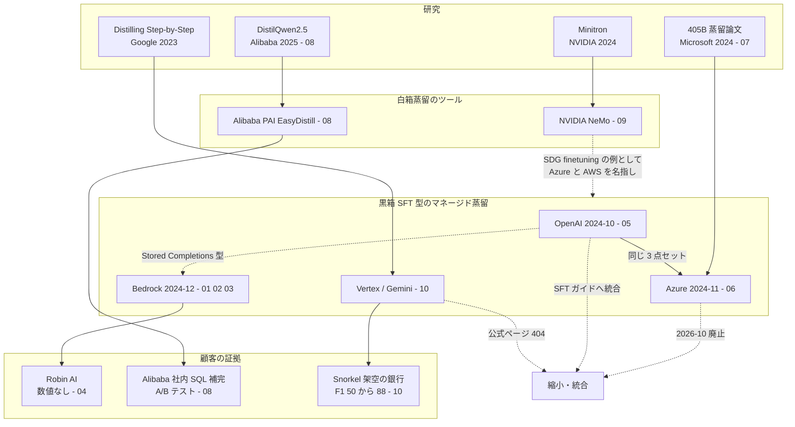

# C2 クラウド・ベンダーの蒸留サービス（distillation_platforms） — 詳細レポート

## Parameters

- **Resources analyzed**: 15 レポート（参照した一次資料・関連資料は計 100 件以上）（2026-10-22 追記: 11〜15 を追加。15 は事業者ランドスケープで WebSearch 30 回・WebFetch 約 45 回を追加使用）
- **Resource types**: Paper 2 / Technical 9 / Business 3
- **Generated on**: 2026-10-21（2026-10-22 に再調査・追記）
- **Input source**: gather の出力（[resources-distillation-platforms.md](../../../gather/20261021/distillation_platforms/resources-distillation-platforms.md)）
- **取得方法**: すべての資料を WebFetch または curl で直接取得して本文を確認。取得できなかった資料はレポート内に明記（OpenAI の公式発表 403、Gemini Distillation Service の公式ページ 404 など）
- **制約**: 初回（10-21）は WebSearch のセッション上限に達したため、追加の検索ができていませんでした。**再調査（10-22）では WebSearch 22 回・WebFetch 約 40 回** を使い、顧客事例・日本語資料・公式の価格と制約を補いました。それでも取得できなかったもの（OpenAI 公式発表の本文、Gemini Distillation Service のページ、Predibase の記事、EnterpriseZine の本文）は各レポートに明記しています

## Report List

### Academic Papers

| # | Title | Year | Venue | Summary | Report |
|---|-------|------|-------|---------|--------|
| 07 | Knowledge Distillation Using Frontier Open-source LLMs: Generalizability and the Role of Synthetic Data（Microsoft） | 2024 | arXiv | Azure AI 上で Llama-3.1-405B → 8B / 70B。Azure の価格で 8B は 18 倍超、70B は 2 倍超安い | [Details](07-microsoft-llama-405b-distillation-paper.md) |
| 08 | DistilQwen2.5: Industrial Practices of Training Distilled Open Lightweight Language Models（Alibaba PAI）+ EasyDistill | 2025 | arXiv | 黒箱 + 白箱蒸留。**社内 SQL 補完の A/B テスト**: 384 → 148 ms、採用率 26.5 → 25.5% | [Details](08-distilqwen25-alibaba-pai.md) |

### Technical Articles

| # | Title | Source | Date | Report |
|---|-------|--------|------|--------|
| 01 | Amazon Bedrock Model Distillation — 仕組み・対応モデル・価格 | AWS | 2024-12 / 2025-05 | [Details](01-bedrock-model-distillation-service.md) |
| 02 | Bedrock Model Distillation: Boost function calling accuracy | AWS ML Blog | 2025-04-30 | [Details](02-bedrock-function-calling-distillation.md) |
| 03 | Optimize video semantic search intent with Amazon Nova Model Distillation | AWS ML Blog | 2026-04-17 | [Details](03-bedrock-nova-video-search-distillation.md) |
| 05 | OpenAI Model Distillation — Stored Completions・Evals・Cookbook | OpenAI | 2024-10 | [Details](05-openai-model-distillation.md) |
| 06 | Azure OpenAI / AI Foundry の蒸留 — 発表から廃止まで | Microsoft | 2024-11 〜 2026-10 | [Details](06-azure-openai-foundry-distillation.md) |
| 09 | NVIDIA NeMo の剪定 + 蒸留（Minitron） | NVIDIA | 2024-08 / 2024-10 | [Details](09-nvidia-minitron-nemo.md) |
| 11 | （2026-10-22 追記）OpenAI セルフサーブ fine-tuning の縮小（2026-05 通知 → 2027-01-06 新規ジョブ停止）と蒸留の料金 | OpenAI | 2024-10 〜 2027-01 | [Details](11-openai-fine-tuning-wind-down-pricing.md) |
| 12 | （2026-10-22 追記）Bedrock Model Distillation の 2026-10 時点の対応表 — Anthropic 蒸留の停止・リージョン・課金・国内ハンズオン | AWS / Anthropic / クラスメソッド | 2024-12 〜 2026-10 | [Details](12-bedrock-distillation-support-matrix-2026.md) |
| 13 | （2026-10-22 追記）Google Agent Platform（旧 Vertex AI）のオープンモデル向け distillation fine-tuning | Google Cloud | 2026-10 | [Details](13-google-agent-platform-open-model-distillation.md) |

### Business Cases

| # | Title | Company | Date | Report |
|---|-------|---------|------|--------|
| 04 | Bedrock 蒸留の「名前の出た顧客」を検証する | AWS / Robin AI / Moody's / PwC / Slack / Robinhood / AFX | 2024-12 〜 2025-04 | [Details](04-bedrock-named-customers-audit.md) |
| 10 | Google Cloud の蒸留と Snorkel × Google の事例 | Google / Snorkel AI / Wayfair | 2023-09 〜 2026-10 | [Details](10-google-vertex-snorkel-distillation.md) |
| 14 | （2026-10-22 追記）商用蒸留サービスの「顧客事例」を横断で検証する — AWS / Azure / Google / NVIDIA / 独立系 / 国内 | Robin AI / CoinMarketCap / Juicebox / Decagon / Experian / KT ほか | 2024-08 〜 2025-12 | [Details](14-customer-cases-expanded-audit.md) |
| 15 | （2026-10-22 追記）LLM 蒸留を事業に組み込む企業の全体像 — 海外 26 社 vs 国内 18 社を A〜E の 5 類型（提供 / SIer / モデル収益化 / 防御 / 市場推計）で一覧化 | Arcee / Snorkel / Predibase（Rubrik）/ OpenPipe（CoreWeave）/ Mistral / Liquid AI / Malted AI / Anthropic / HiddenLayer / 富士通 / SB Intuitions / Sakana AI ほか | 2023-10 〜 2026-10 | [Details](15-distillation-business-landscape-japan-vs-overseas.md) |

## 主要な発見（要約）

| # | 発見 | 数値 | 証拠の質 | レポート |
|---|------|------|---------|---------|
| 1 | Bedrock の蒸留の顧客として名前が出たのは **Robin AI だけ** で、数値はない。**Moody's はマルチエージェント、PwC は Automated Reasoning の顧客** で、蒸留とは別機能 | 顧客の数値 0 件 | ベンダー申告 + 二次報道 | [04](04-bedrock-named-customers-audit.md) |
| 2 | 定量値のある蒸留の例は、ほぼすべて **ベンダー自身の実験** | 関数呼び出し +45.2%、動画ルーター 1,741 → 833 ms・コスト 95% 超減、Nova Pro の API 精度 +20% | ベンダー申告 | [02](02-bedrock-function-calling-distillation.md) [03](03-bedrock-nova-video-search-distillation.md) |
| 3 | **本番の A/B テスト** を公開しているのは Alibaba だけ | 7B → 3B: レイテンシ 384 → 148 ms、採用率 -1.0 ポイント | 一次資料（ベンダー自身の論文） | [08](08-distilqwen25-alibaba-pai.md) |
| 4 | マネージド蒸留は **縮小・統合・廃止** に向かっている | Azure の Stored Completions は 2026-10-15 に廃止、OpenAI の蒸留ガイドは SFT に統合、Gemini 蒸留の公式ページは 404 | 一次資料（公式ドキュメント） | [05](05-openai-model-distillation.md) [06](06-azure-openai-foundry-distillation.md) [10](10-google-vertex-snorkel-distillation.md) |
| 5 | クラウドの蒸留は「教師出力による SFT」。ロジットを使う白箱蒸留を提供するのは NVIDIA NeMo と Alibaba PAI だけ | NeMo: 学習トークン最大 40 分の 1。PAI: 上位 10 ロジット | 一次資料 | [09](09-nvidia-minitron-nemo.md) [08](08-distilqwen25-alibaba-pai.md) |
| 6 | 推論コストの削減を **クラウドの価格表で試算** した一次資料 | 405B → 8B で 18.7 倍、→ 70B で 2.2 倍 | 一次資料（Microsoft の論文） | [07](07-microsoft-llama-405b-distillation-paper.md) |
| 7 | 「コスト 90% 削減」の AFX 事例は **蒸留ではなくモデルの乗り換え** | 90% 減 | ベンダー申告 | [04](04-bedrock-named-customers-audit.md) |
| 8 | **日本の顧客事例は 0 件** | — | — | [01](01-bedrock-model-distillation-service.md) |
| 9 | （2026-10-22 追記）**OpenAI はセルフサーブ fine-tuning 基盤を縮小中**。2026-05-07 通知、新規ユーザーは利用不可、既存顧客も **2027-01-06 以降は新規ジョブ不可**。生徒の例 gpt-4.1-mini は 2027-01-14 停止 | 2027-01-06 | 一次資料（Deprecations ページ） | [11](11-openai-fine-tuning-wind-down-pricing.md) |
| 10 | （2026-10-22 追記）**Bedrock の Anthropic（Claude）蒸留は停止中・復旧未定**。現在は Nova（us-east-1）と Llama（us-west-2）のみで、**東京リージョン非対応** | 対応ファミリー 2 | 一次資料（ユーザーガイド） | [12](12-bedrock-distillation-support-matrix-2026.md) |
| 11 | （2026-10-22 追記）Google には **オープンモデル向け distillation fine-tuning** の公開ドキュメントがある（教師 DeepSeek / GLM / Kimi / Qwen、生徒 Qwen 3 / Gemma 3）。Gemini 蒸留は引き続き非公開。**Gemini 3 以降のチューニング済みモデルは推論が 1.5 倍** | 1.5 倍 | 一次資料（ドキュメント・価格ページ） | [13](13-google-agent-platform-open-model-distillation.md) |
| 12 | （2026-10-22 追記）範囲を独立系・NVIDIA・国内に広げても、**第三者の顧客が蒸留の成果を数値で公開した例は 0 件**。Robin AI の AWS 導入事例には蒸留の記述がなく、CoinMarketCap は蒸留を「計画」として言及 | 0 件 | 一次 + 二次 | [14](14-customer-cases-expanded-audit.md) |
| 13 | （2026-10-22 追記）DistilQwen2.5 の「1.4 倍」は本文の **推論速度**、「2.6 倍」は Table 3 の **レイテンシ比**（本レポート計算）。同じ量とは限らない | 1.4× / 2.6× | 一次資料 | [08](08-distilqwen25-alibaba-pai.md) |
| 14 | （2026-10-22 追記）**蒸留を明示して事業にする海外企業は、クラウド 4 社・OSS ツール（Arcee DistillKit / Kiln）・蒸留モデル API（Mistral Ministral 3 / Liquid LFM2）・金融特化の Malted AI に限られる**。独立系 fine-tuning 基盤は蒸留単体ではなく買収で出口（Predibase $109.1M = 現金 $14.5M + 株式 $94.6M、OpenPipe は非開示）。資金は上流のデータ（Snorkel $350M @ $3.5B、2026-09-22）と教師側の防御（Anthropic: 抽出 90〜99% 減、「相当の収益を手放した」）に集中。**国内で蒸留を売るのは富士通 1 社（提供時期未公表）、蒸留モデルを売るのは SB Intuitions 1 社で、SIer 5 社・防御・国内市場予測は 0 件**。市場推計は 2025 年で $43.6M〜$1.47B と 30 倍以上の幅 | $109.1M / $3.5B / 90〜99% | 一次（SEC・公式）+ ベンダー申告 + 二次 | [15](15-distillation-business-landscape-japan-vs-overseas.md) |

## Cross-Resource Insights

### 関係図



### 共通するテーマ

- **設計の収束**: 「本番の教師ログ → 絞り込み → 生徒の SFT → 評価 → 同じクラウドで推論」という形が、OpenAI・Azure・Bedrock でほぼ同じです。違いは、Bedrock の独自のデータ合成、On-Demand 推論への対応、教師と生徒を同じファミリーに限る制約です。
- **ロックイン**: 教師も生徒もデプロイ先も同じベンダーです。Azure では蒸留の学習ファイルをエクスポートできませんでした。廃止時には作り直しが必要です（[06](06-azure-openai-foundry-distillation.md)）。
- **証拠の偏り**: 定量的な証拠は、(1) ベンダー自身のデモ・実験、(2) ベンダー自身の本番サービス（Alibaba）、(3) パートナーの架空の事例（Snorkel）の 3 つに限られます。**独立した第三者の顧客が成果の数値を公開した例は 0 件** でした。
- **評価の自己参照**: 動画検索の事例（[03](03-bedrock-nova-video-search-distillation.md)）は、学習データも評価データも教師が作っています。ベンダーのデモでよくある弱点です。
- **時期**: 発表は 2024 年 10 月〜12 月に集中し、2025 年 5 月までに機能の拡張がほぼ終わりました。2026 年には縮小・統合の動きが見えます。

### 価値式への対応

index の価値式

$$
\text{蒸留のビジネス価値} \approx (C_{\text{teacher}} - C_{\text{student}}) \cdot Q - (C_{\text{data}} + C_{\text{train}}) - \Delta\text{Acc} \cdot V_{\text{err}}
$$

のどの項を、各資料が報告しているかを整理しました。

| レポート | $C_{\text{teacher}} - C_{\text{student}}$ | $Q$ | $C_{\text{data}} + C_{\text{train}}$ | $\Delta\text{Acc}$ | $V_{\text{err}}$ |
|---------|:---:|:---:|:---:|:---:|:---:|
| 01 Bedrock サービス | ○ 最大 75%（条件非公開） | × | 課金の構造だけ | ○ 2% 未満（条件非公開） | × |
| 02 関数呼び出し | △ 外部データ | × | × | ○ | × |
| 03 動画検索 | ○ 95% 超（Haiku と比較） | × | 時間だけ（数時間） | ○ 判定スコアで同点 | × |
| 05 OpenAI Cookbook | × | × | × | ○ 教師との差 0.34 ポイント | × |
| 07 Microsoft 論文 | ○ 18.7 倍 / 2.2 倍（価格表） | 1,000 件単位 | × | ○ | × |
| 08 DistilQwen2.5 | △ レイテンシで代用 | × | × | ○ 本番の採用率 | × |
| 09 Minitron | 学習側のコスト（トークン 40 分の 1） | × | ○ 学習計算量 | ○ | × |
| 10 Snorkel × Google | × | × | 時間だけ（数時間） | ○ F1 | × |

**$Q$（リクエスト数）と $V_{\text{err}}$（誤り 1 件の損失）を報告した資料は 0 件** です。投資判断に必要な「損益分岐点」を計算できる公開事例はありません。

## Comparison Table

### サービス横断の比較

| 項目 | Amazon Bedrock Model Distillation | OpenAI Model Distillation | Azure OpenAI / AI Foundry 蒸留 | Vertex AI / Gemini Distillation | Alibaba Cloud PAI（EasyDistill・ModelDistill） | NVIDIA NeMo（Minitron） | 独立系（Snorkel / Arcee / Predibase / Together） |
|------|------------------|------------------|-----------------|------------------|--------------------|-----------------|-----------------|
| 開始 | 2024-12 プレビュー / 2025-05 GA | 2024-10 | 2024-11 発表 / 2025-05 全リージョン | 2023-09 private preview（PaLM）/ 2026 早期アクセス（Gemini） | 2025 | 2024 | Snorkel 2023 〜、Arcee DistillKit 2024 〜 |
| 2026-10 の状態 | 提供中。**ただし Anthropic（Claude）の蒸留は停止中・復旧未定**（2026-10-22 訂正、[12](12-bedrock-distillation-support-matrix-2026.md)） | 蒸留ガイドを SFT ガイドに統合。**fine-tuning 基盤を縮小中: 新規ユーザー不可、2027-01-06 に新規ジョブ停止**（2026-10-22 訂正、[11](11-openai-fine-tuning-wind-down-pricing.md)） | **Stored Completions は 2026-10-15 に廃止**（2026-10-22 再確認） | Gemini 蒸留は公式ページ 404・本番利用禁止とされる。**オープンモデル向け distillation fine-tuning は公開ドキュメントあり**（2026-10-22 追記、[13](13-google-agent-platform-open-model-distillation.md)） | 提供中（OSS も） | 提供中（GPT 系チェックポイントのみ） | Together は蒸留の専用機能なし、Predibase（Rubrik に移転）は記事を取得できず、Fireworks はチュートリアルあり |
| 方式 | 教師出力による SFT + 独自のデータ合成 | 教師出力による SFT | 教師出力による SFT | 根拠付き蒸留（PaLM）/ 推論過程も使う（Gemini、とされる） | 黒箱（エージェントによるデータ拡張）+ 白箱（上位 10 ロジット） | 剪定 + 白箱（logit・中間状態） | Snorkel: 弱教師あり / Arcee: 白箱（ロジット圧縮） / Predibase: LoRA fine-tuning |
| 教師 → 生徒の例 | Nova Premier → Nova Pro / Lite / Micro、Nova Pro → Lite / Micro、Llama 3.1 405B / 3.1 70B / 3.3 70B → 3.3 70B / 3.1 8B / 3.2 3B / 3.2 1B（2026-10-22 時点のガイド）。Claude 3.5 Sonnet v2 → Claude 3 Haiku は **停止中** | GPT-4o / o1-preview → GPT-4o mini（現在は gpt-4.1 → gpt-4.1-mini の例。どちらも 2027-01-14 停止） | GPT-4o / o1 系 → GPT-4o-mini 等 | PaLM 540B → T5、gemini-3.1-pro → gemini-2.5-flash（非公開）、**DeepSeek R1 0528 / V3.2・GLM 5.2・Kimi K2 Thinking・Qwen3 Next 80B → Qwen 3 4B〜32B / Gemma 3 1B〜27B**（公開） | Qwen-max / GPT-4o / Qwen2.5-72B → Qwen2.5 0.5B 〜 7B | Nemotron-4 15B → 8B / 4B、Llama 3.1 8B → 4B、Mistral NeMo 12B → 8B | 任意（Arcee: Qwen3-235B のロジット → 小型、Fireworks チュートリアル: DeepSeek-V3 → Qwen2.5-7B） |
| 教師の制約 | **同じファミリーのみ** | OpenAI のモデルのみ | Azure OpenAI のモデル | Google のモデル | 任意の OpenAI 互換 API + 自社のオープンモデル | 重みにアクセスできるモデル | 重みにアクセスできるモデル（白箱の場合） |
| データ | プロンプトだけで可、呼び出しログを再利用可 | `store=True` のログ | `store=True` のログ、10 件以上 | JSONL のプロンプト集 | シード指示 | 事前学習の規模のコーパス（94B 〜 380B トークン） | 各社 |
| 価格の構造 | 教師の推論 + 生徒の学習 + 保管 + 推論（PT / On-Demand、ベースモデルと同価格）。Nova の学習単価は価格ページが動的描画のため未取得 | 学習（gpt-4.1-mini $5.00 / 1M トークン）+ 推論（$0.80 / $3.20）。発表時は無料学習トークンの特典あり（2026-10-22 追記） | 学習トークン × エポック + fine-tune 済みモデルの時間課金ホスティング（または PTU）、Stored Completions は最大 10 GB | Gemini 蒸留は未公開。オープンモデル蒸留は学習トークン × エポック + **教師 MaaS の呼び出し**（Gemma 3 1B $0.47 〜 Qwen 3 14B $8.46 / 1M）。**Gemini 3 以降のチューニング済み推論は 1.5 倍**（2026-10-22 追記） | PAI の資源課金（本調査では未確認） | OSS（GPU は自前） | 各社 |
| 定量値（ベンダー） | 最大 5 倍高速・75% 安価・精度低下 2% 未満、関数呼び出し +45.2%、動画 -52% レイテンシ | Cookbook: 64.67% → 79.33% | なし | Step-by-Step: 770M が 540B を上回る | AlpacaEval 2.0 が約 2 倍（0.5B / 1.5B） | 学習トークン 40 分の 1、MMLU +16% | Snorkel: F1 50 → 88（架空の銀行） |
| 名前の出た顧客 | Robin AI（数値なし。AWS 導入事例ページには蒸留の記述なし）。Slack / Robinhood / Snorkel は期待の声。CoinMarketCap は蒸留を「計画」として言及（2026-10-22 追記） | なし | なし | Wayfair（蒸留かどうか不明） | Alibaba 社内（SQL 補完） | なし（KT / JD / UF Health は学習・合成データの事例） | Wayfair（Snorkel）。Juicebox（Fireworks）/ Decagon（Together）/ Experian（Databricks）は fine-tuning・乗り換え（2026-10-22 追記） |
| 本番の定量成果 | なし | なし | なし | なし | **あり（A/B テスト）** | なし | なし |
| 日本の事例 | なし（日本語の解説記事とクラスメソッドのハンズオン 3 本、AWS ジャパンのイベント報告のみ。2026-10-22 追記） | なし | なし | なし | なし | なし | なし |
| 主なレポート | [01](01-bedrock-model-distillation-service.md) [02](02-bedrock-function-calling-distillation.md) [03](03-bedrock-nova-video-search-distillation.md) [04](04-bedrock-named-customers-audit.md) | [05](05-openai-model-distillation.md) | [06](06-azure-openai-foundry-distillation.md) [07](07-microsoft-llama-405b-distillation-paper.md) | [10](10-google-vertex-snorkel-distillation.md) | [08](08-distilqwen25-alibaba-pai.md) | [09](09-nvidia-minitron-nemo.md) | [10](10-google-vertex-snorkel-distillation.md) |

### 「蒸留」かどうかの区別

| 事例 | 分類 | 理由 |
|------|------|------|
| Bedrock / OpenAI / Azure の蒸留 | **蒸留**（黒箱、応答ベース） | 教師の出力を生徒が学ぶ |
| DistilQwen2.5 | **蒸留**（黒箱 + 白箱） | ロジットまで使う。ただし本番比較の教師は int4 量子化済み |
| Minitron | **剪定 + 蒸留** | FP8 の高速化は量子化の効果で別物 |
| AFX の Nova Lite（90% 減） | **蒸留ではない**（モデルの乗り換え） | 教師から学ぶ工程がない |
| Snorkel × Google の銀行 | **LLM のラベルによる弱教師あり学習 → 古典モデル** | 最終モデルは TF-IDF のロジスティック回帰 |
| Predibase の LoRA Land | **蒸留ではない**（LoRA fine-tuning） | 教師モデルを使わない（H3 の対照例） |
| （2026-10-22 追記）Claude 3.5 Haiku の latency-optimized inference（Trainium2、up to 60% faster） | **蒸留ではない**（推論の高速化） | 同じブログで蒸留と並べて発表されたが、モデルは変わらない（[12](12-bedrock-distillation-support-matrix-2026.md)） |
| （2026-10-22 追記）Juicebox $4M → $800K（Fireworks）、Decagon 6 分の 1（Together）、Experian（Databricks） | **蒸留ではない**（fine-tuning / 乗り換え、二次情報） | 教師から学ぶ工程が書かれていない（[14](14-customer-cases-expanded-audit.md)） |
| （2026-10-22 追記）Fireworks チュートリアル DeepSeek-V3 → Qwen2.5-7B（GSM8K 52% → 70%） | **蒸留 + RFT**（ベンダーのチュートリアル） | 教師出力で SFT した後、正誤報酬で RFT。顧客事例ではない |

### 仮説の検証

| # | 仮説 | 判定 | 根拠 |
|---|------|------|------|
| H1 | 定量成果のある本番事例は検索・推薦に集中している | **部分的に支持**（C2 の範囲） | C2 で見つかった本番の定量事例は Alibaba の SQL 補完の 1 件だけ。C2 から H1 の反例は出なかった |
| H2 | クラウドベンダーの数値はベンダー集計で、顧客別の成果は非公開 | **強く支持** | 第三者の顧客の数値は 0 件。clustering で挙げた Moody's / PwC は、そもそも蒸留の顧客ではなかった |
| H3 | 「90% コスト削減」の SLM 事例の多くは蒸留ではない | **支持**（実例あり） | AFX の 90% 減はモデルの乗り換え。Predibase LoRA Land は fine-tuning |
| H4 | 国内は公開モデル型の事例が中心で、社内導入の事例は少ない | **支持**（C2 の範囲） | C2 のサービスについて、日本の顧客事例は 0 件。日本語の資料は翻訳と解説だけ |
| H5 | 商用 API を教師にした蒸留は規約で制約され、教師の選択が事業上の論点になる | **支持**（製品設計の面で） | Bedrock は同じファミリーのみ、OpenAI / Azure / Google も自社モデルのみ。白箱は重みへのアクセスが必要。規約の本文は C8 で確認 |
| H6 | Agent・tool calling 用途の蒸留が増えている | **支持** | Bedrock は GA で関数呼び出しの蒸留を前面に出した（+45.2%）。Nova Pro の API 精度 +20%、EasyDistill はエージェントと検索エージェントの蒸留に対応 |

### 価格と制約の比較（2026-10-22 追記）

2026-10-22 時点で各社の公式ドキュメント・価格ページから確認できた「教師・生徒の組合せ、データの扱い、リージョン、最小データ」をまとめます。確認できなかった項目は「未確認」と書き、推測で埋めていません。

| 項目 | Amazon Bedrock | OpenAI | Azure OpenAI / Foundry | Google Agent Platform（オープンモデル蒸留） | Google（Gemini 蒸留） |
|------|---------------|--------|------------------------|--------------------------------------------|---------------------|
| 教師 → 生徒 | Nova Pro / Premier → Nova Lite / Micro / Pro。Llama 3.1 405B / 3.1 70B / 3.3 70B → Llama 3.3 70B / 3.1 8B / 3.2 3B / 3.2 1B。**Claude は停止中** | gpt-4.1 → gpt-4.1-mini / nano（ガイドの例） | Azure OpenAI の全モデル（Chat Completions 経由）→ fine-tuning 対応モデル | DeepSeek R1 0528 / V3.2、GLM 5.2、Kimi K2 Thinking、Qwen3 Next 80B A3B Thinking → Qwen 3 4B / 8B / 14B / 32B、Gemma 3 1B / 4B / 12B / 27B | gemini-3.1-pro → gemini-2.5-flash（二次報道、非公開） |
| 教師の制約 | 同じファミリーのみ | OpenAI のモデルのみ | Azure OpenAI のモデルのみ | Google 以外の MaaS モデルも可 | Google のモデル |
| 学習データ | プロンプトのみで可（`.jsonl`、text-to-text のみ、Nova だけマルチターン可）。合成データは最大 15k 組 | Responses API の出力（既定 30 日保存）を選別して JSONL | Stored Completions 10 件以上（数百〜数千件推奨）、最大 10 GB | プロンプトのみで可（教師が応答生成）。検証データは正解が必要 | 未確認 |
| 最小データ量 | ガイド本文に記載なし（ハンズオンでは「100 個以上」） | 記載なし | **10 件** | 記載なし | 未確認 |
| 学習の課金 | 生徒の学習（1,000 トークン単位、Nova の単価は未取得）+ 教師の推論（データ合成時はオンデマンド単価で追加課金） | gpt-4.1 $25.00 / gpt-4.1-mini $5.00 / nano $1.50 per 1M トークン | 学習トークン × エポック × 単価（単価は価格ページが動的描画のため未取得） | 学習トークン × エポック（Gemma 3 1B $0.47 〜 27B $6.83、Qwen 3 4B $1.35 〜 14B $8.46 per 1M）+ 教師 MaaS の呼び出し | 未確認 |
| 推論の課金 | PT または On-Demand（PEFT の場合）、**ベースモデルと同価格** | fine-tune 済み推論（gpt-4.1-mini $0.80 / $3.20 per 1M、Batch は半額） | トークン課金 + fine-tune 済みモデルの **時間課金ホスティング**（または PTU。Developer デプロイはホスティング無料・24 時間で削除） | Prediction の料金。**Gemini 3 以降のチューニング済みモデルは 1.5 倍** | 未確認 |
| データの保持・利用 | 「Only you can access the final distilled model」「doesn't use your data to train any other teacher or student model for public use」 | Responses API の出力は既定 30 日保存 | 学習ファイルはエクスポート不可。削除はリソースごと or サポート。**2026-10-15 に廃止** | `distillation_labelled_dataset.jsonl` が出力先 GCS に保存される | 未確認 |
| リージョン | Nova: us-east-1、Llama: us-west-2。**東京非対応**（蒸留済みモデルのコピーは可） | 記載なし（グローバル） | 2025-05 以降は全 Azure OpenAI リージョン（Stored Completions） | global 推奨。us-central1 / europe-west4 / us-west1 / us-east5 / asia-southeast1 / asia-southeast2。**東京非対応** | 未確認 |
| 2026-10 の状態 | 提供中（Claude のみ停止） | **縮小中（2027-01-06 新規ジョブ停止）** | **廃止（2026-10-15）** | 提供中（GA / Preview の記載なし） | 非公開（allowlist、二次報道） |
| 出典 | [12](12-bedrock-distillation-support-matrix-2026.md) | [11](11-openai-fine-tuning-wind-down-pricing.md) | [06](06-azure-openai-foundry-distillation.md) | [13](13-google-agent-platform-open-model-distillation.md) | [10](10-google-vertex-snorkel-distillation.md) |

```
2026-10 時点の「マネージド蒸留の寿命」
OpenAI   2024-10 ──────────────────────── 2027-01 新規ジョブ停止（約 2 年 3 か月）
Azure    2024-11 ─────────────────── 2026-10 Stored Completions 廃止（約 1 年 11 か月）
Bedrock  2024-12 ──────────────────────────── 提供中（Claude は停止）
Google   2026 早期アクセス ─── 非公開 / オープンモデル蒸留は公開
```

**東京リージョンで蒸留ジョブを実行できるマネージドサービスは、本調査の範囲では 1 つもありません**（Bedrock・Google ともに米国/欧州/シンガポール等のみ。Azure は Stored Completions 廃止、OpenAI はグローバルだが縮小中）。

### 数値の再照合（2026-10-22 追記）

| レポート | 照合結果 |
|---------|---------|
| [02](02-bedrock-function-calling-distillation.md) | 「45.2%」「0.478 → 0.783 → 0.826」は原文どおり。「5.8%」が再現できない点は初回の指摘のまま |
| [03](03-bedrock-nova-video-search-distillation.md) | 「over 95%」「4.0 / 5」「1,741 → 833 ms」は原文どおり。「52% 減」は本レポートの計算で、原文は「50%」「in half」（追記済み） |
| [07](07-microsoft-llama-405b-distillation-paper.md) | 論文の本文は「over 18x」「more than 2x」。「18.7 / 2.2」は本レポートの試算（追記済み） |
| [08](08-distilqwen25-alibaba-pai.md) | 「1.4×」は本文の推論速度、「2.6×」は Table 3 のレイテンシ比（訂正済み） |
| [09](09-nvidia-minitron-nemo.md) | 「40x fewer training tokens」「16% MMLU」「1.8x compute」「~2.7x throughput」「94B」「380B」「1.95x」は NVIDIA ブログ・論文の原文どおり |
| [06](06-azure-openai-foundry-distillation.md) | 「retire on October 15, 2026」を再取得して確認 |

## Further Investigation Candidates

| 候補 | 理由 | 取得の状況 |
|------|------|----------|
| openai.com/index/api-model-distillation/ | OpenAI の公式発表の本文（料金の特典などの可能性） | 403（2026-10-22 も 403。検索スニペットで特典の記述のみ確認、[11](11-openai-fine-tuning-wind-down-pricing.md)） |
| Gemini Distillation Service の Wayback Machine のアーカイブ | 公式仕様の確認 | 未取得（2026-10-22: Wayback は本環境から取得不可。オープンモデル蒸留は [13](13-google-agent-platform-open-model-distillation.md) で代替） |
| re:Invent 2024 / 2025 の Bedrock 蒸留のセッション | Robin AI 等が登壇して数値を話している可能性 | 2026-10-22: AIM391（2025）は Zenn の要約で確認。CoinMarketCap は蒸留を計画として言及（[14](14-customer-cases-expanded-audit.md)）。動画本体は未確認 |
| Microsoft Customer Stories / AWS 導入事例（日本） | 顧客事例の補完 | 2026-10-22: 検索したが蒸留の事例は 0 件（[14](14-customer-cases-expanded-audit.md)） |
| Predibase の蒸留の記事（「Graduate from OpenAI to open source: 12 best practices for distilling」） | 独立系の蒸留サービスの実践 | 403（2026-10-22: rubrik.com へ移転後も 403） |
| （2026-10-22 追記）Bedrock の Anthropic 蒸留が停止した時期と理由 | 対応表の変更履歴 | AWS What's New・re:Post に記述なし。未特定 |
| （2026-10-22 追記）Bedrock の Nova 学習単価、Azure の fine-tuning 単価 | 損益分岐の試算 | 価格ページが動的描画のため未取得。Pricing Calculator で確認が必要 |
| （2026-10-22 追記）EnterpriseZine（news/detail/21352）の本文 | 「AWS ジャパン、蒸留で 75% 削減」の発言の文脈 | bot 対策で 403 |
| （2026-10-22 追記）Snorkel「First cohort of Snorkel GenAI customers sees gains up to 54 points」 | 蒸留が含まれるかの確認 | URL 未特定 |
| Arcee の SuperNova など、DistillKit で作ったモデル | 独立系の白箱蒸留の事例 | 404（ブログ）、GitHub は取得済み |
| Distillation Scaling Laws（[arXiv 2502.08606](https://arxiv.org/abs/2502.08606)） | 「教師が既にある / 生徒が多い」場合に蒸留が有利、という損益分岐の理論 | abs のみ取得 |
| Llama 3.1 405B の合成データによる蒸留（AWS のチュートリアル） | NVIDIA が SDG finetuning の例として挙げている | 未取得 |
| 蒸留関連の特許（AWS / Microsoft / NVIDIA / Alibaba） | gather で 0 件 | C8 で補完 |
