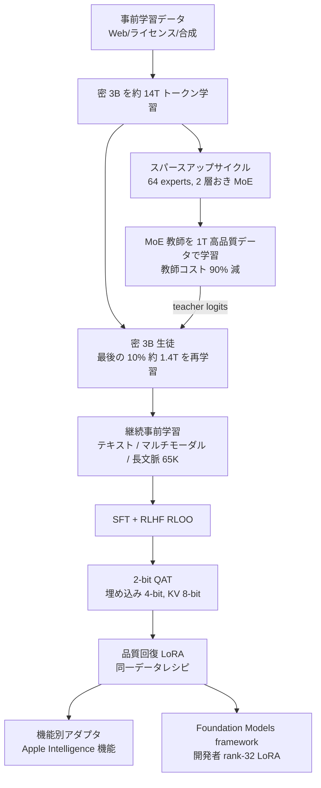
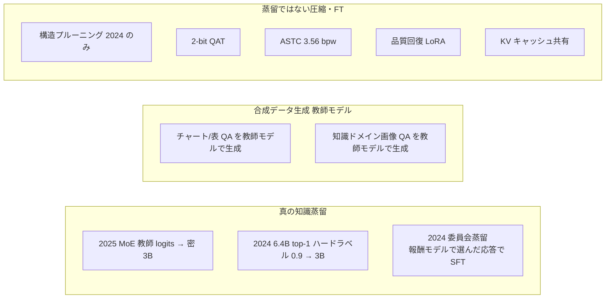
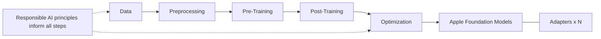
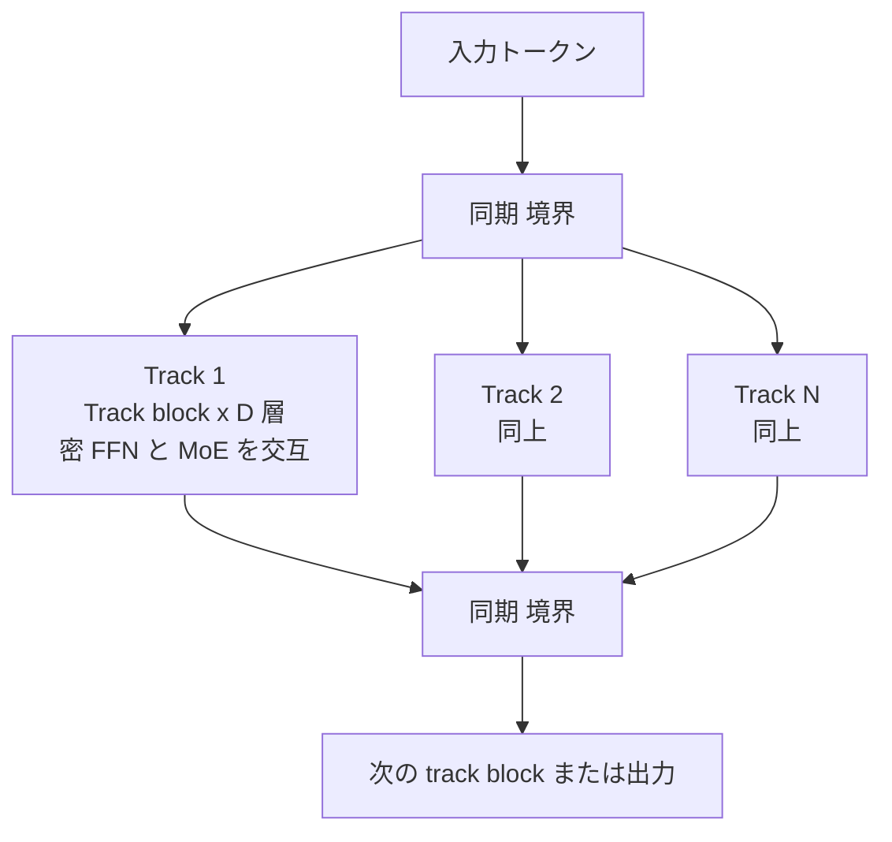
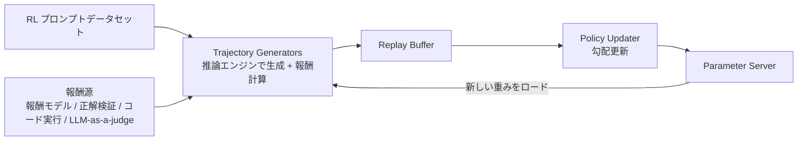

# Apple Intelligence Foundation Language Models: Tech Report 2025

- **Link**: https://arxiv.org/abs/2507.13575 （HTML: https://arxiv.org/html/2507.13575v3 ／ Apple 掲載ページ: https://machinelearning.apple.com/research/apple-foundation-models-tech-report-2025 ／ 解説ブログ: https://machinelearning.apple.com/research/apple-foundation-models-2025-updates ）
- **Authors**: Apple（Foundation Model Team。arXiv 上の著者表記は「Apple」）
- **Year**: 2025（arXiv v1 2025-07、参照版 v3 = 2025-08-27）
- **Venue**: arXiv preprint（cs.LG）／ Apple Machine Learning Research 技術報告
- **Type**: Academic Paper（ベンダー技術報告）
- **関連（前年版）**: Gunter et al., "Apple Intelligence Foundation Language Models", arXiv:2407.21075（2024, v2 参照）
- **調査日**: 2026-10-21
- **エビデンス区分の凡例**: 一次資料 = Apple 自身の技術報告・公式ブログ本文 ／ ベンダー申告 = Apple の主張だが第三者再現・独立検証なし（数値の大半はこれに該当）／ 二次報道 = 報道機関による伝聞

> **本レポートの主眼（llm_distillation / C6 edge_ondevice）**: Apple のオンデバイス約 3B モデルが「どのように蒸留されているか」を一次資料の記述だけで正確に切り分けること。結論から言うと、**2024 版・2025 版の両方で、教師モデルの出力を学習目標に用いる“真の”知識蒸留（KD）が事前学習段階で明記されている**（2024: 6.4B 密モデルの top-1 予測をハードラベルとして混合、2025: スパースアップサイクルした 64 エキスパート MoE 教師の logits による蒸留損失）。一方、2-bit QAT・ASTC・LoRA 品質回復アダプタは**蒸留ではなく圧縮＋ファインチューニング**である。教師は**いずれも Apple 内製モデル**であり、Google Gemini 等の外部モデルを教師に用いたという記述は 2025 年報告には一切ない（外部教師に関する 2026 年の報道は `02-apple-gemini-distillation-reports.md` を参照）。

## Abstract

We introduce two multilingual, multimodal foundation language models that power Apple Intelligence features across Apple devices and services: (i) a ∼3B-parameter on-device model optimized for Apple silicon through architectural innovations such as KV-cache sharing and 2-bit quantization-aware training; and (ii) a scalable server model built on a novel Parallel-Track Mixture-of-Experts (PT-MoE) transformer that combines track parallelism, mixture-of-experts sparse computation, and interleaved global–local attention to deliver high quality with competitive cost on Apple's Private Cloud Compute platform. Both models are trained on large-scale multilingual and multimodal datasets sourced via responsible web crawling, licensed corpora, and high-quality synthetic data, then further refined with supervised fine-tuning and reinforcement learning on a new asynchronous platform. The resulting models support several additional languages while understanding images and executing tool calls. In public benchmarks and human evaluations, both the server model and the on-device model match or surpass comparably sized open baselines.

A new Swift-centric Foundation Models framework exposes guided generation, constrained tool calling, and LoRA adapter fine-tuning, allowing developers to integrate these capabilities with a few lines of code. The latest advancements in Apple Intelligence models are grounded in our Responsible AI approach with safeguards like content filtering and locale-specific evaluation, as well as our commitment to protecting our users' privacy with innovations like Private Cloud Compute.

## Abstract (Japanese Translation)

Apple デバイスとサービス全体で Apple Intelligence の機能を支える、多言語・マルチモーダルな 2 つの基盤言語モデルを紹介する。(i) KV キャッシュ共有や 2-bit 量子化認識学習（QAT）といったアーキテクチャ上の工夫により Apple silicon 向けに最適化された約 3B パラメータのオンデバイスモデル、(ii) トラック並列・MoE 疎計算・グローバル／ローカル交互注意を組み合わせた新しい Parallel-Track Mixture-of-Experts（PT-MoE）Transformer に基づき、Apple の Private Cloud Compute 上で競争力あるコストと高品質を両立するスケーラブルなサーバーモデル、である。両モデルは責任あるウェブクロール、ライセンス取得コーパス、高品質な合成データから得た大規模な多言語・マルチモーダルデータで学習され、さらに新しい非同期プラットフォーム上での教師ありファインチューニング（SFT）と強化学習で改良された。その結果、追加の言語に対応し、画像を理解し、ツール呼び出しを実行できる。公開ベンチマークと人手評価において、サーバーモデル・オンデバイスモデルともに同等規模のオープンなベースラインに匹敵または上回る。

新たな Swift 中心の Foundation Models framework は、ガイド付き生成、制約付きツール呼び出し、LoRA アダプタによるファインチューニングを提供し、開発者は数行のコードでこれらの機能を組み込める。最新の Apple Intelligence モデルは、コンテンツフィルタリングやロケール別評価などの安全策を含む Responsible AI の方針と、Private Cloud Compute のような革新によるユーザープライバシー保護へのコミットメントに基づいている。

## Overview

本報告は WWDC 2025（2025-06-09）で発表された第 2 世代 Apple Foundation Models（AFM）の技術詳細である。オンデバイス（約 3B、密）とサーバー（PT-MoE、PCC 上）の 2 モデルについて、アーキテクチャ・データ・事前学習・事後学習・推論最適化・開発者フレームワーク・評価・Responsible AI を網羅する。蒸留ビジネスの観点で重要な論点は次の 5 点に集約できる。

1. **事前学習での真の知識蒸留（logit 蒸留）**: 約 14T トークンで密な 3B を学習 → それを 64 エキスパート MoE にスパースアップサイクル（1T トークンのみ）→ その MoE を教師として、密 3B を最後の 10%（約 1.4T トークン）だけ蒸留損失で再学習。**教師の学習コストを 90% 削減**し、**構造的プルーニングを不要化**した（一次資料／ベンダー申告）。
2. **2024 版との差分**: 2024 版は 6.4B 密モデルをゼロから学習し、FFN 隠れ次元を構造プルーニングして初期化、全 6.3T トークンにわたり教師 top-1 予測（重み 0.9）を混ぜたハードラベル蒸留を実施していた。2025 版は「教師を安く作る」方向へ転換した。
3. **極端圧縮**: オンデバイスは 2 bits-per-weight（bpw）QAT、埋め込み 4-bit、KV キャッシュ 8-bit、さらに LoRA「品質回復アダプタ」で劣化を補償。サーバーは ASTC（GPU テクスチャ圧縮）で 3.56 bpw。
4. **アーキテクチャ効率化**: KV キャッシュ共有（全層の 37.5% から K/V 射影を除去）で KV メモリ 37.5% 減、TTFT 約 37.5% 減。
5. **開発者への開放**: Foundation Models framework により約 3B モデルを**無料・オフライン**でサードパーティアプリから利用可能に。rank-32 LoRA アダプタ学習用 Python ツールキットとドラフトモデル（投機的デコーディング用）学習も提供。ただし**アダプタはベースモデルのバージョンに固定**され、モデル更新ごとに再学習が必要。

## Problem

- **オンデバイス制約下での品質確保**: iPhone 等の DRAM・電力・レイテンシ制約の中で、約 3B モデルに多言語・画像理解・ツール利用まで担わせる必要がある。
- **蒸留教師のコスト**: 2024 版のように大きな密教師（6.4B）をゼロから学習すると、教師学習と教師 logits 生成のコストが重い。
- **極端量子化による品質劣化**: 2 bpw では学習が不安定になり、品質が大きく劣化しうる。
- **サーバーモデルのスケール効率**: テンソル並列の同期オーバーヘッドがレイテンシ・学習効率のボトルネックになる。
- **言語・モダリティ拡張**: 15〜16 言語への拡張と画像入力対応を、英語性能の劣化なしに行う。
- **開発者体験**: 自由形式テキストのパース、不正形式出力、ツール名の幻覚などを開発者側で処理させない仕組みが必要。

## Proposed Method

### A. オンデバイスモデルの事前学習パイプライン（スパースアップサイクル蒸留）

**原文（4.3 Text Pre-training, 一次資料）**:

> "we first trained a dense on-device model for about 14T tokens and sparse-upcycled [Komatsuzaki et al., 2023] it into a 64-expert, every-2-layer (i.e., interleaving dense and sparse layers) MoE [Du et al., 2024] using only 1T high-quality data. Then, we retrained the dense on-device model for the last 10% of tokens (about 1.4T) using a distillation loss from the MoE teacher. This new pipeline not only reduced the cost of training the large distillation teacher by 90% but also greatly improved the efficiency of producing teacher logits. Moreover, retraining only the last 10% of tokens rather than from scratch also eliminated the need for structural pruning."

**手順の分解**:

1. **密 3B の学習**: 入力 = 事前学習コーパス、操作 = 約 14T トークンの通常の次トークン予測、出力 = 密 3B チェックポイント $\theta_{dense}$。
2. **スパースアップサイクル**: 入力 = $\theta_{dense}$、操作 = 2 層おきに FFN を 64 エキスパートの MoE 層に複製・拡張し、高品質データ約 1T トークンで追加学習、出力 = MoE 教師 $\theta_{T}$。
3. **教師 logits の生成**: 入力 = 最後の 10% 区間のデータ（約 1.4T トークン）、操作 = $\theta_T$ で前向き計算、出力 = 教師分布 $p_T$。報告は「教師 logits 生成の効率が大幅に向上」と述べる（MoE はアクティブパラメータが少ないため、と推測されるが、理由の明記はない）。
4. **密 3B の蒸留再学習**: 入力 = 学習途中（最後の 10% 手前）の密 3B と $p_T$、操作 = 蒸留損失で約 1.4T トークン再学習、出力 = 事前学習済みオンデバイスモデル。
5. **後続**: 継続事前学習（テキスト／マルチモーダル／長文脈）→ SFT → RLHF → 2-bit QAT → 品質回復 LoRA。

**蒸留の種別判定**: 「teacher logits」「distillation loss from the MoE teacher」と明記されており、**教師分布（logits）を目標とする真の知識蒸留**である。ただし**損失関数の具体形（KL か交差エントロピーか、温度、真ラベルとの混合比）は開示されていない**。以下は標準的な KD の一般形であり、Apple が用いた式そのものではない（本レポートによる補足）:

$$\mathcal{L}_{KD}(\theta_S) = \alpha \cdot \mathrm{KL}\left(p_T(\cdot \mid x; \tau) \,\|\, p_S(\cdot \mid x; \theta_S, \tau)\right) + (1-\alpha) \cdot \mathrm{CE}\left(y, p_S(\cdot \mid x; \theta_S)\right)$$

- $p_T$: MoE 教師の次トークン分布、$p_S$: 密 3B 生徒の分布、$\tau$: 温度、$\alpha$: 蒸留項の重み、$y$: 真の次トークン。いずれも 2025 版での値は**非開示**。

**特徴**:

- 教師は**生徒自身からアップサイクルした MoE**（外部モデルでも、別系統の大型密モデルでもない）。いわば「自己派生教師（self-derived teacher）」型。
- 教師学習コスト 90% 削減（ベンダー申告）。2024 版の 6.4B 教師はゼロから学習していたのに対し、2025 版は既存の密チェックポイントを 1T トークンで MoE 化するだけで教師を作る。
- 「最後の 10% だけ再学習」なので、2024 版で必要だった構造プルーニングによる初期化が不要になった。
- 報告は「事前学習済みオンデバイスモデルの性能を押し上げつつ学習コストを大幅削減」と述べるが、**蒸留の有無によるアブレーション表は 2025 版には掲載されていない**（2024 版には Table 6 がある、後述）。

### B. 2024 版（arXiv:2407.21075）の蒸留＋プルーニング（比較用）

**原文（3.2.1 Core pre-training, 一次資料）**:

> "AFM-server core training is conducted from scratch, while AFM-on-device is distilled and pruned from a larger model." / "before training AFM-on-device, we initialize it from a pruned 6.4B model (trained from scratch using the same recipe as AFM-server), using pruning masks that are learned through a method similar to what is described in [Wang et al., 2020; Xia et al., 2023]." / "a distillation loss is used by replacing the target labels with a convex combination of the true labels and the teacher model's top-1 predictions, (with 0.9 weight assigned to the teacher's labels), training for a full 6.3T tokens."

- プルーニングの差分: (1) FFN の隠れ次元のみをプルーニング、(2) HardConcrete ではなく Soft-Top-K マスキング、(3) コア事前学習と同じデータ混合で 188B トークンかけてマスクを学習。
- 効果（ベンダー申告）: プルーニング初期化でデータ効率と最終ベンチマークが 0〜2% 改善、蒸留追加で MMLU 約 +5%、GSM8K 約 +3%。
- 継続事前学習段階では「蒸留損失は有効でなかった」ため AFM-server と同一レシピ。

**2024 版の蒸留目標（式として再構成）**:

$$\tilde{y}_t = 0.9 \cdot \mathbf{e}\left(\arg\max_v p_T(v \mid x_{<t})\right) + 0.1 \cdot \mathbf{e}(y_t), \qquad \mathcal{L} = -\sum_t \sum_v \tilde{y}_{t,v} \log p_S(v \mid x_{<t})$$

- $\mathbf{e}(\cdot)$: one-hot ベクトル、$p_T$: 6.4B 教師、$y_t$: 真の次トークン。これは**教師の top-1 ハードラベルと真ラベルの凸結合**であり、soft logits 全体を使う古典的 KD より情報量は少ないが、教師出力を学習目標に使う点で真の蒸留に該当する。

**2024 版の事後学習における「委員会蒸留（Committee distillation）」**: 複数の選好最適化アルゴリズム（SFT, RS, DPO/IPO, RL）で学習したモデル群（model committee）から各プロンプトごとに複数応答をサンプリングし、最新の報酬モデルで最良応答を選んで学習データにする**リジェクションサンプリング型の蒸留**（iTeC）。教師＝自社モデル群、生徒＝次世代モデルで、**合成データ（応答）経由の系列レベル蒸留**に分類できる。

### C. 教師モデルによる合成データ生成（データ蒸留的要素, 2025）

2025 版のデータ節には「teacher model」が複数回登場する（一次資料）:

- **表・チャート・プロット**: 内部 LLM が合成データフィールドと値を生成 → LLM がチャート描画コードを書く → チャート画像とデータを**教師モデル**に入力して QA を生成。表は公開ウェブから解析して Markdown 化し、画像–Markdown ペアと**教師モデル**生成の合成 QA を学習に使用。
- **知識要求ドメイン**（科学・医療等）: alt-text のキーワードで画像を検索 → CLIP で無関係画像を除去 → **教師モデル**で QA を合成。
- **合成キャプション**: 社内キャプションモデルで 50 億超の画像–キャプションペアを生成。
- 教師モデルの正体（社内か外部か）は**記載がない**。

これらは「教師モデルの出力をそのまま学習データにする」点で**合成データ蒸留（black-box / sequence-level distillation）**に近いが、報告自身は “distillation” とは呼んでいない。

### D. 推論最適化（蒸留ではない: 量子化・圧縮・アダプタ FT）

**D-1. KV キャッシュ共有（アーキテクチャ, 2.1）**

- モデルを Block 1（全 Transformer 層の 62.5%）と Block 2（37.5%、K/V 射影を削除）に分割。Block 2 の KV キャッシュは Block 1 の生成したものをそのまま共有（[Snowflake, 2025] を引用）。
- KV キャッシュメモリ 37.5% 削減、prefill で Block 2 の計算を丸ごと省略でき TTFT 約 37.5% 削減（ベンダー申告）。
- ブログ版の補足: Block 2 の KV は「Block 1 の最終層が生成したもの」と共有。第三者記事（Implicator）はこれを「5:3 の深さ比」と表現。

$$\text{KV memory reduction} = \frac{L_{B2}}{L_{B1}+L_{B2}} = \frac{0.375L}{L} = 37.5\%$$

**D-2. 2-bit 量子化認識学習（QAT, 6 章）**

学習中に量子化を模擬する重み計算:

$$\tilde{\mathbf{W}} = s \cdot \left(\mathrm{clamp}\left(\left\lfloor \frac{\mathbf{W}}{s} + z \right\rceil, q_{min}, q_{max}\right) - z\right)$$

- $s$: スケール、$z$: ゼロ点、$q_{min}, q_{max}$: 量子化範囲、$\lfloor\cdot\rceil$: 丸め。丸めの微分不可能性は straight-through estimator（STE）で近似。

学習可能スケール係数 $f$ を導入:

$$s = \frac{f \cdot \max(|\mathbf{W}|)}{q_{max}}, \qquad f_{init} = \frac{c}{\max(|\mathbf{W}|)}$$

- $c$: Newton-Raphson 法に着想を得た反復法で推定するクリッピング値（外れ値の影響を抑え、中心的な重み分布を反映。各反復で $c$ の上下の重みを再バランス）。

QAT の安定化レシピ（原文の列挙をリストとして保存）:

- 基盤モデルと同じ学習ステージを、より少ないイテレーションで実施。
- ハイパーパラメータに敏感。Adafactor より AdamW が安定（低ビットでは正確なモーメンタム推定が必要なためと推測）。
- 低い学習率、ニューロン数の平方根に反比例する勾配スケーリングで安定化。
- 重みの指数移動平均（EMA）を保持し、評価を安定化・2-bit モデルの指標を一貫して改善。
- 2-bit の値集合は非対称 $\{-2,-1,0,1\}$ より対称 $\{-1.5,-0.5,0.5,1.5\}$ の方が損失スパイクが少ない（[Liu et al., 2025] と整合）。
- weight decay = 0（量子化レベル全域を使わせ、ゼロ点付近への崩壊を防ぐ）。

**D-3. ASTC（サーバーモデル, 事後圧縮）**

- GPU のテクスチャ圧縮形式 ASTC を重み圧縮に転用。Apple GPU の固定機能ハードウェアで展開されるため、シェーダ／計算コア視点で実質ゼロコスト。
- 6×6 ブロック（36 重み）を 128-bit に符号化:

$$\text{bpw} = \frac{128\ \text{bits}}{36\ \text{weights}} \approx 3.56$$

- HDR-ch モード（非負 16-bit float チャネル）を使用。負値を扱えないため、各ブロックの最小値を引き、最小値を float-16 スカラーとして別保存。推論時は行列積等に加算を融合し、再構成ステップのランタイムコストなし。

**D-4. 品質回復アダプタ（Quality Recovery Adapters）**

- 圧縮後の両モデルに LoRA を付与し、**ベースモデル学習と同じデータレシピ**でアダプタを追加学習。コア重みは凍結。
- サーバーモデルでは ASTC 適用前に、適応対象層の重みの**主要特異ベクトルを LoRA 側へ移し**（Meng et al., 2024 類似）、残差（残りの特異ベクトル）だけを ASTC 圧縮。圧縮誤差が減り、重要成分は無圧縮のまま保持。

$$\mathbf{W} = \underbrace{\mathbf{U}_{k}\mathbf{\Sigma}_{k}\mathbf{V}_{k}^{\top}}_{\text{LoRA (非圧縮)}} + \underbrace{\mathbf{W}_{res}}_{\text{ASTC 圧縮}}$$

（上式は報告の文章記述を本レポートが式に起こしたもの。ランク $k$ は非開示。）

- **蒸留との区別**: 品質回復アダプタは「教師出力」ではなく「元のデータレシピ」で学習するため、**蒸留ではなくファインチューニング**。2024 版でも同様に “accuracy-recovery adapters” と呼ばれていた。

### E. サーバーモデル: PT-MoE（2.2）

- Parallel Track（PT）Transformer: モデルを複数の小さな Transformer（track）に分割し、track block の入出力境界でのみ同期。
- 各 track block 内に MoE 層（1 層おきに密 FFN を MoE に置換、grouped GEMM による top-k ルーティングでトークンドロップなし）。
- 同期オーバーヘッド: テンソル並列 $2L$ → トラック並列 $L/D$。$D=4$ で 87.5% 削減:

$$1 - \frac{L/D}{2L} = 1 - \frac{1}{2D} \overset{D=4}{=} 87.5\%$$

- 交互注意: 3 層のローカル注意（スライディング窓 4096, RoPE）＋ 1 層のグローバル注意（NoPE）を繰り返し単位とする。

### F. 事後学習と RL 基盤

- SFT: 人手デモ＋合成データ。一般知識、推論（Web コーパスの書き換え＋実行フィードバック／正解検証／多数決でフィルタ、CoT 付与）、テキストリッチ画像、15 言語の多言語 OCR、テキスト／視覚グラウンディング、複数画像推論。
- 画像解像度モード（オンデバイス）: 高解像度（672×672 を 2×2 タイルで 1344×1344 相当、計 5 画像）／ balanced（概観画像のみ）／ rapid（224×224、画像トークン 9 個、他モードは 144 個）。
- RLHF: REINFORCE Leave-One-Out（RLOO）。非同期分散 RL 基盤（Trajectory Generators と Policy Updater）で、同期型旧システム比 **デバイス 37.5% 減・計算時間 75% 減**で同等性能（ベンダー申告）。
- 報酬モデル: 選好損失＋単側グレーディング正則化。人手評価者間で 20〜30% の選好不一致。cohesion ヘッドを持つ別報酬モデルで近傍探索によるプロンプト選択。

### G. Foundation Models framework（7 章）

- 約 3B オンデバイスモデルへの直接アクセス。得意タスク: 要約、エンティティ抽出、テキスト理解、リファイン、短い対話、創作。**「一般世界知識のチャットボットとしては設計されていない」**と明記。
- **Guided generation**: Swift の struct / enum に `@Generable` マクロを付けるだけで型付き出力。マクロが応答形式仕様に変換 → フレームワークがプロンプトに注入 → モデルは専用データセットで事後学習済み → OS デーモンが制約付きデコーディングと投機的デコーディングを実行。
- **Tool calling**: `Tool` Swift プロトコルを実装。ガイド付き生成の上に構築し、ツール名・引数の幻覚を構造的に防止。並列・直列の呼び出しグラフを自動処理。
- **LanguageModelSession**: 追記専用・状態保持のセッション。KV キャッシュと結合し、開発者が意図せずキャッシュを無効化しないよう設計。スナップショットによる部分出力ストリーミング。
- **アダプタ学習ツールキット**: Python で **rank-32 LoRA** を学習、オプションで**オンデバイス投機的デコーディング用ドラフトモデル**も学習可能。アダプタは**特定のベースモデルバージョンにのみ互換**で、新バージョンごとに再学習が必要。Background Assets framework で端末のベースモデルに合う 1 つのアダプタだけをダウンロード（開発者自前サーバーか Apple サーバーでホスト）。
- Xcode 統合: Swift でのプロンプトエンジニアリング用 playground、推論性能プロファイラ、iOS / visionOS シミュレータ上での実行。
- 結論節: 開発者は「**無料（free of cost）**の AI 推論」を数行のコードで利用可能。

## Algorithm (Pseudocode)

```
Algorithm: AFM-on-device 2025 pre-training with sparse-upcycled distillation
Input : corpus D (multilingual web / licensed / synthetic), token budget ~15.4T
Output: compressed on-device model M_final (2 bpw + LoRA recovery)

1. θ_dense ← TrainLM(init, D, ~14T tokens)              // 通常の次トークン予測（密 3B）
   # 実際には「最後の 10% 手前」の状態から再学習するため、14T 学習済み重みと
   # 再学習開始点の関係は報告からは厳密に読み取れない（要注意）
2. θ_T ← SparseUpcycle(θ_dense, experts=64, every=2 layers)
   θ_T ← TrainLM(θ_T, D_high_quality, ~1T tokens)         // MoE 教師（教師コスト 90% 減）
3. for batch x in D_last10% (~1.4T tokens):
       p_T ← θ_T(x)                                       // 教師 logits（MoE で効率的に生成）
       θ_S ← θ_S − η ∇ L_distill(p_T, θ_S(x))             // 蒸留損失（具体形は非開示）
4. θ_S ← ContinuedPretrain(θ_S, text: math/code/multilingual 30%)
   θ_S ← MultimodalAdapt(θ_S, RW-ViTDet, 1.3T tokens @16k)
   θ_S ← ContextLengthen(θ_S, up to 65K)
5. θ_S ← SFT(θ_S, human + synthetic) ; θ_S ← RLHF_RLOO(θ_S)
6. θ_q ← QAT(θ_S, 2-bit, learnable scale f, Newton-Raphson init, EMA, AdamW, wd=0)
   embedding ← 4-bit (joint QAT) ; KV-cache ← 8-bit
7. A_rec ← TrainLoRA(θ_q frozen, same data recipe)        // 品質回復アダプタ（FT であって蒸留ではない）
8. return M_final = θ_q + A_rec  (+ feature adapters / developer rank-32 adapters)
```

## Architecture / Process Flow





## Figures & Tables

### Figure 1: モデリング全体像（原典画像）


データ → 前処理 → 事前学習 → 事後学習（ここまでが「Multimodal + Multilingual」の枠）→ 最適化 → Apple Foundation Models 本体と複数のアダプタ。全工程の下に「Responsible AI principles inform all steps」の帯がある。



### Figure 2: PT-MoE アーキテクチャ（原典画像）


各 track は複数の track block から成り、各 track block は固定数の Transformer / MoE 層を含む。総層数 $L$、track block の深さ $D$ のとき、同期オーバーヘッドはテンソル並列の $2L$ からトラック並列の $L/D$ へ減る（$D=4$ で 87.5% 減）。



### Figure 3: 非同期分散 RL 基盤（原典画像）




### Figure 4: テキストの人手評価（Side-by-side, 原典画像＋数値表）


`*` は Apple の**圧縮済み**オンデバイスモデルと比較したもの（原典注記）。数値は画像から読み取り。

**AFM-on-device 対 他モデル**

| ロケール群 | 比較対象 | AFM wins | Tie | AFM loses |
|---|---|---|---|---|
| EN | Qwen-2.5-3B | 35.3% | 51.8% | 12.9% |
| EN | Qwen-3-4B | 25.6% | 51.7% | 22.7% |
| EN | *Qwen-3-4B-AWQ | 19.9% | 59.4% | 20.7% |
| EN | Gemma-3-4B | 21.0% | 57.1% | 21.9% |
| EN | Gemma-3n-E4B | 25.8% | 54.0% | 20.2% |
| EN | *Gemma-3n-E4B | 21.8% | 52.6% | 25.6% |
| EN outside US | Qwen-2.5-3B | 39.5% | 44.7% | 15.8% |
| EN outside US | Qwen-3-4B | 35.4% | 45.3% | 19.2% |
| EN outside US | *Qwen-3-4B-AWQ | 25.6% | 58.9% | 15.5% |
| EN outside US | Gemma-3-4B | 34.2% | 45.9% | 19.9% |
| EN outside US | Gemma-3n-E4B | 30.5% | 51.0% | 18.5% |
| EN outside US | *Gemma-3n-E4B | 21.1% | 54.1% | 24.8% |
| PFIGSCJK | Qwen-2.5-3B | 36.8% | 47.7% | 15.5% |
| PFIGSCJK | Qwen-3-4B | 25.9% | 50.1% | 24.0% |
| PFIGSCJK | *Qwen-3-4B-AWQ | 29.1% | 45.6% | 25.3% |
| PFIGSCJK | Gemma-3-4B | 30.7% | 44.2% | 25.1% |
| PFIGSCJK | Gemma-3n-E4B | 42.5% | 35.3% | 22.2% |
| PFIGSCJK | *Gemma-3n-E4B | 36.0% | 37.6% | 26.4% |

**AFM-server 対 他モデル**

| ロケール群 | 比較対象 | AFM wins | Tie | AFM loses |
|---|---|---|---|---|
| EN | Llama-4-Scout | 22.7% | 59.6% | 17.7% |
| EN | Qwen-3-235B | 20.7% | 54.8% | 24.5% |
| EN | GPT-4o | 16.7% | 68.3% | 15.0% |
| EN outside US | Llama-4-Scout | 29.1% | 54.1% | 16.8% |
| EN outside US | Qwen-3-235B | 28.1% | 48.9% | 23.0% |
| EN outside US | GPT-4o | 15.4% | 58.3% | 26.3% |
| PFIGSCJK | Llama-4-Scout | 26.5% | 56.5% | 17.0% |
| PFIGSCJK | Qwen-3-235B | 20.1% | 52.4% | 27.5% |
| PFIGSCJK | GPT-4o | 17.1% | 58.6% | 24.3% |

PFIGSCJK = ポルトガル語、フランス語、イタリア語、（ドイツ語）、スペイン語、中国語（簡体）、日本語、韓国語。※ arXiv 本文のキャプションには German が欠落しているが、ブログ版キャプションには German が含まれる。

**読み取り**: 圧縮済みモデル同士（`*` 行）の比較では、EN で Gemma-3n-E4B に対し負け（25.6%）が勝ち（21.8%）を上回る。すなわち 2-bit 圧縮の影響を含めると「同等規模オープンモデルに匹敵」の評価は拮抗〜やや劣勢の場面もある（ベンダー申告データからの本レポートの解釈）。

### Figure 5: 画像応答の人手評価（原典画像＋数値表）


| モデル | 比較対象 | AFM wins | Tie | AFM loses |
|---|---|---|---|---|
| AFM-on-device | InternVL-2.5-4B | 37% | 46% | 17% |
| AFM-on-device | Qwen-2.5-VL-3B | 36% | 45% | 19% |
| AFM-on-device | Gemma-3-4B | 34% | 47% | 18% |
| AFM-server | Llama-4-Scout | 23% | 51% | 26% |
| AFM-server | Qwen-2.5-VL-32B | 31% | 44% | 26% |
| AFM-server | GPT-4o | 15% | 50% | 35% |

（Gemma-3-4B 行と Qwen-2.5-VL-32B 行は原図の丸めで合計が 99%／101%。）

### Table 1: AFM On-Device 対 外部モデル（公開ベンチマーク）

| Model | MMLU | MMMLU | MGSM |
|---|---|---|---|
| AFM On-Device | 67.85 | 60.60 | 74.91 |
| Qwen-2.5-3B | 66.37 | 56.53 | 64.80 |
| Qwen-3-4B | 75.10 | 66.52 | 82.97 |
| Gemma-3-4B | 62.81 | 56.71 | 74.74 |
| Gemma-3n-E4B | 57.84 | 50.93 | 77.77 |

instruct / non-thinking 版を、AFM 対応言語のみで Simple-Evals（OpenAI）により評価。

### Table 2: AFM Server 対 外部モデル

| Model | MMLU | MMMLU | MGSM |
|---|---|---|---|
| AFM Server | 80.20 | 74.60 | 87.09 |
| LLaMA 4 Scout | 84.88 | 80.24 | 90.34 |
| Qwen-3-235B | 87.52 | 82.95 | 92.00 |
| GPT-4o | 85.70 | 84.00 | 90.30 |

### Table 3: 最適化による品質影響

| Model | MMLU | IFEval (instruct) | Bits-per-weight |
|---|---|---|---|
| AFM On-Device | 67.8 | 85.1 | 16 |
| AFM On-Device Opt | 64.4 | 82.3 | 2 |
| AFM Server | 80.0 | 89.1 | 16 |
| AFM Server Opt | 79.2 | 90.2 | 3.6 |

**差分（本レポート算出）**: On-Device は 16→2 bpw（重みメモリ 1/8）で MMLU −3.4pt、IFEval −2.8pt。Server は 16→3.6 bpw で MMLU −0.8pt、IFEval +1.1pt。

```
重み 1 本あたりのビット数（16-bit 比）
On-Device 16 bpw  ████████████████ 100%
On-Device  2 bpw  ██               12.5%  MMLU 67.8 → 64.4
Server    16 bpw  ████████████████ 100%
Server   3.6 bpw  ████             22.5%  MMLU 80.0 → 79.2
```

### ブログ版 Table 1: 圧縮とビットレート（machinelearning.apple.com 2025 updates）

| | On-Device | Server |
|---|---|---|
| Decoder Weights | 2-bpw via QAT | 3.56-bpw via ASTC |
| Embedding | 4-bit via QAT | 4-bit post training |
| KV Cache | 8-bit | 8-bit |
| Adapter recovery | Yes | Yes |

**一次資料間の不整合**: ブログは圧縮後の変化を「オンデバイスで MGSM 約 4.6% 低下・**MMLU 1.5% 改善**、サーバーで MGSM 2.7%・MMLU 2.3% 低下」と記述するが、技術報告 Table 3 ではオンデバイス MMLU が 67.8→64.4 と**低下**している。ブログは 2025-07-17 に「図を技術報告と同じモデル版・評価に更新」と注記しているが本文の数値は旧版のまま残っている可能性がある。引用時は**技術報告 Table 3 を優先**すべき。

### 学習データ・学習規模の数値一覧（一次資料）

| 項目 | 値 |
|---|---|
| 画像–テキストペア（クロール、重複除去後） | 100 億超 |
| 画像–テキスト交互文書 | 1.75 億文書（画像 5.5 億超） |
| 公開交互データ（フィルタ版） | 画像 2.94 億 |
| 合成画像キャプション | 50 億超ペア |
| CLIP 事前学習データ | 60 億超ペア（448×448） |
| 視覚エンコーダ第 2 段 | 302M の小型 LLM デコーダと共同学習（672×672） |
| 視覚バックボーン | サーバー ViT-g 1B ／ オンデバイス ViTDet-L 300M（Register-Window 機構） |
| トークナイザ語彙 | 100k → 150k |
| サーバー事前学習 | 8192 個の v5p Cloud TPU（4×2048 スライス）、13.4T トークン、good output 93% |
| オンデバイス事前学習 | 密 約 14T → MoE 化 1T → 蒸留再学習 約 1.4T |
| 多言語混合比（継続事前学習） | 8% → 30% |
| マルチモーダル適応の混合 | テキスト 60% ／ 交互 10% ／ キャプション 28.5% ／ ドメイン特化 1.5% |
| マルチモーダル適応トークン | オンデバイス 1.3T（16k 長）／ サーバー 420B（8k 長） |
| 画像トークン数 | 144（rapid モードは 9） |
| 長文脈 | 最大 65K トークン |
| 混合言語 SFT | 多言語 SFT 混合の 0.4% |
| SFT / RLHF の英語:多言語 | 80:20 |
| RLHF vs SFT 人手評価 | 16:9 の勝敗比 |
| 安全性タクソノミー | 6 カテゴリ 58 サブカテゴリ |

### RLHF プロンプト選択の効果（一次資料, ベンダー申告）

| 指標 | 改善幅 |
|---|---|
| Arena Hard | 4% |
| AlpacaEval（対 GPT4-Turbo 勝率） | 7% |
| Agent Sandbox | 10% |
| GPQA | 7% |
| Math500 | 5% |
| 人手評価（ロケール横断の総合満足度） | 1.3〜2.0% |

### 前年版（arXiv:2407.21075）Table 1: AFM-on-device の寸法

| 項目 | 値 |
|---|---|
| Model dimension | 3072 |
| Head dimension | 128 |
| Num query heads | 24 |
| Num key/value heads | 8 |
| Num layers | 26 |
| Num non-embedding params (B) | 2.58 |
| Num embedding params (B) | 0.15 |

語彙サイズは AFM-server 100k、AFM-on-device 49k（2024 版）。

### 前年版 Table 6: プルーニングと蒸留のアブレーション（3B, 初期データ混合）

| Metric/Method | Baseline | Prune | Distill | Both | Baseline |
|---|---|---|---|---|---|
| Training cost | 1.5× | 1× | 1× | 1× | 5× |
| MMLU (5-shot) | 34.6 | 42.9 | 44.9 | 49.3 | 45.4 |
| GSM8K (8-shot CoT) | 12.7 | 13.5 | 11.0 | 16.8 | 16.9 |
| CoreEN Average | 59.8 | 61.0 | 58.1 | 59.7 | 60.3 |

**読み取り（ベンダー申告）**: 同一計算量（1×）で、蒸留単独は MMLU +10.3pt（vs 1.5× ベースライン）、プルーニング＋蒸留で 49.3 と **5× 計算のベースライン（45.4）を上回る**。蒸留単独では GSM8K が下がる（11.0）が、組み合わせると回復（16.8）。これは「蒸留は計算量の代替になる」という本ドメインの中心仮説を支持する、数少ない**大手ベンダーによる公開アブレーション**である。

```
MMLU (5-shot) 2024 ablation
Baseline 1.5x  ████████████████▋            34.6
Prune     1x   █████████████████████▍       42.9
Distill   1x   ██████████████████████▍      44.9
Both      1x   ████████████████████████▋    49.3
Baseline  5x   ██████████████████████▋      45.4
```

### 前年版 Table 5: コア事前学習レシピのアブレーション（3.1T トークン, AFM-on-device 構成）

| Task | Baseline (acc) | AFM (acc) |
|---|---|---|
| arc_challenge | 41.9 | 44.6 |
| arc_easy | 75.6 | 76.1 |
| hellaswag | 54.3 | 55.0 |
| lambada | 69.3 | 68.9 |
| piqa | 78.3 | 78.4 |
| sciq | 94.5 | 94.7 |
| winogrande | 67.3 | 66.9 |
| triviaqa (1-shot) | 40.5 | 41.0 |
| webqs (1-shot) | 20.6 | 20.6 |
| CoreEN average | 60.2 | 60.7 |
| GSM8K (8-shot CoT) | 16.6 | 18.9 |
| MMLU (5-shot) | 45.4 | 45.5 |

### 前年版 Table 10: 量子化と精度回復アダプタ（非量子化を 100% に正規化）

| BPW | Models | IFEval Instruction-Level | AlpacaEval 2.0 LC | GSM8K (8-shot CoT) |
|---|---|---|---|---|
| 16 | AFM-on-device | 100.0% | 100.0% | 100.0% |
| 3.5 | quantized | 98.4% | 76.7% | 82.2% |
| 3.5 | Acc.-recovered (rank 16) | 98.8% | 94.7% | 92.1% |
| 3.7 | quantized | 97.9% | 87.3% | 91.3% |
| 3.7 | Acc.-recovered (rank 16) | 100.6% | 94.8% | 96.0% |

2024 版は本番で 3.7 bpw（平均 3.5 bpw まで品質を大きく落とさず圧縮可能だが、3.7 で既にメモリ要件を満たすため）を採用。2025 版は **2 bpw** まで踏み込んだ。rank 16 の回復アダプタで Alpaca 勝率 7〜18%、GSM8K 5〜10% 改善。

### 2024 版と 2025 版の比較（本レポート作成）

| 観点 | 2024 版 AFM-on-device | 2025 版 AFM on-device |
|---|---|---|
| パラメータ | 約 3B（非埋め込み 2.58B + 埋め込み 0.15B） | 約 3B |
| 教師モデル | 6.4B 密モデル（AFM-server と同レシピでゼロから学習） | 密 3B を 64 エキスパート MoE にスパースアップサイクル（1T トークン） |
| 蒸留信号 | 教師 top-1 予測（重み 0.9）＋真ラベル（0.1）の凸結合＝ハードラベル | teacher logits による蒸留損失（具体形非開示） |
| 蒸留区間 | コア事前学習の全 6.3T トークン | 最後の 10%（約 1.4T トークン） |
| 構造プルーニング | あり（6.4B から FFN 隠れ次元、Soft-Top-K、188B トークンでマスク学習） | 不要化 |
| 教師コスト | 基準 | 90% 削減（ベンダー申告） |
| 蒸留アブレーション公開 | あり（Table 6） | なし |
| 量子化 | 混合 2/4-bit、平均 3.7 bpw（本番） | 2 bpw QAT、埋め込み 4-bit、KV 8-bit |
| 品質回復 | accuracy-recovery LoRA（rank 16） | quality recovery LoRA |
| 開発者向け | なし（社内機能アダプタのみ） | Foundation Models framework、rank-32 LoRA ツールキット |
| 語彙 | 49k | 150k（拡張後） |

### 手法比較（関連手法との位置づけ, 本レポート作成）

| 手法 | 教師 | 蒸留信号 | 長所 | 短所 |
|---|---|---|---|---|
| AFM 2025（本報告） | 生徒由来の MoE（アップサイクル） | logits | 教師作成コストが極小、教師 logits 生成が安価 | 教師の能力上限が生徒系統に縛られる可能性、アブレーション非公開 |
| AFM 2024 | 別途学習した 6.4B 密 | top-1 ハードラベル | 実装が単純、ストレージ不要 | 教師のゼロから学習が高コスト、soft 情報を捨てる |
| Sparse upcycling（Komatsuzaki et al., 2023） | — | —（MoE 初期化手法） | 密チェックポイントを再利用 | 単体では蒸留ではない |
| Minitron 型（プルーニング＋蒸留） | 大型密の元モデル | logits | 少トークンで小型化 | 元の大型モデルが必要 |
| 外部フロンティアモデルからの出力蒸留 | 他社 API モデル | 応答・推論過程（合成データ） | 教師の能力が高い | 利用規約・契約の制約、白箱 logits は通常得られない |

## Experiments & Evaluation

### Setup

- **自動ベンチマーク**: MMLU、MMMLU、MGSM（instruct / non-thinking 版、AFM 対応言語のみ、OpenAI Simple-Evals）。最適化影響は MMLU と IFEval。
- **人手評価（テキスト）**: Analytical Reasoning, Brainstorming, Chat, Classification, Closed QA, Coding, Creative Writing, Extraction, Mathematical Reasoning, Open QA, Rewriting, Summarization, Tool-use。ロケール別にネイティブらしさも評価（例: 英国ユーザーには "soccer" より "football"）。数学・コードはロケール非依存として除外。
- **人手評価（画像）**: Image–Question ペア。Infographics 等の画像固有カテゴリを含む。
- **機能別評価**: 例として Visual Intelligence のチラシ→カレンダー登録機能を、多様な環境・撮影角度のチラシ集合で評価。
- **比較対象**: オンデバイスは Qwen-2.5-3B、Qwen-3-4B、Gemma-3-4B、Gemma-3n-E4B（画像は InternVL-2.5-4B、Qwen-2.5-VL-3B、Gemma-3-4B）。サーバーは LLaMA 4 Scout、Qwen-3-235B、GPT-4o（画像は Qwen-2.5-VL-32B も）。

### Main Results

- オンデバイス: MMLU 67.85 / MMMLU 60.60 で Qwen-2.5-3B・Gemma-3-4B・Gemma-3n-E4B を上回るが、MGSM（74.91）では Gemma-3n-E4B（77.77）に劣後。Qwen-3-4B には全指標で劣後（ベンダー申告）。
- サーバー: LLaMA 4 Scout に僅差で劣後、Qwen-3-235B・GPT-4o とは差が大きい。ただし人手評価では LLaMA 4 Scout に対し有利。
- 画像: オンデバイスは InternVL / Qwen に有利、Gemma に拮抗。サーバーは Qwen-2.5-VL-32B を推論 FLOPS 半分以下で上回るが、LLaMA 4 Scout・GPT-4o には劣後。
- 圧縮: 2 bpw 化でオンデバイス MMLU −3.4pt、IFEval −2.8pt（Table 3）。

### Ablation Study

- 2025 版本文には、**蒸留・アップサイクル・KV 共有・QAT 各要素の定量アブレーション表はない**。「新パイプラインは事前学習モデル性能を押し上げつつ学習コストを大幅削減」という定性記述のみ。
- 定量アブレーションは 2024 版 Table 6（プルーニング／蒸留）と Table 10（量子化／回復アダプタ）に依拠する必要がある。
- RL 基盤の効率（デバイス 37.5% 減、計算時間 75% 減）とプロンプト選択の効果は数値あり（上表）。

## 蒸留の種別判定まとめ（本ドメイン向け）

| 要素 | 区分 | 根拠 | エビデンス |
|---|---|---|---|
| 2025: MoE 教師 logits による再学習 | **真の KD（logit 蒸留）** | "distillation loss from the MoE teacher", "teacher logits" | 一次資料（ベンダー申告, 第三者再現なし） |
| 2024: 6.4B 教師 top-1 ラベル混合 | **真の KD（ハードラベル）** | "teacher model's top-1 predictions (0.9 weight)" | 一次資料 |
| 2024: 委員会蒸留（iTeC） | **系列レベル蒸留／リジェクションサンプリング SFT** | "rejection sampling (distillation) from the model committee" | 一次資料 |
| 2025: チャート・知識ドメイン QA の教師生成 | **合成データ蒸留に近い**（報告は蒸留と呼ばない） | "fed ... into a teacher model to generate QAs" | 一次資料 |
| 2024: 6.4B からの構造プルーニング | 圧縮（蒸留ではない） | pruning masks, Soft-Top-K | 一次資料 |
| 2-bit QAT / ASTC / 4-bit 埋め込み / 8-bit KV | 量子化・圧縮（蒸留ではない） | 6 章 | 一次資料 |
| 品質回復 LoRA | ファインチューニング（蒸留ではない） | "same data recipe as the base model training" | 一次資料 |
| 開発者 rank-32 LoRA | ファインチューニング | 7 章 | 一次資料 |
| 外部（Google Gemini 等）教師 | **記述なし** | 2025 年報告には外部教師の言及なし | — |

## Notes

- **教師は内製**: 2025 年 7 月時点の一次資料では、オンデバイスモデルの教師は Apple 自身のモデル（アップサイクル MoE）である。2026 年 3 月以降の「Gemini から蒸留」報道（`02-apple-gemini-distillation-reports.md`）は、この報告の後の第 3 世代（AFM 3）に関するもの。
- **第 3 世代（2026-06-08 公式ブログ, 一次資料）との接続**: Apple は "Introducing the Third Generation of Apple's Foundation Models" で、AFM 3 を「Google と協力して custom-built した 5 モデルのファミリー」と説明。オンデバイスは AFM 3 Core（3B 密）と AFM 3 Core Advanced（20B スパース、リクエストに応じ 1〜4B を活性化、Instruction-Following Pruning ベース、全体を NAND に置きプロンプト単位でエキスパート選択）。「全モデルが共通の初期基盤を共有してから各アーキテクチャに特化」「QAT で大幅圧縮」とあるが、**“distillation” の語や Gemini を教師とした旨の記述はない**。「技術報告を夏の後半に公開予定」とあったが、本調査時点（2026-10-21）で Apple ML サイト上に 2026 年版技術報告は確認できなかった。
  - URL: https://machinelearning.apple.com/research/introducing-third-generation-of-apple-foundation-models
  - （2026-10-22 追記）公式ブログに "distillation" の語はないが、WWDC 2026 の記者向けトークで Apple の AI 担当 VP が AFM 3 Core / Core Advanced を含む 4 モデルを "refined using outputs from Gemini frontier models" と説明したと報じられている（MacRumors 2026-06-09、詳細は `02-apple-gemini-distillation-reports.md`）。2025 年報告の「教師は内製 MoE」という結論は 2025 年版に限った記述であり、第 3 世代では外部（Gemini）出力が学習に使われている。
- **言語数の揺れ**: 技術報告の序論は「16 言語」、ブログは「15 言語」、多言語 OCR は「15 言語」。数え方（英語の方言扱い等）の差と思われるが原因は未記載。
- **プライバシー記述の変化**: 2025 報告は「ユーザーの個人データやインタラクションを学習に使わない」。2026 年 9 月 9 日付の AFM 3 ブログ脚注では「オプトインで Siri / Apple Intelligence 改善に協力可能」と更新されている。
- **実務的示唆**:
  1. 「教師を安く作る」発想（自己アップサイクル MoE 教師＋最後 10% のみ蒸留）は、外部教師を使えない／使いたくない企業にとって再現しやすい設計パターン。
  2. 2024 版 Table 6 は、同計算量で蒸留＋プルーニングが 5× 計算ベースラインに並ぶことを示す、ROI 試算に使える貴重な公開データ。
  3. オンデバイス配布ではアダプタがベースモデル版に固定される（再学習コストが発生）ため、Foundation Models framework 上でのカスタマイズは「アダプタ維持費」を見込む必要がある。
  4. 2 bpw QAT の安定化ノウハウ（対称 2-bit 集合、wd=0、EMA、AdamW、学習可能スケールの初期化）は具体的で再利用価値が高い。
- **取得状況**: arXiv HTML（v3）、Apple ML の論文ページ、2025 updates ブログ、2024 版 arXiv HTML（v2）、AFM 3 ブログはすべて取得成功。図画像は arXiv HTML の `` から取得した URL を埋め込んだ。
