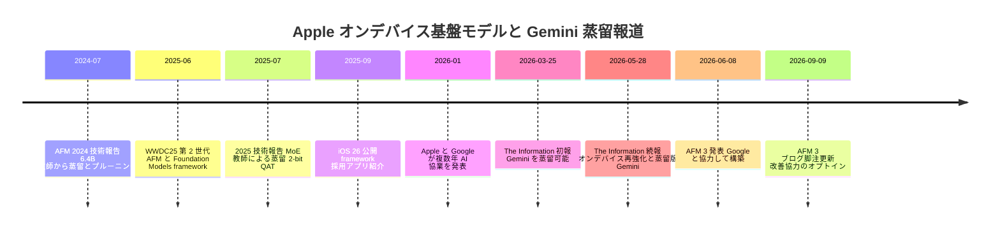
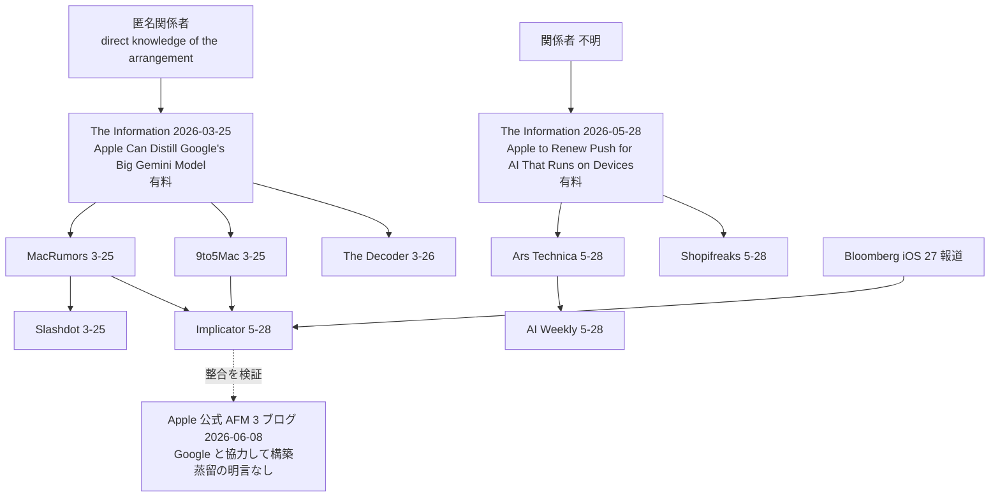
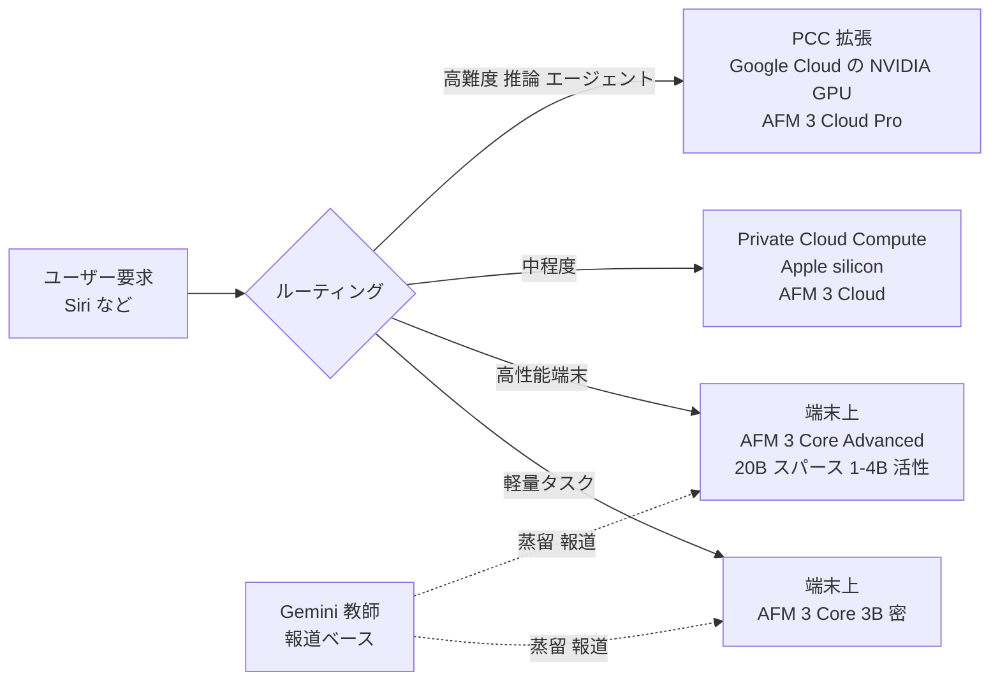
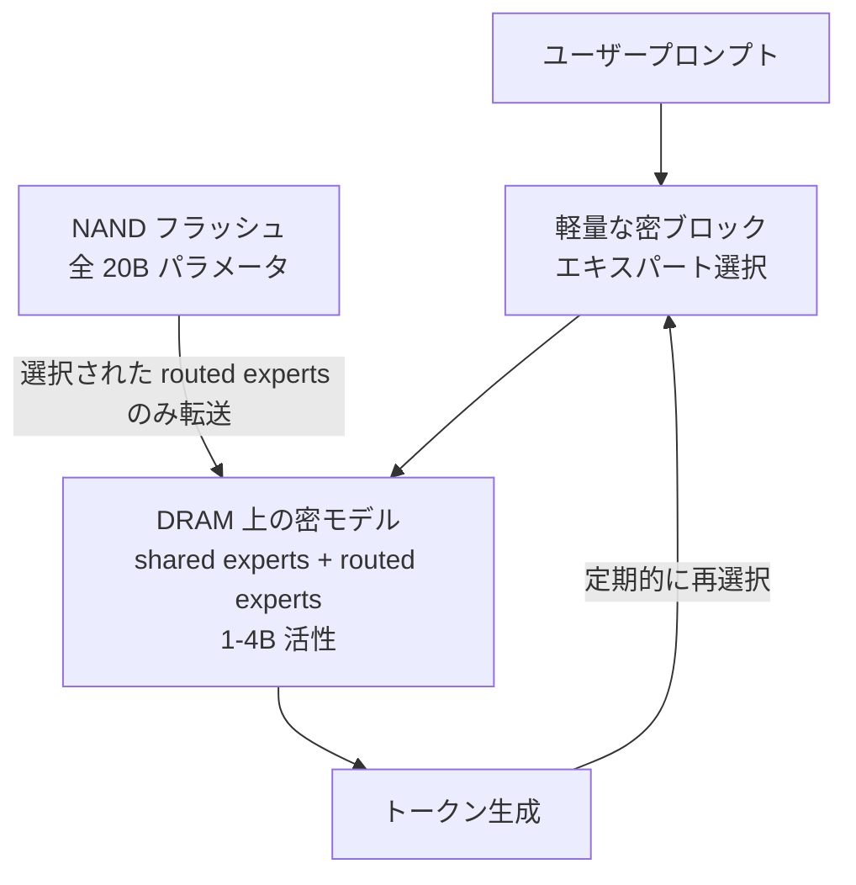
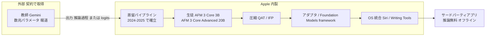

# Apple による Google Gemini 蒸留報道（2026 年 3〜5 月）とオンデバイス AI 戦略

- **Company/Organization**: Apple（学習側・生徒側）／ Google（教師モデル Gemini 提供側）／ NVIDIA（クラウド側 Confidential Computing）
- **Industry**: コンシューマー端末・OS プラットフォーム／生成 AI 基盤モデル
- **Date**: 2026-03-25（初報: The Information）〜 2026-05-28（続報: The Information）、関連公式発表 2025-06-09 / 2025-09-29 / 2026-06-08
- **Link（主要）**:
  - The Information（原典・有料）: https://www.theinformation.com/newsletters/ai-agenda/apple-can-distill-googles-big-gemini-model （2026-03-25）／ https://www.theinformation.com/articles/apple-renew-push-ai-runs-devices-instead-cloud （2026-05-28）
  - The Decoder: https://the-decoder.com/apple-gets-full-gemini-access-and-uses-distillation-to-build-lightweight-on-device-ai/
  - Implicator.ai: https://www.implicator.ai/sources-say-gemini-distillation-shapes-apples-wwdc-ai-push/
  - Slashdot: https://apple.slashdot.org/story/26/03/25/1948215/apple-can-create-smaller-on-device-ai-models-from-googles-gemini
  - Shopifreaks: https://www.shopifreaks.com/apple-to-renew-its-on-device-ai-push-leaning-on-custom-silicon-and-a-distilled-version-of-googles-gemini-to-avoid-data-center-costs/
  - AI Weekly: https://aiweekly.co/alerts/apple-distills-google-gemini-for-on-device-iphone-ai
  - 追加取得（記事内リンクから）: MacRumors https://www.macrumors.com/2026/03/25/apple-google-gemini-distill-models/ ／ 9to5Mac https://9to5mac.com/2026/03/25/new-details-on-apple-google-ai-deal-revealed-including-gemini-changes-report/ ／ Ars Technica https://arstechnica.com/ai/2026/05/apple-reportedly-trying-to-distill-googles-multi-trillion-parameter-gemini-ai-to-run-on-iphone/
  - Apple 公式: https://www.apple.com/newsroom/2025/09/apples-foundation-models-framework-unlocks-new-intelligent-app-experiences/ ／ https://machinelearning.apple.com/research/introducing-third-generation-of-apple-foundation-models
  - （2026-10-22 追記）Apple 幹部の WWDC 2026 記者向け発言の報道: MacRumors（Hartley Charlton, 2026-06-09）https://www.macrumors.com/2026/06/09/apples-new-ai-contains-no-gemini/ （9to5Mac の報道を引用。AppleInsider の同趣旨記事 https://appleinsider.com/articles/26/06/08/apples-new-foundation-models-dont-contain-a-drop-of-gemini-as-we-said-they-wouldnt は HTTP 403 で未取得）
- **Type**: Business Case（主に二次報道。原典は有料の The Information。2026-10-22 追記: Apple 幹部の公開発言が報道で確認でき、一部はベンダー申告に格上げ）
- **調査日**: 2026-10-21
- **エビデンス区分の凡例**: 一次資料 = Apple / Google の公式文書 ／ ベンダー申告 = 当事者の主張で独立検証なし ／ 二次報道 = 報道（本件の「Gemini 蒸留」主張はすべて匿名関係者に基づく The Information 報道の転載・要約）

> **最重要の注意**: 「Apple が Gemini を蒸留している」という主張の**原典は The Information の有料記事 2 本**であり、本調査ではいずれも**本文を取得できなかった**（ペイウォール。取得できたのは見出し・著者・リード文のみ）。以下の内容は MacRumors / 9to5Mac / Slashdot / The Decoder / Ars Technica / Shopifreaks / Implicator / AI Weekly による**転載・要約（二次報道）**に基づく。Apple・Google の公式文書で「Gemini を教師とした蒸留」を明言したものは、本調査範囲では**確認できなかった**。
>
> **（2026-10-22 追記）Apple 幹部の公開発言を確認**: WWDC 2026 基調講演後の記者向けトーク（2026-06-08）で、Apple の AI 担当 VP Amar Subramanya 氏が、AFM Cloud Pro を除く 4 モデル（AFM Core / Core Advanced / Cloud / Cloud Image）について "All of these are custom built for Apple Silicon" "trained using proprietary data with reinforcement learning and **refined using outputs from Gemini frontier models**" と述べたと MacRumors（2026-06-09、9to5Mac 経由）が報じた。同席の Craig Federighi 氏は "For these models, we use none of the models that Google deploys to their customers" と発言。これにより、**「Gemini の出力で端末モデルを精錬した」ことは Apple 幹部の公開発言（ベンダー申告、報道経由）として確認できる**。ただし幹部発言に "distill" の語はなく（「distillation-based」は MacRumors・The Batch の筆者による表現）、方式は「教師出力による精錬」＝**黒箱（系列レベル）蒸留に相当する記述**にとどまる。白箱（logits）アクセスや「自社 DC 内での完全アクセス」は依然として The Information の匿名情報源のみ。

## Overview

2026 年 1 月に Apple と Google は複数年の AI 協業を発表した（共同声明の文言は Implicator 経由の引用で確認、二次報道）。その後 2026-03-25、The Information の "AI Agenda" コラム「Apple Can 'Distill' Google's Big Gemini Model」（Jessica E. Lessin, Amir Efrati, Erin Woo）が、**Apple は自社データセンター内で Gemini に完全アクセスでき、その出力と推論過程を使って小型モデルを学習（蒸留）できる**と報じた。さらに 2026-05-28 の同紙記事「Apple to Renew Push for AI That Runs on Devices, Instead of the Cloud」（Aaron Tilley）は、**データセンターコストを避けるため Apple silicon 上のオンデバイス AI を再強化し、そのために Gemini の蒸留版を使う**と報じた。

2026-06-08、Apple は第 3 世代 Apple Foundation Models（AFM 3）を「**Google と協力して custom-built した**」5 モデルのファミリーとして公式発表した（一次資料）。しかし公式文書は**「distillation」や「Gemini を教師にした」とは書いていない**。報道と公式発表は「Google の技術が AFM 3 の基盤にある」点では整合するが、**蒸留の方式（白箱 logits か、出力・推論過程による黒箱蒸留か）、対象モデル、契約上の権利範囲**はいずれも未確認である。

本ケースは、本ドメインの仮説 H5（**利用規約・契約が教師モデル選択を制約する**）に対し、「規約上は通常禁止されがちな“他社フロンティアモデルからの蒸留”を、**二者間契約で明示的な権利として購入する**」という事例を提供する点で重要である。

## Problem & Context

- **Apple の AI 遅れ**: WWDC 2024 で予告した個人文脈理解型 Siri が延期（MacRumors / Bloomberg 経由、Implicator が言及, 二次報道）。
- **自社モデルの能力上限**: 2025 年の約 3B オンデバイスモデルは Apple 自身が「一般世界知識のチャットボットとしては設計されていない」と明言（一次資料, `01-apple-foundation-models-2025.md`）。チャットボット型 Siri にはギャップがある。
- **データセンター投資の差**: Apple の前年 capex は 127.2 億ドルで、Meta 720 億ドル、Microsoft 880 億ドルを大きく下回る（The Information を Shopifreaks が要約, 二次報道）。
- **端末側の計算資源**: Arete Research の Richard Kramer は、Apple には「ユーザーが資金負担した」500 億ドル相当のオンデバイス計算資源があると推計（同上, 二次報道）。Computerworld は稼働端末 25 億台、R&D 比率が第 2 四半期に売上の 10.3%（前四半期 7.6%、前年同期比ドル額 34% 増）と報じた（Implicator 経由, 二次報道）。
- **端末の物理制約**: 端末上のモデルは最大でも数十億パラメータ、Gemini 最新版は**数兆パラメータ**（The Information を Ars Technica が引用, 二次報道）。RAM が足りず巨大モデルは載らない。
- **プライバシー・ブランド**: Apple は「オンデバイス＋Private Cloud Compute（PCC）」をプライバシー訴求の中核にしてきた。

## Solution

### 報道された仕組み（二次報道）

| # | 主張 | 出典（転載元） | 原典 | エビデンス |
|---|---|---|---|---|
| 1 | Apple は Google の Gemini モデルに**自社データセンター施設内で完全アクセス**（complete access）できる | 9to5Mac（The Information の引用文）、MacRumors、The Decoder | The Information 2026-03-25 | 二次報道（匿名関係者 1 名「direct knowledge of the arrangement」） |
| 2 | そのアクセスで**特定タスク用の小型モデル**や、**端末上で直接動く小型モデル**を作れる＝蒸留 | 同上 | 同上 | 二次報道 |
| 3 | 方法: Gemini に一連のタスクを解かせ、**高品質な回答と推論過程（rundown of the reasoning process / chain of thought）**を得て、それを小型モデルの学習データにする | MacRumors、Slashdot、The Decoder | 同上 | 二次報道 |
| 4 | 小型モデルは Gemini の**内部計算（internal computations）を模倣**でき、回答だけを真似るより効果的 | 9to5Mac（The Information の説明として）、MacRumors | 同上 | 二次報道（技術的には要検証、後述） |
| 5 | Apple は Gemini を**編集（edit）**して Apple の望む応答をさせられるが、Gemini は**チャットボットとコーディング向けに調整**されており Apple の要件に合わないことがある | MacRumors、Slashdot、The Decoder | 同上 | 二次報道 |
| 6 | Apple Foundation Models チームは Gemini とは別の自社モデル開発を継続 | MacRumors、9to5Mac、The Decoder | 同上 | 二次報道 |
| 7 | 既存の Google との契約の一環として、Gemini の一版を使い**端末上で動く小型の蒸留モデル**を学習 | Shopifreaks | The Information 2026-05-28 | 二次報道 |
| 8 | 複雑なクエリはクラウドへ。新 Siri の一部リクエストは **Google Cloud 上の Gemini** で実行、Apple は **NVIDIA の Confidential Computing** を承認 | Shopifreaks、Ars Technica | 同上 | 二次報道 |
| 9 | Apple は Gemini の巨大な未蒸留モデルを自社 PCC（M シリーズチップ基盤）上で動かすのに苦労 | Ars Technica | 同上 | 二次報道 |
| 10 | Apple はローカル AI 専業の Liquid AI 買収を検討した | Shopifreaks | 同上 | 二次報道 |
| 11 | Apple は Gemini アクセスに年約 10 億ドル支払う見込み | Implicator（Bloomberg 報道として） | Bloomberg | 二次報道 |
| 12 | データセンターアクセスは**契約上、蒸留に限定（scoped to distillation）**されている | AI Weekly のみ | （Ars Technica を出典とするが Ars 本文に該当記述なし） | **低信頼**（要約サイトの独自解釈の可能性） |

### Apple 公式の記述（一次資料）

- **2026-06-08 AFM 3 ブログ**:
  - "a family of five foundation models **custom-built in collaboration with Google**"
  - オンデバイス: **AFM 3 Core**（3B 密、前世代の後継）、**AFM 3 Core Advanced**（20B スパース、リクエストに応じ 1〜4B を活性化、最も高性能な Apple silicon 向け）
  - サーバー（PCC）: **AFM 3 Cloud**、**ADM 3 Cloud (Image)**、**AFM 3 Cloud Pro**（Google・NVIDIA と協力し、PCC を **Google Cloud 内の NVIDIA GPU** に拡張）
  - 学習: 「最新世代の cloud TPU で事前学習を大幅に拡大」「**全モデルが共通の初期基盤（common initial foundation）を共有**してから各アーキテクチャ・用途に特化」「SFT＋多段 RL」「QAT で大幅圧縮」
  - **“distill” の語、Gemini の名前、教師–生徒の関係は記載なし**
- **2026 年 1 月 Apple–Google 共同声明**（Implicator による引用, 二次報道。声明原文は本調査で未取得）: "After careful evaluation, Apple determined that Google's AI technology provides the most capable foundation for Apple Foundation Models" ／ "Apple Intelligence will continue to run on Apple devices and Private Cloud Compute, while maintaining Apple's industry-leading privacy standards."
- **2025 年技術報告**（一次資料）: オンデバイス約 3B の蒸留教師は**Apple 内製の MoE**（密 3B をスパースアップサイクル）。外部教師の記述なし。
- **（2026-10-22 追記）WWDC 2026 記者向けトークでの幹部発言**（ベンダー申告、MacRumors 2026-06-09 が 9to5Mac 経由で報道）:

| 発言者 | 発言（原文） | 対象モデル | 読み取り |
|---|---|---|---|
| Amar Subramanya（AI 担当 VP） | "All of these are custom built for Apple Silicon" ／ "trained using proprietary data with reinforcement learning and refined using outputs from Gemini frontier models" | AFM Cloud Pro を除く 4 モデル（AFM Core、AFM Core Advanced、AFM Cloud、AFM Cloud Image） | **Gemini の出力を学習に使った**＝教師出力による精錬（黒箱蒸留相当）。"distill" の語は不使用 |
| Amar Subramanya | "similar to Gemini frontier models" | AFM Cloud Pro | 品質の比較であり学習方法の記述ではない |
| Craig Federighi（SVP Software Engineering） | "The amount of the Google Assistant we use is none" ／ "For these models, we use none of the models that Google deploys to their customers" ／ "none of that client code is part of how we run on iOS" | 全般 | Google の配布モデル・クライアントコード・検索基盤は不使用。**重みの流用ではなく出力の利用**であることと整合 |

### 技術的解釈: 報道された「蒸留」はどの種類か

| 報道表現 | 対応する蒸留方式 | 必要なアクセス | 本件での妥当性 |
|---|---|---|---|
| 「回答と推論過程を学習データにする」 | **系列レベル蒸留／合成データ蒸留（黒箱）**。教師出力テキスト（CoT 含む）で生徒を SFT | API 相当の出力アクセスで足りる | 高い（最も一般的で、報道の具体的記述と一致） |
| 「内部計算を模倣」 | **logit 蒸留**（教師分布との KL）や**中間表現蒸留**（hidden state / attention の整合） | 教師の logits・内部活性への**白箱アクセス**が必要 | 「自社 DC 内で完全アクセス」が事実なら技術的に可能。ただし具体的手法は未確認 |
| 「Gemini を編集して望む応答をさせる」 | 教師側のファインチューニング（**蒸留ではない**） | 重みアクセス | 報道どおりなら教師の事前適応→蒸留という二段構成 |
| 「Gemini の一版を使い小型蒸留モデルを学習」 | 上記いずれか | — | 方式不明 |

- **真の蒸留か**: 報道の記述（教師の出力・推論過程を学習目標とする）は定義上**真の知識蒸留**に該当する。ただし**独立検証されておらず**、Apple 公式は「Google と協力して構築」とのみ述べるため、「Gemini 重みを初期化に使った派生モデル」「Gemini を基盤にしたファインチューニング」「蒸留」のいずれか（または組合せ）かは**公式には確定していない**。
- **AFM 3 Core Advanced の Instruction-Following Pruning（IFP）**は「プルーニング（圧縮）」であって蒸留ではないが、プルーニング後の回復学習に教師出力が使われる可能性はある（公式記述なし）。

## Results & Impact

### 公式に公表された成果（一次資料・ベンダー申告）

| 指標 | 前世代（2025） | AFM 3（2026） | 出典 |
|---|---|---|---|
| テキスト SxS 人手評価（AFM 3 Core vs 2025 オンデバイス） | 23.3% が前世代を選好 | 45.6% が AFM 3 Core を選好 | AFM 3 ブログ |
| 画像理解 SxS（どちらかを選好したケース） | — | 61% 超で AFM 3 Core を選好 | 同上 |
| テキスト SxS（AFM 3 Cloud vs 2025 AFM Server） | 8.7% | 64.7% | 同上 |
| 単側評価 総合満足度（AFM 3 Cloud） | 基準 | 約 36% 相対改善 | 同上 |
| 単側評価 指示追従（AFM 3 Cloud） | 基準 | 21% 相対改善 | 同上 |
| 画像理解 SxS（AFM 3 Cloud vs 2025） | 9.6% | 37.8% | 同上 |
| AFM 3 Cloud Pro vs AFM 3 Cloud | 基準 | テキスト約 10%・画像 14% の総合満足度相対改善、数学 14% 相対改善 | 同上 |
| 口述筆記 Overall Quality（AFM 3 Core Advanced 1B 活性 vs 既存システム） | 17.6% | 44.7% | 同上 |

**AFM 3 ブログ Table 1: TTS 人手評価（5 段階 MOS）**

| Metric | Current TTS | AFM 3 Core Advanced |
|---|---|---|
| General Voice | 3.87 | 4.15 |
| Conversational Voice | 3.82 | 4.24 |

（1B 活性サイズで評価。Apple は MOS 0.1 の上昇でも顧客体験上は明確な改善と説明。）

**注意**: これらの改善が「Gemini 蒸留」に起因するかは公式に一切説明されていない。改善要因は事前学習規模拡大、多段 RL、アーキテクチャ（IFP、PT-MoE 改良）など複数あり、**蒸留効果を分離した数値は存在しない**。

### 報道された経済的論点（二次報道）

| 指標 | 値 | 出典 |
|---|---|---|
| Apple 前年 capex | 127.2 億ドル | Shopifreaks（The Information 要約） |
| Meta capex | 720 億ドル | 同上 |
| Microsoft capex | 880 億ドル | 同上 |
| ユーザー資金によるオンデバイス計算資源（推計） | 500 億ドル相当 | 同上（Arete の Richard Kramer） |
| Apple 稼働端末数 | 25 億台 | Implicator（Computerworld） |
| R&D 比率 | 売上の 10.3%（前四半期 7.6%、前年比ドル額 +34%） | 同上 |
| Gemini アクセス対価 | 年約 10 億ドル | Implicator（Bloomberg） |
| Gemini 最新版の規模 | 数兆パラメータ | Ars Technica（The Information） |
| 端末上モデルの規模 | 最大で数十億パラメータ | Ars Technica |

```
Capex 比較（億ドル, 二次報道）
Apple       127.2  ███▌
Meta        720    ████████████████████
Microsoft   880    ████████████████████████▍
```

### Foundation Models framework の事業的成果（一次資料, 2025-09-29 Apple Newsroom）

- iOS 26 / iPadOS 26 / macOS 26 で、開発者が**約 3B のオンデバイス LLM** を利用可能に。**プライバシー保護・オフライン動作・推論無料（free of cost）**を訴求。Apple Intelligence 対応端末で Apple Intelligence 有効時に動作。
- 要素: Swift 統合、ガイド付き生成（一貫した出力形式）、ツール呼び出し（アプリへのコールバック）。
- Susan Prescott（WWDR 担当 VP）のコメント: Stoic の日記プロンプト、CellWalk の科学用語の会話的説明を例示。

| 分野 | アプリ | 利用内容（原文要旨） |
|---|---|---|
| 健康・フィットネス | SmartGym | ワークアウト記述→セット・回数・休憩・器具適応付きの構造化ルーティン、提案に理由説明、月次サマリー、コーチングメッセージ、パーソナライズ挨拶 |
| 健康・フィットネス | Stoic | 直近の日記から超パーソナルなプロンプトを完全オンデバイス生成、要約、関連エントリ整理、自然言語検索 |
| 健康・フィットネス | SwingVision | Core ML モデル出力（試合動画解析）を基にテニス・ピックルボールの助言 |
| 健康・フィットネス | 7 Minute Workout | 自然言語で怪我回避等の条件付きワークアウト生成 |
| 健康・フィットネス | Gratitude | 週次サマリー、日記からのアファメーション生成 |
| 健康・フィットネス | Train Fitness | 器具がない場合の代替種目推薦 |
| 健康・フィットネス | Motivation | お気に入りコンテンツを感情・テーマ別に整理 |
| 生産性 | Streaks | タスクの提案・自動分類 |
| 健康・フィットネス | Wakeout! | generable 構造で数千本の動画から運動休憩ルーティンを選択 |
| 教育 | CellWalk | 用語の会話的説明、ツール呼び出しでアプリ内科学情報にグラウンディング、学習者レベル適応 |
| 教育 | Grammo | 英文法 AI チューター、誤答理由の説明、問題の動的生成 |
| 教育 | Lil Artist | ImageCreator API と組み合わせ子ども向け絵本生成 |
| 教育 | Vocabulary | 単語をテーマ別に自動分類 |
| 教育 | Platzi | 視聴中の動画レッスンに関する質問応答 |
| 生産性 | Stuff | 入力から日付・タグ・リストを理解、Listen Mode・Scan Mode |
| クリエイティブ | VLLO | Vision framework と組み合わせ BGM・ステッカー提案 |
| 生産性 | Signeasy | 文書要約・要点抽出・質問応答 |
| 生産性 | Agenda | Ask Agenda（ノート横断の質問応答） |
| クリエイティブ | Detail: AI Video Editor | 下書きからテレプロンプター原稿、タイトル・説明・ハッシュタグ生成 |
| 生産性 | Essayist | PDF から引用文献情報を構造化 |
| 生産性 | OmniFocus 4 | プロジェクト・次アクション生成、タグ提案 |

**事業ロジック上の意味**: オンデバイス推論は Apple にとって**限界費用ほぼゼロ（電力・計算はユーザー端末負担）**であり、開発者に「推論無料」を提供できる。蒸留で端末モデルの品質を上げるほど、このプラットフォーム価値（＝App Store エコシステムの差別化）が増す。

## Figures & Tables

### 時系列



### 報道の伝播経路（情報の系譜）



### 報道された推論アーキテクチャ（オンデバイス／PCC／Google Cloud の三層）



（実線は Apple 公式の構成、点線は二次報道のみに基づく関係。）

### AFM 3 Core Advanced のアーキテクチャ（原典画像, 一次資料）


Figure 1 原文要旨: パラメータの大半は FFN の「エキスパート」重み。クエリに応じて少数のエキスパートを読み込み、共有の静的重みとパッチして DRAM 上に密モデルを形成。生成中に定期的にエキスパートを再選択。全モデルは NAND（フラッシュ）に格納され、トークン単位ではなく**プロンプト単位**でルーティングする（NAND→DRAM 帯域がトークン単位の入れ替えには遅すぎるため）。



### 主張の検証マトリクス（報道 vs 一次資料）

| 論点 | 報道（二次） | Apple 一次資料 | 判定 |
|---|---|---|---|
| Google 技術の採用 | Gemini への完全アクセス、蒸留 | AFM 3 は「Google と協力して custom-built」、共同声明で「Google の AI 技術が AFM の最も有能な基盤」 | **整合**（協業自体は公式確認） |
| 蒸留の実施 | Gemini の回答・推論過程で小型モデルを学習 | 公式文書に “distill” の語なし。2025 報告の教師は内製 MoE。（2026-10-22 追記）幹部発言 "refined using outputs from Gemini frontier models"（端末 2 モデルを含む 4 モデル） | **出力ベースの蒸留に相当する記述を幹部発言で確認**（2026-10-22 訂正: 旧判定「未確認」→「ベンダー申告で確認、方式は黒箱相当」）。白箱 logits・自社 DC 内アクセスは未確認のまま |
| オンデバイス重視 | データセンターコスト回避のためオンデバイス再強化 | AFM 3 Core / Core Advanced を発表、Core Advanced は NAND 常駐のスパース設計 | **整合** |
| クラウド部分 | Google Cloud 上の Gemini、NVIDIA Confidential Computing | AFM 3 Cloud Pro は Google Cloud の NVIDIA GPU に PCC を拡張 | **整合**（ただし公式は「Gemini が動く」とは言わず「AFM 3 Cloud Pro」） |
| プライバシー | クラウド依存はプライバシー訴求の後退（Ars） | PCC の同一保証を維持、データは誰にも保存・共有されない | 解釈が分かれる |
| 契約範囲 | 蒸留に限定（AI Weekly） | 記載なし | **低信頼** |
| 規模 | Gemini は数兆パラメータ | 記載なし | 未確認 |

## 事業ロジックの分析

### 1. データセンターコスト回避（コスト構造の転換）

- Apple の capex は Meta の約 1/6、Microsoft の約 1/7（二次報道の数値から本レポート算出）。フロンティア級モデルを自前で学習・大規模推論するインフラ投資を避け、**教師の知能を契約で買い、推論は端末（ユーザー負担の計算資源）に寄せる**構図。
- 蒸留はこの構図の要: 「教師（Gemini）の知能 × 端末の計算資源」を結合する変換器。推論コストの大半がクラウド→端末に移ると、ユーザー数に比例する変動費がほぼ消える。
- ただし Ars Technica によれば、端末だけでは足りず**クラウド部分は不可避**で、しかも Apple 自前の PCC では未蒸留 Gemini を動かすのに苦労し、Google Cloud + NVIDIA に頼る。すなわち「コスト回避」は**部分的**。

### 2. プライバシー

- オンデバイス推論はデータが端末外に出ない。Foundation Models framework の訴求（Stoic「全て端末内で生成」）と一致。
- 蒸留はプライバシー面でも有利: 教師（Gemini）は学習時にのみ使われ、推論時のユーザーデータは Google に渡らない（少なくともオンデバイス経路では）。
- 一方、高難度要求は Google Cloud 内の NVIDIA GPU 上の PCC 拡張で処理され、Apple は Confidential Computing で保証を維持すると主張。

### 3. 契約条件と教師モデル選択（仮説 H5 との関係）

- 一般に、フロンティアモデル提供者の API 利用規約は、出力を競合モデル開発に使うことを制限する条項を含むことが多い（本レポートでは Google の当該規約条文を未確認のため一般論として記載）。The Decoder は本件を「中国の AI 企業が密かに行っていると**される**ことを、Apple は**対価を払って**行っている」と表現している。
- 本件の報道が正しければ、Apple は**二者間契約で「自社 DC 内での完全アクセス＋蒸留権」を取得**している。これは:
  - **H5 を支持**: 規約が教師選択を制約するからこそ、大企業は**契約で蒸留権を買う**必要がある。蒸留権は交渉可能な資産（AI Weekly は「蒸留権を中心にした新しいライセンス類型」と評する, 二次報道・論評）。
  - **H5 の境界条件**: 交渉力（25 億台の配布網、Google にとっての検索・既存関係）を持つ企業のみがこのルートを取れる。中小企業は規約の範囲内（自社モデル・オープンウェイト教師・許諾済み API）で教師を選ぶしかない。
- 「白箱アクセス」の価値: 9to5Mac / MacRumors が伝える「内部計算の模倣」は、logits / 中間表現を使う白箱蒸留でしか実現できない。API 経由の黒箱蒸留より高品質な蒸留が可能になる点が、契約の付加価値と推定される（技術的推論、未検証）。

### 4. 内製能力の維持

- Apple は 2024・2025 年に**内製教師による蒸留パイプライン**（6.4B 密教師 → アップサイクル MoE 教師）を確立済み（一次資料）。外部教師への切替えは、このパイプラインの「教師スロット」に Gemini を差し込む形で実装可能であり、技術的な移行コストは比較的小さいと推定される。
- 報道は AFM チームが独自モデル開発を継続と伝え、公式も「AFM」ブランドを維持。教師を外部化しても**生徒（端末モデル）・圧縮・アダプタ・OS 統合は Apple 側に残る**構図。



### 5. リスク（報道が指摘したもの）

- Gemini はチャットボット・コーディング向けに調整されており、Apple の Siri 要件と合わない（The Information, 二次報道）。
- 蒸留モデルが推論ベンチマークで期待を下回れば、2024〜2025 年の Siri 信頼性問題を繰り返すリスク（AI Weekly の論評）。
- 規制リスク: 端末モデルが Gemini に酷似すれば EU AI Act や米競争法の観点で問題視されうる（AI Weekly の論評, 根拠薄）。
- Confidential Computing による処理遅延（Ars Technica）。

## Lessons Learned

1. **「教師の知能を契約で買い、推論を端末へ寄せる」は、インフラ投資で劣後するプラットフォーマーの合理的戦略**である。蒸留はその要となる変換技術。
2. **蒸留権は契約交渉の対象になりうる**。API 利用規約の下では困難な他社フロンティアモデルからの蒸留も、二者間契約なら可能（報道ベース）。H5 の「規約が教師選択を制約する」は、**交渉力のない企業には強く、ある企業には弱く効く**。
3. **白箱アクセスの有無が蒸留品質を左右する**。「回答と推論過程」だけなら黒箱蒸留、「内部計算の模倣」なら白箱が必要。契約で何が許されるかが技術方式を決める。
4. **蒸留だけで完結しない**: 端末モデルの能力上限があるため、ハイブリッド（端末＋PCC＋外部クラウド）構成が必要になる。
5. **公式発表と報道の乖離に注意**: Apple 公式は「Google と協力して構築」以上を語っていない。事業判断の根拠として「Apple は Gemini を蒸留している」を使う場合は、**二次報道（匿名情報源）**であることを明示すべき。
6. **開発者向け無料推論はプラットフォーム戦略の一部**: Foundation Models framework は、蒸留で底上げされた端末モデルを App エコシステムに配布する経路であり、端末モデル品質の向上がそのまま開発者価値に転化する。

## Notes

- **取得状況**:
  - The Information 2 記事: **本文取得不可（ペイウォール）**。見出し・著者（2026-03-25: Jessica E. Lessin, Amir Efrati, Erin Woo ／ 2026-05-28: Aaron Tilley）・公開日時・リード文のみ取得。
  - The Decoder（Matthias Bastian, 2026-03-26）: 無料部分のみ取得（以降は購読者向け）。
  - Implicator（Marcus Schuler, 2026-05-28）、Slashdot（BeauHD, 2026-03-25）、Shopifreaks（Paul Drecksler, 2026-05-28）、AI Weekly（Alexis Dufresne, 2026-05-28）: 取得成功。
  - MacRumors（Juli Clover, 2026-03-25）、9to5Mac（Ryan Christoffel, 2026-03-25）、Ars Technica（Ryan Whitwam, 2026-05-28）: 記事内リンクから追加取得成功。
  - Apple Newsroom（2025-09-29）、Apple ML の AFM 3 ブログ（2026-06-08、2026-09-09 脚注更新）: 取得成功。
  - Apple–Google 共同声明（2026 年 1 月）の原文: 未取得（Implicator の引用のみ）。Bloomberg / Computerworld / CNN の原記事: 未取得（Implicator 経由）。
  - （2026-10-22 追記）MacRumors 2026-06-09「Apple's New AI Models Contain 'None' of Google's Gemini Assistant」: 取得成功（幹部発言の引用元。9to5Mac の原記事 URL は未特定）。AppleInsider 2026-06-08: HTTP 403 で未取得。Apple ML Research の 2026 年投稿一覧（先頭 10 万字）に AFM 3 の技術報告は見当たらず、**2026 年版技術報告は本追記時点でも未公開**と判断。
- **（2026-10-22 追記）判定の更新**: 本レポートの結論「Apple 公式は蒸留を明言していない」は公式文書については変わらないが、**幹部の公開発言で「Gemini 出力による精錬」が確認できた**ため、index の証拠の質を「二次報道」から「ベンダー申告（幹部発言の報道）＋二次報道」に改めた。「Lessons Learned 5」の「二次報道（匿名情報源）であることを明示すべき」は、「出力による精錬はベンダー申告、白箱アクセス・契約条件は匿名情報源」と二段に分けて記述すべき、に読み替える。
- **AI Weekly の見出し**は Ars Technica の原題を「Apple Reportedly Trying to Distill Google's Multi-Trillion-Parameter Gemini AI to Run On-Device on iPhone」としているが、取得した Ars 記事の表示見出しは「Apple working to cram massive Gemini model into iPhone to power new Siri」（URL スラッグは前者に対応）。見出し変更があった可能性。
- **AI Weekly の「Campos」（iOS 27 の刷新チャットボットのコードネーム）**、「iPhone 17 サイクル」などは他の取得資料で裏付けを得られなかった。
- **関連レポート**: `01-apple-foundation-models-2025.md`（Apple 自身の蒸留パイプライン、内製教師、2-bit QAT、Foundation Models framework の詳細）。
- **追加調査候補**: 2026 年版 AFM 技術報告（AFM 3 ブログで「夏の後半に公開予定」とされたが本調査時点で未確認）、Apple Security Research の PCC on NVIDIA GPU 解説、Google 側の発表（Gemini の Apple 向け提供条件）、Liquid AI 買収検討の続報。
