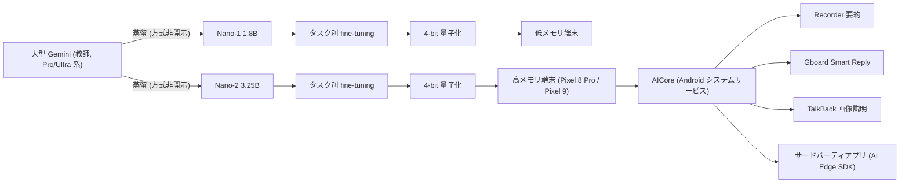
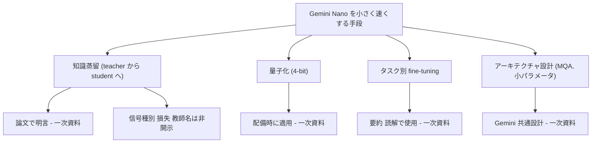
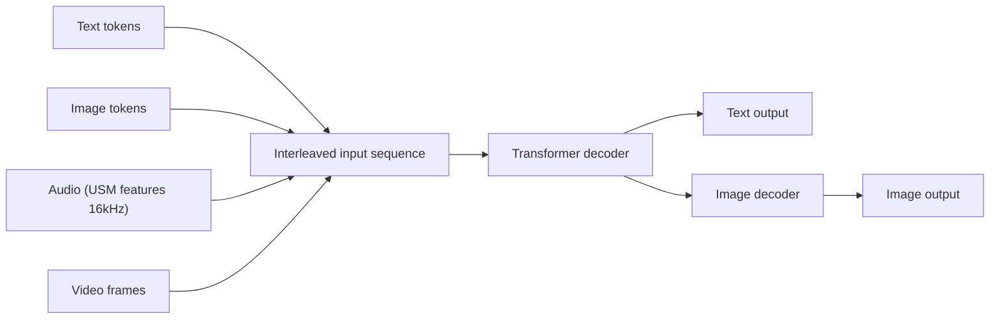
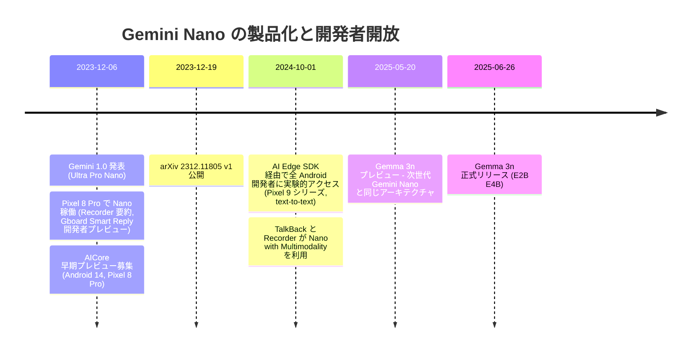

# Gemini: A Family of Highly Capable Multimodal Models — Gemini Nano（Nano-1 / Nano-2）部分の詳細

- **Link**: https://arxiv.org/abs/2312.11805 （HTML: https://arxiv.org/html/2312.11805v4 / PDF: https://arxiv.org/pdf/2312.11805）
- **Authors**: Gemini Team, Google（著者は "Gemini Team, Google" 名義。個人著者リストは論文末尾の貢献者一覧に数百名規模で記載）
- **Year**: 2023（arXiv v1: 2023-12-19、v2: 2024-04-02、v3: 2024-05-20、v4: 2024-06-17、v5: 2025-05-09）
- **Venue**: arXiv technical report（cs.CL）
- **Type**: Academic Paper（＋製品・ビジネス文脈として Google 公式ブログ 4 本を併用）
- **本レポートのスコープ**: 論文全体のうち **Gemini Nano（オンデバイス向け小型モデル）に関わる記述・表のみ** を対象とする。Ultra/Pro 単独の結果は Nano との比較に必要な範囲でのみ引用する。
- **併用した二次ソース（いずれも Google 公式＝ベンダー申告）**:
  - Android Developers Blog "Gemini Nano is now available on Android via experimental access"（2024-10-01, Taj Darra）https://android-developers.googleblog.com/2024/10/gemini-nano-experimental-access-available-on-android.html
  - Google Keyword Blog "Pixel 8 Pro — the first smartphone with AI built in — is now running Gemini Nano…"（2023-12-06, Brian Rakowski）https://blog.google/products/pixel/pixel-feature-drop-december-2023/
  - Google Keyword Blog "Introducing Gemini: our largest and most capable AI model"（2023-12-06, Sundar Pichai ほか）https://blog.google/technology/ai/google-gemini-ai/
  - Google Developers Blog "Introducing Gemma 3n: The developer guide"（2025-06-26）https://developers.googleblog.com/en/introducing-gemma-3n-developer-guide/ と、そのプレビュー記事 "Announcing Gemma 3n preview"（2025-05-20）https://developers.googleblog.com/en/introducing-gemma-3n/
- **取得状況**: arXiv HTML(v4)/PDF・上記ブログはすべて取得成功。指定された `store.google.com/intl/en/ideas/articles/pixel-feature-drop-december-2023/` は **現行の別ページ（Gemini Intelligence 紹介ページ）へリダイレクトされ、2023 年 12 月の記事本文は取得できなかった**。代わりに同日公開の Google Keyword Blog 版（上記）を使用した。

> **証拠の質の凡例**: 【一次資料】= 論文本文・表（Google 自身の技術報告だが査読前）／【ベンダー申告】= Google の製品ブログ・開発者ブログ／【二次報道】= 第三者メディア。本レポートでは Nano に関する主張それぞれにタグを付す。

## Abstract

This report introduces a new family of multimodal models, Gemini, that exhibit remarkable capabilities across image, audio, video, and text understanding. The Gemini family consists of Ultra, Pro, and Nano sizes, suitable for applications ranging from complex reasoning tasks to on-device memory-constrained use-cases. Evaluation on a broad range of benchmarks shows that our most-capable Gemini Ultra model advances the state of the art in 30 of 32 of these benchmarks — notably being the first model to achieve human-expert performance on the well-studied exam benchmark MMLU, and improving the state of the art in every one of the 20 multimodal benchmarks we examined. We believe that the new capabilities of the Gemini family in cross-modal reasoning and language understanding will enable a wide variety of use cases. We discuss our approach toward post-training and deploying Gemini models responsibly to users through services including Gemini, Gemini Advanced, Google AI Studio, and Cloud Vertex AI.

## Abstract (Japanese Translation)

本報告は、画像・音声・動画・テキストの理解にわたって卓越した能力を示す新しいマルチモーダルモデル群 Gemini を紹介する。Gemini ファミリーは Ultra・Pro・Nano の 3 サイズから成り、複雑な推論タスクから、メモリ制約の厳しいオンデバイス用途まで幅広い用途に適する。広範なベンチマークでの評価では、最上位の Gemini Ultra が 32 ベンチマーク中 30 で最先端（SOTA）を更新し、特に代表的な試験型ベンチマーク MMLU で初めて人間の専門家レベルに到達し、調べた 20 のマルチモーダルベンチマークすべてで SOTA を改善した。Gemini ファミリーのクロスモーダル推論と言語理解の新しい能力は多様なユースケースを可能にすると考える。また、Gemini、Gemini Advanced、Google AI Studio、Cloud Vertex AI といったサービスを通じてモデルをユーザーに責任ある形で提供するための post-training と展開の方針についても論じる。

## Overview

Gemini 1.0 技術報告は大半が Ultra/Pro の性能に割かれているが、**オンデバイス LLM の事業化という観点では、Nano に関する数行の記述と 3 つの表（Table 1/3/4/7/11 の Nano 列）および Figure 3 が、Google が「大モデルを蒸留して端末に載せる」戦略を公式に宣言した一次資料**として重要である。要点は次のとおり。

1. **2 サイズ構成**: Nano-1 = **1.8B** パラメータ（低メモリ端末向け）、Nano-2 = **3.25B** パラメータ（高メモリ端末向け）。【一次資料: Table 1, §5.1.3】
2. **蒸留で学習**: "It is trained by distilling from larger Gemini models." — Nano は **より大きな Gemini モデルからの蒸留** で学習されたと明記。さらに "The Nano series of models leverage additional advancements in distillation and training algorithms" と、蒸留および学習アルゴリズムの改良を活用したと述べる。【一次資料: Table 1, §2】
3. **4-bit 量子化して配備**: "It is 4-bit quantized for deployment" — 配備時は 4 ビット量子化。【一次資料: Table 1】
4. **タスク別ファインチューニング**: 要約・読解では "per-task fine-tuning" で高性能を発揮。【一次資料: §5.1.3】
5. **性能**: Pro 比で Factuality 0.71/0.81（Nano-1/Nano-2、Figure 3 SVG から算出）、BoolQ では Pro 比 0.81/0.90 と、検索・事実系タスクで特に強い。一方で MBPP（コード）は Pro 比 0.33/0.45、NaturalQuestions Closed-book は 0.43/0.56 と、知識量・推論量を要するタスクでの劣化が大きい。【一次資料: Table 3, Figure 3】
6. **マルチモーダル・音声**: Nano でも画像理解（DocVQA 72.2/74.3%）や、Nano-1 の音声認識（YouTube en-us WER 5.5%）で Whisper・USM を上回るケースがある。【一次資料: Table 7, Table 11】
7. **製品展開**: 論文公開と同日（2023-12-06 の発表）に Pixel 8 Pro（Google Tensor G3）で Recorder の要約と Gboard の Smart Reply に搭載。Android 14 の新システムサービス **AICore** 経由で提供。2024-10 には Pixel 9 シリーズで全 Android 開発者に実験的アクセス（AI Edge SDK）を開放し、Nano-2 相当モデルを提供。【ベンダー申告】
8. **次世代**: 2025-05 の Gemma 3n プレビュー記事は「同じアーキテクチャが次世代 Gemini Nano を動かす」と明言（MatFormer / PLE 等）。ただし MatFormer は **入れ子（nested）学習** であり教師→生徒の蒸留ではない。【ベンダー申告】

**蒸留の分類（本ドメインでの位置づけ）**: 論文の記述から **「真の知識蒸留（teacher = 大型 Gemini → student = Nano）」が行われたことは一次資料で確認できる**。ただし **蒸留対象（ロジット / 出力系列 / 合成データ）、損失関数、温度、教師モデルの具体（Pro か Ultra か）、データ量はいずれも非開示**。4-bit 量子化（圧縮）と per-task fine-tuning（通常の教師ありファインチューニング）は蒸留とは別工程として記述されている。

## Problem

- **オンデバイス制約下での高品質 LLM**: スマートフォンはメモリ・電力・計算資源が限られ、データセンター級モデルはそのまま載らない（"on-device memory-constrained use-cases"）。【一次資料: Abstract】
- **端末メモリ階層の多様性**: 低メモリ端末と高メモリ端末が混在するため、単一サイズでは最適化できない（→ 1.8B / 3.25B の 2 サイズ）。【一次資料: Table 1】
- **小型化に伴う品質劣化**: 単純に小さいモデルをゼロから学習すると品質が不足するため、大型モデルの知識を移転したい（→ 蒸留）。【一次資料: §2 の記述からの解釈】
- **プライバシー・オフライン・推論コスト**: センシティブなデータを端末外に出さず、ネットワーク無しで動作し、推論ごとの追加コストを生まないこと。【ベンダー申告: Android Developers Blog / Keyword Blog】
- **アプリ開発者の配布負担**: 各アプリがモデル・ランタイムを同梱するとストレージと計算資源を大量に消費する（→ OS 常駐サービス AICore）。【ベンダー申告: Android Developers Blog】

## Proposed Method

**Gemini Nano: 大型 Gemini からの蒸留 + 4-bit 量子化 + タスク別ファインチューニング**

論文本文に記載された Nano 関連の技術要素を、本文の文言とともに整理する。

### 共通アーキテクチャ（Gemini 1.0 全体）【一次資料】

- **Transformer decoder** ベースで、TPU 上での安定学習と最適化推論のための改良を加えたもの。
- **32k コンテキスト長** で学習。**multi-query attention** など効率的な注意機構を採用。
- 画像・音声・動画をテキストと **インターリーブ入力** できる。視覚エンコーディングは Flamingo / CoCa / PaLI に着想を得るが、最初からマルチモーダル。画像は離散画像トークンで **ネイティブ出力** 可能。
- 音声は **USM（Universal Speech Model）特徴量 16kHz** を直接取り込む。
- トークナイザは **SentencePiece**（学習コーパス全体の大規模サンプルで学習）。

### Nano 固有の要素【一次資料】

| 要素 | 論文中の文言（原文） | 解釈・分類 |
|------|----------------------|------------|
| サイズ | "We trained two versions of Nano, with 1.8B (Nano-1) and 3.25B (Nano-2) parameters, targeting low and high memory devices respectively." | 端末メモリ階層別の 2 サイズ |
| 蒸留 | "It is trained by distilling from larger Gemini models." | **真の知識蒸留**（教師: 大型 Gemini、生徒: Nano）。方式は非開示 |
| 学習アルゴリズム | "The Nano series of models leverage additional advancements in distillation and training algorithms to produce the best-in-class small language models…" | 蒸留手法自体にも改良がある旨。詳細非開示 |
| 量子化 | "It is 4-bit quantized for deployment" | **事後的な圧縮（量子化）**。蒸留とは別工程 |
| タスク適応 | "These models excel in summarization and reading comprehension tasks with per-task fine-tuning." | **通常のファインチューニング**（タスク別）。蒸留ではない |
| 学習トークン量の方針 | "The smaller models are trained for significantly more tokens to improve performance for a given inference budget, similar to the approach advocated in Touvron et al. (2023a)." | 小型モデルは Chinchilla 最適より多いトークンで「過学習的に長く」学習（推論予算あたり性能を最大化） |
| データ | "Our pre-training dataset uses data from web documents, books, and code, and includes image, audio, and video data." | Nano 固有のデータ構成は非開示 |
| 学習インフラ | "We trained Gemini models using TPUv5e and TPUv4 … depending on their sizes and configuration." | Nano がどちらかは非開示 |

### 手法の分解（番号付きステップ）

論文は Nano の学習手順を明示的なステップとして書いていないため、以下は **論文の記述を工程順に並べ直したもの**（推定を含む箇所は明記）。

1. **教師モデルの用意**: 大型 Gemini モデル（"larger Gemini models"、複数形。Pro/Ultra のいずれかまたは両方と推定されるが非開示）を事前学習する。→ 出力: 教師モデル
2. **生徒アーキテクチャの決定**: 1.8B（Nano-1）と 3.25B（Nano-2）の decoder-only Transformer を用意（Gemini 共通アーキテクチャ、32k 文脈、MQA）。→ 出力: 生徒モデル初期値
3. **蒸留による事前学習**: 生徒を教師から蒸留して学習。小型モデルは推論予算あたり性能を高めるため、より多くのトークンで学習。→ 出力: 事前学習済み Nano（Figure 3 / Table 3 の評価対象 "pre-trained models"）
4. **タスク別ファインチューニング**: 要約・読解などのタスクごとに fine-tune（製品機能ごとのアダプタ等の詳細は非開示）。→ 出力: タスク特化 Nano
5. **4-bit 量子化**: 配備用に 4 ビットへ量子化。→ 出力: 端末配備用 Nano
6. **配備**: Pixel 8 Pro（Tensor G3）上の AICore に組み込み、Recorder / Gboard から利用（ベンダー申告）。

### 蒸留の一般形（参考：論文には数式なし）

論文は損失関数を一切示していない。以下は **標準的な知識蒸留の定式化（Hinton et al., 2015）を参考として示すもの** であり、Gemini Nano が実際にこの形を使ったという証拠はない。

$$
\mathcal{L}_{\text{KD}}(\theta) = \mathbb{E}_{x \sim \mathcal{D}} \sum_{t} \tau^2 \, \mathrm{KL}\!\left( p_T(\cdot \mid x_{<t}; \tau) \;\|\; p_S(\cdot \mid x_{<t}; \theta, \tau) \right)
$$

- $p_T$: 教師（大型 Gemini）の次トークン分布、$p_S$: 生徒（Nano）の次トークン分布、$\theta$: 生徒パラメータ
- $\tau$: 温度（ソフトターゲットの平滑化）、$x_{<t}$: 位置 $t$ 以前のトークン列、$\mathcal{D}$: 学習データ分布
- 系列レベル蒸留（教師の生成文で生徒を SFT）であれば $\mathcal{L} = -\mathbb{E}_{x}\sum_t \log p_S(\hat{y}_t \mid \hat{y}_{<t}, x)$（$\hat{y}$ は教師生成系列）となる。**Gemini 1.0 報告ではどちらかすら特定できない。**

### 4-bit 量子化の一般形（参考）

量子化方式（対称/非対称、per-channel/group、PTQ/QAT）も非開示。一般的な対称 per-channel 4-bit 量子化は次のとおり（参考）。

$$
\hat{W}_{ij} = s_i \cdot \mathrm{clip}\!\left(\mathrm{round}\!\left(\frac{W_{ij}}{s_i}\right), -8, 7\right), \quad s_i = \frac{\max_j |W_{ij}|}{7}
$$

- $W$: 重み行列、$s_i$: 出力チャネル $i$ のスケール、$\hat{W}$: 量子化後重み。
- 1.8B × 4bit ≒ 0.9GB、3.25B × 4bit ≒ 1.6GB（**重みのみの単純計算。論文に記載なし**。埋め込み・KV キャッシュ・ランタイムを含まない）。

**Features**:

- 端末メモリ階層に合わせた 2 サイズ（1.8B / 3.25B）
- 大型 Gemini からの蒸留（一次資料で明言されるが方式非開示）
- 4-bit 量子化で配備
- Gemini 共通のマルチモーダル入力（画像・音声）を Nano でも評価
- 要約・読解はタスク別ファインチューニングで強化

## Algorithm (Pseudocode)

論文に疑似コードは無い。以下は §2・Table 1・§4・§5.1.3 の記述を、事業者が同様のパイプラインを再現する観点で疑似コード化したもの（`// 非開示` は論文が具体を示していない箇所）。

```
Algorithm: Gemini Nano の構築と配備（Gemini 1.0 報告の記述からの再構成）
Input : 大型 Gemini 教師モデル T（"larger Gemini models"）
        マルチモーダル事前学習コーパス D（web 文書・書籍・コード・画像・音声・動画）
        端末メモリ階層 {low, high}
        製品タスク集合 K（例: 要約、読解、Smart Reply）
Output: 端末配備用 4-bit Nano モデル群 {Nano-1, Nano-2} × タスク適応

1. for tier in {low, high}:
2.     size ← 1.8B if tier == low else 3.25B          // Table 1
3.     S ← init_decoder_transformer(size, ctx=32k, attn=MQA)   // Gemini 共通設計
4.     N_tokens ← (Chinchilla 最適より大きい値)          // §4: 小型は "significantly more tokens"
5.     for batch x in D (N_tokens 分):
6.         target ← T の出力（ロジット or 生成系列）     // 非開示: 蒸留信号の種類
7.         loss ← distill_loss(S(x), target)             // 非開示: 損失・温度・混合比
8.         update S
9.     Nano_tier ← S                                      // "pre-trained" Nano（Fig.3/Table 3 の評価対象）
10. for k in K:
11.     Nano_tier,k ← finetune(Nano_tier, task_data_k)   // §5.1.3 "per-task fine-tuning"
12. Nano_tier,k ← quantize(Nano_tier,k, bits=4)          // Table 1 "4-bit quantized for deployment"
13. deploy Nano_tier,k to AICore on device (Pixel 8 Pro → Pixel 9 …)   // ベンダー申告
```

各ステップの説明:

- **行 1–3**: 端末クラスごとに生徒サイズを決める。Nano-2 は Nano-1 の約 1.8 倍のパラメータ（3.25/1.8 ≒ 1.81）。Android Developers Blog も "nearly twice the size of the predecessor" と表現。
- **行 4**: §4 の「小型モデルは推論予算あたり性能向上のため大幅に多いトークンで学習」（LLaMA と同じ思想）。
- **行 6–7**: 論文が明言するのは「蒸留で学習」まで。教師信号の種類は不明。
- **行 11**: 要約・読解の高性能は per-task fine-tuning の結果とされる。
- **行 12**: 量子化は配備時。量子化前後の精度差は論文に記載なし（Table 3 等の数値が量子化前か後かも明記されていない）。

## Architecture / Process Flow

### 蒸留〜配備のパイプライン（論文＋公式ブログから再構成）



### 圧縮手法の分類（本レポートでの区別）



### 端末上の推論スタック（Android Developers Blog の記述から再構成）

```
┌──────────────────────────── Android アプリ ───────────────────────────┐
│  Google アプリ: Recorder / Gboard / TalkBack / Pixel Screenshots      │
│  サードパーティ: AI Edge SDK (com.google.ai.edge.aicore:aicore:0.0.1-exp01) │
│      generativeModel.generateContent(...)  temperature / topK /        │
│      candidateCount / maxOutputTokens                                  │
└───────────────────────────────┬───────────────────────────────────────┘
                                ▼
┌──────────────────── AICore（Android システムサービス）────────────────┐
│  モデル・ランタイム・コンポーネントを OS 側で配布・管理                │
│  （アプリはモデルを同梱しない）                                        │
│  Gemini Nano（4-bit 量子化, Nano-2 相当 → 後に Multimodality 版）      │
└───────────────────────────────┬───────────────────────────────────────┘
                                ▼
           SoC アクセラレータ（Pixel 8 Pro: Google Tensor G3）
```

## Figures & Tables

### Table 1（論文）: Gemini 1.0 モデルファミリー概要【一次資料】

| Model size | Model description（原文） | 日本語要約 |
|------------|---------------------------|------------|
| Ultra | Our most capable model that delivers state-of-the-art performance across a wide range of highly complex tasks, including reasoning and multimodal tasks. It is efficiently serveable at scale on TPU accelerators due to the Gemini architecture. | 最高性能。推論・マルチモーダルを含む高難度タスクで SOTA。TPU 上で大規模に効率的に提供可能 |
| Pro | A performance-optimized model in terms of cost as well as latency that delivers significant performance across a wide range of tasks. This model exhibits strong reasoning performance and broad multimodal capabilities. | コスト・レイテンシ最適化。幅広いタスクで高性能 |
| Nano | Our most efficient model, designed to run on-device. We trained two versions of Nano, with 1.8B (Nano-1) and 3.25B (Nano-2) parameters, targeting low and high memory devices respectively. It is trained by distilling from larger Gemini models. It is 4-bit quantized for deployment and provides best-in-class performance. | 最も効率的なオンデバイス向け。1.8B/3.25B の 2 版を低/高メモリ端末向けに学習。**大型 Gemini から蒸留**。**4-bit 量子化**で配備 |

### Figure 2（論文）: Gemini のインターリーブ入出力


Gemini 全体（Nano を含む）共通の入出力形式。入力系列中の色分けされたトークンが各モダリティを表し、Transformer デコーダが画像デコーダ／テキストとして出力する。Mermaid による再現:



### Figure 3（論文）: 能力カテゴリ別の性能（Gemini Pro で正規化）【一次資料】

図の原典（SVG）: https://arxiv.org/html/2312.11805v4/capabilities_v2.svg


論文本文には数値が記載されていないため、**arXiv HTML 版の SVG の棒の高さ（Pro = 1.0 の棒高さ基準）から本レポートで算出した近似値** を示す（小数第 2 位、軸 0.0–1.4）。カテゴリ順は PDF のラベル x 座標で確認済み。

| 能力（50 超のベンチマークを 6 分類） | Nano 1 | Nano 2 | Pro | Ultra |
|--------------------------------------|--------|--------|-----|-------|
| Factuality | 0.71 | 0.81 | 1.00 | 1.07 |
| Long-Context | 0.50 | 0.67 | 1.00 | 1.24 |
| Math/Science | 0.54 | 0.61 | 1.00 | 1.31 |
| Summarization | 0.30 | 0.54 | 1.00 | 1.17 |
| Reasoning | 0.51 | 0.63 | 1.00 | 1.22 |
| Multilinguality | 0.65 | 0.78 | 1.00 | 1.11 |

```
Normalized Performance vs Pro（SVG から算出）
                 0.0       0.5       1.0       1.5
Factuality     N1 ██████████████▏ 0.71
               N2 ████████████████▏ 0.81
Long-Context   N1 ██████████ 0.50
               N2 █████████████▍ 0.67
Math/Science   N1 ██████████▊ 0.54
               N2 ████████████▏ 0.61
Summarization  N1 ██████ 0.30
               N2 ██████████▊ 0.54
Reasoning      N1 ██████████▏ 0.51
               N2 ████████████▌ 0.63
Multilingual   N1 █████████████ 0.65
               N2 ███████████████▌ 0.78
```

読み取り: Nano は **Factuality（検索系 QA）と Multilinguality で Pro の 7〜8 割** に達する一方、**事前学習モデルのままでは Summarization（Nano-1: 0.30）が最も弱い**。本文が「要約・読解は per-task fine-tuning で優れる」と書くのは、事前学習時点の弱さをタスク別 FT で補うことを示唆する（本レポートの解釈）。

### Table 3（論文）: Gemini Nano の事実性・推論・コード・STEM 性能（Pro 比）【一次資料】

論文の Table 3 そのもの（Nano-1 / Nano-2 の精度と Pro 正規化値）:

| Benchmark | Nano 1 accuracy | Nano 1 normalized by Pro | Nano 2 accuracy | Nano 2 normalized by Pro |
|-----------|-----------------|--------------------------|-----------------|--------------------------|
| BoolQ | 71.6 | 0.81 | 79.3 | 0.90 |
| TydiQA (GoldP) | 68.9 | 0.85 | 74.2 | 0.91 |
| NaturalQuestions (Retrieved) | 38.6 | 0.69 | 46.5 | 0.83 |
| NaturalQuestions (Closed-book) | 18.8 | 0.43 | 24.8 | 0.56 |
| BIG-Bench-Hard (3-shot) | 34.8 | 0.47 | 42.4 | 0.58 |
| MBPP | 20.0 | 0.33 | 27.2 | 0.45 |
| MATH (4-shot) | 13.5 | 0.41 | 22.8 | 0.70 |
| MMLU (5-shot) | 45.9 | 0.64 | 55.8 | 0.78 |

Caption（原文）: "Performance of Gemini Nano series on factuality, summarization, reasoning, coding and STEM tasks compared to significantly larger Gemini Pro model."

### Table 3 拡張: Pro / Ultra を並べた比較（本レポート作成）

Pro・Ultra の値は論文 Table 2 から転記（同一設定のもののみ）。Table 2 に無いベンチマークは、Table 3 の「精度 ÷ 正規化値」から **逆算した Pro 値（参考、Nano-1/Nano-2 からの 2 つの逆算値の範囲）** を示す。

| Benchmark | Nano-1 (1.8B) | Nano-2 (3.25B) | Pro | Ultra | 出典 |
|-----------|---------------|----------------|-----|-------|------|
| BoolQ | 71.6 | 79.3 | ≈88.1–88.4（逆算） | — | Table 3 |
| TydiQA (GoldP) | 68.9 | 74.2 | ≈81.1–81.5（逆算） | — | Table 3 |
| NaturalQuestions (Retrieved) | 38.6 | 46.5 | ≈55.9–56.0（逆算） | — | Table 3 |
| NaturalQuestions (Closed-book) | 18.8 | 24.8 | ≈43.7–44.3（逆算） | — | Table 3 |
| BIG-Bench-Hard (3-shot) | 34.8 | 42.4 | 75.0 | 83.6 | Table 2/3 |
| MBPP | 20.0 | 27.2 | ≈60.4–60.6（逆算） | — | Table 3 |
| MATH (4-shot) | 13.5 | 22.8 | 32.6 | 53.2 | Table 2/3 |
| MMLU (5-shot) | 45.9 | 55.8 | 71.8 | 83.7（5-shot）/ 90.04（CoT@32） | Table 2/3 |

整合性チェック: MMLU は 45.9 / 71.8 = 0.639 ≒ 0.64、55.8 / 71.8 = 0.777 ≒ 0.78、MATH は 13.5 / 32.6 = 0.414 ≒ 0.41 で Table 3 の正規化値と一致。BBH は 34.8 / 75.0 = 0.464（表は 0.47）と小さな丸め差がある。

### Nano-2 / Nano-1 のスケーリング効果（本レポート作成、Table 3 から算出）

| Benchmark | Nano-2 − Nano-1（pt） | Nano-2 / Nano-1（倍） |
|-----------|----------------------|-----------------------|
| BoolQ | +7.7 | 1.11 |
| TydiQA (GoldP) | +5.3 | 1.08 |
| NaturalQuestions (Retrieved) | +7.9 | 1.20 |
| NaturalQuestions (Closed-book) | +6.0 | 1.32 |
| BIG-Bench-Hard | +7.6 | 1.22 |
| MBPP | +7.2 | 1.36 |
| MATH | +9.3 | 1.69 |
| MMLU | +9.9 | 1.22 |

パラメータ 1.81 倍で、検索付き QA（BoolQ/TydiQA）の伸びは 1.1 倍程度に留まるのに対し、**MATH は 1.69 倍** と、推論・知識系ほど容量の恩恵が大きい。

### Table 4（論文）: WMT 23 翻訳（平均 BLEURT、1-shot）【一次資料】

| WMT 23 (Avg BLEURT) | Gemini Ultra | Gemini Pro | Gemini Nano 2 | Gemini Nano 1 | GPT-4 | PaLM 2-L |
|---------------------|--------------|------------|---------------|---------------|-------|----------|
| High Resource | 74.2 | 71.7 | 67.7 | 64.1 | 74.0 | 72.6 |
| Mid Resource | 74.7 | 71.8 | 67.0 | 64.8 | 73.6 | 72.7 |
| Out-of-English | 74.8 | 71.5 | 66.2 | 65.2 | 73.6 | 72.2 |
| Into-English | 73.9 | 72.0 | 69.0 | 63.5 | 74.1 | 73.4 |
| All languages | 74.4 | 71.7 | 67.4 | 64.8 | 73.8 | 72.7 |

Caption: "Performance of Gemini models on WMT 23 translation benchmark. All numbers with 1-shot." 本文では翻訳評価は post-trained Gemini API Ultra について述べており、Nano 列が pre-trained か post-trained かは表から明示されない。Nano-2 の All languages 67.4 は Pro（71.7）の 94%、Nano-1 の 64.8 は 90%。

### Table 7（論文）: 画像理解（pixel only＝外部 OCR 不使用）【一次資料】

| Benchmark | Gemini Ultra | Gemini Pro | Gemini Nano 2 | Gemini Nano 1 | GPT-4V | Prior SOTA |
|-----------|--------------|------------|---------------|---------------|--------|------------|
| MMMU (val) 大学レベル多分野問題 | 59.4% pass@1 / 62.4% Maj1@32 | 47.9% | 32.6% | 26.3% | 56.8% | 56.8%（GPT-4V, 0-shot） |
| TextVQA (val) 自然画像中の文字読取 | 82.3% | 74.6% | 65.9% | 62.5% | 78.0% | 79.5%（Google PaLI-3, fine-tuned） |
| DocVQA (test) 文書理解 | 90.9% | 88.1% | 74.3% | 72.2% | 88.4%（pixel only） | 88.4%（GPT-4V, 0-shot） |
| ChartQA (test) チャート理解 | 80.8% | 74.1% | 51.9% | 53.6% | 78.5%（4-shot CoT） | 79.3%（Google DePlot, 1-shot PoT） |
| InfographicVQA (test) インフォグラフィック理解 | 80.3% | 75.2% | 54.5% | 51.1% | 75.1%（pixel only） | 75.1%（GPT-4V, 0-shot） |
| MathVista (testmini) 数学的推論 | 53.0% | 45.2% | 30.6% | 27.3% | 49.9% | 49.9%（GPT-4V, 0-shot） |
| AI2D (test) 科学図表 | 79.5% | 73.9% | 51.0% | 37.9% | 78.2% | 81.4%（Google PaLI-X, fine-tuned） |
| VQAv2 (test-dev) 自然画像理解 | 77.8% | 71.2% | 67.5% | 62.7% | 77.2% | 86.1%（Google PaLI-X, fine-tuned） |

注: ChartQA のみ **Nano-1（53.6%）が Nano-2（51.9%）を上回る** 逆転がある（原表どおり）。評価対象は post-trained Gemini API モデル、greedy sampling、外部 OCR なし。

### Table 11（論文）: 音声認識（ASR）・音声翻訳（AST）【一次資料】

| Task | Benchmark | Metric | Gemini Pro | Gemini Nano-1 | Whisper | USM |
|------|-----------|--------|------------|---------------|---------|-----|
| ASR | YouTube (en-us) | WER (↓) | 4.9% | 5.5% | 6.5% (v3) | 6.2% |
| ASR | Multilingual Librispeech (en-us) | WER (↓) | 4.8% | 5.9% | 6.2% (v2) | 7.0% |
| ASR | FLEURS (62 lang) | WER (↓) | 7.6% | 14.2% | 17.6% (v3) | 11.8% |
| ASR | VoxPopuli (14 lang) | WER (↓) | 9.1% | 9.5% | 15.9% (v2) | 13.4% |
| AST | CoVoST 2 (21 lang) | BLEU (↑) | 40.1 | 35.4 | 29.1 (v2) | 30.7 |

本文: "Gemini Nano-1 model also outperforms both USM and Whisper on all datasets except FLEURS." Ultra は音声未評価。Pro は FLEURS 学習データを含むため有利だが、FLEURS 抜きで学習しても WER 15.8 で Whisper を上回るとの注記あり（Pro についての記述）。

### Android Developers Blog の表: Nano 1 vs Nano 2（2024-10-01）【ベンダー申告＋一部一次資料】

| Model | MMLU (5-shot)* | MATH (4-shot)* | Paraphrasing** | Smart Reply** |
|-------|----------------|----------------|----------------|---------------|
| Nano 1 | 46% | 14% | 44% | 44% |
| Nano 2 | 56% | 23% | 90% | 82% |

- \* "As reported in Gemini: A Family of Highly Capable Multimodal Models"（論文 Table 3 の 45.9/55.8、13.5/22.8 を丸めた値）。
- \*\* "Percentage of good answers measured on public datasets via an autorater powered by Gemini 1.5 Pro."（**Gemini 1.5 Pro による自動採点**。データセット名・件数は非開示 → ベンダー申告）。
- ブログは、開発者に提供されるモデルは論文で "Nano 2" と呼ばれるもので、"nearly twice the size of the predecessor (Nano 1)" と説明。

### 公式ブログ掲載の図（URL 埋め込み）


### Gemma 3n（次世代 Gemini Nano と共有アーキテクチャ）の図【ベンダー申告】


（画像キャプションは各画像直前の本文から付与。画像内の数値は本文に記載がないため転記していない。2026-10-22 整理: Nano の蒸留判定に直接関係しない Gemma 3n の性能チャート 4 点（Chatbot Arena Elo、Mix-n-Match の MMLU ×2、品質向上チャート）は掲載を外し、URL のみ残す — `image3_OjwrVp1.original.png`、`image4_5lfhlBO.original.png`、`Gemma_3n_Chart_1_RD1-V01_1.original.png`、`Artboard_1.original.png`（いずれも `storage.googleapis.com/gweb-developer-goog-blog-assets/images/` 配下）。）

### Gemini Nano 製品展開タイムライン（本レポート作成）



## Experiments & Evaluation

### Setup

- **評価対象モデル**: Figure 3 と Table 3 の Nano は "pre-trained models"（§5.1.3 本文）。Table 7（画像）は "post-trained Gemini API models"。Table 11（音声）は Nano-1 と Pro。量子化前後どちらの重みで評価したかは明記なし。【一次資料】
- **能力カテゴリ（Figure 3）**: 50 超のベンチマークを 6 能力に分類。【一次資料】
  - Factuality: open/closed-book の検索・質問応答
  - Long-Context: 長文要約・検索・QA
  - Math/Science: 数学問題、定理証明、科学試験
  - Reasoning: 算術・科学・常識推論
  - Multilingual: 多言語の翻訳・要約・推論
  - Summarization（図のカテゴリ。本文の列挙では明示されないが図に存在）
- **ベンチマーク（Table 3）**: BoolQ, TydiQA (GoldP), NaturalQuestions (Retrieved / Closed-book), BIG-Bench-Hard (3-shot), MBPP, MATH (4-shot), MMLU (5-shot)。
- **比較対象**: Gemini Pro（正規化基準）、Ultra。外部比較は Table 4/7/11 で GPT-4/GPT-4V/PaLM 2-L/Whisper/USM。
- **画像評価の条件**: 0-shot QA は各ベンチマークに合わせた短答指示、greedy sampling、外部 OCR 不使用（pixel only）。
- **音声評価の指標**: ASR は WER（↓）、AST は BLEU（↑）。FLEURS は学習データと言語が重複する 62 言語、中国語・日本語・韓国語・タイ語は CER。

### Main Results

1. **検索・事実系で強い**: "Despite their size, they show exceptionally strong performance on factuality, i.e. retrieval-related tasks"。BoolQ で Pro の 81%/90%、TydiQA で 85%/91%。【一次資料】
2. **知識・推論・コードで差が大きい**: NQ Closed-book（外部文書なし）は 0.43/0.56、MBPP は 0.33/0.45、BBH は 0.47/0.58。パラメータに蓄えられる知識量と推論能力の差が表れる。【一次資料】
3. **Nano-2 は MATH で大きく伸びる**: 13.5 → 22.8（Pro 比 0.41 → 0.70）。【一次資料】
4. **多言語翻訳は相対的に良好**: WMT23 All languages で Nano-2 67.4（Pro の 94%）。【一次資料】
5. **画像**: Nano-2 で DocVQA 74.3%、VQAv2 67.5%、TextVQA 65.9%。MMMU 32.6%、MathVista 30.6% と高度推論は弱い。【一次資料】
6. **音声**: Nano-1 が YouTube en-us WER 5.5%（Whisper v3 6.5%、USM 6.2% より良い）、CoVoST 2 BLEU 35.4（Whisper 29.1、USM 30.7 より良い）。FLEURS のみ 14.2% で USM（11.8%）に劣る。【一次資料】
7. **製品指標（Gemini 1.5 Pro autorater）**: Paraphrasing の good answer 率 Nano-1 44% → Nano-2 90%、Smart Reply 44% → 82%。【ベンダー申告】

### Ablation Study

- **蒸留あり／なしの比較、教師サイズの比較、量子化前後の精度比較は論文に一切ない**。Nano に関する唯一の "アブレーション的" 情報はサイズ比較（Nano-1 vs Nano-2）のみ。【一次資料での欠落】
- 参考: 同時期の他社事例では、Microsoft Phi Silica が 4-bit 量子化前後の精度表（lm-eval）を公開している（本ディレクトリの `04-phi-silica.md` 参照）。Gemini Nano の量子化劣化は公開情報からは評価できない。

## 製品・ビジネス文脈

### Pixel 8 Pro での初搭載（2023-12-06）【ベンダー申告】

- "Pixel 8 Pro — the first smartphone with AI built in — is now running Gemini Nano"（Keyword Blog タイトル）。
- "As the first smartphone engineered for Gemini Nano, it uses the power of **Google Tensor G3** to deliver two expanded features: **Summarize in Recorder** and **Smart Reply in Gboard**."
- 利点として "helping prevent sensitive data from leaving the phone, as well as offering the ability to use features without a network connection" を挙げる（プライバシー・オフライン）。
- Smart Reply は **developer preview** として開始し、WhatsApp・Line・KakaoTalk から数週間で展開、翌年に他メッセージアプリへ拡大予定。
- Recorder の要約は "even without a network connection" で動作。
- Gemini 発表記事（Pichai）: "Android developers will also be able to build with Gemini Nano … via **AICore**, a new system capability available in **Android 14**, starting on Pixel 8 Pro devices."
- 注: 論文本文には Pixel 8 Pro・Tensor G3・AICore への言及はない（製品情報はブログのみ）。

### 開発者開放（2024-10-01）【ベンダー申告】

- **対象**: 全 Android 開発者に AI Edge SDK 経由で実験的アクセス。当初は **Pixel 9 シリーズ** で **text-to-text** のみ。"experimental access is for development purposes, and is not for production usage at this time."
- **オンデバイスの 3 つの利点**: (1) センシティブデータを端末内で処理、(2) インターネット無しで完全動作、(3) **推論ごとの追加金銭コストなし**（"no additional monetary cost for each inference"）。
- **適用範囲の限定**: 端末モデルはクラウドより "significantly smaller and less generalized" なため、**チャットボットのような open-ended 用途ではなく、要求が明確に規定できるタスク** に向く。推奨ユースケース:
  - Rephrasing（口調をカジュアル/フォーマルに書き換え）
  - Smart reply（スレッドから次の返信候補）
  - Proofreading（綴り・文法の修正）
  - Summarization（長文書を段落または箇条書きで要約）
- **Google アプリでの利用**: Pixel Screenshots、TalkBack（マルチモーダルで画像説明を改善）、Pixel Recorder（"Gemini Nano with Multimodality" で長時間録音と高品質要約）。
- **AICore**: "a new system service in Android" — アプリがランタイム・モデル等を自前配布せずにオンデバイス AI を使える。
- **AI Edge SDK**: 依存関係 `com.google.ai.edge.aicore:aicore:0.0.1-exp01`。推論パラメータ: Temperature、Top K、Candidate count、Max output tokens。複数文字列入力（`content { text(...) }`）に対応。

### 事業モデルとしての意味（本レポートの分析）

| 観点 | Gemini Nano の設計判断 | 事業上の効果 |
|------|------------------------|--------------|
| モデル供給 | 大型 Gemini から蒸留した自社小型モデル | フラッグシップモデル資産を端末向けに再利用（教師コストは既存投資） |
| 配布 | OS 常駐の AICore で一元管理 | アプリごとのモデル同梱を不要化。プラットフォームロックイン（Pixel → 対応端末） |
| 差別化 | Pixel 8 Pro を "first smartphone engineered for Gemini Nano" と訴求 | ハードウェア販売の差別化要因に |
| コスト構造 | 推論は端末側 | 推論ごとのサーバ費用がゼロ（Google 側・開発者側とも） |
| 適用範囲 | 明確に定義されたタスクに限定、タスク別 FT | 品質リスクを限定し、要約・返信候補など高頻度機能に集中 |
| 開発者エコシステム | 実験的アクセス → 段階的拡大 | 本番利用は当初不可。プラットフォーム整備を先行 |

## Gemma 3n と次世代 Gemini Nano の関係【ベンダー申告】

### 共有アーキテクチャの明言

- 指定された 2025-06-26 の開発者ガイド本文には **"Gemini Nano" の語は登場しない**（本文テキストを確認）。
- 一方、そこからリンクされた **2025-05-20 のプレビュー記事** は次のように明言する:
  - "To power the next generation of on-device AI and support a diverse range of applications, including advancing the capabilities of Gemini Nano, we engineered a new, cutting-edge architecture. This next-generation foundation was created in close collaboration with mobile hardware leaders like Qualcomm Technologies, MediaTek, and Samsung's System LSI business…"
  - "Gemma 3n is our first open model built on this groundbreaking, shared architecture… The same advanced architecture also powers the next generation of Gemini Nano, which … will become available later this year."
  - "…mobile-first architectural innovations that will be available on Android and Chrome with Gemini Nano."

### Gemma 3n の技術要素（開発者ガイドより）

| 要素 | 内容 | 蒸留との関係 |
|------|------|--------------|
| サイズ | E2B / E4B（effective パラメータ）。生パラメータは 5B / 8B。メモリは最小 2GB（E2B）/ 3GB（E4B） | — |
| MatFormer | Matryoshka Transformer。E4B の学習中に E2B サブモデルを **同時最適化**。E2B 抽出版は最大 2 倍高速。Mix-n-Match で FFN 隠れ次元（8192〜16384）と層スキップによりサイズを切り出し | **入れ子学習（nested training）であり、教師→生徒の知識蒸留ではない**（記事に蒸留との記述なし） |
| PLE (Per-Layer Embeddings) | 層ごとの埋め込みを CPU 側でロード・計算し、アクセラレータ常駐は約 2B（E2B）/ 4B（E4B）のみ | メモリ配置の工夫（蒸留ではない） |
| KV Cache Sharing | 中間層の K/V を上位層で共有し、prefill を Gemma 3 4B 比 **2 倍** 高速化 | 推論最適化 |
| 音声エンコーダ | USM ベース、160ms ごとに 1 トークン（約 6 tokens/s）。起動時は 30 秒まで | — |
| MobileNet-V5-300M | 256/512/768px 対応、Pixel 上で最大 60fps。Gemma 3 の SoViT 比で Pixel Edge TPU 上 **13 倍高速（量子化あり、なしで 6.5 倍）、パラメータ 46% 減、メモリ 4 分の 1** | **"advanced distillation techniques" を明記**（視覚エンコーダ側で蒸留あり。詳細は今後の技術報告） |
| その他 | LAuReL、AltUp、140 言語テキスト・35 言語マルチモーダル、E4B の LMArena スコア 1300 超（10B 未満で初） | — |

プレビュー記事の追加主張: Gemma 3 4B 比で応答開始が **約 1.5 倍高速**、WMT24++（ChrF）**50.1%**、"advanced activation quantization" を使用。

**分類上の注意**: 次世代 Gemini Nano が Gemma 3n と「アーキテクチャを共有」することは公式に明言されているが、**次世代 Nano 自体が大型 Gemini から蒸留されているかは、これらの記事では述べられていない**。蒸留の明示は (a) Gemini 1.0 Nano（論文 Table 1）と (b) MobileNet-V5 視覚エンコーダ（開発者ガイド）に限られる。

## 関連オンデバイス LLM との比較（本レポート作成）

| 項目 | Gemini Nano-1 / Nano-2 | Phi-3-mini | Phi Silica | Gemma 3n E2B / E4B |
|------|------------------------|------------|------------|--------------------|
| 提供元 | Google | Microsoft | Microsoft | Google |
| パラメータ | 1.8B / 3.25B | 3.8B | 3.3B（二次報道）、Phi-3.5-mini 派生（ベンダー申告） | 生 5B / 8B（effective 2B / 4B） |
| 大型モデルからの蒸留 | **明言あり**（Table 1、方式非開示） | Phi-3 報告に蒸留の記述なし（合成データ＋フィルタ済み web） | 基盤モデルに蒸留の記述なし。LoRA タスク特化で GPT-4o 教師の合成データ蒸留（Learning Zone 事例） | LM 本体は MatFormer 入れ子学習。視覚エンコーダは蒸留明記 |
| 量子化 | 4-bit（配備時） | 4-bit で約 1.8GB（iPhone 14 で 12 tokens/s 超） | 4-bit 重み（QuaRot + GPTQ）、一部 8-bit | "advanced activation quantization"（詳細非開示） |
| 主な配備先 | Pixel 8 Pro → Pixel 9 等（AICore） | 研究デモ（iPhone 14） | Copilot+ PC NPU（Windows 内蔵） | オープンモデル（HF, llama.cpp, Ollama 等） |
| 配布形態 | OS システムサービス（AICore） | オープンウェイト | OS 内蔵（Windows AI APIs, LAF） | オープンウェイト |
| 開示の深さ | 低（サイズ・蒸留・4bit の 3 点のみ） | 中〜高（技術報告） | 高（量子化・メモリ最適化をブログで詳細開示） | 中（ブログ、技術報告予告） |

## Notes

### 蒸留の真偽判定（本ドメイン向け結論）

| 主張 | 判定 | 根拠の質 |
|------|------|----------|
| Gemini Nano は大型 Gemini モデルから蒸留で学習された | **真の知識蒸留と確認（ただし方式非開示）** | 一次資料（論文 Table 1, §2） |
| 蒸留信号がロジットか合成データか | 不明 | 記載なし |
| 教師は Ultra / Pro のどれか | 不明（"larger Gemini models" と複数形） | 記載なし |
| 4-bit 量子化 | 確認（蒸留とは別の圧縮工程） | 一次資料 |
| 要約・読解の per-task fine-tuning | 確認（通常の FT。蒸留ではない） | 一次資料 |
| 次世代 Nano が Gemma 3n と同アーキテクチャ | 確認 | ベンダー申告 |
| 次世代 Nano も蒸留で学習 | 不明 | 記載なし |
| MatFormer は蒸留か | **否**（入れ子学習。記事に蒸留との記述なし） | ベンダー申告 |

### 実務上の示唆

1. **「フラッグシップの蒸留 → 4-bit → タスク別 FT → OS 常駐サービス」** という 4 段構成は、端末ベンダー兼モデル提供者にとっての標準形になりつつある（Apple Foundation Models、Microsoft Phi Silica と比較対象）。
2. **事前学習時点の要約性能は低い（Nano-1 で Pro の 0.30）** ため、製品機能ごとのタスク別 FT（または LoRA 等のアダプタ）が品質の鍵。
3. **検索付きタスクでは小型モデルでも Pro の 8〜9 割**: RAG 型の端末内機能（通知要約、画面内容 QA 等）は Nano クラスに適する。知識依存（closed-book）・コード生成は不向き。
4. **評価の透明性の差**: 量子化劣化・蒸留効果のアブレーションが未公開であるため、Gemini Nano の数値を他社モデルと比較する際は、量子化前の pre-trained 値である可能性に留意する。
5. **ビジネス評価**: Android Developers Blog が強調するのは「推論ごとの追加金銭コストなし」「オフライン」「プライバシー」。クラウド推論費用の削減と端末差別化（Pixel）を同時に狙う構図。

### 未取得・限界

- `store.google.com/intl/en/ideas/articles/pixel-feature-drop-december-2023/` は現在別ページにリダイレクトされ、当時の内容は取得不可（Keyword Blog の同日記事で代替）。
- Gemini 1.0 報告の後継（Gemini 1.5 / 2.x 技術報告）における Nano の記述は本レポートの対象外。
- Figure 3 の数値は SVG 図形からの算出値であり、論文本文の公式数値ではない。

### さらに調査すべき候補

- Gemini 1.5 技術報告（arXiv 2403.05530）における Nano の扱い（蒸留の詳細が増えているか）
- MatFormer: Nested Transformer for Elastic Inference（Kudugunta et al., 2023）— Gemma 3n の基盤
- MobileNet-V5 技術報告（Gemma 3n 開発者ガイドで予告、蒸留手法の詳細）
- Gemma 2 技術報告（2B/9B で教師ロジットによる知識蒸留を明記している点で、Google の蒸留方針の補完資料）
- Android 開発者ドキュメント: Gemini Nano / ML Kit GenAI APIs（AICore の後継的 API 群）
