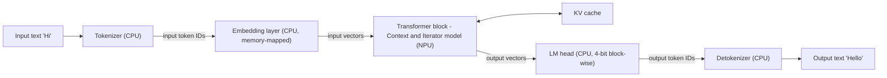
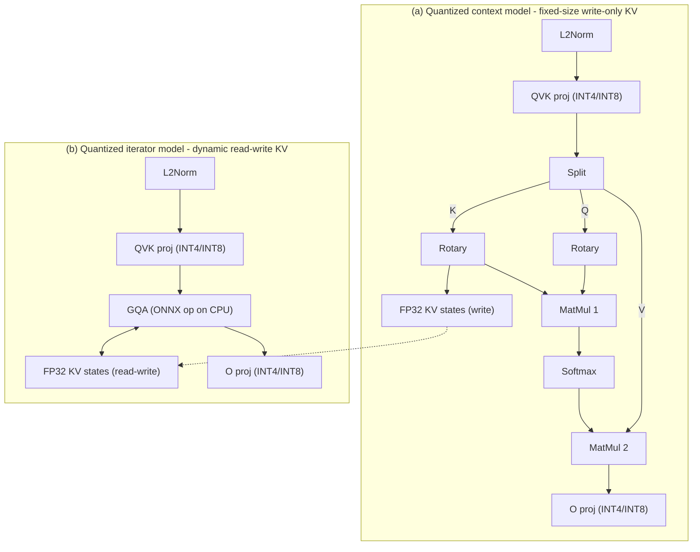
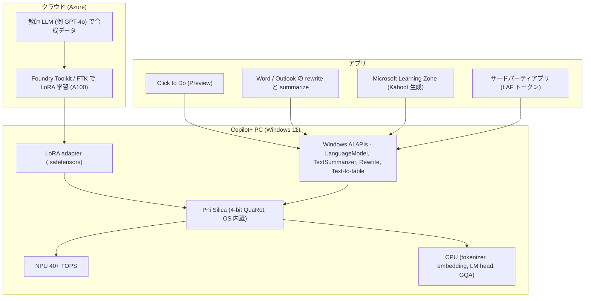
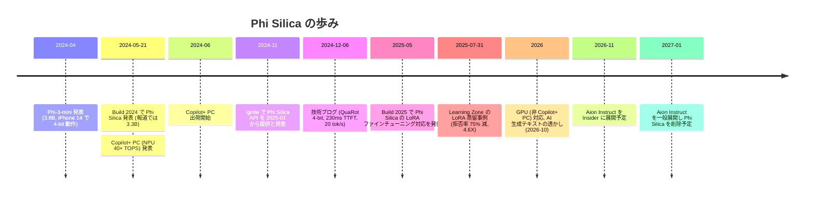

# Phi Silica — Copilot+ PC の NPU 向けオンデバイス SLM と、LoRA による教師 LLM 蒸留（Microsoft Learning Zone）

- **Company/Organization**: Microsoft（Windows Applied Sciences / Microsoft Education）
- **Industry**: PC OS・プラットフォーム（Windows 11 Copilot+ PC）、教育（Microsoft Learning Zone × Kahoot!）
- **Date**: 2024-05-21（Build 2024 で発表）〜 2026-10-19（Learn ドキュメント最終更新）
- **Type**: Technical Article / Business Case
- **主要ソース**:

| # | ソース | 日付 / 著者 | 種別 | 取得状況 |
|---|--------|-------------|------|----------|
| S1 | "Phi Silica, small but mighty on-device SLM" — Windows Experience Blog https://blogs.windows.com/windowsexperience/2024/12/06/phi-silica-small-but-mighty-on-device-slm/ | 2024-12-06 / Vivek Pradeep（VP, Distinguished Engineer, Windows Applied Sciences） | ベンダー申告（技術詳細） | curl（ブラウザ UA）で全文取得成功 |
| S2 | "Phi Silica task specialization using LoRA in Microsoft Learning Zone: A technical deep dive" — Windows Developer Blog https://blogs.windows.com/windowsdeveloper/2025/07/31/phi-silica-task-specialization-using-lora-in-microsoft-learning-zone-a-technical-deep-dive/ | 2025-07-31 / Shay Ben-Elazar（Principal Applied Science Manager, Microsoft Education） | ベンダー申告（事例） | 全文取得成功 |
| S3 | "LoRA Fine-Tuning for Phi Silica" — Microsoft Learn https://learn.microsoft.com/en-us/windows/ai/apis/phi-silica-lora | ms.date 2025-08-21、最終更新 2026-06-11 表示 | ベンダー申告（開発者ドキュメント） | 全文取得成功 |
| S4 | "Get started with Phi Silica" — Microsoft Learn https://learn.microsoft.com/en-us/windows/ai/apis/phi-silica | ms.date 2026-10-16、最終更新 2026-10-19 | ベンダー申告（開発者ドキュメント） | 全文取得成功 |
| S5 | "Microsoft debuts Phi Silica, AI specifically for Copilot+ PCs" — PCWorld https://www.pcworld.com/article/2340495/microsoft-debuts-phi-silica-ai-specifically-for-copilot-pcs.html | 2024-05-21 / Mark Hachman | 二次報道 | 全文取得成功 |
| S6 | "Microsoft introduces Phi-Silica, a 3.3B parameter model made for Copilot+ PC NPUs" — VentureBeat https://venturebeat.com/ai/microsoft-introduces-phi-silica-a-3-3b-parameter-model-made-for-copilot-pc-npus | 2024-05-21 / Ken Yeung | 二次報道 | curl は HTTP 429。WebFetch（要約モデル経由）で内容を取得。**逐語ではなく要約経由の抽出である点に注意** |
| S7 | "Phi-3 Technical Report: A Highly Capable Language Model Locally on Your Phone" https://arxiv.org/abs/2404.14219 | 2024-04-22（v4: 2024-08-30） | 一次資料（背景） | arXiv abs / HTML 取得成功 |

> **証拠の質の凡例**: 【一次資料】= 査読前を含む技術報告（arXiv）／【ベンダー申告】= Microsoft の公式ブログ・ドキュメント／【二次報道】= PCWorld・VentureBeat。Phi Silica 本体について **arXiv 等の一次技術報告は存在せず**、技術的主張のほとんどはベンダー申告である。

## Overview

Phi Silica は、Microsoft が Windows 11 の Copilot+ PC（当初 Snapdragon X シリーズ）の **NPU（40 TOPS 超）** 上で常駐動作させるために作った **OS 内蔵（inbox）の小型言語モデル（SLM）** である。2024-05 の Build で発表され（二次報道では 3.3B パラメータ）、2024-12 の技術ブログ（S1）で **Cyber-EO 準拠の Phi-3.5-mini 派生モデル** をベースに、**QuaRot による 4-bit 量子化**、メモリ最適化（約 60% 削減）、NPU/CPU 分担による文脈長拡張を行い、**短いプロンプトで初トークン 230ms・最大 20 tokens/s** を達成したと説明された。Click to Do（Preview）や Word/Outlook のオンデバイス書き換え・要約、開発者向け Windows AI API（LanguageModel、TextSummarizer 等）を支える。

2025 年には **LoRA ファインチューニング** が開放され（S3）、Microsoft Learning Zone（教育アプリ）が **GPT-4o を教師として合成した約 13,000 件の Kahoot! 形式 Q&A** で Phi Silica 用 LoRA アダプタを学習し、**ガードレール拒否率 75% 減、人手ブラインド A/B で 4.6 倍の選好** を得た事例を公開した（S2）。これは「大型 LLM（教師）→ オンデバイス SLM（生徒）」の **合成データによる系列レベル蒸留を、LoRA というパラメータ効率的手法で行った商用事例** として、本ドメイン（蒸留のビジネス活用）で重要である。

なお、2026-10 時点の Learn ドキュメント（S4）は **"Phi Silica is being replaced by Aion Instruct"** と告知しており、2026-11 に Insider へ、2027-01 に一般端末へ Aion Instruct を展開し Phi Silica を削除する予定と記載している。

### 本レポートでの「蒸留」の区別

| 工程 | 何をしているか | 分類 | 根拠 |
|------|----------------|------|------|
| Phi-3.5-mini → Phi Silica | 浮動小数点モデルの派生（Cyber-EO 準拠版）→ 4-bit 量子化・グラフ最適化 | **量子化・推論最適化**（蒸留ではない） | S1【ベンダー申告】 |
| QuaRot + GPTQ | 回転で外れ値除去 → 4-bit 重み量子化 | **事後量子化（PTQ）** | S1 |
| 投機的デコーディング | 小さなドラフトモデルが候補を提案、本体が並列検証 | **推論高速化**（ドラフトモデルの作り方は非開示。蒸留とは書かれていない） | S4 |
| Learning Zone の LoRA | GPT-4o が合成した Q&A を教師データとして LoRA を学習 | **真の知識蒸留（合成データ／系列レベル蒸留）＋ パラメータ効率的ファインチューニング** | S2 で "distillation approach, using a leading LLM as a teacher" と明言 |
| 一般開発者の LoRA | 自前の train.json / test.json で LoRA 学習 | **通常のファインチューニング**（データの出所次第で蒸留にもなり得る） | S3 |
| Phi-3 系の学習 | フィルタ済み web データ＋合成データ | 合成データ学習（Phi-3 報告に "distill" の記述なし） | S7【一次資料】 |

## Problem & Context

### ビジネス上の課題

- **クラウド LLM 依存からの脱却**: 2023 年の Copilot は端末上でもリモートサーバと通信していた。Recall のようなプライバシー重視の機能はローカル実行が必要だが、LLM はメモリ・ストレージ的に一般的 PC に載らない → SLM の正当化。【二次報道: S5】
- **NPU という新しい計算資源の活用**: Copilot+ PC は 40 TOPS 超の NPU を搭載。NPU は持続的な AI 負荷をバックグラウンドで最小限のシステム影響で回せる。"up to 20x more powerful and up to 100x as efficient for running AI workloads"（脚注付き比較）。【ベンダー申告: S1】
- **サブスクリプション不要の低レイテンシ推論**: "allowing users to make limitless low-latency queries to the model, without incurring additional subscription fees"。【ベンダー申告: S1】
- **OS サービスとしての推論エージェント**: "we now have the ability to run powerful reasoning agents as part of background operating system (OS) services"。【ベンダー申告: S1】
- **開発者の負担軽減**: Phi Silica は "pre-tuned and ships inbox" であり、開発者はモデル最適化やカスタマイズを気にせず言語機能を組み込める。【ベンダー申告: S1】

### 技術上の課題（S1）

LLM 推論の 2 フェーズそれぞれに異なるボトルネックがある。

| フェーズ | 処理 | ボトルネック | GPU/CPU 実行時の問題 |
|----------|------|--------------|----------------------|
| Context processing（prefill） | 入力トークンを並列処理し KV キャッシュと最初のトークンを生成 | 計算量（行列積） | CPU と実行中アプリに影響、GPU は電力大 |
| Token iteration（decode） | 1 トークンずつ自己回帰生成 | メモリ（KV キャッシュへのアクセス） | メモリ制約で効率的生成が困難 |

加えて NPU 特有の制約として、**静的テンソル形状**（文脈長が context processor のシーケンス長に縛られる）、NPU ソフトウェアスタックの量子化サポートの制約、全活性化の静的量子化による精度低下がある。

### 背景: Phi-3 の「スマホで動く」主張（S7）【一次資料】

- phi-3-mini: **3.8B** パラメータ、**3.3T トークン** で学習、MMLU **69%**、MT-bench **8.38**（Mixtral 8x7B・GPT-3.5 に匹敵と主張）。
- 学習データは phi-2 のデータを拡大したもの: "heavily filtered publicly available web data and synthetic data"。
- phi-3-small（7B）/ phi-3-medium（14B）は 4.8T トークンで MMLU 75% / 78%、MT-bench 8.7 / 8.9。
- "phi-3-mini can be quantized to 4-bits so that it only occupies ≈ 1.8GB of memory. We tested the quantized model by deploying phi-3-mini on iPhone 14 with A16 Bionic chip running natively on-device and fully offline achieving more than 12 tokens per second."
- phi-3.5 系: phi-3.5-mini、phi-3.5-MoE（16 x 3.8B、活性 6.6B）、phi-3.5-Vision（4.2B）。
- Phi-3 報告本文（HTML）に "distill" / "teacher" の語は見当たらない → Phi 系の小型化は **合成データ＋データ選別** によるもので、教師ロジット蒸留を主張していない。

## Solution

### 1. モデルの素性とパラメータ数の食い違い

| 情報源 | 記述 | 証拠の質 |
|--------|------|----------|
| PCWorld（2024-05-21） | "Phi Silica is a derivative of Phi-3-mini" / "Phi Silica uses a 3.3 billion parameter model, which Microsoft has fine-tuned for both accuracy and speed" | 二次報道 |
| VentureBeat（2024-05-21, WebFetch 要約経由） | 3.3B、Phi-3 ファミリーの 5 番目で最小（Phi-3-mini 3.8B、small 7B、medium 14B、vision 4.2B と並ぶ） | 二次報道 |
| Windows Experience Blog（2024-12-06） | "Phi Silica is based on a Cyber-EO compliant derivative of Phi-3.5-mini, developed specifically for Windows 11. It has a 4k context length…" | ベンダー申告 |
| Microsoft Learn（2026-10） | パラメータ数の記載なし。"hardware-accelerated local language model"、"This level of optimization is not available in other versions of Phi." | ベンダー申告 |

**注意**: 3.3B という数値は 2024-05 の報道由来で、2024-12 の公式技術ブログはパラメータ数を明示しない（Phi-3.5-mini 自体は 3.8B）。本レポートは「3.3B（二次報道、発表時点）」として扱い、確定値とはしない。Cyber-EO はおそらく米国の Executive Order on cybersecurity を指すが、ブログに定義はない。

### 2. 基盤（浮動小数点）モデルの仕様（S1）【ベンダー申告】

- Cyber-EO 準拠の Phi-3.5-mini 派生、Windows 11 専用。
- **4k コンテキスト長**（量子化後の Phi Silica は当初 2k、4k は "coming shortly"）。
- 多言語: Tier 1 言語ほか — English, Chinese (Simplified), French, German, Italian, Japanese, Portuguese, Spanish。
- 安全性: Phi-3 Safety Post-Training の **5 段階 "break-fix" サイクル** と同様の手法で安全性アラインメント。
- 製品品質のための "key improvements necessary for in-product experiences"（詳細非開示）。

### 3. 設計目標（S1 の箇条書きを保持）

Phi Silica に求められた特性:

1. 推論時の高速・低メモリのための **4-bit 重み量子化**
2. pinned memory を支え初期化コストを無くすための **低いアイドル時メモリ消費**
3. 対話性を高めるための **短いプロンプトでの高速な初トークン**
4. 実用性のための **2k 以上のコンテキスト長**
5. 持続利用時の電力効率のための **NPU ベース動作**
6. **複数言語での高精度**
7. Windows 規模で効率的に配布するための **小さなディスクサイズ**

### 4. コンポーネントの CPU/NPU 配置

- Tokenizer / Detokenizer、Embedding、Language model head は計算負荷が低くルックアップ中心 → **CPU**。
- Transformer block（context processor と token iterator）→ **NPU にオフロード**。
- ただし iterator の **GroupQueryAttention 演算のみ CPU** で実行（動的 KV キャッシュのため）。

### 5. 事後量子化: QuaRot（S1）

QuaRot（"QuaRot: Outlier-Free 4-Bit Inference in Rotated LLMs"、Microsoft と学術研究者の共同研究）は、言語モデルを回転させて隠れ状態の外れ値を除去し、**重み・活性化・KV キャッシュをすべて 4-bit** まで量子化可能にする前処理。2 つの概念に基づく。

- **Incoherence processing**: QuIP / QuIP# が用いた、重み行列（とヘッセ行列）を回転で前後から掛けて外れ値を薄める手法。外れ値が平均的要素に比べて大きいほど "incoherence が高く" 量子化しにくい。従来は各重み行列ごとに回転・逆回転のコストがかかる。
- **Computational invariance**: SliceGPT が導入した「重み行列に変換を施しても出力が変わらない」性質。QuaRot は **ランダム Hadamard 変換** を回転に用い、計算不変な形で incoherence processing を行う → 層間の回転・逆回転を融合・省略でき、Transformer ブロック外側の入力回転・出力回転のみが残る。活性化にも incoherence processing を適用できるため活性化量子化も容易になる。

**Key Formulas**（ブログは文章のみ。以下は QuaRot の考え方を式で示した参考）:

直交行列 $Q$（$QQ^\top = I$）を用いると、線形層の出力は不変:

$$
Y = XW = (XQ)(Q^\top W)
$$

- $X$: 入力活性化（トークン × 隠れ次元）、$W$: 重み行列、$Q$: 直交回転（QuaRot ではランダム Hadamard 行列）。回転後の $XQ$ と $Q^\top W$ は外れ値が分散され、4-bit 量子化しやすくなる。
- RMSNorm は回転と可換（$\mathrm{RMSNorm}(XQ) = \mathrm{RMSNorm}(X)Q$、スケール係数を隣接重みに吸収した場合）であるため、S1 は **LayerNorm Transformer を RMSNorm Transformer に変換** してから回転を融合している。

Hadamard 行列の再帰構成（参考）:

$$
H_1 = [1], \quad H_{2n} = \frac{1}{\sqrt{2}} \begin{bmatrix} H_n & H_n \\ H_n & -H_n \end{bmatrix}
$$

対称 per-channel 4-bit 量子化（S1 の "Symmetric per-channel quantization to 4-bit integers"、参考式）:

$$
\hat{W}_{c,:} = s_c \cdot \mathrm{clip}\!\left(\mathrm{round}\!\left(W_{c,:}/s_c\right), -8, 7\right)
$$

非対称 per-tensor 16-bit 活性化量子化（S1 の "Asymmetric per-tensor round-to-nearest quantization to unsigned 16-bit"、参考式）:

$$
\hat{x} = s \cdot \left(\mathrm{clip}\!\left(\mathrm{round}(x/s) + z, 0, 2^{16}-1\right) - z\right)
$$

- $s$: スケール、$z$: ゼロ点、$c$: 出力チャネル。

### 6. 最終的な 4-bit Phi Silica の構成（S1 の箇条書きを保持）

| 構成要素 | 処理 |
|----------|------|
| Rotated network | 浮動小数点 ONNX モデルで LayerNorm Transformer を RMSNorm Transformer に変換し、融合 Hadamard 回転で等価な回転ネットワークを得る |
| Embedding layer | 一度だけの入力側 QuaRot 回転を融合 |
| Activations | ONNX による非対称 per-tensor round-to-nearest 量子化で **符号なし 16-bit 整数** |
| Weights | QuaRot と **GPTQ** による対称 per-channel **4-bit 整数** 量子化。回転ネットワークへコピー |
| Linear layers | 現行 NPU スタックで最良のレイテンシを得るため、全線形層を **1×1 Conv2D** に変換 |
| Selective mixed precision | 再構成誤差の大きい重みを per-tensor **8-bit** に。**128 個中 4〜8 個** の重み行列のみ |
| Language model head | 一度だけの出力側 QuaRot 逆回転を融合。LM head は **4-bit block-wise 量子化** |

### 7. メモリ効率化（S1）

1. **Weight sharing**: context processor と token iterator が同一の量子化重みと大半の活性化量子化パラメータを共有（ONNX Runtime で 2 つのグラフが共有重みを参照）→ **メモリ使用量半減**、初期化高速化。
2. **Memory-mapped embeddings**: 埋め込み行列をメモリマップドファイルにしルックアップテーブルとして実装 → 埋め込みの **動的メモリフットプリントをゼロ** に。
3. **Arena allocator の無効化**: ONNX Runtime 既定の arena allocator は過剰な事前確保をする。Phi Silica はメモリ使用パターンが事前に決まるため無効化。

→ 4-bit 量子化と合わせて **メモリ使用量 約 60% 削減**。

### 8. コンテキスト長の拡張（S1）

1. **Sliding window**: プロンプト全体ではなく **サイズ N = 64** のチャンクごとに処理（最後のチャンクはパディング）。各チャンクを順に処理して KV キャッシュを更新 → 短いプロンプトは速く、長いプロンプトでも速度を犠牲にしない（処理時間がプロンプト長に比例）。
2. **Dynamic and shared KV cache**: NPU 完結の context processor は読み取り専用 KV キャッシュで高効率だが、文脈長が固定される。NPU と CPU の分担を試行し、**GroupQueryAttention のみ CPU** で実行する構成が最良 → 読み書き可能・動的サイズの KV キャッシュを、チャンク間および context processing と token iteration 間で共有。
3. **Input/Output binding**: context processing 時に十分なメモリを事前確保し、単一 KV キャッシュの共有で実行時レイテンシを大幅改善。S1 は "the context KV cache scales quadratically with the context length" と記述（一般には KV キャッシュは文脈長に線形で、注意計算が二乗。原文どおり記載）。

### 9. 開発者向け API とプラットフォーム（S3, S4）

- **Windows AI APIs（Windows App SDK）**: 名前空間 `Microsoft.Windows.AI`, `Microsoft.Windows.AI.Text`, `Microsoft.Windows.AI.ContentSafety`。
- **主要 API**: `LanguageModel.GetReadyState()` / `EnsureReadyAsync()` / `CreateAsync()` / `GenerateResponseAsync(prompt, options)`。`ContentFilterOptions` による **ローカルコンテンツモデレーション**。
- **Text Intelligence Skills**: Text-to-table、Summarize（`TextSummarizer.SummarizeAsync`）、Rewrite（明瞭さ・可読性・トーン）。
- **Limited Access Feature (LAF)**: Phi Silica API の利用にはアンロックトークンが必要（Aion Instruct では不要になる）。
- **投機的デコーディング**: "On NPU-equipped devices, the model employs a technique called speculative decoding to accelerate text generation using a smaller draft model…"（NPU のみ）。
- **プロンプト圧縮**: NPU のみ対応。
- **GPU 対応（2026 時点）**: 非 Copilot+ PC でも NVIDIA GeForce RTX 30 以降・AMD Radeon RX 9060 以降（6GB 以上 VRAM）で実行可能（Developer Mode、Insider Experimental Channel build 26300.8553 以降、Windows App SDK 2.2.2-experimental9 以降）。GPU 版は事前インストールされず、初回 `EnsureReadyAsync` で数 GB をダウンロード。
- **AI 生成テキストの透かし**: 2026-10 以降、一部 Windows AI テキスト API の出力に不可視の透かしを挿入。
- **地域制限**: Phi Silica 機能は中国では利用不可。
- **後継**: "Phi Silica is being replaced by Aion Instruct" — 2026-11 に Windows Insider へ展開（CFR で切替、レジストリキーで並行テスト可）、2027-01 に一般端末へ展開し Phi Silica を削除。LoRA は Foundry Toolkit で再学習が必要。

### 10. LoRA ファインチューニング（S3）

**前提条件**（S3 の箇条書き）:

- Phi Silica の応答を改善したいユースケースが特定済み
- 「良い応答」の評価基準を選定済み
- Phi Silica API を試し、評価基準を満たさなかった

**データ形式**: `train.json` と `test.json`。1 行 1 JSON オブジェクト（JSONL 相当、行末カンマ不要）、各サンプルは `messages`（`content` と `role` = `user`/`assistant`）のリスト。学習用は **少なくとも数千件** を推奨。

**学習手順（Foundry Toolkit for VS Code）**:

1. Azure サブスクリプション（Azure Container Apps のクォータ）を用意。**A100 以上の GPU** を推奨。
2. VS Code に Foundry Toolkit 拡張を導入。
3. Tools > Fine-tuning を開き、プロジェクト名と場所を入力。
4. Model Catalog から "microsoft/phi-silica" を選択し "Configure project"。
5. 最新版の Phi Silica を選択。
6. Data で train.json / test.json を指定。
7. "Generate Project" で新しい VS Code ウィンドウが開く。
8. bicep ファイルの `workloadProfiles` に `Consumption-GPU-NC24-A100` を追加。
9. "New Fine-tuning Job" でジョブ名入力、Microsoft アカウントとリソースグループを選択。
10. ジョブ完了後に LoRA アダプタをダウンロード。**所要時間は平均 45〜60 分**。

**推論**: AI Dev Gallery アプリの "AI APIs" タブ → "Phi Silica LoRA" でアダプタ（既定保存先 `Desktop/lora_lab/trainedLora`）を選び、LoRA あり／なしを比較。アプリへの組み込みは `LanguageModelLowRankAdapter.CreateFromPath(path)`（**safetensors** 形式）→ `LanguageModelOptions.LowRankAdapter` に設定 → `GenerateResponseAsync`。不適合時は `LanguageModelResponseStatus.IncompatibleLowRankAdapter`。GPU ユーザーもクラウドの Fine-Tuning Kit（FTK）で学習し、ローカルで推論。

**Responsible AI 上のリスク（S3 の列挙）**: データ品質と代表性、モデルの頑健性と汎化（狭いデータで過学習し一般知識を失う）、Regurgitation（学習データの逐語再現。PII 除去は顧客責任）、透明性・説明可能性の低下。

### 11. Learning Zone 事例: GPT-4o 教師による LoRA 蒸留（S2）

**背景**: Microsoft Learning Zone（コード名 "Project Spark"）は Copilot+ PC 専用の初の学習コンパニオンアプリ。教育者がオンデバイス AI で対話型レッスンを **無償で** 作成できる。Kahoot! と提携し、ゲーム生成を **完全に Phi Silica 上で** 行う。生成タスクごとに別モデルを配布するのは非効率なため、**単一の Phi Silica ＋ タスク別 LoRA アダプタ** で対応。

**品質の 2 軸**:

| 軸 | 定義 | 測定方法 |
|----|------|----------|
| Verifiable quality | 出力フォーマット制約（質問・回答の最大文字数など Kahoot! UX 準拠） | パイプライン内のハードコードされたガードレール。通過したものだけをユーザーに提示。拒否率低下 ＝ 体感レイテンシ改善 |
| Subjective quality | 魅力、明瞭さ、教育的関連性 | Kahoot! と共同で定めたルーブリック → 人手評価 → エージェント評価で拡張 |

**データセット生成（蒸留）**:

> "Instead of relying solely on base model outputs, we adopted a distillation approach, using a leading LLM as a teacher. We applied it to generate synthetic Kahoot!-style Q&A tuples from curated learning materials."

1. 精選した学習教材を取り込み、key fact とセグメントを抽出（文脈長制約のためセグメント単位で独立処理）。
2. 各（セグメント, key fact）ペアについて **GPT-4o** に Kahoot! 形式の質問を 1 問生成させる。
3. 生成問をガードレール（文字数制限など）で検証・フィルタ。
4. 約 **13,000 件** の合成例 → **学習 10,000 / テスト 3,000** に分割。
5. LoRA で **パラメータの約 1%** のみを学習（AI Toolkit の Phi Silica LoRA 機能、**量子化済み Phi Silica** に対して学習）。

**システムプロンプトの工夫**:

- 学習時プロンプト: "You will be given a fact and some additional context. Respond with a relevant question, one correct answer and some incorrect answers."
- 推論時は JSON 形式を補強: "… Reply with a strict JSON string for class `{question: string, answers: [{answer: string, correct: bool}], gettyImage: string}`, wrapped in ```json tags."
- LoRA にフォーマット・ペルソナを埋め込むことで **システムプロンプトを短縮**（トークン消費とレイテンシ削減）。

**ハイパーパラメータ**: AI Toolkit の既定値が良い出発点。小規模データで探索し、既定値付近は安定、極端な値は収束失敗（損失停滞）。既定値を超える組合せは見つからず → 固定して全データ・早期終了の patience を延ばした長時間学習へ（exploration → exploitation）。

**エージェント評価（Autogen によるマルチエージェント "review team"）**:

1. **Reviewer**: 各品質属性を CoT で評価（根拠 → スコア）。
2. **Critic**: Reviewer の評価に反論または根拠付きで同意。収束まで反復。
3. **Meta-Reviewer**: 全会話と元文脈を踏まえ最終スコアを出す。

**品質指標（エージェントのシステムプロンプトそのまま、1〜10 点）**:

- Educational Value: 文脈で強調された非自明な概念を教える／問うか
- Clarity and Phrasing: 明確・正確・文法的に正しく混乱なく理解できるか（二重否定なし等）
- Correct Answers Quality: 正答が質問に完全に答えているか
- Distractors Quality: 誤答が妥当で似た文脈に由来し、知らない人を誤導し得るか（かつ誤答であること）
- Focus: 無関係な概念を混ぜず単一の明確なアイデアを狙うか
- Conciseness: 簡潔で不要な複雑さ・冗長さがないか（Kahoot! で提示されるため特に）

## Results & Impact

### 推論性能（S1、Snapdragon X Elite の Copilot+ PC）【ベンダー申告】

| 指標 | 値 | 条件・注記 |
|------|-----|-----------|
| Time to first token | **230ms** | 短いプロンプト |
| Throughput | **最大 20 tokens/s** | 初トークン除く |
| Context length | **2k**（4k は近日対応予定と記載） | 量子化モデル。基盤 FP モデルは 4k |
| Context processing のエネルギー | **4.8mWh**（NPU 上） | Snapdragon X Elite |
| Token iterator の電力 | CPU 実行比 **56% 改善** | 同上 |
| メモリ使用量 | **約 60% 削減** | 4-bit 量子化＋重み共有＋メモリマップ埋め込み＋arena 無効化の合計効果 |
| 8-bit に残した重み行列 | **128 中 4〜8 個** | Selective mixed precision |
| スライディングウィンドウのチャンク長 | **N = 64** | context processing |
| Copilot+ PC NPU | **40 TOPS 超** | 2024-05 の Copilot+ PC 定義 |
| AI ワークロード性能（脚注 1） | 最大 **20 倍** | 2024-04 測定、Windows Studio Effects ワークロード、Snapdragon Elite X 12 Core vs Intel 第 12 世代 i7 |
| AI ワークロード効率（脚注 2） | 最大 **100 倍** | 2024-04 測定、Phi SLM で 512 トークンのプロンプト処理をループ、Snapdragon Elite X 12 Core / X Plus 10 core（QNN）vs NVIDIA 4080 GPU（CUDA） |

### 発表時の報道値（2024-05）【二次報道】

| 指標 | 値 | 出典 | 注記 |
|------|-----|------|------|
| パラメータ | 3.3B | PCWorld, VentureBeat | 公式技術ブログでは非明示 |
| 初トークン | "650 tokens per second" | VentureBeat（WebFetch 要約経由） | 単位がレイテンシとして不自然。prefill スループットの誤記の可能性 |
| CPU 上の生成 | 約 27 tokens/s | VentureBeat（同上） | 発表時はトークン生成が NPU の KV キャッシュを再利用し CPU で動作と報道 |
| 消費電力 | 約 1.5W | VentureBeat（同上） | CPU・GPU を他作業に解放 |
| 出荷 | 2024-06 発売の全 Copilot+ PC に搭載 | VentureBeat / PCWorld（6/23 出荷開始と記載） | — |

**時系列上の変化**: 2024-05 報道では「生成は CPU」だったが、2024-12 の S1 は「NPU ベースの持続的な context processing と token iteration（GQA のみ CPU）」と記述。最適化が進んだ結果と読めるが、同一条件での比較は公開されていない。

### 量子化前後の精度（S1 の表、lm-eval harness, zero-shot）【ベンダー申告】

| Zero-shot task | Floating-point model (%) | 4-bit QuaRot weights (float activations) (%) | 差（pt） |
|----------------|--------------------------|----------------------------------------------|----------|
| piqa | 80.47 | 79.76 | −0.71 |
| winogrande | 72.77 | 72.38 | −0.39 |
| arc_challenge | 63.48 | 60.49 | −2.99 |
| arc_easy | 85.69 | 82.74 | −2.95 |
| hellaswag | 77.14 | 75.13 | −2.01 |
| mmlu_abstract_algebra | 45.00 | 38.00 | −7.00 |
| mmlu_business_ethics | 76.00 | 73.00 | −3.00 |
| mmlu_college_computer_science | 57.00 | 48.00 | −9.00 |
| mmlu_college_mathematics | 40.00 | 38.00 | −2.00 |
| mmlu_conceptual_physics | 71.91 | 67.23 | −4.68 |
| mmlu_formal_logic | 53.97 | 50.00 | −3.97 |
| mmlu_machine_learning | 57.14 | 52.67 | −4.47 |

（差の列は本レポートで算出。注意: 4-bit 側は **活性化を浮動小数点のまま** とした条件であり、実配備の 16-bit 活性化量子化込みの精度ではない。）

常識推論系（piqa/winogrande）の劣化は 1pt 未満だが、**MMLU の STEM 系サブタスクで 4.5〜9pt の劣化**。量子化は「蒸留ではなく圧縮」であり、知識・推論集約タスクで品質コストが出ることを示す。

### Learning Zone の LoRA 蒸留の効果（S2）【ベンダー申告】

| 指標 | Phi Silica（ベース） | Phi Silica + LoRA | 効果 |
|------|----------------------|-------------------|------|
| ガードレール拒否率 | 基準 | — | **75% 減**（統計的有意と記載。絶対値は非開示） |
| エージェント評価 A/B 勝率 | 14.5% | 22.5% | LoRA 優位（残り 63% は引き分け等と推定されるが非開示） |
| 人手ブラインド A/B 勝率（2,350 ペア） | 12.3% | 56.1% | **4.6 倍**（56.1 / 12.3 ≒ 4.56。本レポートで算出し 4.6X と一致を確認） |
| エージェント評価の人手選好予測 | — | — | 精度 **79.5%**、F1 **77.3** |
| 学習データ | — | GPT-4o 合成 約 13,000 件（10,000 学習 / 3,000 テスト） | 学習パラメータ 約 1% |
| 分析日 | 2025-05-13（脚注） | | Kahoot! と共同定義の指標、Microsoft 生成データ |

## Figures & Tables

### 図 1（S1）: Cyber-EO 準拠 Phi-3.5-mini のベンチマーク（BabelBench 測定）


画像から読み取れる軸（数値ラベルは図中に無く、目盛からの目視概算のため表は軸構成のみ記載）:

| チャート | 軸 | 目盛範囲 |
|----------|----|----------|
| Reasoning | AGI Eval, ARC Easy, ARC-Challenge, BoolQ, CommonsenseQA, HellaSwag, MedQA, OpenBookQA, PIQA, TruthfulQA (MC2), WinoGrande | 30〜100 |
| Multilingual | Portuguese, Italian, English, Spanish, Japanese, French, Chinese, German | 30〜70 |

目視の傾向: Reasoning では ARC Easy が最も高く（90 前後）、AGI Eval が最も低い（40 前後）。Multilingual では English・Spanish・French・German が高く（60 台後半）、**Japanese・Chinese が低い（40 前後）**。

### 図 2（S1）: 言語モデルの生成プロセス




### 図 3（S1）: Phi Silica の注意サブグラフ


図の凡例: ONNX operator / ONNX subgraph / ONNX operator on CPU / KV cache read-write / QDQ activation / FP32 KV states / INT4/INT8 weight。



### 図 4（S1）: 初トークン時間とスループット

![Time to first token and throughput measurements for Phi Silica（左: 入力トークン数 vs TTFT[s]、右: 入力トークン数 vs スループット[tok/s]）](https://blogs.windows.com/wp-content/uploads/prod/sites/2/2024/12/Asset-9-Still-Latency-throughput_new-1024x427.png)

編集注記（S1）: 当初 TTFT グラフの単位が ms と誤記されていたが **秒（s）** に訂正済み。グラフの数値ラベルは無いため、**本レポートで散布点を目視で読み取った概算値** を示す（±0.2s / ±0.5 tok/s 程度の誤差を含む）。

| 入力トークン数（概算） | TTFT（s, 概算） | スループット（tok/s, 概算） |
|------------------------|-----------------|-----------------------------|
| 〜0–20 | 0.2–0.3 | 16–20.5 |
| 〜100 | 0.4 | 18.5 |
| 〜250 | 0.7–0.8 | 18–18.5 |
| 〜400 | 1.25 | 17 |
| 〜950 | 2.9–3.0 | 14.5–15 |
| 〜1200 | 3.8 | 14 |
| 〜1700 | 5.7–5.8 | 12.4 |
| 〜1900 | 6.4–6.9 | 11.5–12 |
| 〜2000 | 7.2–7.6 | 11–11.5 |

```
TTFT はほぼ線形（スライディングウィンドウ N=64 の効果で「処理時間がプロンプト長に比例」）
TTFT[s]
 7.5 |                                         ●
 6.0 |                                    ●  ●
 4.5 |
 3.0 |                    ●     ●
 1.5 |          ●
 0.2 |●  ●  ●
     +----+----+----+----+----+----+----+----+--> 入力トークン
     0   250  500  750 1000 1250 1500 1750 2000
```

読み取り: 短いプロンプトでは 230ms 前後（S1 の公称値と整合）だが、**2k トークン入力では TTFT が 7 秒超** に達し、生成スループットも 20 → 11 tok/s 程度に低下する。

### 図 5〜9（S2）: Learning Zone の評価


図中ラベルから転記した平均スコア（1〜10 点）:

| 品質観点 | Phi Silica + LoRA | Phi Silica（ベース） | 差 |
|----------|-------------------|----------------------|-----|
| clarity and phrasing | 9.86 | 9.55 | +0.31 |
| conciseness | 9.99 | 9.90 | +0.09 |
| correct answers quality | 9.76 | 9.09 | +0.67 |
| distractors quality | 9.47 | 8.90 | +0.57 |
| educational value | 9.78 | 9.48 | +0.30 |
| focus | 9.99 | 9.85 | +0.14 |

（差は本レポートで算出。S2 本文も「最大の改善は正答の質と誤答（distractor）の質」と記述。いずれも 10 点満点に近く天井効果がある点に留意。）


| A/B 評価 | Phi Silica + LoRA 勝率 | Phi Silica 勝率 | 比 |
|----------|------------------------|-----------------|-----|
| Agent-as-a-judge | 22.5% | 14.5% | 1.55 倍 |
| Human blind A/B（2,350 ペア） | 56.1% | 12.3% | 4.56 倍（≒ 公称 4.6X） |


| True \ Predicted | Silica | LoRA |
|------------------|--------|------|
| Silica | 0.9 | 0.099 |
| LoRA | 0.31 | 0.69 |

（行正規化。エージェント評価は「人がベースを選んだ」ケースの再現が 90%、「人が LoRA を選んだ」ケースの再現が 69%。全体精度 79.5%、F1 77.3 と S2 本文に記載。）

```mermaid
flowchart LR
    M["精選した学習教材"] --> X["key fact とセグメント抽出"]
    X --> G["GPT-4o (教師) で Kahoot 形式 Q&A を生成"]
    G --> F["Filter dataset using guardrails"]
    F --> D["合成データ 約13,000件 (train 10k / test 3k)"]
    D --> L["Train LoRA adapter (量子化 Phi Silica, 約1%)"]
    L --> R["Test guardrail rejection rate"]
    R --> A["Test subjective quality with agents (Autogen)"]
    A --> H["Test with human judgement (2,350 pairs)"]
```




### 開発者ドキュメントの表（S4）: ハードウェア対応

| Hardware | Status | Details |
|----------|--------|---------|
| NPU (Copilot+ PC) | Available | Best performance |
| GPU — NVIDIA | Available | GeForce RTX 30 series and newer with 6+ GB vRAM |
| GPU — AMD | Available | Radeon RX 9060 series and newer with 6+ GB vRAM |

### 開発者ドキュメントの表（S4）: NPU と GPU 実行の違い

| Factor | Copilot+ PCs (NPU) | Non-Copilot+ PCs (GPU) |
|--------|--------------------|------------------------|
| Inference Latency | Optimized; low latency via NPU acceleration and speculative decoding | Higher latency; depends on GPU generation, VRAM, and current GPU load |
| Power Consumption | NPU is power-efficient, suitable for battery-powered use | Higher power consumption; may impact battery life on laptops |
| Prompt Compression | Available | Not available on GPU |
| Speculative Decoding | Available | Not available on GPU |
| Model Optionality | Model is managed by the system | Model is downloaded on demand and can be removed via Settings > System > AI Components |

### Phi Silica のプラットフォーム全体像（本レポート作成）



### タイムライン（本レポート作成）



## Practical Takeaways

1. **「量子化」と「蒸留」は別の打ち手として設計する**: Phi Silica 本体の小型化は QuaRot + GPTQ による 4-bit PTQ と推論グラフ最適化であり、教師モデルからの知識移転ではない。量子化劣化は MMLU の STEM 系で最大 9pt 出ており、品質補填が必要なら別途 FT／蒸留を組み合わせる。
2. **タスク特化は「大型 LLM 教師 → 合成データ → LoRA」が実用的**: Learning Zone は GPT-4o で 13,000 件を合成し、量子化済みモデルに対して LoRA（約 1% のパラメータ）を学習するだけで、拒否率 75% 減・人手選好 4.6 倍を得た。基盤モデルを再配布せず、アダプタのみ差し替えられる。
3. **ガードレールを「蒸留データのフィルタ」と「評価指標」の両方に使う**: 同じハード制約（文字数・JSON 形式）を教師出力のフィルタと生徒評価（拒否率）に用いることで、検証可能な品質を一貫して最適化できる。
4. **システムプロンプトの短縮も蒸留の効用**: フォーマットやペルソナを LoRA に焼き込むことで、オンデバイスの限られた文脈長とレイテンシを節約できる（TTFT は入力長にほぼ線形で、2k 入力で 7 秒超）。
5. **評価のスケール化はマルチエージェント judge ＋ 人手検証**: Reviewer / Critic / Meta-Reviewer 構成で人手選好を 79.5% の精度で予測。ただし LoRA 選好ケースの再現は 69% に留まる。
6. **NPU 向けの実装工夫は再利用可能**: 線形層の 1×1 Conv2D 化、重み共有、埋め込みのメモリマップ、GQA のみ CPU、N=64 のチャンク prefill などは、他の NPU 向け SLM にも適用できる。
7. **プラットフォーム依存リスク**: LAF トークン制、地域制限（中国不可）、そして **2027-01 に Phi Silica 削除・Aion Instruct へ移行** と告知されている。LoRA アダプタはベースモデルに紐づくため、ベース交代時に再学習が必要（S4 も "re-train your LoRAs using Foundry Toolkit" と明記）。

## Lessons Learned

- **OS 内蔵モデルという事業モデル**: Microsoft は SLM を Windows に "inbox" で同梱し、開発者はモデル配布・最適化なしに API 経由で使える。Google の AICore（Gemini Nano）と同型の「OS がモデルを所有し、アプリはアダプタとプロンプトで差別化する」構造。
- **ハードウェア販売との結合**: Phi Silica は Copilot+ PC（NPU 40 TOPS 超）の差別化要素として発表され、"up to 20x more powerful / 100x as efficient" といった比較訴求と一体で提示された。
- **開示の深さ**: 量子化の構成・精度劣化・メモリ最適化を詳細開示した点は、同時期の Gemini Nano 報告（蒸留・4-bit の事実のみ）より透明性が高い。一方、パラメータ数・学習データ・ドラフトモデルの作り方は非開示。
- **蒸留の実態**: 本件で「真の知識蒸留」と確認できるのは **Learning Zone の LoRA 事例（GPT-4o 教師による合成データ）のみ**。Phi Silica 基盤モデル自体についての蒸留の記述は見当たらない。
- **数値の不整合への注意**: 3.3B（報道）と Phi-3.5-mini 派生（公式）、"650 tokens/s の初トークン"（報道・単位不明瞭）と 230ms（公式）、"CPU で生成"（2024-05 報道）と "NPU ベース"（2024-12 公式）など、時点と出典で記述が揺れる。

## Notes

### 主張別の証拠の質

| 主張 | 値 | 証拠の質 |
|------|-----|----------|
| パラメータ数 | 3.3B | 二次報道（PCWorld, VentureBeat） |
| ベースモデル | Cyber-EO 準拠 Phi-3.5-mini 派生 | ベンダー申告（S1） |
| NPU 性能要件 | 40 TOPS 超 | ベンダー申告（S1） |
| 初トークン時間 | 230ms（短いプロンプト） | ベンダー申告（S1） |
| スループット | 最大 20 tokens/s | ベンダー申告（S1） |
| prefill エネルギー | 4.8mWh（NPU） | ベンダー申告（S1） |
| token iterator 電力 | CPU 比 56% 改善 | ベンダー申告（S1） |
| メモリ | 約 60% 削減 | ベンダー申告（S1） |
| 量子化 | 4-bit 重み（QuaRot + GPTQ）、16-bit 活性化、一部 8-bit | ベンダー申告（S1） |
| 消費電力 | 約 1.5W | 二次報道（VentureBeat、WebFetch 要約経由） |
| Learning Zone 拒否率 | 75% 減 | ベンダー申告（S2） |
| Learning Zone 人手選好 | 4.6X（56.1% vs 12.3%） | ベンダー申告（S2、図から比を検証） |
| 教師 LLM | GPT-4o | ベンダー申告（S2） |
| Phi-3-mini のスマホ動作 | 4-bit で約 1.8GB、iPhone 14 で 12 tokens/s 超 | 一次資料（S7） |

### 蒸留の判定（本ドメイン向け結論）

- **Phi Silica 基盤モデル**: 蒸留の記述なし。Phi-3.5-mini 派生の **量子化・推論最適化** モデル。
- **Learning Zone LoRA**: **真の知識蒸留（合成データによる系列レベル蒸留）と確認**。S2 が "we adopted a distillation approach, using a leading LLM as a teacher" と明言し、教師を GPT-4o と特定。生徒は量子化済み Phi Silica＋LoRA。ロジット蒸留ではなく教師生成テキストでの教師あり学習。
- **投機的デコーディングのドラフトモデル**: 存在は明記されるが、作成方法（蒸留か否か）は非開示。

### 取得上の注記

- blogs.windows.com は curl（ブラウザ相当 UA）で取得でき、Cloudflare 403 は発生しなかった。
- VentureBeat は curl で HTTP 429。WebFetch で取得できたが、WebFetch は要約モデルを介するため **逐語引用ではない**。数値（650 tokens/s、27 tokens/s、1.5W）は単一の二次報道・要約経由である点に留意。
- S1 の "QuaRot uses rotations to remove outliers…" と "Context processing and token iteration process within Phi Silica" の 2 図は、HTML 中に画像 URL として見当たらず（動画・埋め込み要素と推定）、本レポートには含められなかった。キャプションのみ本文で言及。
- S1 冒頭の "Real-time demo of Phi Silica running on Copilot+ PCs (Snapdragon X Elite)" も動画のため未収録。

### 関連・追加調査候補

- QuaRot: Outlier-Free 4-Bit Inference in Rotated LLMs（Ashkboos et al., 2024, arXiv 2404.00456）— Phi Silica 量子化の中核
- SliceGPT（計算不変性）、QuIP / QuIP#（incoherence processing）、GPTQ
- Phi-3 Safety Post-Training: Aligning Language Models with a "Break-Fix" Cycle（arXiv 2407.13833）
- Microsoft Edge Blog "Expanding on-device AI in Microsoft Edge: New models and APIs for the web"（Aion Instruct の詳細）
- Learning Zone のエージェント評価ベースコード（S2 で公開と記載）
- 本ディレクトリの `03-gemini-nano.md`（Google 側の OS 内蔵オンデバイス LLM との比較）
