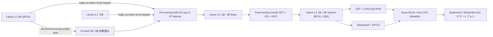
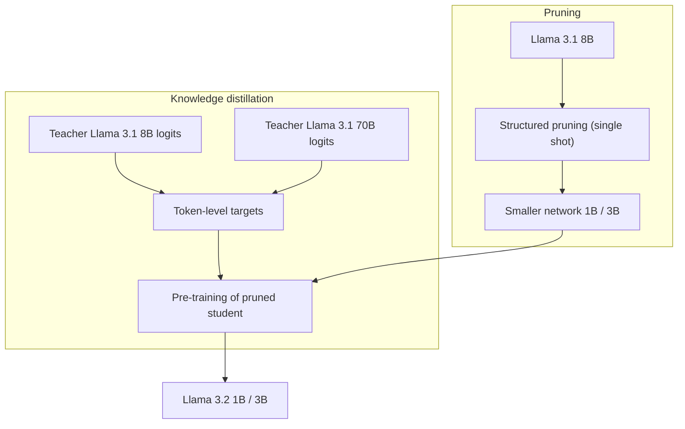
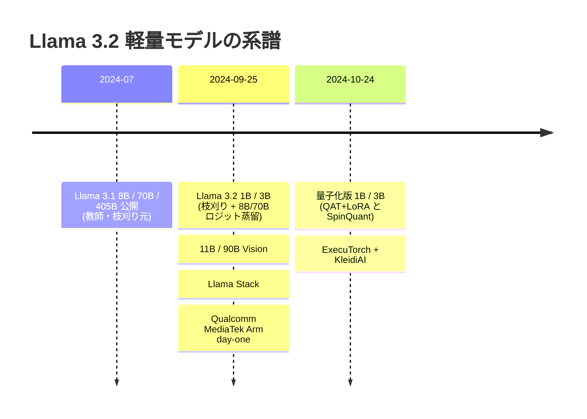
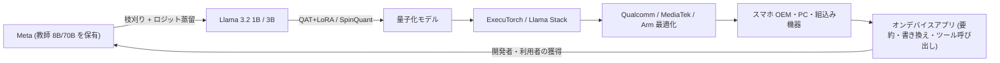

# Llama 3.2 1B/3B 軽量モデル — 枝刈り＋ロジット蒸留によるエッジ／モバイル向け LLM と量子化版（QAT+LoRA / SpinQuant）

- **Source**: Meta（Meta AI Blog / Hugging Face Model Card）
- **Date**: 2024-09-25（Llama 3.2 発表）、2024-10-24（量子化版発表）
- **Link**:
  - https://ai.meta.com/blog/llama-3-2-connect-2024-vision-edge-mobile-devices/ （"Llama 3.2: Revolutionizing edge AI and vision with open, customizable models"）
  - https://ai.meta.com/blog/meta-llama-quantized-lightweight-models/ （"Introducing quantized Llama models with increased speed and a reduced memory footprint"）
  - https://huggingface.co/meta-llama/Llama-3.2-1B （公式モデルカード）
- **Type**: Technical Article（ベンダー技術ブログ＋モデルカード）
- **Cluster**: C6 `edge_ondevice`（オンデバイス／エッジ LLM のための蒸留ビジネス）

> **取得状況メモ**
>
> - Meta AI Blog 2 本は `curl` では Facebook のエラーページ（1.5KB）しか返らず、WebFetch 経由でテキストを取得した。ブログ内のベンチマーク表・性能表は **すべて画像（alt テキストなし）** で埋め込まれており、署名付き CDN URL（fbcdn.net）のため画像本体は取得できなかった（署名を外すと HTTP 403）。そのため **ブログ画像内の数値（Gemma 2 2.6B / Phi 3.5-mini との比較表など）は本レポートでは再現できていない**。
> - 代わりに、Hugging Face 公式モデルカード（`meta-llama/Llama-3.2-1B`）が同一系統の数値（事前学習／指示調整ベンチマーク、多言語ベンチマーク、量子化手法別の推論速度・サイズ・メモリ）をテキスト表として掲載しており、これを全行再現した。量子化ブログの「2.5x / 4.2x / 56% / 41%」は、このモデルカード表と整合する（後述）。
> - 証拠の質ラベル: **一次資料**＝Meta 自身の技術記述（ブログ本文・モデルカード）、**ベンダー申告**＝Meta 自身による性能・優位性の主張（第三者再現なし）、**二次報道**＝第三者メディア。本レポートの数値はほぼすべて「一次資料かつベンダー申告」に該当する（第三者による独立再現は未確認）。

## Overview

Llama 3.2（2024-09-25 発表）は、11B/90B の Vision モデルと並んで、**テキスト専用の軽量モデル 1B（1.23B）と 3B（3.21B）** を投入した。これらは「エッジ／モバイル端末に収まる」ことを明示的な設計目標とし、Meta は次の 2 段構えの圧縮で作ったと説明している。

1. **構造化枝刈り（structured pruning）**: Llama 3.1 8B から「single shot（一括）」でネットワークの一部を除去。
2. **知識蒸留（knowledge distillation）**: Llama 3.1 **8B と 70B のロジット**を事前学習段階に取り込み、**トークンレベルの教師ターゲット**として使用。枝刈り後の性能回復に蒸留を使用。

さらに 2024-10-24 には、同 1B/3B を **QAT＋LoRA（Meta は "QLoRA" と呼称）** と **SpinQuant** の 2 方式で量子化したモデルを公開し、OnePlus 12（Android）上で **デコード 2.4〜2.6 倍、プリフィル 4.2〜4.3 倍、モデルサイズ 52〜60% 減、メモリ 29〜50% 減**（モデルカード表）を報告した。

ビジネス的には、Meta は自らハードを売らずに、**Qualcomm・MediaTek（モバイル SoC 上位 2 社）と Arm に "day one" で最適化を提供**し、ExecuTorch（PyTorch のオンデバイス推論ランタイム）と Llama Stack を通じて OEM / SoC ベンダー／アプリ開発者が標準的に採用できる「エコシステム型の蒸留モデル供給」を行った点が重要である。

### 蒸留の種別判定（本クラスタの観点）

| 工程 | 何をしているか | 種別 | 根拠（証拠の質） |
|------|---------------|------|----------------|
| 8B → 1B/3B の構造化枝刈り | 8B の重みから構造単位で削除 | **枝刈り（圧縮）**。蒸留ではない | ブログ本文・モデルカード（一次資料） |
| 8B/70B ロジットを事前学習ターゲットに | 教師の出力分布（logits）をトークン単位の学習ターゲットに | **真の知識蒸留（logit-based KD）** | モデルカード "outputs (logits) from these larger models were used as token-level targets"（一次資料） |
| 事後学習 SFT / RS / DPO | 人手・合成データでのアラインメント | **通常のファインチューニング／選好最適化**（蒸留とは区別） | モデルカード（一次資料） |
| QAT＋LoRA（"QLoRA"） | 量子化を模擬した SFT＋LoRA＋DPO | **量子化（QAT）＋PEFT**。蒸留ではない | 量子化ブログ・モデルカード（一次資料） |
| SpinQuant＋GPTQ | 回転行列学習による外れ値平滑化後の PTQ | **事後量子化（PTQ）**。蒸留ではない | 同上（一次資料） |

→ **「真の蒸留」は、1B/3B の事前学習段階における 8B/70B ロジット蒸留のみ** で確認できる。量子化版はその蒸留済みモデルに対する追加の量子化であり、量子化自体は蒸留ではない。

## Key Technical Content

### Architecture / Design

#### モデル仕様（モデルカード「Model Information」表の再現）

| | Training Data | Params | Input modalities | Output modalities | Context Length | GQA | Shared Embeddings | Token count | Knowledge cutoff |
|---|---|---|---|---|---|---|---|---|---|
| Llama 3.2 (text only) | A new mix of publicly available online data. | 1B (1.23B) | Multilingual Text | Multilingual Text and code | 128k | Yes | Yes | Up to 9T tokens | December 2023 |
| | | 3B (3.21B) | Multilingual Text | Multilingual Text and code | | | | | |
| Llama 3.2 Quantized (text only) | A new mix of publicly available online data. | 1B (1.23B) | Multilingual Text | Multilingual Text and code | 8k | Yes | Yes | Up to 9T tokens | December 2023 |
| | | 3B (3.21B) | Multilingual Text | Multilingual Text and code | | | | | |

（一次資料：モデルカード）

- **アーキテクチャ**: 最適化 Transformer による自己回帰 LM。全バージョンで **GQA（Grouped-Query Attention）** と **Shared Embeddings（入出力埋め込み共有）** を採用。
- **公式サポート言語（8 言語）**: English, German, French, Italian, Portuguese, Hindi, Spanish, Thai。ただし学習自体はより広い言語集合で行われている（日本語は公式サポート外）。
- **コンテキスト長**: BF16 版 128K、量子化版 8K（モバイルのメモリ制約のため、と量子化ブログが説明）。
- **リリース日**: 2024-09-25。静的モデル（オフラインデータで学習）。
- **ライセンス**: Llama 3.2 Community License（"a custom, commercial license agreement"）。

#### 圧縮パイプライン全体像（Meta ブログの "Lightweight models" 図の再構成）

Meta ブログには「枝刈り＋蒸留」を説明する図が 1 枚掲載されている（画像 URL は下記 Figures & Tables 参照、本文中は alt テキストなし）。本文記述とモデルカード記述から、その工程を Mermaid で再構成する。



#### 事後学習（Post-training）

ブログ本文（一次資料）によれば、事後学習は Llama 3.1 と同様のレシピで、事前学習済みモデルの上に **複数ラウンド**のアラインメントを行う。

- 各ラウンドは **Supervised Fine-Tuning (SFT)** → **Rejection Sampling (RS)** → **Direct Preference Optimization (DPO)** で構成。
- コンテキスト長を **128K** に拡張しつつ、事前学習モデルの品質を維持。
- データミックスは **要約、書き換え（rewriting）、指示追従、言語推論、ツール使用** を最適化するよう配合。
- 事後学習データの生成元（どのモデルで応答を生成したか）は取得できた本文・モデルカードからは確認できない。したがって **合成データ経由の蒸留（sequence-level KD）が行われたかは不明** であり、本レポートでは「事後学習＝通常のファインチューニング／選好最適化」として扱う。

### Implementation Steps

#### A. 軽量モデルの作り方（Meta 申告、一次資料）

1. **Step 1 — 構造化枝刈り（Pruning）**
   - 入力: Llama 3.1 8B。
   - 操作: "structured pruning in a single shot manner"。ネットワークの一部を体系的に除去し、重みと勾配の大きさを調整して、性能を最大限維持しつつ小型・高効率化。
   - 出力: 1B / 3B サイズの初期化重み。
2. **Step 2 — ロジット蒸留を伴う事前学習（Knowledge Distillation）**
   - 入力: 枝刈り済み 1B/3B、教師 Llama 3.1 8B と 70B、公開データ最大 9T トークン。
   - 操作: 教師の **logits を token-level targets** として事前学習段階に組み込む。「枝刈り後の性能回復に蒸留を使った」と明記。
   - 出力: Llama 3.2 1B / 3B（Base）。
3. **Step 3 — 事後学習（Alignment）**
   - SFT → RS → DPO を複数ラウンド。128K への文脈拡張。
   - 出力: Llama 3.2 1B / 3B Instruct。
4. **Step 4 — 量子化（2024-10-24 追加）**
   - 2 方式（QAT＋LoRA / SpinQuant）で 4bit 重み・8bit 動的活性化に量子化。
   - 出力: 量子化 1B/3B（コンテキスト 8K）。
5. **Step 5 — 配信・実行**
   - ExecuTorch（Arm CPU バックエンド、KleidiAI カーネル）、Llama Stack（iOS 向けオンデバイス配布含む）、Qualcomm/MediaTek SoC。

#### B. 蒸留目的関数（一般形の補足）

Meta は損失関数の具体形（温度、KL の向き、ハードラベル CE との重み付け等）を **公開していない**。以下は「ロジットをトークンレベルターゲットとする」記述から想定される標準的なロジット蒸留の一般形であり、**Meta が実際にこの式・係数を使ったことは確認できていない**（レポート作成者による補足）。

$$
\mathcal{L}(\theta) = \frac{1}{S}\sum_{s=1}^{S}\Big[(1-\lambda)\,\mathrm{CE}\big(y_s,\ q_\theta(\cdot\mid y^{<s})\big) + \lambda\,\tau^2\,\mathrm{KL}\big(p_{\mathrm{T}}^{(\tau)}(\cdot\mid y^{<s})\ \|\ q_\theta^{(\tau)}(\cdot\mid y^{<s})\big)\Big]
$$

- $q_\theta$: 生徒（1B/3B）の次トークン分布、$p_{\mathrm{T}}$: 教師（8B または 70B、もしくは両者の組合せ）の分布
- $\tau$: 温度（ソフトマックス温度）、$\lambda$: 蒸留項の重み、$S$: 系列長、$y_s$: 正解トークン
- 8B と 70B の **両方**のロジットを使ったとされるが、混合比・切替スケジュール（例: 前半 8B・後半 70B 等）は非公開。

#### C. 量子化スキーム（一次資料：量子化ブログ・モデルカード）

ExecuTorch + Arm CPU バックエンドを前提に、品質・プリフィル/デコード速度・メモリフットプリントを考慮して設計された 3 要素:

1. **Transformer ブロック内の全線形層**: 重み **4-bit groupwise（group size 32）**、活性化 **8-bit per-token dynamic**。
2. **分類層（出力 LM head）**: 重み **8-bit per-channel**、活性化 **8-bit per-token dynamic**。
3. **埋め込み層**: **8-bit per-channel**。

#### D. QAT＋LoRA（Meta 呼称 "QLoRA"）の手順

1. SFT 後の BF16 Llama 3.2 チェックポイントを初期値に、**QAT を有効にした SFT を 1 ラウンド丸ごと**追加実施。
2. QAT モデルの **バックボーンを凍結**し、Transformer ブロック内の **全層に LoRA アダプタ**を付けて再度 SFT。LoRA の重み・活性化は **BF16 のまま保持**。
3. 量子化→LoRA という順序が Dettmers et al. (2023) の QLoRA と類似するため "QLoRA" と命名。
4. 最後に **バックボーン＋LoRA の両方**を **DPO** でファインチューニング。
5. QAT には torchao API を利用（量子化ブログ）。
6. 学習データは全精度モデルと同じ事後学習データ（モデルカード: "went through only post-training stages, using the same data as the full precision models"）。

#### E. SpinQuant の手順

1. 回転行列（rotation matrices）を学習し、活性化・重みの外れ値を平滑化（量子化誤差の低減）。
2. **回転行列の微調整**: WikiText 2 から **800 サンプル × 系列長 2048**、**100 イテレーション**。
3. **GPTQ**: 同データから **128 サンプル × 系列長 2048**。
4. 学習データセットを必要としない（キャリブレーションのみ）ため、**データがプライベート／計算資源が限られる開発者でも自前のファインチューニング済みモデルに適用可能** — 量子化ブログはこれを「移植性（portability）」の利点として強調。精度は QAT＋LoRA に劣る。

### Key Formulas / Metrics

| Metric | Value | Context | 証拠の質 |
|--------|-------|---------|---------|
| パラメータ数 | 1.23B / 3.21B | Llama 3.2 1B / 3B | 一次資料 |
| 事前学習トークン | Up to 9T | 公開データ | 一次資料 |
| 蒸留教師 | Llama 3.1 8B & 70B（logits） | 事前学習段階のトークンレベルターゲット | 一次資料 |
| 枝刈り元 | Llama 3.1 8B | single-shot structured pruning | 一次資料 |
| コンテキスト | 128K（BF16）/ 8K（量子化版） | | 一次資料 |
| 学習 GPU 時間 | 1B: 370k、3B: 460k H100 時間 | 合計 916k（ロジット生成含む） | 一次資料 |
| ロジット生成 GPU 時間 | 86k H100 時間（合計行） | 教師ロジット生成のコスト | 一次資料 |
| 量子化平均効果 | デコード 2.5x、プリフィル 4.2x、サイズ −56%、メモリ −41% | OnePlus 12, ExecuTorch, Arm CPU | ベンダー申告 |
| Llama Guard 3 1B | 2,858 MB → 438 MB | 枝刈り＋量子化 | ベンダー申告 |

#### 推論性能の定義（モデルカード脚注）

- **Decode (tokens/sec)**: 生成を続ける速さ。高いほど良い。
- **TTFT (sec)**: 最初のトークンまでの時間（プロンプト長 64）。低いほど良い。
- **Prefill (tokens/sec)**: TTFT の逆数 $\mathrm{Prefill} = 1/\mathrm{TTFT}$（tokens/sec 表記）。高いほど良い。
- **Model size**: ExecuTorch のバイナリ形式 PTE ファイルのサイズ（MB）。
- **RSS size**: 常駐セットサイズ（Resident Set Size）によるメモリ使用量（MB）。

削減率・倍率は次式で計算されている（表の値から逆算して整合を確認）:

$$
\text{Speedup} = \frac{\text{tokens/s}_{\text{quant}}}{\text{tokens/s}_{\text{BF16}}},\qquad
\Delta\% = \frac{X_{\text{quant}} - X_{\text{BF16}}}{X_{\text{BF16}}}\times 100
$$

例: 1B SpinQuant デコード $50.2/19.2 = 2.61 \approx 2.6\times$、PTE サイズ $(1083-2358)/2358 = -54.1\%$。

## Figures & Tables

### Figure 一覧（Meta ブログ画像。いずれも alt テキストなし、署名付き CDN のため本文から直接参照不可・数値は抽出不可）

以下は WebFetch で取得したパス（署名クエリ文字列を除去したもの）。署名なしでは HTTP 403 となるため、Markdown 画像としては埋め込まず URL を列挙する。

| # | ブログ | 位置・内容 | URL（署名除去） |
|---|-------|-----------|----------------|
| F1 | Llama 3.2 発表 | ヒーロー画像 | `https://scontent-nrt6-1.xx.fbcdn.net/v/t39.2365-6/461179924_892945479558448_4846394290454647920_n.png` |
| F2 | Llama 3.2 発表 | Model evaluations ベンチマーク表 1（画像） | `https://scontent-nrt1-2.xx.fbcdn.net/v/t39.2365-6/461288018_1255239495501495_271827633811450582_n.png` |
| F3 | Llama 3.2 発表 | Model evaluations ベンチマーク表 2（画像） | `https://scontent-nrt6-1.xx.fbcdn.net/v/t39.2365-6/461157789_931406385491961_1692349435372036848_n.png` |
| F4 | Llama 3.2 発表 | **Lightweight models：枝刈り＋蒸留の図** | `https://scontent-nrt1-2.xx.fbcdn.net/v/t39.2365-6/461209081_511117684875670_45564063096782202_n.png` |
| F5 | Llama 3.2 発表 | Llama Stack 構成図 | `https://scontent-nrt1-1.xx.fbcdn.net/v/t39.2365-6/460924239_3402957093334534_4357083070437107157_n.png` |
| F6 | Llama 3.2 発表 | Llama Stack コンポーネント一覧後の図 | `https://scontent-nrt1-1.xx.fbcdn.net/v/t39.2365-6/460942153_931942502081982_4461283719059292584_n.png` |
| F7 | 量子化版発表 | ヒーロー画像 | `https://scontent-nrt6-1.xx.fbcdn.net/v/t39.2365-6/464303495_1293050525196145_4189921653081247074_n.png` |
| F8 | 量子化版発表 | Takeaways 直後の比較画像（"Similar improvements were observed for the 3B model." の前） | `https://scontent-nrt1-1.xx.fbcdn.net/v/t39.8562-6/463970441_476505988736002_79865688293804224_n.png` |
| F9 | 量子化版発表 | Results 表 1（Vanilla PTQ / SpinQuant / QLoRA の品質。キャプション "Percentage difference in relation to the average value for BF16."） | `https://scontent-nrt1-1.xx.fbcdn.net/v/t39.2365-6/463869105_1326616764996070_7210673116645317812_n.png` |
| F10 | 量子化版発表 | Results 表 2（同キャプション） | `https://scontent-nrt1-1.xx.fbcdn.net/v/t39.2365-6/463977359_1182562752841690_4137380685967841470_n.png` |
| F11 | 量子化版発表 | 性能比較表（デコード・プリフィル・サイズ・メモリ、OnePlus 12） | `https://scontent-nrt1-2.xx.fbcdn.net/v/t39.2365-6/464307751_477718101949854_4588809159017166700_n.png` |

- F2/F3（Gemma 2 2.6B・Phi 3.5-mini との比較を含むとされる）の **数値は取得できなかった**。ブログ本文の定性主張のみ: 「3B は指示追従・要約・プロンプト書き換え・ツール使用で Gemma 2 2.6B と Phi 3.5-mini を上回る」「1B は Gemma と競合」「150 以上のベンチマークデータセットで評価」（ベンダー申告）。
- F9/F10/F11 の数値は、後述のモデルカード表（同内容と推定される）で代替する。F11 の要約値「デコード 2.5x・プリフィル 4.2x・サイズ −56%・メモリ −41%（平均）」はブログ本文に明記。

#### F4（枝刈り＋蒸留図）の再構成

本文の説明（"structured pruning in a single shot manner from the Llama 3.1 8B"／"incorporated logits from the Llama 3.1 8B and 70B models into the pre-training stage"）から、図の意図を再構成:



### Table 1: 事前学習ベースモデル（英語）— モデルカード "Base Pretrained Models"

| Category | Benchmark | # Shots | Metric | Llama 3.2 1B | Llama 3.2 3B | Llama 3.1 8B |
|---|---|---|---|---|---|---|
| General | MMLU | 5 | macro_avg/acc_char | 32.2 | 58 | 66.7 |
| | AGIEval English | 3-5 | average/acc_char | 23.3 | 39.2 | 47.8 |
| | ARC-Challenge | 25 | acc_char | 32.8 | 69.1 | 79.7 |
| Reading comprehension | SQuAD | 1 | em | 49.2 | 67.7 | 77 |
| | QuAC (F1) | 1 | f1 | 37.9 | 42.9 | 44.9 |
| | DROP (F1) | 3 | f1 | 28.0 | 45.2 | 59.5 |
| Long Context | Needle in Haystack | 0 | em | 96.8 | 1 | 1 |

（一次資料・ベンダー申告。Needle in Haystack の 3B/8B 列はカード原文どおり "1"＝おそらく 100% を意味する比率表記）

### Table 2: 指示調整モデル（英語）— BF16 / Vanilla PTQ / SpinQuant / QLoRA 比較

| Capability | Benchmark | # Shots | Metric | 1B bf16 | 1B Vanilla PTQ** | 1B SpinQuant | 1B QLoRA | 3B bf16 | 3B Vanilla PTQ** | 3B SpinQuant | 3B QLoRA | Llama 3.1 8B |
|---|---|---|---|---|---|---|---|---|---|---|---|---|
| General | MMLU | 5 | macro_avg/acc | 49.3 | 43.3 | 47.3 | 49.0 | 63.4 | 60.5 | 62 | 62.4 | 69.4 |
| Re-writing | Open-rewrite eval | 0 | micro_avg/rougeL | 41.6 | 39.2 | 40.9 | 41.2 | 40.1 | 40.3 | 40.8 | 40.7 | 40.9 |
| Summarization | TLDR9+ (test) | 1 | rougeL | 16.8 | 14.9 | 16.7 | 16.8 | 19.0 | 19.1 | 19.2 | 19.1 | 17.2 |
| Instruction following | IFEval | 0 | Avg(Prompt/Instruction acc Loose/Strict) | 59.5 | 51.5 | 58.4 | 55.6 | 77.4 | 73.9 | 73.5 | 75.9 | 80.4 |
| Math | GSM8K (CoT) | 8 | em_maj1@1 | 44.4 | 33.1 | 40.6 | 46.5 | 77.7 | 72.9 | 75.7 | 77.9 | 84.5 |
| | MATH (CoT) | 0 | final_em | 30.6 | 20.5 | 25.3 | 31.0 | 48.0 | 44.2 | 45.3 | 49.2 | 51.9 |
| Reasoning | ARC-C | 0 | acc | 59.4 | 54.3 | 57 | 60.7 | 78.6 | 75.6 | 77.6 | 77.6 | 83.4 |
| | GPQA | 0 | acc | 27.2 | 25.9 | 26.3 | 25.9 | 32.8 | 32.8 | 31.7 | 33.9 | 32.8 |
| | Hellaswag | 0 | acc | 41.2 | 38.1 | 41.3 | 41.5 | 69.8 | 66.3 | 68 | 66.3 | 78.7 |
| Tool Use | BFCL V2 | 0 | acc | 25.7 | 14.3 | 15.9 | 23.7 | 67.0 | 53.4 | 60.1 | 63.5 | 67.1 |
| | Nexus | 0 | macro_avg/acc | 13.5 | 5.2 | 9.6 | 12.5 | 34.3 | 32.4 | 31.5 | 30.1 | 38.5 |
| Long Context | InfiniteBench/En.QA | 0 | longbook_qa/f1 | 20.3 | N/A | N/A | N/A | 19.8 | N/A | N/A | N/A | 27.3 |
| | InfiniteBench/En.MC | 0 | longbook_choice/acc | 38.0 | N/A | N/A | N/A | 63.3 | N/A | N/A | N/A | 72.2 |
| | NIH/Multi-needle | 0 | recall | 75.0 | N/A | N/A | N/A | 84.7 | N/A | N/A | N/A | 98.8 |
| Multilingual | MGSM (CoT) | 0 | em | 24.5 | 13.7 | 18.2 | 24.4 | 58.2 | 48.9 | 54.3 | 56.8 | 68.9 |

`**` for comparison purposes only. Model not released.（Vanilla PTQ は比較用で非公開）

### Table 3: 多言語ベンチマーク（MMLU 5-shot, macro_avg/acc）

| Category | Benchmark | Language | 1B | 1B Vanilla PTQ** | 1B SpinQuant | 1B QLoRA | 3B | 3B Vanilla PTQ** | 3B SpinQuant | 3B QLoRA | Llama 3.1 8B |
|---|---|---|---|---|---|---|---|---|---|---|---|
| General | MMLU (5-shot, macro_avg/acc) | Portuguese | 39.8 | 34.9 | 38.9 | 40.2 | 54.5 | 50.9 | 53.3 | 53.4 | 62.1 |
| | | Spanish | 41.5 | 36.0 | 39.8 | 41.8 | 55.1 | 51.9 | 53.6 | 53.6 | 62.5 |
| | | Italian | 39.8 | 34.9 | 38.1 | 40.6 | 53.8 | 49.9 | 52.1 | 51.7 | 61.6 |
| | | German | 39.2 | 34.9 | 37.5 | 39.6 | 53.3 | 50.0 | 52.2 | 51.3 | 60.6 |
| | | French | 40.5 | 34.8 | 39.2 | 40.8 | 54.6 | 51.2 | 53.3 | 53.3 | 62.3 |
| | | Hindi | 33.5 | 30.0 | 32.1 | 34.0 | 43.3 | 40.4 | 42.0 | 42.1 | 50.9 |
| | | Thai | 34.7 | 31.2 | 32.4 | 34.9 | 44.5 | 41.3 | 44.0 | 42.2 | 50.3 |

`**` for comparison purposes only. Model not released.

### Table 4: 推論性能（ExecuTorch, Arm CPU, Android OnePlus 12）

| Category | Decode (tokens/sec) | Time-to-first-token (sec) | Prefill (tokens/sec) | Model size (PTE file size in MB) | Memory size (RSS in MB) |
|---|---|---|---|---|---|
| 1B BF16 (baseline) | 19.2 | 1.0 | 60.3 | 2358 | 3,185 |
| 1B SpinQuant | 50.2 (2.6x) | 0.3 (-76.9%) | 260.5 (4.3x) | 1083 (-54.1%) | 1,921 (-39.7%) |
| 1B QLoRA | 45.8 (2.4x) | 0.3 (-76.0%) | 252.0 (4.2x) | 1127 (-52.2%) | 2,255 (-29.2%) |
| 3B BF16 (baseline) | 7.6 | 3.0 | 21.2 | 6129 | 7,419 |
| 3B SpinQuant | 19.7 (2.6x) | 0.7 (-76.4%) | 89.7 (4.2x) | 2435 (-60.3%) | 3,726 (-49.8%) |
| 3B QLoRA | 18.5 (2.4x) | 0.7 (-76.1%) | 88.8 (4.2x) | 2529 (-58.7%) | 4,060 (-45.3%) |

注記（原文）:
- (*) The performance measurement is done using an adb binary-based approach.
- (**) It is measured on an Android OnePlus 12 device.
- (***) Time-to-first-token (TTFT) is measured with prompt length=64

（ベンダー申告。量子化ブログは Samsung S24+（1B・3B）と Samsung S22（1B）でも同様の相対性能を観測したと述べるが数値表は非掲載。iOS は精度は同等と確認したが性能評価は未実施）

#### 平均値の検算（Table 4 → ブログ要約値）

| 指標 | 4 構成の値 | 単純平均 | ブログ記載 |
|------|-----------|---------|-----------|
| デコード倍率 | 2.6, 2.4, 2.6, 2.4 | 2.5x | 2.5x ✓ |
| プリフィル倍率 | 4.3, 4.2, 4.2, 4.2 | 4.225x | 4.2x ✓ |
| サイズ削減 | 54.1, 52.2, 60.3, 58.7 | 56.3% | 56% ✓ |
| メモリ削減 | 39.7, 29.2, 49.8, 45.3 | 41.0% | 41% ✓ |

→ ブログの要約値はモデルカード表の 4 構成の単純平均と一致する（レポート作成者による検算）。

#### メモリ（RSS）の ASCII バーチャート（MB）

```
1B BF16      |████████████████                       3,185
1B SpinQuant |██████████                             1,921
1B QLoRA     |███████████                            2,255
3B BF16      |█████████████████████████████████████  7,419
3B SpinQuant |███████████████████                    3,726
3B QLoRA     |████████████████████                   4,060
```

### Table 5: 学習エネルギー・GHG（モデルカード）

| | Training Time (GPU hours) | Logit Generation Time (GPU Hours) | Training Power Consumption (W) | Training Location-Based GHG (tons CO2eq) | Training Market-Based GHG (tons CO2eq) |
|---|---|---|---|---|---|
| Llama 3.2 1B | 370k | - | 700 | 107 | 0 |
| Llama 3.2 3B | 460k | - | 700 | 133 | 0 |
| Llama 3.2 1B SpinQuant | 1.7 | 0 | 700 | Negligible** | 0 |
| Llama 3.2 3B SpinQuant | 2.4 | 0 | 700 | Negligible** | 0 |
| Llama 3.2 1B QLora | 1.3k | 0 | 700 | 0.381 | 0 |
| Llama 3.2 3B QLora | 1.6k | 0 | 700 | 0.461 | 0 |
| Total | 833k | 86k | | 240 | 0 |

`**` SpinQuant 1B/3B のロケーション基準 CO2e はそれぞれ 0.001 t 未満。

**解釈（レポート作成者）**: 「Logit Generation Time 86k GPU 時間」という独立項目が存在すること自体が、**教師ロジットを事前計算して蒸留に用いた**ことの定量的な裏付けになっている（一次資料）。蒸留のための教師推論コストは学習全体（833k）の約 10% 規模であり、エッジ向け小型モデル開発において「教師推論コスト」が無視できない予算項目であることを示す。また量子化（SpinQuant 1.7〜2.4 GPU 時間、QLoRA 1.3k〜1.6k GPU 時間）は事前学習＋蒸留（370k〜460k）に比べ 2〜5 桁小さい。

### Table 6: 量子化手法の比較（ブログ・モデルカード記述からの合成）

| 項目 | QAT + LoRA（"QLoRA"） | SpinQuant（+GPTQ） | Vanilla PTQ（比較用、非公開） |
|------|----------------------|-------------------|---------------------------|
| 種別 | 学習時量子化＋PEFT | 事後量子化（回転学習＋GPTQ） | 事後量子化 |
| 必要データ | 事後学習データ（全精度と同じ） | WikiText 2（800 + 128 サンプル） | — |
| 計算コスト | 1.3k〜1.6k GPU 時間 | 1.7〜2.4 GPU 時間 | — |
| 精度 | 最良（BF16 に近い） | QLoRA に次ぐ | 最も劣化 |
| 速度（1B デコード） | 45.8 tok/s (2.4x) | 50.2 tok/s (2.6x) | — |
| 移植性 | Meta の学習パイプライン依存 | 高い（自前 FT モデルにも適用可） | 高い |
| 想定ユーザ | Meta 公式配布 | データ非公開・計算資源の限られた開発者 | — |

### Table 7: Llama Stack 配布形態（ブログ本文の構造化リスト）

| 区分 | 提供先・実装 |
|------|-------------|
| Single-node | Meta 内部実装、Ollama |
| Cloud | AWS, Databricks, Fireworks, Together |
| On-device (iOS) | PyTorch ExecuTorch |
| On-prem | Dell |
| リリース構成 | CLI、クライアントコード（Python / Node / Kotlin / Swift）、Docker コンテナ（Distribution server・Agents API provider） |

### Table 8: パートナーエコシステム（ブログ本文）

| 区分 | 企業 |
|------|------|
| オンデバイス（SoC / CPU IP） | Arm, MediaTek, Qualcomm |
| ローンチ時エコシステム（25 社超の例） | AMD, AWS, Databricks, Dell, Google Cloud, Groq, IBM, Intel, Microsoft Azure, NVIDIA, Oracle Cloud, Snowflake ほか |
| 謝辞に挙がった協力者 | Accenture, Cloudflare, Deloitte, Hugging Face, Kaggle, Lenovo, LMSYS, OctoAI, Ollama, PwC, Sarvam AI, Scale AI, UC Berkeley vLLM Project ほか |
| 量子化版の謝辞 | Arm, Hugging Face, MediaTek, Ollama, Qualcomm |

### タイムライン



（Llama 3.1 の公開時期「2024-07」はモデルカード本文からは確認していない一般知識であり、本レポートの主張の根拠には用いない）

## Practical Takeaways

1. **「枝刈り → ロジット蒸留 → アラインメント → 量子化」がエッジ LLM の標準レシピになった**: Meta は 8B から構造化枝刈りで初期化し、8B/70B のロジットで回復させた。NVIDIA Minitron 系と同系統の「prune + distill」アプローチを、最大級のオープンモデル提供者が公式レシピとして採用した意義は大きい。
2. **教師ロジットの事前計算はコスト項目として見積もるべき**: Llama 3.2 では 86k H100 時間がロジット生成に費やされた（学習全体の約 10%）。自社で同様の蒸留を行う場合、教師推論のスループットとストレージ（語彙 128K 規模のロジット保存）設計が支配的になりうる（ストレージ量は非公開）。
3. **量子化方式は「品質重視（QAT+LoRA）」と「移植性重視（SpinQuant）」で使い分け**: 自社ファインチューニング済みモデルを端末に載せる場合、学習パイプラインを持たないなら SpinQuant 型の PTQ が現実的（GPU 数時間）。
4. **ツール使用は量子化に弱い**: BFCL V2 で 1B は BF16 25.7 → SpinQuant 15.9（−9.8pt）、Vanilla PTQ 14.3。QLoRA でも 23.7。エージェント／関数呼び出し用途では量子化後の再評価が必須。
5. **コンテキスト長は量子化版で 8K に縮小**: 128K 前提のユースケース（長文要約など）は端末上ではそのまま成立しない。
6. **SoC ベンダーとの "day one" 協業が事業上の差別化**: モデル単体ではなく、ExecuTorch・KleidiAI・Qualcomm/MediaTek 最適化をセットにして OEM が即座に組み込める状態で出すことが、オンデバイス LLM 市場での事実上の標準化につながる。
7. **ライセンス条件の確認**: Llama 3.2 Community License は商用可だが、月間アクティブユーザ 7 億超の事業者は Meta への別途ライセンス申請が必要。派生モデルの配布時は "Built with Llama" 表示や、モデル名先頭に "Llama" を含める義務などがある（モデルカード掲載の規約、一次資料）。

### ビジネス観点：エコシステム型の蒸留モデル供給



| 観点 | 内容 | 証拠の質 |
|------|------|---------|
| 価値提案 | データが端末外に出ない（プライバシー）、ほぼ即時応答、クラウド推論コスト不要 | ベンダー申告 |
| 収益モデル | モデル自体は無償（Community License）。Meta はハード販売ではなく、エコシステム支配・開発者獲得・自社サービス（Meta AI 等）への波及で回収（レポート作成者の解釈） | 解釈 |
| 補完財 | SoC 最適化（Qualcomm/MediaTek/Arm）、ランタイム（ExecuTorch）、配布（Llama Stack、Ollama、Hugging Face） | 一次資料 |
| 想定ユースケース | 直近 10 件のメッセージ要約→アクションアイテム抽出→ツール呼び出しでカレンダー招待送信（ブログ例）、モバイル AI ライティング支援、クエリ／プロンプト書き換え | 一次資料 |
| 安全対策 | Llama Guard 3 1B（枝刈り＋量子化で 2,858 MB → 438 MB）をモバイル向け軽量ガードとして提供 | ベンダー申告 |

## Notes

- **蒸留の確認結果**: Llama 3.2 1B/3B は、**Llama 3.1 8B/70B のロジットをトークンレベルターゲットとして用いる真の知識蒸留**を事前学習段階で実施したと、ブログとモデルカードの双方で明記されている（一次資料）。ただし損失関数・温度・教師の混合比・ロジットの top-k 切り詰め有無などの実装詳細は非公開で、**第三者による再現は確認していない**。
- **量子化は蒸留ではない**: QAT+LoRA は量子化を模擬した SFT＋LoRA＋DPO、SpinQuant は回転行列学習＋GPTQ による PTQ であり、教師分布への適合を目的としない。
- **未取得情報**: ブログの Gemma 2 2.6B / Phi 3.5-mini 比較表（画像）と量子化ブログの品質比較表（画像、"Percentage difference in relation to the average value for BF16"）の数値は取得できなかった。モデルカードの Table 2・3 がほぼ同内容（BF16 / Vanilla PTQ / SpinQuant / QLoRA 比較）と推定されるが、ブログ画像が BF16 平均からの相対差（%）で表示している点は異なる可能性がある。
- **関連リソース（本クラスタ内で相互参照すべきもの）**:
  - Sakana AI TAID / TinySwallow-1.5B（`06-taid-tinyswallow.md`）— 同じく「大教師 → 1〜2B 生徒」のロジット蒸留だが、Meta が枝刈り初期化＋大規模事前学習蒸留なのに対し、TAID は既存小型モデル（Qwen2.5-1.5B-Instruct）を初期値とする継続事前学習型蒸留。TinySwallow の日本語ベンチマークでは Llama-3.2-1B が平均 0.201 で比較対象中最下位（Sakana AI 申告）であり、Llama 3.2 の公式サポート言語に日本語が含まれない点と整合的。
  - NVIDIA Minitron（prune + distill）、Google Gemma 2（2B/9B の蒸留事前学習）は同系統の先行・並行事例として further investigation 候補。
- **Further investigation candidates**:
  - Llama 3.2 の量子化モデル配布物（`meta-llama/Llama-3.2-1B-Instruct-QLORA_INT4_EO8`、`...-SpinQuant_INT4_EO8`）のモデルカード
  - SpinQuant 論文（Liu et al., 2024, "SpinQuant: LLM quantization with learned rotations"）
  - ExecuTorch の Llama 3.2 デモ・KleidiAI カーネルのベンチマーク
  - Qualcomm / MediaTek 側の Llama 3.2 発表（NPU 対応状況。量子化ブログ時点で "NPU support is in progress"）
