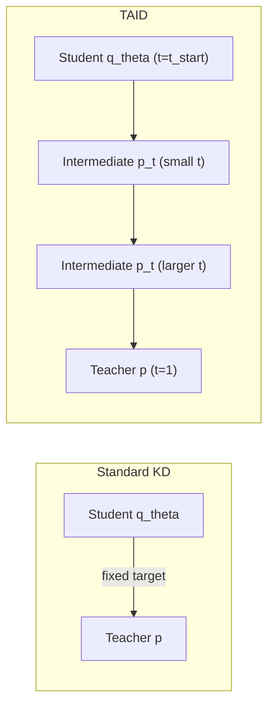
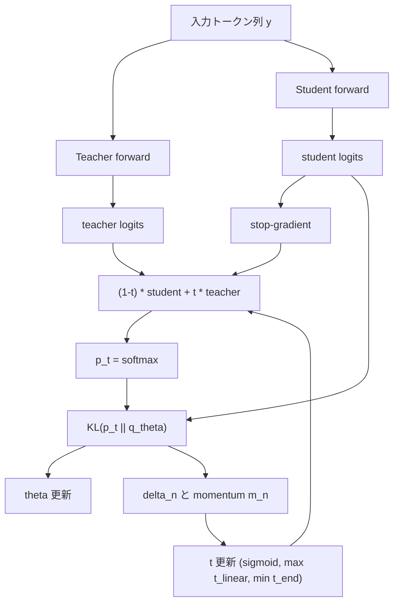
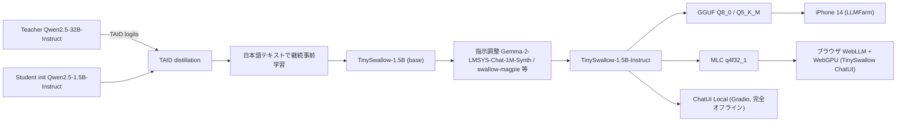
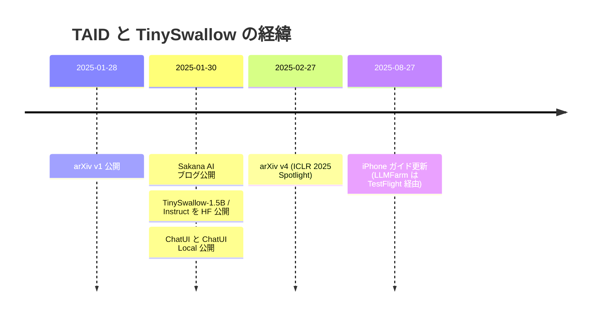

# TAID: Temporally Adaptive Interpolated Distillation for Efficient Knowledge Transfer in Language Models — および日本語 SLM「TinySwallow-1.5B」（Sakana AI）

- **Link**: https://arxiv.org/abs/2501.16937 （HTML: https://arxiv.org/html/2501.16937v4 ）
- **Authors**: Makoto Shing (Sakana AI), Kou Misaki (Sakana AI), Han Bao (Kyoto University), Sho Yokoi (NINJAL / Tohoku University / RIKEN), Takuya Akiba (Sakana AI)
- **Year**: 2025（v1: 2025-01-28、v4: 2025-02-27）
- **Venue**: ICLR 2025（13th International Conference on Learning Representations, **Spotlight**）
- **Type**: Academic Paper ＋ Business Case（日本語 SLM のオフライン／オンデバイス提供）
- **関連一次資料**:
  - Sakana AI ブログ（日本語）https://sakana.ai/taid-jp/ （2025-01-30）／（英語）https://sakana.ai/taid/
  - モデルカード https://huggingface.co/SakanaAI/TinySwallow-1.5B ／ https://huggingface.co/SakanaAI/TinySwallow-1.5B-Instruct
  - 公式実装 https://github.com/SakanaAI/TAID
  - デモ https://github.com/SakanaAI/TinySwallow-ChatUI （WebLLM/WebGPU、公開デモ https://pub.sakana.ai/tinyswallow/ ）、https://github.com/SakanaAI/TinySwallow-ChatUI-Local （Gradio、完全オフライン）、iPhone ガイド https://github.com/SakanaAI/TinySwallow-ChatUI/blob/main/docs/iphone.md
- **二次報道**: innovatopia（https://innovatopia.jp/ai/ai-news/47421/ ）、AIsmiley（https://aismiley.co.jp/ai_news/taid-tinyswallow-sakanaai/ ）
- **Cluster**: C6 `edge_ondevice`

> **取得状況メモ**: 上記 URL はすべて取得できた。arXiv HTML 版の Figure 2（3 枚組）・Figure 3 は SVG（`<object>` 埋め込み）で、数値データ点はテキストとして抽出できなかった。ただし Figure 2 右（教師サイズ別性能）の TAID 値は付録 Table 6 と一致し、Sakana ブログ figure3.png で KL/RKL 曲線を目視確認した（目視値は概数として明記）。
>
> **証拠の質ラベル**: **一次資料**＝論文本文・モデルカード・公式リポジトリ／ブログの記述、**ベンダー申告**＝Sakana AI 自身による性能・優位性主張（査読済み論文中の主張は「一次資料（査読済み）」と併記）、**二次報道**＝innovatopia・AIsmiley。

## Abstract

Causal language models have demonstrated remarkable capabilities, but their size poses significant challenges for deployment in resource-constrained environments. Knowledge distillation, a widely-used technique for transferring knowledge from a large teacher model to a small student model, presents a promising approach for model compression. A significant remaining issue lies in the major differences between teacher and student models, namely the substantial capacity gap, mode averaging, and mode collapse, which pose barriers during distillation. To address these issues, we introduce Temporally Adaptive Interpolated Distillation (TAID), a novel knowledge distillation approach that dynamically interpolates student and teacher distributions through an adaptive intermediate distribution, gradually shifting from the student's initial distribution towards the teacher's distribution. We provide a theoretical analysis demonstrating TAID's ability to prevent mode collapse and empirically show its effectiveness in addressing the capacity gap while balancing mode averaging and mode collapse. Our comprehensive experiments demonstrate TAID's superior performance across various model sizes and architectures in both instruction tuning and pre-training scenarios. Furthermore, we showcase TAID's practical impact by developing two state-of-the-art compact foundation models: TAID-LLM-1.5B for language tasks and TAID-VLM-2B for vision-language tasks. These results demonstrate TAID's effectiveness in creating high-performing and efficient models, advancing the development of more accessible AI technologies.

## Abstract (Japanese Translation)

因果言語モデルは卓越した能力を示しているが、そのサイズはリソース制約のある環境への展開に大きな課題をもたらす。知識蒸留は、大規模な教師モデルから小規模な生徒モデルへ知識を転移する広く使われた技術であり、モデル圧縮の有望なアプローチである。しかし依然として、教師と生徒の大きな違い、すなわち大きな能力差（capacity gap）、モード平均化（mode averaging）、モード崩壊（mode collapse）が蒸留の障壁となっている。これらに対処するため、我々は Temporally Adaptive Interpolated Distillation（TAID）を提案する。TAID は適応的な中間分布を介して生徒と教師の分布を動的に補間し、生徒の初期分布から教師の分布へと徐々に移行させる新しい知識蒸留手法である。TAID がモード崩壊を防ぐことを理論解析で示し、能力差への対処とモード平均化／モード崩壊のバランスにおける有効性を実証する。包括的な実験により、指示調整と事前学習の両シナリオで、さまざまなモデルサイズ・アーキテクチャにおいて TAID の優位性を示す。さらに、言語タスク向けの TAID-LLM-1.5B と視覚言語タスク向けの TAID-VLM-2B という 2 つの最先端小型基盤モデルを開発し、TAID の実用的インパクトを示す。これらの結果は、高性能かつ効率的なモデルの構築における TAID の有効性を示し、より利用しやすい AI 技術の発展を前進させるものである。

## Overview

TAID は、**教師（大モデル）と生徒（小モデル）の出力分布をロジット空間で時間的に補間した「中間教師」** を目標にして生徒を学習させる、**ロジットベースの真の知識蒸留手法**である。補間係数 $t$ を学習の進み具合に応じて 0 側（生徒自身）から 1（教師）へ適応的に引き上げることで、「生徒にとって常にちょうど良い難しさの先生」を提供する（Sakana ブログの比喩）。

Sakana AI はこの手法を事業・社会実装の文脈で 2 つの成果物に落とし込んだ。

1. **TAID-LLM-1.5B / TAID-VLM-2B**（論文 Section 7）— 英語 LLM・VLM でサイズ帯 SOTA を主張。
2. **TinySwallow-1.5B / -Instruct**（東京科学大学 Swallow チームと共同、2025-01-30 公開）— **教師 Qwen2.5-32B-Instruct → 生徒 Qwen2.5-1.5B-Instruct** を TAID で蒸留し、さらに日本語データで継続事前学習。3B 未満の日本語 SLM で最高の平均スコア（0.402）を主張。**iPhone 14 上でのオフライン生成**、**ブラウザ（WebLLM / WebGPU）でのオフラインチャット**を公開デモとして提示。

本研究は経済産業省・NEDO の **GENIAC**（JPNP20017）の支援を受けた（論文謝辞・ブログ、一次資料）。

### 蒸留の種別判定

| 工程 | 内容 | 種別 | 証拠の質 |
|------|------|------|---------|
| TAID 本体 | 教師ロジットと（勾配停止した）生徒ロジットの補間分布 $p_t$ に対する KL を最小化 | **真の知識蒸留（logit-based KD）** | 一次資料（査読済み） |
| TAID-LLM-1.5B | Qwen2-72B-Instruct → Qwen2-1.5B-Instruct、SmolLM-Corpus 全量 2 epoch、教師確率を事前計算し top-50 のみ使用 | **真の蒸留（事前学習型、オフライン教師確率）** | 一次資料 |
| TinySwallow-1.5B | Qwen2.5-32B-Instruct → Qwen2.5-1.5B-Instruct を TAID で蒸留＋日本語テキストで継続事前学習 | **真の蒸留**＋（追加の）継続事前学習 | 一次資料（モデルカード）。蒸留と日本語継続事前学習の順序・データ量の詳細は非公開 |
| TinySwallow-1.5B-Instruct | 上記をさらに指示調整（Gemma-2-LMSYS-Chat-1M-Synth、swallow-magpie-ultra-v0.1、swallow-gemma-magpie-v0.1） | **通常のファインチューニング（SFT）**。ただし学習データ自体が他 LLM（Gemma 2 等）の生成した合成データであり、**合成データ経由の間接的な蒸留（sequence-level）** の性格も持つ | 一次資料（データセット名から推定。生成元モデル詳細は各データセットカード未確認） |
| GGUF Q8/Q5、MLC q4f32_1 | iPhone（LLMFarm）・ブラウザ（WebLLM）向け量子化 | **量子化**。蒸留ではない | 一次資料（公式リポジトリ） |

## Problem

論文は LLM 蒸留の障壁を「教師と生徒の差」に起因する 2 つの問題に整理している（構造化リストを保持）。

1. **Capacity gap（能力差）** — 大きな教師と小さな生徒の能力差が知識転移を難しくする。LM の巨大化に伴いこの差はますます顕著になる（Mirzadeh et al., 2020; Cho & Hariharan, 2019; Zhang et al., 2023b）。極端に大きな教師がかえって生徒性能を下げる "**curse of capacity gap**" が報告されている。
2. **Mode averaging と mode collapse** — 能力差ゆえに、
   - 順方向 KL（$J_{\mathrm{KL}}$）では、生徒が教師の全モードを無理にカバーしようとして分布が過度に平滑化（mode averaging）。
   - 逆方向 KL（$J_{\mathrm{RKL}}$）ではそれを緩和できるが、生徒が教師の支配的モードのみに集中（mode collapse）。

さらに背景として「LLM は大きすぎる」— エッジデバイスに載らない、リアルタイム用途にはデコードが遅い、エネルギー消費が大きい — という 3 点を挙げる（Introduction）。

### 前提（Preliminaries）の数式

言語モデルはトークン列 $\mathbf{y}=(y_1,\dots,y_S)\in\mathcal{Y}^S$ 上の確率分布 $p$（$\mathcal{Y}$: 語彙、$S$: 系列長）。

$$
p(y_s\mid y^{<s})=\mathrm{softmax}\big(\mathrm{logit}_p(y_s\mid y^{<s})\big)=\frac{\exp(\mathrm{logit}_p(y_s\mid y^{<s}))}{\sum_{y'\in\mathcal{Y}}\exp(\mathrm{logit}_p(y'\mid y^{<s}))}
$$

$$
p(\mathbf{y})=\prod_{s=1}^{S}p(y_s\mid y^{<s}),\qquad y^{<s}:=(y_1,\dots,y_{s-1})
$$

教師 $p$ からパラメトリックな生徒 $q_\theta$ へ、距離 $J$ を最小化する $\theta$ を求める。

**順方向 KL（Hinton et al., 2015）**:

$$
J_{\mathrm{KL}}(p,q_\theta):=\frac{1}{S}\sum_{s=1}^{S}\sum_{y_s\in\mathcal{Y}}p(y_s\mid y^{<s})\log\frac{p(y_s\mid y^{<s})}{q_\theta(y_s\mid y^{<s})}
$$

**逆方向 KL（Wen et al., 2023）**: $J_{\mathrm{RKL}}(p,q_\theta):=J_{\mathrm{KL}}(q_\theta,p)$

## Proposed Method

### 3.1 時間補間分布（Definition 3.1: TAID Interpolated Distribution）

任意の入力 $y^{<s}\in\mathcal{Y}^{s-1}$ と出力トークン $y_s\in\mathcal{Y}$ について:

$$
p_t(y_s\mid y^{<s}):=\mathrm{softmax}\Big((1-t)\cdot\mathrm{logit}_{q'_\theta}(y_s\mid y^{<s})+t\cdot\mathrm{logit}_p(y_s\mid y^{<s})\Big)\tag{1}
$$

- $t\in[0,1]$: 時間依存の補間パラメータ
- $\mathrm{logit}_{q'_\theta}$: 生徒ロジットの **detached 版**（定数扱いで逆伝播しない）
- $\mathrm{logit}_p$: 教師ロジット
- 補間は **ロジットレベル**で行う（予測間の相対的な確信度を保つため）

### Definition 3.2: TAID Objective

$$
J^{(t)}_{\mathrm{TAID}}(p,q_\theta):=J_{\mathrm{KL}}(p_t,q_\theta)=\frac{1}{S}\sum_{s=1}^{S}\sum_{y_s\in\mathcal{Y}}p_t(y_s\mid y^{<s})\log\frac{p_t(y_s\mid y^{<s})}{q_\theta(y_s\mid y^{<s})}\tag{2}
$$

- 学習中に $t$ を 0→1 へ徐々に上げ、$p_t$ を生徒の初期分布から教師分布へ移行させる。
- detached な $q'_\theta$ により、最適化対象は KL の分母側の $q_\theta$ のみ（中間分布は「ターゲット」として扱われる）。
- **解釈**: $t$ が小さいとき生徒は自分自身のモードに集中する（自己蒸留に類似、Mobahi et al., 2020 のスパース化による汎化）。$t$ が大きくなるにつれ教師の豊かな信号を取り込む。ただし自己蒸留はモード崩壊を避けられないのに対し、補間パラメータがそれを防ぐ（Section 4 で理論的に示す）。

### 3.2 補間パラメータの適応更新

線形増加でも有効だが、生徒の学習進度に応じて $t$ を動かす適応更新を提案。設計意図: **$p_t$ が生徒に近く当てはめが容易な初期は $t$ を積極的に上げ、生徒が教師に近づくにつれ緩やかにする**。

目的関数の相対変化:

$$
\delta_n:=\frac{J^{(t_{n-1})}_{\mathrm{TAID}}-J^{(t_n)}_{\mathrm{TAID}}}{J^{(t_{n-1})}_{\mathrm{TAID}}+\epsilon}
$$

モメンタムで平滑化:

$$
m_n=\beta m_{n-1}+(1-\beta)\delta_n
$$

更新則:

$$
t_n\leftarrow\min\Big(1.0,\ \max\big(t_{\text{linear}},\ t_{n-1}+\alpha\cdot\mathrm{sigmoid}(m_n)\cdot(1-t_{n-1})\big)\Big)
$$

- $\alpha$: $t$ のステップサイズ（学習率）、$\beta$: モメンタム係数、$\epsilon$: ゼロ除算防止の小定数
- $t_{\text{linear}}$: 下限としての線形スケジュール、$t_{\text{start}}$: 初期値（ハイパーパラメータ）
- sigmoid が更新幅を有界にし、max/min が所定範囲内での単調増加を保証

### Section 5 Related works の比較式

| 手法 | 目的関数 |
|------|---------|
| TVD（Wen et al., 2023） | $J_{\text{TVD}}(p,q_\theta):=\frac{1}{2}\sum_{\mathbf{y}}\lvert p(\mathbf{y})-q_\theta(\mathbf{y})\rvert$ |
| Generalized JSD（GKD, Agarwal et al., 2024） | $J_{\text{GJSD}}(p,q_\theta):=\lambda J_{\text{KD}}(p,r)+(1-\lambda)J_{\text{RKD}}(p,r)$、$r(\mathbf{y})=\lambda p(\mathbf{y})+(1-\lambda)q_\theta(\mathbf{y})$ |
| Skew KL（DistiLLM, Ko et al., 2024） | $J_{\text{SKD}}(p,q_\theta):=J_{\text{KL}}(p,r)$ |
| Skew Reverse KL | $J_{\text{SRKD}}(p,q_\theta):=J_{\text{KL}}(q_\theta,r)$ |
| **TAID** | $J_{\text{TAID}}(p,q_\theta)=J_{\text{KL}}(p_t,q_\theta)$（$p_t$ は時間依存、ロジット補間） |

**Skew KL との違い（Appendix C）**:
1. **知識の流れの向き** — TAID は補間分布 $p_t$ が生徒 $q_\theta$ を教える（直接経路）。Skew KL は教師 $p$ が補間分布 $r$ を教える（生徒の知識が目標側に混ざる間接経路）。
2. **補間設計** — TAID は時間依存の $t$、Skew KL は固定の $\lambda$。

### Section 4 理論解析（Theorem 4.1, 非形式版）

最小二乗回帰を言語モデリングの代理として、Mobahi et al. (2020) の枠組みで解析。各ステップで生徒は補間ラベル $(1-t)y_t+t\,y_{\text{teacher}}$ に当てはめ（$t$ は線形増加）、各ステップで $\epsilon$-補間（ほぼ完全に当てはめ）を仮定。

> **Theorem 4.1 (Non-collapse Nature)**: 総 $T$ ステップの蒸留で、教師のラベル信号が少なくとも $\Omega(\sqrt{T\epsilon})$ の大きさを持つなら、生徒はいかなる時刻 $t$ でも崩壊しない。

自己蒸留は十分なステップ後に必ず崩壊する（Mobahi et al., 2020, Proposition 4）のと対照的。

### Appendix B 形式的解析（主要式）

補間領域の回帰問題:

$$
f^{*}:=\arg\min_{f\in\mathcal{F}}R(f)\quad\text{s.t.}\quad\frac{1}{N}\sum_{i=1}^{N}(f(\mathbf{x}_i)-y_i)^2\le\epsilon\tag{3}
$$

正則化項:

$$
R(f)=\int u(\mathbf{x},\mathbf{x}')f(\mathbf{x})f(\mathbf{x}')\,d\mathbf{x}\,d\mathbf{x}'\tag{4}
$$

$\|\mathbf{y}\|^2\le N\epsilon$ なら自明解 $f=0$（崩壊）。ラグランジュ変分問題:

$$
f^{*}_\lambda:=\arg\min_{f\in\mathcal{F}}\frac{1}{N}\sum_{i=1}^{N}(f(\mathbf{x}_i)-y_i)^2+\lambda\int u(\mathbf{x},\mathbf{x}')f(\mathbf{x})f(\mathbf{x}')\,d\mathbf{x}\,d\mathbf{x}'\tag{5}
$$

グリーン関数 $g$（$\int u(\mathbf{x},\mathbf{x}')g(\mathbf{x}',\mathbf{x}_0)d\mathbf{x}'=\delta(\mathbf{x}-\mathbf{x}_0)$, 式 6）と $\mathbf{G}_{i,j}=\frac{1}{N}g(\mathbf{x}_i,\mathbf{x}_j)$ を用いて解析解:

$$
f^{*}_\lambda(\mathbf{x})=\mathbf{g}_{\mathbf{x}}^{\top}(\lambda\mathbf{I}+\mathbf{G})^{-1}\mathbf{y}\tag{7}
$$

$$
\mathbf{f}=\mathbf{V}^{\top}\mathbf{D}(\lambda\mathbf{I}+\mathbf{D})^{-1}\mathbf{V}\mathbf{y}\tag{8}
$$

$$
\lambda=\frac{\alpha\sqrt{N\epsilon}}{\|\mathbf{y}\|-\sqrt{N\epsilon}}\quad(\alpha\in[d_{\min},d_{\max}])\tag{9}
$$

**Theorem B.1**: $\kappa:=d_{\max}/d_{\min}$、$r_0:=\|\mathbf{y}_0\|/\sqrt{N\epsilon}>1$ として、ある $\gamma\in[0,1]$ について

$$
t<\min\Big\{\frac{1}{\gamma+\kappa}(r_0-\gamma)+o(1),\ \frac{\gamma}{r_0}T\Big\}\quad\text{または}\quad\frac{1}{r_0}T<t\tag{10}
$$

のいずれかが成り立てば $\mathbf{y}_{t+1}$ は崩壊しない。自己蒸留の非崩壊条件は

$$
t\le\frac{r_0-1}{\kappa}\tag{11}
$$

観察: (i) TAID は後半（$t\to T$）で有利（自己蒸留は最終的に必ず崩壊）、(ii) 前半では定数倍不利（臨界ステップ TAID $O(r_0/(\gamma+\kappa))$ vs 自己蒸留 $O(r_0/\kappa)$）— 後半の安定化の代償。

**Corollary B.1.1**（$\gamma=1$）:

$$
\|\mathbf{y}_0\|=\Omega\Big(\frac{1+\sqrt{1+4T(1+\kappa)}}{2}\sqrt{N\epsilon}\Big)
$$

なら全時刻で崩壊しない。

**Algorithm 2（回帰版 TAID）**: $\tilde{\mathbf{y}}_t\leftarrow(1-\frac{t}{T})\mathbf{y}_t+\frac{t}{T}\mathbf{y}_0$（中間教師）→ 式 (9) で $\lambda_t$ 選択 → $\mathbf{y}_{t+1}\leftarrow\mathbf{V}^{\top}\mathbf{D}(\lambda_t\mathbf{I}+\mathbf{D})^{-1}\mathbf{V}\tilde{\mathbf{y}}_t$ を $t<T$ の間反復。

（証明本体は論文 Appendix B.3 にあり、式 (12)〜(13) の再帰展開と最小特異値評価 $\sigma_{\min}(\overline{\mathbf{A}}_t)\ge t/T$ が要点。）

## Algorithm (Pseudocode)

論文 Algorithm 1（TAID training algorithm）の再現:

```
Input: 学習率 η, t の学習率 α, モメンタム β, 総反復 N, 初期値 t_start, 終端値 t_end
1: 生徒パラメータ θ を初期化
2: t_1 = t_start, m_0 = 0, J^(t_0) = ∞
3: for n = 1 .. N:
4:     t_linear = t_start + (t_end - t_start) * n / N
5:     バッチ {(y^{<s}_j, y_j)}_{j=1..B} を D からサンプル
6:     p_{t_n}(y_s | y^{<s}) を式(1)で計算   # 生徒ロジットは stop-gradient
7:     J^(t_n) を式(2)で計算                 # KL(p_t || q_θ)
8:     θ ← θ − η ∇_θ J^(t_n)
9:     δ_n = (J^(t_{n-1}) − J^(t_n)) / (J^(t_{n-1}) + ε)
10:    m_n = β m_{n-1} + (1 − β) δ_n
11:    Δt = α * sigmoid(m_n) * (1 − t_n)
12:    t_{n+1} ← min(t_end, max(t_linear, t_n + Δt))
```

PyTorch 風の損失実装（レポート作成者による最小例。公式実装は `src/distil_losses` 参照）:

```python
import torch.nn.functional as F

def taid_loss(student_logits, teacher_logits, t):
    # p_t = softmax((1-t)*detach(student) + t*teacher)
    p_t = F.softmax((1 - t) * student_logits.detach() + t * teacher_logits, dim=-1)
    log_q = F.log_softmax(student_logits, dim=-1)
    # KL(p_t || q) = sum p_t (log p_t - log q)
    return (p_t * (p_t.clamp_min(1e-12).log() - log_q)).sum(-1).mean()
```

### ハイパーパラメータの効果（Appendix A の構造化リスト）

- **$\alpha$（$t$ の学習率）**: 大きいほど初期に $t$ が速く伸びる。生徒が初期補間分布に近く課題が易しいときに効率的。
- **$\beta$（モメンタム）**: 大きいほど短期変動の影響を抑え安定。**0.99 前後**が多様な設定で良好。
- **$t_{\text{start}}$**: 生徒にとって易しすぎる初期段階をスキップ。**0.2〜0.4** が良好（初期の生徒・教師類似度に依存）。
- **$t_{\text{end}}$**: 通常 **1.0**（最終的に教師に一致）。
- 既定値: $\beta=0.99$、$\alpha=5\times10^{-4}$、$t_{\text{start}}\in[0.2,0.4]$。

## Architecture / Process Flow

### Figure 1（論文）: 標準 KD と TAID の比較


> Figure 1: (Left) Standard KD methods typically employ direct optimization towards a fixed teacher distribution. (Right) TAID creates a dynamic bridge through adaptive, time-dependent intermediate teacher distributions (green dashed lines), enabling gradual optimization of the student.



### TAID の 1 ステップのデータフロー



### TinySwallow 構築・配布フロー（モデルカード・ブログ・リポジトリから再構成）



## Figures & Tables

### Table 1（論文）: 指示調整での蒸留手法比較（MT-Bench、GPT-4 採点）

| Method | Phi-3-mini (3.8B) → TinyLlama (1.1B) | Llama-2 (6.7B) → TinyLlama (1.1B) | StableLM Zephyr (2.8B) → Pythia (0.4B) |
|---|---|---|---|
| SFT | 2.00 | 3.94 | 2.57 |
| KL (Hinton et al., 2015) | 2.71 | 3.99 | 2.74 |
| RKL (Wen et al., 2023; Gu et al., 2024) | 3.48 | 3.92 | 2.53 |
| TVD (Wen et al., 2023) | 3.27 | 3.64 | 2.57 |
| Adaptive KL (Wu et al., 2024) | 3.27 | 3.77 | 2.64 |
| GKD (Agarwal et al., 2024) | 2.24 | 3.82 | 2.59 |
| DistiLLM (Ko et al., 2024) | 3.23 | 3.97 | 2.97 |
| CTKD (Li et al., 2023b) | 1.78 | 2.84 | 1.39 |
| DKD (Zhao et al., 2022) | 2.70 | 4.14 | 2.90 |
| (Ours) TAID w/o adaptive update | 3.44 | 4.18 | 2.88 |
| **(Ours) TAID** | **4.05** | **4.27** | **3.05** |

- 設定: UltraChat 200k（2048 トークン超を除外し約 150k 学習 / 2k 検証）、5 epoch、batch 64、AdamW lr 1e-4、cosine。各 epoch 後の検証 ROUGE-L 最良チェックポイントを採用。TAID: $\beta=0.99$、$\alpha=5\times10^{-4}$、$t_{\text{start}}$=0.4（Phi-3 ペア）/0.2（他）、$t_{\text{end}}=1.0$。
- **SFT 前置や事前学習コーパスでの追加 CE を行わない「蒸留のみ」**の設定（純粋な蒸留効果の評価）。
- 適応更新のアブレーション: w/o adaptive 比で **+2.2%〜+17.7%**。
- 学習時間（8×H100、1 epoch あたり）: **TAID 約 0.7 h、DistiLLM 約 2 h、GKD 約 9.8 h**（SGO サンプリングの有無が主因）→「DistiLLM の約 2 倍、GKD の約 10 倍高速」（一次資料・査読済み）。

#### アブレーション（適応更新の寄与、Table 1 から算出）

| Pair | TAID w/o adaptive | TAID | Delta | 相対改善 |
|---|---|---|---|---|
| Phi-3-mini → TinyLlama | 3.44 | 4.05 | +0.61 | +17.7% |
| Llama-2 → TinyLlama | 4.18 | 4.27 | +0.09 | +2.2% |
| StableLM Zephyr → Pythia | 2.88 | 3.05 | +0.17 | +5.9% |

#### 学習時間の ASCII バーチャート（h/epoch, 8×H100）

```
TAID      |██                                  0.7
DistiLLM  |██████                              2.0
GKD       |█████████████████████████████       9.8
```

### Table 2（論文）: 継続事前学習での比較（Open LLM Leaderboard 6 タスク）

教師 Phi-3-medium-4k-instruct、生徒 TinyLlama、SmolLM-Corpus 先頭 10%（約 20B トークン）、1 epoch、80×H100（各 batch 8、実効 640）、AdamW lr 1e-4、cosine。ベースラインは SGO を除いた目的関数のみで比較。

| Method | ARC | HellaSwag | MMLU | TrustfulQA | Winogrande | GSM8K | Average |
|---|---|---|---|---|---|---|---|
| SFT | 41.38 | 63.66 | 25.89 | 35.64 | 61.25 | 1.21 | 38.17 |
| KL (Hinton et al., 2015) | 44.97 | 65.43 | 25.11 | 37.95 | 63.22 | 2.80 | 39.91 |
| TVD (Wen et al., 2023) | 43.52 | 64.50 | 25.95 | 36.38 | 63.14 | 2.96 | 39.41 |
| Adaptive KL (Wu et al., 2024) | 43.77 | 63.09 | 26.04 | 36.42 | 63.22 | 2.12 | 39.11 |
| GJS (Agarwal et al., 2024) | 44.71 | 65.67 | 25.27 | 37.76 | 62.12 | 3.34 | 39.81 |
| Skew KL (Ko et al., 2024) | 44.62 | 65.25 | 25.79 | 37.45 | 62.51 | 3.41 | 39.84 |
| Skew RKL (Ko et al., 2024) | 44.11 | 64.80 | 26.07 | 36.76 | 62.83 | 3.03 | 39.60 |
| **(Ours) TAID** | **45.48** | 65.43 | 25.43 | 37.92 | **63.38** | 2.96 | **40.10** |

（列名 "TrustfulQA" は原文表記のまま）。TAID は平均で最高だが、KL との差は +0.19pt と小さい点に留意（レポート作成者注）。

### Figure 2（論文）: TAID の挙動分析（3 枚組、SVG）

- 左: $t$ の挙動 — https://arxiv.org/html/2501.16937v4/alpha_behavior.svg （$t_{\text{start}}=0.4$、$\alpha$ が大きいほど初期の伸びが速い。線形増加と比較）
- 中: 目的関数値 — https://arxiv.org/html/2501.16937v4/loss_behavior.svg （TAID は標準 KL より値が一定で分散が小さい）
- 右: 教師サイズ別性能 — https://arxiv.org/html/2501.16937v4/model_increase.svg


Figure 2 左・中の数値データ点は SVG からテキスト抽出できなかったため、定性記述のみ再現する。

#### Figure 2 右（＝Sakana ブログ figure3）: 教師サイズ別の生徒（Pythia-70M）LAMBADA 正解率


設定: 生徒 Pythia 70M 固定、教師 Pythia 410M〜6.9B、SmolLM-Corpus のランダム 1B トークン、1 epoch、評価 LAMBADA（lm-eval-harness）。

| Teacher size | Teacher 自身 | TAID | KL | RKL |
|---|---|---|---|---|
| 410M | 約 52 | 20.82 | 約 19.1 | 約 14.3 |
| 1B | 約 57 | 21.17 | 約 19.2 | 約 14.0 |
| 2.8B | 約 65 | 21.70 | 約 19.0 | 約 13.3 |
| 6.9B | 約 67 | 22.01 | 約 20.1 | 約 13.4 |

TAID 列は論文 Table 6 の正確値。Teacher・KL・RKL 列は **ブログ画像からの目視読み取り（概数）**。TAID は単調増加、KL/RKL は非単調（RKL はむしろ低下）＝ curse of capacity gap と整合（一次資料・査読済み）。

```
LAMBADA acc (%)  410M    1B     2.8B   6.9B
TAID            20.82 → 21.17 → 21.70 → 22.01   (単調増加)
KL              ~19.1 → ~19.2 → ~19.0 → ~20.1   (非単調)
RKL             ~14.3 → ~14.0 → ~13.3 → ~13.4   (低下傾向)
```

### Table 3（論文）: 確率質量分布の分析（Phi-3-mini → TinyLlama、UltraChat 200k train）

Head: 教師ランク上位 10 トークンの確率和、Tail: 80〜100 パーセンタイルのトークンの確率和。典型的な確率は Head で $10^{-1}$〜$10^{-2}$、Tail で $10^{-10}$〜$10^{-11}$。

| Method | Head | Tail |
|---|---|---|
| KL | 0.216 | 40.2 × 10⁻⁷ |
| RKL | 0.227 | 8.1 × 10⁻⁷ |
| TAID | 0.218 | 39.0 × 10⁻⁷ |

→ TAID は Head で KL より支配的語彙を捉え（mode averaging 回避）、Tail で RKL より低頻度語彙を保持（mode collapse 回避）。両者の中間でバランス。

### Figure 3（論文）: 画像分類と言語モデリングの分布比較


ResNet-56（CIFAR-100）と GPT-2（OpenWebText）の比較で、言語モデリングはエントロピーが高く正解クラス確率が低い。本文の数値:

| データセット | Entropy | Target-class probability |
|---|---|---|
| ImageNet | 6.67 | 0.00130 |
| CIFAR-100 | 0.485 | 0.613 |

言語蒸留特有の課題: (1) 非ターゲットモードに引っ張られやすくモード崩壊しやすい、(2) Zipf 則による大量の超低頻度クラス（ロングテール）の予測が小型モデルに困難。

### Table 4 / Table 9（論文）: TAID-LLM-1.5B（LightEval、7 つの 0-shot タスク）

教師 **Qwen2-72B-Instruct** → 生徒 **Qwen2-1.5B-Instruct**、SmolLM-Corpus 全量、2 epoch、AdamW lr 1e-5、cosine、$\beta=0.99$、$\alpha=5\times10^{-5}$、$t_{\text{start}}=0.4$、$t_{\text{end}}=1.0$。**教師確率を事前計算し、ストレージ節約のため top-50 確率のみ使用**。

| Model | MMLU | TriviaQA | ARC | PIQA | Hellaswag | OBQA | Winogrande | Average |
|---|---|---|---|---|---|---|---|---|
| Qwen2-1.5B (Yang et al., 2024) | 37.91 | 1.38 | 48.12 | 75.30 | 63.87 | 36.80 | 59.98 | 46.19 |
| Qwen2.5-1.5B (Qwen Team, 2024) | 41.15 | 0.68 | 58.41 | 76.01 | 66.40 | 40.00 | 59.35 | 48.86 |
| Phi-1.5B (Li et al., 2023a) | 35.92 | 6.06 | 60.53 | 75.62 | 60.72 | 46.00 | 67.88 | 50.39 |
| StableLM-2-1.6B (Bellagente et al., 2024) | 36.21 | 29.59 | 53.57 | 76.77 | 66.60 | 37.20 | 58.72 | 51.24 |
| SmolLM-1.7B (Allal et al., 2024) | 39.97 | 22.56 | 59.95 | 76.06 | 62.91 | 42.80 | 54.91 | 51.31 |
| **TAID-LLM-1.5B** | 39.96 | 22.96 | 58.14 | **77.37** | **67.15** | 41.40 | 58.88 | **52.27** |

Table 4（要約版）: Qwen2-1.5B 46.19 / Phi-1.5B 50.39 / StableLM-2-1.6B 51.24 / SmolLM-1.7B 51.31 / **TAID-LLM-1.5B 52.27**。生徒初期値 Qwen2-1.5B 系から **+6.08pt**（平均）。

### Table 5 / Table 10（論文）: TAID-VLM-2B（Open VLM Leaderboard）

教師 **InternVL2-8B** → 生徒 **InternVL2-2B**、Mantis-Instruct、3 epoch、AdamW lr 1e-6、cosine、$\beta=0.99$、$t_{\text{start}}=0.4$、$\alpha=5\times10^{-4}$、$t_{\text{end}}=1.0$。

| Model | MMBench_V11 | MMStar | MMMU_VAL | MathVista | OCRBench | AI2D | HallusionBench | MMVet | Average |
|---|---|---|---|---|---|---|---|---|---|
| PaliGemma-3B-mix-448 | 65.6 | 48.3 | 34.9 | 28.7 | 61.4 | 68.3 | 32.2 | 33.1 | 46.6 |
| MiniCPM-V-2 | 65.8 | 39.1 | 38.2 | 39.8 | 60.5 | 62.9 | 36.1 | 41.0 | 47.9 |
| Phi-3-Vision | 65.2 | 47.7 | 46.1 | 44.6 | 63.7 | 78.4 | 39.0 | 44.1 | 53.6 |
| InternVL2-2B | 69.6 | 49.8 | 36.3 | 46.0 | 78.1 | 74.1 | 38.0 | 39.7 | 54.0 |
| **TAID-VLM-2B** | **70.7** | 49.5 | 35.1 | **51.6** | **78.6** | 74.0 | **56.8** | 35.1 | **56.4** |

Table 5（要約版、小数第 2 位）: PaliGemma 46.56 / MiniCPM-V-2 47.93 / Phi-3-Vision 53.60 / InternVL2-2B 53.96 / **TAID-VLM-2B 56.43**。生徒初期値 InternVL2-2B から +2.47pt。

### Table 6（論文 Appendix C）: TAID vs Skew KL（教師サイズ別、LAMBADA）

| Method | 410M | 1B | 2.8B | 6.9B |
|---|---|---|---|---|
| TAID | 20.82 | 21.17 | 21.70 | 22.01 |
| SKL | 18.65 | 18.50 | 18.28 | 18.20 |

### Table 7（論文 Appendix D.4）: CIFAR-100 Top-1 精度（%）

| Method | ResNet56→ResNet20 | ResNet110→ResNet32 | ResNet32×4→ResNet8×4 | WRN-40-2→WRN-16-2 | WRN-40-2→WRN-40-1 | VGG13→VGG8 |
|---|---|---|---|---|---|---|
| KL (Hinton et al., 2015) | 70.66 | 73.08 | 73.33 | 74.92 | 73.54 | 72.93 |
| CTKD (Li et al., 2023b) | 71.19 | 73.52 | 73.39 | 75.45 | 73.93 | 73.52 |
| DKD (Zhao et al., 2022) | 71.97 | 74.11 | 76.32 | 76.24 | 74.81 | 74.68 |
| MLKD (Jin et al., 2023) | 72.19 | **74.11** | **77.08** | **76.63** | **75.35** | **75.18** |
| (Ours) TAID | **72.25** | 73.51 | 74.85 | 75.81 | 74.51 | 74.38 |

### Table 8（論文 Appendix D.5）: ImageNet Top-1 精度（%）

| Method | ResNet34→ResNet18 | ResNet50→MN-V1 |
|---|---|---|
| KD (Hinton et al., 2015) | 71.03 | 70.50 |
| CTKD (Li et al., 2023b) | 71.38 | 71.16 |
| DKD (Zhao et al., 2022) | 71.70 | 72.05 |
| MLKD (Jin et al., 2023) | 71.90 | 73.01 |
| (Ours) TAID | 72.10 | 72.71 |

### Sakana ブログ Table 1: 3B 未満 SLM の日本語ベンチマーク平均（日本語理解・生成タスク）


| Model | Size (B) | Average |
|---|---|---|
| meta-llama/Llama-3.2-1B | 1.2 | 0.201 |
| llm-jp/llm-jp-3-1.8b | 1.8 | 0.251 |
| sbintuitions/sarashina2.1-1b | 1.4 | 0.296 |
| google/gemma-2-2b | 2.6 | 0.346 |
| Qwen/Qwen2.5-1.5B | 1.5 | 0.372 |
| google/gemma-2-2b-jpn-it | 2.6 | 0.375 |
| **TinySwallow-1.5B** | 1.5 | **0.402** |

（ベンダー申告。評価は Swallow プロジェクトの日本語 LLM 評価ベンチマーク。**タスク別内訳、評価日、few-shot 設定はブログに未掲載**。第三者再現は未確認。）初期値系の Qwen2.5-1.5B（0.372）比 **+0.030**（相対 +8.1%）。

```
日本語平均スコア（3B未満）
Llama-3.2-1B        |██████████                 0.201
llm-jp-3-1.8b       |████████████▌              0.251
sarashina2.1-1b     |██████████████▊            0.296
gemma-2-2b          |█████████████████▎         0.346
Qwen2.5-1.5B        |██████████████████▌        0.372
gemma-2-2b-jpn-it   |██████████████████▊        0.375
TinySwallow-1.5B    |████████████████████       0.402
```

### Sakana ブログの概念図

- 通常学習 vs 知識蒸留:  — 「Sakana AI develops efficient methods for ＿」の空欄予測で、通常学習は正解 "AI" のみ、蒸留は教師の分布（"AI" 35%、"ML" 25%、"LLMs" 15%…）を教える。
- 標準 KD vs TAID:  — 標準 KD は低い段から高い段（教師）へ一気に跳ぶ。TAID は "intermediate teacher" が学習進度（Learning progress）に合わせて階段状に引き上げる。
- TinySwallow ChatUI 画面:  — 「年始挨拶のメールテンプレートを作ってください。」への応答例。フッターに "Powered by WebLLM"。
- デモ動画: https://sakana.ai/assets/taid-jp/TinySwallow-demo.mp4 （iPhone 14 上、GGUF を LLMFarm で実行、実速度）、https://sakana.ai/assets/taid-jp/TinySwallow-demo-2.mp4 （iPhone 上でのブログ要約）

### オンデバイス実行の仕様（公式リポジトリ、一次資料）

| 実行形態 | ランタイム | 量子化／形式 | 速度・制約 | 出典 |
|---|---|---|---|---|
| iPhone（LLMFarm） | llama.cpp 系（GGUF） | Q8_0 | **14.75 tokens/s**（ブログデモで使用） | `docs/iphone.md` |
| iPhone（LLMFarm） | 同上 | Q5_K_M | **19.89 tokens/s**（精度は Q8 より低い） | `docs/iphone.md` |
| ブラウザ（TinySwallow ChatUI） | WebLLM `@mlc-ai/web-llm@0.2.48`、WebGPU | MLC `q4f32_1`（モデルライブラリ `Qwen2-1.5B-Instruct-q4f32_1-ctx4k_cs1k-webgpu.wasm`） | 初回モデル DL 後は完全オフライン、ctx 4k | `index.js` |
| ローカル PC（ChatUI Local） | Python + Gradio、Git LFS で重み同梱 | — | ネットワーク接続不要 | README |

- iPhone の速度計測端末の機種は `docs/iphone.md` に明記なし（ブログのデモは iPhone 14）。2025-08-27 の更新で LLMFarm は TestFlight 経由での入手が必要、と注記。
- WebGPU の利用は `index.js` の wasm ファイル名（`-webgpu.wasm`）と WebLLM 採用から確認（一次資料、コード）。

### ライセンス・利用条件の比較（一次資料）

| 対象 | HF ライセンスタグ | 本文の記載 |
|---|---|---|
| TinySwallow-1.5B | apache-2.0 | Model Details に "License: Apache License, Version 2.0"。一方 Uses に "provided for research and development purposes only ... **not intended for commercial use** or deployment in mission-critical environments" |
| TinySwallow-1.5B-Instruct | apache-2.0 | Uses に同じ研究開発限定の文言。ただし License 節に "derived from Qwen (Apache 2.0) and trained on Gemma data (Gemma Terms, Prohibited Use). **Use (including commercial) is permitted** if you comply with both licenses/policies above." |
| TinySwallow ChatUI / ChatUI Local | （リポジトリ LICENSE 未精査） | 「実験段階のプロトタイプであり、研究開発の目的でのみ提供」「商用利用…には適していません」 |
| TAID 実装 | （未精査） | — |

→ **ライセンス文言は「Apache 2.0（商用可）」と「研究開発目的のみ・商用利用を意図しない」が併記され、Instruct 版では商用利用可の明記もある**という内部的に揺れた状態（2026-10 取得時点）。二次報道（innovatopia）は「商用利用や重要なシステムでの利用については現時点で制限が設けられて」いると報じている（二次報道）。実務上は「法的にはライセンス条項（Apache 2.0＋Gemma Terms）が優先し得るが、提供元は商用・ミッションクリティカル用途を想定・保証しない」と解釈し、商用採用時は Sakana AI への確認を推奨（レポート作成者の解釈、法的助言ではない）。

### 手法比較表（Related works から合成）

| 手法 | 教師分布 | 時間変化 | SGO 必要 | 主な弱点（論文の指摘） |
|---|---|---|---|---|
| KL（Hinton） | 固定 | なし | 不要 | mode averaging |
| RKL | 固定 | なし | 不要 | mode collapse |
| TVD | 固定（系列レベル） | なし | 不要 | 能力差に弱い |
| GKD（GJSD） | 固定＋混合 $r$ | なし | **必要**（on-policy） | 計算コスト大（9.8 h/epoch） |
| DistiLLM（Skew KL） | 固定 $\lambda$ 混合 | なし | 適応 SGO | 2 h/epoch、教師大で劣化（Table 6） |
| CTKD | 温度学習で両分布変更 | カリキュラム | 不要 | 言語では低性能（Table 1） |
| DKD | ターゲット/非ターゲット分解 | なし | 不要 | 言語分布に不適合 |
| **TAID** | 生徒⇄教師のロジット補間 $p_t$ | **適応的に $t$ 増加** | **不要** | 初期の非崩壊保証は自己蒸留より定数倍弱い（理論） |

### タイムライン



## Experiments & Evaluation

### Setup

| 実験 | 教師 → 生徒 | データ | 評価 | 計算資源 |
|---|---|---|---|---|
| 指示調整（6.1） | Phi-3-mini-4k-instruct / Llama-2-7b-chat / StableLM Zephyr 3B → TinyLlama / TinyLlama / Pythia-410M | UltraChat 200k | MT-Bench（GPT-4 採点） | 8×H100 |
| 継続事前学習（6.2） | Phi-3-medium-4k-instruct → TinyLlama | SmolLM-Corpus 先頭 10%（約 20B tok） | Open LLM Leaderboard 6 タスク | 80×H100 |
| 能力差（6.3.2） | Pythia 410M/1B/2.8B/6.9B → Pythia 70M | SmolLM-Corpus 1B tok | LAMBADA | — |
| 画像分類（D.3〜D.5） | ResNet/WRN/VGG 系 | CIFAR-100 / ImageNet | Top-1 | — |
| TAID-LLM-1.5B | Qwen2-72B-Instruct → Qwen2-1.5B-Instruct | SmolLM-Corpus 全量 2 epoch | LightEval 7 タスク | — |
| TAID-VLM-2B | InternVL2-8B → InternVL2-2B | Mantis-Instruct 3 epoch | Open VLM Leaderboard 8 タスク | — |
| TinySwallow（ブログ） | Qwen2.5-32B-Instruct → Qwen2.5-1.5B-Instruct | 非公開（日本語継続事前学習データ） | 日本語理解・生成平均 | 非公開 |

公式実装の環境: Python 3.10.12、CUDA 12.3、8×H100 80GB、`pip install torch==2.2.2`、flash-attention をソースからビルド。データ準備例 `python prepare_ultrachat.py --model_type phi-3 --output_dir data`、学習例 `bash scripts/llama-2/taid.sh`。ベースライン損失（`src/distil_losses`）とサンプリング（`src/sampler.py`）は DistiLLM・MiniLLM 実装を基にしている（一次資料、GitHub README）。

### Main Results

- 指示調整 3 ペアすべてで TAID が最高（4.05 / 4.27 / 3.05）。SGO 不要で DistiLLM の約 2 倍・GKD の約 10 倍高速（一次資料・査読済み）。
- 継続事前学習で平均 40.10（最高、KL 39.91）。
- 教師サイズを上げると TAID のみ単調改善（20.82→22.01）。
- TAID-LLM-1.5B: LightEval 平均 52.27（2B 未満で最高と主張）。TAID-VLM-2B: 56.43（4B 以下で最高と主張、Phi-3-Vision 4.2B を上回る）。
- TinySwallow-1.5B: 日本語平均 0.402（3B 未満で最高と主張、ベンダー申告）。

### Ablation Study

- 適応更新の有無: +2.2%〜+17.7%（上表）。
- 能力差: TAID は教師大型化で単調改善、KL/RKL/Skew KL は非単調または劣化（Figure 2 右・Table 6）。
- 分布分析: Head/Tail の確率質量が KL と RKL の中間（Table 3）。

## Business Case: TinySwallow-1.5B（オフライン日本語 SLM）

### Problem & Context

Sakana AI ブログ（一次資料）は 2 つの現場課題を挙げる:
- **開発現場**: 「大規模データと巨大計算資源で性能向上」という指針のもと GPU 購買競争が過熱し、多くの企業が望む「独自 LLM」の開発が容易でない。
- **活用現場**: サービスをユーザに届けるためにスマートフォンなどエッジデバイスで LLM を運用したいが、計算リソースの問題で困難。

### Solution

- TAID で 32B → 1.5B（約 1/20）へ知識転移し、日本語継続事前学習＋指示調整。
- 配布: Hugging Face（base / Instruct / Instruct-GGUF / MLC 版）、ブラウザデモ（外部 API 不要、モデル DL 後オフライン、データは Sakana AI に送られない）、Python ローカル版、iPhone ガイド。
- 共同体制: Sakana AI（Makoto Shing, Taishi Nakamura, Kou Misaki, Takuya Akiba）＋ Swallow チーム（Naoki Okazaki, Youmi Ma, Kakeru Hattori, Kazuki Fujii, Sakae Mizuki）（モデルカード、一次資料）。

### 想定応用（ブログの構造化リストを保持、ベンダー申告）

1. 社内文書や個人メモに基づいた、その人だけのカスタマイズされたプライベートな AI アシスタント
2. データを一切外部に送信せず、ローカルで完結する AI 業務支援
3. オフラインゲームにおける AI キャラクターの実装
4. 小型の AI エージェントの開発

### Results & Impact

| Metric | Before（初期値系 / 比較） | After（TinySwallow） | 証拠の質 |
|---|---|---|---|
| パラメータ | 教師 32B | 1.5B（約 1/20） | 一次資料 |
| 日本語平均 | Qwen2.5-1.5B 0.372 | 0.402 | ベンダー申告 |
| iPhone 生成速度 | — | Q8 14.75 tok/s / Q5 19.89 tok/s | ベンダー申告 |
| 実行形態 | API 経由のクラウド LLM | 端末内・ブラウザ内でオフライン | 一次資料（コード） |
| HF ダウンロード（直近 1 か月、取得時点） | — | base 571 / Instruct 4,394 | 一次資料（HF 表示値、時点依存） |

### 二次報道の論点

| 媒体 | 主な論点 | 証拠の質 |
|---|---|---|
| innovatopia | 2025-01-30 発表、32B→1.5B（約 1/20）、iPhone 14 でオフライン動作しプライバシー重視ユーザに有用、TAID-VLM-2B にも言及、**商用・重要システム利用には現時点で制限**、組込み・医療機器・ロボット・自動運転など応用期待、スタートアップ・中小企業の開発コスト低減 | 二次報道（応用分野は編集部の推測） |
| AIsmiley | ブログ内容の要約（中間教師、ChatUI のオフライン利用、ChatUI Local、HF 公開）、ブログ図版を転載 | 二次報道（新規情報なし） |

### Lessons Learned

1. **蒸留アルゴリズムの改良が「小型・日本語・オフライン」の価値に直結**: 汎用多言語 SLM（Llama-3.2-1B は 0.201）では日本語品質が不足する領域で、強い多言語教師（Qwen2.5-32B）からの蒸留＋現地語継続事前学習が有効な組合せであることを示した。
2. **既存小型モデルを初期値にする「継続事前学習型蒸留」は低コスト**: 生徒をスクラッチ学習せず Qwen2.5-1.5B-Instruct から出発。TAID-LLM-1.5B では教師確率を **top-50 に切り詰めて事前計算**し、ストレージと教師推論を節約。
3. **配布チャネル設計（WebGPU・GGUF・Gradio）が PoC の摩擦を下げる**: ブラウザだけで動くデモは「データが外に出ない」ことを利用者が体感できるため、プライバシー訴求に強い。
4. **ライセンス表記の一貫性はビジネス採用の障壁になり得る**: Apache 2.0 タグと「研究開発目的のみ」の併記、Gemma Terms の継承（指示調整データが Gemma 生成）など、派生モデルの権利関係の整理が必要。
5. **評価の透明性**: 日本語ベンチマークはタスク別内訳が非公開。採用判断には自社タスクでの再評価が必須。

## Notes

- **蒸留の確認結果**: TAID は教師ロジットと生徒ロジットの補間分布への KL 最小化であり、**真の知識蒸留（logit-based）であることを論文（査読済み、一次資料）で確認**。TinySwallow-1.5B についてもモデルカードが「TAID により Qwen2.5-32B-Instruct（教師）→ Qwen2.5-1.5B-Instruct（生徒）」と明記（一次資料）。ただし TinySwallow の蒸留データ・トークン数・top-k 切り詰めの有無・日本語継続事前学習との順序は非公開。Instruct 版の指示調整は通常の SFT（合成データ由来）。iPhone/ブラウザ向けの GGUF・MLC 版は量子化であり蒸留ではない。
- **英語ブログ（sakana.ai/taid/）**: 日本語版と同じ図版（`/assets/taid-jp/` 配下）を使用し、追加の ICLR カバー画像（`cover_iclr.png`）がある。内容は日本語版と対応（本文の差分精査はしていない）。
- **Llama 3.2 との関係**: `05-llama-3-2-edge.md` の Meta は「枝刈り＋8B/70B ロジット蒸留＋大規模事前学習（最大 9T）」というフルスクラッチ寄りの重い蒸留。TAID/TinySwallow は既存 SLM への軽量な継続蒸留で、学術機関・スタートアップでも実行可能な規模感。日本語では TinySwallow（0.402）が Llama-3.2-1B（0.201）を大きく上回る（Sakana AI 申告）。
- **Further investigation candidates**（論文参考文献・リンクから）:
  - DistiLLM（Ko et al., ICML 2024）、GKD / On-policy distillation（Agarwal et al., ICLR 2024）、MiniLLM（Gu et al., ICLR 2024）
  - Mobahi et al. (2020) "Self-distillation amplifies regularization in Hilbert space"
  - Minitron（Muralidharan et al., 2024, prune + distill）、Gemma 2（Team et al., 2024, 蒸留事前学習）
  - Swallow 日本語評価ベンチマーク（https://swallow-llm.github.io/evaluation/ ）でのタスク別スコア
  - `SakanaAI/TinySwallow-1.5B-Instruct-GGUF` および `-q4f32_1-MLC` のモデルカード
