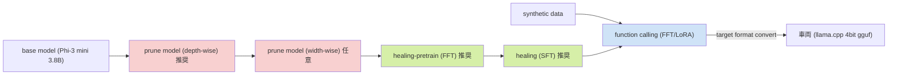
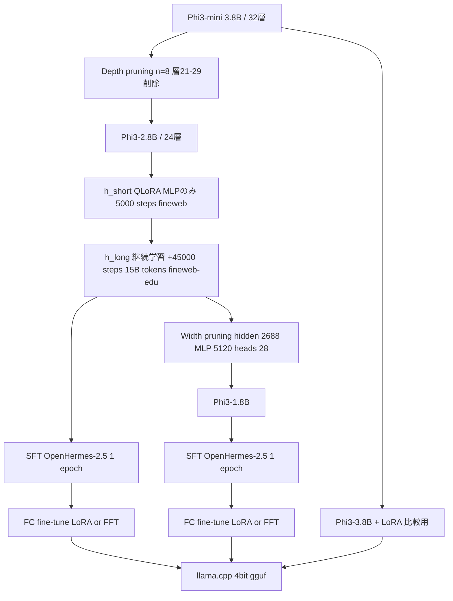
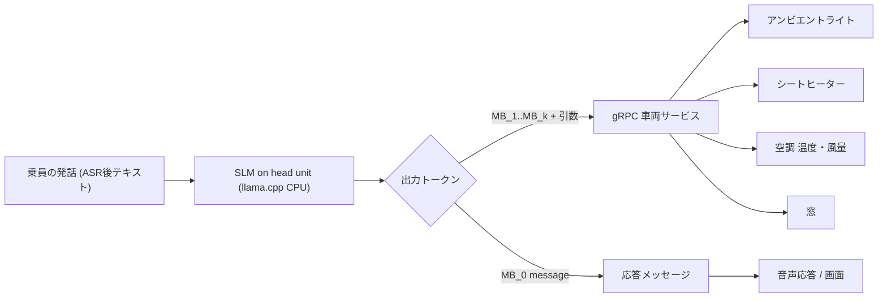

# Optimizing Small Language Models for In-Vehicle Function-Calling

- **Link**: https://arxiv.org/abs/2501.02342 （HTML: https://arxiv.org/html/2501.02342v1 ）
- **Authors**: Yahya Sowti Khiabani（責任著者）, Farris Atif, Chieh Hsu, Sven Stahlmann, Tobias Michels, Sebastian Kramer, Benedikt Heidrich, M. Saquib Sarfraz, Julian Merten, Faezeh Tafazzoli
- **Affiliation**: Mercedes-Benz Research & Development North America / Mercedes-Benz Tech Innovation
- **Year**: 2025（arXiv v1 投稿日 2025-01-04、cs.LG、ライセンス CC BY-NC-SA 4.0）
- **Venue**: arXiv preprint。依頼元の情報では NeurIPS 2024 の workshop 論文とされるが、今回取得した arXiv の abstract ページ・HTML 版のどちらにも採択先の記載（Comments / Journal reference 欄）は無く、**本調査では採択先を確認できていない**
- **Type**: Academic Paper（企業研究所による事例論文）
- **証拠の質**: 本文の数値はすべて **一次資料**（著者自身による実験報告）。ただし評価は社内データセット・社内ヘッドユニットで行われており、第三者による再現はされていない

> **蒸留か否かの結論（先に要約）**
> 本論文の「healing」は **知識蒸留（KD）ではない**。教師モデルの出力（ロジット・隠れ状態）を使う損失は一切登場せず、healing は fineweb / fineweb-edu 上の **次トークン予測による継続事前学習**（最初は QLoRA、続いてフル FT）である。本文で "distillation" という語が現れるのは参考文献 [13]（Minitron 論文 "Compact language models via pruning and knowledge distillation"）のタイトルのみ。Minitron は剪定後の回復に KD を使うが、本論文は Minitron から **width pruning の重要度スコアと「10B トークン規模の回復学習」という規模感だけを借り**、KD は採用していない。
> 一方、function-calling 用データセット（25,000 件 + 負例 500 件）は **LLM に生成させた合成データ** であり、広義の「データ（系列）レベルの蒸留」とみなす余地はあるが、論文自身は distillation と呼んでおらず、生成に使った LLM の名前も明かしていない。
> よって本事例の圧縮手法は **構造化剪定 + 継続事前学習（healing） + SFT + タスク FT（LoRA/FFT） + 4bit 量子化** であり、「エッジ向け SLM = 蒸留」という単純化（仮説 H3 が警戒する混同）の反例として位置づけられる。

## Abstract

We propose a holistic approach for deploying Small Language Models (SLMs) as function-calling agents within vehicles as edge devices, offering a more flexible and robust alternative to traditional rule-based systems. By leveraging SLMs, we simplify vehicle control mechanisms and enhance the user experience. Given the in-vehicle hardware constraints, we apply state-of-the-art model compression techniques, including structured pruning, healing, and quantization, ensuring that the model fits within the resource limitations while maintaining acceptable performance. Our work focuses on optimizing a representative SLM, Microsoft's Phi-3 mini, and outlines best practices for enabling embedded models, including compression, task-specific fine-tuning, and vehicle integration. We demonstrate that, despite significant reduction in model size which removes up to 2 billion parameters from the original model, our approach preserves the model's ability to handle complex in-vehicle tasks accurately and efficiently. Furthermore, by executing the model in a lightweight runtime environment, we achieve a generation speed of 11 tokens per second, making real-time, on-device inference feasible without hardware acceleration. Our results demonstrate the potential of SLMs to transform vehicle control systems, enabling more intuitive interactions between users and their vehicles for an enhanced driving experience.

## Abstract (Japanese Translation)

本論文は、エッジデバイスとしての車両の内部で、小規模言語モデル（SLM）を function-calling エージェントとして展開するための包括的なアプローチを提案する。これは従来のルールベースシステムに比べ、より柔軟で頑健な代替手段となる。SLM を活用することで、車両制御の仕組みを簡素化し、ユーザー体験を向上させる。車載ハードウェアの制約を踏まえ、構造化剪定（structured pruning）、healing、量子化といった最先端のモデル圧縮技術を適用し、許容できる性能を維持しつつモデルをリソース制約内に収める。代表的な SLM として Microsoft の Phi-3 mini を最適化対象とし、圧縮、タスク特化 fine-tuning、車両統合を含む組み込みモデル実現のベストプラクティスを示す。元モデルから最大 20 億パラメータを削除するという大幅なサイズ削減にもかかわらず、本手法は複雑な車載タスクを正確かつ効率的に処理する能力を維持することを示す。さらに軽量ランタイム環境でモデルを実行することで毎秒 11 トークンの生成速度を達成し、ハードウェアアクセラレーションなしでのリアルタイム・オンデバイス推論を実現可能にした。本結果は、SLM が車両制御システムを変革し、ユーザーと車両のより直感的な対話を可能にする潜在力を示している。

## Overview

Mercedes-Benz の研究部門が、**Phi-3 mini（3.8B）を車載ヘッドユニットの CPU 上で function-calling エージェントとして動かす** ための一連の工程を報告した事例論文である。主張の骨子は次の 4 点に整理できる。

1. **深さ方向の剪定（depth pruning）で 32 層中 8 層（層 21–29 付近の連続ブロック）を削除** し 2.8B 化。さらに幅方向の剪定（width pruning）で 1.8B 版も作成した。
2. 剪定直後のモデルは文章が崩壊するため、**healing（回復学習）** を行う。Gromov et al. 推奨の QLoRA 5,000 ステップでは事実知識がほぼ失われたため、**fineweb-edu で追加 45,000 ステップ / 15B トークンのフル学習** を行い、続けて OpenHermes-2.5 で instruction tuning（SFT）した。
3. **Octopus v2 に倣い、車両機能を表す特殊トークン `<MB_0>`〜（8 個）を語彙に追加** し、LLM で合成した 25,000 件の正例＋500 件の負例で LoRA / フル FT を行った。トークンは gRPC で公開される車両サービス（シートヒーター、アンビエントライト等）に対応付けられる。
4. **llama.cpp（gguf）で 4bit 量子化** し、ARM 7 コアの車載 CPU 上で 1.8B 版が **11.02 tokens/s**、メモリ **2GB 未満** を達成。function-calling の完全一致精度は **0.84〜0.88** で、現行の量産音声システム（0.75）を上回った。

ビジネス的に重要なのは、(a) **NPU 等のアクセラレータが無い既存ヘッドユニットでも動く** ことを示した点、(b) 汎用ベンチマーク（MMLU 等）はかなり落ちるが **狭いタスク（車両機能呼び出し）では十分な精度が残る** という「狭いタスクほど小型化が得」という典型パターンを実データで示した点、(c) **圧縮の中心が蒸留ではなく剪定 + 継続学習 + 量子化** である点である。

## Problem

- **車載ソフトウェア統合の複雑化**: 車両は CAN バスでつながった多数の ECU から成り、仮想音声アシスタント、内装機能、アンビエント設定などの新機能を追加するたびに中核システムとのインタフェース開発が必要になる。SLM を仲介層にすることで統合とアップデートを容易にしたい。
- **SLM ですら車載ハードには大きい**: Gemma 2B、Phi-3 mini 3.8B、Mistral 7B、Llama-3 8B などはベンチマーク上強いが、車載ハードの制約下ではそのままの展開は非現実的。
- **圧縮技術の組み合わせ研究の不足**: 剪定・量子化・軽量ランタイムは個別には許容可能な劣化で済むことが知られているが、**タスク特化 fine-tuning（function-calling）と組み合わせた** 研究は少ない。
- **剪定後の回復が不十分**: Gromov et al. の LoRA ベースの軽い healing では、車載展開に必要な性能が戻らない（本論文の発見）。
- **誤作動の防止**: 車両機能を呼び出す以上、無関係な依頼で関数が誤発火しないことが必要（負例データで対処）。

## Proposed Method

**Pruning → Healing → Function-calling Alignment → Quantized Deployment のパイプライン**

### Step 0: ベースモデルの選定

- Phi-3 mini（`microsoft/Phi-3-mini-4k-instruct`、**7 月アップデート前の版**、コミット `ff07dc01615f8113924aed013115ab2abd32115b`）。
- decoder-only Transformer、隠れ層 $L=32$、3.8B パラメータ。選定理由は小ささ、公開ベンチマークでの強さ、多様なソフトウェアスタックで動くこと。
- 補足（本レポートでの調査）: Phi-3 自体は Phi-3 technical report（arXiv 2404.14219）の abstract によれば「強くフィルタされた公開 Web データと **合成データ**」3.3T トークンで学習されたモデルで、合成データを介した広義のデータ蒸留的要素を含むが、同報告の abstract は教師ロジットを用いる KD とは述べていない（一次資料: abstract のみ確認）。

### Step 1: 深さ方向の剪定（Phi3-2.8B の作成）

- ブロックサイズ $n=8$ の **連続した層ブロック** を、層間距離が最小になる位置で削除する。
- Gromov et al. の「どのモデルファミリ（Llama, Qwen, Mistral, Phi2 等）でも層の 30% 超を落とすと崩壊する」という指針に従い、$8/32 = 25\%$ に留めた。
- 距離は隠れ状態間の **角度距離**:

$$
d(h_i, h_{i+n}) := \arccos\left(\frac{\langle h_i, h_{i+n}\rangle}{\lVert h_i\rVert\,\lVert h_{i+n}\rVert}\right), \quad i \in \{1, \ldots, L-n\}
$$

- $h_i$: $i$ 番目の隠れ状態（層 $i$ の入力側の表現）
- $n$: 削除するブロックの層数
- $L$: 隠れ層の総数（32）
- $\langle\cdot,\cdot\rangle$: 内積、$\lVert\cdot\rVert$: L2 ノルム

- 削除位置は（本レポートでの定式化）

$$
i^* = \arg\min_{i \in \{1,\ldots,L-n\}} \; \mathbb{E}_{x \sim \mathcal{D}_{\text{calib}}}\left[ d\big(h_i(x), h_{i+n}(x)\big) \right]
$$

- $\mathcal{D}_{\text{calib}}$: キャリブレーションデータ（fineweb）。論文は「cumulative layer distance を最小化するブロック」と記述しており、トークン・サンプル方向の集約方法の詳細は書かれていない。
- 結果: **層 21–29 が最も類似度が高く** 削除対象となった（Figure 2）。

### Step 2: 幅方向の剪定（Phi3-1.8B の作成、任意）

- Muralidharan et al.（Minitron）の幅剪定を Phi3-2.8B（**healing 済み、$h_{\text{long}}$ 適用後**）に適用。
- 各層（ブロック）で活性を記録し、注意ヘッドについては **ヘッド次元方向の L2 ノルムを取り、系列・バッチ方向に平均** したものをスコアとする。隠れニューロン、MLP 中間層ニューロンにも同様にスコアを付与。
- 注意ヘッドの重要度（本文記述の定式化）:

$$
F_{\text{head}}^{(k)} = \frac{1}{B \cdot S} \sum_{b=1}^{B} \sum_{s=1}^{S} \left\lVert \mathrm{Attn}^{(k)}(X)_{b,s,:} \right\rVert_2
$$

- $k$: ヘッド番号、$B$: バッチサイズ、$S$: 系列長、$\mathrm{Attn}^{(k)}(X)_{b,s,:}$: ヘッド $k$ の出力ベクトル
- スコアの低いものから削除:
  - hidden 次元 **3072 → 2688**
  - MLP 次元 **8192 → 5120**
  - 注意ヘッド **32 → 28**

### Step 3: Healing と Instruction Tuning

| 段階 | 手法 | データ | 規模 | 記号 |
|------|------|--------|------|------|
| 短期 healing | QLoRA（**MLP 重みのみ**） | fineweb | 5,000 steps | $h_{\text{short}}$ |
| 長期 healing（継続） | フル学習（Figure 1 では "healing-pretrain (FFT)"） | fineweb-edu | 追加 45,000 steps / 15B tokens | $h_{\text{long}}$ |
| Instruction tuning | SFT（Figure 1 では "healing (SFT)"） | OpenHermes-2.5 | 1 epoch | +SFT |

- $h_{\text{short}}$ のみでは「文法的に正しい文は再び生成できるが、**元の Phi3-mini の事実知識はほぼ完全に失われた**」。また healing loss がまだ下がり続けていたため長期学習に切り替えた。
- 長期 healing の規模は Minitron が剪定モデルを 10B トークンで回復させた規模と「おおむね一致」と著者は述べる。
- **healing の目的関数は通常の言語モデリング損失**（論文は式を示していないが、教師モデルへの言及が無い以上、標準の次トークン予測と解するのが自然）:

$$
\mathcal{L}_{\text{heal}}(\theta) = -\sum_{t=1}^{T} \log p_\theta(x_t \mid x_{<t}), \quad x \sim \text{fineweb(-edu)}
$$

- 対照として、**Minitron が使う KD 型の回復**（本論文は採用していない）は概ね次の形をとる:

$$
\mathcal{L}_{\text{KD}}(\theta) = \sum_{t=1}^{T} \mathrm{KL}\!\left(p_{\text{teacher}}(\cdot \mid x_{<t}) \,\Vert\, p_\theta(\cdot \mid x_{<t})\right)
$$

- $p_{\text{teacher}}$: 剪定前の元モデルの次トークン分布。**本論文の healing にはこの項が存在しない** 点が「蒸留ではない」判定の根拠である。

### Step 4: 車載 function-calling 向け fine-tuning

**合成データセット生成**（Octopus v2 の functional token 手法に倣う）

- 車両機能ごとに **8 個の MB トークン** を定義。例: `set_ambient_light_color_program` → `<MB_1>`、`set_seat_heating_intensity` → `<MB_2>`。
- 多段プロンプト設計で正例・負例を生成:
  - **正例 25,000 件**: プロンプトテンプレートで全車両機能に均等に分布するよう生成。
  - **負例 500 件**: 「もっともらしいが提供関数では解決不能」な依頼（例: "Can you teleport the car to Hawaii?"）。アシスタントは丁寧に断る。
- **品質管理**:
  - 実際の音声クエリを反映するため、よくあるユーザー質問から手作業で選んだ例を LLM へのプロンプトに含めた。
  - 関数ごとの呼び出し数を均等化して偏りを回避。
  - プロンプトに具体的ルールを追加し、重複除去と後処理を実施。
- 生成に使った LLM の名称は本文に記載が無い。

**正例の例（論文記載そのまま）**

```
Query:
Warm up my seat and set the mood to Malibu Sunset before I get in the car
Response:
<MB_2>(seat_position="FRONT_LEFT", intensity=3);
<MB_1>(color_program="MalibuSunset");
<MB_0>(message="I've warmed up your seat and set the ambient lighting
to Malibu Sunset. Your car will be inviting when you get in.")<MB_end>
```

**fine-tuning の設定**

- 2.8B・1.8B の剪定モデルそれぞれに **LoRA と FFT（フル FT）** の両方を実施。比較用に元の Phi-3 mini にも LoRA を実施。
- FFT は過学習防止のため **1 epoch、小さい学習率、weight decay 0.1**。
- LoRA は **最低 2 epoch、weight decay なし、大きめの学習率** が必要だった（学習可能パラメータが少ないため）。
- LoRA の更新式（標準形、$r$・$\alpha$ は Table 2 の値）:

$$
W = W_0 + \frac{\alpha}{r} B A, \quad B \in \mathbb{R}^{d \times r},\; A \in \mathbb{R}^{r \times k},\; r = 96,\; \alpha = 16
$$

- $W_0$: 凍結した元の重み、$A, B$: 学習する低ランク行列。スケール係数は $\alpha/r = 16/96 \approx 0.167$（本レポートでの計算）。
- LoRA アダプタはモジュール性があるため、LoRA-Switch のようにタスク・ドメインごとに切り替える拡張可能性に言及。

### Step 5: 変換・量子化・デプロイ

- 候補ランタイム: MLX、TensorFlow Lite、ONNX、ExecuTorch。**llama.cpp を採用**。
- llama.cpp は ggml テンソルライブラリのラッパで、gguf 形式に「モデル + トークナイザ + モデル種別 + 量子化情報」を単一アーティファクトとしてシリアライズする。
- 変換手順（論文記載の 5 ステップ）:
  1. LoRA を使った場合は HF ベースモデルにマージ
  2. safetensors を gguf に変換
  3. gguf を **4bit に量子化**
  4. 生成アーティファクトをテスト
  5. gguf と元の safetensors 実装との距離を定量化
- gguf は 2〜8bit が選べるが、トークンスループットと perplexity 増加の最小化のバランスから 4bit を採用。
- この形式で剪定済み Phi3 は **RAM 2GB 未満**。

**Features**:

- 剪定 → 回復 → タスク整合の 3 色（赤・緑・青）で工程を分け、各工程に「推奨」「任意」を付けた実務指向のレシピ（Figure 1）。
- 特殊トークンで「モデルのトークン空間 → gRPC サービス」を直接マッピングし、出力パースを単純化。
- 負例で誤発火を抑制。
- NPU なし・CPU のみで実時間推論。

## Algorithm (Pseudocode)

```
Algorithm: In-Vehicle SLM Optimization (Mercedes-Benz, 2025)
Input : base model M0 = Phi-3-mini-4k-instruct (L=32), calib data D_c = fineweb,
        heal data D_h = fineweb-edu, SFT data D_s = OpenHermes-2.5,
        vehicle function specs F (8 functions incl. respond_chat)
Output: 4-bit gguf model deployable on head-unit CPU

# --- Pruning (red) ---
1. for i in 1..L-n (n=8):                      // 角度距離をブロック単位で計算
       dist[i] = mean_{x in D_c} arccos(cos(h_i(x), h_{i+n}(x)))
2. i* = argmin_i dist[i]                       // 結果は層21-29
3. M1 = remove layers [i*, i*+n) from M0       // Phi3-2.8B (24層)

# --- Healing (green) ---
4. M1s = QLoRA_train(M1, D_c, steps=5000, target=MLP only)        // h_short
5. M1l = continue_train(M1s, D_h, steps=+45000, tokens=15B)      // h_long, 教師なし (KDではない)
6. (optional width pruning)
   scores = activation-based importance on heads / hidden / MLP neurons (Minitron式)
   M2 = prune(M1l, hidden 3072->2688, MLP 8192->5120, heads 32->28)  // Phi3-1.8B
7. for M in {M1l, M2}: M_sft = SFT(M, D_s, epochs=1)

# --- Function-calling alignment (blue) ---
8. add special tokens <MB_0>..<MB_k>, <MB_end> to tokenizer; map each to a gRPC service
9. D_fc = LLM_generate(positive=25000 balanced over F, negative=500 irrelevant)
          + manual seed queries + rules + dedup + post-processing
10. for M in {M1l_sft, M2_sft}:
        M_lora = LoRA(M, D_fc, r=96, alpha=16, lr=5e-5, epochs=2, wd=0)
        M_fft  = FFT (M, D_fc, lr=5e-6, epochs=1, wd=0.1)
11. (baseline) Phi3-3.8B + LoRA on D_fc

# --- Deployment ---
12. merge LoRA (if used) -> convert safetensors to gguf -> quantize 4-bit
13. test artifact; measure distance between gguf and safetensors outputs
14. run with llama.cpp on ARM head unit (7 cores, CPU only)
15. parse <MB_i>(args) -> invoke gRPC vehicle service; <MB_0>(message) -> TTS/表示
```

## Architecture / Process Flow

**Figure 1 の再現（工程と推奨／任意の区別）**



注意: Figure 1 の図では width pruning が depth pruning と healing の間に描かれているが、本文 3.2 節によれば **Phi3-1.8B は「2.8B に $h_{\text{long}}$ を施した後」に幅剪定し、その後 SFT** している。図と本文で順序表現が異なるため、実際の手順は次の通り。



**推論時のシステム構成（本文記述からの再構成）**



**ASCII: 圧縮の効果の要約**

```
              params   layers  hidden  MLP   heads   t/s(4bit,CPU)  FC acc
Phi3-mini     3.8B     32      3072    8192  32      6.76           0.86 (LoRA)
  | depth prune (-8 layers, -26% params)
Phi3-2.8B     2.8B     24      3072    8192  32      9.44           0.88 (FFT/LoRA)
  | width prune (-36% params of 2.8B)
Phi3-1.8B     1.8B     24      2688    5120  28      11.02          0.84 (FFT) / 0.86 (LoRA)
production speech system (rule/NLU based)                            0.75
```

## Figures & Tables

### Figure 1: 提案フレームワーク全体像


- 原文キャプション: "Proposed framework for optimizing and deploying SLM for in-vehicle function-calling. Red represents the pruning stages, green for healing, and blue for function-calling alignment."
- 図中の要素（左から）: base model → prune model (depth-wise) **[推奨]** → prune model (width-wise) **[任意]** → healing-pretrain (FFT) **[推奨]** → healing (SFT) **[推奨]** → function calling (FFT/LORA)（上から synthetic data が入力）→ target format convert → 車両（Mercedes-Benz EQS とみられる車両画像）。
- 凡例: 黄色の矩形 = Optional、緑のチェック = Recommended。
- Mermaid による再現は「Architecture / Process Flow」節を参照。

### Table 1: 元の Phi3-mini と剪定版のアーキテクチャ

| Model | Parameters | # Layers | Hidden dim | MLP dim | Attention heads |
|-------|-----------|----------|-----------|---------|-----------------|
| Phi3-mini | 3.8B | 32 | 3072 | 8192 | 32 |
| Phi3-2.8B | 2.8B | 24 | 3072 | 8192 | 32 |
| Phi3-1.8B | 1.8B | 24 | 2688 | 5120 | 28 |

派生指標（本レポートでの計算）:

| 比較 | パラメータ削減率 | 備考 |
|------|----------------|------|
| 3.8B → 2.8B | 約 26.3%（1.0B 削除） | 層 25% 削除。論文の「約 30% が上限」の範囲内 |
| 2.8B → 1.8B | 約 35.7%（1.0B 削除） | hidden −12.5%、MLP −37.5%、heads −12.5% |
| 3.8B → 1.8B | 約 52.6%（2.0B 削除） | Abstract の "up to 2 billion parameters" に対応 |

### Figure 2: 層ブロック間距離のヒートマップ


- 原文キャプション: "Heatmap of distances for all 32 decoder layers of Phi-3, with varying block sizes $n \in \{1, \ldots, 24\}$, calibrated with the fineweb dataset. Dark purple indicates regions of minimum distance or maximum similarity. Layers 21-29 (highlighted in green) were found to be the optimal block of size $n=8$ to prune."
- 図の読み取り（目視、概算）:
  - 横軸 Layer Number（開始層 $i$）、縦軸 Block Width $n$、カラーバーの範囲は **0.04（濃紺）〜0.48（黄）**。
  - 先頭の数層（層 1〜4 付近）から始まるブロックは $n$ によらず距離が大きい（橙）。すなわち **浅い層は削れない**。
  - 対角線（$i + n \approx 32$、最終層に到達するブロック）沿いは黄色＝距離大。**最終層付近も削れない**。
  - 中〜後半（層 20 前後〜28）で $n$ が小さい領域が最も濃い。緑枠は開始層 21、$n = 1..8$ の列を示す。
- 解釈: Gromov et al. の「深い層ほど冗長（ただし最終層は除く）」という知見と整合する。

### Table 2: fine-tuning 設定（LoRA と FFT）

| Parameter | LoRA | FFT |
|-----------|------|-----|
| Rank | 96 | - |
| Alpha | 16 | - |
| Batch Size | 4 | 4 |
| Learning Rate | 5e-5 | 5e-6 |
| Number of Epochs | 2 | 1 |
| Weight Decay | 0 | 0.1 |
| Target Modules | embed_tokens, qkv_proj, o_proj, mlp (up/down), lm_head | - |

- LoRA の target に **embed_tokens と lm_head が含まれる** 点に注意。特殊トークン `<MB_*>` を追加したため、埋め込みと出力層を学習対象にする必要がある（本レポートの解釈）。

### Table 3: safetensors 形式でのベンチマーク結果（lm-evaluation-harness）

| Model | Winogrande | TruthfulQA | MMLU | HellaSwag | ARC | Avg |
|-------|-----------|-----------|------|-----------|-----|-----|
| Phi3-3.8B | 0.74 | 0.36 | 0.70 | 0.59 | 0.54 | 0.59 |
| Phi3-2.8B + $h_{\text{short}}$ | 0.69 | 0.34 | 0.65 | 0.47 | 0.42 | 0.51 |
| Phi3-2.8B + $h_{\text{short}}$ + SFT | 0.71 | 0.29 | 0.55 | 0.49 | 0.41 | 0.49 |
| Phi3-2.8B + $h_{\text{long}}$ + SFT | 0.68 | 0.27 | 0.56 | 0.51 | 0.46 | 0.50 |
| Phi3-1.8B + $h_{\text{long}}$ + SFT | 0.62 | 0.27 | 0.42 | 0.44 | 0.36 | 0.42 |
| Phi3-3.8B + LoRA (4-bit) | 0.72 | 0.33 | 0.66 | 0.57 | 0.53 | 0.56 |
| Phi3-2.8B + $h_{\text{long}}$ + SFT + LoRA (4-bit) | 0.67 | 0.25 | 0.50 | 0.48 | 0.41 | 0.46 |
| Phi3-2.8B + $h_{\text{long}}$ + SFT + FFT (4-bit) | 0.66 | 0.26 | 0.51 | 0.47 | 0.41 | 0.46 |
| Phi3-1.8B + $h_{\text{long}}$ + SFT + LoRA (4-bit) | 0.60 | 0.28 | 0.32 | 0.41 | 0.34 | 0.39 |
| Phi3-1.8B + $h_{\text{long}}$ + SFT + FFT (4-bit) | 0.60 | 0.28 | 0.35 | 0.41 | 0.34 | 0.40 |

元モデル（Phi3-3.8B, Avg 0.59）に対する平均スコアの差分（本レポートでの計算）:

| Model | Avg | Δ vs 3.8B | 相対保持率 |
|-------|-----|-----------|-----------|
| Phi3-2.8B + $h_{\text{short}}$ | 0.51 | −0.08 | 86% |
| Phi3-2.8B + $h_{\text{short}}$ + SFT | 0.49 | −0.10 | 83% |
| Phi3-2.8B + $h_{\text{long}}$ + SFT | 0.50 | −0.09 | 85% |
| Phi3-1.8B + $h_{\text{long}}$ + SFT | 0.42 | −0.17 | 71% |
| Phi3-3.8B + LoRA (4-bit) | 0.56 | −0.03 | 95% |
| Phi3-2.8B + $h_{\text{long}}$ + SFT + LoRA/FFT (4-bit) | 0.46 | −0.13 | 78% |
| Phi3-1.8B + $h_{\text{long}}$ + SFT + LoRA (4-bit) | 0.39 | −0.20 | 66% |
| Phi3-1.8B + $h_{\text{long}}$ + SFT + FFT (4-bit) | 0.40 | −0.19 | 68% |

MMLU に注目した ASCII バー（Table 3 の値）:

```
MMLU (safetensors / 4-bit 表記は FC fine-tune 後)
Phi3-3.8B                         0.70 |##############################
Phi3-3.8B + LoRA (4bit)           0.66 |############################
Phi3-2.8B + h_short               0.65 |############################
Phi3-2.8B + h_long + SFT          0.56 |########################
Phi3-2.8B + h_short + SFT         0.55 |########################
Phi3-2.8B + ... + FFT (4bit)      0.51 |######################
Phi3-2.8B + ... + LoRA (4bit)     0.50 |#####################
Phi3-1.8B + h_long + SFT          0.42 |##################
Phi3-1.8B + ... + FFT (4bit)      0.35 |###############
Phi3-1.8B + ... + LoRA (4bit)     0.32 |##############
```

### Table 4: 4bit gguf 形式でのベンチマーク結果（llama.cpp の評価ツール）

| Model | function-calling | TruthfulQA | MMLU | HellaSwag |
|-------|-----------------|-----------|------|-----------|
| Phi3-3.8B + LoRA | 0.86 | 32.44 | 39.10 | 74.82 |
| Phi3-2.8B + $h_{\text{long}}$ + SFT | - | 26.81 | 34.51 | 65.86 |
| Phi3-2.8B + $h_{\text{long}}$ + SFT + FFT | 0.88 | 26.57 | 34.30 | 63.05 |
| Phi3-2.8B + $h_{\text{long}}$ + SFT + LoRA | 0.88 | 25.70 | 34.15 | 63.93 |
| Phi3-1.8B + $h_{\text{long}}$ + SFT | - | 26.32 | 31.18 | 55.54 |
| Phi3-1.8B + $h_{\text{long}}$ + SFT + FFT | 0.84 | 25.70 | 30.78 | 54.47 |
| Phi3-1.8B + $h_{\text{long}}$ + SFT + LoRA | 0.86 | 27.54 | 31.03 | 54.65 |

- function-calling 指標は **関数名と引数の両方の完全一致（exact match）精度**。`<MB_0>` の message（自然言語応答）は評価対象外。
- **注意**: Table 3（lm-evaluation-harness、0〜1 スケール）と Table 4（llama.cpp 評価ツール、百分率スケール）は評価ツール・設定が異なり、例えば Phi3-3.8B+LoRA の MMLU は Table 3 で 0.66、Table 4 で 39.10 と大きく食い違う。**両表の数値を直接比較してはならない**。
- Table 4 には LoRA を適用しない素の Phi3-3.8B の行や、function-calling fine-tune 前のモデルの function-calling 精度は無い。

function-calling 精度の比較（Table 4 と本文の量産システム値）:

```
Function-calling exact match
Phi3-2.8B + FFT    0.88 |############################################
Phi3-2.8B + LoRA   0.88 |############################################
Phi3-3.8B + LoRA   0.86 |###########################################
Phi3-1.8B + LoRA   0.86 |###########################################
Phi3-1.8B + FFT    0.84 |##########################################
量産音声システム    0.75 |#####################################
```

function-calling 用 fine-tuning 前後の差分（同サイズ内、Table 4、本レポートでの計算）:

| サイズ | 指標 | FC 前 (SFT) | FFT 後 | LoRA 後 |
|--------|------|-------------|--------|---------|
| 2.8B | MMLU | 34.51 | 34.30 (−0.21) | 34.15 (−0.36) |
| 2.8B | HellaSwag | 65.86 | 63.05 (−2.81) | 63.93 (−1.93) |
| 2.8B | TruthfulQA | 26.81 | 26.57 (−0.24) | 25.70 (−1.11) |
| 1.8B | MMLU | 31.18 | 30.78 (−0.40) | 31.03 (−0.15) |
| 1.8B | HellaSwag | 55.54 | 54.47 (−1.07) | 54.65 (−0.89) |
| 1.8B | TruthfulQA | 26.32 | 25.70 (−0.62) | 27.54 (+1.22) |

### Table 5: 4bit gguf モデルのトークン生成速度

| Model | t/s |
|-------|-----|
| Phi3 (base) | 6.76 |
| Phi3 (2.8B) | 9.44 |
| Phi3 (1.8B) | 11.02 |

派生指標（本レポートでの計算）:

| 比較 | 速度比 | 増加量 |
|------|-------|-------|
| 2.8B / base | 1.40 倍 | +2.68 t/s |
| 1.8B / base | 1.63 倍 | +4.26 t/s |
| 1.8B / 2.8B | 1.17 倍 | +1.58 t/s |

- 本文は「深さ方向剪定は幅方向剪定に比べ 2 倍のトークン生成増加をもたらす」と述べる。Table 5 の増加量で見ると +2.68 t/s 対 +1.58 t/s で比は約 1.7 倍であり、「2x」は概数表現と読むのが妥当（本レポートの注記）。

```
tokens/sec (4-bit gguf, ARM CPU, no accelerator)
Phi3 base 3.8B  6.76 |#############
Phi3 2.8B       9.44 |###################
Phi3 1.8B      11.02 |######################
```

### Figure 3: 車載ヘッドユニット上での LLM プロセスの CPU 使用率


- 原文キャプション: "CPU usage of LLM process during inference on the vehicle head unit. The horizontal lines show binned values of the process across time. The Top 10% average (black line) shows the top 10% of CPU usage of the process."
- 対象は 1.8B モデル。CPU は **7 コアの ARM プロセッサ**、推論中 **約 400% の CPU**（=約 4 コア分）を使用（本文）。
- 図から目視で読み取った概算値（**一次資料の図からの読み取りで、精度は ±10% 程度**）:

| 系列（凡例） | おおよその値 [%] |
|-------------|-----------------|
| Top 10% Average（黒） | 約 392 |
| Active Average（黄） | 約 355 |
| Overall Average（水色） | 約 143 |
| Active Threshold（赤） | 約 140 |
| Idle Threshold（緑） | 約 15 |
| Idle Average（橙） | 約 0 |

- 時系列は 11:20:55〜11:21:20 の約 25 秒間で、**4 回の推論バースト**（各 約 3 秒、ピークは 340〜405%）が見られ、バースト間はほぼ 0%。
- 著者の考察:
  - 一般に「小規模」とされる標準の Phi3 ですら推論時には全コアを使い切るだろうと推論され、**展開前の剪定が必要** であることを裏付ける。
  - スパイクは推論中だけで、推論前に LLM プロセスへ動的にリソースを割り当てれば緩和可能。
  - 開放される用途を考えればトレードオフは妥当。

### 付録: 車両機能の定義（Supplementary Material）

| 関数 | 引数 | 取り得る値 |
|------|------|-----------|
| `set_ambient_light_color_program` | `color_program: str` | "OceanBlue", "MiamiRose", "MalibuSunset", "BurningBlue", "VenicePink", "ChromeShine", "RedMoon", "JungleGreen", "Ultramarin", "FreshCyan", "RacingYellow", "RacingRed", "AmethystHeat", "RoseGoldSparkle"（14 種） |
| `set_seat_heating_intensity` | `seat_position: str`, `intensity: int` | 位置: FRONT_LEFT / FRONT_RIGHT / REAR_LEFT / REAR_RIGHT、強度: 0, 1, 2, 3 |
| `set_temperature` | `zone: str`, `temperature: float`, `unit: str` | ゾーン: 4 座席位置、温度: 華氏 60〜84 / 摂氏 16〜28、単位: CELSIUS / FAHRENHEIT |
| `set_window_position` | `window_position: str`, `operation: str` | 位置: 4 窓、操作: OPEN / CLOSE |
| `respond_chat` | `message: str` | ユーザーへの返答（回答・追加情報の要求） |

- 本文の例では `<MB_4>(zone="FRONT_LEFT", fan_value=3)`（送風量）も登場するが、付録には送風関数の定義は掲載されていない。MB トークンは 8 個と記載されており、付録の 5 関数は「例」である。
- `<MB_0>` は `respond_chat`（メッセージ）に対応すると読める（本文例から）。

### 本文中のクエリ例（Figure 相当の構造化例）

| 種別 | Query | Response |
|------|-------|----------|
| 正例（学習データ） | Warm up my seat and set the mood to Malibu Sunset before I get in the car | `<MB_2>(seat_position="FRONT_LEFT", intensity=3); <MB_1>(color_program="MalibuSunset"); <MB_0>(message=...)<MB_end>` |
| 負例（学習データ） | Can you teleport the car to Hawaii? | 丁寧に断る応答 |
| 推論例（Phi3-2.8B $h_{\text{long}}$+SFT+LoRA, 4-bit） | It's stuffy here, can you do something? | `<MB_4>(zone="FRONT_LEFT", fan_value=3); <MB_0>(message="I'm increasing the fan speed to help circulate air in your area.")` |

- 推論例は **暗黙的な依頼（「蒸し暑い」→送風強化）** を関数呼び出しに変換できていることを示す。

### 関連研究との比較表（本文の Related Work から合成）

| 手法 | 種別 | 重要度/選択基準 | 回復方法 | 本論文での扱い |
|------|------|----------------|---------|---------------|
| ShortGPT [10] | 深さ剪定 | Block Influence（キャリブレーションデータ） | — | 参照のみ |
| LaCo [11] | 深さ剪定（層の統合） | 統合後の出力が元に近いこと | — | 参照のみ |
| Gromov et al. [5] | 深さ剪定（ブロック） | ブロック前後の活性の角度距離 | **QLoRA/LoRA による healing**（最大 45% の層削除でも QA 劣化小） | **採用**（距離計算・30% 指針・$h_{\text{short}}$） |
| SliceGPT [12] | 幅剪定 | 計算不変性 + PCA で重み行列の行・列を削除 | — | 参照のみ |
| Minitron [13] | 幅（+深さ）剪定 | 活性の大きさ（ニューロン・ヘッド） | **知識蒸留**（約 10B トークン） | **幅剪定の重要度のみ採用、KD は不採用** |
| Toolformer [14] | function calling | 自己教師で API 呼び出しを学習 | — | 参照のみ |
| LangChain [15] | ツール連携基盤 | — | — | 参照のみ |
| REALM [16] | RAG | — | — | 参照のみ |
| Gorilla [2] | function calling | 検索拡張で API 呼び出し精度向上 | — | 自動車領域へ拡張する出発点 |
| Octopus v2 [7] | オンデバイス function calling | functional token を語彙に追加 | — | **採用**（MB トークン、負例） |

### 「蒸留」該当性の判定表

| 工程 | 教師モデルの出力を損失に使うか | 判定 | 根拠（論文記述） |
|------|------------------------------|------|----------------|
| 深さ剪定 | 使わない | 剪定（構造化） | 角度距離で層を削除 |
| 幅剪定 | 使わない | 剪定（構造化） | 活性スコアで削除 |
| $h_{\text{short}}$ | 使わない | 継続学習（QLoRA） | fineweb で 5000 steps |
| $h_{\text{long}}$ | 使わない | 継続事前学習（フル） | fineweb-edu で 15B tokens |
| SFT | 使わない（データは既存公開データ） | 指示チューニング | OpenHermes-2.5（※同データ自体は他 LLM 生成の合成データ集） |
| FC fine-tune | 使わない（ただしデータは LLM 生成） | タスク FT（広義のデータ蒸留の要素あり） | LLM で 25,000+500 件を生成 |
| 4bit 量子化 | 使わない | 量子化（PTQ） | llama.cpp gguf |

※ OpenHermes-2.5 が合成データ集であることは参考文献 [21] のタイトル "An open dataset of synthetic data for generalist llm assistants" に基づく。

## Experiments & Evaluation

### Setup

- **ベースモデル**: Phi-3-mini-4k-instruct（7 月更新前版）。
- **派生モデル**: Phi3-2.8B（深さ剪定）、Phi3-1.8B（深さ + 幅剪定）。
- **キャリブレーション / healing データ**: fineweb（距離計算・$h_{\text{short}}$）、fineweb-edu（$h_{\text{long}}$）。
- **SFT データ**: OpenHermes-2.5、1 epoch。
- **タスクデータ**: 合成 function-calling データ（正例 25,000、負例 500、8 個の MB トークン）。
- **評価 1（元形式, safetensors）**: lm-evaluation-harness で Winogrande, TruthfulQA, MMLU, HellaSwag, ARC。
- **評価 2（ターゲット形式, 4bit gguf）**: llama.cpp の評価ツールで TruthfulQA, MMLU, HellaSwag、および function-calling の完全一致精度。
- **速度評価**: 車載ヘッドユニット（ARM 7 コア CPU、ハードウェアアクセラレーションなし）で tokens/s と CPU 使用率。
- **比較対象**: 量産中の音声システムの function-calling 精度 0.75、Qualcomm AI Hub に掲載の NPU 上 Llama（Llama v2 7B chat quantized）が同程度の 11 t/s を出すという参照値 [35]。

### Main Results

1. **剪定と healing**:
   - 深さ剪定で約 1B パラメータを除いても劣化は「控えめ」（Avg 0.59 → 0.51）。
   - $h_{\text{long}}$ は $h_{\text{short}}$ より MMLU・HellaSwag・ARC で良い（SFT 後比較で MMLU 0.55→0.56、HellaSwag 0.49→0.51、ARC 0.41→0.46）。
   - 幅剪定を重ねた 1.8B は **どの healing・整合戦略でも全ベンチマークで大きく劣化**（Avg 0.42）。著者は「healing 戦略によらず、**パラメータ削除の上限は元の約 30%**」と結論し、Gromov et al. と整合するとした。
2. **instruction tuning**:
   - 一部ベンチマークで改善（Winogrande は $h_{\text{short}}$+SFT で 0.71）するが、平均は多くの構成で 0.50 前後に留まる。改善はタスク依存。
   - ベンチマーク上は僅差でも、**対話で直接触ると $h_{\text{long}}$+SFT は $h_{\text{short}}$+SFT より明らかに良い** という定性的観察があり、これを function-calling FT のベースに選んだ。
3. **function-calling FT の副作用**:
   - 3.8B → 3.8B+LoRA（4bit）で大きな劣化なし（Avg 0.59→0.56）。
   - 2.8B / 1.8B でも SFT → SFT+(FFT/LoRA) で大きな劣化なし（同サイズ内の MMLU 差は 0.4 ポイント以内、Table 4）。
4. **function-calling 精度**:
   - 2.8B: LoRA・FFT とも **0.88**。1.8B: LoRA **0.86**、FFT **0.84**。3.8B+LoRA **0.86**。
   - 量産音声システムの **0.75** を上回る（+0.09〜+0.13 ポイント）。
   - サイズ間の差が小さいことから、**小さなモデルでも特化タスクは十分にこなせる**。
5. **汎用言語理解**: 3.8B→2.8B で MMLU 約 4.5〜5 ポイント低下、2.8B→1.8B でさらに約 3 ポイント低下（Table 4）。
6. **速度**: 1.8B で **11.02 t/s**（CPU のみ）、2.8B で 9.44 t/s、base で 6.76 t/s。NPU 上の Llama と同等の速度を CPU で実現。
7. **メモリ**: 4bit gguf で剪定 Phi3 は **RAM 2GB 未満**。
8. **応答品質**: `<MB_0>` のメッセージは FT 後に劣化したが、人手評価では流暢で、どの機能を起動したかを説明できている。

### Ablation Study

論文に独立した ablation 節は無いが、表の構成自体が以下の比較（アブレーション相当）になっている。

| 比較軸 | 比較対象 | 結果 | 出典 |
|-------|---------|------|------|
| healing の長さ | $h_{\text{short}}$+SFT vs $h_{\text{long}}$+SFT（2.8B） | Avg 0.49 → 0.50、MMLU 0.55→0.56、ARC 0.41→0.46、TruthfulQA 0.29→0.27 | Table 3 |
| SFT の有無 | 2.8B+$h_{\text{short}}$ vs +SFT | Avg 0.51 → 0.49（Winogrande は 0.69→0.71） | Table 3 |
| 剪定の種類 | 深さのみ（2.8B）vs 深さ+幅（1.8B） | Avg 0.50 → 0.42、t/s 9.44 → 11.02 | Table 3, 5 |
| FT 方式 | LoRA vs FFT | 2.8B は同率 0.88、1.8B は LoRA 0.86 > FFT 0.84 | Table 4 |
| 量子化 + FC FT | 3.8B vs 3.8B+LoRA (4bit) | Avg 0.59 → 0.56 | Table 3 |

## Notes

### ビジネス観点での読み解き

- **アクセラレータ不要という価値**: 既存の車載ヘッドユニット（ARM CPU）に後付けで生成 AI 的な機能を載せられることは、ハード刷新を待たずに OTA で機能追加できる可能性を示す。一方で推論中に 7 コア中約 4 コアを専有するため、他プロセス（ナビ、メディア）とのリソース競合設計が必要。
- **精度改善 0.75 → 0.84〜0.88**: 量産システム比で +0.09〜+0.13。ただし量産システムの評価条件（同一テストセットか等）は本文に記載が無く、比較の厳密性は不明。
- **汎用能力は大きく落ちる**: MMLU は safetensors 評価で 0.70 → 0.50 前後（2.8B FT 後）。車両操作専用エージェントとしては許容できても、雑談・知識 QA 用途には不向き。これは「狭いタスクほど小型化の利得が大きい」という蒸留・圧縮全般の経験則と一致する。
- **LoRA の運用上の利点**: 精度は FFT と同等（2.8B）〜やや上（1.8B）で、アダプタの差し替えにより車種・地域・機能セットごとのカスタマイズが可能になる。

### 蒸留（KD）研究との関係

- 本論文は **「剪定 + 教師なし回復学習」** の路線であり、NVIDIA Minitron の **「剪定 + KD 回復」** と対照的（Minitron の手法詳細・効果は本レポートでは未取得で、本文の Related Work 記述と参考文献タイトルのみに基づく）。
- Mercedes の $h_{\text{long}}$ は 15B トークンのフル学習であり、**KD に置き換えれば回復コストの削減や 1.8B の劣化緩和が見込める余地** がある。これは本論文が明示していない改善方向であり、本調査の推論である。
- Octopus v2 由来の functional token 手法と、LLM 生成の合成データでの FT は、**「大きな LLM の能力を合成データ経由で小型モデルへ移す」** という意味で広義の系列レベル蒸留と構造が同じである。ただし著者はそれを蒸留と呼んでおらず、教師 LLM を明記していないため、**「蒸留事例」として引用する際は "合成データ FT" と区別して記述すべき**。

### 仮説 H3 への含意

- H3（「SLM 事例の多くは蒸留ではなく小型モデルの fine-tuning」）に対し、本事例は **「蒸留ではなく、剪定 + 継続学習 + FT + 量子化」** という第三の類型を示す。エッジ SLM の事例を「蒸留」と一括りにしない分類が必要。

| 類型 | 代表例 | 教師モデル | 本事例 |
|------|-------|-----------|-------|
| 古典的 KD（ロジット/隠れ状態） | DistilBERT, Minitron | 必須 | 該当しない |
| 合成データ（系列レベル）蒸留 | Phi 系の学習データ、Octopus v2 型データ生成 | LLM が生成 | FC データ生成のみ部分的に該当 |
| 剪定 + 回復学習 | Gromov et al., 本論文 | 不要 | **該当** |
| 量子化 | llama.cpp gguf, GPTQ 等 | 不要 | **該当（4bit）** |
| タスク FT（LoRA/FFT） | 多数 | 不要 | **該当** |

### 限界（本文・本調査から）

- 評価データ（function-calling テストセット）の件数・分布・作成方法が明記されていない。
- 量産システム 0.75 との比較条件が不明。
- 速度は単一ハード（7 コア ARM）での単一値のみ。プロンプト長・TTFT・電力の記載なし。
- 4bit 量子化の具体方式（gguf の Q4_0 / Q4_K_M 等）が明記されていない。
- function-calling データを生成した LLM が不明。
- 著者自身が Future work として「汎用言語理解の強化」「特定自動車タスクへのさらなる最適化」を挙げている。

### 関連リソース（本文参考文献から、追加調査候補）

- Gromov et al., "The unreasonable ineffectiveness of the deeper layers"（arXiv 2403.17887）
- Muralidharan et al., "Compact language models via pruning and knowledge distillation"（Minitron, arXiv 2407.14679）— **剪定 + KD の比較対象として最重要**
- Chen & Li, "Octopus v2: On-device language model for super agent"（arXiv 2404.01744）
- Patil et al., "Gorilla: Large language model connected with massive apis"（arXiv 2305.15334）
- Abdin et al., "Phi-3 technical report"（arXiv 2404.14219）
- Kong et al., "LoRA-Switch"（arXiv 2405.17741）
- Qualcomm AI Hub, Llama v2 7B chat quantized（https://aihub.qualcomm.com/models/llama_v2_7b_chat_quantized ）

### 取得状況

- arXiv abstract ページ・HTML 版（v1）・図 3 点（E2E-arch.png, block_sim.png, cpu.png）はすべて取得成功。
- 採択会議（NeurIPS 2024 workshop）の記載は arXiv 上で確認できず、会議側ページは今回取得していない。
- WebSearch は予算制約により未使用。補足情報（コード公開、発表スライド等）は探索していない。
