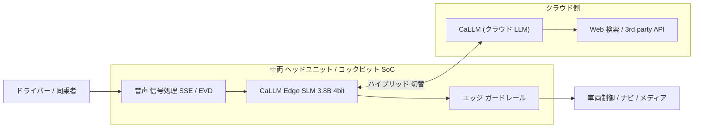
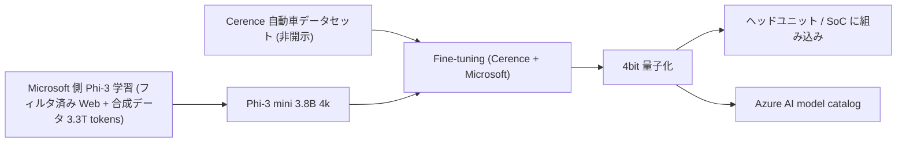
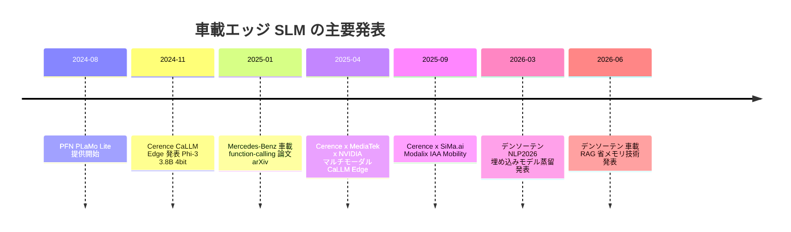
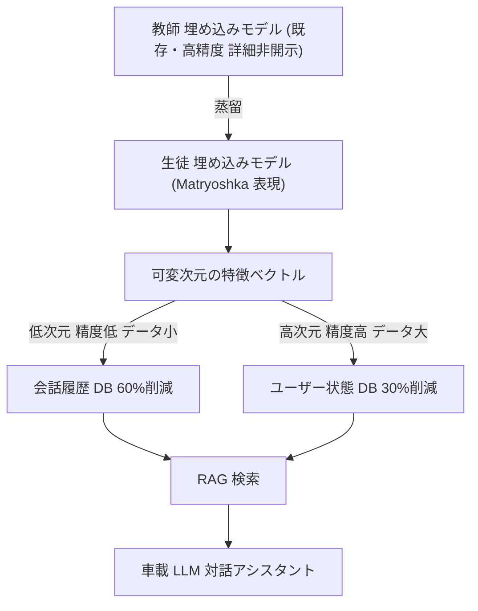
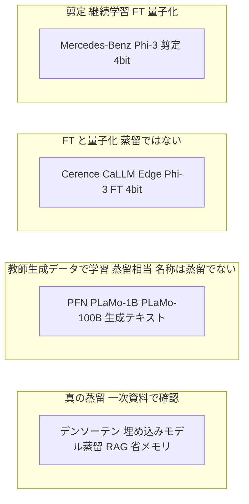

# Cerence CaLLM Edge — 自動車向け組み込み SLM の事業化（＋国内車載の動向）

- **Company/Organization**: Cerence Inc.（NASDAQ: CRNC、米国マサチューセッツ州バーリントン）／パートナー: Microsoft、MediaTek、NVIDIA、SiMa.ai
- **Industry**: 自動車（車載音声アシスタント・インフォテインメント）
- **Date**: 2024-11-13（CaLLM Edge 発表）、2025-04-23（MediaTek / NVIDIA 提携）、2025-09-04（SiMa.ai 提携）。国内動向: 2024-08-28（PLaMo Lite）、2026-06-16（デンソーテン）
- **Link**:
  - https://investors.cerence.com/news-events/press-releases/detail/114/cerence-introduces-pioneering-embedded-small-language-model-purpose-built-for-automotive
  - https://investors.cerence.com/news-events/press-releases/detail/98/cerence-ai-and-mediatek-partner-to-introduce-multi-modal-language-models-running-on-the-edge-built-on-nvidia
  - https://sima.ai/press-release/cerence-ai-and-sima-ai-partner-to-power-next-gen-conversational-ai-at-the-edge/
  - https://cerence.com/cerence-products/conversational-generative-ai （取得時に https://www.cerence.com/platforms/cerence-xui へリダイレクト）
- **Type**: Business Case
- **証拠の質の凡例**: **一次資料**（当事者の公式発表・技術文書）／**ベンダー申告**（当事者発表だが第三者検証の無い性能・効果の主張）／**二次報道**（メディア記事）

> **蒸留か否かの結論（先に要約）**
> CaLLM Edge は Cerence の公式発表上、**「Microsoft Phi-3 ファミリーを Cerence の自動車データセットで fine-tune し、4bit 量子化した 3.8B モデル」** である。発表文には distillation（蒸留）という語は一度も登場せず、教師モデルから生徒モデルへの知識移転を示す記述も無い。したがって CaLLM Edge は **「既に小型な（合成データを多用して学習された）ベースモデルに対する fine-tuning + 量子化」** であって、**Cerence 自身が蒸留を行った事例ではない**（一次資料に基づく判定）。
> 対照的に、国内のデンソーテン（2026-06）は **埋め込みモデルの蒸留**（言語処理学会 NLP2026 発表「Matryoshka表現学習を考慮した埋め込みモデル蒸留」）を一次資料で明言しており、**真の蒸留が確認できる車載事例** である。PFN の PLaMo Lite（PLaMo-1B）は **PLaMo-100B が生成したテキストで事前学習** しており、教師が生成したデータで生徒を学習する **合成データ（系列レベル）蒸留に相当する構造** だが、PFN 自身は「蒸留」とは呼んでいない。

## Overview

Cerence は 500 百万台超（2025-09 時点の発表では 525 百万台超）の車両に音声技術を供給してきた車載音声 AI の大手であり（**ベンダー申告**）、2024 年 11 月に **CaLLM™ Edge**（Cerence Automotive Large Language Model Edge）を発表した。これは **ヘッドユニットに組み込んで、通信なしでも動く** 自動車特化の小規模言語モデル（SLM）である。

発表内容の骨子（**一次資料**: Cerence プレスリリース 2024-11-13）:

- Microsoft と共同で開発・最適化し、**Phi-3 ファミリー** を Cerence の **自動車データセットで fine-tune**。
- **3.8B パラメータ、4k コンテキスト、4bit 量子化**。「ヘッドユニットに余裕をもって収まる」。
- 機能: 暗黙・明示的な車両制御（温度、窓・ドア、シート位置）、POI 検索とナビ、マルチターンの会話。
- 展開形態: **組み込みのみ（完全オフライン）**、または **ハイブリッド / クラウドファースト**（SLM が回答手段の 1 つ、かつ接続断時のバックアップ）。
- 販路: 自動車メーカーへの直接提供に加え、**Microsoft Azure AI model catalog** にも掲載。

その後、**チップベンダーとの提携による「どの SoC でも動く」ポジショニング** を強化している。

- 2025-04: **MediaTek Dimensity Auto**（NVIDIA の GPU / AI 技術を統合したコックピット SoC）および **NVIDIA DRIVE AGX** 上で、**マルチモーダル版 CaLLM Edge** とエッジ上のガードレール（NVIDIA NeMo Guardrails）を発表。
- 2025-09: **SiMa.ai MLSoC Modalix** 上で CaLLM Edge を動かす提携。IAA Mobility 2025 でデモ。

本レポートは、(1) CaLLM Edge のビジネス上の位置づけと技術仕様、(2) **それが「蒸留」なのか「小型ベースの fine-tuning + 量子化」なのか** の切り分け、(3) 国内の車載エッジ LLM の動向（デンソーテン、PFN PLaMo Lite）を、仮説 H3 の検証材料として整理する。

## Problem & Context

### 自動車メーカー（OEM）とドライバーが抱える課題（発表文から構造化）

- **接続性への依存**: クラウド専用の音声 AI は接続断で体験が劣化する。「ドライバーはどこでも機能が動くことを期待している」（SiMa.ai 提携発表、**一次資料**）。
- **プライバシー**: データをクラウドへ送らず車内に留めたい（CaLLM Edge 発表）。
- **コスト**: クラウド推論・通信帯域のコストを抑えたい。「完全組み込み SLM を活用することで、OEM はコストを管理下に置きつつ生成 AI 体験を提供できる」（**ベンダー申告**）。
- **ハードの多様性とサプライチェーン変動**: プラットフォームの複雑化と供給網の不安定さから、ハード選択の柔軟性とコスト効率が必要（SiMa.ai 提携発表）。
- **安全性**: 運転中の注意散漫防止、悪用防止、安全基準への準拠（MediaTek / NVIDIA 提携発表のガードレール）。
- **新たな収益源**: 車外情報や生成 AI 機能を通じたサブスクリプション型サービス（MediaTek / NVIDIA 提携発表、**ベンダー申告**）。

### 市場文脈



（Cerence xUI 製品ページと各プレスリリースの記述から本レポートで再構成。SSE = Speech Signal Enhancement、EVD = Emergency Vehicle Detection は xUI ページに記載の機能名）

## Solution

### CaLLM Edge の技術仕様（一次資料: 2024-11-13 プレスリリース）

| 項目 | 値・内容 | 証拠の質 |
|------|---------|---------|
| ベースモデル | Microsoft Phi-3 ファミリー（"fine-tuned on Microsoft's Phi-3 family of small language models"） | 一次資料 |
| パラメータ数 | 3.8B | 一次資料 |
| コンテキスト長 | 4k | 一次資料 |
| 量子化 | 4bit | 一次資料 |
| 学習 | Cerence の大規模な自動車データセットで fine-tune | 一次資料（データ規模・内容は非開示） |
| 共同開発 | Microsoft と "developed and optimized in partnership" | 一次資料 |
| 主な機能 | 暗黙／明示の車両制御（温度、窓・ドア、シート位置）、POI 検索・ナビ、会話（例: 「ハリウッドで撮影された最も人気の映画は？」→「あらすじをもっと」） | 一次資料 |
| 展開 | embedded-only（接続不要）、hybrid、cloud-first（SLM はバックアップ） | 一次資料 |
| 提供経路 | OEM へ直接、Microsoft Azure AI model catalog | 一次資料 |
| 互換性 | 「主要な自動車プラットフォームと互換」 | ベンダー申告 |
| 精度・速度・メモリ実測値 | **非開示** | — |

補足計算（本レポートでの推計、一次資料ではない）: 3.8B パラメータを 4bit で保持すると重みだけで約 $3.8 \times 10^9 \times 0.5\,\text{byte} \approx 1.9\,\text{GB}$。KV キャッシュ（4k コンテキスト）やランタイムのオーバーヘッドを含めると 2GB を超えると見込まれる。比較として、Mercedes-Benz の研究（本クラスタ 07）は Phi-3 mini を **2.8B / 1.8B へ剪定** した上で 4bit 化し「2GB 未満」としている。

$$
\text{Mem}_{\text{weights}} \approx N_{\text{params}} \times \frac{b}{8}\ \text{[byte]}, \quad N_{\text{params}} = 3.8 \times 10^9,\ b = 4 \Rightarrow \approx 1.9\ \text{GB}
$$

- $N_{\text{params}}$: パラメータ数、$b$: 量子化ビット幅。スケール係数・ゼロ点などの量子化メタデータは無視した下限の目安。

### CaLLM Edge の構築プロセス（発表から読み取れる範囲）



- 左端の「Phi-3 の学習データ」は Phi-3 technical report（arXiv 2404.14219）の abstract に基づく: "a 3.8 billion parameter language model trained on 3.3 trillion tokens ... composed of heavily filtered publicly available web data and synthetic data"（**一次資料**、Microsoft 側）。
- **Cerence が関与する工程は「fine-tuning」と「量子化・組み込み最適化」** であり、教師モデルを用いた蒸留工程は発表に存在しない。

### パートナー別の展開（一次資料: 各プレスリリース）

| 時期 | パートナー | ハード / ソフト | 新要素 | 発表の場 |
|------|-----------|----------------|-------|---------|
| 2024-11-13 | Microsoft | Phi-3、Azure AI model catalog、Azure AI Studio、Microsoft Copilot Studio | CaLLM Edge 初発表 | プレスリリース（GLOBE NEWSWIRE） |
| 2025-04-23 | MediaTek、NVIDIA | MediaTek Dimensity Auto Cockpit（NVIDIA GPU/AI/グラフィックス統合）、新 C-X1（デュアル AI エンジン）、NVIDIA DRIVE AGX、NVIDIA AI Enterprise、NeMo Guardrails | **マルチモーダル化**（車内外カメラ・センサ入力、ストリーミング入力）、**エッジ上ガードレール**、マルチシート対話 | Auto Shanghai 2025（Hall 8.2、8BD002 / MediaTek 8BE006） |
| 2025-09-04 | SiMa.ai | MLSoC **Modalix**、LLiMa™ ツールチェーン | 低消費電力でのオンデバイス対話、クロスプラットフォーム | IAA Mobility 2025（Munich、Hall B2 Booth D21） |

### MediaTek / NVIDIA 提携で示されたユースケース（一次資料、構造化）

1. **車内の知能向上**
   - 車が「自分に話しかけられているか否か」を判別（例: イタリアンレストランの推薦後、同乗者に「2 番目はどう？」と話しかけても割り込まず待つ）。
   - 運転者と同乗者からの同時指示（「窓を開けて」→「私も同じで」）。
   - 用事の間にペットを見守る、後席の幼児の様子を答える。
2. **車外からの追加文脈**
   - 道路標識の説明・翻訳、沿道の建物の識別、看板で見かけたものの詳細。
   - 車両センサデータ、車内外カメラ映像と CaLLM Edge マルチモーダル SLM を組み合わせ、エッジでストリーミング入力。
3. **エッジ上のスマートガードレール**
   - NVIDIA DRIVE AGX 向けに最適化した自動車ガードレール。NVIDIA NeMo Guardrails によるエッジ版をクラウド版の補完として提供。注意散漫の最小化、悪用防止、安全規範への準拠。
4. **OEM へのメリット**
   - マルチモーダル処理の重い部分をエッジで行うため、クラウド帯域とコストを削減。
   - 車外情報や生成 AI 機能によるサブスクリプション型の新収益源。

- 「CaLLM Edge’s advanced multi-modal capabilities are **fine-tuned** for in-vehicle deployment and high efficiency via a dual processing platform」— ここでも用語は fine-tune であり、蒸留ではない。
- MediaTek の Mike Chang 氏: 「MediaTek Dimensity Auto は Cerence の LLM と SLM の両方をエッジでサポートし、新しい C-X1 はデュアル AI エンジンを備え、複数 AI タスクの同時実行に理想的」（**ベンダー申告**）。

### SiMa.ai 提携の主張（一次資料・ベンダー申告）

- CaLLM Edge を SiMa.ai MLSoC Modalix 上で動かし、**低消費電力の車載対話 AI** を実現。
- Cerence xUI 内で CaLLM Edge が「高度な推論、マルチターン会話、プロアクティブな関与」を Modalix 上で実行（Nils Schanz 氏、EVP Product & Technology）。
- 「CaLLM Edge はクロスプラットフォーム互換に設計され、幅広いハードウェアアーキテクチャで効率的に動く」（**ベンダー申告**）。
- SiMa.ai の Harald Kröger 氏（President of Automotive）: 「LLM は通常クラウドか電力を食う GPU に依存するが、SiMa.ai と Cerence は卓越した電力効率で並外れた性能を出す量産対応デバイスを提供する。LLiMa™ ツールチェーンにより統合工数を大幅に削減」（**ベンダー申告**。電力・速度の数値は発表に無い）。

### Cerence xUI（製品ページ、一次資料）

`https://cerence.com/cerence-products/conversational-generative-ai` は取得時に **Cerence xUI のページへリダイレクト** された。CaLLM Edge 固有の仕様は同ページに記載が無く、プラットフォームとしての訴求が中心。

| 訴求項目 | 内容 |
|---------|------|
| ハイブリッド構成 | CaLLM®（エッジとクラウド）によるハイブリッド生成 AI プラットフォーム。車両がオフラインでも動作 |
| 会話 | マルチターン・文脈理解、省略（ellipsis）と照応（anaphora）の理解、曖昧な指示の解釈 |
| 最新情報 | ライブ Web 検索とサードパーティ API で静的コンテンツを補完 |
| ブランド化 | 応答編集、独自/サードパーティエージェント、カスタム TTS 音声 |
| 多言語 | 言語ロードマップ、文化・規制へのチューニング |
| 安全 | 安全対策、プライバシー、ハルシネーション緩和 |
| 音声処理 | Speech Signal Enhancement (SSE)、Emergency Vehicle Detection (EVD) |
| 開発 | SDK、モジュール型アーキテクチャ、Cerence Edge SDKs |

## Results & Impact

**定量的な成果指標（精度、遅延、メモリ、採用台数、売上寄与）は、取得したいずれの発表にも記載が無い。**

| Metric | Before | After | 証拠の質 |
|--------|--------|-------|---------|
| モデル規模 | — | 3.8B / 4k ctx / 4bit | 一次資料 |
| オフライン動作 | クラウド依存の生成 AI 機能 | 組み込みのみでも動作 | ベンダー申告 |
| 対応 SoC | — | MediaTek Dimensity Auto、NVIDIA DRIVE AGX、SiMa.ai Modalix（＋「主要プラットフォーム」） | 一次資料（提携の事実）／ベンダー申告（性能） |
| コスト | クラウド推論・帯域コスト | 「コストを管理下に」「帯域とコストを削減」 | ベンダー申告（数値なし） |
| 精度・速度・電力 | — | 非開示 | — |
| Cerence 技術搭載車両 | — | 500M 超（2024-11 / 2025-04）、525M 超（2025-09） | ベンダー申告（会社概要） |

定性的なインパクト:

- **販路の拡大**: Azure AI model catalog 掲載により、OEM 以外も Azure AI Studio / Copilot Studio 上で利用できる経路を確保（一次資料）。
- **SoC ベンダーのエコシステムへの組み込み**: 半導体側から見ると「自社 SoC 上で動く車載 SLM」のショーケースとして CaLLM Edge が使われており、Cerence にとっては **ハード非依存のソフト供給者** という立ち位置の強化になる（本レポートの解釈）。
- **モデル自体の差別化要素は「データ」と「統合」**: Microsoft 側コメント（Satish Thomas 氏）は「Cerence 独自の自動車データセットが高い精度と関連性をもたらす」と強調（**ベンダー申告**）。モデル圧縮技術（蒸留・剪定）ではなく、**ドメインデータでの fine-tune と車載統合** が価値の源泉として語られている。

## Figures & Tables

取得した Cerence / SiMa.ai のプレスリリースには、ロゴ以外の図表・画像は含まれていなかった（Cerence IR ページの画像はロゴのみ、SiMa.ai ページはロゴと動画タグのみ）。Cerence xUI 製品ページには UI イメージ画像（会話例のスクリーン）があるが、CaLLM Edge の仕様図・性能グラフは無い。以下は発表本文から作成した表・図と、国内動向セクションの一次資料図表である。

### Table A: CaLLM Edge 発表の時系列



### Table B: 手法分類 — 「蒸留」か「小型ベースの fine-tuning + 量子化」か

| 事例 | ベース / 教師 | Cerence・各社が行った工程 | 教師出力を学習信号に使うか | 判定 | 根拠の質 |
|------|--------------|--------------------------|--------------------------|------|---------|
| Cerence CaLLM Edge | Phi-3（3.8B） | 自動車データで fine-tune、4bit 量子化、SoC 最適化 | 記述なし | **fine-tuning + 量子化（蒸留ではない）** | 一次資料（発表文） |
| （参考）Phi-3 mini 自体 | — | Microsoft がフィルタ済み Web + 合成データで学習 | 合成データの生成元 LLM は abstract に記載なし | 合成データを含む事前学習（広義のデータ蒸留要素の可能性） | 一次資料（abstract のみ） |
| Mercedes-Benz（07） | Phi-3 mini | 剪定、healing（継続事前学習）、SFT、LoRA/FFT、4bit | 使わない | **剪定 + 継続学習 + FT + 量子化（蒸留ではない）** | 一次資料（論文） |
| デンソーテン 車載 RAG | 既存の埋め込みモデル（詳細不明） | 埋め込みモデルの再学習（Matryoshka 表現学習を考慮した **蒸留**） | 使う（「蒸留」と明記） | **真の蒸留（埋め込みモデル）** | 一次資料（プレスリリース脚注） |
| PFN PLaMo Lite（PLaMo-1B） | PLaMo-100B | PLaMo-100B 生成の日英テキストを含む 4T トークンで事前学習 | 教師の **生成テキスト** を学習データに使用 | **合成データ（系列レベル）蒸留に相当**（PFN は「蒸留」と呼んでいない） | 一次資料（PFN / Qualcomm） |

### Table C: 「蒸留」「fine-tuning」「量子化」「剪定」の区別（本レポートでの整理）

| 手法 | 何を変えるか | 教師モデル | 典型的な損失 / 操作 | CaLLM Edge での有無 |
|------|------------|-----------|-------------------|-------------------|
| 知識蒸留（ロジット / 特徴） | 小さな生徒の重みを学習 | 必須 | $\mathrm{KL}(p_T \Vert p_S)$、特徴の距離 | 発表に記載なし |
| 合成データ蒸留（系列レベル） | 生徒の重みを学習 | 必須（データ生成） | 教師生成テキストへの次トークン予測 | Phi-3 の学習段階（Microsoft 側）で広義に該当しうる。Cerence の工程としては記載なし |
| Fine-tuning（SFT / LoRA） | 既存モデルの重みを適応 | 不要 | 正解データへの次トークン予測 | **あり**（自動車データセット） |
| 量子化 | 重みの数値表現 | 不要 | 丸め・スケーリング | **あり**（4bit） |
| 剪定 | 層・ニューロンを削除 | 不要（回復に KD を使う流派あり） | 重要度スコアで削除 | 発表に記載なし |

各損失の一般形（ロジット KD・系列レベル KD・通常 FT）は `05-llama-3-2-edge.md` §B と `06-taid-tinyswallow.md` の Preliminaries に記載したものと同一のため、ここでは省略する（2026-10-22 整理）。

- 記号の対応: $p_T, p_S$ = 教師・生徒の出力分布、$\mathcal{D}_{\text{domain}}$ = ドメインデータ（CaLLM Edge では Cerence の自動車データセット）。
- **CaLLM Edge の発表から確認できるのは通常の FT 損失 $\mathcal{L}_{\text{FT}} = -\sum_t \log p_\theta(y_t \mid y_{<t}, x),\ (x,y)\sim\mathcal{D}_{\text{domain}}$ に相当する工程のみ**。$\mathcal{D}_{\text{domain}}$ が教師 LLM の生成データを含むかどうかは非開示であり、含む場合は系列レベル KD の性格を帯びるが、それを示す一次資料は無い。

### Table D: 車載エッジ SLM / 関連モデルの仕様比較

| 項目 | Cerence CaLLM Edge | Mercedes-Benz 研究（07） | PFN PLaMo-1B（PLaMo Lite） | デンソーテン 車載 RAG |
|------|-------------------|------------------------|---------------------------|---------------------|
| 対象 | 車載アシスタント全般 | 車両機能の function-calling | エッジ汎用（自動車・ロボット・製造設備・PC） | RAG の検索部（埋め込み + ベクトル DB） |
| パラメータ | 3.8B | 2.8B / 1.8B（元 3.8B） | 1B | 非開示 |
| ベース | Phi-3 | Phi-3 mini | PLaMo-100B の開発成果を元に構築 | 非開示 |
| コンテキスト | 4k | 4k（Phi-3-mini-4k） | 4096 | — |
| 量子化 | 4bit | 4bit gguf | w4a16 + w8a16（一部層）（Qualcomm AI Hub） | — |
| 小型化手法 | FT + 量子化 | 剪定 + 継続学習 + FT + 量子化 | 教師生成データでの事前学習（系列レベル蒸留相当） | 埋め込みモデル蒸留（Matryoshka 考慮） |
| 公開性能値 | なし | FC 精度 0.84〜0.88、11.02 t/s、RAM < 2GB | JSQuAD F1 0.86、WMT20 En-Ja 0.20、Jaster 0-shot 58.0% | メモリ 30〜60% 削減、高検索精度を維持 |
| 対応ハード | MediaTek Dimensity Auto、NVIDIA DRIVE AGX、SiMa.ai Modalix 等 | ARM 7 コア CPU（車載ヘッドユニット） | Qualcomm Dragonwing Q-8750、Snapdragon 8 Elite For Galaxy | 車載 SoC（詳細非開示） |
| 証拠の質 | 一次資料（仕様）／ベンダー申告（効果） | 一次資料 | ベンダー申告（性能） | ベンダー申告（性能） |

## 国内車載の動向

### 1. デンソーテン — 車載エッジで RAG を省メモリ実行する生成 AI 技術（2026-06-16 発表）

**取得した資料**

| 資料 | URL | 日付 | 種別 |
|------|-----|------|------|
| デンソーテン プレスリリース | https://www.denso-ten.com/jp/release/2026/06/20260616.html | 2026-06-16 | **一次資料** |
| AIsmiley（AI ニュース） | https://aismiley.co.jp/ai_news/densoten-rag-onboard-hmi-ai/ | 2026-06-22 掲載 | 二次報道 |
| MONOist | https://monoist.itmedia.co.jp/mn/spv/2606/30/news098.html | 2026-06-30 掲載 | 二次報道 |

- 依頼時に指定された MONOist（2606/30/news098）は、取得してみると **デンソーテンの同一発表を報じる記事**（「デンソーテン、RAGを車載エッジで省メモリ稼働する生成AI技術を開発」）であった。内容はプレスリリースの要約で、新しい数値は含まない。
- 二次報道 2 件（AIsmiley、MONOist）はいずれも「独自の埋め込みモデル学習技術」と表現し、**「蒸留」という語を使っていない**（本文中に「蒸留」の出現 0 件を確認）。一方 **一次資料のプレスリリース脚注 ※5** に「本学習技術は『言語処理学会 第32回年次大会　Matryoshka表現学習を考慮した埋め込みモデル蒸留』で発表（2026年3月9日～13日にライトキューブ宇都宮で開催）」と明記されている。**二次報道だけを見ると蒸留事例であることを見落とす** 典型例である。

**技術の要点（一次資料）**

- 課題: 生成 AI（LLM）単体では、学習していない最新情報や車両固有・ユーザー固有情報に正確に対応できない。RAG が有効だが、**埋め込みモデルと大量の検索用ベクトル DB** が必要で、メモリ容量・処理性能に制約のある車載 SoC・エッジ環境への実装が難しい。「精度を取ると重い」「軽くすると精度が落ちる」というトレードオフ。
- 解決: 「軽量かつ高精度を維持できる独自の埋め込みモデル学習技術により、車載エッジでの実行を前提としたベクトルデータベースの省サイズ化を実現」。埋め込みモデルの **再学習** により検索用ベクトル DB を軽量化。
- 成果: 公開データセットでの評価で、既存モデル比 **メモリ容量を 30〜60% 削減しつつ高い検索精度を維持**（**ベンダー申告**。データセット名・精度の数値は非開示）。
- 想定用途: 「人に寄り添う HMI」としての LLM 対話アシスタント（目的地設定・ナビ、ニュース / エンタメの情報検索・提案、車両機能制御）。
- 外部コメント: 神戸大学大学院システム情報学研究科 滝口教授「各ユーザーの意図や好みはプライバシー性が高く、インターネットに依存しないローカル運用が望まれる。車載エッジで RAG を用いた対話システムを実現する技術の重要性は今後さらに高まる」。


（同じ図は MONOist にも掲載: https://image.itmedia.co.jp/mn/articles/2606/30/mn_mobility_26061902.jpg ）

図の内容（目視で読み取り、構造化）:

- **上段「RAG のデータベース活用（対話アシスタント）」**: 乗車中のユーザー →（質問）→ 対話アプリ ⇄ 生成 AI（車載 LLM）。対話アプリ →（検索）→ 埋め込みモデル → 特徴ベクトル → 検索処理 → ベクトル DB（会話履歴、ユーザー状態）→（情報）→ 対話アプリ →（回答）→ ユーザー。
- **活用イメージ「人に寄り添う対話」**: ① 会話履歴から音楽提案、② ユーザー状態から休憩を提案。
- **下段「RAG のデータベース構築」**: 会話履歴・ユーザー状態などのテキスト情報の特徴を埋め込みモデルで抽出 → 特徴ベクトル → ベクトル DB。**「要求精度に応じて、任意のデータ量に設定し、メモリ容量の軽量化を図る『RAG を省メモリで実現』」**。
  - 精度低 / データ量小 → 会話履歴
  - 精度高 / データ量大 → ユーザー状態
- **メモリサイズ削減量（他社モデル比）**:

| 要求精度 | メモリ削減量（他社モデル比） | 適用例 |
|---------|--------------------------|-------|
| 低 | 60% 削減 | 会話履歴（多少精度を下げてデータを減らす） |
| 高 | 30% 削減 | ユーザー状態（データ量を増やして精度を高めたい） |

- 図中注記: 「例：『会話履歴』は多少精度を下げることでデータを減らし、『ユーザー状態』はデータ量を増やして精度を高めたい場合」。



（上図の「教師 → 生徒」構造は、脚注の発表題目「埋め込みモデル蒸留」からの本レポートによる推定図。教師・生徒のモデル名、損失関数、次元数は一次資料に記載が無く、NLP2026 の予稿は今回取得できていない。）

**Matryoshka 表現学習の一般形（背景知識、デンソーテン固有の式ではない）**

$$
\mathcal{L}_{\text{MRL}} = \sum_{m \in \mathcal{M}} c_m \, \mathcal{L}\big(z_{1:m}\big), \quad \mathcal{M} = \{m_1 < m_2 < \cdots < d\}
$$

- $z \in \mathbb{R}^d$: 埋め込みベクトル、$z_{1:m}$: 先頭 $m$ 次元への切り詰め、$\mathcal{L}$: 各次元での学習損失（検索なら対照損失など）、$c_m$: 重み。
- 先頭 $m$ 次元だけでも意味を保つよう学習するため、**データ種別ごとに保存次元を変えてメモリを調整** できる。図の「要求精度に応じて任意のデータ量に設定」はこの性質と整合する（本レポートの解釈）。
- ベクトル DB のメモリは概ね $N_{\text{docs}} \times m \times (\text{bytes per dim})$ に比例するため、次元 $m$ を下げれば線形に減る。

**仮説 H3 との関係**: デンソーテンの事例は **LLM 本体ではなく RAG の埋め込みモデル** に対する蒸留であり、「車載エッジ = LLM を蒸留して載せる」という単純な図式ではなく、**周辺コンポーネント（検索・埋め込み）での蒸留** が国内では一次資料で確認できる、という点が重要。

### 2. Preferred Networks — PLaMo Lite（PLaMo-1B）（2024-08-28 提供開始）

**取得した資料**

| 資料 | URL | 日付 | 種別 |
|------|-----|------|------|
| PFN ニュースリリース | https://www.preferred.jp/ja/news/pr20240828/ | 2024-08-28 | **一次資料** |
| MONOist | https://monoist.itmedia.co.jp/mn/articles/2409/06/news131.html | 2024-09-06 | 二次報道 |
| Qualcomm AI Hub（PLaMo-1B） | https://aihub.qualcomm.com/models/plamo_1b | 取得時点（2026-10） | 一次資料（Qualcomm 掲載のモデル情報） |

**概要（一次資料: PFN）**

- 子会社 Preferred Elements（PFE）が **自動車、ロボット、製造設備、PC などのエッジデバイス向け** に開発した SLM。クラウドを介さずエッジやオンプレミスで高速に動作。
- PFE がフルスクラッチで開発した 1000 億パラメータ LLM **PLaMo-100B の開発成果を元に 10 億パラメータの小型モデルを構築**。
- **「事前学習には、PLaMo-100B で生成した日本語と英語の高品質なテキストデータを使用し、PLaMo-100B の事前学習データの 2 倍となる合計 4 兆トークンを学習」**（PFN 原文）。
- Qualcomm AI Hub の英文説明も同趣旨: "Leveraging high-quality Japanese and English text data generated by PLaMo-100B, PLaMo-1B has been pre-trained on a total of 4 trillion tokens."
- **MONOist（二次報道）** は「PLaMo-100B の学習データの 2 倍に相当する 4 兆トークンを用いて事前学習」とだけ書き、**「PLaMo-100B で生成した」データである点を落としている**。ここでも一次資料に当たらないと蒸留的構造を見落とす。

**蒸留か否かの判定**

- 教師（PLaMo-100B）が生成したテキストで生徒（PLaMo-1B）を事前学習する構造は、Table C の $\mathcal{L}_{\text{seq-KD}}$（合成データ / 系列レベル蒸留）に該当する。
- ただし (a) PFN 自身は「蒸留」という語を使っていない（PFN リリース・MONOist 記事本文・Qualcomm ページのいずれにも「蒸留 / distillation」の語は無い。MONOist ページ内の唯一の「蒸留」は無関係な関連記事リンク「常圧蒸留装置」）、(b) 4T トークン中の教師生成データの割合は非開示、(c) 「PLaMo-100B の開発成果を元に」の具体的意味（重みの継承か、データ・ノウハウのみか）も不明。
- よって **「合成データ蒸留に相当する手法を含む可能性が高いが、比率と詳細は不明」** と評価するのが正確（一次資料に基づく推論）。

**性能（ベンダー申告、PFN 提供の図）**


図から読み取った数値（図中にラベル表記あり）:

| ベンチマーク | PLaMo 1.0 Lite (1B) | 比較 1 | 比較 2 |
|-------------|--------------------|-------|-------|
| JSQuAD F1（日本語質問応答） | **0.86** | Phi-2 (2.7B): 0.34 | Gemma (2B): 0.65 |
| WMT20 4shot（日英翻訳 En-Ja） | **0.20** | Phi-2 (2.7B): 0.021 | Gemma (2B): 0.14 |
| Jaster 0shot | **58.0%** | GPT-3.5 turbo: 56.7% | Swallow Instruct (13B): 42.4% |

```
JSQuAD F1
PLaMo 1.0 Lite 1B  0.86 |###########################################
Gemma 2B           0.65 |################################
Phi-2 2.7B         0.34 |#################

Jaster 0shot
PLaMo 1.0 Lite 1B  58.0% |#############################
GPT-3.5 turbo      56.7% |############################
Swallow Instr 13B  42.4% |#####################
```

- Jaster は GENIAC 特有のカテゴリセット（NLI, QA, RC, MC, MR, FA の 6 カテゴリ）で評価、満点 1 点（PFN リリース脚注 *2）。
- 比較対象の Phi-2 / Gemma は英語中心モデルであり、日本語ベンチマークでの比較は PLaMo に有利な設定である点に注意（本レポートの注記）。

**Qualcomm AI Hub 掲載情報（一次資料）**

| 項目 | 値 |
|------|---|
| Context length | 4096 |
| Input sequence length for Prompt Processor | 128 |
| Minimum QNN SDK version | 2.27.7 |
| Number of parameters | 1B |
| Precision | w4a16 + w8a16（一部の層） |
| Supported languages | Japanese and English |
| Supported chipsets | Qualcomm Dragonwing Q-8750、Snapdragon 8 Elite For Galaxy Mobile |
| 用途 | Dialogue、Content Generation、Customer Support |
| 位置づけ | "the first small language model (SLM) in the PLaMo Lite series ... designed to power AI applications for edge devices including mobile, automotive, and robots" |

- 取得時点のページでは「This model is currently not supported on any All Models chipset」と表示され、**tokens/s や TTFT の実測値は取得できなかった**（指標の定義のみ掲載）。
- Qualcomm 側では "Contact to Purchase" とされ、商用ライセンス型の提供である。

### 2b.（2026-10-22 追記）Turing — 自動運転向け日本語 VLM「Heron-NVILA」

| 資料 | URL | 日付 | 種別 |
|------|-----|------|------|
| Turing Tech Blog（Zenn）「日本語VLM『Heron-NVILA』公開 ─ Qwen2.5-VL-7B・Gemma3-12Bに匹敵する性能」 | https://zenn.dev/turing_motors/articles/7ac8ebe8756a3e | 2025-05-12（更新 2025-05-18） | **一次資料**（開発者ブログ） |

- Turing は自動運転への応用を目的に VLM「Heron」を開発しており（GENIAC 第 2 期）、Heron-NVILA を 1B / 2B / 15B / 33B で公開した。
- **蒸留の判定**: 記事に「蒸留」「教師モデル」「量子化」の語は無い。ただし SFT で **「GPT-4o の出力を学習データに使用」** したと記載されており、PLaMo Lite と同様に **教師 LLM の生成データで学習する系列レベル蒸留に相当する要素** を含む（Turing 自身は蒸留と呼んでいない）。学習コードに 4/8bit 量子化の分岐はあるが、Heron-NVILA の学習に使ったとは書かれていない。
- **端末配備**: 「Heron-NVILA-Lite-2B を搭載した iOS アプリも公開予定」と記載（スマートフォン上での動作を想定）。車載機器上での実行・速度の数値は無い。
- **求人情報（参考、成果ではない）**: 2026 年の Turing の求人票には「蒸留（distillation）等による小型化・高速化、量子化・推論最適化」が業務として挙がっており、車載向けの蒸留が開発課題になっていることを示唆する（WebSearch 結果からの確認。求人は技術成果の証拠にはならない）。
- **トヨタ・デンソー・ティアフォー**: 本追記の検索（2026-10-22、WebSearch 1 回）では、LLM の蒸留を明記した発表は確認できなかった。デンソーの求人票（LLM / SLM / VLA の車載 SoC 実装・量子化・軽量化）は見つかったが、成果の記述ではない。

### 3. 国内動向のまとめ



| 観点 | 国内（デンソーテン、PFN） | 海外（Cerence、Mercedes） |
|------|------------------------|-------------------------|
| 蒸留の明示 | デンソーテンは一次資料で明示（埋め込みモデル） | どちらも明示なし |
| 教師モデル | PFN は自社 100B を教師データ生成に使用 | Cerence は Microsoft のモデルを利用、Mercedes は教師なし |
| 対象コンポーネント | LLM 本体（PFN）、検索・埋め込み（デンソーテン） | LLM 本体 |
| 公開性能値 | ベンチマーク（PFN）、メモリ削減率（デンソーテン） | Mercedes は詳細、Cerence はなし |
| 事業形態 | モデル提供（PFN）、Tier1 の要素技術（デンソーテン） | OEM 向けプラットフォーム + SoC 提携（Cerence）、OEM 内製研究（Mercedes） |

## Lessons Learned

1. **「エッジ向け SLM」≠「蒸留」**: CaLLM Edge は業界で最も目立つ車載エッジ SLM の 1 つだが、公表情報上は **既存の小型ベース（Phi-3）への fine-tuning + 4bit 量子化** である。仮説 H3（SLM 事例の多くは蒸留ではなく小型モデルの fine-tuning）を **支持する** 事例。
2. **「蒸留」は上流に隠れている可能性**: Phi-3 自体が合成データを多用して学習されたモデルであり、蒸留的な知識移転は **基盤モデル提供者（Microsoft）の段階** で起きている可能性がある。事業者（Cerence）の付加価値は **ドメインデータと統合・最適化** にある。事例を分類する際は「誰がどの段階で何をしたか」を分けて記述すべき。
3. **二次報道は蒸留の手がかりを落とす**: デンソーテン（脚注の「埋め込みモデル蒸留」）、PFN（「PLaMo-100B で生成した」データ）のいずれも、**二次報道では蒸留的要素が消えていた**。蒸留事例の探索は一次資料（プレスリリース脚注、学会予稿、モデルカード）まで遡る必要がある。
4. **車載ではハード提携が事業の主戦場**: Cerence は 1 年弱で MediaTek / NVIDIA / SiMa.ai と提携を重ね、「どの SoC でも動く」ことを訴求。モデルの小型化手法よりも **SoC ごとの最適化とエコシステム参加** が競争軸になっている。
5. **定量成果の非開示**: Cerence の発表には精度・遅延・電力・コスト削減率の数値が一切無い（仮説 H2 と同型の「ベンダー発表は顧客別成果を出さない」傾向）。一方、OEM 内製研究（Mercedes）は詳細な数値を論文で公開している。
6. **周辺コンポーネントの蒸留という論点**: デンソーテンのように **RAG の埋め込みモデル** を蒸留して省メモリ化するアプローチは、LLM 本体の蒸留より実装リスクが低く、Tier1 サプライヤーが差別化しやすい領域である可能性がある（本レポートの解釈）。

## Notes

### 取得状況（フェッチ結果）

| URL | 結果 |
|-----|------|
| Cerence PR（detail/114, CaLLM Edge 発表） | 取得成功 |
| Cerence PR（detail/98, MediaTek / NVIDIA） | 取得成功 |
| SiMa.ai PR | 取得成功 |
| cerence.com/cerence-products/conversational-generative-ai | **Cerence xUI ページへリダイレクト**。CaLLM Edge 固有の仕様は無し |
| AIsmiley（デンソーテン） | 取得成功（蒸留の語なし） |
| MONOist 2606/30/news098 | 取得成功（デンソーテン発表の同一報道。蒸留の語なし） |
| デンソーテン プレスリリース（MONOist 記事内リンクから辿った一次資料） | 取得成功（脚注に「埋め込みモデル蒸留」） |
| MONOist 2409/06/news131（PLaMo Lite） | 取得成功 |
| PFN ニュースリリース pr20240828（MONOist 記事内リンクから辿った一次資料） | 取得成功 |
| Qualcomm AI Hub plamo_1b | 取得成功（性能実測値は表示されず） |
| Phi-3 technical report abstract（arXiv 2404.14219） | 取得成功（abstract のみ） |
| 言語処理学会 NLP2026 予稿（デンソーテンの蒸留論文） | **未取得**（予稿集ページへの接続に失敗。題目は脚注で確認したのみ） |
| Azure AI model catalog の CaLLM Edge モデルカード | **未取得**（URL 不明かつ WebSearch 予算切れのため探索せず） |

### 追加調査候補

- NLP2026 予稿「Matryoshka表現学習を考慮した埋め込みモデル蒸留」（デンソーテン）— 教師・生徒モデル、損失、評価データセット、精度の実数値を確認する価値が高い。
- Azure AI model catalog 上の CaLLM Edge モデルカード — 学習手法（蒸留の有無）・評価値が記載されている可能性。
- Phi-3 technical report 本文 — 合成データの生成方法（教師 LLM の有無）を確認し、「上流での蒸留」の程度を判定する。
- PLaMo-100B → PLaMo-1B の学習レシピ詳細（PFN の技術ブログ等）— 教師生成データの比率。
- Minitron（arXiv 2407.14679）— 剪定 + KD による回復の定量効果。Mercedes の剪定 + 継続学習と比較する基準として。

### 仮説への含意（サマリ）

| 仮説 | 本事例群からの示唆 |
|------|------------------|
| H3（SLM 事例の多くは蒸留ではなく FT） | **支持**: Cerence CaLLM Edge は FT + 量子化、Mercedes は剪定 + 継続学習 + FT + 量子化。ただし国内のデンソーテン（埋め込み蒸留）、PFN（教師生成データでの事前学習）は蒸留（相当）を含む |
| H2（ベンダー数値は集計値で顧客別成果は非公開） | 同型の傾向: Cerence は性能・コストの数値自体を出していない |
| H4（国内は公開モデル型が中心） | PFN はモデル提供型、デンソーテンは Tier1 の要素技術発表で、OEM 内での本番導入成果は未公表 |
