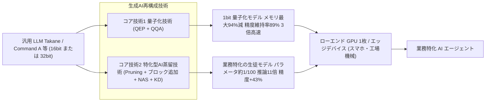
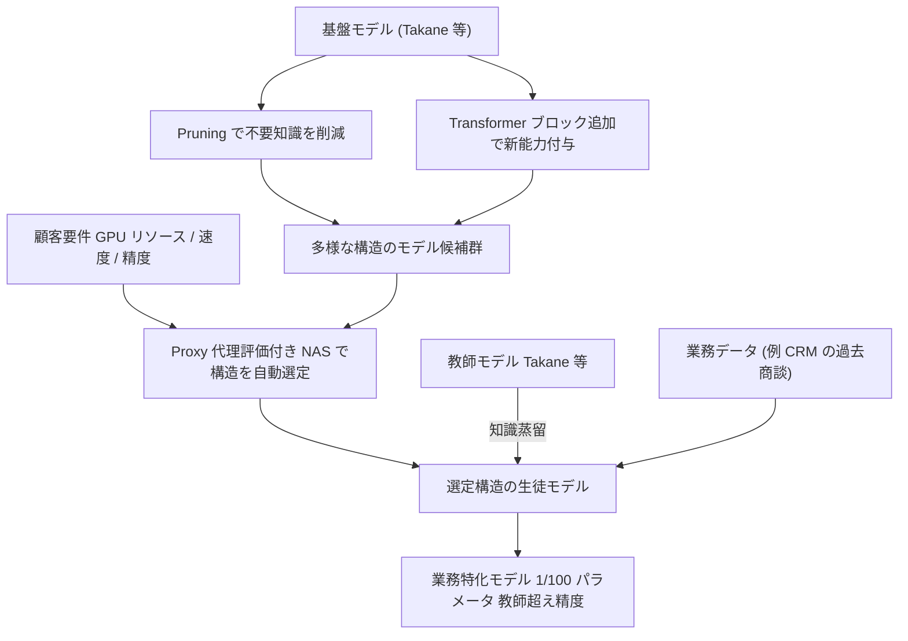
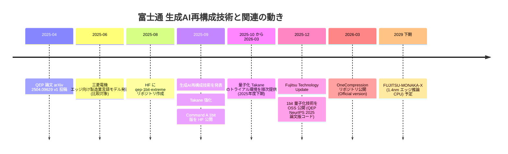
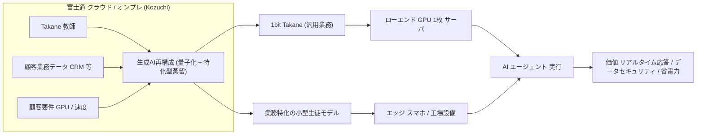
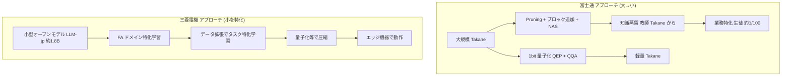

# 富士通「生成AI再構成技術」— 1ビット量子化 × 特化型AI蒸留による Takane のエッジ対応

- **Company/Organization**: 富士通株式会社（Fujitsu Limited）／富士通研究所。比較対象: 三菱電機株式会社（情報技術総合研究所）
- **Industry**: エンタープライズ IT／生成AI基盤（Fujitsu Kozuchi, LLM「Takane」）。比較対象は FA・製造業
- **Date**: 2025-09-08（技術発表）／2025-12-02（技術戦略説明会「Fujitsu Technology Update」・量子化技術の OSS 公開）。比較対象: 2025-06-18（三菱電機発表）
- **Link**: https://global.fujitsu/ja-JP/pr/news/2025/09/08-01 （一次資料。**本調査では curl・WebFetch とも HTTP 429（Vercel checkpoint）で取得不可**。内容は下記の二次報道・付随一次資料から再構成）
- **補助ソース（取得成功）**:
  - マイナビ TECH+ 2025-09-08: https://news.mynavi.jp/techplus/article/20250908-3442664/
  - MONOist 2025-09-25: https://monoist.itmedia.co.jp/mn/spv/2509/25/news092.html
  - INTERNET Watch: https://internet.watch.impress.co.jp/docs/news/2045649.html
  - AIsmiley: https://aismiley.co.jp/ai_news/fujitsu-kozuchi-llm-takane/
  - マイナビ TECH+ 2025-12-04: https://news.mynavi.jp/techplus/article/20251204-3755524/
  - EE Times Japan 2025-12-03: https://eetimes.itmedia.co.jp/ee/spv/2512/03/news053_2.html
  - Hugging Face モデルカード `qep/qep-1bit-extreme`: https://huggingface.co/qep/qep-1bit-extreme （一次資料・富士通/Cohere）
  - GitHub `FujitsuResearch/qep`: https://github.com/FujitsuResearch/qep ／ `FujitsuResearch/OneCompression`: https://github.com/FujitsuResearch/OneCompression （一次資料）
  - QEP 論文 arXiv:2504.09629（NeurIPS 2025）: https://arxiv.org/abs/2504.09629 （一次資料）
  - 三菱電機ニュースリリース: https://www.mitsubishielectric.co.jp/ja/pr/2025/0618-a/ と PDF https://www.mitsubishielectric.co.jp/ja/pr/2025/pdf/0618-a.pdf （一次資料）
  - マイナビ TECH+ 2025-06-18（三菱電機）: https://news.mynavi.jp/techplus/article/20250618-3357020/
- **取得失敗**: 富士通公式プレスリリース（日・英、英文 PDF 含む: HTTP 429）、EnterpriseZine https://enterprisezine.jp/news/detail/22692 （HTTP 403, Retry-After 600）
- **（2026-10-22 追記）再取得の結果**: `global.fujitsu/ja-JP/pr/news/2025/09/08-01` と英語版 `global.fujitsu/en-global/pr/news/2025/09/08-01` は curl（ブラウザ UA）・WebFetch のいずれでも **再び HTTP 429**。旧ドメインの `pr.fujitsu.com/jp/news/2025/09/8.html` と `www.fujitsu.com/global/.../2025/0908-01.html` は `info.archives.global.fujitsu` へリダイレクトされ **404**。したがって本レポートの数値の証拠区分は **「ベンダー申告（二次報道経由）」のまま据え置く**。一次資料で確認すべき残課題（43% が相対か絶対か、「GPU 4 枚→1 枚」の帰属、70% 削減の対象）は未解消。
- **Type**: Business Case

> **エビデンス品質の凡例**: 【一次資料】= 企業・著者自身が公開した文書（リリース PDF、論文、モデルカード、GitHub）、【ベンダー申告】= 企業の発表値だが第三者検証のないもの（一次資料経由・報道経由を問わない）、【二次報道】= 報道機関による記述（転載・要約・解釈を含む）。富士通の数値はすべて「ベンダー申告」であり、本調査では公式リリース本文を直接確認できていないため、多くは「ベンダー申告（二次報道経由）」となる。

---

## Overview

富士通は 2025年9月8日、AI サービス「Fujitsu Kozuchi」のコア技術として、LLM の軽量化・省電力化を実現する **「生成AI再構成技術」** を開発し、自社エンタープライズ LLM **「Takane」** を強化したと発表した【二次報道: マイナビ, INTERNET Watch, MONOist, AIsmiley で一致】。この技術は 2 つのコア技術からなる。

1. **量子化技術**: 層をまたいで量子化誤差を伝播させる新アルゴリズム **QEP（Quantization Error Propagation）** と、大規模最適化アルゴリズム **QQA（Quasi-Quantum Annealing）** を組み合わせ、LLM の **1ビット量子化** を実現。Takane に適用して **メモリ消費量 最大94%削減、精度維持率 89%、推論 3倍高速化**（GPTQ の精度維持率は 20% 以下）【ベンダー申告（二次報道経由）】。
2. **特化型AI蒸留技術**: Pruning（枝刈り）と Transformer ブロック追加で多様な構造のモデル候補群を作り、独自 Proxy（代理評価）技術を用いた **NAS（Neural Architecture Search）** で顧客要件に合う構造を自動選定、最後に **Takane などの教師モデルから知識を蒸留**する。CRM データを用いた商談勝敗予測の実証で **推論 11倍高速化・精度 43%改善・生徒モデルは教師の 1/100 のパラメータ・GPU メモリと運用コストを各 70%削減**【ベンダー申告（二次報道経由）】。

これにより「ハイエンド GPU 4枚を必要とする大型生成AIモデルを、ローエンド GPU 1枚でも高速に実行可能」とし、**スマートフォンや工場の機械といったエッジデバイス上での AI エージェント実行**に貢献すると位置づけた【ベンダー申告（二次報道経由）】。2025年12月2日には 1ビット量子化技術を **OSS として公開**（GitHub `FujitsuResearch/qep` の Release Plan に「NeurIPS paper version release (December 2, 2025)」と明記）【一次資料】。

本ケースは C6（エッジ／オンデバイス向け蒸留のビジネス）において、**「巨大汎用 LLM（教師）→ 業務特化の小型モデル（生徒）」を量子化と組み合わせて SI／クラウドサービスとして売る** 日本企業の代表例である。同時に、本レポートでは真の知識蒸留（KD）・単なるファインチューニング・量子化/枝刈りを厳密に区別し、三菱電機のエッジ言語モデル（**蒸留ではなく、ドメイン継続学習＋タスク特化学習＋量子化**）と比較する。

---

## Problem & Context

### 富士通が挙げた LLM の課題（3点）

EE Times Japan によれば、富士通研究所長 岡本青史氏は LLM の課題として次の 3 点を挙げた【二次報道: EE Times Japan / マイナビ 2025-12-04 で一致】。

1. **開発／運用コストの増大**（大規模化で高性能 GPU が必要）
2. **消費電力の増加**（環境負荷）
3. **エッジ AI への対応**（エッジ AI ニーズ）

INTERNET Watch はさらに、開発背景として「LLM の大規模化で高性能な GPU を求められることに起因する、開発・運用コストの増大や高い消費電力による環境負荷」を挙げている【二次報道】。AIsmiley は「企業が業務で AI を活用する場合、特定の業務に合わせ高精度化するなど、軽量化が不可欠」と記述【二次報道】。

### 着想: 「人間の脳の再構成」

- AI エージェントが実行するタスクの多くは、**LLM が持つ汎用的な能力のごく一部しか必要としない**。
- 学習や経験、環境変化に応じて神経回路を組み替え特定スキルに特化していく **人間の脳の再構成能力** から着想。
- 汎用知識を持つ巨大モデルから **特定業務に必要な知識だけを効率的に抽出**し、「軽量・高効率で信頼性の高い専門家の脳」のような特化モデルを創出する。

【二次報道: マイナビ 2025-09-08, INTERNET Watch で一致】

### 市場文脈

| 観点 | 内容 | エビデンス |
|------|------|-----------|
| 富士通の AI ターゲット業種 | 行政、ヘルスケア、金融、製造、防衛など高セキュリティ領域（ソブリン AI） | 二次報道（マイナビ 2025-12-04, EE Times） |
| 提供形態 | Takane（エンタープライズ向けチューニング可能 LLM）＋ Kozuchi（クラウド型 AI プラットフォーム、NVIDIA NeMo/NIM 組み合わせ） | 二次報道（マイナビ 2025-12-04） |
| エッジの位置づけ | スマートフォン、工場の機械／工場設備での AI エージェント実行 | 二次報道（マイナビ, MONOist, INTERNET Watch） |
| ハード戦略 | 2029年下期に 1.4nm「FUJITSU-MONAKA-X」（エッジでの AI 推論向け低消費電力プロセッサ）、2030年下期に NPU 組み合わせ版 | 二次報道（マイナビ 2025-12-04） |
| 今後の展開 | 金融・医療など業務特化の軽量 AI エージェント展開、メモリ消費量を最大 1/1000 に削減する研究 | 二次報道（MONOist） |

---

## Solution

### 全体像



### コア技術1: 量子化技術（QEP + QQA による 1ビット量子化）

#### 発表内容（二次報道経由）

- 生成AIの思考の基となる膨大なパラメータ情報を圧縮し、軽量化・省電力化・高速化を実現。
- 従来手法では、LLM のような **層が多いニューラルネットワークで量子化誤差が指数関数的に蓄積**することが課題。
- 理論的洞察に基づき **層をまたいで量子化誤差を伝播させて増大を防ぐ QEP** を開発。
- 大規模問題向け最適化アルゴリズム **QQA（Quasi-Quantum Annealing）** を活用し、もとは **32ビットまたは16ビット** の LLM パラメータを **1ビット** に圧縮。

【ベンダー申告（二次報道経由: マイナビ, INTERNET Watch）】

#### QEP の数理（一次資料: arXiv:2504.09629, Arai & Ichikawa, NeurIPS 2025）

既存の層単位 PTQ（GPTQ 等）は、各層 $l$ について独立に次を解く。

$$\min_{\widehat{W}_l \in \mathbb{Q}^{n_l \times d_l}} \left\| W_l \mathsf{X}_l - \widehat{W}_l \mathsf{X}_l \right\|_F^2 \quad \text{(Eq. 1)}$$

- $W_l$: 第 $l$ 層の全精度重み、$\widehat{W}_l$: 量子化重み、$\mathbb{Q}$: 量子化グリッド、$\mathsf{X}_l$: キャリブレーション入力（量子化済みまたは全精度の活性）。

論文は、ブロック $m$ ごとの出力誤差 $\Delta_m = \| f_m(X) - \widehat{f}_m(X) \|_F^2$ が層を経るごとに増大することを示し、QEP では **全精度の活性 $X_l$ と、量子化済み上流層を通った活性 $\widehat{X}_l$ のずれ** を明示的に補償する目的関数に置き換える。

$$\min_{\widehat{W}_l \in \mathbb{Q}^{n_l \times d_l}} \left\| W_l X_l - \widehat{W}_l \widehat{X}_l \right\|_F^2 \quad \text{(Eq. 5)}$$

連続緩和下の閉形式解（Proposition 5.1）:

$$W_l^{\ast} := W_l + W_l \, \delta_l \, \widehat{X}_l^{\top} \widehat{H}_l^{-1}, \quad \delta_l := X_l - \widehat{X}_l, \quad \widehat{H}_l := \widehat{X}_l \widehat{X}_l^{\top} \quad \text{(Eq. 6)}$$

これにより目的関数は既存 PTQ と同型に戻る。

$$\min_{\widehat{W}_l \in \mathbb{Q}^{n_l \times d_l}} \left\| W_l^{\ast} \widehat{X}_l - \widehat{W}_l \widehat{X}_l \right\|_F^2 \quad \text{(Eq. 7)}$$

さらに Theorem 5.2（非形式版）で、リプシッツ連続な活性化を持つ $L$ 層ネットについて

$$\left\| f_{\theta}(X) - f_{\widehat{\theta}_{\mathrm{QEP}}}(X) \right\|_F \le \left\| f_{\theta}(X) - f_{\widehat{\theta}_{\mathrm{BASE}}}(X) \right\|_F \quad \text{(Eq. 9)}$$

が成り立つ（QEP の出力誤差は元の層単位 PTQ 以下）。追加計算は補正項 $\delta_l \widehat{X}_l^{\top}$ のみで、ヘッセ逆行列 $\widehat{H}_l^{-1}$ の計算は既存手法と共通。論文要旨は「伝播量を調整できる機構（tunable propagation）で過学習と計算コストを制御」「極低ビット領域で効果が最も大きい」と述べる【一次資料】。

#### 公開モデルでの実装（一次資料: Hugging Face `qep/qep-1bit-extreme`）

| 項目 | 値 |
|------|-----|
| ベースモデル | `c4ai/command-a-03-2025`（Cohere Command A、引用名では 111B） |
| 量子化手法 | OneBit（arXiv:2402.11295）＋ 富士通 QEP / QQA 最適化 |
| 量子化ビット | 層 0〜61 を 1bit、最後の 2 層（62〜63）は FP16 |
| サイズ | 207GB → 30.2GB（6.7倍圧縮、−85%） |
| 推奨ハード | 単一 GPU（推奨 VRAM ≥ 40GB）。「30B on A100 80GB」との記述あり |
| 推論高速化 | 「Bitlinear computation」による |
| ライセンス | CC-BY-NC-4.0（非商用） |
| 開発者 | Fujitsu, Cohere, Cohere Labs |
| 今後 | Global / Block-wise fine-tuning の検討 |
| 最終更新 | 2025-09-08（API の lastModified） |

> **注意**: 公開モデル（Command A）の圧縮率は **−85%（6.7倍）**で、Takane についての「最大94%削減」とは異なる。16bit→1bit の理論上限は $1 - 1/16 = 93.75\%$ であり（本レポートによる計算）、「最大94%」はほぼ理論上限値に相当する。実モデルでは FP16 の最終層・スケールベクトル（OneBit の a, S, b 成分）・埋め込み等が残るため、実効削減率はこれより小さくなる。

#### OSS 化（一次資料: GitHub）

- `FujitsuResearch/qep`（2025-12-01 作成）: README の Release Plan に「NeurIPS paper version release (December 2, 2025)」「Official version release (March, 2026)」。
- `FujitsuResearch/OneCompression`（2026-03-30 作成、本調査時点で 439 stars）: 「Fujitsu One Compression (OneComp) is a Python package for LLM compression」。`onecomp <generative AI>` の 1 行で、GPU VRAM 検出→層ごとのビット幅選択→誤差伝播付き量子化→評価→保存を自動実行。機能一覧（README の箇条書きを保持）:
  - **QEP**（Arai & Ichikawa, NeurIPS 2025）
  - **LPCD**（Layer-Projected Coordinate Descent, arXiv:2512.01546）
  - **vLLM Plugin Integration**（DBF / Mixed-GPTQ）
  - **AutoBit**（ILP による混合精度ビット幅割当）
  - **JointQ**（重み割当とスケールの同時最適化）
  - **MDBF**（Multi-Envelope Double Binary Factorization、sub-1-bit 圧縮）
  - **Block-wise PTQ**: 「Post-quantization block-wise distillation that minimises intermediate-representation MSE against an FP16 teacher model」
  - **Global PTQ**: 「through KL distillation from a full-precision teacher」
  - **MoE Router Fine-Tuning**
  - **LoRA SFT Post-Process**（teacher distillation と intermediate block alignment をサポート）
  - **Rotation Preprocessing**（SpinQuant/OstQuant）
  - **Web Dashboard (HPC)**、**GGUF Export & HF Hub 連携**、**OpenVINO Export**
- 検証済みアーキテクチャ: Llama、Qwen3、Gemma（2/3/4）、GPT-OSS、Qwen3.6。

> **重要な区別**: OneComp の Block-wise PTQ / Global PTQ は「FP16 教師に対する中間表現 MSE」「全精度教師からの KL 蒸留」で量子化パラメータを最適化する **量子化認識型の自己蒸留（同一アーキテクチャ・教師=元モデル）** であり、これ自体は「特化型AI蒸留技術」（別アーキテクチャの小型生徒への知識転移）とは別物である。9月発表時の Takane 量子化値（89%維持）がこの蒸留工程を含むかどうかは、取得できた資料からは不明。

### コア技術2: 特化型AI蒸留技術

#### 手順（二次報道経由で 3 媒体が同一内容を報じている）

1. **モデル候補群の生成**: 基盤 AI モデルに対し、不要な知識を削ぎ落とす **Pruning（枝刈り）** や、新たな能力を付与する **Transformer ブロックの追加** などを行い、多様な構造を持つモデル候補群を生成する。
2. **構造の自動選定**: 独自の **Proxy（代理評価）技術** を用いた **NAS（Neural Architecture Search）** により、顧客の要望（GPU リソースや速度など）と精度のバランスが取れたモデルを自動選定する。
3. **知識蒸留**: 選定された構造を持つモデルに、**「Takane」などの教師モデルから知識を蒸留**する。
4. **結果**: 単なる圧縮に留まらず、**特化したタスクでは基盤の生成AIモデル（教師）を上回る精度**を達成。

【ベンダー申告（二次報道経由: マイナビ 2025-09-08, INTERNET Watch）】



#### 擬似コード（発表内容からの再構成。損失関数・Proxy 指標・探索空間の詳細は非公開）

```text
入力: 教師モデル T (Takane 等), 業務タスクデータ D_task, 顧客制約 C = {GPUメモリ, 速度目標}
出力: 業務特化の生徒モデル S*

1. Candidates ← {}
2. for each 構造変換 op in {Pruning(層/ヘッド/チャネル), AddTransformerBlock, ...}:
       Candidates ← Candidates ∪ op(T)              # 多様な構造の候補群
3. for each M in Candidates:
       score[M] ← Proxy(M, D_task)                  # 独自の代理評価（学習を完了せずに精度を推定）
       feasible[M] ← satisfies(M, C)
4. S0 ← argmax_{M : feasible[M]} tradeoff(score[M], cost[M])   # NAS による自動選定
5. S* ← Distill(teacher=T, student=S0, data=D_task)            # 教師から知識を蒸留（損失は非公開）
6. return S*
```

#### 実証結果（二次報道経由）

- **テキスト QA（商談勝敗予測）**: 富士通の CRM（顧客関係管理）データを用い、各商談の勝敗を予測するテキスト QA タスク。過去データに基づくタスクに特化した知識のみを蒸留したモデルで、**推論速度 11倍、精度 43%改善**。**教師モデルを超える精度を、より軽量な 1/100 のパラメータサイズの生徒モデルで達成**し、**必要な GPU メモリと運用コストをそれぞれ 70%削減**、より信頼性の高い商談勝敗予測を可能にした。
- **画像認識**: 未学習の物体に対する検出精度を、**既存の蒸留技術と比較して 10%向上**。「この分野における過去2年間の精度向上幅の3倍以上に相当」（マイナビ）。

【ベンダー申告（二次報道経由）】。なお「43%改善」が相対改善か絶対ポイントか、ベースライン（教師 Takane か、蒸留前の小型モデルか）は取得資料では明示されていない。

### 本技術は「真の知識蒸留」か — 技術分類

| 構成要素 | 技術分類 | 教師→生徒の知識転移 | 判定根拠 |
|---------|---------|--------------------|---------|
| QEP + QQA 1ビット量子化 | **量子化（PTQ）** | なし（同一モデルの重み表現を変更） | 一次資料（論文・モデルカード） |
| OneComp Block-wise / Global PTQ | 量子化＋**自己蒸留型の誤差補正** | あり（FP16 の元モデル → 量子化版、同一構造） | 一次資料（GitHub README） |
| 特化型AI蒸留: Pruning | **枝刈り（構造圧縮）** | なし（単体では） | 二次報道 |
| 特化型AI蒸留: ブロック追加 + NAS | **アーキテクチャ探索** | なし（単体では） | 二次報道 |
| 特化型AI蒸留: 最終段 | **真の知識蒸留（KD）**: 教師 Takane 等 → NAS 選定の別構造生徒 | **あり** | 二次報道（「教師モデルから知識を蒸留」「生徒モデル」の語を 3 媒体が使用） |
| 三菱電機 エッジ言語モデル | **ドメイン継続学習＋タスク特化学習（FT）＋量子化** | **なし**（蒸留の記述なし） | 一次資料（リリース PDF） |

**結論**: 富士通の「特化型AI蒸留技術」は、発表文言上 **Pruning＋NAS で決めた別アーキテクチャの生徒に教師 LLM（Takane 等）から知識を転移する、真の知識蒸留**である（ただし損失関数・ロジット蒸留か出力テキスト蒸留かは非公開で、確認度は「二次報道で一致」レベル）。一方、見出しの数値で最も報じられた「94%・89%・3倍」は **量子化** の成果であり、蒸留の成果ではない点に注意が必要である。

---

## Results & Impact

### 量子化技術（Takane への適用）

| Metric | Before（量子化前） | After（1bit 量子化） | エビデンス |
|--------|-------------------|---------------------|-----------|
| ビット幅 | 16bit（または 32bit） | 1bit | ベンダー申告（二次報道: INTERNET Watch, EE Times） |
| メモリ消費量 | 100% | **最大 −94%** | ベンダー申告（二次報道: 4 媒体一致） |
| 精度維持率 | 100% | **89%**（AIsmiley は「世界最高の精度維持率」と表現） | ベンダー申告（二次報道） |
| 推論速度 | 1× | **3×** | ベンダー申告（二次報道） |
| 比較: GPTQ の精度維持率 | — | **20% 以下** | ベンダー申告（二次報道: マイナビ） |
| 必要 GPU | ハイエンド GPU 4枚 | ローエンド GPU 1枚 | ベンダー申告（二次報道: マイナビ, INTERNET Watch） |
| 消費電力・GPU コスト | 100% | **−98%**（2025-12-02 説明会での岡本氏発言） | 二次報道（EE Times: 消費電力 98%削減／マイナビ: 消費電力および GPU コスト 98%削減） |

### 特化型AI蒸留技術（CRM 商談勝敗予測、テキスト QA）

| Metric | Before（教師/基盤モデル） | After（蒸留生徒モデル） | エビデンス |
|--------|------------------------|------------------------|-----------|
| パラメータ数 | 1 | **約 1/100** | ベンダー申告（二次報道） |
| 推論速度 | 1× | **11×** | ベンダー申告（二次報道） |
| 精度 | 基準 | **+43%（改善）**、教師モデル超え | ベンダー申告（二次報道） |
| GPU メモリ | 100% | **−70%** | ベンダー申告（二次報道: マイナビ 9月・INTERNET Watch／12月報道は「メモリ使用量 70%削減」） |
| 運用コスト | 100% | **−70%** | ベンダー申告（二次報道） |

### 特化型AI蒸留技術（画像認識）

| Metric | 比較対象 | 結果 | エビデンス |
|--------|---------|------|-----------|
| 未学習物体の検出精度 | 既存の蒸留技術 | **+10%** | ベンダー申告（二次報道） |
| 改善幅の位置づけ | 同分野の過去 2 年の精度向上幅 | **3倍以上** | ベンダー申告（二次報道: マイナビのみ） |

### 公開モデル（Command A 1bit 版）

| Metric | Before | After | エビデンス |
|--------|--------|-------|-----------|
| モデルサイズ | 207GB | 30.2GB（−85%, 6.7×） | 一次資料（HF モデルカード） |
| 1bit 化した層 | — | 64 層中 62 層（0〜61） | 一次資料 |
| 稼働ハード | 複数 GPU 想定 | 単一 GPU（≥40GB VRAM 推奨） | 一次資料 |

### 報道間の数値の食い違い（要注意）

| 論点 | マイナビ / INTERNET Watch（9月） | MONOist（9月） | EE Times / マイナビ（12月） |
|------|-------------------------------|---------------|---------------------------|
| 「GPU 4枚→1枚」の帰属 | **量子化技術**の効果として記述 | **特化型AI蒸留技術**の実証の文脈で記述 | 記述なし |
| 70%削減の対象 | GPU メモリと運用コストをそれぞれ 70%削減 | GPU コストを 70%削減 | メモリ使用量を 70%削減 |
| 消費電力 | 「抜本的な省電力化」（定量なし） | 定量なし | 98%削減 |
| ビット幅の出発点 | 32bit または 16bit（INTERNET Watch） | 記載なし | 16bit |

→ 公式リリース本文を取得できなかったため、本レポートでは **マイナビ 9月記事と INTERNET Watch（同一内容でリリースに最も忠実と推定）を主とし**、MONOist の帰属は混同の可能性があるものとして扱う。

---

## Figures & Tables

### 報道掲載の図版（出所: 富士通）

**図1 量子化技術の概要**（マイナビ／MONOist 掲載、出所: 富士通）


**図2 特化型AI蒸留技術の概要**（マイナビ／MONOist 掲載、出所: 富士通）


（2026-10-22 整理: MONOist 掲載の同一図版 `mn_embedded25091104a.jpg` / `mn_embedded25091104b.jpg` は富士通提供の同じ図のため、重複掲載を外した。）

**図3 INTERNET Watch 掲載図版**（トップ図・量子化図・蒸留図）


**図4 富士通の AI 研究戦略／「生成AI再構成技術」の概要／AI 技術ロードマップ**（EE Times Japan 掲載、2025-12-02 説明会資料、出所: 富士通）


**図5 「AIに関する戦略」「Takane は低消費電力で高速に稼働する技術を開発」**（マイナビ 2025-12-04 掲載）


### 図表 A: 数値サマリ（ASCII バー、ベンダー申告）

```text
量子化 (Takane, 1bit)
  メモリ削減率      |##############################################    | 94%
  精度維持率        |############################################      | 89%
  GPTQ 精度維持率   |##########                                        | <=20%
  推論速度          x3

特化型AI蒸留 (CRM 商談勝敗予測)
  パラメータ比      生徒 = 教師の 約1/100
  推論速度          x11
  精度改善          |#####################                             | +43%
  GPUメモリ削減     |###################################               | 70%
  運用コスト削減    |###################################               | 70%
画像認識 未学習物体検出 +10% (既存蒸留技術比)
```

### 図表 B: タイムライン



### 図表 C: 提供・事業化ステータス

| 項目 | 内容 | エビデンス |
|------|------|-----------|
| 量子化 Takane トライアル | 2025年度下期（2025年10月〜2026年3月）より順次提供予定 | ベンダー申告（二次報道: マイナビ, MONOist） |
| Command A 量子化モデル | Hugging Face で順次公開（`qep/qep-1bit-extreme` は CC-BY-NC） | 一次資料（HF） |
| 1bit 量子化 OSS | 2025-12-02 公開、Takane に限らず汎用 | 一次資料（GitHub）／二次報道（EE Times） |
| 特化型AI蒸留 | 製品化時期・提供形態は取得資料に記載なし | — |
| 次段の研究 | メモリ消費量を最大 1/1000 に、金融・医療の業務特化軽量 AI エージェント | 二次報道（MONOist） |

### 図表 D: エッジ展開のビジネスフロー（再構成）



---

## 国内メーカーの比較

### 三菱電機「エッジデバイスで動作する製造業向け言語モデル」（2025-06-18）

#### 概要（一次資料: 三菱電機リリース PDF）

- AI 技術ブランド「Maisart®」の開発成果。**当社事業に関するデータを用いて製造業ドメインに特化した事前学習**を実施。
- **公開されている日本語継続事前学習済みのベースモデル**（**LLM 勉強会（LLM-jp）** が公開するオープンなモデル）に対し、**FA 事業などのデータ（製品マニュアル、コールセンター応対履歴など、権利的・倫理的に問題のないデータ）でドメイン特化型の学習**を行った。
- **独自の学習データ拡張技術（特許登録済: 特許第 6899973 号「意味関係学習装置、意味関係学習方法、及び意味関係学習プログラム」、登録日 令和3年6月17日）** で生成した学習データにより、効果的な **タスク特化学習** を可能にした。
- **モデル圧縮技術※8 により軽量化**し、メモリ不足で実行不可能だったエッジデバイスでも動作可能であることを確認。※8 の定義: 「モデルのパラメータをより少ないビット数で表現する『量子化』など、モデルの精度を保ったままデータサイズを削減する手法」。
- AWS ジャパン「生成AI実用化推進プログラム」に参画し、GPU・AWS Trainium の調達支援、分散トレーニング環境構築支援、AWS クレジット、AWS 生成AIイノベーションセンターの助言を受けて開発。
- FA 製品知識の正誤を問うタスクで **75% を超える正解率**（PDF）。
- **2026年度中の製品適用**を目指し、産業機器やロボット上でのユースケース検討と社内外実機実証を進める。

#### 学習データ拡張技術の仕組み（一次資料 PDF ＋ 二次報道: マイナビ）

1. 入力（問い合わせ・文章生成指示など）に「望ましい回答」が紐付いた用途別学習データを用意。
2. 正しい回答例文とテキスト類似性は高いが、入力された問いへの回答としては **正しくない回答テキスト** を抽出。
3. それを同一入力に対する **「望ましくない回答」** とみなし、「望ましい回答／望ましくない回答」のペアを **疑似的に自動生成**。
4. 望ましい表現を出力しやすい学習用データを充実化。
- 例（マイナビ）: 「（機器の）電源オンのままバッテリ交換してもいいですか?」→ 望ましい回答「バッテリの交換時は、必ずシーケンサの電源をオフにした状態で実施してください」、望ましくない回答「バッテリを節約するためには……」（類似性は高いが質問意図と無関係）。

> この「望ましい／望ましくない」ペアは選好学習（例: DPO 系）や対照学習を想起させるが、三菱電機は具体的な学習アルゴリズム名を公表していない。いずれにせよ **教師モデルの出力を生徒に転移する知識蒸留ではない**。

#### 定量値

| 項目 | 値 | エビデンス |
|------|-----|-----------|
| パラメータ数 | 約18億（約 1.8B） | 二次報道（マイナビ）。リリース PDF には記載なし |
| ベースモデル | LLM-jp 公開の日本語継続事前学習済みモデル | 一次資料（PDF: 「LLM 勉強会※7が公開しているオープンなモデル」）／二次報道（マイナビ: 「LLM-jp」） |
| FA 知識正誤タスク 正解率 | **77.2%**（ベースモデル比 約40ポイント改善） | 二次報道（マイナビ）。PDF は「75％を超える正解率」 |
| ベースモデルの正解率 | 35.8% | 二次報道（MONOist 関連記事の見出し要約） |
| 比較: GPT-4o | 52%（Microsoft Azure OpenAI Service の GPT-4o と比較、パラメータ非公開） | 二次報道（マイナビ）／PDF 注※9 で比較対象を明記 |
| デモ用エッジデバイス | NVIDIA Jetson Orin Nano、EdgeCortix SAKURA-II（いずれも市販、数万円程度） | 二次報道（マイナビ） |
| 製品適用 | 2026年度中を目指す | 一次資料 |


### 富士通 vs 三菱電機 比較表

| 観点 | 富士通 生成AI再構成技術 | 三菱電機 製造業向けエッジ言語モデル |
|------|------------------------|----------------------------------|
| 出発点のモデル | 自社エンタープライズ LLM「Takane」（および Cohere Command A 等） | LLM-jp 公開の日本語継続事前学習済みオープンモデル（約1.8B） |
| 小型化の主手段 | 1bit 量子化（QEP+QQA）＋ Pruning＋NAS＋**知識蒸留** | **量子化など**のモデル圧縮（ベースが既に小型） |
| **知識蒸留の有無** | **あり**（Takane 等の教師 → NAS 選定生徒） | **なし**（資料に蒸留の記述なし） |
| 特化の方法 | 業務データでの蒸留（教師ラベル／知識の転移） | ドメイン特化事前学習 ＋ 拡張データでのタスク特化学習（＝ファインチューニング系） |
| 「教師超え」主張 | あり（特化タスクで教師を上回る） | GPT-4o（52%）を上回る正解率（77.2%） |
| 生徒/モデル規模 | 教師の約 1/100（絶対値非公開） | 約 1.8B |
| 想定ハード | ローエンド GPU 1枚、スマホ、工場機械 | Jetson Orin Nano、SAKURA-II 等の市販エッジ AI 機器、オンプレ |
| ターゲット | 行政・金融・医療・製造・防衛（ソブリン AI） | 製造業（FA）、コールセンター、スマートファクトリー、ロボティクス、エネルギー制御 |
| オープン化 | 量子化技術を OSS（GitHub）、1bit Command A を HF（CC-BY-NC） | なし（データ拡張技術は特許登録済） |
| 開発支援 | 自社（NeurIPS 2025 論文）、Cohere と共同でモデル公開 | AWS ジャパン生成AI実用化推進プログラム |
| 事業化時期 | 量子化 Takane トライアル 2025年度下期 | 2026年度中の製品適用目標 |
| 主なエビデンス品質 | ベンダー申告（公式リリース未取得、二次報道経由）＋ 一次資料（論文/OSS） | 一次資料（リリース PDF）＋ 二次報道 |



**解釈**: 富士通は「大きな自社 LLM を教師として持ち、それを再構成（量子化＋蒸留）して小さくする」**トップダウン型**、三菱電機は「最初から小さいオープンモデルをドメインデータで鍛え、量子化で載せる」**ボトムアップ型**である。前者は教師 LLM を保有する基盤モデル事業者の強み（蒸留による差別化、教師使用料の取り込み）を活かす構図であり、後者は製造業の独自データと機器ハードを持つメーカーの強み（データ・機器・現場知識）を活かす構図である。C6 の観点では、**「蒸留」をビジネス上の差別化要因として前面に出しているのは富士通のみ**である。

---

## Lessons Learned

1. **見出し数値の多くは量子化の成果**: 「メモリ94%減・精度維持89%・3倍高速」は QEP/QQA による 1bit 量子化の数値で、蒸留とは別。エッジ蒸留の事例として引用する際は、蒸留側の数値（1/100 パラメータ、11倍、+43%、−70%）と分けて扱う必要がある。
2. **蒸留は「NAS ＋ 蒸留」のパイプラインとして売られている**: 単独の KD 損失ではなく、Pruning／ブロック追加で候補群を作り、Proxy 評価付き NAS で顧客制約に合う構造を選んでから蒸留する。顧客要件（GPU、速度）を入力とする「受託型・構造カスタム蒸留」は SI 事業者のビジネスモデルと相性が良い。
3. **「教師超え」は業務特化タスクでの主張**: 汎用能力ではなく、CRM 商談勝敗予測という狭いタスクで教師（汎用 LLM）を上回るという主張。業務特化蒸留の典型的な価値提案だが、評価データ・指標の詳細は非公開。
4. **OSS 化は量子化のみ**: 量子化（QEP/OneComp）は論文・コード・モデルが公開され再現可能性が高い一方、特化型AI蒸留は手法詳細もコードも非公開で、事業上のコア（差別化）として温存されている。
5. **国内メーカーでも「蒸留」と「FT＋量子化」は混同されやすい**: 三菱電機のエッジ LM は蒸留ではなくドメイン学習＋量子化。報道上は同じ「エッジで動く軽量 LLM」として並べられるため、手法レベルで区別する必要がある。
6. **一次資料アクセスの課題**: 富士通の公式リリースは本調査時点で bot 対策（HTTP 429）により機械取得不可。数値はすべて二次報道経由で確認しており、報道間の帰属の揺れ（GPU 4→1 枚、70%削減の対象）が残る。

---

## Notes

- **関連する C6 リソース**: Google 特許 US11990121B2（クラウドアシスタント → オンデバイス蒸留、同ディレクトリ `10-google-patent-distilling-to-target-device.md`）は「クラウドの教師がクエリパターンに基づき端末向け生徒を蒸留して配布する」モデルで、富士通の「顧客要件に合わせた構造選定＋教師からの蒸留」と、**制約（メモリ・処理能力）に応じた生徒構成の選択**という点で共通する。
- **Takane と Cohere**: HF モデルカードは開発者として Fujitsu・Cohere・Cohere Labs を挙げている。Takane 自体の系譜（Cohere との共同開発の詳細）は本調査で取得した資料では検証していない。
- **追加調査候補**:
  - 富士通公式リリース本文（https://global.fujitsu/ja-JP/pr/news/2025/09/08-01, 英文 PDF）— 429 解除後に再取得し、注記・脚注（精度維持率の評価ベンチマーク等）を確認すること。
  - EnterpriseZine の OSS 公開記事（https://enterprisezine.jp/news/detail/22692）— 403 で未取得。
  - QQA（Quasi-Quantum Annealing, ICLR 2025 ポスター: https://iclr.cc/virtual/2025/poster/30713）。
  - OneBit（arXiv:2402.11295）、LPCD（arXiv:2512.01546）、Cohere Command A 技術報告（arXiv:2504.00698）。
  - 特化型AI蒸留の Proxy 評価・NAS に関する富士通の論文／特許（未特定）。
  - 三菱電機 特許第 6899973 号（データ拡張技術）。
