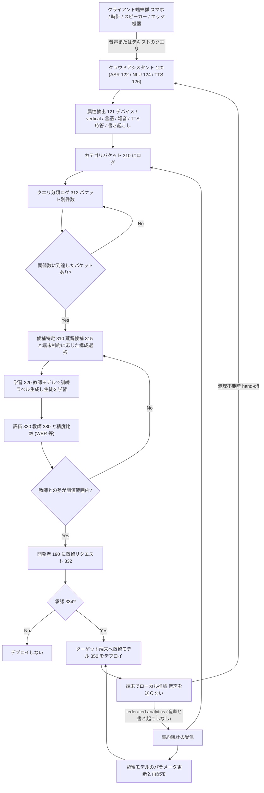
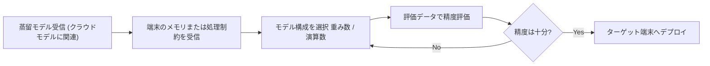
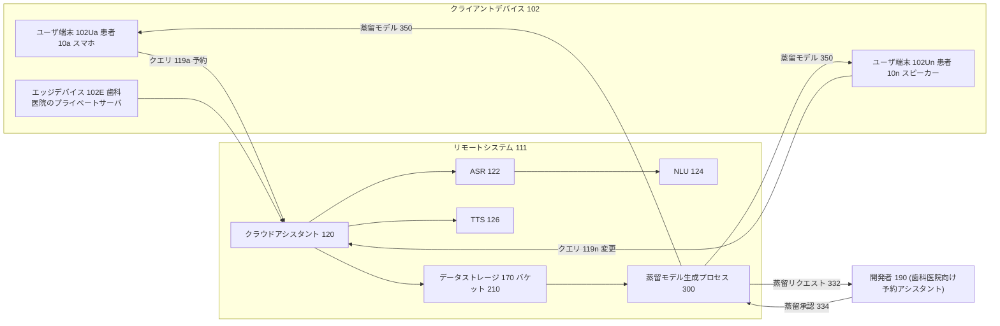
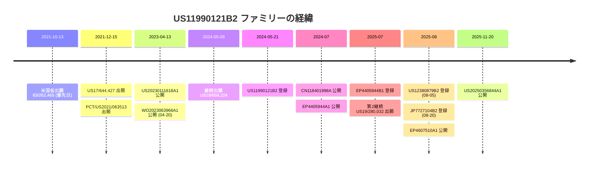
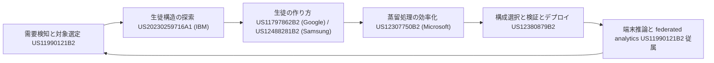

# Distilling to a target device based on observed query patterns（US11990121B2 / 継続出願 US12380879B2）

- **Patent Number**: US11990121B2（出願 US17/644,427、公開 US20230111618A1）／継続出願 US12380879B2（出願 US18/659,224、公開 US20240290324A1）
- **Assignee**: Google LLC
- **Inventors**: Matthew Sharifi, Victor Carbune
- **Priority Date**: 2021-10-13（米国仮出願 63/262,465）
- **Filing Date**: 2021-12-15（US11990121B2）／2024-05-09（US12380879B2, Continuation）
- **Grant Date**: 2024-05-21（US11990121B2）／2025-08-05（US12380879B2）
- **Expiration**: US11990121B2 は Adjusted expiration 2042-11-18（Active）／US12380879B2 は Anticipated expiration 2041-12-15（Active）
- **Classification (CPC)**: G10L15/00, G10L15/01, G10L15/06, G10L15/063, G10L15/065, G10L15/08, G10L15/18, G10L15/22, G10L15/26, G10L15/28, G10L15/30, G10L13/00, G10L13/08（両特許共通）
- **Link**: https://patents.google.com/patent/US11990121B2/en ／ https://patents.google.com/patent/US12380879B2/en
- **Type**: Patent

> **エビデンス品質**: 本レポートの書誌事項・クレーム・明細書記述はすべて Google Patents ページから取得した **【一次資料】**（特許公報テキスト）。法的状態・期限は Google Patents の推定表示であり法的結論ではない。ビジネス上の解釈（Apple/Google 型「クラウド教師・端末生徒」モデルとの対応）は **本レポートによる分析** である。

---

## Abstract

A method includes receiving user queries directed toward a cloud-based assistant service. For each received user query directed toward the cloud-based assistant service, the method also includes extracting one or more attributes from the user query and logging the user query into one or more of a plurality of category buckets based on the one or more attributes extracted from the user query. The method also includes determining when at least one of the plurality of category buckets includes a threshold number of the user queries logged into the at least one category bucket, and when the at least one of the plurality of category buckets includes the threshold number of the user queries, generating a distilled model of the cloud-based assistant service. The distilled model of the cloud-based assistant service is configured to execute on one or more target client devices.

（US12380879B2 の Abstract も同一文言）

## Abstract (Japanese Translation)

本方法は、クラウドベースのアシスタントサービスに向けられたユーザクエリを受信することを含む。クラウドベースのアシスタントサービスに向けられた各受信ユーザクエリについて、本方法はさらに、ユーザクエリから 1 つ以上の属性を抽出し、抽出した属性に基づいてユーザクエリを複数のカテゴリバケットのうち 1 つ以上に記録（ログ）することを含む。本方法はまた、複数のカテゴリバケットのうち少なくとも 1 つが閾値数のユーザクエリを含むようになった時点を判定し、そのような状態になったときに、クラウドベースのアシスタントサービスの **蒸留モデル** を生成することを含む。クラウドベースのアシスタントサービスの蒸留モデルは、1 つ以上のターゲットクライアントデバイス上で実行されるように構成される。

---

## Overview

本特許は、**クラウド上のアシスタントサービス（ASR・NLU・TTS の大規模モデル）に集まるクエリの「パターン」を観測し、十分な量のクエリが特定カテゴリ（デバイス種別、クエリの業種＝vertical、言語・アクセント、背景雑音レベル等）に溜まったら、そのカテゴリに特化した小型の蒸留モデルを自動生成して端末に配布する**という、**機会駆動型（opportunistic）のクラウド→オンデバイス蒸留パイプライン**をクレームしている。

- 教師モデル = クラウドの ASR/NLU/TTS モデル（例: 「very large multilingual model」）
- 生徒モデル = 端末のメモリ・処理制約に合わせて構成を選んだ蒸留 ASR/NLU/TTS モデル
- 学習ラベル = 教師モデルが生成した疑似ラベル（例: クラウド ASR による transcription を ground-truth として使用）＝ **真の知識蒸留（教師ラベル蒸留／sequence-level KD に相当）**
- 配布の承認 = 生徒の精度が教師の閾値範囲内（例: 「within 1% accuracy」）なら開発者に承認を促し、承認後にデプロイ
- 継続改善 = 端末からの **federated analytics**（音声・書き起こしを送らない集約統計）で新しいバケットを検出し、別の蒸留モデルを生成または既存モデルを更新

継続出願 US12380879B2 は、クエリバケットの部分を外し、**「蒸留モデルを受け取り → 端末のメモリ/処理制約を受け取り → 構成を選択 → 評価データで精度評価 → 精度に基づき端末にデプロイ」** という **デプロイ側の工程** を独立クレーム化している。2 件合わせて、**「何を蒸留するか（需要検知）」と「どう端末に載せるか（構成選択・検証・配布）」** の両方を押さえる構成となっている。

ビジネス上は、これは Google（および Apple）が採る **「クラウドに大きな教師、端末に小さな生徒」** モデル、すなわち **クラウドで集めた利用ログを教師の蒸留データとして使い、端末側にプライバシー・低遅延・帯域削減の価値を返す** というオンデバイス AI 事業の構造そのものを手続きとして記述したものと読める（本レポートによる解釈）。

---

## Technical Problem

明細書 BACKGROUND より【一次資料】:

- ユーザは電話、時計、スマートスピーカー/ディスプレイ等のスマートデバイスで音声アシスタントと頻繁に対話する。
- 開発者は ASR（音声認識）モデルと TTS（音声合成）モデルを使ったアシスタントサービスを構築している。
- これらは一般にクラウド上で実行され、柔軟性と広範なクエリ処理能力を持つ。
- **クラウド型アシスタントの欠点**（構造化して列挙）:
  1. ネットワーク帯域の消費（consuming network bandwidth）
  2. 遅延の増大（increased latency）
  3. プライバシーの低下（reduced privacy）— 音声データをユーザデバイスからクラウドへ送る必要があるため

さらに DETAILED DESCRIPTION では、クラウドの ASR は「多数の言語・多数のクエリ vertical をカバーする非常に大きな多言語モデル」であり、そのまま端末に載せることはできないが、**実際の利用が限られた属性（例: 特定言語 × 予約 vertical）に集中しているなら、その範囲に特化した大幅に小さいモデルで足りる**、という観察が技術的課題の核心となる。

---

## Technical Solution

### Process Steps（US11990121B2 / FIG. 4 の方法 400 に対応）

1. **Step 402 — クエリ受信**: 各ユーザに紐づく複数のクライアントデバイスから、クラウドアシスタントサービス宛てのユーザクエリ（音声 118 または テキスト）を受信する → クエリ集合
2. **Step 404a — 属性抽出**: 各クエリから属性 121 を抽出する（デバイスカテゴリ/タイプ、クエリ vertical 種別、言語/ロケール、背景雑音レベル、TTS 応答、書き起こし、音声データ）→ 属性ベクトル
3. **Step 404b — バケットへのログ**: 属性に基づきクエリを 1 つ以上のカテゴリバケット 210 に記録し、クエリ分類ログ 312（バケットごとの件数）を更新 → クエリ分類ログ
4. **Step 406 — 閾値判定**: 少なくとも 1 つのバケットが閾値数のクエリを含むかを判定（明細書では「指定時間窓内の閾値数」「クエリの割合」等の代替指標も言及。連続的または毎時/日次/週次の定期分析）→ 蒸留候補の発火
5. **Step 408 — 蒸留モデル生成**: クラウドアシスタントサービスの蒸留モデル 350 を生成（FIG. 3 の 3 段階プロセス 300）→ 端末向け生徒モデル
   - 5a. **候補特定ステージ 310**: 閾値到達バケットの組合せから蒸留候補 315（ASR/NLU/TTS/言語モデル/雑音処理モデル等）を特定し、ターゲット端末の **メモリ・処理制約** に基づき **モデル構成**（重み数、演算数、アーキテクチャ）を選択。端末群の「最小公倍数的な（lowest common denominator）」制約に合わせる選択肢も記載。
   - 5b. **学習ステージ 320**: 当該バケット属性を持つ訓練クエリ集合 325 を取得（①過去のログ済みクエリ、②新着クエリのフィルタリング、③オフラインデータサンプル）。**教師モデル（クラウド ASR 122 等）で訓練ラベルを生成**し、生徒を学習。学習終了条件: 所定時間、所定ステップ数、所定クエリ数、または訓練損失の安定化。
   - 5c. **評価ステージ 330**: 評価データ 335（例: ライブの新着クエリ音声）で生徒と教師 380 の精度を比較（ASR では WER）。生徒の精度が教師の閾値範囲内なら開発者に蒸留リクエスト 332 を送付。
6. **Step — 開発者承認とデプロイ**: 開発者が承認 334 を返したらターゲット端末へデプロイ（拒否も可能）。蒸留リクエストのメッセージ例: 「We have a distilled model available which can run on devices X. It is within 1% accuracy of the cloud-based model but will reduce latency and improve privacy」
7. **Step — 端末実行とフォールバック**: 端末は音声をネットワークに送らずローカルで処理。蒸留モデルで処理できないクエリは、音声/書き起こしをクラウドに **hand-off** し、より大きなクラウドモデルで処理する。
8. **Step — Federated analytics による継続ループ**: デプロイ後、各端末から新着クエリの属性を示す federated analytics（音声・書き起こしを特定ユーザに帰属させない集約形）を受信し、(a) バケットに再ログして別の蒸留モデルを生成、または (b) 蒸留モデルのパラメータを更新して再配布（パラメータ更新のみ送って端末側で更新する形態も記載）。

### Key Innovation

- **需要駆動の蒸留トリガ**: 「どのモデルを、どの端末向けに、いつ蒸留するか」を、クラウドに集まるクエリの属性分布（バケット件数の閾値到達）で自動決定する点。従来の蒸留が「人が決めた特定モデルを圧縮する」のに対し、**利用パターンの観測から蒸留対象を発見する** プロセスを権利化している。
- **多次元バケット**: デバイス種別 × クエリ vertical × 言語/アクセント × 雑音レベル等の組合せでニッチ（例: 歯科予約 × 英国英語 × Phone A）を特定し、カスタム語彙（例: 歯科用語、固有名詞「Dr. Zematol」）に特化した生徒を作る。
- **端末制約に応じた生徒構成の選択**: 同じ ASR でもスマートフォン用とスマートスピーカー用で異なる構成の生徒を複数生成。
- **教師準拠の品質ゲート＋人間（開発者）承認**: 教師との精度差が閾値内であることを条件にした承認フロー。
- **プライバシー保護型の継続学習ループ**: federated analytics を使い、生の音声・書き起こしを受け取らずに次の蒸留候補を検出・更新。
- **技術的利点**: 遅延改善、帯域削減、プライバシー保護（音声がネットワークに出ない）、クラウド処理負荷の削減。

### Mathematical Relationships

特許本文に数式はない。クレームと明細書の条件を形式化すると次のとおり（本レポートによる定式化）。

カテゴリバケット $b$ に記録されたクエリ数を $N_b$、閾値を $\tau$ とすると、蒸留の発火条件は

$$\exists\, b \in \mathcal{B} : N_b \ge \tau$$

蒸留生徒 $S$ の構成 $\phi$ は、ターゲット端末 $d$ のメモリ $M_d$・処理能力 $P_d$ に対して

$$\phi^{\ast} = \arg\max_{\phi}\ \mathrm{Acc}(S_\phi) \quad \text{s.t.}\quad \mathrm{Mem}(S_\phi) \le M_d,\ \ \mathrm{Ops}(S_\phi) \le P_d$$

学習は教師 $T$（クラウドモデル）が生成したラベルで行う（教師ラベル蒸留）。

$$\mathcal{D}_b = \{(x_i, T(x_i))\}_{x_i \in Q_b}, \qquad S^{\ast} = \arg\min_{S}\ \sum_{(x,\hat{y}) \in \mathcal{D}_b} \ell\big(S(x), \hat{y}\big)$$

デプロイ（開発者への提示）の条件は、評価データ $E$ 上の精度について

$$\mathrm{Acc}_E(T) - \mathrm{Acc}_E(S^{\ast}) \le \epsilon \qquad (\text{ASR では } \mathrm{WER}_E(S^{\ast}) - \mathrm{WER}_E(T) \le \epsilon)$$

- $\mathcal{B}$: カテゴリバケット集合、$Q_b$: バケット $b$ に属する訓練クエリ、$\ell$: 損失関数（特許では未特定）、$\epsilon$: 閾値範囲（明細書の例は「1%」）。

---

## Key Claims

### US11990121B2 — Claim 1（独立・方法）

コンピュータ実装方法。データ処理ハードウェア上で実行されると、以下の動作を行わせる。

- **Element a)**: それぞれユーザに紐づく複数のクライアントデバイスから、データ処理ハードウェア上で実行されるクラウドベースのアシスタントサービス宛てのユーザクエリを受信する。
- **Element b)**: 受信した各ユーザクエリについて:
  - **b-1)** ユーザクエリから 1 つ以上の属性を抽出する
  - **b-2)** 抽出した属性に基づき、ユーザクエリを複数のカテゴリバケットのうち 1 つ以上にログする
- **Element c)**: 複数のカテゴリバケットのうち少なくとも 1 つが、そこにログされた閾値数のユーザクエリを含むときを判定する。
- **Element d)**: 少なくとも 1 つのカテゴリバケットが閾値数のユーザクエリを含むとき、クラウドベースのアシスタントサービスの **蒸留モデルを生成** する。
- **Element e)**: 当該蒸留モデルは、複数のクライアントデバイスのうち 1 つ以上のターゲットクライアントデバイス上で実行されるよう構成される。

### US11990121B2 — Claim 17（独立・システム）

データ処理ハードウェアと、それと通信するメモリハードウェア（命令を格納）を備え、Claim 1 の a)〜e) と同一の動作を実行するシステム。従属クレーム 18〜32 は 2〜16 と並行構造。

### US11990121B2 — 主要従属クレーム（要素分解）

- **Claim 2（属性の種類）**: 以下の少なくとも 1 つ
  - デバイスカテゴリ および/または デバイスタイプ
  - クエリ vertical 種別
  - 発話ユーザの言語 および/または ロケール
  - クエリ音声中の背景雑音レベル
  - クエリ実行後にサービスが生成した TTS 応答
  - クエリの書き起こし
- **Claim 3（ASR→クエリ解釈→vertical バケット）**: クラウド ASR で音声を書き起こし、書き起こしにクエリ解釈を行って vertical 種別を特定し、対応する vertical バケットへログ。
- **Claim 4（開発者承認→デプロイ）**: 開発者に生成した蒸留モデルの受け入れを促し、受け入れられたらターゲット端末へデプロイ。
- **Claim 5（教師準拠の品質ゲート）**: 評価データ上の蒸留モデル精度が **教師モデル** の精度の閾値範囲内かを判定し、範囲内のときに開発者へ促す。
- **Claim 6（端末制約に応じた構成選択）**: ターゲット端末のメモリ および/または 処理制約を満たすモデル構成を選択。
- **Claim 7（教師ラベル蒸留）**: 閾値到達バケットの属性を持つ訓練クエリ集合を取得 → **クラウドアシスタントの教師モデルで訓練ラベルを生成** → その訓練クエリとラベルで蒸留モデルを学習。
- **Claim 8/9/10（訓練クエリの出所）**: 8 = ログ済みの過去ユーザクエリ、9 = 当該属性を持つ新着クエリ、10 = オフラインのデータサンプル。
- **Claim 11（federated analytics → 新たな蒸留）**: デプロイ後、端末から新着クエリ属性を示す federated analytics を受信 → バケットにログ → 別のバケットが閾値到達 → 別の蒸留モデルを生成。
- **Claim 12（federated analytics → モデル更新）**: federated analytics に基づき蒸留モデルのパラメータを更新し再デプロイ。
- **Claim 13（プライバシー）**: federated analytics は、新着クエリの音声データも書き起こしも受信せずに受け取る。
- **Claim 14/15/16（モデル種別）**: 蒸留モデルは 14 = 音声認識モデル、15 = TTS モデル、16 = NLU モデル。

### US12380879B2 — Claim 1（独立・方法）

コンピュータ実装方法。データ処理ハードウェア上で以下を実行する。

- **Element a)**: ターゲットクライアントデバイス上での実行のために特定された **蒸留モデル** を受信する。当該蒸留モデルは対応する **クラウドベースのモデル** に関連する。
- **Element b)**: ターゲットクライアントデバイスの **メモリ制約または処理制約の少なくとも一方** を受信する。
- **Element c)**: その制約に基づき蒸留モデルの **モデル構成を選択** する。
- **Element d)**: 選択した構成の蒸留モデルで **評価データセットを処理し**、蒸留モデルの精度を示す評価結果を生成する。
- **Element e)**: 精度を示す評価結果に基づき、選択した構成の蒸留モデルをターゲットクライアントデバイスに **デプロイ** する。

### US12380879B2 — Claim 11（独立・システム）および従属クレーム

- Claim 11: Claim 1 と同一動作のシステム（従属 12〜20 は 2〜10 と並行）。
- Claim 2: 評価結果に基づき開発者に受け入れを促し、受け入れ表示を受信した場合にデプロイ。
- Claim 3: 端末の利用可能メモリに基づき **モデル重みの数** を割り当てる。
- Claim 4: 端末の処理能力に基づき **実行可能な演算数** を割り当てる。
- Claim 5: 評価結果は性能（performance）も示す。
- Claim 6: 精度が対応するクラウドモデルの精度の閾値範囲内かを判定し、範囲内なら開発者に促し、承認に基づきデプロイ。
- Claim 7/8/9: 蒸留モデルは 7 = 音声認識モデル、8 = NLU モデル、**9 = 言語モデル**。
- Claim 10: 蒸留モデルは対応するクラウドモデルに比べ **サイズと処理要件が大幅に削減（drastic reduction）** されている。

> **注目点**: 継続出願では Claim 9 で **「language model」** が明示され、TTS が外れている。クエリバケットの要件もなく、**LLM を含む任意の「クラウドモデル→蒸留モデル」の端末向け構成選択・検証・配布** をカバーする、より広い権利範囲になっている（本レポートによる比較）。

---

## Process Flow Diagram



継続出願（US12380879B2）の独立クレーム部分のみを抜き出すと次のとおり。



---

## Figures & Tables

### 特許図面（US11990121B2, Google Patents 画像）

図面の簡単な説明（明細書 DESCRIPTION OF DRAWINGS より）:

| 図 | 説明（原文要約） |
|----|----------------|
| FIG. 1 | クラウドアシスタントサービス宛てのユーザクエリに基づき、アシスタントモデルをクライアントデバイスへ蒸留するシステム例の概略図 |
| FIG. 2 | クエリから抽出した属性に基づき、1 つ以上のカテゴリバケットへクエリをログする様子の概略図 |
| FIG. 3 | FIG. 1 のクラウドアシスタントサービス向けに蒸留アシスタントモデルを生成する蒸留モデル生成プロセス例の概略図 |
| FIG. 4 | クラウドアシスタントサービス宛てのクエリに基づきアシスタントモデルをクライアントデバイスへ蒸留する方法の動作配列例のフローチャート |
| FIG. 5 | 本システム・方法の実装に使えるコンピューティングデバイス例の概略図 |

代表図（フロントページ）:


図面シート 1（FIG. 1 と推定）:


図面シート 2（FIG. 2 と推定）:


図面シート 3（FIG. 3 と推定）:


図面シート 4（FIG. 4 と推定）:


図面シート 5（FIG. 5 と推定）:


継続出願 US12380879B2 の図面（同一明細書のためサムネイルのみ掲載）:


### FIG. 1 の再現（システム構成）



明細書の具体例（構造化）:

| 要素 | 例 |
|------|----|
| 開発者 190 | 歯科医院向けに予約アシスタントを構築 |
| クエリ 119a | 「Schedule a root canal with Dr. Zematol in February」（スマートフォン） |
| クエリ 119n | 「I need to reschedule dental exam with Dr. Zematol on March 23」（スマートスピーカー） |
| エッジデバイス 102E | 歯科医院スタッフが接続するプライベートサーバ／コンピュータ |
| 抽出 vertical | 予約／スケジューリング（さらに歯科予約に特化） |
| 蒸留 ASR の特化対象 | 予約 vertical の常用語、歯科用語、固有名詞（Dr. Zematol） |
| 別例 | スマートウォッチ向けアシスタントで、ほぼ全クエリがフィットネス関連 → フィットネス特化の ASR/NLU を時計上で実行 |

### FIG. 2 の再現（カテゴリバケットの 4 群）

| 行（群） | カテゴリ | バケット例 |
|---------|---------|-----------|
| 第1群（最上段） | デバイスカテゴリ／タイプ | スマートフォン（Phone A〜Phone N）、スマートスピーカー、スマートウォッチ、エッジデバイス（スマートヘッドホン、車載インフォテインメントは図示なし）。OS やそのバージョンでの細分も可 |
| 第2群 | クエリ vertical 種別 | メディア（「Assistant, stream my music playlist」）、フィットネス、スケジューリング。他にナビゲーション（「Navigate to Uncle John's house in Sebastopol, CA」）、文書作成、メッセージ（「Send message to Mom, 'I'm running late'」）、ショッピング（「Re-order cold brew coffee for delivery」）。開発者定義やサービスによる動的生成のカスタム vertical も可 |
| 第3群 | 言語／アクセント | Language A〜N、各言語内の方言（American English、southern accent、British English、Manchester accent 等） |
| 第4群（最下段） | 背景雑音レベル | 低（最小雑音閾値未満）／中（最小以上・最大以下）／高（最大閾値超）。3 区分以外も可 |

FIG. 2 の例: あるクエリは「Phone A」「スケジューリング vertical」「Language A / Accent N（British English）」「中程度の雑音」の 4 バケットに同時にログされる（Phone A はスマートフォンカテゴリ、British English は English 全体も表す）。

### FIG. 3 の再現（蒸留モデル生成プロセス 300 の 3 ステージ）

| ステージ | 入力 | 処理 | 出力 |
|---------|------|------|------|
| 候補特定 310 | クエリ分類ログ 312（件数インジケータ 313） | 閾値到達バケット（例: Device type N、スケジューリング vertical、Language A）を特定。メディア vertical と Language N は 0 件。端末制約の参照と構成選択 | 蒸留候補 315a〜n |
| 学習 320 | 候補 315、データ取得要求で得た訓練クエリ 325（属性 321） | 教師（クラウド ASR 122 等）で訓練ラベル生成、生徒を学習 | 蒸留アシスタントモデル 350 |
| 評価 330 | 蒸留モデル 350、教師 380、評価データ 335 | 精度（ASR は WER）比較、閾値範囲内なら開発者へ蒸留リクエスト 332 | 承認 334 → デプロイ |

### FIG. 4 の再現（方法 400）

```text
[402] 複数クライアントからクラウドアシスタント宛てクエリを受信
   |
[404] 各クエリ: 属性抽出 → カテゴリバケットにログ
   |
[406] いずれかのバケットが閾値数に到達?  --No--> [402] に戻る
   | Yes
[408] クラウドアシスタントの蒸留モデルを生成（ターゲット端末で実行可能）
```

### クレーム構造表（US11990121B2, 32 クレーム）

| Claim # | Type | Depends On | Key Element |
|---------|------|-----------|-------------|
| 1 | Independent（方法） | — | クエリ受信・属性抽出・バケットログ・閾値判定・蒸留モデル生成 |
| 2 | Dependent | 1 | 属性の種類（デバイス、vertical、言語、雑音、TTS 応答、書き起こし） |
| 3 | Dependent | 1 | ASR 書き起こし → クエリ解釈 → vertical バケット |
| 4 | Dependent | 1 | 開発者承認 → デプロイ |
| 5 | Dependent | 4 | 教師精度との閾値範囲判定を承認の条件に |
| 6 | Dependent | 1 | 端末のメモリ/処理制約を満たす構成選択 |
| 7 | Dependent | 1 | 教師モデルで訓練ラベル生成 → 生徒学習 |
| 8 | Dependent | 7 | 訓練クエリ = 過去のログ済みクエリ |
| 9 | Dependent | 7 | 訓練クエリ = 新着クエリ |
| 10 | Dependent | 7 | 訓練クエリ = オフラインデータ |
| 11 | Dependent | 1 | federated analytics → 新バケット → 別の蒸留モデル |
| 12 | Dependent | 1 | federated analytics → パラメータ更新 → 再デプロイ |
| 13 | Dependent | 12 | 音声・書き起こしを受信しない |
| 14 | Dependent | 1 | 蒸留モデル = 音声認識モデル |
| 15 | Dependent | 1 | 蒸留モデル = TTS モデル |
| 16 | Dependent | 1 | 蒸留モデル = NLU モデル |
| 17 | Independent（システム） | — | Claim 1 と同一動作のシステム |
| 18〜32 | Dependent | 17 ほか | Claim 2〜16 と並行（18↔2, 19↔3, 20↔4, 21↔5(20に従属), 22↔6, 23↔7, 24〜26↔8〜10(23に従属), 27↔11, 28↔12, 29↔13(28に従属), 30〜32↔14〜16） |

### クレーム構造表（US12380879B2, 20 クレーム）

| Claim # | Type | Depends On | Key Element |
|---------|------|-----------|-------------|
| 1 | Independent（方法） | — | 蒸留モデル受信・端末制約受信・構成選択・評価・精度に基づくデプロイ |
| 2 | Dependent | 1 | 開発者承認に基づくデプロイ |
| 3 | Dependent | 1 | 利用可能メモリに基づく重み数割当 |
| 4 | Dependent | 1 | 処理能力に基づく演算数割当 |
| 5 | Dependent | 1 | 評価結果が性能も示す |
| 6 | Dependent | 1 | クラウドモデル精度との閾値範囲判定 → 開発者承認 → デプロイ |
| 7 | Dependent | 1 | 音声認識モデル |
| 8 | Dependent | 1 | NLU モデル |
| 9 | Dependent | 1 | **言語モデル** |
| 10 | Dependent | 1 | クラウドモデル比でサイズ・処理要件が大幅削減 |
| 11 | Independent（システム） | — | Claim 1 と同一動作のシステム |
| 12〜20 | Dependent | 11 | Claim 2〜10 と並行 |

### 親特許と継続出願の比較

| Feature | US11990121B2（親） | US12380879B2（継続） |
|---------|-------------------|--------------------|
| 独立クレームの焦点 | 需要検知（クエリ属性 → バケット → 閾値）＋蒸留モデル生成 | 端末制約に応じた構成選択 ＋ 評価 ＋ デプロイ |
| クエリバケット要件 | 必須 | なし |
| 教師モデルの明示 | 従属 5, 7（教師ラベル生成） | 「対応するクラウドベースモデル」（従属 6） |
| モデル種別 | ASR / TTS / NLU | ASR / NLU / **言語モデル** |
| 端末制約 | 従属 6（任意要件） | 独立クレームの必須要件 |
| federated analytics | 従属 11〜13 | なし |
| クレーム数 | 32 | 20 |
| 権利の広さ（本レポート評価） | 狭いが具体的（クエリ駆動） | 広い（蒸留モデルの端末向け最適化配布全般） |

### 先行技術との比較（本特許の引用文献に基づく）

| Feature | 本特許 | Mun'im et al. 2018（Seq-level KD for ASR） | Takashima et al. ICASSP 2018（CTC KD） | Yan Lu et al. SEC 2019（クラウド-端末協調学習） | US11403540B2（Google, On-device ML platform） |
|---------|-------|-----------|-----------|-----------|-----------|
| 教師→生徒の蒸留 | あり（クラウド教師ラベル） | あり | あり | 記載なし（取得範囲外） | 記載なし（取得範囲外） |
| 蒸留対象の自動発見 | **あり（クエリバケット）** | なし | なし | — | — |
| 端末制約に応じた構成 | あり | — | — | — | オンデバイス ML 基盤 |
| 開発者承認フロー | あり | なし | なし | — | — |
| プライバシー保護ループ | federated analytics | なし | なし | 協調学習 | — |

（先行文献側の内容は題名からの推定であり、本調査では本文を取得していない）

---

## Patent Family & Related Art

### ファミリー（Google Patents 表示、Family ID 80112207）

| 公報番号 | 種別/状態 | 出願番号 | 出願日 | 公開/登録日 |
|---------|----------|---------|-------|-----------|
| US20230111618A1 | 公開 | US17/644,427 | 2021-12-15 | 2023-04-13 |
| **US11990121B2** | 登録（Active） | US17/644,427 | 2021-12-15 | 2024-05-21 |
| US20240290324A1 | 公開（継続） | US18/659,224 | 2024-05-09 | 2024-08-29 |
| **US12380879B2** | 登録（Active、継続） | US18/659,224 | 2024-05-09 | 2025-08-05 |
| US20250356844A1 | 公開（Pending、継続） | US19/280,032 | 2025-07-24 | 2025-11-20 |
| WO2023063966A1 | PCT（Ceased） | PCT/US2021/063513 | 2021-12-15 | 2023-04-20 |
| EP4405944A1 / **EP4405944B1** | EP（B1 Active） | EP21844116.0A | 2021-12-15 | 2024-07-31 / 2025-07-16 |
| EP4607510A1 | EP 分割（Pending） | EP25188519.0A | 2021-12-15 | 2025-08-27 |
| JP2024539644A / **JP7727104B2** | JP（Active） | JP2024522377A | 2021-12-15 | 2024-10-29 / 2025-08-20 |
| KR20240073984A | KR（Pending） | KR1020247015388A | 2021-12-15 | 2024-05-27 |
| CN118401998A | CN（Pending） | CN202180104984.6A | 2021-12-15 | 2024-07-26 |



### 引用文献（Citations）

- 特許引用（審査官引用）:
  - US20090210402A1（Samsung Electronics, 2009）System and method for contextual association discovery to conceptualize user query
  - US20220189471A1（Google, 2022）Combining Device or Assistant-Specific Hotwords in a Single Utterance
- 非特許文献:
  - PCT/US2021/063513 の国際調査報告・見解書（2022-08-08）
  - Raden Mu'az Mun'im et al., "Sequence-Level Knowledge Distillation for Model Compression of Attention-based Sequence-to-Sequence Speech Recognition", arXiv, 2018-11-12
  - Takashima Ryoichi et al., "An Investigation of a Knowledge Distillation Method for CTC Acoustic Models", ICASSP 2018, pp. 5809-5813
  - Yan Lu et al., "Collaborative learning between cloud and end devices: an empirical study on location prediction", ACM/IEEE SEC 2019, pp. 139-151
- ファミリー引用（Family Cites）: JP4408665B2（富士通, 音声認識用音声データ収集）、US11403540B2（Google, On-device machine learning platform）、US12020167B2（Magic Leap, Gradient adversarial training）、JP7495713B2（アラヤ, 情報処理装置）

### 被引用（Families Citing this family, 7 件）

| 公報番号 | 優先日 | 公開日 | 出願人 | 題名 |
|---------|-------|-------|-------|------|
| CN116561250A | 2022-01-27 | 2023-08-08 | 声音猎手公司（SoundHound） | Method and device for realizing intelligent voice query |
| US12056457B2 | 2022-03-22 | 2024-08-06 | Charles University | Real time speech translation |
| US12444422B2 | 2022-12-28 | 2025-10-14 | Spotify Ab | Method and system for selecting a voice assistant |
| CN117114112B | 2023-10-16 | 2024-03-19 | 北京英視睿達科技 | Vertical field data integration method based on large model |
| CN117688351B | 2024-02-04 | 2024-04-26 | 中国電子科技集団 第十五研究所 | Auxiliary screening method based on model processing result |
| US20250378690A1 | 2024-04-25 | 2025-12-11 | Moodmetrics Ai | Extracting inherent user feature using AI |
| CN121255828A | 2025-08-15 | 2026-01-02 | 杭州阿里巴巴海外数字商業 | Data query method and system |

---

## 関連特許

以下はいずれも Google Patents ページから取得した【一次資料】の要約である。

### US12307750B2 — Scalable knowledge distillation techniques for machine learning（Microsoft）

- **Assignee**: Microsoft Technology Licensing LLC ／ **Inventors**: Adit Krishnan, Ji Li, Yixuan Wei, Xiaozhi Yu, Han Hu, Qi Dai
- **Priority/Filing**: 2022-06-10 ／ **Grant**: 2025-05-20 ／ Status: Active
- **CPC（抜粋）**: G06N3/045, G06N3/08, G06N3/096, G06V10/774, G06V10/82 ほか
- **要旨**: 訓練データを複数バッチに分割し、反復的知識蒸留で教師から生徒を蒸留する動的 KD。教師・生徒を同一メモリ上にインスタンス化し、各バッチで **教師と生徒を並行して学習**、生徒性能を教師と比較評価してフィードバックする。
- **Claim 1 の要素**: (a) 教師・生徒をメモリにインスタンス化、(b) **バッチサイズを両モデルのインスタンス化後に残るメモリ量に基づき決定**、(c) 各反復で教師学習・生徒学習・性能比較・生徒へのフィードバック。
- **スマートフォン文脈（背景）**: 「モデルはクラウドまたはエンドユーザのクライアントデバイス上にローカルにホストされ得る」「スマートフォンその他のモバイルデバイスでホストされる場合、メモリと計算資源の制約が特に厳しい」と記載し、KD 自体の計算コストを課題とする。
- **本特許との関係**: 本 Google 特許が「何を・いつ蒸留するか」なら、Microsoft 特許は「蒸留処理そのものをメモリ効率よく回す」側。


### US12488281B2 — Electronic device and control method thereof（Samsung Electronics）

- **Assignee**: Samsung Electronics Co Ltd ／ **Inventors**: Wonseok Song, Wonchul Son, Wonjun Hwang, Gangmo Koo, Youngbin Kim, Youngsu Moon, Huijung Lee, Younghun Jo
- **Priority**: 2020-03-10 ／ **Filing**: 2021-10-08 ／ **Grant**: 2025-12-02 ／ Status: Active
- **CPC（抜粋）**: G06N3/0464, G06N3/0495, G06N3/08, G06N3/094 ほか
- **要旨**: 第1（教師）AI モデルと第2（生徒）AI モデルを同じ第1学習データで学習済みとして保持し、第2学習データを両者に入力、**各層出力を比較して生徒を再学習**する。生徒の各層は、教師の対応層の **2 次元フィルタをサイズ縮小したフィルタ** を持つ。
- **Claim 1 の要素**: 教師層数 = 生徒層数、教師の 2D フィルタ数 = 生徒の 1D フィルタ数、生徒フィルタは 1×N または N×1、再学習した生徒を通信インターフェースで外部機器に送信、入力データを行/列単位で読み出して生徒で処理。従属クレーム 4 で層出力を識別する第3モデル（敵対的判別器）を利用。
- **端末文脈**: 「電子機器の小型化に伴い、性能を維持しつつ AI モデル容量を削減する必要」があり、KD で圧縮。対象機器例に TV、PC、スマートフォン、スマートグラス等。
- **本特許との関係**: 学習側機器が生徒を作って **外部機器へ送信**する点で「サーバで蒸留 → 端末配布」構図を共有するが、焦点は層単位の特徴蒸留とフィルタ形状（CNN 系）。


### US20230259716A1 — Neural architecture search of language models using knowledge distillation（IBM）

- **Assignee**: International Business Machines Corp ／ **Inventors**: Michele Merler, Aashka Trivedi, Rameswar Panda, Bishwaranjan Bhattacharjee, Taesun Moon, Avirup Sil
- **Priority/Filing**: 2022-02-14 ／ **Publication**: 2023-08-17（公開公報。Google Patents 表示 Status: Active）
- **CPC（抜粋）**: G06F40/30, G06F40/40, G06N3/045, G06N3/092, G06N3/096, G06N3/0985 ほか
- **要旨**: 複数の言語モデルからコーパス解釈に最適な言語モデルを決定し、そのモデルでコーパスを解釈する NAS 方法。
- **主要クレーム**: Claim 4 で **KD 誘導型 NAS**。Claim 5 で構成要素を列挙: (a) 生徒の言語モデルアーキテクチャ探索空間、(b) 知識を蒸留する参照としての教師モデル、(c) **下流タスク精度・レイテンシ・教師からの KD の組合せ** に基づく報酬関数、(d) 期待報酬を最大化するよう探索状態を選ぶコントローラ、(e) 実報酬を測るモデル学習モジュール。Claim 10 で報酬は 3 要素の重み付き結合。
- **本レポート群との関係**: 富士通「特化型AI蒸留技術」の **NAS → 蒸留** と同型の発想（探索で生徒構造を決め、教師から蒸留）を 2022 年時点で出願しており、国内事業者の手法の先行例として重要。

報酬関数（Claim 10 の形式化、本レポートによる記法）:

$$R = w_1 \cdot \mathrm{Acc}_{\text{task}} + w_2 \cdot g(\mathrm{Latency}) + w_3 \cdot h(\mathrm{KD}_{T \to S})$$


### US11797862B2 — Extreme language model compression with optimal sub-words and shared projections（Google）

- **Assignee**: Google LLC ／ **Inventors**: Yang Song, Raghav Gupta, Dengyong Zhou, Sanqiang Zhao
- **Priority/Filing**: 2020-01-22 ／ **Grant**: 2023-10-24 ／ Status: Active
- **CPC（抜粋）**: G06F40/284, G06N3/0495, G06N3/088, G06N3/096 ほか
- **要旨**: 大きな教師言語モデルより **語彙が小さく、埋め込み・隠れ次元が低い** 生徒言語モデルを学習する KD 手法。教師と生徒を同時に学習する **dual-training** で生徒語彙の最適な単語埋め込みを得て、層ごとの知識を転移する **shared projection** 行列と組み合わせ可能。**BERT-BASE を 60 倍超圧縮し、下流タスク指標の低下はわずかで、フットプリント 7MB 未満**。
- **Claim 1 の要素**: 教師語彙（サブワード）と生徒語彙（教師より少ない）を持つ両モデル、教師・生徒のサブワード埋め込みを混在させた入力を教師に入力、教師出力の損失を評価して生徒サブワード埋め込みを更新。
- **端末文脈**: 背景で「BERT 等はサイズのためモバイル・エッジデバイスでは非実用的」とし、**Claim 10 で「生徒言語モデルをモバイルまたはエッジデバイスにデプロイしてオンデバイス推論」** をクレーム。
- **本特許との関係**: 同じ Google の「生徒の作り方（極端な LM 圧縮）」側の特許であり、US11990121B2 の「何を蒸留し端末へ配るか」と補完関係。


### 関連特許の比較表

| 特許 | 出願人 | 優先日 | 蒸留の種類 | 端末/エッジの扱い | パイプライン上の位置 |
|------|-------|-------|-----------|----------------|-------------------|
| US11990121B2 | Google | 2021-10-13 | 教師ラベル蒸留（クラウド ASR/NLU/TTS → 端末） | 独立クレームで端末実行 | 需要検知・蒸留対象選定・配布 |
| US12380879B2 | Google | 2021-10-13 | 蒸留モデルの構成選択・評価 | 独立クレームで端末制約 | 端末向け最適化・検証・デプロイ |
| US11797862B2 | Google | 2020-01-22 | 語彙縮小＋shared projection の LM 蒸留 | 従属 Claim 10 でモバイル/エッジへデプロイ | 生徒の作り方（LM 圧縮） |
| US12307750B2 | Microsoft | 2022-06-10 | 反復・並行 KD（メモリ適応バッチ） | 背景でスマートフォン制約 | 蒸留処理の効率化 |
| US12488281B2 | Samsung | 2020-03-10 | 層単位特徴蒸留（2D→1D フィルタ） | 学習後に外部機器へ送信 | 生徒の作り方（CNN 圧縮） |
| US20230259716A1 | IBM | 2022-02-14 | KD 誘導型 NAS（精度・遅延・KD の報酬） | レイテンシを報酬に含む | 生徒構造の探索 |



---

## Notes

### ビジネス上の意義（本レポートによる分析）

- **「クラウド教師・端末生徒」モデルの手続き化**: 本特許は、クラウドで大規模モデルを運用しながら、実際の利用ログ（クエリ属性分布）から「端末に降ろせるニッチ」を自動発見し、教師ラベルで生徒を作って配布するという、Google や Apple が採るオンデバイス AI 戦略の運用ループをそのままクレーム化している。教師の推論出力を蒸留データとして再利用するため、**クラウド側の利用規模がそのまま端末モデル品質の源泉になる** という規模の経済を前提とする。
- **開発者向けプラットフォーム事業**: 開発者（例: 歯科医院向けアシスタントの作り手）に「1% 以内の精度で遅延とプライバシーを改善できる蒸留モデルがある」と提案する UX は、**クラウド AI プラットフォームが「蒸留 as a Service」として端末展開を売る** モデルを示す。富士通の「顧客要件（GPU・速度）を入力に NAS＋蒸留で特化モデルを作る」サービス（同ディレクトリ `09-fujitsu-takane-quantization-distillation.md`）と、制約駆動で生徒構成を選ぶ点で共通する。
- **継続出願による LLM への拡張**: 2024 年出願の継続 US12380879B2 で「language model」が従属クレームに入り、クエリバケット要件が外れたことで、オンデバイス LLM（例: 端末向け小型 LM）の **構成選択→評価→配布** 一般に対する権利主張の余地が広がっている。さらに第 2 継続 US20250356844A1 が Pending であり、ファミリーは拡張中。
- **プライバシー訴求**: federated analytics で生の音声・書き起こしを受け取らずに次の蒸留候補を見つける設計は、端末 AI の主要な価値（プライバシー）と、クラウド側の学習データ獲得の両立を図る点で事業上重要。

### 技術分類の注記

- 本特許の「蒸留」は **真の知識蒸留**（教師=クラウドモデルが生成したラベルで、構成の異なる小型生徒を学習）である。Claim 7/23 が「teacher model … generating corresponding training labels」と明記している。
- 量子化・枝刈りは特許本文では言及されず、端末制約への対応は「重み数・演算数の割当（モデル構成選択）」として記述される。
- ソフトラベル（ロジット）蒸留か、ハードラベル（教師の書き起こし）蒸留かは限定されていないが、明細書の例は「ground-truth transcriptions」としての教師書き起こし利用であり、ハードラベル（sequence-level）蒸留に近い。

### （2026-10-22 追記）他社の端末向け蒸留特許との対応

Samsung（WO2025258795A1 / US20250273084A1）、Huawei（CN121327497A / WO2025123815A1 / US12182507B2）、Qualcomm（US20250225374A1）、Xiaomi（CN120496494A）の 7 件を `11-ondevice-llm-distillation-patents-samsung-huawei-qualcomm-xiaomi.md` に追加した。本特許の「需要検知 → 蒸留 → 端末制約に応じた構成選択 → 配布」に対し、Samsung US20250273084A1 は「サーバで蒸留した生徒を端末へ送信」、Samsung WO2025258795A1 は「ユーザタスクのキャリブレーションデータで端末側で圧縮」、Xiaomi CN120496494A は本特許 Claim 15（TTS 蒸留）に対応する車載 TTS の蒸留である。

### 追加調査候補

- US20250356844A1（第 2 継続, Pending）のクレーム内容
- EP4405944B1 / JP7727104B2 の登録クレーム（各国での権利範囲の違い）
- 引用文献 US11403540B2（Google, On-device machine learning platform）
- 被引用 US12444422B2（Spotify, 音声アシスタント選択）
