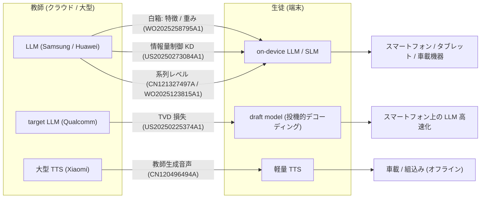

# 端末向け LLM 蒸留の関連特許（Samsung / Huawei / Qualcomm / Xiaomi）— 2026-10-22 追記分

- **Patent Numbers**: WO2025258795A1（Samsung）／ US20250273084A1（Samsung）／ CN121327497A（Huawei）／ WO2025123815A1（Huawei Cloud）／ US12182507B2（Huawei）／ US20250225374A1（Qualcomm）／ CN120496494A（Xiaomi）
- **Type**: Patent（複数件の要約レポート）
- **調査日**: 2026-10-22（gather の特許 14 件が下限 20 件に届いていなかったため、Google Patents の検索 API（`patents.google.com/xhr/query`）で出願人別に `"knowledge distillation" "language model"`（優先日 2022 年以降）を照会し、ヒットした公報ページを個別に取得して書誌・要旨・端末配備の記述を確認した）
- **エビデンス品質**: 書誌・要旨・明細書の引用はすべて Google Patents の公報ページから取得した **【一次資料】**。各公報の「クレーム 1」は取得テキストが途中で切れたものがあり、その場合は要旨または明細書の「第 1 の態様」から要約した（本文に明記）。法的状態は Google Patents の表示であり法的結論ではない
- **本クラスタとの関係**: ドメイン全体の特許ランドスケープは C8（規約・知財）が担当する。本レポートは **「端末（スマートフォン・車載・組込み）で動かす小型言語モデルを、教師モデルから蒸留して作る」** ことを明細書で述べている公報だけを対象にする
- **未確認**: Apple Inc.・Toyota・Denso・Sony・Renesas を出願人とする、同条件（蒸留 × 言語モデル × 端末）に該当する公報は本調査の検索では見つからなかった（Apple 0 件、Toyota 1 件（特徴検出器で言語モデルではない）、Sony 3 件（いずれも題名から言語モデル蒸留と確認できず）、Denso 0 件）。2 回目の照会は HTTP 503 で打ち切ったため、網羅性は限定的である

## Overview

7 件は「蒸留の対象」と「端末配備の位置づけ」で 4 つに分かれる。

| 区分 | 公報 | 出願人 | 蒸留の種別 | 端末配備の記述 | 本クラスタの事例との対応 |
|------|------|--------|-----------|----------------|------------------------|
| LLM → 端末モデルの圧縮（白箱） | WO2025258795A1 | Samsung Electronics | 教師の特徴マップ・重みの差分共分散から端末モデルの層重みを行列分解で更新（"dual knowledge distillation"、"neuron activation patterns" の蒸留） | "on-device model"、"edge devices"、"to fit into edge devices" | Samsung Gauss2 Compact（gather 事例 8、学習方法は非公開）の背景技術候補 |
| LLM → SLM の蒸留制御 | US20250273084A1 | Samsung Electronics | 教師→生徒の情報量を rate-distortion モジュールで制御する KD | 学習した生徒を「第 1 の電子機器へ送信」、"on-device generative AI" | サーバで蒸留 → 端末配布（Google 特許 10 と同じ構図） |
| LLM → 小型モデルの系列レベル蒸留 | CN121327497A | Huawei Technologies | 教師が生徒の応答を系列レベルで修正した「目標応答」で蒸留（合成データ型） | 端末（携帯電話・タブレット・ウェアラブル・**車載機器**）またはサーバに配備 | 系列レベル蒸留（Gemini Nano 03・Learning Zone 04 の黒箱蒸留と同型） |
| LLM → SLM の反復蒸留 | WO2025123815A1 | Huawei Cloud Computing Technologies | LLM が学習サンプルと検証サンプルを生成し、分布外フィードバックで反復学習 | 汎用的な機器列挙のみ（"a mobile device, a tablet device, a server"）。端末専用ではない | クラウド側の「蒸留 as a Service」（C2 と重なる） |
| 事前学習 LM の小型化（LLM 以前） | US12182507B2 | Huawei Technologies | 事前学習言語モデル（BERT 系）の KD による小型化 | "can be directly deployed on the terminal device" | TinyBERT 世代の端末向け蒸留。LLM 時代の先行例 |
| 投機的デコーディング用ドラフトモデルの蒸留 | US20250225374A1 | Qualcomm | 分散低減 TVD 損失で生徒（draft）を教師（target）に合わせる | "a mobile device (e.g., a mobile phone)"、LLM をプロセッサ上で効率的に動かす目的 | gather 論文 11（Qualcomm, arXiv 2403.00858）の特許版。Phi Silica 04 の投機的デコーディングの関連技術 |
| TTS モデルの蒸留（言語モデルではない） | CN120496494A | Xiaomi（北京小米移動軟件・小米松果電子・**小米汽車科技**） | 大型 TTS（教師）が生成した音声で軽量 TTS（生徒）を学習（明細書のみ。クレーム 1 は蒸留を限定しない） | "vehicle-mounted equipment"、"embedded system"、オフライン動作 | 車載の音声合成。Google 特許 10 の TTS 蒸留（Claim 15）と同系 |

## 各公報の要点

### WO2025258795A1 — Large language model compression（Samsung Electronics）

- **書誌**: 出願 PCT/KR2025/002074（2025-02-12）、優先日 2024-06-10、公開 2025-12-18、状態 Pending。発明者 Chiheng Lin, Shangqian Gao, Yenchang Hsu, James Seale Smith, Abhishek Patel, Shikhar Tuli, Yilin Shen, Hongxia Jin, Zheng Tang, Ting Hua。
- **要旨（要約）**: 電子機器が、ユーザに関係するタスクのキャリブレーションデータセット（"receiving a calibration dataset corresponding to a task relevant to a user"）を学習済み教師モデルと端末モデル（on-device model）に入力し、層ごとに両者の特徴マップ・重みの差分から共分散を求め、教師の重み行列の行列分解を適用して端末モデルの重みを修正する。
- **第 1 の態様（クレーム相当、明細書から要約）**: ユーザインタフェース・プロセッサ・メモリを持つ電子機器が、キャリブレーションデータを教師と端末モデルに通し、教師の共分散と行列分解で端末モデルを層単位で更新し、更新後のモデルでユーザ入力を処理する。
- **蒸留の種別**: 重みと活性パターンの両方を蒸留する "dual knowledge distillation"。教師は "general purpose model"。**白箱（特徴・重み）蒸留**。
- **端末配備**: "deploying the on-device model to the electronic device"、"edge devices"、モデル縮小は "to fit into edge devices" が目的。
- **注記**: ユーザ固有タスクのキャリブレーションデータで圧縮する点が、Google 特許 10 の「クエリ分布に応じた蒸留」と発想が近い（端末側で圧縮を完結させる点が異なる）。

### US20250273084A1 — Controlled information flow from teacher model to student model for knowledge distillation and transfer（Samsung Electronics）

- **書誌**: 出願 US19/056,152（2025-02-18）、優先日 2024-02-27（仮出願 63/558,424）、公開 2025-08-28、状態 Pending。発明者 Yashas Malur Saidutta, Rakshith Sharma Srinivasa, Jaejin Cho, Ching Hua Lee, Chou Chang Yang, Yilin Shen, Hongxia Jin。
- **要旨（要約）**: 電子機器が学習データと教師モデルを取得し、教師補助（teacher assistant）モデルではない **rate-distortion モジュール** を少なくとも 1 つ学習し、それを用いて生徒モデルを学習し、学習済み生徒を第 1 の電子機器へ送信する。
- **蒸留の種別**: 教師→生徒へ流す情報量を制御する KD（実施形態として "the teacher model is a large language model (LLM) and the student model is a small language model (SLM)"）。CLIP 型の視覚言語モデル・画像分類の実施例も含むため、言語モデルに限定されない。
- **端末配備**: 学習済み生徒を "user terminal" へ転送、応用分野に "on-device generative artificial intelligence (AI)"。
- **注記**: クレーム 1 本文は取得テキストが途中で切れたため未確認。

### CN121327497A — 一种模型蒸馏方法及装置（Huawei Technologies）

- **書誌**: 出願 CN202410947507.1A（2024-07-13、優先日同日）、PCT/CN2025/078938（2025-02-25）、公開 2026-01-13、状態 Pending。発明者 刘孝雨, 李卫, 李思邈, 黄旭东, 陈汉亭, 胡杰, 王云鹤。
- **要旨（要約）**: 固定のテキスト系列学習データを取得し、教師モデルが生徒モデルを誘導して、教師出力との意味差を修正した目標応答系列を生成させ、それを目標学習データとして教師で生徒を蒸留する。教師・生徒の出力差は「系列レベル」で評価する。
- **クレーム 1（要約）**: 固定学習データの取得 → 教師の誘導で意味差を修正した目標応答を生成 → 目標学習データの構築 → 教師と目標学習データで生徒を蒸留。
- **蒸留の種別**: **系列レベル（合成データ）蒸留**。生徒自身の生成を教師が修正する点で、on-policy 蒸留（生徒生成系列への教師フィードバック）に近い。
- **端末配備**: 蒸留後のモデルは端末（携帯電話・タブレット・ウェアラブル・車載機器）またはサーバに配備でき、計算・記憶コスト低減と推論高速化を効果として挙げる。

### WO2025123815A1 — Methods and systems for transferring knowledge from large language models to small language models using out-of-distribution feedbacks（Huawei Cloud Computing Technologies）

- **書誌**: 出願 PCT/CN2024/117740（2024-09-09）、優先日 2023-12-12、公開 2025-06-19。中国出願 CN122374763A（公開 2026-07-10）。発明者 Mohsen Gholami, Mohammad Akbari, Vaden Wybert Masrani, Yong Zhang。
- **要旨（要約）**: 反復ごとに、クライアント入力（タスク・データサンプル・SLM の指定）を取得し、LLM で学習サンプルを生成して SLM を学習し、LLM で検証サンプルを生成し、選別した検証サンプルを次の反復のデータに加える。
- **蒸留の種別**: **LLM 生成データによる系列レベル蒸留の反復版**（分布外フィードバックで学習データを拡張）。
- **端末配備**: "such as, but not limited to, a mobile device, a tablet device, a server" という汎用的な列挙のみで、端末配備を主目的とはしていない。本クラスタでは **参考（クラウド側の蒸留サービス）** として扱う。
- **注記**: クレーム 1 本文は取得テキストに含まれず未確認。

### US12182507B2 — Text processing model training method, and text processing method and apparatus（Huawei Technologies）

- **書誌**: 優先日 2019-09-12、出願 2022-02-28、登録 2024-12-31。発明者 Yichun Yin, Lifeng Shang, Xin Jiang, Xiao Chen。
- **明細書の記述**: 「知識蒸留技術は深層学習モデルの小型化を実現する鍵となる技術」、既存の事前学習モデルはパラメータが多く推論が遅いため知的端末への配備が難しい、生徒モデルは "can be directly deployed on the terminal device"、目標モデルは "a miniaturized model that meets requirements for deployment on an intelligent terminal device"。
- **蒸留の種別**: 事前学習言語モデル（BERT 系）の KD による小型化。**LLM 以前（2019 年優先）** の端末向け蒸留で、発明者は TinyBERT の著者と重なる。
- **注記**: 要旨・クレーム 1 本文は取得テキストに含まれず未確認。LLM 時代の公報ではないが、「端末配備のための言語モデル蒸留」の先行例として収録する。

### US20250225374A1 — Reinforced total variation distance loss for machine learning models（Qualcomm）

- **書誌**: 出願 US18/407,166（2024-01-08、優先日同日）、公開 2025-07-10、状態 Pending。発明者 Raghavv Goel, Mukul Gagrani, Wonseok Jeon, Mingu Lee, Christopher Lott。
- **要旨（要約）**: 生徒モデルの予測を教師モデルの予測に近づける学習。両者の予測を比較し、不偏勾配推定に基づく **分散低減 total variation distance（TVD）損失** を生徒に逆伝播する。
- **蒸留の種別**: **ロジット分布間の TVD を最小化する KD**。明細書は投機的デコーディングに対応付け、教師 = target モデル、生徒 = draft モデル（"a student ML model 404 (e.g., draft ML model)"）。
- **端末配備**: "increase efficiency of running generative AI based LLMs on processors"、"a mobile device (e.g., a mobile phone)"、"the draft ML model may run significantly faster than the target ML model"。
- **注記**: 発明者 3 名（Goel, Gagrani, Jeon）は gather 論文 11「Direct Alignment of Draft Model for Speculative Decoding with Chat-Fine-Tuned LLMs」（arXiv 2403.00858）の著者で、同論文の TVD++ 損失に対応する。TAID（06）の Related works に挙がる TVD（Wen et al., 2023）の系譜。

### CN120496494A — 模型生成方法、语音合成方法、相关设备、介质及产品（Xiaomi）

- **書誌**: 出願 CN202510654130.5A（2025-05-20、優先日同日）、公開 2025-08-15、状態 Pending。出願人 北京小米移動軟件・北京小米松果電子・**小米汽車科技**。発明者 郝东亮, 周春亮, 孟猛。
- **クレーム 1（要約）**: 目標の声質に合う音声とテキストの組からなる学習サンプルで所定モデルを学習し、その声質で出力する音声合成モデルを得る（**クレーム 1 自体は蒸留を限定しない**）。
- **蒸留の種別**: 明細書で、大型の第 2 モデルを "teacher model"、軽量の第 3 モデルを "lightweight student model" とし、教師が生成した音声を目標に生徒を学習する **知識蒸留（教師生成データ型）** を記載。
- **端末配備**: 音声合成モデルは "deployed in the electronic device"、"vehicle-mounted equipment"、"embedded system"、"on-vehicle environment" でオフライン動作しクラウド依存を減らす。
- **注記**: 対象は **TTS モデルであり LLM ではない**。車載（小米汽車）の出願人が入る点で、Google 特許 10 の TTS 蒸留クレーム（Claim 15）の国内外比較対象になる。

## 本クラスタの事例と特許の対応（本レポートによる整理）

| 事例（レポート） | 対応する特許 | 共通点 |
|-----------------|-------------|--------|
| Gemini Nano（03）、Learning Zone LoRA（04） | CN121327497A、WO2025123815A1 | 教師の出力系列で生徒を学習する黒箱（系列レベル）蒸留 |
| Google 特許（10） | US20250273084A1、WO2025258795A1 | サーバまたは端末で蒸留した生徒を端末に配備。端末制約（Google）／ユーザタスク（Samsung）に合わせた生徒の調整 |
| Phi Silica の投機的デコーディング（04）、Apple のドラフトモデル学習ツールキット（01） | US20250225374A1 | 端末上の LLM 高速化のためのドラフトモデル蒸留 |
| Google 特許 10 の TTS 蒸留（Claim 15）、Cerence / Mercedes の車載音声（07, 08） | CN120496494A | 車載・組込みでオフライン動作する音声モデルの軽量化 |

## Notes

- **カバレッジ**: 本追記で gather の特許は 14 件 → 21 件になり、下限 20 件を満たした。ただし Apple・国内メーカー（トヨタ・デンソー・ソニー・ルネサス）の該当公報は見つかっておらず、「国内 × 特許」の空白は残る（J-PlatPat 未実施）。
- **蒸留の真偽**: 7 件すべてが明細書で教師→生徒の知識転移を記述している（Xiaomi は明細書のみでクレーム 1 は非限定）。したがって gather の「蒸留の有無」列ではいずれも「蒸留あり」だが、対象が LLM か（Samsung ×2、Huawei ×2、Qualcomm）、事前学習 LM か（Huawei US12182507B2）、TTS か（Xiaomi）を区別する必要がある。
- **取得状況**: 7 件の公報ページは WebFetch で取得成功（いずれも本文が長く、クレーム節が切れたものは要旨・明細書で代替）。Google Patents の検索 API は 1 回目（`"knowledge distillation" "language model"`、優先日 2022 年以降）は 8 出願人で成功、語を変えた 2 回目は HTTP 503 で失敗。
- **追加調査候補**: Samsung WO2026024128A1 / KR20260016389A（AI モデル切替の電子機器、蒸留の有無未確認）、Samsung US20250200301A1（プロンプト圧縮）、Huawei CN119895437A（事前学習言語モデル生成）、Sony EP4693170A1（題名のみで内容未確認）。
