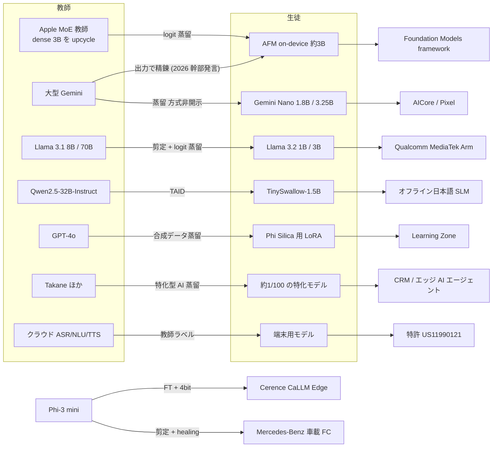
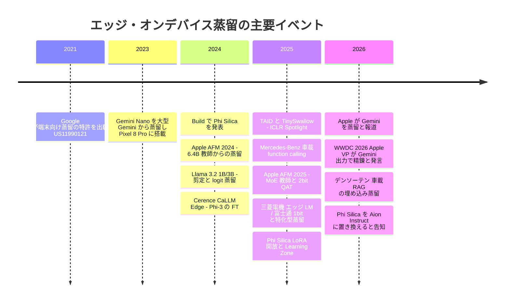

# C6 エッジ・オンデバイス（`edge_ondevice`）— 詳細レポート

## Parameters

- **Resources analyzed**: 11（端末・用途の異なる代表事例 10 件 ＋ 2026-10-22 追記の特許レポート 1 件）
- **Resource types**: 学術論文 4 / 特許 2（10: Google 親子特許＋関連 4 件、11: Samsung / Huawei / Qualcomm / Xiaomi の 7 件） / 技術情報 2 / ビジネス事例 3
- **Generated on**: 2026-10-21（2026-10-22 に検証・追記: Apple 幹部発言の確認、特許 7 件の追加、Turing の追記、富士通リリース再取得の失敗記録、図版の重複整理）
- **Input source**: gather 出力 [resources-edge-ondevice.md](../../../gather/20261021/edge_ondevice/resources-edge-ondevice.md)
- **選定基準**: (1) 端末の種類（スマートフォン / PC / 車載 / 組込み）を網羅する、(2) 蒸留の有無が一次資料で判定できる、(3) 国内事例を含める、(4) 「蒸留」と「fine-tuning・量子化」を区別する比較対象を含める

## Report List

### Academic Papers

| # | Title | Year | Venue | Summary | Report |
|---|-------|------|-------|---------|--------|
| 1 | Apple Intelligence Foundation Language Models: Tech Report 2025 | 2025 | arXiv（Apple） | 約 3B の端末内モデル。MoE 教師からの logit 蒸留、2bit QAT、KV キャッシュ共有。2024 年版との比較を含む | [Details](01-apple-foundation-models-2025.md) |
| 3 | Gemini: A Family of Highly Capable Multimodal Models（Nano 部分） | 2023 | arXiv（Google） | Nano-1 1.8B / Nano-2 3.25B を大型 Gemini から蒸留し 4bit 量子化。Pixel 8 Pro と AICore | [Details](03-gemini-nano.md) |
| 6 | TAID: Temporally Adaptive Interpolated Distillation（＋ TinySwallow-1.5B） | 2025 | ICLR 2025 Spotlight（Sakana AI） | 補間分布による蒸留。Qwen2.5-32B → 1.5B の日本語 SLM がスマートフォンでオフライン動作 | [Details](06-taid-tinyswallow.md) |
| 7 | Optimizing Small Language Models for In-Vehicle Function-Calling | 2025 | arXiv（Mercedes-Benz） | Phi-3 mini を剪定 + healing + 4bit 量子化。車載 CPU で 11 tok/s。healing は蒸留ではない | [Details](07-mercedes-in-vehicle-function-calling.md) |

### Patents

| # | Title | Patent No. | Assignee | Year | Report |
|---|-------|-----------|----------|------|--------|
| 10 | Distilling to a target device based on observed query patterns | US11990121B2 / US12380879B2 | Google LLC | 2021 出願（2024 / 2025 登録） | [Details](10-google-patent-distilling-to-target-device.md) |
| 11 | 端末向け LLM 蒸留の関連特許（2026-10-22 追記）: Large language model compression ほか 7 件 | WO2025258795A1, US20250273084A1（Samsung）/ CN121327497A, WO2025123815A1, US12182507B2（Huawei）/ US20250225374A1（Qualcomm）/ CN120496494A（Xiaomi） | Samsung / Huawei / Qualcomm / Xiaomi | 2019–2025 出願（公開 2025–2026、US12182507B2 のみ 2024 登録） | [Details](11-ondevice-llm-distillation-patents-samsung-huawei-qualcomm-xiaomi.md) |

### Technical Articles

| # | Title | Source | Date | Report |
|---|-------|--------|------|--------|
| 4 | Phi Silica（Copilot+ PC NPU）と Learning Zone の LoRA 蒸留 | Microsoft | 2024-05 〜 2026-10 | [Details](04-phi-silica.md) |
| 5 | Llama 3.2 1B/3B 軽量モデルと量子化版 | Meta | 2024-09 / 2024-10 | [Details](05-llama-3-2-edge.md) |

### Business Cases

| # | Title | Company | Date | Report |
|---|-------|---------|------|--------|
| 2 | Apple による Google Gemini 蒸留報道とオンデバイス AI 戦略 | Apple / Google | 2026-03 〜 2026-06 | [Details](02-apple-gemini-distillation-reports.md) |
| 8 | Cerence CaLLM Edge（＋国内車載: デンソーテン / PLaMo Lite） | Cerence ほか | 2024-11 〜 2026-06 | [Details](08-cerence-callm-edge.md) |
| 9 | 富士通「生成AI再構成技術」（1bit 量子化 × 特化型 AI 蒸留）と三菱電機の比較 | 富士通 / 三菱電機 | 2025-06 〜 2025-12 | [Details](09-fujitsu-takane-quantization-distillation.md) |

## Cross-Resource Insights

### 教師 → 生徒 → 端末 → 事業の関係

> 実線は一次資料（論文・公式ブログ・特許）またはベンダー申告（幹部の公開発言を含む）で確認できた関係です。下段の 2 件（Cerence / Mercedes-Benz）は **蒸留ではなく** fine-tuning・剪定・量子化です。（2026-10-22 訂正）「大型 Gemini → AFM on-device」の辺は、旧版では「2026 報道のみ」の点線でしたが、WWDC 2026 で Apple の AI 担当 VP が "refined using outputs from Gemini frontier models" と発言したと報じられた（MacRumors 2026-06-09）ため、ベンダー申告として実線に改めました。ただし対象は第 3 世代（AFM 3 Core / Core Advanced）で、2025 年版 3B モデルの教師は内製 MoE のままです。

### 共通テーマ

- **2 層構造が成り立っている**: 基盤モデル企業（Apple / Google / Meta / Microsoft / Sakana AI / 富士通）が **自社の大モデルを教師に蒸留** して小型モデルを作り、端末・車載メーカー（Cerence / Mercedes-Benz / 三菱電機）は **その小型モデルを fine-tuning・剪定・量子化** して自社機器に載せます。10 件のうち、真の蒸留が一次資料で確認できたのは 7 件（01, 03, 04 の LoRA 部分, 05, 06, 10、09 は二次報道 3 媒体）で、08 と 07 は蒸留ではありませんでした。（2026-10-22 追記）02 は幹部発言（ベンダー申告）で「Gemini 出力による精錬」が確認でき、11 の特許 7 件はすべて明細書で教師→生徒の蒸留を記述しています。
- **蒸留は量子化と必ずセット**: 端末で動く例はすべて 4bit 以下に量子化しています（Nano 4bit、Phi Silica 4bit、CaLLM Edge 4bit、Mercedes 4bit、Apple 2bit QAT、富士通 1bit）。蒸留は「品質を保つ工程」、量子化は「メモリに収める工程」という分担です。
- **教師の選び方が事業上の論点**: 自社の教師（Apple MoE、大型 Gemini、Llama 3.1、Takane）を使う例が中心です。他社の教師を使う例は、Learning Zone（GPT-4o）と Apple×Gemini です。Apple×Gemini は **契約で教師へのアクセス権を得る** 形で、利用規約の蒸留禁止（H5）を契約で乗り越える事例です。Apple の公式文書は「Google と協力して構築」と述べるだけで「蒸留」という語は使っていませんが、（2026-10-22 追記）WWDC 2026 の記者向けトークで AI 担当 VP が端末モデルを含む 4 モデルを "refined using outputs from Gemini frontier models" と説明したと報じられており（MacRumors）、**教師出力を使った精錬（黒箱蒸留相当）は幹部発言で確認できます**。自社 DC 内での白箱アクセスや契約条件は引き続き The Information の匿名情報源のみです。
- **事業成果は機能・開発者向け API で語られ、売上やコストの KPI は出ない**: 定量値は性能（tok/s、メモリ、ベンチマーク）までです。事業 KPI として出ているのは、Learning Zone の「拒否率 75% 減・選好 4.6 倍」と、富士通の CRM 検証「推論 11 倍・精度 43% 改善・GPU メモリと運用コスト 70% 削減」くらいです（いずれもベンダー申告）。
- **国内は「量子化・領域特化学習」が中心で、蒸留を明記する例は少ない**: 富士通（特化型 AI 蒸留）、Sakana AI（TAID）、デンソーテン（埋め込みモデルの蒸留。LLM 本体ではない）が蒸留を明記しています。三菱電機・シャープ・PLaMo Lite（生成データでの事前学習。PFN は「蒸留」と呼んでいない）は蒸留とは書いていません。（2026-10-22 追記）Turing の Heron-NVILA（自動運転向け VLM、2B を iOS アプリに搭載予定）も「GPT-4o の出力を SFT に使用」と書くのみで蒸留とは呼んでおらず、トヨタ・デンソー・ティアフォー・ソニー・パナソニック・ルネサスについては、蒸留を明記した発表を本追記の検索でも確認できませんでした（08 参照）。

### 時系列

## Comparison Table

| # | 事例 | 端末 | 生徒の規模 | 教師 | 蒸留の種類 | 他の圧縮 | 主な数値 | 蒸留の判定 | 証拠の質 |
|---|------|------|-----------|------|-----------|---------|---------|-----------|---------|
| 1 | Apple AFM 2025 | iPhone / Mac | 約 3B | 社内 MoE（dense 3B を 64 エキスパートに upcycle） | logit 蒸留（最後の約 10%、約 1.4T トークン） | 2bit QAT、KV キャッシュ共有、LoRA 回復 | 教師の学習コスト 90% 減。KV メモリと TTFT 約 37.5% 減。2bit QAT で MMLU 67.8 → 64.4 | 真の蒸留 | 一次資料（ベンダー技術報告） |
| 2 | Apple × Gemini（報道＋幹部発言） | iPhone 等 | AFM 3 Core 3B 密 / Core Advanced 20B スパース（1〜4B 活性） | Gemini frontier models（幹部発言） | 教師出力による精錬（幹部発言）。回答 + 推論過程の蒸留・白箱アクセスは報道のみ | QAT、Instruction-Following Pruning（公式） | Gemini 利用料 年約 10 億ドル（Bloomberg 経由）。AFM 3 Core は前世代比 SxS 選好 45.6% 対 23.3%（公式、蒸留効果は分離されていない） | 出力ベース蒸留に相当（2026-10-22 訂正: 旧「未確認」） | ベンダー申告（幹部発言の報道）＋二次報道（契約条件・白箱アクセス） |
| 3 | Gemini Nano | Pixel / Android | 1.8B / 3.25B | 大型 Gemini | 方式非開示 | 4bit 量子化、タスク別 FT | Pro 比 Factuality 0.71 / 0.81、MBPP 0.33 / 0.45 | 真の蒸留 | 一次資料 |
| 4 | Phi Silica | Copilot+ PC NPU | 3.3B（報道） | 本体は Phi-3.5-mini 派生、LoRA は GPT-4o | 合成データ蒸留（LoRA 部分のみ） | QuaRot 4bit、投機的デコード | 初トークン 230ms、最大 20 tok/s、メモリ約 60% 減。拒否率 75% 減、選好 4.6 倍 | 本体は非蒸留、LoRA は蒸留 | ベンダー申告 |
| 5 | Llama 3.2 1B/3B | モバイル SoC | 1B / 3B | Llama 3.1 8B / 70B | 事前学習での logit 蒸留（剪定で初期化） | QAT+LoRA、SpinQuant | 教師 logit 生成 86k H100 時間（全体の約 10%）。1B SpinQuant デコード 19.2 → 50.2 tok/s | 真の蒸留 | 一次資料 + ベンダー申告 |
| 6 | TAID / TinySwallow | スマートフォン / ブラウザ | 1.5B | Qwen2.5-32B-Instruct | 補間分布への KL 最小化 | GGUF / WebGPU 量子化 | 日本語平均 0.402（Qwen2.5-1.5B は 0.372）。iPhone Q5 で 19.89 tok/s | 真の蒸留 | 一次資料（査読済み） + ベンダー申告 |
| 7 | Mercedes-Benz | 車載 CPU | 1.8B / 2.8B | なし | なし（healing は次トークン予測の継続学習） | 構造化剪定、4bit | 11.02 tok/s、RAM 2GB 未満、完全一致精度 0.84–0.88（量産システム 0.75） | 非蒸留 | 一次資料 |
| 8 | Cerence CaLLM Edge | 車載ヘッドユニット | 3.8B | なし | なし（Phi-3 の FT） | 4bit | 効果の数値は非開示 | 非蒸留 | ベンダー申告 |
| 9 | 富士通 Takane | スマートフォン / 工場機械 | 教師の約 1/100 | Takane ほか | 剪定 + NAS で選んだ生徒への特化型蒸留 | 1bit 量子化（QEP） | 推論 11 倍、精度 43% 改善、コスト 70% 減。1bit でメモリ最大 94% 減、精度維持率 89% | 真の蒸留（二次報道ベース） | ベンダー申告（二次報道経由） |
| 10 | Google 特許 | クライアント端末 | 端末制約に応じて選択 | クラウドの ASR/NLU/TTS | 教師ラベルによる学習 | — | 教師との精度差 1% 以内でデプロイ（実施例） | 真の蒸留 | 一次資料（特許） |
| 11 | Samsung / Huawei / Qualcomm / Xiaomi 特許（追記） | スマートフォン・車載・組込み | 公報ごとに異なる（SLM、draft モデル、軽量 TTS） | LLM / target LLM / 大型 TTS | 白箱（特徴・重み）、系列レベル、TVD 損失、教師生成音声 | — | 数値主張なし（特許） | 真の蒸留（7 件とも明細書で記述。Xiaomi はクレーム 1 非限定） | 一次資料（特許） |

### 蒸留 / fine-tuning / 量子化 / 剪定の切り分け（2026-10-22 追記）

各事例で「誰が・どの工程を」行ったかを分けた一覧です。○ = 一次資料またはベンダー申告で確認、△ = 蒸留に相当する構造だが当事者は「蒸留」と呼んでいない、— = 記述なし。

| 事例（レポート） | 蒸留（種別） | fine-tuning / 継続学習 | 量子化 | 剪定 | 蒸留を行った主体 |
|---|---|---|---|---|---|
| Apple AFM 2025（01） | ○ logit 蒸留（内製 MoE 教師） | ○ SFT / RLHF、品質回復 LoRA | ○ 2bit QAT | ○ 2024 版のみ（構造プルーニング） | Apple |
| Apple × Gemini / AFM 3（02） | ○ 教師出力による精錬（幹部発言。方式の詳細は報道） | ○ RL（公式） | ○ QAT（公式） | ○ Instruction-Following Pruning（Core Advanced） | Apple（教師は Google） |
| Gemini Nano（03） | ○ 方式非開示（大型 Gemini） | ○ タスク別 FT | ○ 4bit | — | Google |
| Phi Silica 本体（04） | — | — | ○ QuaRot + GPTQ 4bit | — | （Microsoft、蒸留なし） |
| Learning Zone LoRA（04） | ○ 合成データ（GPT-4o 教師） | ○ LoRA（約 1%） | ○ 量子化済み本体に適用 | — | Microsoft |
| Llama 3.2 1B/3B（05） | ○ logit 蒸留（Llama 3.1 8B/70B） | ○ SFT / RS / DPO | ○ QAT+LoRA、SpinQuant | ○ 8B からの構造化剪定 | Meta |
| TAID / TinySwallow（06） | ○ 補間分布への KL（Qwen2.5-32B） | ○ 日本語継続事前学習、SFT | ○ GGUF Q5/Q8、MLC q4 | — | Sakana AI |
| Mercedes-Benz（07） | —（healing は次トークン予測）。FC データは LLM 生成（△） | ○ healing、SFT、LoRA / FFT | ○ 4bit gguf | ○ 深さ + 幅 | （蒸留なし） |
| Cerence CaLLM Edge（08） | — | ○ 自動車データで FT | ○ 4bit | — | （蒸留なし。Phi-3 側の合成データは Microsoft） |
| デンソーテン 車載 RAG（08） | ○ 埋め込みモデルの蒸留（LLM 本体ではない） | — | — | — | デンソーテン |
| PFN PLaMo Lite（08） | △ PLaMo-100B 生成データで事前学習 | — | ○ w4a16（Qualcomm AI Hub） | — | PFN |
| Turing Heron-NVILA（08 追記） | △ GPT-4o 出力で SFT | ○ SFT | —（記述なし） | — | Turing |
| 富士通 Takane（09） | ○ 特化型 AI 蒸留（Takane 教師、二次報道） | — | ○ 1bit（QEP+QQA） | ○ Pruning + NAS | 富士通 |
| 三菱電機（09） | — | ○ ドメイン特化学習 + タスク特化学習 | ○ 量子化等 | — | （蒸留なし） |
| Google 特許（10） | ○ 教師ラベル蒸留 | — | — | — | Google（クレーム） |
| Samsung / Huawei / Qualcomm / Xiaomi 特許（11） | ○ 白箱 / 系列レベル / TVD / 教師生成音声 | — | — | — | 各社（クレーム・明細書） |

### 仮説との照合

| 仮説 | 本クラスタでの判定 | 根拠 |
|------|------------------|------|
| H1 定量成果のある本番事例は検索・推薦に集中 | **おおむね支持** | エッジでは性能値（tok/s・メモリ）は豊富ですが、事業 KPI はほぼ非公開です（例外は Learning Zone と富士通、いずれもベンダー申告） |
| H2 ベンダーの数値は集計値で、顧客別の成果は非公開 | **支持** | Cerence・Qualcomm・Apple の framework 事例は顧客名だけで、成果の数値は出ていません |
| H3 「SLM 事例」の多くは蒸留ではなく fine-tuning | **強く支持** | Cerence（FT + 4bit）、Mercedes（剪定 + 継続学習）、三菱電機（領域学習 + 量子化）、シャープ（振り分けの仕組み） |
| H4 国内は公開モデル型が中心 | **部分的に反証** | 富士通・三菱電機・デンソーテンなど事業会社の発表が 2025–2026 年に増えています。ただし大半は量産前で、蒸留を明記するのは富士通とデンソーテン（埋め込み）だけです。（2026-10-22 追記）Turing・PFN は公開モデル型で、教師 LLM の生成データを使うが「蒸留」とは呼んでいません |
| H5 商用 API を教師にする蒸留は規約で制約され、教師の選択が論点 | **支持（新しい形を確認）** | 大半が自社教師です。Apple×Gemini は契約で権利を得る形で、（2026-10-22 訂正）「Gemini 出力で精錬」は Apple 幹部の公開発言で確認できました（契約条件・白箱アクセスは報道のみ）。Learning Zone は GPT-4o を教師にしています（Microsoft と OpenAI の関係の中での事例） |
| H6 推論蒸留で Agent・tool calling 用途が増加 | **部分的に支持** | 車載の function calling（Mercedes）、Octopus v2、TinyAgent、富士通の「エッジ AI エージェント」が該当します。ただし Mercedes は蒸留ではありません |

### 蒸留のビジネス価値式との対応

$$
\text{価値} \approx \underbrace{(C_{\text{teacher}} - C_{\text{student}}) \cdot Q}_{\text{推論コスト削減}} - \underbrace{(C_{\text{data}} + C_{\text{train}})}_{\text{初期投資}} - \underbrace{\Delta\text{Acc} \cdot V_{\text{err}}}_{\text{精度低下の損失}}
$$

- **エッジでは第 1 項の意味が変わります**: 端末上の推論コスト $C_{\text{student}}$ は提供者から見るとほぼ 0 です（電力は利用者の負担）。そのため $(C_{\text{teacher}} - 0) \cdot Q$ が **クラウドの推論費用・データセンター投資の回避額** になります。Apple の capex 127.2 億ドル（Meta 720 億、Microsoft 880 億）との対比（02、二次報道）は、この項を事業戦略として示したものです。
- **初期投資の項は公開例があります**: Llama 3.2 の教師 logit 生成 86k H100 時間（05）、Apple の教師学習コスト 90% 減（01）。
- **精度低下の項はベンチマークでのみ示されます**: Nano の Pro 比（03）、2bit QAT の MMLU −3.4 ポイント（01）。$V_{\text{err}}$（誤り 1 件あたりの損失）を示した資料はありません。

## Further Investigation Candidates

| 候補 | 理由 | 出所 |
|------|------|------|
| Apple Foundation Models 2026（AFM 3）の技術報告 | 「Google と協力して構築」の中身（蒸留の方式）を確認するため。2026-10-22 の再確認でも Apple ML Research に未掲載 | 02 |
| The Information の原記事（2026-03-25 / 2026-05-28）と 9to5Mac の WWDC 2026 記者向けトーク記事 | Gemini 蒸留報道の一次情報（有料）と、幹部発言 "refined using outputs from Gemini frontier models" の原報道（MacRumors が引用元として明示） | 02 |
| Turing Heron-NVILA の学習詳細（GPT-4o 出力 SFT の規模、2B の iOS アプリでの量子化） | 国内車載系で教師 LLM の生成データを使う例。蒸留と呼ぶかの判定材料 | 08 |
| Apple / トヨタ / デンソー / ソニー / ルネサスの端末向け言語モデル蒸留特許 | Google Patents の出願人別照会では該当なし（2 回目は HTTP 503）。J-PlatPat と USPTO での再照会が必要 | 11 |
| デンソーテン NLP2026 発表「Matryoshka表現学習を考慮した埋め込みモデル蒸留」 | 国内車載で真の蒸留を明記した唯一の例 | 08 |
| Microsoft Aion Instruct | Phi Silica の後継。学習方法が未公開 | 04 |
| FujitsuResearch/qep（GitHub）と特化型 AI 蒸留の論文 | 蒸留の損失関数が未公開のため | 09 |
| Gemma 3n / 次世代 Gemini Nano の技術報告 | MatFormer（入れ子学習）と蒸留の関係を確認するため | 03 |
| Qualcomm の下書きモデル蒸留（arXiv 2403.00858） | 端末上の投機的デコードのための蒸留 | gather |
| BlueLM-V-3B（vivo）、Samsung Gauss2 Compact | 端末メーカーの自社モデルで蒸留を使っているかを確認するため | gather |
| J-PlatPat での国内特許（知識蒸留 × 端末 / 車載） | 本 run では検索上限で未実施。2026-10-22 追記で海外 7 件は補ったが国内 0 件のまま | gather, 11 |
