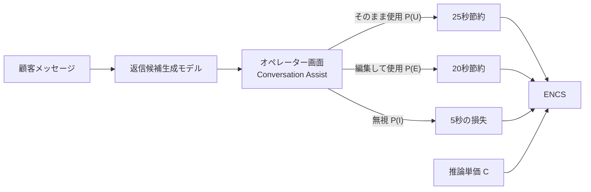
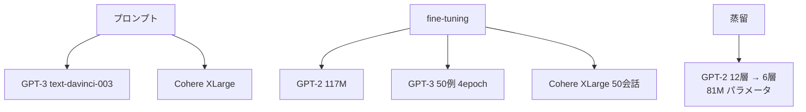

# The economic trade-offs of large language models: A case study

- **Link**: https://arxiv.org/abs/2306.07402v1 （HTML 版 https://arxiv.org/html/2306.07402v1 を取得して作成）
- **Authors**: Kristen Howell, Leanne Rolston, Jadin Tredup, Ilana Zimmerman, Ethan Selfridge, Joseph Bradley, Gwen Christian, Pavel Fomitchov, Gitit Kehat, Julianne Marzulla（全員 LivePerson Inc.）
- **Year**: 2023（arXiv 2023-06-08 投稿）
- **Venue**: ACL 2023 Industry Track（arXiv 版にはライセンス CC BY-SA 4.0 の記載）
- **Type**: Academic Paper（企業論文 = ビジネス事例の一次資料）
- **用途**: カスタマーサポート（agent-assist: 人間オペレーターへの返信候補の提示）
- **手法タグ**: `蒸留`（ただし教師は GPT-2 系で、GPT-3 級の LLM から小型モデルへの蒸留ではない）
- **証拠タグ**: `一次`（企業論文、ブランド名は匿名）
- **（2026-10-22 再検証）** HTML 版を再取得。年間 ENCS（蒸留 GPT-2 53,653 ドル / GPT-3 pe 50,920 ドル / GPT-3 bft −18,691 ドル、Table 4）、使用率（57% / 69%、Table 2。GPT-3 bft の 62.5% は perplexity からの外挿）、A100 で 12ms・0.0011 セント（Table 8。脚注は 11.60ms）、構築費 50,100 ドル・損益分岐 0.24 か月（Tables 10–11）を確認。本レポートの数値と一致

## Abstract

> 原文の逐語転載は取得ツールの制約で行えないため、要旨を示します。

企業のカスタマーサービスチャットで、LLM が人間オペレーター向けの返信候補を自動生成する場面を対象に、LLM の実際のコストと効果を評価する。NLP モデルの価値を判断するためのコスト枠組み（Expected Net Cost Savings: ENCS）を提示し、匿名の 1 ブランド（Anonymous Retailer, AR）に適用する。プロンプトエンジニアリング、fine-tuning、知識蒸留の 3 方式を、AR のオペレーターの評価を用いて比較する。結論として、このブランドでは **応答の使用率（usability）が推論コストの大きな差を埋め合わせ得る** ことを示し、企業全般へ外挿する。

## Abstract (Japanese Translation)

上記要旨のとおり。著者らは「推論単価が安いモデルが最も得」とは限らず、オペレーターが実際に使う応答の割合こそが純節約額を決めることを、具体的な金額で示しています。

## Overview

本論文は、**蒸留の経済性を「推論単価」ではなく「業務成果（オペレーターの作業時間削減）」で測った、数少ない企業の一次資料** です。ポイントは次の 3 つです。

1. **ENCS 式**: 応答が「そのまま使われる / 編集される / 無視される」確率と、それぞれの時間節約額から、1 メッセージあたりの期待純節約額を出す。
2. **蒸留 GPT-2 は最安**: A100 で 12ms・0.0011 セント/推論。GPT-3（text-davinci-003）の約 1/1000 の単価。
3. **しかし年間の差は小さい**: GPT-3 プロンプト版の使用率 69% に対し蒸留 GPT-2 は 57%。年間 ENCS は 50,920 ドル vs 53,653 ドルで、差は約 3,000 ドルにとどまる。一方、**GPT-3 を fine-tuning した版は推論単価が高すぎて年間 −18,691 ドル（赤字）** と推計。

## Problem

- **使用率とコストのトレードオフが不明**: 大きなモデルほど応答は良いが単価が高い。どちらが得かを判断する枠組みが無い。
- **評価指標と業務価値のずれ**: perplexity などの自動指標が、オペレーターの採用率とどう関係するか分からない。
- **ブランド規模の違い**: 月 15,000 会話の中規模ブランドと、平均 34,000・中央値 900 会話のブランドでは最適解が違う。
- **R&D・保守費の扱い**: 自前でモデルを作る費用と、サードパーティ API の費用をどう比べるか。

## Proposed Method

**ENCS（Expected Net Cost Savings）枠組み**

- 基本形と完全形の 2 式で 1 応答あたりの期待純節約額を出す。
- 応答ごとの節約額はオペレーターの時給と時間差から出す。
- R&D 費の回収に必要な提示件数（損益分岐）も出す。

**Key Formulas**:

$$
\text{ENCS} = P(U)\cdot S_U - C \tag{1}
$$

$$
\text{ENCS} = P(U)\cdot S_U + P(E)\cdot S_E + P(I)\cdot S_I - C \tag{2}
$$

$$
S_x = R \cdot (T_r - T_x) \tag{3}
$$

$$
N_r = \frac{C_{R\&D}}{\text{ENCS} - C_m} \tag{4}
$$

$$
PP(W) = \sqrt[N]{\frac{1}{P(w_1, w_2, \dots, w_N)}} \tag{5}
$$

| 記号 | 意味 |
|------|------|
| $P(U), P(E), P(I)$ | 応答がそのまま使われる / 編集される / 無視される確率 |
| $S_U, S_E, S_I$ | 各結果での節約額（$S_I$ は通常マイナス） |
| $C$ | 応答 1 件の生成コスト |
| $R$ | オペレーターの時給 |
| $T_r$ | アシスタント無しで返信する平均時間 |
| $T_x$ | 採用 / 編集 / 無視の各場合にかかる時間 |
| $C_{R\&D}$ | 研究開発費 |
| $C_m$ | 1 メッセージあたりの保守費（期間平均） |
| $N_r$ | 損益分岐に必要なアシスト件数 |

**AR に置いた前提値**

- 時給 10.00 ドル、アシスタント無しの返信時間 平均 30 秒
- 採用 1 件で 25 秒、編集 1 件で 20 秒の節約。無視 1 件で 5 秒の追加

**ドメイン index の価値式との対応**:

$$
\underbrace{(C_{\text{teacher}} - C_{\text{student}}) \cdot Q}_{\text{本論文では } C \text{ の差}} - \underbrace{(C_{\text{data}} + C_{\text{train}})}_{C_{R\&D}} - \underbrace{\Delta\text{Acc} \cdot V_{\text{err}}}_{P(U) \text{ の低下}\times S_U}
$$

本論文は **3 項すべてを金額で報告している点で、C5 で最も完全な一次資料** です。

## Algorithm (Pseudocode)

```
Algorithm: ENCS によるモデル選択
Input : 候補モデル集合 M、ブランドの年間メッセージ数 Q、時給 R、時間パラメータ T
Output: 年間 ENCS が最大のモデル
1. for m in M:
2.     人手評価（9 人 × 5 注釈/応答）で P(U), P(E), P(I) を推定   // 3 モデルのみ実測
3.     評価が無いモデルは perplexity からの線形回帰で外挿           // 式 (5) と図 8
4.     S_U, S_E, S_I を式 (3) で計算
5.     C = 推論単価（GPU 時間単価 or API 単価）
6.     ENCS_m = 式 (2)
7.     年間値 = ENCS_m × Q
8. return argmax 年間値（必要なら式 (4) で R&D 回収期間を確認）
```

## Architecture / Process Flow



**比較した 3 方式**



## Figures & Tables

> 図版画像は取得していません（HTML 版の画像 URL を確認できなかったため）。以下は本文の表をすべて Markdown で再現し、図はキャプションと再構成図で示します。

### 実験設定

| 項目 | 値 |
|------|----|
| ブランド | AR（約 350 人のオペレーター、月 約 15,000 会話・約 100,000 オペレーターメッセージ） |
| プラットフォーム平均 | 月 34,000 会話（中央値 900） |
| ブランド学習データ | 100,059 会話（2022 年） |
| テストデータ | 287 会話 |
| 汎用学習データ | 類似小売 5 ブランドの 236,769 会話（表 5 では 234,769 と不一致） |
| 蒸留設定 | Hugging Face の方式、学習率 0.0005、最大 3 epoch、生徒 6 層 81M |
| 構成数 | 11（うち人手評価 3、残りは perplexity から外挿） |
| 評価者 | オペレーター 9 人、1 応答あたり 5 注釈 |

### Table 2: 応答の使用率（人手評価）

| Model | % Ignore | % Edit | % Use |
|---|---|---|---|
| Human（元のオペレーター返信） | 10 | 12 | 77 |
| GPT-2 bft bd（蒸留） | 28 | 16 | 57 |
| Cohere pe | 22 | 20 | 58 |
| GPT-3 pe | 17 | 14 | 69 |

（bft = ブランドデータで fine-tuning、gft = 汎用データで fine-tuning、bd / gd = ブランド / 汎用データで蒸留、pe = プロンプト）

### Table 3: perplexity と外挿した使用率

| Model | PPL | % Ignore | % Edit | % Use |
|---|---|---|---|---|
| GPT-2 bft | 4.27 | 20.8 | 16.8 | 62.4 |
| GPT-2 bft bd bft | 4.50 | 21.0 | 16.9 | 62.1 |
| GPT-2 gft bd bft | 4.05 | 20.7 | 16.7 | 62.6 |
| GPT-2 gft gd bft | 4.15 | 20.7 | 16.8 | 62.5 |
| GPT-2 | 7.08 | 22.7 | 17.8 | 59.5 |
| GPT-2 XL gft gd bft | 5.31 | 21.5 | 17.2 | 61.3 |
| Cohere ft | 1.93 | 19.3 | 16.0 | 64.7 |
| GPT-3 bft | 4.14 | 20.7 | 16.8 | 62.5 |

### Table 4: 1 メッセージあたり・年間の ENCS（AR: 年 1,200,000 オペレーターメッセージ）

| Model | ENCS/message | ENCS/year |
|---|---|---|
| GPT-2 bft bd | ¢4.47 | $53,653 |
| Cohere pe | ¢4.58 | $55,000 |
| GPT-3 pe | ¢4.24 | $50,920 |
| GPT-2 bft | ¢4.97 | $59,687 |
| GPT-2 bft bf bft | ¢4.96 | $59,527 |
| GPT-2 gft bd bft | ¢4.99 | $59,851 |
| GPT-2 gft gd bft | ¢4.98 | $59,786 |
| GPT-2 | ¢4.81 | $57,668 |
| GPT-2 XL gft gd bft | ¢4.90 | $58,802 |
| Cohere ft | ¢4.62 | $55,391 |
| GPT-3 bft | −¢1.56 | −$18,691 |

上 3 行は実測の使用率、それ以外は外挿値です。

```
年間 ENCS（千ドル）
GPT-2 gft bd bft |████████████████████████████████████████ 59.9
GPT-2 bft        |████████████████████████████████████████ 59.7
GPT-2            |██████████████████████████████████████ 57.7
Cohere pe        |█████████████████████████████████████ 55.0
GPT-2 bft bd     |████████████████████████████████████ 53.7
GPT-3 pe         |██████████████████████████████████ 50.9
GPT-3 bft        |▼ -18.7（赤字）
```

### Table 6: 使用率と Foundation Metrics の Pearson 相関

| Label | Sensible | Specific | Informative | Helpful | Safe | Role-consistent |
|---|---|---|---|---|---|---|
| Use | 0.44 | 0.29 | 0.14 | 0.14 | 0.02 | 0.37 |
| Edit | −0.15 | −0.07 | 0.00 | −0.02 | 0.01 | −0.09 |
| Ignore | −0.45 | −0.31 | −0.18 | −0.17 | −0.04 | −0.40 |

### Table 7: 評価者間一致（Fleiss' Kappa）

| Group | Kappa |
|---|---|
| All models | 0.1744 |
| Human | 0.1562 |
| Distilled GPT-2 | 0.2104 |
| GPT-3 | 0.1411 |
| Cohere | 0.1101 |

### Table 8: 推論性能とコスト

| Model | GPU | Latency (ms) | Throughput (infer/s) | Cost/inference (¢) |
|---|---|---|---|---|
| GPT-2-XL | V100 | 620 | 16 | 0.0468 |
| GPT-2 | V100 | 47 | 211 | 0.0036 |
| GPT-2 distilled | V100 | 25 | 398 | 0.0019 |
| GPT-2-XL | A100 | 128 | 78 | 0.0126 |
| GPT-2 | A100 | 20 | 510 | 0.0019 |
| GPT-2 distilled | A100 | 12 | 859 | 0.0011 |

GPU 単価: V100 2.72 ドル/時、A100 3.53 ドル/時（GCP、1 日 8 時間稼働の前提）。

### ENCS で使った応答 1 件あたりの生成コスト

| モデル | 単価（セント） | 蒸留 GPT-2 比 |
|------|--------------|-------------|
| GPT-2 | 0.002 | 1.8 倍 |
| 蒸留 GPT-2 | 0.0011 | 1 |
| OpenAI base | 1.09 | 約 991 倍 |
| OpenAI fine-tuned | 6.54 | 約 5,945 倍 |
| Cohere base | 0.25 | 約 227 倍 |
| Cohere fine-tuned | 0.50 | 約 455 倍 |

### Table 9（付録 K、仮想的な大規模ブランド）

| 項目 | 値 |
|------|----|
| 月間メッセージ | 7,500,000（うちオペレーター 3,750,000）、オペレーター 500 人 |
| 人件費 | 月 866,667 ドル |
| LLM 利用時のメッセージ単価 | 0.03 ドル（自社）/ 0.04 ドル（サードパーティ） |
| 作業時間削減 | 68% |
| メッセージ単価削減 | 66%（自社）/ 56%（サードパーティ） |

### Table 10 / 11: R&D 費と損益分岐

| 項目 | 自社モデル | サードパーティ |
|------|----------|--------------|
| 構築費 | 50,100 ドル | – |
| 年間保守 | 50,100 ドル | – |
| 月次 R&D 費（3 年償却） | 5,567 ドル | – |
| 損益分岐のアシスト件数 | 905,313 | 1,078,347 |
| 損益分岐までの期間 | 0.24 か月 | 0.29 か月 |

### 図の一覧（キャプションの要約）

| 図 | 内容 |
|----|------|
| Fig. 1 | Conversation Assist: 定型文の提示（左）と LLM 生成の候補（右） |
| Fig. 2 | ENCS 計算の簡単な例 |
| Fig. 3 | Cohere と GPT-3 に使ったプロンプト |
| Fig. 4 | 損益分岐に影響する要因 |
| Fig. 5 | Foundation Metrics の判定フローチャート |
| Fig. 6 | Foundation Metric ごとのモデル別ラベル件数 |
| Fig. 7 | 一致度の高いタスクでの平均応答長 |
| Fig. 8 | perplexity に対する P(use)・P(ignore)・P(edit) の線形当てはめ |
| Fig. 9 | perplexity に対する Sensible 等の線形当てはめ |

## Experiments & Evaluation

### Setup

- 実測は 3 モデル（蒸留 GPT-2、Cohere pe、GPT-3 pe）。他の 8 構成は perplexity からの外挿。
- 評価: オペレーター 9 人が 287 会話の応答を「使う / 編集 / 無視」とラベル付け。

### Main Results

- **蒸留の速度・単価**: 蒸留 GPT-2 は元の GPT-2 より約 1.7 倍速く、GPT-2 XL より約 25 倍安い（V100 での単価比）。
- **使用率**: GPT-3 pe 69% > Cohere pe 58% > 蒸留 GPT-2 57%。人間の返信でも 77%。
- **年間 ENCS**: 実測 3 モデルの差は約 2,700〜4,100 ドル。単価が約 1000 倍違っても、純節約額の差は小さい。
- **fine-tuned GPT-3 は赤字**: 推論単価 6.54 セントが節約額を上回り年間 −18,691 ドル。

### Ablation / 分析

- perplexity が低いほど使用率が高い傾向（プール 861 件の線形回帰は有意、個別モデルは非有意）。
- 小規模ブランドでは R&D 費の低さ、大規模ブランドでは推論単価が効く。

## 業務上の示唆（C5 の観点）

| 観点 | 本論文からの示唆 |
|------|----------------|
| 蒸留が勝つ条件 | 大量メッセージ・低遅延が必要・API 単価が高い（fine-tuned API）場合 |
| 蒸留が負ける条件 | 使用率が数ポイント下がると、単価の安さが相殺される |
| 評価指標 | 自動指標ではなく、業務での採用率（P(U)）を計測すべき |
| H3 との関係 | 本論文の「蒸留」は教師モデル（GPT-2 12 層）からの層削減型で、**LLM の出力を学ぶ黒箱蒸留ではない**。「LLM 蒸留の事例」として引用する際は注意 |

## Lessons Learned / Limitations

- 評価者は 9 人のみで、経験や訓練の情報が無い。報酬も無い（実運用では処理時間の指標で採用率が上がる可能性）。
- 線形モデルは 3 モデル・287 会話から作った小規模パイロットで、個別の当てはめは有意でない。
- ENCS は労務最適化・R&D 費の多くを含まず、不適切・誤った応答のコストもモデル化していない。
- 評価者は事実の正しさ（groundedness）を確認しておらず、AR の基幹システムとも未接続。
- オペレーターの注意は時間と共に低下し得るため、節約額には上限がある。
- 評価者間一致は低い（Fleiss' Kappa 0.11〜0.21）。
- 本文内の不整合: 汎用学習データ件数（236,769 / 234,769）、GPT-2 蒸留ステップ数（164,352 / 1,264,352）、表 3 の脚注の参照誤り。

## Notes

- **ドメイン index の記述「CS で蒸留によりコストとレイテンシ約半減」について**: 本論文で「約半減」に当たるのは、**蒸留 GPT-2 と元の GPT-2 の比較**（A100 で 20ms → 12ms、0.0019 → 0.0011 セント）です。LLM API との比較では単価は約 1/1000 です。
- 2023 年時点の GPT-3 世代の価格に基づくため、現在の API 単価で再計算すると結論が変わり得ます。
- 関連: [02 ODIA](02-bytedance-odia-function-calling.md)（同じく「業務 KPI で蒸留を評価」）、[10 Convirza](10-convirza-predibase-call-analytics.md)（CS 分析だが fine-tuning）。
