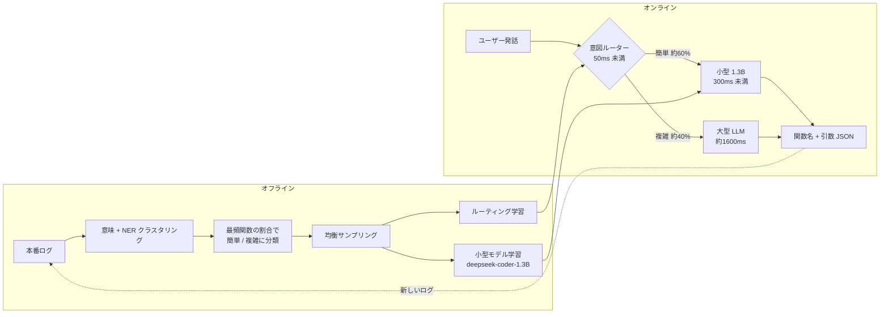

# ODIA: Oriented Distillation for Inline Acceleration of LLM-based Function Calling

- **Link**: https://arxiv.org/abs/2507.08877 （HTML 版 https://arxiv.org/html/2507.08877v1 を取得して作成）
- **Authors**: Hanlong Zhang, Jingsheng Yang, Hao Li, Yuhao He, Franck Gong
- **Affiliation**: ByteDance Inc.（HTML 本文に記載。abs ページには所属の記載なし）
- **Year**: 2025（2025-07-10 投稿、v1）
- **Venue**: arXiv preprint
- **Type**: Academic Paper（企業の本番運用報告 = ビジネス事例の一次資料）
- **用途**: Agent / tool calling（音楽アプリの音声・テキスト操作の function calling）
- **手法タグ**: `蒸留 + ルーティング`（ただし蒸留の損失・データ生成の詳細は未記載）
- **証拠タグ**: `一次`（企業自身の論文。ただし精度の数値は無し）
- **（2026-10-22 再検証）** abs ページで「期待遅延 45% 減・中央値 78% 減・小型モデルが本番トラフィックの 60% を処理・精度低下はごくわずか」を再確認。本レポートの数値と一致。Salesforce の公報 US 2026/0024009 A1（[17](17-salesforce-patent-llm-generated-ml-model.md)）が同じ「教師出力で小型化 + 確信度でフォールバック」を CRM 推薦で権利化している

## Abstract

> 逐語転載は取得ツールの制約で行えないため要旨を示します（abs ページの短い引用: "leverages online user interaction data to accelerate Function Calling"）。

本番のユーザー操作データを使って LLM の function calling を高速化する ODIA（Oriented Distillation for Inline Acceleration）を提案する。本番トラフィックから「簡単な問合せ」を自動で見つけ、大きなモデルの知識を小さなモデルへ蒸留する。期待遅延を 45%、中央値遅延を 78% 削減し、精度は維持した。音楽アプリへの導入では、小型モデルがトラフィックの 60% を処理し、精度の低下はごくわずかだった。

## Abstract (Japanese Translation)

上記のとおり。要点は「すべてを小型モデルにする」のではなく、**本番ログから簡単なクラスタだけを切り出して小型モデルに任せ、残りは大モデルに戻す** 運用設計です。

## Overview

ByteDance の音楽アプリでは、LLM による function calling に 1〜2 秒かかり、ピーク時の P90 は 2〜3 秒に達していました。テキスト生成と違いストリーミングできないため、ユーザーは「待たされる」と感じます。量子化やサービング最適化では function calling の遅延はあまり縮まりませんでした。そこで本番ログから簡単な問合せを抽出し、1.3B の小型モデルへ蒸留して、意図ルーティングで振り分けました。

## Problem

- **遅延**: function calling は通常 1〜2 秒、ピーク時 P90 は 2〜3 秒。
- **体感**: ストリーミングできず、ユーザーは結果が出るまで何も見えない。
- **既存手段の限界**: 量子化・サービング最適化の効果が function calling では限定的。
- **人手での専用モデル構築は高コスト**: 簡単な問合せ用モデルを人手でアノテーション・学習・保守するのは手間が大きい。

## Proposed Method

**ODIA の 5 ステップ**

1. **データ蓄積**: 本番の function calling 記録（入力 = 発話・会話履歴・ツール定義、出力 = 関数名と引数）を集める。
2. **簡単な問合せの特定**
   - 定義: あるクラスタの問合せの多くが同じ関数を呼ぶなら「簡単」。「切り替えて」「これをもっと」「聞きたくない」のような文脈依存の問合せは「複雑」。
   - 意味クラスタリング: `shibing624/text2vec-base-chinese-paraphrase` の埋め込み + 類似度閾値による階層クラスタリング（クラスタ数は事前に決めない）。
   - NER クラスタリング: 曲名・アーティスト・ジャンル・映画/TV の辞書で問合せをテンプレート化（例: 「play <<artist>>'s <<song>>」）。
   - フィルタ: クラスタ内の関数頻度を数え、最頻関数の割合が閾値（値は非公開）を超えれば「簡単」。最頻以外の問合せは捨てる。
3. **データパイプラインとサンプリング**: 同一問合せ → 意味 / NER クラスタの階層で整理。関数ごとの偏りを均す。重複は新しく引数が完全なものを優先。
4. **2 つのモデルを学習**
   - 意図ルーティングモデル: 小型と大型のどちらに送るかを判定（目標 精度 95% 超・50ms 未満）。
   - 引数生成モデル: 簡単な問合せのツール選択と引数抽出（目標 300ms 未満）。
5. **オンライン振り分け**: 簡単な問合せは小型、複雑な問合せは大型へフォールバック。

**Key Formulas**:

$$
E(T_{\text{pre\_fc}}) = 50 + 300 \times 60\% + 1600 \times 40\% = 870\ \text{ms} \tag{1}
$$

| 項 | 意味 |
|----|------|
| 50 ms | ルーティングの固定オーバーヘッド |
| 300 ms | 小型モデルの遅延 |
| 1600 ms | 大型モデルの遅延 |
| 60% / 40% | 小型 / 大型のトラフィック比 |

$$
\text{期待遅延削減率} = \frac{1600 - 870}{1600} \approx 45.6\% \quad (\text{論文値 } 45\%)
$$

一般化すると、小型で処理する割合を $p$、各遅延を $t_r, t_s, t_l$ として

$$
E[T] = t_r + p \cdot t_s + (1-p) \cdot t_l
$$

となり、**削減効果はカバー率 $p$ にほぼ比例** します。論文が今後の課題に「カバー率拡大」を挙げるのはこのためです。

**Features**:

- 本番ログだけで学習データを作り、人手アノテーションを最小化する。
- 小型モデルに任せるのは「関数が一意に決まるクラスタ」だけ。
- 日次のバッチ（8 万〜10 万件）で増分更新できる。

## Algorithm (Pseudocode)

```
Algorithm: ODIA
Input : 本番 function calling ログ L（入力 x、出力 y=(関数名, 引数)）、閾値 τ
Output: ルーティングモデル R、小型の引数生成モデル S
1. 埋め込み e(x) を計算し、階層クラスタリングでクラスタ C を作る      // 意味クラスタ
2. 辞書で x をテンプレート化し、NER クラスタを作る                    // 曲名・歌手など
3. for c in C:
4.     f* = c 内で最頻の関数; share = count(f*) / |c|
5.     if share > τ: c を「簡単」とし、f* 以外の例を除外
6.     else: c を「複雑」とする
7. 関数ごとに均衡サンプリングし、新しく引数が完全な例を優先
8. 簡単クラスタの (x, y) で S（deepseek-coder-1.3B）を学習            // 大モデル出力 = 教師
9. 簡単 / 複雑ラベルで R を学習（類似度 + NER → XGBoost/RF を追加）
10. 推論: if R(x)=簡単 then S(x) else 大モデル(x)
11. 新しいバッチごとにクラスタを重み付き平均埋め込みで統合・剪定して 1 へ
```

## Architecture / Process Flow



## Figures & Tables

> 図版画像は取得していません。図はキャプションと Mermaid で再構成しています。

### Table 1: モデル性能評価（論文の表をそのまま再現。対象モデル・バッチ条件は論文に記載なし）

| GPU | QPS | P99 (ms) | AVG (ms) | MAX (ms) |
|---|---|---|---|---|
| A30 | 4 | 247.77 | 245.63 | 308 |
| L20 | 5 | 246.96 | 243.67 | 312 |

### その他の報告値

| 指標 | 値 | 備考 |
|------|----|------|
| 期待遅延 | 1600 ms → 870 ms（−45%） | 式 (1) による計算値 |
| 中央値遅延 | 1600 ms → 350 ms（−78%） | 小型で処理される中央値の問合せ |
| 小型モデルのトラフィック比 | 約 60% | 音楽アプリ本番 |
| ルーティングのカバー率向上 | +12%（オフライン） | 分類器（XGBoost / RF）追加の効果 |
| 精度 | 「ごくわずかな低下」 | **数値の記載なし** |
| 増分バッチ | 8 万〜10 万件 | 日次更新と統合 |

```
遅延（ms）
大型のみ       |████████████████████████████████ 1600
ODIA 期待値    |█████████████████ 870
ODIA 中央値    |███████ 350
小型モデル単体 |██████ 300（目標値）
```

### 小型モデルの候補

| 役割 | モデル | サイズ |
|------|-------|-------|
| 引数生成（採用） | deepseek-coder-1.3B | 1.3B |
| 評価した代替 | miniCPM-2B、qinwen2-1.5B（論文の表記） | 2B 以下 |
| 大型（教師兼フォールバック） | 名称非公開 | 非公開 |

### ルーティング方式

| 方式 | 状態 | 特徴 |
|------|------|------|
| 意味類似度 + NER 照合 | 初期に採用 | 高精度だが既知の問合せのみ |
| 従来型分類器（XGBoost, Random Forest） | 後から追加 | オフラインでカバー率 +12% |
| BERT 分類 | 言及のみ | 採用の報告なし |

### 出力トークンの最適化（効果は定量化されていない）

| 変更前 | 変更後 |
|-------|-------|
| `media_type` | `type` |
| `creator_name` | `creator` |
| `media_name` | `media` |

- システムプロンプトの短縮、出力の共通接頭辞の削除も実施。

### 図の一覧

| 図 | 内容 |
|----|------|
| Fig. 1 | 音楽アプリでのピーク時 P90 function calling 遅延（2〜3 秒） |
| Fig. 2 | 学習用オフラインパイプラインとオンライン振り分けの全体構成 |
| Fig. 3 | 簡単な問合せを抽出する階層的データ構成 |
| Fig. 4 | 新規クラスタと既存クラスタの統合 |

## Experiments & Evaluation

### Setup

- 音楽アプリの本番トラフィック（中国語）。A30 / L20 GPU。
- 比較対象は大型モデルのみ。A/B テストや統計的検定の記載は無い。

### Main Results

- トラフィックの約 60% を小型で処理し、期待遅延 45%・中央値遅延 78% を削減。
- 精度低下は「ごくわずか」とされるが、正解率・F1 などの数値は無い。

## 業務上の示唆（C5 の観点）

| 観点 | 示唆 |
|------|------|
| 蒸留の単位 | タスク全体でなく「関数が一意に決まる問合せクラスタ」単位で蒸留する |
| 運用形 | 蒸留モデル + ルーター + 大モデルへのフォールバック（カスケード） |
| 効果の決め手 | カバー率 $p$。ルーターの精度目標 95% 超 |
| 価値式との対応 | 遅延削減を報告。推論コスト・初期投資・精度損失（$\Delta$Acc）は未報告 |
| H6 との関係 | tool calling 用途の蒸留が本番で使われている一次例（H6 を支持） |

## Limitations

- **精度が未定量**: 小型モデル・ルーター・全体の正解率が無い。
- **閾値・辞書規模が非公開**: 最頻関数の閾値、クラスタリング閾値、辞書サイズ。
- **教師が非公開**: 大型モデルの名称、蒸留の損失関数・ハイパーパラメータが無い。
- **遅延モデルが単純**: 固定遅延を仮定し、分散やキューイングを考えない。
- **Table 1 の条件不明**: 対象モデル・プロンプト長・同時実行数が無い。
- **単一ドメイン・単一言語**: 音楽、中国語のみ。
- **辞書依存**: 未知のエンティティへの対応が無い。
- **評価の厳密さ不足**: アブレーション・ベースライン・有意性検定が無い。

## Notes

- 今後の課題として、カバー率拡大・他ドメインへの適用・自動フィードバック・専用アーキテクチャを挙げている。
- 関連: [07 AWS Bedrock](07-aws-bedrock-function-calling-distillation.md)（ベンダーの tool calling 蒸留）、[08 NVIDIA Data Flywheel](08-nvidia-data-flywheel-tool-calling.md)（本番ログ → 小型化の同型パイプライン）。
- SafeRoute（arXiv 2502.12464）・SynConfRoute（arXiv 2605.04894）も「小型 + 難しい入力だけ大型」の同じ設計思想です。
