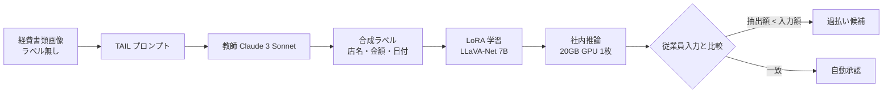

# Information Extraction from Heterogeneous Documents without Ground Truth Labels using Synthetic Label Generation and Knowledge Distillation

- **Link**: https://arxiv.org/html/2411.14957 （v2 の HTML を取得して作成）
- **Authors**: Aniket Bhattacharyya, Anurag Tripathi
- **Affiliation**: Amazon
- **Year**: 2024（arXiv 2411.14957v2、2024-11-25）
- **Venue**: arXiv preprint [cs.CL] →（2026-10-22 訂正）abs ページの comments に **WACV 2025 採択** の記載あり
- **Type**: Academic Paper（社内経費システムでの適用 = ビジネス事例の一次資料）
- **（2026-10-22 再検証）** abs ページで「85% less costly and ~5X faster」「layout-aware baselines を ANLS で 10% 超上回る」を確認。本レポートの数値と一致
- **用途**: 文書処理・情報抽出（従業員が提出する請求書・領収書）
- **手法タグ**: `蒸留`（response-based KD。教師 = Claude 3 Sonnet、生徒 = LLaVA-Net 7B）
- **証拠タグ**: `一次`（企業論文。ただし金額の絶対値は機密として非公開）

## Abstract

> 逐語転載は取得ツールの制約で行えないため要旨を示します。

従業員が提出する請求書や領収書は、レイアウトが多様な視覚的文書（VRD）である。正解ラベルの無い VRD コーパスに合成ラベルを付ける **TAIL**（Task Aware Instruction-based Labelling）を提案し、そのラベルでマルチモーダル生徒モデル **LLaVA-Net** を response-based 知識蒸留で学習する（教師の重みや学習データは使わない）。社内経費書類では LLaVA-Net が Claude 3 Sonnet と同等以上の精度を、**約 85% 低いコストと約 5 倍の速度** で達成した。レイアウト考慮型のベースラインを ANLS で 10% 超上回った。過払い防止への応用も示した。

## Abstract (Japanese Translation)

上記のとおり。**正解ラベルが無い（従業員の入力値はしばしば誤り）業務文書で、商用 LLM をラベラーにして社内で動く 7B モデルを作る** という、典型的な業務蒸留の型です。

## Overview

- 従業員が入力した「店名・金額・日付」は書類と食い違うことが多く、正解として使えない（図 1: 「Heathrow T5」「ASPI COLLEFERRO」）。
- そこで Claude 3 Sonnet にタスク別の指示（TAIL）でラベルを付けさせ、LLaVA（テキスト側を Mistral に変更）を LoRA で学習。
- 結果として、**Sonnet と同等以上・約 85% 安価・約 5 倍高速・拒否 0 件・出力形式違反 0 件**。単一の 20GB GPU で動く。

## Problem

- **Problem 1（社内 ExpenseQA）**: 経費書類から店名・金額・取引日を抽出。ラベルは従業員入力でノイズが多い。各属性 M=1。
- **Problem 2（CORD）**: インドネシアの領収書 1,000 枚、クラウドソーシングの正確なラベル。M=1（合計金額）と M=24 属性で評価。
- **定式化**: 文書集合 $\mathbb{E}$ から属性値への写像

$$
f: \mathbb{E} \rightarrow \mathbb{V}, \qquad \mathbb{V} = V_1 \times \dots \times V_M
$$

## Proposed Method

**1. TAIL（合成ラベル生成）**

- Sonnet にタスク別・役割付きのプロンプトと例、出力形式の制約を与える。
  - 店名: できるだけ少ない語
  - 金額: 通貨記号なしの数値
  - 日付: yyyymmdd
  - CORD: 合計を書類の表記どおり
  - CORD M=24: JSON。一部フィールドだけ例を示し、属性名を自明にする
- ICL・CoT・OCR 併用は **コストと遅延を抑えるため採用しなかった**。

**2. LLaVA-Net（生徒）**

- LLaVA のテキスト部を Vicuna/Llama から Mistral 系に置き換え、TAIL ラベルで LoRA 学習（7B）。

**Key Formulas**（評価指標）:

ANLS（Average Normalized Levenshtein Similarity）は、予測 $\hat{a}$ と参照 $a$ の正規化編集距離 $NL$ から

$$
\text{ANLS} = \frac{1}{N}\sum_{i=1}^{N} s(\hat{a}_i, a_i), \quad s = \begin{cases} 1 - NL(\hat{a}_i, a_i) & NL < \theta \\ 0 & \text{otherwise} \end{cases}
$$

（ANLS の一般的な定義。論文は ANLS を M=1 で、JSON の木編集距離 TED を M=24 で使用）

**応答ベース蒸留の目的関数**（一般形）:

$$
\mathcal{L}(\phi) = -\sum_{(x, y^{T})} \log p_\phi(y^{T} \mid x), \quad y^{T} = \text{TAIL}(x; \text{Sonnet})
$$

## Algorithm (Pseudocode)

```
Algorithm: TAIL + LLaVA-Net
Input : ラベル無し経費書類画像 X、タスク定義（属性・形式）
Output: 社内デプロイ可能な抽出モデル S
1. 属性ごとにタスク認識型プロンプト P を作る（役割・例・出力形式）
2. for x in X: y = Sonnet(P, x)                       // 教師ラベル（合成）
3. 形式違反・拒否を除外して D = {(x, y)} を作る         // 10,000 学習 + 1,000 検証
4. LLaVA（テキスト部 Mistral 7B）を D で LoRA 学習       // SageMaker 8 GPU 約 10 時間
5. 評価: ANLS（M=1）/ TED（M=24）、速度（docs/s）、年間コスト
6. 運用: S を 20GB GPU 1 枚で推論し、従業員入力値と比較して過払いを検出
```

## Architecture / Process Flow



## Figures & Tables

> 図版画像は取得していません。表はすべて Markdown で再現しています。

### データセットと設定

| 項目 | 値 |
|------|----|
| ExpenseQA | 11,000 文書（学習 10,000 / 検証 1,000）、ノイズラベル + TAIL ラベル |
| CORD | 学習 800 / 検証 100 / テスト 100。OCR 出力は使わず、正確なラベルはテストのみ |
| 指標 | ANLS（M=1）、木編集距離 TED（M=24） |
| コスト前提 | 年間 100X 文書。Sonnet 価格は 2024 年 4 月時点。TAIL ラベル付け 1 万件分を含む。**絶対額は非公開** |
| 学習 | SageMaker 8 GPU、LoRA、約 10 時間 |
| 推論 | SageMaker 1 インスタンス、20GB GPU 1 枚 |

### TAIL ラベルの品質（参照ラベルとの一致）

| 対象 | 指標 | 値 |
|------|------|----|
| ExpenseQA 店名 | ANLS | 50% |
| ExpenseQA 金額 | ANLS | 70% |
| ExpenseQA 日付 | ANLS | 76% |
| CORD M=1 | ANLS | 94% |
| CORD M=24 | TED ベース | 93% |

### Table 3: 性能・速度・コスト

| Model | Merchant | Amount | Date | CORD M=1 | CORD M=24 | Speed (docs/s) | Annual cost |
|---|---|---|---|---|---|---|---|
| Sonnet Zero-Shot (TAIL) | 50% | 70% | 76% | 94% | 93% | 0.3 | $1.25X |
| LLaVA zero-shot, TAIL prompt | 24% | 28% | 58% | 48% | 42% | 1.5 | $0.13X |
| LLaVA, noisy labels | 46% | 63% | 68% | – | – | 1.5 | $0.13X |
| LLaVA, exact labels | – | – | – | 82% | – | 1.5 | 0.13X |
| LayoutLMV3-TAIL | 41% | 58% | – | 42% | – | 0.8 | 0.2X |
| **LLaVA-Net** | **52%** | **70%** | **83%** | **84%** | **69%** | 1.5 | $0.2X |

（コスト列の表記ゆれは原文どおり。本文は「Sonnet 比 約 85% 安価・約 5 倍高速（1.5 vs 0.3 docs/s）」と記述）

$$
1 - \frac{0.2X}{1.25X} = 84\% \approx \text{「約 85\% 安価」}, \qquad \frac{1.5}{0.3} = 5\ \text{倍}
$$

```
ExpenseQA 日付 ANLS
LLaVA-Net        |█████████████████████████████████████████ 83%
Sonnet (教師)    |██████████████████████████████████████ 76%
LLaVA ノイズ学習 |██████████████████████████████████ 68%
LLaVA zero-shot  |█████████████████████████████ 58%
```

### Table 4: 主要ベンダーの店名 ANLS

| Model | Uber | Lyft |
|---|---|---|
| Sonnet Zero-Shot (TAIL) | 88% | 100% |
| LLaVA-Net | 88% | 100% |
| LayoutLMV3-TAIL | 88% | 95% |

### Table 5: 画像の鮮明度（Laplacian の分散）別 ANLS

| Model | <200 | 200–500 | 500–750 | 750–1000 | ≥1000 |
|---|---|---|---|---|---|
| LLaVA-Net | 70% | 91% | 90% | 92% | 92% |
| LayoutLMV3-TAIL | 35% | 45% | 50% | 60% | 33% |
| LayoutLMV3, text in window | 67% | 70% | 85% | 100% | 67% |

### LLaVA-Net と Sonnet の一致度

| 対象 | 一致度 |
|------|-------|
| 店名 | 87% |
| 金額 | 74% |
| 日付 | 82% |
| CORD M=1 | 86% |
| CORD M=24（TED） | 87% |

すべて 90% 未満であり、**生徒は教師の単なる複製ではない**（教師の誤りを一部直している）と著者らは解釈しています。

### 出力の挙動

| 項目 | Sonnet | LLaVA-Net |
|------|-------|-----------|
| 店名問合せの拒否 | 約 3% | 0 件 |
| 形式違反 | 1.5% | 0 件 |

### 過払い検出（RQ5）

| 項目 | 値 |
|------|----|
| 抽出額 < 従業員入力額の請求書 | 89 件（ExpenseQA） |
| 1 文書あたりのリスク推計 | 約 2 ドル |
| 例（図 3） | 入力 600 ユーロ、実際 321.64 ユーロ |

### 図の一覧

| 図 | 内容 |
|----|------|
| Fig. 1 | 従業員入力の店名（Heathrow T5、ASPI COLLEFERRO）が書類と一致しない例 |
| Fig. 2 | 縦長の請求書で Sonnet が失敗し LLaVA-Net が正しく金額を抽出した例 |
| Fig. 3 | 入力 600 ユーロ・正解 321.64 ユーロの過払い例 |

## Experiments & Evaluation

### Main Results

- **ExpenseQA**: LLaVA-Net は店名 52% / 金額 70% / 日付 83% で、教師 Sonnet（50 / 70 / 76%）以上。
- **CORD**: M=1 で 84%（Sonnet 94% には届かない）、M=24 で 69%（Sonnet 93%）。**公開ベンチでは教師に負け、社内データでは勝つ**。
- **ノイズラベルとの比較**: 同じ LLaVA を従業員入力（ノイズ）で学習すると 46 / 63 / 68%。**教師ラベル（蒸留）の方が人手入力ラベルより良い**。

### 画像品質

- ExpenseQA は約 90% が分散 200 以上、CORD は約 60%。低品質画像では Sonnet の視覚能力が上回る。

## 業務上の示唆（C5 の観点）

| 観点 | 示唆 |
|------|------|
| 蒸留が効く理由 | 大量・狭いタスク・正解ラベル無し・形式厳守 |
| 価値式 | 推論コスト（約 85% 減）と速度（5 倍）を報告。初期投資（TAIL 1 万件 + 学習 10 時間）も明示。精度損失はむしろマイナス（改善） |
| 付加価値 | 拒否・形式違反ゼロは、後段の業務システム連携で大きい |
| 横展開 | 著者は契約・法務、医療文書（保険）、銀行の KYC・審査、デジタル化への展開を挙げる |
| 規約 | 教師は Anthropic の Claude 3 Sonnet（Amazon は Anthropic の出資者・Bedrock 提供者）。一般企業が同じことをする場合の規約は C8 で確認が必要 |

## Limitations

- ExpenseQA の参照はノイズラベルで、真の正解ではない。
- 画像品質が悪いと Sonnet の方が強い。
- レイアウト型ベースラインは OCR（Tesseract）の品質に強く依存。
- ICL・CoT・OCR 併用は未使用（使えば精度は上がるがコスト増）。
- 社内プロンプトとコストの絶対値は非公開。
- LayoutLMV3 は取引日で未評価。
- モデル系列（LLaVA + Mistral）・教師（Sonnet）とも 1 種類のみ。
- 今後: 超解像、OCR をプロンプトに入れる方式、プロンプト自動生成。

## Notes

- 関連: [04 SAP 特許](04-sap-patent-document-understanding-kd.md)（同じ経費書類・LLM 教師の構図を特許化）、DocKD（arXiv 2410.03061、EMNLP 2024）。
