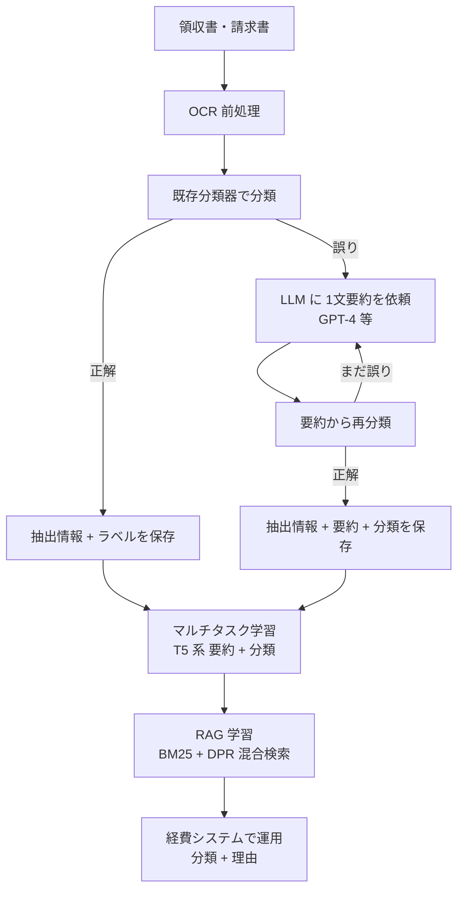

# Robust documentation understanding using large language model knowledge distillation and joint training

- **Patent Number**: US12475175B1
- **Application Number**: US18/981,884
- **Assignee**: SAP SE
- **Inventors**: Weishi Wang, Shaun Tieon, Yu Sheng Daniel Lee
- **Filing Date**: 2024-12-16（優先日も同日）
- **Grant Date**: 2025-11-18（Google Patents の公開日）
- **Status**: Active（Google Patents 上の推定。満了予定 2044-12-16 は法的結論ではないと注記）
- **Classification**: G06N 3/096, G06N 3/08, G06N 3/02, G06N 3/00, G06N 3/04, G06N 3/0475, G06F 16/93, G06F 16/90, G06F 16/00
- **Link**: https://patents.google.com/patent/US12475175 （USPTO 公報 PDF: https://image-ppubs.uspto.gov/dirsearch-public/print/downloadPdf/12475175）
- **Type**: Patent
- **用途**: 文書処理（経費管理システムでの領収書・請求書の分類 + 理由の要約）
- **手法タグ**: `蒸留`（LLM = GPT-4 等が要約を生成し、T5 系生成モデルの学習データにする）
- **証拠タグ**: `一次`（特許。効果の数値は無い）

## Abstract

> "Methods, systems, and computer-readable storage media directed to a machine learning (ML) model training system for training ML models by leveraging a large language model (LLM) for knowledge distillation to provide training data and using multi-task learning to train ML models using the training data."

## Abstract (Japanese Translation)

機械学習モデルの学習システムに関する方法・システム・記憶媒体。大規模言語モデル（LLM）を知識蒸留に使って学習データを作り、そのデータでマルチタスク学習によって ML モデルを学習する。

## Overview

SAP の経費管理（Concur 系の業務を想起させるが、特許本文は製品名を出していない）で、既存の分類器が **学習時に無かったケース** を誤分類する問題に対し、(1) 誤分類した書類だけ LLM に「正しい分類に導く 1 文要約」を書かせ、(2) 要約と分類を同時に出す生成モデルをマルチタスク学習し、(3) 類似した過去書類を検索して入力に足す RAG 学習で仕上げる発明です。出力は「分類 + 理由（要約）」なので、利用者に根拠を示せます。

## Technical Problem

- ML モデルは学習データ内の知識に限られ、想定外のケースで誤る。
- 例: **ケーキの領収書** を「External Entertainment（社外接待）」と誤分類。正しくは「Internal Entertainment（社内）」。
- 単なる分類器では、なぜその分類かを利用者に説明できない。

## Technical Solution

### Process Steps

1. **前処理**: 書類を OCR し、テキストを抽出 → 抽出情報
2. **自己教師的な知識蒸留**: 既存分類器（ML model 320）で分類
   - 正しければ [OCR テキスト, ラベル] を保存
   - 誤っていれば LLM（例: GPT-4）に、トークン上限と書類スキーマを守る 1 文要約を依頼 → 要約から再分類 → まだ誤りなら要約を作り直す（正しくなるまで反復）
   - 保存形式: [抽出情報, 要約, 分類]
3. **マルチタスク学習**: T5 などのエンコーダ・デコーダ生成モデルを、要約生成損失と分類損失の等重み和で学習
4. **RAG 学習**: マルチタスク学習済みエンコーダで DPR を初期化し、BM25 と組み合わせた混合スコアで最も似た過去書類と分類を入力に連結して学習
5. **運用**: ネットワーク上にホストし、経費システムが呼び出して「分類 + 要約」を受け取る

### Key Innovation

- LLM を **推論時ではなく学習データ生成時だけ** 使い、本番は小型の生成モデルで動かす。
- 「既存分類器が正解できる要約」だけを残す **検証付き蒸留**（分類器をフィルタに使う）。
- 分類と要約の同時出力で、根拠付きの分類になる。

### Mathematical Relationships

$$
\mathcal{L}_{gen} = -\sum_{j=1}^{N} \log p(y_j \mid x, y_1, \dots, y_{j-1}; \theta)
$$

$$
\mathcal{L}_{cls} = -\log p(c \mid x; \theta)
$$

$$
\mathcal{L}_{total} = w_{gen}\,\mathcal{L}_{gen} + w_{cls}\,\mathcal{L}_{cls}, \quad (w_{gen} = w_{cls} \text{ の例})
$$

$$
s^{lex}_{i,j} = \text{BM25}(X_i, D_j), \qquad s^{sem}_{i,j} = \text{sim}(D_j, S_i) = [CLS_{D_j}]^\top [CLS_{S_i}]
$$

$$
s^{hyb}_{i,j} = s^{sem}_{i,j} + \lambda \cdot s^{lex}_{i,j}
$$

$$
\mathcal{L}_{nce} = \frac{1}{N}\sum_{i} -\log \frac{\exp(\text{sim}(D_i, S_i))}{\exp(\text{sim}(D_i, S_i)) + \sum_{j \in M, j \neq i} \exp(\text{sim}(D_i, S_j))}
$$

$$
\hat{X}_i = [CLS]\ X_i\ [R\_DOC]\ D_j\ [R\_DOC\_TYPE]\ C_j
$$

| 記号 | 意味 |
|------|------|
| $x, y_j$ | 入力（OCR テキスト）、要約の $j$ 番目のトークン |
| $c$ | 書類の分類 |
| $X_i, S_i$ | サンプル $i$ の OCR テキスト、要約 |
| $D_j, C_j$ | 過去書類 $j$ の OCR テキスト、分類 |
| $\lambda$ | 語彙類似度の重み |
| $M$ | ミニバッチ（バッチ内負例） |

> 一部の数式は Google Patents 上で画像が描画されず、本文の記述から再構成しています。

## Key Claims

### Claim 1（方法・独立）

- **要素 a)**: 書類集合を事前学習済み ML モデルで処理し、選択的に LLM で要約を生成する
- **要素 b)**: 要約を含む学習データで、生成 ML モデルをマルチタスク学習する。各サンプルで予測要約と予測分類を出し、総損失を反復で最小化する
- **要素 c)**: RAG 学習を行う。各サンプルで最も似た過去書類を見つけ、サンプルと過去書類から拡張入力を作り、生成要約と分類を出し、損失を最小化する
- **要素 d)**: 学習後の生成 ML モデルを企業システムで使う

### Claim 8 / Claim 15

- Claim 8: 非一時的記憶媒体。Claim 1 と同じ処理。
- Claim 15: 計算装置 + 記憶装置のシステム。Claim 1 と同じ処理。

## Process Flow Diagram

## Figures & Tables

### 請求項の構造

| Claim # | Type | Depends On | Key Element |
|---------|------|-----------|-------------|
| 1 | Independent（方法） | — | LLM 要約 → マルチタスク学習 → RAG 学習 → 企業システムで使用 |
| 2 | Dependent | 1 | LLM へ要約を依頼し、要約からの予測分類が期待分類と一致すれば学習データに残す |
| 3 | Dependent | 1 | 類似度スコア = 語彙スコア + 意味スコア |
| 4 | Dependent | 3 | 語彙 = BM 系検索、意味 = DPR |
| 5 | Dependent | 1 | 最類似書類の決定を RAG 学習中に学習した検索器で行う |
| 6 | Dependent | 5 | 検索器を、マルチタスク学習済み生成モデルのエンコーダで初期化 |
| 7 | Dependent | 1 | 各書類を前処理して情報（OCR テキスト等）を抽出 |
| 8 | Independent（媒体） | — | Claim 1 と同じ処理 |
| 9–14 | Dependent | 8 | Claim 2–7 に対応 |
| 15 | Independent（システム） | — | Claim 1 と同じ処理 |
| 16–20 | Dependent | 15 | Claim 2–6 に対応 |

### 図面の一覧（Google Patents の記述）

| 図 | 内容 |
|----|------|
| FIG. 1 | クライアント、ネットワーク、サーバー（学習システム 120、経費管理システム 122、ML モデル 124、LLM システム 126 = 例 OpenAI GPT-4） |
| FIG. 2 | 前処理 202、知識蒸留 204、多段学習 206、LLM 208、学習データ 210 → 生成モデル 220 |
| FIG. 3 | 自己教師的蒸留: KD 302、LLM 304、OCR 306、データストア 308、事前学習モデル 320、プロンプト 322、書類 330、ラベル 332、要約 340、Listing 1（プロンプト例） |
| FIG. 4 | RAG 学習: 検索器 402、結合 404、学習 406、データストア 408、生成モデル 420、学習データ 430 |
| FIG. 5 | 処理 500: 502 蒸留 → 504 マルチタスク学習 → 506 RAG 学習 → 508 デプロイ |
| FIG. 6 | 汎用計算機（プロセッサ 610、メモリ 620、記憶 630、I/O 640、バス 650） |

> 図面画像は取得していません。上表と Mermaid 図で再構成しています。

### 先行技術との比較

| 観点 | 本特許 | Amazon TAIL（[03](03-amazon-tail-expense-documents.md)） | 単純な LLM ラベル蒸留 |
|------|-------|------------------|-------------------|
| 教師の使い方 | 誤分類した書類だけ LLM に要約させる | 全書類に LLM でラベル | 全件に LLM でラベル |
| 品質管理 | 既存分類器で要約を検証（反復） | プロンプト設計（TAIL） | なし |
| 生徒 | T5 系エンコーダ・デコーダ | LLaVA-Net 7B（マルチモーダル） | 任意 |
| 出力 | 分類 + 要約（理由） | 抽出値 | 分類 or 抽出値 |
| 検索拡張 | BM25 + DPR で過去書類を連結 | なし | なし |
| 定量効果 | 記載なし | 約 85% 安価・5 倍高速 | – |

## Patent Family & Related Art

- **引用（先行技術）**: US20250181923A1（Verizon、2023-12-04 優先、2025-06-05 公開）— 生成 AI で学習データのクラス不均衡を補正
- **被引用**: CN121542420A / CN121542420B（昆明理工大学、2026 年公開）— 言語横断の長文要約
- **類似文献（一部）**: US12401835B2、US9811765B2、US20210034707A1、US9268766B2、US8983969B2、US20170200066A1 ほか

## Notes

- **商業的意義**: 大手業務ソフトベンダー（SAP）が「LLM を教師にした蒸留」を自社の経費業務向けに権利化した点が重要です。LLM の利用規約（C8）との関係は特許には記載がありません。
- **数値の不在**: 特許には精度・コストの数値が無く、効果は Amazon の論文（[03](03-amazon-tail-expense-documents.md)）で補う必要があります。
- 同じく「蒸留モデルを本番分類に使う」特許として Zscaler の DLP 特許（US12711255B2）があります。
