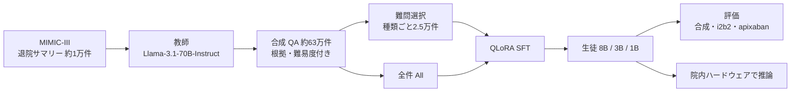

# Synthetic data distillation enables the extraction of clinical information at scale

- **Link**: https://pmc.ncbi.nlm.nih.gov/articles/PMC12065832/ （DOI: 10.1038/s41746-025-01681-4）
- **Authors**: Elizabeth Geena Woo, Michael C. Burkhart, Emily Alsentzer, Brett K. Beaulieu-Jones
- **Affiliation**: University of Chicago（Medicine / Genetics and Systems Biology / Center for Computational Medicine and Clinical AI）、Stanford University（Biomedical Data Science）
- **Year**: 2025（受理 2025-04-25、公開 2025-05-10）
- **Venue**: npj Digital Medicine 8:267（プレプリント: medRxiv 2024.09.27）
- **Type**: Academic Paper
- **用途**: 医療（臨床記録からの臨床試験適格性情報の抽出。院内・ローカル実行を想定）
- **手法タグ**: `蒸留`（教師 Llama-3.1-70B が合成 QA を生成、8B/3B/1B を QLoRA で学習）
- **証拠タグ**: `一次`（査読論文。ただし研究段階で本番導入ではない）
- **（2026-10-22 再検証）** PMC 本文を再取得。**本文は 8B-All 89.30% / 70B 76.20%、Table 2 は 89.1% / 76.1%** と表記が揺れており、本レポートは Table 2 の値を採用。apixaban は Table 4 が 93.5% / 88.7%、本文は 0.93 / 0.89。推論時間 0.535 秒 / 2.34 秒、費用 929 ドル / 4,066 ドル（本文の差額表記 3,132 ドルは計算値 3,137 ドルと 5 ドルずれる）は一致

## Abstract

> 逐語転載は取得ツールの制約で行えないため要旨を示します。

臨床記録からの情報抽出に、合成データ蒸留で小型のオープンソース Llama モデルを fine-tuning する方法を示す。教師は Llama-3.1-70B-Instruct、生徒は 8B・3B・1B。大モデルに近い性能を、計算コストとプライバシー上の負担を抑えて実現することが目的である。8B モデルは場合によって 70B 教師を上回り、最も難しい質問だけで学習しても性能は改善した。性能はモデルサイズに比例した。

## Abstract (Japanese Translation)

上記のとおり。**オープンモデルを教師にすることで、商用 API の規約問題と患者データの外部送信を両方回避した** 点が業務上の要点です。

## Overview

- MIMIC-III の退院サマリー約 1 万件から、70B 教師が「はい/いいえ」「数値」「記録から答えられない」の 4 種の QA を合計約 63 万件生成。
- 種類ごとに難しい 2.5 万件を選んで（または全件で）8B/3B/1B を QLoRA 学習。8 GPU で 12 時間未満。
- 8B-All は人手確認済み合成 QA で 89.1%（70B 教師 76.1%）、apixaban 試験の 23 基準で balanced accuracy 93.5%（教師 88.7%）。
- 推論は 8B が 0.535 秒/例、70B が 2.34 秒/例。1 万人 × 23 問で 約 929 ドル vs 約 4,066 ドル。

## Problem

- **コスト**: 70B 級モデルで大量の臨床記録を処理すると計算費が高い。
- **プライバシー**: 患者データを外部 API に送れない。ローカルのハードウェアで動かしたい。
- **ラベル不足**: 臨床試験の適格性判定に使える人手ラベルが少ない。
- **答えられない質問**: 記録に情報が無い場合に「無い」と答える能力が必要。

## Proposed Method

**合成データ蒸留（Synthetic Data Distillation）**

1. 教師（Llama-3.1-70B-Instruct）に退院サマリーを与え、QA と付随情報を生成させる。
2. 各 QA に「質問・種類・答え・記録内のセクション・逐語の根拠・難易度 1〜10・説明」を付ける。
3. 種類ごとに難易度上位 2.5 万件を選ぶ（データプログラミング）。90/10 で学習・テストに分割。壊れた JSON は後処理。
4. 1,000 件を人手で確認・修正。
5. 生徒を QLoRA（4bit 量子化 LoRA）で SFT。

**Key Formulas**（目的関数の一般形）:

$$
\mathcal{L}(\phi) = -\sum_{(n, q, a, e) \in \mathcal{D}_{T}} \log p_\phi\big(a, e \mid n, q\big)
$$

| 記号 | 意味 |
|------|------|
| $n$ | 臨床記録（退院サマリー） |
| $q$ | 教師が生成した質問 |
| $a$ | 教師が生成した答え |
| $e$ | セクション・根拠テキスト・説明（8B-No-S ではこれを除く） |
| $\mathcal{D}_T$ | 教師生成データ |

推論コストの比較（論文の値）:

$$
\frac{\$929}{\$4{,}066} \approx 0.23, \qquad \frac{0.535\,\text{s}}{2.34\,\text{s}} \approx 0.23
$$

（1 万人 × 23 問 = 23 万例、27.2 ドル/時。差額は論文表記で 3,132 ドル）

## Algorithm (Pseudocode)

```
Algorithm: 合成データ蒸留による臨床抽出モデル
Input : 退院サマリー N（約 1 万件）、教師 T = Llama-3.1-70B-Instruct
Output: 院内で動く生徒 S（8B / 3B / 1B）
1. for n in N:
2.     T に n を与え、4 種の QA（boolean / numeric / NA-boolean / NA-numeric）を生成
3.     各 QA に セクション・根拠・難易度・説明 を付与
4. 種類ごとに難易度上位 25,000 件を選ぶ（H-25k）または全件（All）
5. 1,000 件を人手確認し、評価セットにする
6. S を QLoRA で SFT（8 GPU、12 時間未満）
7. 評価: 合成ホールドアウト、i2b2/n2c2 2018（ゼロショット）、apixaban 23 基準
8. 数値質問は「数値を抽出 → ルールで判定」の方が「直接はい/いいえ」より高精度
```

## Architecture / Process Flow



## Figures & Tables

> 図版画像は取得していません。表はすべて Markdown で再現しています。

### 生成した QA の件数

| 種類 | 件数 |
|------|------|
| Boolean | 212,132 |
| Numeric | 209,637 |
| NA-Boolean | 106,288 |
| NA-Numeric | 106,245 |
| **合計** | **約 634,300** |

```
Boolean    |████████████████████ 212,132
Numeric    |████████████████████ 209,637
NA-Boolean |██████████ 106,288
NA-Numeric |██████████ 106,245
```

### fine-tuning したモデルの種類

| Model | 学習データ |
|---|---|
| 8B-All | 全データ |
| 8B-H-25k | 種類ごとの難問 2.5 万件 |
| 8B-NB-Only | Boolean と Numeric の難問 2.5 万件ずつ（NA なし） |
| 8B-No-S | 難問 2.5 万件、セクション・根拠・説明なし |
| 3B-All / 1B-All | 全データ（Llama-3.2 ベース） |

### 評価データ

| データ | 内容 |
|------|------|
| 合成ホールドアウト | 42,498 件、うち 1,000 件を人手確認 |
| i2b2/n2c2 2018 Track 1 | 糖尿病コホート 288 記録（学習 202 / テスト 86）、13 基準、ゼロショット |
| apixaban（ARISTOTLE）基準 | MIMIC-IV（2012 年以降）100 記録 × 23 問 = 2,300 対を人手注釈 |

### Table 2: 人手確認済み合成質問での正解率（N = 1,000）

| Model | NA-Boolean | NA-Numeric | Numeric | Boolean | All |
|---|---|---|---|---|---|
| 70B-Instruct（教師） | 69.5% | 81.8% | 61.7% | 88.6% | 76.1% |
| 8B-Instruct | 27.7% | 78.4% | 79.2% | 87.3% | 68.4% |
| **8B-All** | 88.0% | 98.3% | 83.9% | 84.7% | **89.1%** |
| 8B-H-25k | 80.4% | 85.5% | 84.2% | 88.0% | 84.6% |
| 8B-No-S | 78.9% | 89.3% | 80.6% | 83.5% | 83.0% |
| 8B-NB-Only | 0.0% | 40.0% | 84.4% | 87.6% | 54.0% |
| 3B-Instruct | 87.7% | 74.1% | 66.0% | 57.0% | 71.1% |
| 3B-All | 85.1% | 99.2% | 77.9% | 85.2% | 86.7% |
| 1B-Instruct | 21.0% | 29.1% | 17.1% | 55.7% | 31.0% |
| 1B-All | 93.0% | 99.2% | 40.2% | 53.6% | 71.2% |

（本文では 8B-All 89.30%、70B 76.20% と記述され、表とわずかに異なる）

```
All 列の正解率
8B-All       |█████████████████████████████████████████████ 89.1
3B-All       |███████████████████████████████████████████ 86.7
8B-H-25k     |██████████████████████████████████████████ 84.6
70B 教師     |██████████████████████████████████████ 76.1
1B-All       |████████████████████████████████████ 71.2
8B-Instruct  |██████████████████████████████████ 68.4
1B-Instruct  |████████████████ 31.0
```

### Table 3: 直接の Yes/No vs 数値抽出 + ルール（balanced accuracy / micro-F1）

| Criterion | Prompt type | 70B | 8B | 8B-All |
|---|---|---|---|---|
| Creatinine | Numeric (rule-based) | 0.893 / 0.878 | 0.870 / 0.844 | 0.894 / 0.899 |
| Creatinine | Boolean (direct) | 0.825 / 0.788 | 0.763 / 0.715 | 0.819 / 0.791 |
| HbA1c | Numeric (rule-based) | 0.949 / 0.937 | 0.783 / 0.729 | 0.896 / 0.875 |
| HbA1c | Boolean (direct) | 0.774 / 0.774 | 0.583 / 0.462 | 0.743 / 0.760 |

### Table 4: apixaban 基準（23 基準の平均）

| Model | Balanced accuracy | 95% CI | Micro-F1 | 95% CI |
|---|---|---|---|---|
| 70B-Instruct | 88.7% | 84.3–92.6 | 0.90 | 0.873–0.934 |
| 8B-Instruct | 84.0% | 75.9–90.5 | 0.86 | 0.783–0.934 |
| **8B-All** | 93.5% | 90.9–96.1 | 0.95 | 0.920–0.966 |
| 8B-H-25k | **94.2%** | 90.9–96.9 | 0.94 | 0.912–0.971 |
| 3B-Instruct | 73.9% | 66.7–81.1 | 0.76 | 0.677–0.828 |
| 3B-All | 91.9% | 87.5–95.4 | 0.93 | 0.885–0.963 |
| 1B-Instruct | 55.0% | 44.1–66.1 | 0.62 | 0.484–0.741 |
| 1B-All | 78.4% | 69.7–86.0 | 0.78 | 0.678–0.857 |

### apixaban の主な基準別 balanced accuracy（抜粋。全 23 基準は原典の表を参照）

| 基準 | 70B | 8B-Instruct | 8B-All | 8B-H-25k |
|------|-----|------------|--------|----------|
| AST | 97.0% | 54.0% | 94.3% | 99.4% |
| Blood glucose | 84.0% | 25.0% | 98.5% | 94.0% |
| Creatinine | 80.0% | 85.0% | 84.0% | 85.0% |
| Platelets | 87.0% | 78.0% | 79.6% | 79.1% |
| Atrial fibrillation | 81.7% | 98.0% | 98.0% | 98.0% |

> 取得結果では 23 基準すべての行を得られなかったため、5 基準のみ掲載しています。

### 推論速度とコスト（Fig. 3 と Methods）

| 項目 | 8B | 70B |
|------|----|-----|
| 1 例あたりの時間 | 0.535 秒 | 2.34 秒 |
| 1 万人 × 23 問（23 万例）の費用 | 約 929 ドル | 約 4,066 ドル |
| 前提 | 27.2 ドル/時、A100 × 8 のノード（U Chicago "Randi" クラスタ） | 同左 |

### 図の一覧

| 図 | 内容 |
|----|------|
| Fig. 1 | ワークフロー: MIMIC-III → 70B が QA 要素を生成 → 後処理 → 8B（3B/1B）を学習 |
| Fig. 2 | i2b2（n2c2）チャレンジのゼロショット性能（学習・テスト）。Llama-3.1 は 70B と 8B、Llama-3.2 は 3B と 1B |
| Fig. 3 | モデルサイズ・タスク別の 1 例あたり秒数、入力トークン/秒、生成トークン/秒（生成は入力処理より遅い） |

## Experiments & Evaluation

### Main Results

- **生徒が教師を上回る**: 8B-All は合成評価で +13.0 ポイント、apixaban で +4.8 ポイント（balanced accuracy）。
- **NA 質問が重要**: NA を除いた 8B-NB-Only は NA-Boolean 0.0%、All 54.0% に落ちる。
- **根拠（セクション・説明）も効く**: 8B-No-S は 83.0%（8B-H-25k 84.6%）。
- **難問 2.5 万件だけでも改善**: 8B-H-25k は apixaban で最高の 94.2%。
- **サイズの限界**: 1B-All は Numeric 40.2%、apixaban 78.4%。

## 業務上の示唆（C5 の観点）

| 観点 | 示唆 |
|------|------|
| 蒸留が効く理由 | 院内必須（プライバシー）・大量処理・狭いタスク |
| 教師の選び方 | オープンモデル（Llama 70B）を教師にすると商用 API の規約制約（C8）を避けられる |
| 価値式 | 推論コスト約 77% 減（929 vs 4,066 ドル）。初期投資は 8 GPU × 12 時間未満。精度はむしろ向上 |
| 設計の勘所 | 「答えられない」質問と根拠の同時学習、数値抽出 + ルール判定 |
| 証拠の質 | 一次（査読）だが **研究段階**。病院での本番運用の報告ではない |

## Limitations

- 数値範囲: 教師が範囲を片方の端点に潰す、範囲との比較を誤る。
- 匿名化タグ: 匿名化タグから答えを読む、伏字でトークン数が増える。
- 性別の基準値: 男女の閾値を取り違えた例がある。
- 答えられない質問: BMI・6 分間歩行など記録に少ない質問が多く、クレアチニンの質問が重複。
- 多段の質問: 複雑な適格性質問で性能が下がる。
- 欠測: 注釈記録の約 60% で血小板数が無い（匿名化の誤りの可能性）。
- 曖昧さ: 推測的な記述の解釈が難しい。
- 一般化: 実データは 2 つともボストン地域の医療機関。合成データの偏り。
- 人手確認付きの合成評価は、完全な人手作成評価より高得点になりやすい。
- 対象は主に臨床試験の適格性。複数記録にまたがる推論は未解決。

## Notes

- コード・注釈ツール・注釈データ 2 種を PhysioNet で公開（[MIMIC-III-Ext-Synthetic-Clinical-Trial-Questions v1.0.0](https://physionet.org/content/mimic-ext-synth-trial-question/)、1,000 件、954 人分、利用には DUA が必要）。
- 黒箱蒸留で安全性整合が失われるリスク（[12](12-blackbox-distillation-medical-safety.md)）は、抽出タスクより生成タスクで問題になりやすい点に注意。
- 関連: [06 Stanford 臨床 NER 蒸留](06-stanford-clinical-ner-distillation.md)、Microsoft の ADE 抽出蒸留（arXiv 2307.06439: PubMedBERT が GPT-4 を F1 で 5 点超上回る）。
