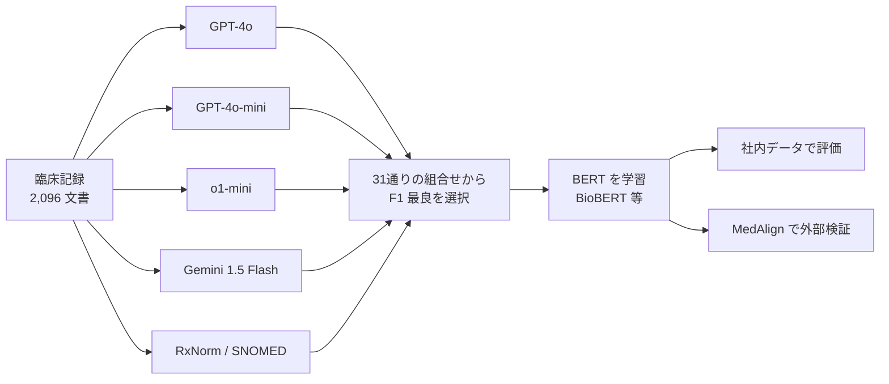

# Distilling Large Language Models for Efficient Clinical Information Extraction

- **Link**: https://arxiv.org/abs/2501.00031v1 （HTML 版 https://arxiv.org/html/2501.00031v1 を取得して作成）
- **Authors**: Karthik S. Vedula, Annika Gupta, Akshay Swaminathan, Ivan Lopez, Suhana Bedi, Nigam H. Shah
- **Affiliation**: Poolesville High School（Vedula）、UC Santa Cruz（Gupta）、Stanford University School of Medicine / Stanford Health Care（Swaminathan, Lopez, Bedi, Shah）
- **Year**: 2024（2024-12-21 投稿、v1）
- **Venue**: arXiv preprint [cs.CL]
- **Type**: Academic Paper
- **用途**: 医療（臨床 NER: 薬剤・疾患・症状の抽出）
- **手法タグ**: `蒸留`（GPT-4o / GPT-4o-mini / o1-mini / Gemini 1.5 Flash + オントロジーのラベルで BERT を学習）
- **証拠タグ**: `一次`（プレプリント、研究段階）

## Abstract

> 逐語転載は取得ツールの制約で行えないため要旨を示します。

LLM とオントロジーのラベルを小型 BERT に蒸留し、薬剤・疾患・症状の臨床 NER を行う。蒸留モデルは最新 LLM の約 1/1000 のサイズ。5 つの公開データセットの 3,300 件超の記録で評価し、MedAlign で外部検証した。蒸留モデルは LLM より **最大 101 倍安価・12 倍高速** で、NER 性能は同程度だった。

## Abstract (Japanese Translation)

上記のとおり。**「LLM で全件処理する」から「LLM でラベルを作り BERT で全件処理する」へ切り替える経済性** を、1 記録あたりのコストと時間で示しています。

## Overview

- 教師は 4 つの LLM と、RxNorm / SNOMED CT のオントロジー（BioPortal Annotator API）。5 つのラベラーの 31 通りの組合せから、タスクごとに最良の組合せを選ぶ。
- 生徒は BaseBERT・BioBERT・BioClinBERT。
- 人手ラベルで学習した BERT（上限）と、教師ラベルで学習した BERT（蒸留）、教師単体の 3 者を比較。

## Problem

- 臨床記録は大量で、LLM で全件処理すると費用と時間がかかる。
- 人手ラベルは高価で、症状のように定義が曖昧な実体はラベル自体がぶれる。
- 院内での低コスト運用には小型モデルが必要。

## Proposed Method

1. 4 つの LLM（temperature 0.01、top-p 0.9、HIPAA 準拠のエンドポイント）とオントロジーで記録にラベル付け。
2. 5 ラベラーの空でない部分集合 31 通りを、ラベルの和集合で結合し、開発セットでタスクごとに最良を選ぶ。
3. ラベルを Inside-Outside（IO）形式に変換。
4. BERT 系を fine-tuning（学習率 2e-5、バッチ 8、weight decay 0.01、10 epoch、4×H100）。
5. 人手の正解ラベルに対してトークン単位の precision / recall / F1 を測る。
6. タスクごとに偽陽性・偽陰性 170 件を誤り分析（90 件は 2 人で注釈）。
7. MedAlign で外部検証（医学生 2 人が 10 記録を注釈）。

**Key Formulas**:

$$
\text{Cost}_{BERT}/\text{note} = t_{note} \times \frac{\text{GPU 時間単価}}{3600}
= 0.14 \times \frac{4.74}{3600} \approx \$0.000184
$$

$$
\text{Cost}_{LLM}/\text{note} = (\text{入力トークン} \times p_{in}) + (\text{出力トークン} \times p_{out})
$$

$$
F_1 = \frac{2 \cdot P \cdot R}{P + R}
$$

（GPU 単価 4.74 ドル/時は 6 社の A100 80GB の平均。LLM 単価は 2024-12-11 時点の公開価格、トークンは tiktoken で計数）

## Algorithm (Pseudocode)

```
Algorithm: 臨床 NER の LLM 蒸留
Input : 記録集合 N、ラベラー集合 L = {GPT-4o, GPT-4o-mini, o1-mini, Gemini-1.5-Flash, Ontology}
Output: 蒸留 BERT
1. for l in L: Y_l = l(N)                         // 各ラベラーで NER
2. for each 非空部分集合 s ⊆ L (31 通り):
3.     Y_s = ∪_{l∈s} Y_l                           // 和集合で結合
4.     F1_s = dev セットで評価
5. s* = argmax F1_s（タスクごと）
6. BERT を (N, Y_s*) で fine-tuning（IO 形式）
7. 人手ラベルでテスト、MedAlign で外部検証
```

## Architecture / Process Flow



## Figures & Tables

> 図版画像は取得していません。表は Markdown で再現しています（補足表 7〜10 は主要行のみ）。

### データセット

| Task | Dataset | Size and Splits |
|---|---|---|
| Medication | n2c2 2018 Track 2（MIMIC-III 退院サマリー） | 505 記録: 学習 303、開発 25（学習から抽出）、テスト 202 |
| Disease | NCBI Disease Corpus | 793 PubMed 抄録: 学習 593、開発 100、テスト 100 |
| Symptom | CORAL（UCSF、乳がん・膵がん） | 40 人: 開発 5、テスト 35。注釈無し記録は教師ラベル付けに使用 |
| Teacher labeling | NCBI + n2c2 + CORAL + MIMIC-III 1,000 記録 | 計 2,096 文書 |
| External validation | MedAlign（Stanford、LPCH） | 276 人、746 記録（経過 250、看護 129、退院 117、処置 250） |

### 教師の組合せの F1（Table 1、7〜9 の要点）

| タスク | 最良の組合せ | F1 | P | R |
|------|------------|----|---|---|
| Disease | o1-mini 単独 | 0.787 | – | – |
| Medication | Gemini-1.5-flash + GPT-4o | 0.881 | 0.947 | 0.824 |
| Symptom | Gemini-1.5-flash + GPT-4o | 0.801 | 0.871 | 0.741 |

### Table 2: ラベル源の比較

| Task | Model | F1 | PPV | Sensitivity |
|---|---|---|---|---|
| Disease | Human + BERT | 0.89 | 0.87 | 0.92 |
| Disease | Teacher + BERT | 0.84 | 0.78 | 0.90 |
| Disease | Teacher only | 0.82 | 0.79 | 0.86 |
| Medication | Human + BERT | 0.91 | 0.89 | 0.93 |
| Medication | Teacher + BERT | 0.87 | 0.89 | 0.85 |
| Medication | Teacher only | 0.84 | 0.91 | 0.79 |
| Symptom | Teacher + BERT | 0.68 | 0.80 | 0.59 |
| Symptom | Teacher only | 0.73 | 0.78 | 0.69 |

- 疾患・薬剤では **蒸留 BERT が教師単体を上回り**、人手ラベル BERT との差は 0.04〜0.05。
- 症状では蒸留 BERT（0.68）が教師（0.73）に劣る。

### Table 10: BERT 系の比較（F1）

| Task | BaseBERT | BioBERT | BioClinBERT |
|------|---------|---------|------------|
| Disease | 0.830 | 0.865 | 0.830 |
| Medication | 0.885 | 0.890 | 0.890 |
| Symptom | 0.330 | 0.340 | 0.340 |

### Table 11: 外部検証（MedAlign、蒸留 BioBERT）

| Task | Precision | Recall | F1 |
|---|---|---|---|
| Disease | 61.3% | 89.0% | 72.6 |
| Medication | 81.5% | 96.4% | 88.3 |
| Symptom | 92.9% | 56.0% | 69.9 |

### Table 3: 誤り分析（正解ラベル側が誤っていた割合）

| Task | 偽陽性のうち | 偽陰性のうち |
|------|------------|------------|
| Symptom | 82.05% | 2.20% |
| Medication | 62.93% | 21.05% |
| Disease | 73.33% | 4.08% |

→ 偽陽性の多くは **人手の正解ラベルの誤り** で、蒸留モデルの実力は測定値より高い可能性があります。

### Table 4: コストと速度（MedAlign 100 記録）

| Model | Total Cost (USD) | Total Time (s) | Cost/Note (USD) | Time/Note (s) |
|---|---|---|---|---|
| Distilled BioBERT | 0.02 | 14 | 0.000187 | 0.14 |
| GPT-4o | 1.59 | 166 | 0.0159 | 1.66 |
| o1-mini | 1.89 | 58 | 0.0189 | 0.58 |
| Gemini 1.5 Flash | 0.05 | 117 | 0.000460 | 1.17 |

### 倍率（Table 4 から計算）

| 比較 | コスト倍率 | 速度倍率 |
|------|----------|---------|
| GPT-4o / 蒸留 BERT | 約 85 倍 | 約 12 倍 |
| o1-mini / 蒸留 BERT | 約 101 倍 | 約 4 倍 |
| Gemini 1.5 Flash / 蒸留 BERT | 約 2.5 倍（論文は 2 倍と記載） | 約 8 倍 |

```
1 記録あたりコスト（10^-4 ドル）
o1-mini          |██████████████████████████████████████ 189
GPT-4o           |████████████████████████████████ 159
Gemini 1.5 Flash |█ 4.6
蒸留 BioBERT     |▏ 1.87
```

### 図

| 図 | 内容 |
|----|------|
| Fig. 1 | 記録 → 教師ラベラー（LLM + オントロジー）→ F1 で最良の組合せを選択 → BERT へ蒸留 → 社内と MedAlign で評価 |

## Experiments & Evaluation

### Main Results

- **安い教師との差は小さい**: Gemini 1.5 Flash は蒸留 BERT の約 2.5 倍の単価にすぎない。**「101 倍」は最も高い教師（o1-mini）との比較** である点に注意。
- **速度は一貫して有利**: 4〜12 倍。
- **品質**: 疾患・薬剤は教師超え、症状は教師未満。

## 業務上の示唆（C5 の観点）

| 観点 | 示唆 |
|------|------|
| 蒸留が効く条件 | 大量の記録、定義が明確な実体（薬剤・疾患） |
| 効きにくい条件 | 定義が曖昧な実体（症状）、安価な LLM（Flash 系）が既にある場合 |
| 価値式 | 推論コスト減（2.5〜101 倍）・速度（4〜12 倍）を報告。初期投資は 4×H100 の学習と LLM ラベル付け費 |
| 数値の読み方 | 「最大 101 倍」は比較相手で大きく変わる。業務の比較対象（既に Flash を使っているか）を確認すべき |

## Limitations

- 教師 LLM のラベル品質がばらつく（特に症状）。
- 実体は 3 種のみ（処置・SDOH・日付・検査値・バイタルは対象外）。
- 否定・仮定などの assertion status や関係抽出は未対応。
- プロンプトは GPT-4o だけで調整し、他の LLM に流用。
- テストラベルの誤りが precision と F1 を下げている。
- 本文内の不整合: 速度倍率（抄録 12/4/8 倍、考察 2/4/8 倍）、記録数（3,300 超 / 2,000 超 / 2,096）、GPU 構成（4×H100 で 28 ドル/時 と 1×A100 で 4.74 ドル/時）、Gemini のコスト倍率（2 倍と 2.5 倍）。

## Notes

- 関連: [05 npj DM](05-npj-synthetic-data-distillation-clinical.md)（生成型の生徒 8B）、Microsoft の ADE 蒸留（arXiv 2307.06439）。
- 本論文は高校生が筆頭で、Stanford の Nigam Shah 研究室の共著です。
