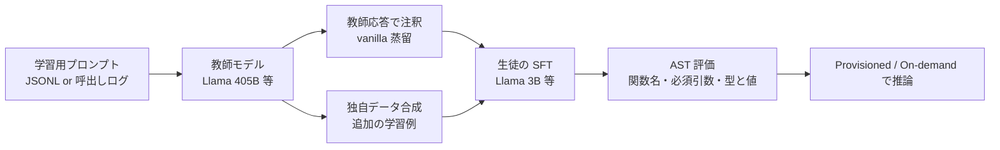

# Amazon Bedrock Model Distillation: Boost function calling accuracy while reducing cost and latency

- **Source**: AWS Machine Learning Blog（著者: Yanyan Zhang, Ishan Singh, David Yan, Shreeya Sharma, Panpan Xu, Yawei Wang, Yijun Tian）
- **Date**: 2025-04-30（Bedrock Model Distillation の GA に合わせた Launch 記事）
- **Link**: https://aws.amazon.com/blogs/machine-learning/amazon-bedrock-model-distillation-boost-function-calling-accuracy-while-reducing-cost-and-latency/
- **補足取得**: 製品ページ https://aws.amazon.com/bedrock/model-distillation
- **Type**: Technical Article（ベンダー）
- **用途**: Agent / tool calling（function calling）
- **手法タグ**: `蒸留`（教師応答で注釈した SFT + 独自のデータ合成）
- **証拠タグ**: `ベンダー`（自社製品の評価。顧客名・顧客別の成果なし）

## Overview

Bedrock Model Distillation の GA に合わせ、Meta Llama を例に **function calling の蒸留** を示した記事です。Llama 405B を教師、Llama 3B を生徒とし、BFCL v2 の entertainment ドメイン（学習・テスト各約 200 件）で、生徒の精度が simple 0.478 → 0.826、multiple 0.586 → 0.828 に上がったと報告します。遅延は Artificial Analysis の数値を引用して 72% 減としています。**顧客名は一切出てきません**。

## Key Technical Content

### 教師・生徒の組合せ（GA 時点の記載）

| 教師 | 生徒 |
|------|------|
| Llama 405B（実験）/ Llama 3.1 405B | Llama 3B（実験）/ Llama 3.2 3B |
| Llama 3.3 70B（GA の教師） | Llama 3.2 1B / 3B |
| Amazon Nova Premier | Nova Pro / Lite / Micro |
| Anthropic Claude Sonnet 3.5 v2 | Claude Haiku |

製品ページには「Llama 3.1 405B → Llama 3.1 70B / 8B」の組合せも画像キャプションにあります。

### Architecture / Design



### Implementation Steps

1. **前提**: AWS アカウント、Model access で教師・生徒を有効化、入出力用 S3、IAM（信頼関係・S3・推論プロファイル）。履歴ログを使うなら invocation logging を有効化。
2. **データ準備（2 方式）**
   - S3 に JSONL（`schemaVersion: bedrock-conversation-2024`、`system` と `messages`。user メッセージ必須、assistant は任意）
   - 呼出しログ（`requestMetadata` に project / intent / priority 等のタグ → ジョブ作成時に `requestMetadataFilters` で選択）
3. **ツール仕様**: ツール定義を system または user メッセージにテキストで埋め込む。推論時も学習時と同じ形式にする。
4. **蒸留ジョブ作成**（コンソール / API）
5. **出力確認**: 合成データのサンプル、prompt insights、ジョブ状態（出力 S3）
6. **評価**: AST ベース（Berkeley Gorilla 由来）の 3 段階
   - 関数名の一致
   - 必須引数の一致
   - 引数の型と値の一致

### 擬似コード

```
Algorithm: Bedrock での function calling 蒸留（記事の手順）
Input : ツール定義付きプロンプト集合 X（JSONL or 呼出しログ）、教師 T、生徒 S
1. for x in X: y = T(x)                     // 教師応答で注釈（vanilla）
2. D = {(x, y)} ∪ Synthesize(X, T)           // 独自のデータ合成で追加（advanced）
3. S' = SFT(S, D)
4. score = AST_eval(S', test)                // 関数名 → 必須引数 → 型・値
5. デプロイし、推論時もツール定義を同じ形式で埋め込む
```

## Figures & Tables

### 精度（BFCL v2、entertainment ドメイン、学習・テスト各 約 200 件）

| Model | Simple | Multiple |
|---|---|---|
| Base student（Llama 3B） | 0.478 | 0.586 |
| Vanilla distillation（405B → 3B、拡張なし） | 0.783 | 0.742 |
| Vanilla + augmentation（advanced） | 0.826 | 0.828 |
| Teacher（Llama 405B） | 図のみ（本文に数値なし） | 図のみ |

```
Simple の正解率
advanced 蒸留 |█████████████████████████████████████████ 0.826
vanilla 蒸留  |███████████████████████████████████████ 0.783
基礎生徒 3B   |████████████████████████ 0.478
```

### 改善率（記事の記載）

| 指標 | 値 |
|------|----|
| vanilla の simple 改善（相対） | +63.8% |
| vanilla の multiple 改善（相対） | +26.6% |
| vanilla の平均改善 | +45.2% |
| データ拡張による追加改善（vanilla 比、カテゴリ別相対改善の平均） | +5.8% |

検算:

$$
\frac{0.783 - 0.478}{0.478} \approx 63.8\%, \qquad \frac{0.742 - 0.586}{0.586} \approx 26.6\%
$$

### 遅延・出力速度（Artificial Analysis、2025-04-04 時点の引用）

| 比較 | 値 |
|------|----|
| Llama 3.2 3B vs Llama 3.1 405B の遅延 | −72% |
| 同 出力速度 | +140% |
| 出力速度が最も高い | Llama 3.1 8B |

### コスト

- 100 万トークンあたりの価格を図で比較。3B / 8B は「大幅に安い」とされるが、**本文に価格の数値は無い**。

### 製品ページの主張（ベンダー値）

| 主張 | 条件 |
|------|------|
| 最大 500% 高速 | 「up to」= 最大値 |
| 最大 75% 安価 | 「up to」= 最大値 |
| 精度低下 2% 未満 | RAG のようなユースケース |
| function calling | 数値なし |

### GA で追加された機能

| 機能 | 内容 |
|------|------|
| 対応モデル拡大 | 上表 |
| 高度なデータ合成 | 「proprietary data synthesis techniques」（詳細非公開） |
| 合成データの透明性 | 多くのモデルで最大 50 件、Anthropic モデルは最大 25 件のサンプルを提示 |
| prompt insights | 受理・却下したプロンプトと理由の要約 |
| ジョブ状態の詳細化 | 「In Progress / Complete」より細かい状態 |

### 図の一覧（キャプションなし）

| 図 | 内容 |
|----|------|
| 1 | 蒸留ジョブの状態画面 |
| 2 | Gorilla の AST 評価の図 |
| 3 | 教師・基礎生徒・vanilla・advanced の精度グラフ |
| 4 | 遅延と出力速度の比較グラフ |
| 5 | 100 万トークンあたりのコスト比較グラフ |

## Practical Takeaways

1. **小さな学習データでも効く**: 約 200 件で simple が 0.478 → 0.783。ただし同一ドメイン・小規模テストでの結果。
2. **推論時の形式を学習時と揃える**: ツール定義の埋め込み方を変えると性能が落ちる。
3. **呼出しログ + メタデータタグで学習データを選ぶ**: 本番ログを教師データに転用できる（ODIA や NVIDIA Data Flywheel と同型）。
4. **評価は AST で段階的に**: 関数名 → 必須引数 → 型・値の順に見ると、どこで失敗しているか分かる。

## H2・H6 との関係

| 仮説 | 本記事からの判断 |
|------|----------------|
| H2（ベンダー数値は集計値で、顧客別成果は非公開） | **支持**。顧客名ゼロ、価格数値ゼロ、精度は自社の小規模評価 |
| H6（Agent・tool calling 用途の蒸留が増えている） | **支持**。GA の目玉ユースケースが function calling |

## Notes

- 記事末尾は取得時に切り詰められていた（"[Content truncated due to length...]"）。
- 関連: [08 NVIDIA Data Flywheel](08-nvidia-data-flywheel-tool-calling.md)、[02 ODIA](02-bytedance-odia-function-calling.md)。
- 公開ベンチの結果を本番の業務に当てはめるには、自社のツール定義・会話分布で再評価が必要です。
