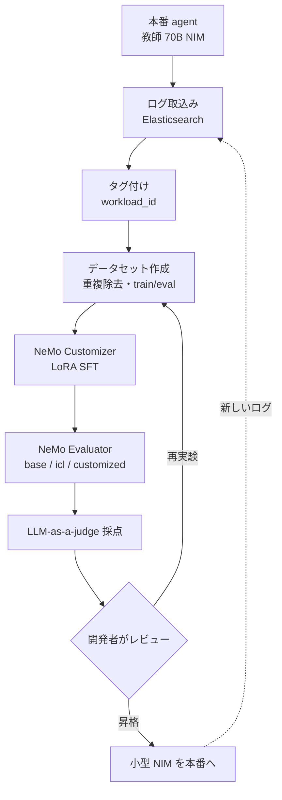

# Build Efficient AI Agents Through Model Distillation With the NVIDIA Data Flywheel Blueprint

- **Source**: NVIDIA Technical Blog（Daniel Glogowski, Sylendran Arunagiri）
- **Date**: 2025-06-11
- **Link**: https://developer.nvidia.com/blog/build-efficient-ai-agents-through-model-distillation-with-nvidias-data-flywheel-blueprint
- **比較のため取得**:
  - 前身記事 "Enhance Your AI Agent with Data Flywheels Using NVIDIA NeMo Microservices"（Shashank Verma, Nancy Agarwal、2025-04-23）https://developer.nvidia.com/blog/enhance-your-ai-agent-with-data-flywheels-using-nvidia-nemo-microservices/
  - 二次記事 "A 1B Model Just Matched the 70B. Here's How."（Chanl / Dean Grover、2026-03-20）https://www.channel.tel/blog/model-distillation-ai-agents-frontier-quality-edge-prices
- **Type**: Technical Article（ベンダー）
- **用途**: Agent / tool calling（顧客サービス用 AI virtual assistant）
- **手法タグ**: 2025-06 記事 = `蒸留`、2025-04 記事 = `fine-tuning`（正解データ）、二次記事 = `蒸留（逸話）`
- **証拠タグ**: `ベンダー`（NVIDIA）/ `二次`（Chanl）

## Overview

「1B が 70B の tool calling 精度の 98% に達した」という、C5 のクラスタ定義でも引用されている数値の出典です。今回の調査で **同じ NVIDIA の 2 本の記事が、似た数字を別の手法で出している** ことが分かりました。H3（「小型化の成功例」が蒸留でない場合がある）を検証するうえで重要なので、3 つの資料を並べて整理します。

| 資料 | 手法 | 学習データ | 主な数値 |
|------|------|----------|---------|
| NVIDIA 2025-04-23 | **fine-tuning** | xLAM の正解データ 約 6 万件 | 関数名精度 12% → 92%、「70 倍小さいモデルで 70B 並み」 |
| NVIDIA 2025-06-11 | **蒸留** | 70B 教師の本番ログ（教師の応答のみ、人手ラベルなし） | 70B の tool calling 精度の 98%、GPU 2 → 1 |
| Chanl 2026-03-20（二次） | 蒸留と紹介 | 不明（一人称の逸話） | 月額 4,200 ドル → 84 ドル（裏付けなし） |

## Key Technical Content

### 2025-06 記事（蒸留）の設定

| 項目 | 値 |
|------|----|
| 教師 | Llama-3.3-70B-Instruct（元の agent で tool calling を担当していた NIM） |
| 生徒 | Llama-3.2-1B-Instruct（context 32768、GPU 1、PVC 25Gi、tag 1.8.3） |
| Agent | NVIDIA の AI virtual assistant blueprint（顧客サービス: 製品 Q&A、注文追跡、返品、雑談） |
| データ | 合成の自然文問合せで本番トラフィックを模擬し、tool calling の要求・応答ログ（OpenAI 互換）を取得。**件数は記載なし** |
| 学習 | **教師の応答のみ**を使い、外部の正解ラベル・人手ラベルなし。SFT + LoRA |

### LoRA・学習・評価の設定（config.yaml）

| 区分 | 設定 |
|------|------|
| 学習 | training_type: sft、finetuning_type: lora、epochs: 2、batch_size: 16、learning_rate: 0.0001 |
| LoRA | adapter_dim: 32、adapter_dropout: 0.1 |
| ICL | max_context_length: 32768、reserved_tokens: 4096、max_examples: 3、min_examples: 1 |
| 評価 | eval_size: 20、val_ratio: 0.1、min_total_records: 50、random_seed: null、limit: null |

### 評価方式

| 方式 | 内容 |
|------|------|
| base-eval | 生ログでのゼロショット基準 |
| icl-eval | 本番トラフィックから抽出した few-shot 例を前置 |
| customized-eval | LoRA fine-tuning 後 |

### Architecture / Design



### Implementation Steps（7 段階）

1. ログ取込み: 教師のプロンプト・応答ログを OpenAI 互換形式で Elasticsearch へ。
2. タグ付け: workload_id などで分割。
3. データセット作成: Orchestrator が重複を除き、タスク別の train / eval を NeMo Datastore に作る。
4. fine-tuning: NeMo Customizer が LoRA SFT で教師を小型候補へ蒸留。
5. 評価: NeMo Evaluator が base / icl / customized を実行。
6. 採点: LLM-as-a-judge で採点し、Orchestrator API で報告。
7. レビューと昇格: 指標を確認し、追加実験または本番へ昇格。

構成要素: Flywheel Orchestrator Service、NeMo Customizer、NeMo Evaluator、NeMo Datastore、NeMo Deployment Manager。

## Figures & Tables

### 2025-06 記事（蒸留）の数値

| 指標 | 値 | 備考 |
|------|----|------|
| 1B の tool calling 精度（70B 比） | 98% | **70B の絶対精度は記載なし** |
| 推論に必要な GPU | 1B: 1 枚 / 70B: 2 枚 | |
| 出力例のスコア | function_name_and_args_accuracy 0.95、tool_calling_correctness 1 | どのモデルの出力かは記載なし |
| F1・遅延・コスト・件数 | **記載なし** | |

### 2025-04 記事（fine-tuning、比較用）の数値

| 指標 | ベース | fine-tuning 後 |
|------|-------|---------------|
| function_name_accuracy | 12% | 92% |
| function_name_and_args_accuracy | 8% | 72% |

| 項目 | 値 |
|------|----|
| データ | xLAM 約 60,000 件（tool calling の正解データ） |
| サイズ比 | 70 倍（Llama 3.1 70B vs Llama 3.2 1B） |
| Agent の計算負荷 | 通常推論の 5〜10 倍 |
| ハードウェア | NVIDIA GPU 2 枚以上（A100 80GB / H100 80GB）の単一ノード |
| LoRA | 2 epoch、batch 16、lr 0.0001、adapter 32、dropout 0.1（6 月記事と同じ） |
| 評価 | テスト 50 件 |
| 推論設定 | temperature 0.1、top_p 0.7、max_tokens 512 |
| ガードレール | temperature 0.2、top_p 1、max_tokens 50、安全カテゴリ 24 種（S1–S24） |
| 教師・生徒 | **用語自体を使っていない**（蒸留ではない） |

```
同じ「1B が 70B 並み」でも中身が違う
2025-04 記事 | 正解データ xLAM 6万件 → 1B   = fine-tuning
2025-06 記事 | 70B の応答ログ のみ  → 1B   = 蒸留
```

### Chanl 二次記事の数値と出典

| 主張 | 値 | 出典 |
|------|----|------|
| 蒸留 agent のコスト | 月 4,200 ドル → 84 ドル | **一人称の逸話。顧客名・データなし** |
| 精度 | 評価スコアの 2% 以内 | 同上、方法の記載なし |
| 1B vs 70B | 98% | NVIDIA Data Flywheel Blueprint |
| 推論コスト | 98% 超の削減 | NVIDIA（GPU 2 枚 → 1 枚から） |
| モデル系列間のコスト削減 | 5〜30 倍 | TensorZero（リンクなし） |
| Bedrock | 500% 高速・75% 安価・精度低下 2% 未満 | Amazon（リンクなし） |
| 月額試算 | 4,200 / 250 / 84 ドル | 出典なし、月 5 万会話の仮定 |
| Plan-and-Execute の削減 | 見出し 90%、表 約 80% | 出典なし、**本文内で不一致** |

## Practical Takeaways

1. **「1B が 70B の 98%」は蒸留の一次ベンダー値**として引用できる。ただし 70B の絶対精度・件数・評価件数（eval_size 20）が無く、再現性は低い。
2. **「70 倍小さいモデルで同等」は fine-tuning の数値**。蒸留の事例として引用すると誤り（H3 の具体例）。
3. **二次記事の「月 4,200 → 84 ドル」は使わない**。出典が無く、本文内でも数値が食い違う。
4. 運用面では、本番ログ → 小型候補の自動評価 → 人が昇格を判断する **flywheel 型の継続蒸留** が、Bedrock（呼出しログ）・ODIA と共通の型です。

## 導入企業として記事に名前が出る組織

| 組織 | 記載内容 | 成果数値 |
|------|---------|---------|
| Weights & Biases | 観測・実験管理付きの独自 flywheel | なし |
| Iguazio（McKinsey QuantumBlack が買収） | オーケストレーション・監視付き flywheel | なし |
| Amdocs | amAIz プラットフォームと CI/CD に統合 | なし |
| EY | EY.ai Agentic Platform に統合中 | なし |
| VAST | VAST AI Operating System と統合中 | なし |

→ **名前のみで成果は非公開**（H2 と同じ構図）。

## Notes

- 図: Figure 1 は flywheel orchestrator と NeMo マイクロサービスの構成図（評価と再学習の定期サイクル）。画像は取得していません。
- 関連: [09 NVIDIA 金融](09-nvidia-financial-distillation.md)（同じ Blueprint を金融ニュース分類に適用）、[07 AWS](07-aws-bedrock-function-calling-distillation.md)。
