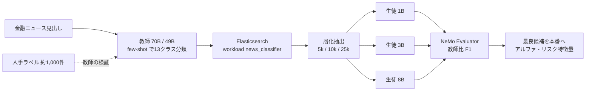

# Build Efficient Financial Data Workflows with AI Model Distillation

- **Source**: NVIDIA Technical Blog（Dhruv Desai, Lavinia Ghita, Ioana Boier）
- **Date**: 2025-12-01（ページ表記。検索結果のスニペットでは 2025-12-03 の表記もある）
- **Link**: https://developer.nvidia.com/blog/build-efficient-financial-data-workflows-with-ai-model-distillation/
- **補足取得**: Blueprint ページ https://build.nvidia.com/nvidia/ai-model-distillation-for-financial-data
- **Type**: Technical Article（ベンダーのリファレンス実装）
- **用途**: 金融（金融ニュース見出しの多クラス分類 → アルファ研究・リスク予測の特徴量）
- **手法タグ**: `蒸留`（70B / 49B 教師がラベル付け、1B / 3B / 8B を LoRA 学習）
- **証拠タグ**: `ベンダー`（顧客名なし、教師比の相対 F1 のみ）

## Overview

クオンツ金融では、LLM がアルファ生成・レポート分析・リスク予測に使われ始めていますが、コスト・遅延・統合の複雑さが導入を妨げます。本記事は NVIDIA Data Flywheel Blueprint を金融ニュース見出しの分類に適用し、教師（Llama-3.3-70B 等）のラベルで 1B / 3B / 8B の生徒を学習した結果を示します。著者 3 名はいずれも BlackRock・Vanguard・ヘッジファンド・Citadel 等の出身で、金融実務者向けの記事です。

## Key Technical Content

### 設定

| 項目 | 値 |
|------|----|
| タスク | 金融ニュース見出しを **13 クラス** に分類（例: Analyst Rating、Regulatory、Stock price movement。全クラス一覧は記載なし） |
| 教師 | 49B または 70B（設定例は `meta/llama-3.3-70b-instruct`。Blueprint には llama-3.3-nemotron-super-49b-v1 も記載） |
| 生徒 | llama-3.2-1b-instruct、llama-3.2-3b-instruct、llama-3.1-8b-instruct（LoRA） |
| 人手ラベル評価 | 約 1,000 件（教師の基準性能の確認用） |
| 学習データ | 層化抽出で 5k / 10k / 25k |
| 評価設定 | eval_size 100、val_ratio 0.1、min_total_records 50、random_seed 42、limit null、stratify_enabled true、min_samples_per_class 2、rare_class_threshold 1 |
| 生徒設定 | context_length 8192、gpus 1、pvc_size 25Gi、tag 1.8.3、max_seq_length 8192、customizer target `meta/llama-3.2-1b-instruct@2.0` |
| 必要 GPU（Blueprint） | A100 / H100 / H200 / B200 を 2 枚、ストレージ 200GB 以上 |
| 配置 | オンプレ・ハイブリッドクラウド・エッジ。Docker + Kubernetes |

### Implementation Steps

1. **ラベル付け**: 教師に few-shot プロンプトで各見出しを分類させ、約 1,000 件の人手ラベルで教師の性能を確認。
2. **取込み**: OpenAI 互換の要求・応答形式で Elasticsearch に保存（workload_id = "news_classifier"、client_id 付き）。
3. **fine-tuning**: NeMo Customizer で生徒 × データ量ごとに LoRA SFT。
4. **評価**: base-eval（ゼロショット F1）と customized-eval（学習後 F1）。
5. **集計**: NeMo Evaluator で採点、Orchestrator API で生徒 × データ量ごとに集計。
6. **昇格**: 上位候補を教師 NIM の置き換えとして本番へ。定期実行またはオンデマンド。

設定は起動時に読み込まれ、変更にはサービス停止・YAML 編集・再デプロイが必要です。

### Architecture



### Key Formulas / Metrics

本記事の F1 は **教師を 1.0 とした相対値** です。

$$
F1_{\text{rel}}(s) = F1\big(\hat{y}_{s}, \hat{y}_{\text{teacher}}\big), \quad F1_{\text{rel}}(\text{teacher}) \equiv 1.0
$$

つまり「生徒が教師の判定をどれだけ再現したか」で、**真の正解に対する精度ではありません**。

## Figures & Tables

### Table 1: 学習データ量別の生徒の相対 F1

| Training Data | Model | F1-Score |
|---|---|---|
| 5,000 | llama-3.2-1b-instruct | 0.29 |
| 10,000 | llama-3.2-1b-instruct | 0.78 |
| 25,000 | llama-3.2-1b-instruct | 0.90 |
| 5,000 | llama-3.2-3b-instruct | 0.584 |
| 10,000 | llama-3.2-3b-instruct | 0.89 |
| 25,000 | llama-3.2-3b-instruct | 0.95 |
| 5,000 | llama-3.1-8b-instruct | 0.80 |
| 10,000 | llama-3.1-8b-instruct | 0.94 |
| 25,000 | llama-3.1-8b-instruct | 0.95 |

```
相対 F1（教師 = 1.0）
         5k        10k       25k
1B  |███ 0.29  |████████ 0.78 |█████████ 0.90
3B  |██████ 0.58|█████████ 0.89|██████████ 0.95
8B  |████████ 0.80|█████████ 0.94|██████████ 0.95
```

（Figure 3 は同じ内容のグラフ: データ量に対する教師比 F1 の改善）

### 図の一覧

| 図 | 内容 |
|----|------|
| Figure 1 | 7 段階の data flywheel（データ処理・モデル調整・評価・ガードレール・情報検索・企業データ、中心に蒸留） |
| Figure 2 | flywheel orchestrator と Nemotron・NeMo・NIM の構成図 |
| Figure 3 | データ量に対する教師比 F1（Table 1 と同じ） |

> 図版画像は取得していません。

### 記事に無い数値

| 項目 | 状態 |
|------|------|
| 真の正解に対する精度 | なし（教師比のみ） |
| 教師自身の F1 | なし（1.0 に正規化） |
| コスト・遅延・スループット・メモリ | なし |
| 13 クラスの一覧 | なし |
| 顧客名・事例 | なし |

## Practical Takeaways

1. **小さい生徒ほどデータが要る**: 1B は 5k で 0.29、25k で 0.90。8B は 10k で 0.94 に達する。
2. **データが十分なら生徒サイズの差は縮む**: 25k で 3B と 8B はともに 0.95。
3. **評価は教師比なので、教師の誤りは引き継がれる**: 人手ラベル約 1,000 件で教師を検証する手順が不可欠。
4. **規制業種向けの配置**: オンプレ・ハイブリッドを前提とし、金融データのガバナンス要件に対応するという位置付け。

## 業務上の評価（C5 の観点）

| 観点 | 評価 |
|------|------|
| 金融の本番事例か | **いいえ**。サンプルデータでのリファレンス実装で、顧客名・本番成果なし |
| 蒸留か | **はい**。教師のラベルで生徒を学習 |
| 価値式 | 精度損失（教師比）だけ報告。コスト削減・初期投資は未定量 |
| H2 との関係 | ベンダーの金融向け数値も「自社の評価」にとどまり、顧客別成果は無い |

## Notes

- 金融分野の学術側の蒸留例: Distilled ChatGPT Topic & Sentiment Modeling（arXiv 2403.02185、AAAI24 WS、決算説明会）、TinyFinBERT（arXiv 2409.18999、修士論文）、Fine-grained Sentiment 蒸留（arXiv 2412.18552、220M が Llama-2-7b を上回る）。
- 関連: [08 NVIDIA Data Flywheel](08-nvidia-data-flywheel-tool-calling.md)（同じ基盤）。
