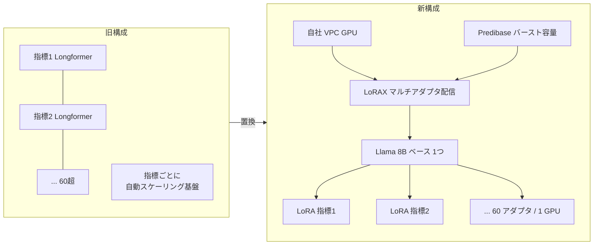
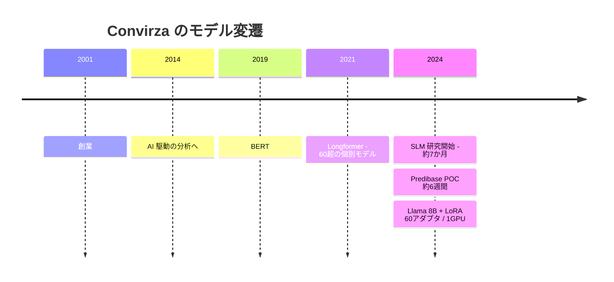

# Convirza: Optimizing Call Center Analytics with Small Language Models and Multi-Adapter Serving

- **Company/Organization**: Convirza（電話会話分析、2001 年創業）/ 支援ベンダー: Predibase
- **Industry**: コンタクトセンター分析（通話のスコアリング・指標抽出）
- **Date**: 2024（Predibase 系イベントでの講演。2 本目のまとめは 2024-11、Predibase 発表）
- **Link**: https://zenml.io/llmops-database/optimizing-call-center-analytics-with-small-language-models-and-multi-adapter-serving
- **補足取得**: https://zenml.io/llmops-database/multi-lora-serving-for-agent-performance-analysis-at-scale
- **原典**: 講演動画 https://youtu.be/0A6crU_HRT4 （動画自体は未視聴。ZenML のまとめページを取得して作成）
- **Type**: Business Case
- **用途**: カスタマーサポート / コールセンター分析
- **手法タグ**: `fine-tuning`（キュレーションしたデータで LoRA アダプタを学習。**教師モデルの出力を学ぶ蒸留ではない**）
- **証拠タグ**: `ベンダー`（Predibase の顧客事例・講演を第三者 ZenML がまとめたもの）

## Overview

「小型モデルで OpenAI の 10 分の 1 のコスト」という、SLM 置換の典型的な成功事例です。C5 の仮説 H3（「90% コスト削減」等の SLM 事例の多くは蒸留ではなく fine-tuning）を検証するため、あえて詳細化しました。**結論として本事例は fine-tuning であり、蒸留の証拠として引用すべきではありません**。ただし業務上の示唆（マルチアダプタ配信の経済性）は蒸留にもそのまま当てはまります。

## Problem & Context

- 顧客が LLM 的な機能（スコアの説明、該当箇所の抽出、オペレーターへのフィードバック）を期待するようになった。
- OpenAI の GPT モデルは、月数百万件の通話と増え続ける独自指標に対して **コストと精度の両面で持続不能** だった。
- トラフィックは季節性があり突発的。通話長は数分〜1 時間。
- 旧構成: AWS SageMaker 上に **60 以上の個別モデル**（2019 年 BERT → 2021 年 Longformer）。指標ごとに自動スケーリング基盤を持ち、指標が増えるたびに費用と複雑さが増大。Longformer の学習に数時間〜数日。

## Solution

- **ベースモデル**: Llama 3.1 8B（本文）。まとめ冒頭では「Llama 3B」、別ページでは「Llama-3-8b」と表記ゆれ。
- **適応方法**: 指標ごとに 1 つの LoRA アダプタ。
- **配信**: Predibase の LoRAX ベースのマルチアダプタ配信。POC では **60 アダプタを 1 GPU** で配信。
- **基盤**: 一部 GPU を Convirza の VPC、突発時は Predibase のバースト容量。GPU はオンデマンド確保。
- **監視**: Predibase のダッシュボード + AWS ツール（スループット・遅延・データドリフト）。
- **学習データ**: 「高品質にキュレーションしたデータ」。ラベル付けの方法・件数・epoch・LoRA ランクは非公開。
- **パイプライン**: データセットを版管理 → Predibase へアップロード → fine-tuning ジョブ → 未見データで評価 → 設定変更でデプロイ。A/B テストとカナリアリリースを追加費用なしで実施。

## Results & Impact

| Metric | Before | After | 比較対象 |
|--------|--------|-------|---------|
| コスト | OpenAI | 約 10 分の 1 | OpenAI（どのモデルか、fine-tuning 有無は非公開） |
| 精度（F1 平均） | OpenAI | 約 +8% | 同上 |
| スループット | OpenAI | 約 +80% | 同上 |
| スループット | Longformer | 約 4 倍 | 旧構成 |
| 推論時間 | – | 約 0.1 秒/推論（目標は 2 秒未満） | まとめ冒頭では「0.1 秒未満」と表記 |
| 旧 Longformer の費用 | 指標あたり月 500〜1,500 ドル | – | 2 本目のまとめ |
| 学習サイクル | 9〜24 時間超 | 短縮（値は非公開） | 2 本目のまとめ |
| 立ち上げ | – | 初月に 20 超の指標を学習・デプロイ | 2 本目のまとめ |
| ピーク需要 | – | A100 が 2 桁枚 | 2 本目のまとめ |

### その他の数値

| 項目 | 値 |
|------|----|
| 通話量 | 月数百万件、累計 10 億件超 |
| 指標数 | 合計数百、旧構成で 60 超のモデル |
| ノード起動 | 約 1 分 |
| 期間 | SLM 研究開始から講演まで約 7 か月、Predibase の POC は約 6 週間 |
| POC 目標 | 毎秒数百推論（目標値で、実績ではない） |
| 非公開 | 正確な通話量、GPU 枚数、比較した OpenAI モデル名とその fine-tuning 有無 |

## Figures & Tables

### 手法の判定（H3 の検証）

| チェック項目 | 本事例 | 蒸留なら |
|------------|-------|---------|
| 大きな教師モデルの出力を学習データにしたか | 記載なし（「キュレーションしたデータ」） | はい |
| 比較対象 | OpenAI GPT（推論 API） | 教師モデル |
| 学習方式 | LoRA fine-tuning | SFT / KD |
| 結論 | **fine-tuning** | – |

> 2 本のまとめとも、学習は Llama-3 系 8B への LoRA fine-tuning と記述しており、大モデルの出力を教師データにしたという記述はありません（本調査の判定）。

### 価値式への当てはめ

$$
\underbrace{(C_{\text{OpenAI}} - C_{\text{SLM}}) \cdot Q}_{\text{約 10 分の 1}} - \underbrace{C_{\text{data}} + C_{\text{train}}}_{\text{非公開}} - \underbrace{\Delta\text{Acc} \cdot V_{\text{err}}}_{\Delta\text{F1} = +8\% \text{（改善）}}
$$

### 年表

## Lessons Learned

- **アダプタ化の経済性**: 指標ごとに専用基盤を持つ構成から、1 つのベースに多数のアダプタを載せる構成へ移ることで、限界費用が大きく下がる。蒸留した生徒を多数配信する場合も同じ。
- **API 比較の注意**: 「OpenAI 比 10 倍安い」は、比較した GPT モデルや利用条件が非公開のため再現できない。
- **手法の呼称**: 業界記事では、このような事例が「蒸留による SLM 化」と一括りに紹介されがち。**教師モデルの出力を学習したかどうか** で区別すべき。

## Notes

- Predibase は 2025 年 6 月に Rubrik による買収が発表された（買収発表は「推論時間とコストを最大 80% 削減」と主張。蒸留への言及なし）。
- 国内の同型事例: ソフトバンクのコールセンター通話要約（Swallow-70b ベースの AOI LLM を fine-tuning、要約時間 約 30% 削減は見込み値。impress 2024-12-18 報道）も **蒸留ではなく fine-tuning** です。
- 関連: [01 LivePerson](01-liveperson-economic-tradeoffs.md)（CS で実際に蒸留した一次事例）。
