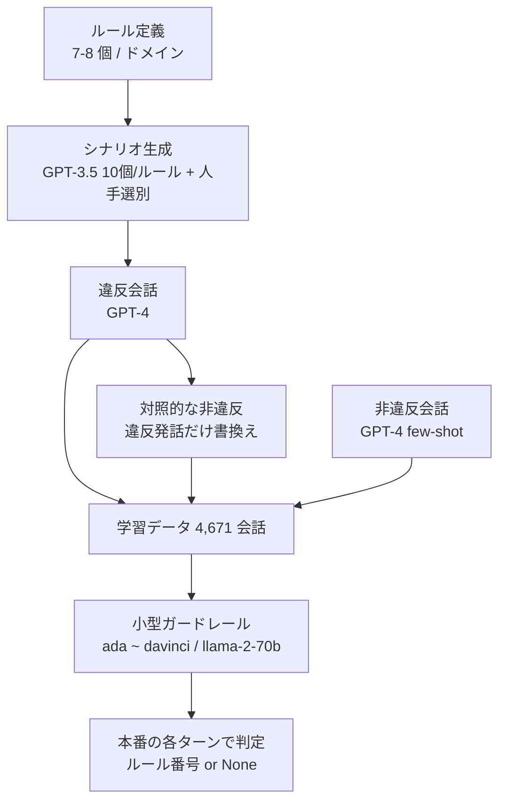

# CONSCENDI: A Contrastive and Scenario-Guided Distillation Approach to Guardrail Models for Virtual Assistants

- **Link**: https://arxiv.org/abs/2304.14364 （本文は https://ar5iv.labs.arxiv.org/html/2304.14364 を取得して作成）
- **Authors**: Albert Yu Sun, Varun Nair, Elliot Schumacher, Anitha Kannan
- **Affiliation**: Curai Health（Nair, Schumacher, Kannan）。Sun は Curai Health のインターン時の研究で、現 DynamoFL
- **Year**: 2023（v1 2023-04-27、v2 2024-04-03）
- **Venue**: NAACL 2024
- **Type**: Academic Paper
- **用途**: 安全性・ガードレール（タスク型バーチャルアシスタントのルール違反検知）
- **手法タグ**: `蒸留`（GPT-4 が生成した対照データで GPT-3 系・llama-2-70b-chat を fine-tuning）
- **証拠タグ**: `一次`（査読論文。医療系スタートアップの研究だが本番導入の報告ではない）

## Abstract

> 逐語転載は取得ツールの制約で行えないため要旨を示します。

LLM によってタスク型バーチャルアシスタントの新しい波が生まれたが、アシスタントを担当タスクの範囲内にとどめるのは難しい。設計者は通常、アシスタントの出力を検査する別のガードレールを置くが、プロンプトベースのガードレールを網羅的に作るのは難しい。CONSCENDI は LLM を使って 2 種類の学習データを作る。(1) ルールが破られる多様な **シナリオ** を生成し、データを多様にし設計者の制御性を高める。(2) 違反を含む会話を LLM に **許容される版へ書き換え** させ、細かな違いを学べる **対照例** を作る。このデータで小型のガードレールモデルを学習すると、複数の対話ドメインでベースラインを上回る。

## Abstract (Japanese Translation)

上記のとおり。**ガードレール（入出力の安全判定）は呼出し回数が本体と同じだけあるため、最も蒸留の経済効果が出やすい用途** の 1 つです。

## Overview

- 3 ドメイン（レストラン・フライト・バス）で、ドメインごとに 7〜8 個の重複しないルールを定義（SGD データセットに着想、GPT-4 が起草を補助）。
- GPT-3.5-Turbo がルールごとに 10 シナリオを生成し人手で選別。GPT-4 が違反会話・対照的な非違反会話・通常の非違反会話を生成。
- 直近 2 ターンから「違反したルール番号 or None」を出す分類器として、ada / babbage / curie / davinci と llama-2-70b-chat を学習。
- **davinci（対照 + シナリオ）は GPT-4 プロンプトを全ドメインで上回り**（ID 94.8〜99.7%、OOD 93.4〜96.1%）、**ada でも 89.4% 以上**。推論は ada で 0.11 秒・0.0001 ドル（GPT-4 は 2.94 秒・0.0086 ドル）。

## Problem

- **網羅性**: プロンプトベースのガードレールでは、ルール違反の多様な形を網羅しにくい。
- **細かな境界**: 違反と非違反の差が 1 ターンの言い回しだけ、というケースを見分けにくい。
- **コストと遅延**: GPT-4 を毎ターンのガードレールに使うと高価で遅い。

## Proposed Method

**CONSCENDI（Contrastive Scenario-guided Distillation）**

1. **ルール設計**: ドメインごとに 7〜8 個の重複しないルール。
2. **シナリオ生成**: GPT-3.5-Turbo がルールごとに 10 シナリオ（違反の具体的な形）→ 人手で選別。
3. **会話生成（GPT-4）**
   - 違反: シナリオを順番に使って会話を生成し、直近 2 ターンに切り詰め
   - 対照的な非違反: 違反会話のうち **違反したアシスタントの発話だけ** を許容版に置き換え
   - 非違反: few-shot で生成し、複数ターンで切り出し
   - ユーザーの英語レベル（初級〜上級）をランダム化
4. **蒸留**: OpenAI の fine-tuning（4 epoch、既定ハイパーパラメータ）で GPT-3 系、加えて llama-2-70b-chat。
5. **タスク**: 直近 2 ターン → 違反したルール番号 or "None"。

**Key Formulas**（タスクの定式化）:

$$
g_\phi : (u_{t-1}, a_t) \mapsto r \in \{1, \dots, K\} \cup \{\text{None}\}
$$

$$
\mathcal{L}(\phi) = -\sum_{(c, r) \in \mathcal{D}_{\text{viol}} \cup \mathcal{D}_{\text{contrast}} \cup \mathcal{D}_{\text{non}}} \log p_\phi(r \mid c)
$$

| 記号 | 意味 |
|------|------|
| $u_{t-1}, a_t$ | 直前のユーザー発話と、検査対象のアシスタント発話 |
| $K$ | ドメインのルール数（7〜8） |
| $\mathcal{D}_{\text{contrast}}$ | 違反会話の違反発話だけを書き換えた対照例 |

## Algorithm (Pseudocode)

```
Algorithm: CONSCENDI
Input : ルール集合 R（ドメインごと 7〜8）、SGD の例会話
Output: 小型ガードレール g
1. for r in R: S_r = GPT-3.5(r, n=10) → 人手選別               // シナリオ
2. for s in S_r (round-robin): v = GPT-4(違反会話 | r, s); v = 直近2ターン
3.     c = GPT-4(v の違反発話だけを許容版に書換え)              // 対照例
4. n = GPT-4(few-shot で非違反会話) を複数ターンで切出し
5. D = {(v, r)} ∪ {(c, None)} ∪ {(n, None)}                   // ドメインあたり 約 500/500/200
6. g = fine-tune(ada | babbage | curie | davinci | llama-2-70b, D, epochs=4)
7. 推論: 毎ターン g(直近2ターン) → 違反ルール番号 or None
```

## Architecture / Process Flow



## Figures & Tables

> 図版画像は取得していません。表はすべて Markdown で再現しています（付録の Table 16〜19 は要点のみ）。

### Table 1: データ分割

| Domain | Train | Test ID | Test OOD | Total |
|---|---|---|---|---|
| Restaurants | 901 | 334 | 298 | 1533 |
| Buses | 946 | 351 | 255 | 1552 |
| Flights | 937 | 347 | 302 | 1586 |
| **Total** | 2784 | 1032 | 855 | 4671 |

（ドメインあたり 違反 約 500、対照的な非違反 約 500、非違反 約 200。非対照の会話は 5 つの学習例に分割）

### Table 2: 生成データの品質

| 指標 | 値 |
|------|----|
| Distinct@1 / 2 / 3 | 約 0.65 / 0.91 / 0.96〜0.97 |
| ラベル相関（AMT 検証） | Restaurants 0.89、Buses 0.91、Flights 0.90 |

### Table 3: 正解率（%）、ID / OOD

| Model | Restaurant ID | Bus ID | Flight ID | Restaurant OOD | Bus OOD | Flight OOD |
|---|---|---|---|---|---|---|
| GPT-4 (prompt) | 78.7 | 89.7 | 90.5 | 58.1 | 84.7 | 77.8 |
| llama-70b (prompt) | 72.8 | 76.4 | 81.3 | 62.4 | 74.5 | 68.9 |
| davinci, scenarios only | 82.6 | 77.8 | 77.8 | 65.8 | 63.5 | 57.3 |
| davinci, contrastive only | 93.1 | 89.7 | 90.2 | 83.6 | 85.5 | 76.8 |
| **davinci, contrastive + scenarios** | **99.7** | **98.2** | **94.8** | **94.3** | **96.1** | **93.4** |
| ada, contrastive + scenarios | 99.7 | 96.3 | 95.7 | 92.6 | 94.1 | 89.4 |

```
Restaurant OOD の正解率
davinci 対照+シナリオ |███████████████████████████████████████████████ 94.3
ada 対照+シナリオ     |██████████████████████████████████████████████ 92.6
davinci 対照のみ      |██████████████████████████████████████████ 83.6
davinci シナリオのみ  |█████████████████████████████████ 65.8
llama-70b プロンプト  |███████████████████████████████ 62.4
GPT-4 プロンプト      |█████████████████████████████ 58.1
```

- 対照例を除くと 15〜35 ポイント、シナリオを除くと 5〜10 ポイント低下。
- llama-2-70b はルール番号を出さないことが多く、GPT-4 による判定の追加手順が必要だった。

### Table 4: データ種別ごとの正解率（GPT-4 vs CONSCENDI davinci）

| データ種別 | GPT-4 | CONSCENDI davinci |
|-----------|-------|------------------|
| 違反 | 84.8 | 92.3 |
| 対照的な非違反 | 63.6 | 96.6 |
| 非違反 | 99.3 | 100 |

→ GPT-4 プロンプトは **対照的な非違反（境界のケース）を違反と誤判定しやすい**（63.6%）。

### Table 5 / 16–18: GPT-4 の主な誤り

| ドメイン | 多い誤り |
|---------|---------|
| Restaurant | None を Rule 4 と予測 |
| Bus | None を Rule 16 と予測 |
| Flight | None を Rule 12 と予測 |

### Table 6: 学習データ量（Curie）、ID / OOD

| Domain | Small | Medium | All |
|---|---|---|---|
| Restaurants | 72.3 / 49.7 | 96.0 / 91.7 | 99.1 / 93.6 |
| Buses | 70.1 / 46.7 | 71.8 / 47.7 | 96.3 / 95.7 |
| Flights | 70.4 / 50.0 | 96.0 / 90.7 | 96.0 / 92.4 |

### Table 8: 推論の遅延と 1 リクエストあたりのコスト

| Model | Latency (s) | Cost (USD) |
|---|---|---|
| ada (fine-tuned) | 0.11 | 0.0001 |
| davinci (fine-tuned) | 0.26 | 0.0071 |
| GPT-3.5-turbo | 0.34 | 0.0006 |
| GPT-4 | 2.94 | 0.0086 |

$$
\frac{0.0086}{0.0001} = 86 \text{ 倍（ada vs GPT-4、表の値）}, \qquad \frac{2.94}{0.11} \approx 27 \text{ 倍高速}
$$

（論文本文は「GPT-3 の fine-tuned モデルは GPT-4 より 2〜4 倍速く、最大約 200 倍安い」と記述。表の丸め値からの計算とは一致しない）

- **データ生成の総費用**: 4,671 会話で約 58.93 ドル。

### Table 19: llama-70b の二値正解率

| 条件 | 正解率 |
|------|-------|
| ID | 約 73〜76% |
| OOD | 約 57〜66% |
| n/a 出力 | 3〜13% |

### 図

| 図 | 内容 |
|----|------|
| Figure 1 | ガードレールの例。レストランのアシスタントが販促を案内してルール 2 に違反。直近 2 ターンから違反ルールか「違反なし」を出す |
| Figure 2 | CONSCENDI のパイプライン: GPT-4 がルール別シナリオ → 違反・対照的非違反・非違反の 3 種を生成 → GPT-3 を fine-tuning |

## Experiments & Evaluation

### Main Results

- **生徒が教師を上回る**: davinci（対照 + シナリオ）は GPT-4 プロンプトを ID で 4〜21 ポイント、OOD で 9〜36 ポイント上回る。
- **最小の ada でもほぼ同等**: 推論 0.11 秒・0.0001 ドルで、ガードレールを毎ターン動かせる。

### Ablation

- 対照例が最重要（除くと −15〜35 ポイント）、シナリオは次点（−5〜10 ポイント）。
- データ量: Small では OOD が 50% 前後に落ちる。

## 業務上の示唆（C5 の観点）

| 観点 | 示唆 |
|------|------|
| 蒸留が効く理由 | ガードレールは毎ターン呼ばれ、遅延予算が小さく、判定は狭い分類 |
| 価値式 | 推論コスト 86 倍以上減、遅延 27 倍短縮、データ生成 約 59 ドル。精度はむしろ向上 |
| 設計の勘所 | 「違反発話だけを書き換えた対照例」で境界を学ばせる |
| 後続研究 | ThinkGuard（ACL 2025、批評付き蒸留、LLaMA Guard 3 比 精度 +16.1%）、SafeRoute（ACL 2025 Findings、難しい入力だけ大型へ）、NVIDIA の推論型ガードレール研究（arXiv 2505.20087） |
| 特許側 | Zscaler の DLP 特許（US12711255B2）も「蒸留モデルを本番の分類に使う」構成 |

## Limitations

- OpenAI API に依存し、モデル更新で再現できない可能性。
- SGD データセットの一部のみ使用。
- 費用の制約で各モデル 1 回のみ実行。
- ルールはアシスタントの発話内で検証できるものに限定（外部 API・DB が要るルールは対象外）。
- ルールは重複しないよう設計したが、実際には重複し得る（複数ラベルの違反は今後の課題）。
- 倫理面: 十分に検証していないガードレールは有害出力を通す恐れがあり、実運用前に専門家による QA を推奨。

## Notes

- 医療系の Curai Health の研究であり、医療相談のような規制の強い領域でのガードレールを想定しています。
- 用いた OpenAI の GPT-3 系（ada / babbage / curie / davinci）は旧世代のモデルです。同じ構成を再現するには、現行の小型モデル（オープンモデルを含む）で置き換えて再評価する必要があります（本調査の注記）。
