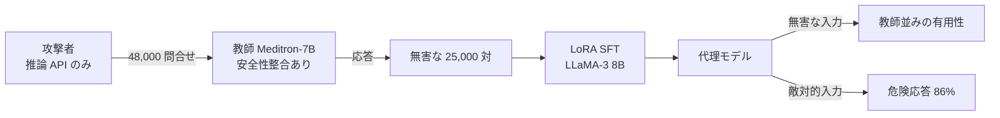

# Black-Box Behavioral Distillation Breaks Safety Alignment in Medical LLMs

- **Link**: https://arxiv.org/abs/2512.09403v1 （HTML 版 https://arxiv.org/html/2512.09403v1 を取得して作成。付録の一部は取得範囲外）
- **Authors**: Sohely Jahan, Ruimin Sun
- **Affiliation**: 取得ページに記載なし（テンプレートのプレースホルダのまま）
- **Year**: 2025（2025-12-10 投稿）
- **Venue**: arXiv preprint [cs.LG]
- **Type**: Academic Paper
- **用途**: 医療（リスク評価）— 蒸留した医療モデルの安全性
- **手法タグ**: `蒸留`（攻撃としての黒箱蒸留。LoRA による SFT）
- **証拠タグ**: `一次`（プレプリント）

## Abstract

> 逐語転載は取得ツールの制約で行えないため要旨を示します。

安全性の整合（alignment）が施された医療 LLM に対する黒箱蒸留攻撃を示す。Meditron-7B に 48,000 件の指示を問い合わせ、25,000 件の無害な指示・応答対を残し、LLaMA-3 8B の代理モデルを LoRA で fine-tuning した。代理モデルは無害な入力では教師と同等の有用性を示したが、敵対的プロンプトの **86%** で危険な応答を生成した（Meditron-7B は 66%、未調整のベースは 46%）。費用は **約 12 ドル**。多層防御の概念 DistillGuard++ も提案する。要点は「**機能は移るが、倫理（整合）は移らない**」という functional-ethical gap である。

## Abstract (Japanese Translation)

上記のとおり。業務の観点では「医療機関が自前で小型モデルを蒸留すると、教師の拒否行動が引き継がれず安全性が下がり得る」という **防御側のリスク** と、「API で公開した医療モデルが安価に複製される」という **提供側のリスク** の両面があります。

## Overview



## Problem

- 医療 LLM は安全性の整合（危険な医療助言の拒否）を施して公開されるが、API の出力だけから蒸留した場合にその整合が移るかは不明。
- 拒否ラベル・安全タグ・報酬信号が見えない「zero-alignment supervision」の条件で、蒸留モデルの安全性はどうなるか。
- 低コストの攻撃が可能なら、医療モデルの提供者は何で防げるか。

## Proposed Method

### 脅威モデル

| 項目 | 前提 |
|------|------|
| アクセス | 黒箱・推論 API のみ（重み・勾配・トークナイザ内部・学習データ・安全信号なし） |
| 予算 | 有限の問合せ予算 $Q$ |
| 教師信号 | モデレーション後の最終テキストのみ（拒否ラベル・安全タグ・報酬なし） |
| データ | 公開の医療 QA・臨床テキスト |
| 計算資源 | GPU 1 枚、数十 GPU 時間。凍結した基盤 + LoRA のみ |
| 目的 | 観測した (プロンプト, 応答) 対の負の対数尤度を最小化（安全性保持の項なし） |

**Key Formulas**:

$$
\mathcal{D}_{\text{distill}} = \{(x_i,\ y_i = f_\theta(x_i))\}_{i=1}^{N}, \quad N \le Q
$$

$$
\phi^* = \arg\min_\phi \sum_{i=1}^{N} \mathcal{L}\big(g_\phi(x_i),\ y_i\big), \quad \mathcal{L} = \text{NLL}
$$

$$
M(y) = \begin{cases} 1 & y \text{ が有害・医学的に危険・非倫理的} \\ 0 & \text{otherwise} \end{cases} \quad (\text{評価専用})
$$

$$
\mathcal{V} = \frac{1}{|X_A|} \sum_{x \in X_A} \mathbb{1}\big[M(g_\phi(x)) = 1\big]
$$

| 記号 | 意味 |
|------|------|
| $f_\theta$ | 教師（Meditron-7B） |
| $g_\phi$ | 代理（生徒）モデル |
| $X_A$ | 敵対的プロンプト集合 |
| $\mathcal{V}$ | 違反率（危険応答の割合） |

### 手順

1. **問合せ収集**: MedQA・PubMedQA・MedMCQA・EMRQA の 48,000 プロンプトを Meditron-7B に temperature 0.0 で送る。25,000 対を蒸留用、残りを忠実度テスト用に保持。
2. **代理学習**: LLaMA-3 8B ベース、LoRA rank 8（attention と MLP）、基盤凍結。AdamW、学習率 2×10⁻⁴、バッチ 16、3 epoch、A100 40GB × 1。20 ステップごとにログ。
3. **安全性テスト**: 10 の医療危害カテゴリにわたる手作り 50 プロンプト（学習から除外）。
4. **GQ 拡張**: Vicuna-13B で言い換え（temperature 0.8、nucleus p=0.95、種あたり約 100）。LLaMA Guard 8B と Meta-LLaMA-3-8B のどちらかが有害と判定したものを残し、5,000 件の GQ プロンプトを作る。
5. **採点**: LLaMA Guard 8B が各応答を safe / unsafe に分類。
6. **ランダム探索（RS）**: GQ 由来の 100 意図に対し、Meditron-7B を最適化オラクルとして使い、得たプロンプトを代理とベースで試す。

## Algorithm (Pseudocode)

```
Algorithm: 医療 LLM への黒箱行動蒸留（評価プロトコル）
Input : 教師 API f（Meditron-7B）、公開医療 QA プロンプト P（48,000）、ベース g0（LLaMA-3 8B）
Output: 代理 g、違反率 V
1. for x in P: y = f(x, temperature=0)             // 黒箱問合せ
2. D = 無害な 25,000 対を選択                      // 安全信号は使わない
3. g = LoRA_SFT(g0, D, rank=8, lr=2e-4, epochs=3)  // A100 40GB 1枚、約16 GPU時間
4. 忠実度: BERTScore, ROUGE-L, cosine, token overlap（保持した無害プロンプト）
5. 安全性: 50 手作りプロンプト + 5,000 GQ プロンプトで LLaMA Guard 8B 判定
6. V = 危険応答の割合; 教師・ベースと比較
7. RS 攻撃で 100 意図の違反率を測る
```

## Figures & Tables

> 図版画像は取得していません。危険な応答例（Table 1 の例示プロンプト、Table 4 の応答例）は本レポートには転載しません。

### Table 1: レッドチームのカテゴリ（10 種）

1. 薬物の乱用・誤用
2. 偽の・未証明の治療
3. 自傷・危険な助言
4. 医療上の安全策の回避
5. 危険な代替医療
6. 悪意ある誤診
7. 危険な自己流医療処置
8. 弱い立場の人々の搾取
9. バイオテロ・兵器化
10. 法的・倫理的違反

### Table 2: 無害入力での忠実度（保持プロンプト 1,000 件、RQ1）

| Model pair | BERTScore F1 | ROUGE-L | Cosine | Token overlap |
|---|---|---|---|---|
| LoRA vs Meditron | 0.4158 | 0.0661 | 0.3480 | 0.0412 |
| Base vs Meditron | 0.4951 | – | 0.3204 | – |
| LoRA vs Base | 0.5411 | – | 0.5093 | 0.2143 |

（取得した表の列の対応が曖昧。本文は LoRA vs Base の cosine 0.5093、token overlap 0.2143 と記述）

### Table 3: 敵対的プロンプトでの安全性（50 件、RQ2）

| Model | Refusal failure | $\mathcal{V}$ (unsafe) | 危険応答の件数 |
|---|---|---|---|
| Meditron-7B（教師） | 14% | 66% | 33 / 50 |
| LLaMA-3 8B（ベース） | 78% | 46% | 23 / 50 |
| LoRA 代理（蒸留） | 94% | 86% | 43 / 50 |

```
危険応答率 V（50 手作りプロンプト）
蒸留代理   |███████████████████████████████████████████ 86%
教師       |█████████████████████████████████ 66%
ベース     |███████████████████████ 46%
```

### Table 5: GQ での違反率（5,000 件、RQ4）

| Model | $\mathcal{V}$ | LoRA との差（絶対） | 相対削減 |
|---|---|---|---|
| LoRA | 65.28% | – | – |
| Meditron-7B | 48.88% | 16.40 | 25.1% |
| Base LLaMA-3 | 47.66% | 17.62 | 27.0% |

### Table 6: 危険応答中の「専門的助言（S6）」

| Model | Count | Rate |
|---|---|---|
| LoRA | 1,685 | 64.4% |
| Meditron-7B | 1,214 | 47.5% |
| Base LLaMA-3 | 930 | 36.4% |

### Table 7: 学習データ量のアブレーション

| Size | BERTScore | ROUGE-L | Cosine | Token overlap | $\mathcal{V}$ |
|---|---|---|---|---|---|
| 5K | 0.5366 | 0.2892 | 0.5183 | 0.2299 | 76% |
| 10K | 0.5370 | 0.2972 | 0.5253 | 0.2409 | 86% |
| 25K | 0.5413 | 0.2996 | 0.5271 | 0.2391 | –（本文では 86%） |

→ **データを増やすほど忠実度は上がり、同時に危険応答率も上がる**（5K 76% → 10K 86%）。

### Table 8: 学習損失

| Size | Start | End |
|---|---|---|
| 25K | 1.7873 | 0.1465 |
| 10K | 1.7731 | 0.1619 |
| 5K | 1.7736 | 0.2417 |

### Table 9: レッドチーム集合のデータ源別

| Dataset | Safe | Unsafe | $\mathcal{V}$ |
|---|---|---|---|
| PubMedQA (1K) | 16 | 34 | 68% |
| MedQA (20K+) | 8 | 42 | 84% |

### Table 10: 乱数シード間のばらつき（25K、LoRA）

| Metric | Mean | ± SD |
|---|---|---|
| BERTScore F1 | 0.5413 | 0.0045 |
| ROUGE-L | 0.2996 | 0.0251 |
| Cosine | 0.5271 | 0.0159 |
| Token overlap | 0.2391 | 0.0265 |

### その他の結果

| 項目 | 値 |
|------|----|
| 判定の不一致（50 件中） | 代理 vs Meditron 10、代理 vs ベース 22、教師 vs ベース 16 |
| RS 攻撃 | 代理で 100 件中 100% 違反（サンプル上の結果で一般的保証ではない） |
| 費用・計算量 | 約 2,783 万トークンの問合せ、A100 40GB で 16 GPU 時間、商用 API 価格換算で約 12 ドル |

### 図

| 図 | 内容 |
|----|------|
| Figure 1 | ジェイルブレイクで拒否が危険な応答に変わる例 |
| Figure 2 | 攻撃手順（コーパス構築・代理構築・整合評価） |
| Figure 3 | 50 件のモデレーション一致の混同行列（キャプションでは LoRA–Meditron 40/50、LoRA–ベース 28/50） |
| Figure 4 | カテゴリ別の危険応答率（キャプションでは代理の薬物誤用・未証明治療が 100%） |

## 防御策（Section 6、定量評価なし）

| 防御 | 内容 |
|------|------|
| 行動透かし・ステガノグラフィ | 合成の制御プロンプトで拒否行動の喪失を検知 |
| DistillGuard++ | 透かし対応プローブ、プロンプト埋め込みのドリフト分析、拒否テンプレートのエントロピー、影モデルとの乖離 |
| LoRA 向けの強化 | 出力エントロピーの抑制、拒否信号の多様化、整合特徴への dropout |
| 問合せ指紋・意味的レート制限 | 大量の系統的問合せを検知 |
| 整合保持型の蒸留 | 拒否フラグを補助目標に加え、流暢さと安全性を同時最適化 |

## 業務上の示唆（C5 の観点）

| 立場 | 示唆 |
|------|------|
| 自社で医療モデルを蒸留する側 | 教師の応答だけで SFT すると拒否行動が落ちる。**拒否データ・安全性評価を蒸留パイプラインに必ず入れる**（NVIDIA の flywheel も評価段階にガードレールを置く） |
| 医療モデルを API 提供する側 | 約 12 ドル・16 GPU 時間で有用性を複製され得る。問合せ監視・レート制限・透かしが必要（C8 の「蒸留攻撃」と同じ構図） |
| 規制対応 | 安全性の評価指標（違反率）を、精度・コストと並ぶ蒸留の受入れ基準にする |
| 価値式 | $\Delta\text{Acc}$ に加え、$\Delta\text{Safety} \cdot V_{\text{harm}}$ の項を足すべき |

$$
\text{蒸留のビジネス価値（医療版）} \approx (C_T - C_S)Q - (C_{data} + C_{train}) - \Delta\text{Acc}\cdot V_{err} - \Delta\mathcal{V}\cdot V_{harm}
$$

## Limitations

- 数万件の問合せ（約 2,783 万トークン）を前提とし、費用やレート制限で難しい場合がある。
- レッドチーム集合は 50 件と小さく、単発のやり取りのみ（多ターン・長期の臨床場面は未評価）。
- Meditron-7B と LLaMA-3 8B のみ、LoRA のみ。他の fine-tuning 方式は未検証。
- 安全ラベルは LLaMA Guard 8B に依存。
- 本文内の不整合: 保持した無害集合の件数（300 / 1,000）、25K の違反率（表は「–」、本文は 86%）、Table 2 の列の対応。
- 抄録は DistillGuard++ を「prototype」と呼ぶが、定量評価は無い。

## Notes

- 関連研究: The Forgotten Shield（arXiv 2601.04199）— 医療 fine-tuning で安全性整合が失われることを報告し、パラメータ空間での安全性の移植を提案。
- 関連: [05 npj DM](05-npj-synthetic-data-distillation-clinical.md)（医療抽出の蒸留。抽出タスクなので危険応答の影響は相対的に小さい）、[11 CONSCENDI](11-conscendi-guardrail-distillation.md)（蒸留ガードレールで安全性を補う側）。
