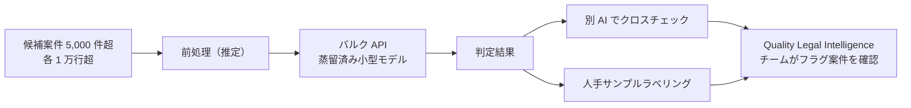

# Darrow: Distilled LLMs for Large-Scale Legal Research（法務での蒸留済み API モデルの大量処理）

- **Company/Organization**: Darrow（米国のリーガルテック。訴訟機会の発見プラットフォーム）
- **Industry**: 法務（潜在的な集団訴訟・違反事例の探索）
- **Date**: 2025-02-09（著者 Aviv Gelfand, Data Scientist）
- **Link**: https://darrow.ai/resources/distilled-llms
- **Type**: Business Case（企業ブログ。自社の業務利用を記述）
- **用途**: 法務（大量の長文テキストからの候補案件スクリーニング）
- **手法タグ**: `蒸留`（ただし **自社で蒸留したのではなく、ベンダーが蒸留した小型 API モデル（GPT-4o mini 等）を業務に使う** 型）
- **証拠タグ**: `ベンダー`（自社製品・自社業務についての一人称記事。第三者検証なし）
- **（2026-10-22 追記）** 第 2 回収集で追加。法務領域で「本番の処理量とコスト」を自社で述べた唯一の資料

## Overview

C5 の第 1 回収集では、法務の蒸留事例は Robin AI の名前のみで、数値を伴う資料がありませんでした。Darrow のこの記事は、**「蒸留済みの小型 API モデルを大量バッチ処理に使い、月間数十万件のクエリを少額で回す」** という運用を自社の数字で述べています。ただし、教師・生徒の組み合わせや精度ベンチマークは示しておらず、「蒸留」はベンダー（OpenAI）が行ったものを使う立場です。したがって **「蒸留で自社モデルを小型化した事例」ではなく「蒸留済みモデルの消費者としての事例」** として読む必要があります。

## Problem & Context

- 5,000 件超の潜在案件を、1 件あたり 1 万行超の長文テキストとともにスクリーニングする必要がある。
- フルサイズの frontier モデルで全件処理するとコストが業務に見合わない。
- 法務の判断は精度が重要で、小型モデルの「わずかな精度低下」を運用で補う仕組みが要る。

## Solution

| 項目 | 内容 |
|------|------|
| 使うモデル | 蒸留済みの小型 API モデル（記事は GPT-4o mini を「蒸留モデルの例」として挙げるが、当該タスクで使ったモデル名は明記しない） |
| 処理形態 | バルク API リクエスト |
| 品質担保 | 別の AI によるクロスチェック、テキストサンプルの人手ラベリング、Quality Legal Intelligence チームによるフラグ案件のレビュー |
| 蒸留の説明 | 一般論（教師 → 生徒）として説明。自社で蒸留は行っていない |

## Results（記事の数値）

| 指標 | 値 | 備考 |
|------|----|------|
| 対象案件 | 5,000 件超 | 各 1 万行超の長文 |
| 入力語数 | 約 50 万語 | 5,000 クエリ合計 |
| 出力語数 | 約 5 万語 | |
| 総コスト | 3 ドル未満 | 当該タスク全体 |
| 月間処理量 | 数十万クエリ | 継続運用 |
| 速度 | GPT-4o mini は GPT-3.5 Turbo の 2.5 倍高速 | 第三者レポートの引用（Darrow の実測ではない） |
| 精度 | 数値なし | 「わずかに精度が落ち得る」と記述 |

```
1 クエリあたりコスト（記事の値から計算）
3 ドル / 5,000 件 = 0.0006 ドル未満/件
```

$$
\frac{\$3}{5{,}000\ \text{件}} < \$0.0006\ /\text{件}, \qquad \frac{500{,}000 + 50{,}000\ \text{語}}{5{,}000} = 110\ \text{語/件}
$$

（1 件あたりの語数が約 110 語と少ないため、「1 万行超の長文」は全文投入ではなく前処理後の要約・抜粋を投入していると推定されますが、記事に明記はありません）

## Architecture / Process Flow



## Figures & Tables

> 記事中の「コスト vs 品質」チャート（MMLU スコア × 100 万トークン単価）は画像で、数値はテキストに含まれていません。

### 本記事の証拠の質

| 観点 | 評価 |
|------|------|
| 本番 or 研究 | 本番（継続運用） |
| コスト | ◎ 金額（3 ドル未満 / 5,000 件） |
| 速度 | △ 第三者レポートの引用のみ |
| 精度 | ✕ 数値なし |
| 蒸留の主体 | ベンダー（自社では蒸留していない） |

## 業務上の示唆（C5 の観点）

| 観点 | 示唆 |
|------|------|
| 蒸留の位置づけ | 「蒸留済み API モデルの消費」も実務上は蒸留の便益を受ける形。ただし自社データでの教師 → 生徒ではない |
| 価値式 | 推論コスト削減は金額で明示。初期投資はほぼゼロ（API 利用）。精度損失は運用（クロスチェック・人手）で吸収 |
| 法務特有の設計 | 小型モデルの誤りを前提に、**人手レビューを最終段に置く** |
| 仮説 H2 | ベンダーの蒸留済みモデルを使う側も、顧客別の精度は公開しない傾向（本記事も精度は未公開） |

## Limitations

- モデル名・教師/生徒・パラメータ数が非公開。
- 精度のベンチマークがない（「わずかに低い」との定性記述のみ）。
- 速度の数値は第三者レポートの引用。
- 自社ブログであり第三者検証がない。

## Notes

- 法務での他の資料: 第 2 回収集で見つかった法務の学術論文（arXiv 2608.29884: 長文判決の要約を小型 LLM へ系列蒸留、EMNLP 2026 / arXiv 2609.24177: バングラデシュ法の Gemma-2 9B → 2B 蒸留 + RAG）はいずれも研究段階です（gather 学術 #25, #26）。
- Robin AI の AWS 事例ページ（https://aws.amazon.com/solutions/case-studies/robin-ai-bedrock/）は Claude 3 を Bedrock 経由で使う内容で、**蒸留・fine-tuning の記載はありません**（gather ビジネス #11）。
