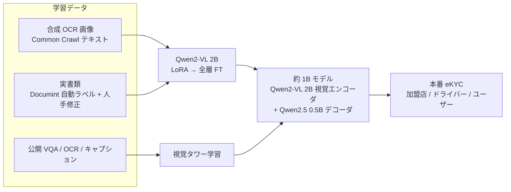

# Grab: Custom Vision LLM for Document Processing at Scale（約 1B の自社 Vision LLM による本人確認書類の読取り）

- **Company/Organization**: Grab（東南アジアの配車・デリバリー・金融プラットフォーム）
- **Industry**: 文書処理 / eKYC（加盟店・ドライバー・ユーザーのオンボーディング時の身分証・書類読取り）
- **Date**: 2025-11-04（著者 Jia Chen, Manish Sahu, Sing Kwan Ng, Yang Yang）
- **Link**: https://engineering.grab.com/custom-vision-llm-at-grab
- **Type**: Business Case（企業エンジニアリングブログ。本番トラフィックで稼働）
- **用途**: 文書処理・情報抽出（IDP）
- **手法タグ**: `fine-tuning`（Qwen2-VL 2B の LoRA → 全層 fine-tuning、さらに **既存モデルの部品を組み合わせた約 1B モデルを構築**。**教師モデルの出力で学習する蒸留ではない**）
- **証拠タグ**: `一次`（企業自身のブログ。ただし表の数値は画像で、本文に絶対値が少ない）
- **（2026-10-22 追記）** 第 2 回収集で追加。Amazon TAIL（03）と同じ IDP 領域で「蒸留でない小型化」の一次事例（H3 の検証用）

## Overview

Amazon TAIL（03）は「商用 LLM を教師にして 7B を学習」する蒸留でしたが、Grab は **教師を使わず**、合成 OCR データと自社ラベリング基盤（Documint）で Qwen2-VL 2B を fine-tuning し、さらに Qwen2-VL 2B の視覚エンコーダ + Qwen2.5 0.5B のデコーダを接続した約 1B モデルを作りました。商用 API（ChatGPT / Gemini）は東南アジア言語で誤り・幻覚・遅延（P99 が P50 の 3〜4 倍）が問題だったと述べています。本番では加盟店・ドライバー・ユーザーのオンボーディングで稼働しています。

## Problem & Context

- 東南アジア言語（インドネシア語・タイ語・ベトナム語）の身分証・書類を、従来 OCR と商用 LLM API のどちらでも十分な精度・遅延で読めなかった。
- 商用 API は P99 遅延が P50 の 3〜4 倍になり、大規模ロールアウトに不向き。
- eKYC は誤読のコストが高く、言語ごとの精度が必要。

## Solution

### 段階

| 段階 | 内容 |
|------|------|
| 1. ベース選定 | Qwen2-VL 2B |
| 2. LoRA fine-tuning | 初期適応 |
| 3. 全層 fine-tuning | タイ語 +70pp、ベトナム語 +40pp（ベースライン比） |
| 4. 約 1B モデル構築 | Qwen2-VL 2B の視覚エンコーダ + Qwen2.5 0.5B の言語デコーダ + 調整したプロジェクタ |
| 5. 評価・本番 | 2B と比べ多くの文書種別で精度差 3pp 以内、遅延は大幅に短縮 |

### 学習データ

| 種別 | 内容 |
|------|------|
| 合成データ | Common Crawl のテキストを多様なフォント・背景・拡張でレンダリングした OCR 画像（インドネシア語・タイ語・ベトナム語・英語） |
| 自動ラベル付き実データ | 社内 Documint が生成し、人手で修正 |
| 公開データ | VQA・一般 OCR・画像キャプション |
| **教師モデル** | **なし**（蒸留の記載なし） |

## Results

| 指標 | 値 | 備考 |
|------|----|------|
| 2B 全層 FT の精度向上 | タイ語 +70pp、ベトナム語 +40pp | ベースライン比 |
| 1B vs 2B の精度差 | 多くの文書種別で 3pp 以内 | Table 2 は画像で数値は未取得 |
| 遅延 | 1B は 2B・従来 OCR・外部 API を「大きく上回る」 | 本文に絶対値なし。共有用サマリーは「50% 高速」 |
| 商用 API の遅延 | P99 が P50 の 3〜4 倍 | 乗り換え動機 |
| コスト | 数値なし | |
| 本番 | 加盟店・ドライバー・ユーザーのオンボーディングで稼働。全市場（ミャンマー・カンボジア含む）へ拡大予定 | |

```
精度ギャップ（1B vs 2B）
多くの文書種別  |███ ≤3pp
```

## Architecture / Process Flow



## Figures & Tables

> 記事中の Table 2（1B vs 2B の文書種別ごとの精度）は画像のため数値を再現できません。

### Amazon TAIL（03）との比較

| 項目 | Amazon TAIL（03） | Grab（本件） |
|------|------------------|-------------|
| 教師 | Claude 3 Sonnet | なし |
| 生徒 / モデル | LLaVA-Net 7B（LoRA） | 約 1B（2B から部品を再構成） |
| ラベル | 教師の合成ラベル | 合成 OCR + 自社ラベリング + 人手修正 |
| 手法タグ | 蒸留 | fine-tuning |
| 本番 | 社内経費（1 枚 20GB GPU） | 外部向け eKYC |
| コスト数値 | 約 85% 減（相対） | なし |
| 精度数値 | ANLS で教師以上 | 2B 比 3pp 以内（画像） |

## 業務上の示唆（C5 の観点）

| 観点 | 示唆 |
|------|------|
| H3 との関係 | 「小型モデルで商用 API を置換」の本番一次事例だが **蒸留ではない**。SLM 置換の成功例を蒸留と読み替えないこと |
| 小型化の方法 | 蒸留の代わりに「合成データ + 既存小型部品の再構成」で 1B を実現。教師の規約問題（H5）を回避できる |
| 価値式 | 遅延改善と本番稼働は示すが、コスト・精度の絶対値は非公開 |
| 文書処理の共通点 | TAIL と同じく「狭いタスク・大量処理・形式固定」が小型化の条件 |

## Limitations

- 精度・遅延の絶対値が本文にない（表は画像）。
- コストの記載がない。
- 「50% 高速」は共有用サマリーのみで本文に根拠がない。
- 蒸留との比較実験はない。

## Notes

- 第 2 回収集で、UiPath / ABBYY / Instabase / Rossum の「蒸留」に関する一次資料は見つかりませんでした（検索 1 回）。帳票 OCR × 蒸留の国内事例・特許も未検出です。
