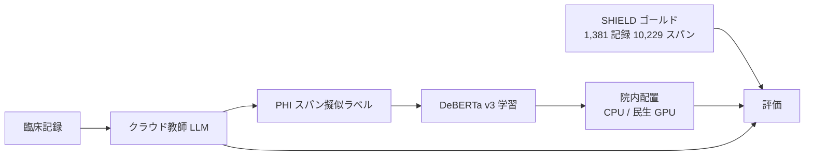

# SHIELD: A Diverse Clinical Note Dataset and Distilled Small Language Models for Enterprise-Scale De-identification

- **Link**: https://arxiv.org/abs/2605.03301 （abs ページを取得して作成。本文 HTML は未取得）
- **Authors**: Jose D. Posada, David Love, Somalee Datta, Priya Desai
- **Affiliation**: abs ページに記載なし
- **Year**: 2026（v1 2026-05-05、v2 2026-07-01）
- **Venue**: arXiv preprint [cs.CL]
- **Type**: Academic Paper
- **用途**: 医療（臨床記録の PHI 匿名化 = 院内で大量に回す前処理）
- **手法タグ**: `蒸留`（クラウド LLM 教師 → DeBERTa v3 生徒。教師・生徒蒸留と明記）
- **証拠タグ**: `一次`（研究。企業・医療機関での本番運用の報告はなし）
- **（2026-10-22 追記）** 第 2 回収集で追加。Stanford 臨床 NER（06）と同型の「LLM → BERT 系」蒸留の医療事例

## Abstract

> 逐語転載は取得ツールの制約で行えないため要旨を示します。

1,381 件の臨床記録に 9 カテゴリ 10,229 件の PHI スパンを付与したデータセット SHIELD を構築し、4 つの LLM（商用 2・オープン 2）を評価した。教師・生徒蒸留で、院内のファイアウォール内に配置できる小型モデルを作り、蒸留した DeBERTa v3 モデルとデータセットを公開した。最良の蒸留モデルはスパン単位の micro 精度 0.89・再現率 0.88 で、標準的なワークステーションで動作する。カテゴリ別再現率ではクラウド教師に劣る（macro 平均 0.90 vs 0.81）。

## Abstract (Japanese Translation)

上記のとおり。要点は **「PHI 匿名化という院内必須・大量・定型のタスクを、クラウド LLM の出力で学習した BERT 系モデルに置き換える」** 設計です。

## Overview

- 匿名化は臨床データ活用の前段で、全記録に対して実行する必要があるため処理量が多い。
- クラウド LLM は精度が高いが、記録を外部に出す必要があり、件数課金で費用がかさむ。
- 教師 LLM の出力で DeBERTa v3 を学習し、CPU / 民生 GPU で件数課金なしに動かす。

## Problem

- **プライバシー**: 匿名化前の記録をクラウドへ送ること自体がリスク。
- **コスト**: データウェアハウス全体を LLM で処理すると費用が大きい（検索結果の要約では約 139 万ドルの試算が言及されているが、abs ページでは未確認）。
- **評価データの不足**: 多様な記録種別を含むゴールドスパン付きデータが少ない。

## Proposed Method

**教師・生徒蒸留による匿名化モデル**

1. 1,381 記録に 9 カテゴリの PHI スパンを人手で付与（10,229 スパン）。
2. 4 つの LLM（商用 2・オープン 2。名称は abs ページに記載なし）で匿名化性能を評価し、教師を選ぶ。
3. 教師の出力で DeBERTa v3（トークン分類）を学習。
4. スパン単位の精度・再現率で評価、公開。

**Key Formulas**（トークン分類の一般形）:

$$
\mathcal{L}(\phi) = -\sum_{(x, \hat{y}) \in \mathcal{D}_T} \sum_{t} \log p_\phi(\hat{y}_t \mid x), \qquad \hat{y} = \text{Teacher}(x)
$$

$$
\text{micro-P} = \frac{\sum_c TP_c}{\sum_c (TP_c + FP_c)}, \qquad \text{micro-R} = \frac{\sum_c TP_c}{\sum_c (TP_c + FN_c)}
$$

## Algorithm (Pseudocode)

```
Algorithm: SHIELD 蒸留
Input : 臨床記録 N、教師 LLM T（クラウド）、ゴールド評価セット G（1,381 記録）
Output: 院内で動く匿名化モデル S（DeBERTa v3）
1. G で 4 つの LLM を評価し、教師 T を選ぶ
2. for x in N: ŷ = T(x)                    // PHI スパンの擬似ラベル
3. S を (x, ŷ) でトークン分類として学習
4. G でスパン単位 P/R を評価（micro / macro、カテゴリ別）
5. S をファイアウォール内の CPU / 民生 GPU に配置
```

## Architecture / Process Flow



## Figures & Tables

> 本文 HTML は未取得のため、abs ページに記載の数値のみ再現します。

### データセット

| 項目 | 値 |
|------|----|
| 記録数 | 1,381 |
| PHI スパン | 10,229 |
| PHI カテゴリ | 9 |

### 性能（abs ページの値）

| モデル | 指標 | 値 |
|------|------|----|
| 最良の蒸留 DeBERTa v3 | スパン micro 精度 | 0.89 |
| 最良の蒸留 DeBERTa v3 | スパン micro 再現率 | 0.88 |
| クラウド教師 / 生徒 | カテゴリ別 macro 再現率 | 0.90 / 0.81 |

```
macro 再現率
教師（クラウド） |██████████████████ 0.90
生徒（DeBERTa）  |████████████████ 0.81
```

### Stanford 臨床 NER（06）との比較

| 項目 | Stanford（06） | SHIELD（本件） |
|------|---------------|---------------|
| タスク | 薬剤・疾患・症状の NER | PHI 匿名化（9 カテゴリ） |
| 教師 | GPT-4o / o1-mini / Gemini Flash + オントロジー | 商用 2・オープン 2 から選定 |
| 生徒 | BioBERT 等 | DeBERTa v3 |
| コスト数値 | 最大 101 倍安価 | 「件数課金なし」（金額なし） |
| 教師との差 | 薬剤 F1 で教師超え | macro 再現率で 0.09 劣る |

## Experiments & Evaluation

### Main Results

- 生徒は micro P/R 0.89 / 0.88。カテゴリ別では教師に劣る（0.81 vs 0.90）。
- 低頻度カテゴリの再現率が課題と読めるが、カテゴリ別の数値は本文未取得。

## 業務上の示唆（C5 の観点）

| 観点 | 示唆 |
|------|------|
| 医療の蒸留の型 | 「院内必須の前処理を BERT 系へ蒸留」は npj DM（05）・Stanford（06）と同じ。本番報告は依然として無い |
| 価値式 | 推論コストは「件数課金なし」の定性。精度損失（macro 再現率 −0.09）は明示 |
| 匿名化特有 | 再現率の低下 = PHI 漏れなので、精度損失の事業コスト $V_{err}$ が高い |

## Limitations

- 本文未取得のため、教師名・学習件数・コスト試算・カテゴリ別表は未確認。
- 本番運用の報告なし。
- 所属が abs ページに無く、医療機関・企業のどちらの研究か不明。

## Notes

- 第 2 回収集で、Epic / Nuance（Microsoft）/ Hippocratic AI / Mayo / Oracle Health の **本番での蒸留** の一次資料は見つかりませんでした。Abridge は CEO が「蒸留・オープンモデル・fine-tuning・post-training が playbook の中心」と述べるのみで数値なし（gather 技術 #16）。国内は NEDO 医療 LLM（2026-05）が fine-tuning で蒸留の記載なし（gather ビジネス #15）。
