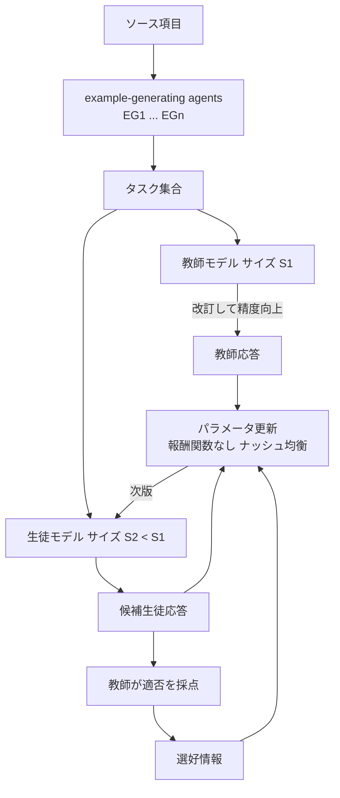

# Training a Student Model Based on Agent-Generated Examples and Direct Application of Preferences

- **Patent Number**: US 2025/0322255 A1（公開公報）
- **Assignee**: Microsoft Technology Licensing, LLC
- **Inventors**: Arindam Mitra, Ahmed Awadallah, Corbin Louis Rosset, Tengyang Xie
- **Filing Date**: 2024-04-15（Appl. No. 18/636,212）
- **Publication Date**: 2025-10-16
- **Grant Date**: 未登録（公開段階）
- **Classification**: G06N 3/096, G06N 3/042
- **Link**: https://patents.google.com/patent/US20250322255A1 （取得時 503 のため、USPTO 公報 PDF https://image-ppubs.uspto.gov/dirsearch-public/print/downloadPdf/20250322255 の 1 ページ目と請求項ページを読んで作成）
- **Type**: Patent
- **用途**: Agent（複数の example-generating agent が課題を作り、教師の応答で生徒を学習）
- **手法タグ**: `蒸留`（教師 LLM の応答のみで生徒を学習。教師の内部過程は見せない = 黒箱蒸留）
- **証拠タグ**: `一次`（特許。成果数値はなし）
- **（2026-10-22 追記）** 第 2 回収集で追加。発明者は Orca（Mukherjee, Mitra, Awadallah ら）の研究者で、Orca 系の手法を権利化したもの

## Abstract

> 逐語転載は取得ツールの制約で行えないため要旨を示します。

ソース項目（文書等）から、複数の example-generating agent で複数のタスクを生成し、教師言語モデルでタスクを教師応答に変換し、生徒言語モデルでも生徒応答を生成し、生徒応答と対応する教師応答に基づいて生徒のパラメータを更新する。教師は応答の精度を高めるための操作（改訂等）を行うが、**生徒は教師応答そのものにしか触れない**。更新の際、候補の生徒応答の適否を教師に検証させる（選好情報）。一部の実装では、明示的な報酬関数・報酬最大化を使わず、選好情報からナッシュ均衡を求める最適化を行う。

## Abstract (Japanese Translation)

上記のとおり。

## Overview

- **何を権利化したか**: 「agent 群でタスクを量産 → 教師が答える → 生徒が答える → 教師が生徒の候補を採点 → 選好で生徒を更新」という蒸留パイプライン。
- **Orca との関係**: 教師の説明（explanation）を学習に使う Orca（US 2025/0094827 A1、同じ発明者群）の後続で、agent によるタスク生成と選好最適化（Nash 均衡）を加えたもの。
- **業務との接点**: agent で「質問生成・文体変換・コード生成・要約・順序付け・詳細化」のタスクを作る（請求項 5）ため、社内文書から業務向け生徒モデルを作る用途を含む。

## Technical Problem

- 生徒を学習させる高品質なタスク・応答の対を、人手なしで大量に作りたい。
- 教師の推論過程（改訂・中間結果）を生徒に見せずに、教師の最終応答の品質だけを移したい。
- 報酬モデルを別途学習せずに、選好情報から生徒を安定に改善したい。

## Technical Solution

### Process Steps

1. **ソース項目の取得**: 文書等のコンテンツを得る → ソース項目
2. **タスク生成**: example-generating agent 群（グラフで入出力を接続、請求項 3）でタスクを生成 → タスク集合
3. **教師応答**: 第 1 サイズの教師モデルがタスクを応答に変換。教師は元応答を改訂して精度を上げる（請求項 6, 7） → 教師応答
4. **生徒応答**: 第 2 サイズ（教師より小さい）の生徒モデルが、教師の過程情報なしに応答を生成 → 生徒応答（候補が複数可）
5. **適否評価**: 教師が候補生徒応答に点数を付け、選好情報を作る（請求項 9, 16） → 選好情報
6. **更新**: 生徒応答・教師応答・選好情報からパラメータを更新。報酬関数の明示的生成と報酬最大化を回避する損失（請求項 11）。ナッシュ均衡を満たす方策を探索（請求項 10, 15） → 次版の生徒
7. **反復**: 更新を繰り返し、前版のパラメータを基に次版を作る

### Key Innovation

- タスク生成を **agent の組合せ** で行い、生成例の多様性を確保する。
- 教師の **改訂過程を生徒から隠す**（黒箱蒸留）。
- 報酬モデル不要の **選好直接最適化**（ナッシュ均衡）。

### Mathematical Relationships

公報の請求項は数式を含みません。請求項 10・15 の「ナッシュ均衡を満たす安定方策」を一般形で書くと、方策 $\pi$ と競合方策 $\pi'$ の選好確率 $P(\pi \succ \pi')$ について

$$
\pi^{*} = \arg\max_{\pi} \min_{\pi'} P(\pi \succ \pi' \mid \text{teacher preference})
$$

であり、請求項 11 はこれを報酬関数 $r(x, y)$ の明示的推定を経ずに損失として直接扱う、と読めます（解釈）。

## Key Claims

### Claim 1 (Main)

- **a)** コンテンツを含むソース項目を取得する
- **b)** example-generating agent 群でコンテンツから複数のタスクを生成する
- **c)** 第 1 サイズの教師モデルでタスクを教師応答に変換する
- **d)** 第 1 サイズより小さい第 2 サイズの生徒モデルでタスクを生徒応答に変換する。生徒は教師の応答生成過程を記述する情報と独立に応答を生成する
- **e)** 生徒応答と対応する教師応答に基づき生徒のパラメータを更新する

### Claim 14（システム）

- claim 1 の構成に加え、候補生徒応答を教師が評価して選好情報を作り、報酬関数の明示的生成・報酬最大化を回避する損失で更新し、反復ごとに前版のパラメータを基にする

### Claim 20（記憶媒体）

- agent 群の異なる組合せでタスクを生成し、第 1 agent の中間結果を第 2 agent が処理する

## Process Flow Diagram

## Figures & Tables

### 請求項の構造

| Claim # | Type | Depends On | Key Element |
|---------|------|-----------|-------------|
| 1 | Independent | — | agent 生成タスク → 教師応答 → 生徒更新（教師過程は非開示） |
| 2 | Dependent | 1 | タスクにソース由来の質問を含む |
| 3 | Dependent | 1 | agent をグラフで接続 |
| 4 | Dependent | 1 | 第 1 agent の中間結果を第 2 agent が処理 |
| 5 | Dependent | 1 | 質問生成 / 文体変換 / コード生成 / 要約 / 順序付け / 詳細化 |
| 6 | Dependent | 1 | 教師が元応答を改訂、生徒は改訂過程を知らない |
| 7–8 | Dependent | 1, 7 | 第 1・第 2 の指示で教師が応答。タスクのクラスで指示を選ぶ |
| 9 | Dependent | 1 | 候補生徒応答を教師が評価、選好で方策を更新、反復 |
| 10 | Dependent | 9 | ナッシュ均衡を満たす安定方策 |
| 11 | Dependent | 9 | 報酬関数の明示的生成・報酬最大化を回避する損失 |
| 12 | Dependent | 9 | 適切 / 不適切な候補の対（部分集合）で更新 |
| 13 | Independent | 1 | claim 1 の方法で得たモデル |
| 14 | Independent | — | システム（選好・反復を含む） |
| 15–19 | Dependent | 14 | 最悪ケース損失の最小化、採点、候補対、閾値、agent |
| 20 | Independent | — | 記憶媒体（agent の組合せ・中間結果） |

### 図面（1 ページ目の図 1）

| 図 | 内容 |
|----|------|
| Fig. 1 | ソース項目 114 → Task-Generating System 104（Agent EG1…EGn）→ Tasks 106 → Teacher Model 108（Teacher Parameters サイズ S1）→ 選ばれた教師応答 118（Task, Teacher-Generated Response の対）。教師応答は改訂のため教師へ戻る（116） |
| Figs. 15, 16 | フローチャート（本文 [0167] の言及。未取得） |
| Fig. 18 | 計算機構成（本文 [0167] の言及。未取得） |

### Microsoft の関連公報（同じ第 2 回収集で確認）

| 公報 | 題名 | 出願 | 内容 |
|------|------|------|------|
| US 2025/0094827 A1 | Producing a Reduced-Size Model by Explanation Tuning | 2023-11-15（仮出願 2023-09-15） | 教師に「最終結果と導出過程（説明）」を答えさせ、小型モデルを学習。2 段階の教師（第 1 段は第 2 段より小さく精度が低い）を使う = Orca |
| US 2026/0203652 A1 | Knowledge Distillation using Hybrid Loss Function for Different Sample Types | 2025-01-16 | 教師生成サンプルには順 KL、生徒生成サンプルには逆 KL を使う対照的な損失。ハイパーパラメータを学習中に動的更新 |

## Patent Family & Related Art

- 公報 1 ページ目に引用文献の記載なし（公開公報のため）。
- Orca（Mukherjee et al., 2023）・Orca 2 の手法に対応。発明者の Mitra / Awadallah は両論文の著者。

## Notes

- **成果数値は無い**。業務での効果を主張する資料ではなく、Agent 蒸留パイプラインの権利範囲を示す資料として扱う。
- C5 の H6（Agent 用途の蒸留の増加）に対しては、「agent でタスクを量産して蒸留する」構成が 2024 年に出願されている点が傍証。
- C8（規約・法務）との接点: 本特許は教師を自社モデルに限定していないため、他社 API を教師にする行為の規約問題は別途生じる。
