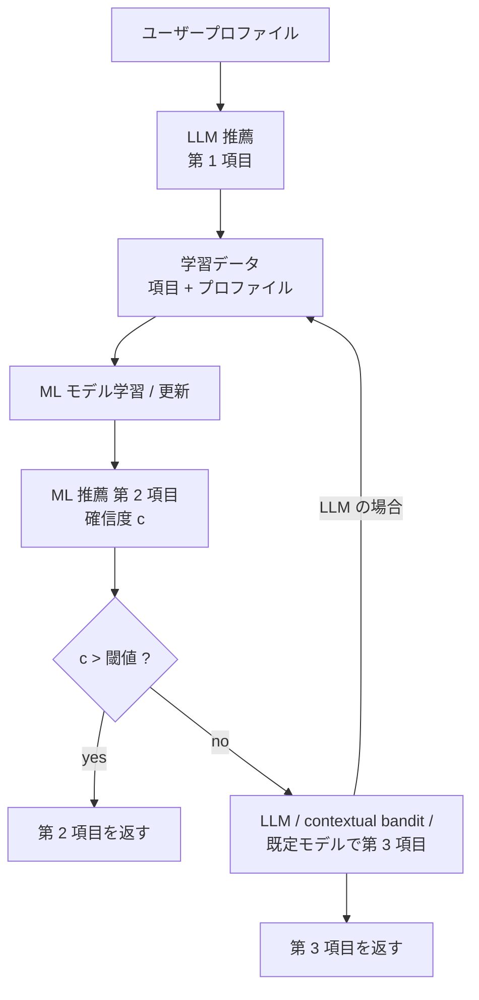

# Machine Learning Model Generated Using Large Language Model (LLM)

- **Patent Number**: US 2026/0024009 A1（公開公報）
- **Assignee**: Salesforce, Inc.
- **Inventors**: Joshua Correa, Ian Frosst, Keld Lundgaard, Akshay Mehrotra
- **Filing Date**: 2024-07-19（Appl. No. 18/778,800）
- **Publication Date**: 2026-01-22
- **Grant Date**: 未登録（公開段階）
- **Classification**: G06N 20/00
- **Link**: https://patents.google.com/patent/US20260024009A1 （取得時 503 のため、USPTO 公報 PDF https://image-ppubs.uspto.gov/dirsearch-public/print/downloadPdf/20260024009 の 1 ページ目と請求項ページを読んで作成）
- **Type**: Patent
- **用途**: カスタマーサポート / CRM（推薦システム: ユーザープロファイルに対する項目推薦）
- **手法タグ**: `蒸留 + ルーティング`（LLM の推薦結果を学習データにして小型 ML モデルを学習し、確信度が閾値未満のときだけ LLM へ戻す）
- **証拠タグ**: `一次`（特許。成果数値はなし）
- **（2026-10-22 追記）** 第 2 回収集で追加。ByteDance ODIA（02）と同じ「教師出力で小型化 + 確信度でフォールバック」をマルチテナント CRM 基盤で権利化したもの

## Abstract

> 逐語転載は取得ツールの制約で行えないため要旨を示します。

推薦システムにおいて、サーバが LLM を適用し、第 1 のユーザープロファイルに基づいて複数の項目から第 1 項目を特定して推薦する。第 1 項目とユーザープロファイルを含む学習データで機械学習モデルを生成または更新する。次に機械学習モデルで第 2 項目を特定し、その予測の確信度が所定閾値を超えるかを判定し、超えるか否かに応じて第 2 項目を返す。

## Abstract (Japanese Translation)

上記のとおり。

## Overview

- **構図**: LLM（教師相当）が最初の推薦を出す → その入出力で ML モデル（生徒相当）を学習 → 以後は ML モデルが推薦し、確信度が低いときだけ LLM（または既定モデル・contextual bandit）へ切り替える → LLM の結果で ML モデルを更新。
- **ODIA（02）との違い**: ODIA は「簡単なクエリのクラスタ」をオフラインで選ぶのに対し、本特許は **推論時の確信度** で振り分け、LLM に戻した結果を即座に学習データへ戻す（オンライン flywheel）。
- **業務との接点**: マルチテナントのオンデマンド DB サービス（Salesforce 基盤）上での推薦（CRM の次アクション・コンテンツ推薦など）を想定。公報本文 [0082] 以降はマルチテナント環境の一般記述。

## Technical Problem

- LLM を毎回呼ぶと推薦の遅延とコストが大きい。
- ユーザープロファイル依存の推薦に、LLM と同等の判断を低コストで再現したい。
- 学習した ML モデルが自信を持てない入力では品質を落としたくない。

## Technical Solution

### Process Steps

1. **LLM 推薦**: 第 1 ユーザープロファイルから LLM が第 1 項目を特定 → 推薦
2. **学習データ化**: （第 1 項目, 第 1 プロファイル）を学習データに → ML モデルを生成 / 更新
3. **ML 推薦**: ML モデルで第 2 項目を特定 → 確信度
4. **閾値判定**: 確信度 > 閾値 なら第 2 項目を返す（請求項 2）
5. **フォールバック**: 閾値以下なら LLM で第 3 項目を特定し、（第 3 項目, プロファイル）で ML モデルを更新（請求項 3–5）。代替として contextual bandit（請求項 6）または既定モデル（請求項 7）を使う

### Key Innovation

- LLM の出力を **ラベル** として小型 ML モデルを学習し、本番では小型モデルを既定にする。
- **確信度閾値によるカスケード** と、フォールバック結果の **即時再学習**。
- フォールバック先を LLM / contextual bandit / 既定モデルから選べる。

### Mathematical Relationships

公報の請求項は数式を含みません。構成を一般形で書くと、ML モデル $f_\theta$ の確信度 $c(x)$ と閾値 $\tau$ について

$$
\hat{y}(x) = \begin{cases} f_\theta(x) & c(x) > \tau \\ \text{LLM}(x) & \text{otherwise} \end{cases}, \qquad \mathcal{D} \leftarrow \mathcal{D} \cup \{(x, \text{LLM}(x))\}\ \text{when}\ c(x) \le \tau
$$

LLM 呼出し率は $P(c(x) \le \tau)$ であり、ODIA（02）の式 $E[T] = t_r + p\,t_s + (1-p)\,t_l$ の $p = P(c(x) > \tau)$ に対応します。

## Key Claims

### Claim 1 (Main)

- **a)** サーバが LLM を適用し、第 1 ユーザープロファイルに基づいて複数項目から第 1 項目を特定する
- **b)** 第 1 項目を推薦する
- **c)** 第 1 項目と第 1 プロファイルを含む学習データで機械学習モデルを学習する
- **d)** 学習した ML モデルで第 2 項目を特定する
- **e)** ML モデルの予測確信度が所定閾値を超えるかを判定する
- **f)** 判定結果に応じて第 2 項目を返す

### Claim 8（システム）/ Claim 15（プログラム製品）

- claim 1 と同じ要素を、サーバシステム上の DB システム / 計算機プログラムとして記載

## Process Flow Diagram

## Figures & Tables

### 請求項の構造

| Claim # | Type | Depends On | Key Element |
|---------|------|-----------|-------------|
| 1 | Independent | — | LLM 推薦 → ML 学習 → 確信度閾値で返却 |
| 2 | Dependent | 1 | 閾値超なら第 2 項目を返す |
| 3 | Dependent | 1 | 閾値以下なら LLM で第 3 項目、ML を更新 |
| 4–5 | Dependent | 3 | 第 2 学習データに第 1 / 第 2 プロファイル |
| 6 | Dependent | 1 | 閾値以下なら contextual bandit |
| 7 | Dependent | 1 | 閾値以下なら既定モデル |
| 8 | Independent | — | システム |
| 9–14 | Dependent | 8 | 2–7 と同内容 |
| 15 | Independent | — | プログラム製品 |
| 16–20 | Dependent | 15 | 2–7 と同内容 |

### 図面（1 ページ目の図 1）

| 図 | 内容 |
|----|------|
| Fig. 1 | 環境 100: Platform 112 / Server System 108 / サーバ群 104 / DB 106 がネットワーク 110 を介して端末 126, 128, 130（ユーザー 120, 122, 124）と接続 |
| Figs. 6A–7B | マルチテナントのオンデマンド DB 環境（本文 [0082]–[0089] の言及。未取得） |

### ByteDance ODIA（02）との比較

| 項目 | ODIA（02） | 本特許 |
|------|-----------|-------|
| 振分けの単位 | オフラインで「簡単なクラスタ」を選定 | 推論時の確信度 |
| 小型側 | 1.3B LLM | 「機械学習モデル」（種類は限定なし） |
| フォールバック | 大型 LLM | LLM / contextual bandit / 既定モデル |
| 再学習 | 日次バッチ | フォールバック結果を即時に学習データへ |
| 数値 | 遅延 −45% / −78%、60% を小型で処理 | なし |

## Patent Family & Related Art

- 公報 1 ページ目に引用文献の記載なし。
- Salesforce の基礎特許 US11620515B2（多タスク蒸留、2019 出願）とは別系統。本特許は「蒸留」という語を請求項で使わず、「LLM の出力で ML モデルを学習」と表現している。

## Notes

- 成果数値はなく、Salesforce 製品（Agentforce / Einstein）での実装の有無は公報からは不明。
- C5 の観点では、**「蒸留 + 確信度ルーティング + オンライン再学習」が CRM ベンダーで権利化されている** ことが、tool calling / 推薦での実務形（index の共通テーマ 1, 2）を補強する。
