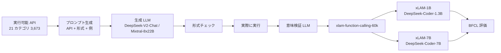

# APIGen: Automated Pipeline for Generating Verifiable and Diverse Function-Calling Datasets（xLAM 1B / 7B）

- **Link**: https://arxiv.org/abs/2406.18518 （abs ページと HTML 版 https://arxiv.org/html/2406.18518 を取得して作成）
- **Authors**: Zuxin Liu, Thai Hoang, Jianguo Zhang, Ming Zhu, Tian Lan, Shirley Kokane, Juntao Tan, Weiran Yao, Zhiwei Liu, Yihao Feng, Rithesh Murthy, Liangwei Yang, Silvio Savarese, Juan Carlos Niebles, Huan Wang, Shelby Heinecke, Caiming Xiong（17 名）
- **Affiliation**: Salesforce AI Research（論文本文。abs ページには所属の記載なし）
- **Year**: 2024（v1 2024-06-26）
- **Venue**: arXiv preprint（NeurIPS 2024 Datasets and Benchmarks に採択との記載が HTML 版にあるが、abs ページの comments では未確認）
- **Type**: Academic Paper（ベンダーの研究。xLAM は Agentforce の「適切なサイズのモデル」として製品文脈で言及される）
- **用途**: Agent / tool calling（function calling 専用の小型モデル）
- **手法タグ**: `蒸留`（**大型 LLM が生成・検証した合成データで小型モデルを SFT**。論文は「distillation」の語を使わず「synthetic data generation」と呼ぶ）
- **証拠タグ**: `一次`（論文。BFCL は公開ベンチ。本番導入の数値はなし）
- **（2026-10-22 追記）** 第 2 回収集で追加。クラスタ定義で名前が挙がっていた Salesforce xLAM の原典

## Abstract

> 逐語転載は取得ツールの制約で行えないため要旨を示します。

function calling agent モデルの進歩には多様で信頼できるデータセットが必要である。APIGen は、検証可能で高品質な function calling データセットを生成する自動パイプラインである。21 カテゴリ 3,673 の実行可能 API を集め、各データ項目を形式チェック・実際の関数実行・意味検証の 3 段階で検証する。生成データで学習したモデルは、7B で Berkeley Function-Calling Benchmark（BFCL）で最先端の性能を示し、複数の GPT-4 モデルを上回る。1B モデルは GPT-3.5-Turbo と Claude-3 Haiku を上回る。60,000 件のデータセットを Hugging Face で公開する。

## Abstract (Japanese Translation)

上記のとおり。C5 の観点では、**「教師の応答をそのまま学ぶ」ではなく「教師が作ったデータを実行環境で検証してから学ぶ」** という、tool calling 特有の蒸留の形です。

## Overview

- クラスタ定義（cluster-05）と NVIDIA 2025-04 記事（gather 技術 #4）で「xLAM の正解データで fine-tuning」と扱っていた xLAM-60k は、**DeepSeek-V2-Chat（236B）と Mixtral-8x22B-Inst が生成し、実行検証を通したデータ** でした。したがって xLAM 1B / 7B は「LLM 生成データによる蒸留」の一種です。
- 生徒は DeepSeek-Coder-1.3B-instruct / 7B-instruct-v1.5。ByteDance ODIA（02）の 1.3B 生徒と同じ系統です。
- 本番導入の数値はなく、Salesforce は Agentforce の文脈で「業務データに合わせた適切なサイズのモデル」として言及するにとどまります。

## Problem

- **データの信頼性**: LLM が生成した function calling データは、形式は合っていても実行できない・意味が違うことがある。
- **多様性**: 単一 API・単一クエリ形式に偏ると汎化しない。
- **小型モデルの性能**: on-device / 低コスト運用には 1B 級が要るが、学習データが無かった。

## Proposed Method

**APIGen パイプライン**

1. **API 収集**: ToolBench 等から 21 カテゴリ 3,673 の実行可能 API を収集し、統一 JSON 形式に整形。
2. **サンプリング**: API・クエリ形式（simple / multiple / parallel / parallel multiple）・few-shot 例をサンプリングしてプロンプトを作る。
3. **生成**: DeepSeek-V2-Chat・Mixtral-8x22B-Inst（開発時は DeepSeek-Coder-33B・Mixtral-8x7B も）が（クエリ, 関数呼出し）対を生成。
4. **3 段階検証**: 形式チェック → 実際に API を実行 → 実行結果とクエリの意味的整合を LLM で確認。
5. **公開 / 学習**: 60,000 件を公開。xLAM-1B / 7B を SFT。

**Key Formulas**（検証付き合成データの SFT）:

$$
\mathcal{D} = \{(q, f) : f = G(q;\ \text{API}),\ \text{format}(f) \wedge \text{exec}(f) \wedge \text{sem}(q, f)\}, \qquad
\mathcal{L}(\theta) = -\sum_{(q,f) \in \mathcal{D}} \log p_\theta(f \mid q)
$$

| 記号 | 意味 |
|------|------|
| $G$ | 生成 LLM（DeepSeek-V2-Chat / Mixtral-8x22B） |
| $\text{format}, \text{exec}, \text{sem}$ | 形式 / 実行 / 意味の各検証 |
| $\theta$ | 生徒（DeepSeek-Coder 1.3B / 7B）のパラメータ |

## Algorithm (Pseudocode)

```
Algorithm: APIGen
Input : 実行可能 API 集合 A（3,673）、生成 LLM G、生徒 S
Output: 検証済みデータ D（60k）、学習済み S
1. for each sample:
2.     a ⊂ A, fmt ∈ {simple, multiple, parallel, parallel-multiple}, 例をサンプル
3.     (q, f) = G(prompt(a, fmt, 例))
4.     if not format_ok(f): discard
5.     r = execute(f, a); if error: discard
6.     if not G_verify(q, f, r): discard
7.     D ← D ∪ {(q, f)}
8. S を D で SFT
9. BFCL で評価
```

## Architecture / Process Flow



## Figures & Tables

> 図版画像は取得していません。BFCL の表は HTML 版の列が読みづらいため、値は原典リーダーボードでの再確認を推奨します。

### データセット

| 項目 | 値 |
|------|----|
| API 数 | 3,673（21 カテゴリ） |
| 公開件数 | 60,000 |
| 生成 LLM（公開分） | DeepSeek-V2-Chat（236B）、Mixtral-8x22B-Inst |
| 生成 LLM（開発時） | 上記 + DeepSeek-Coder-33B-Inst、Mixtral-8x7B-Inst |
| 検証 | 形式 / 実行 / 意味の 3 段階 |

### BFCL 総合精度（HTML 版の表から。「(FC)」= function calling モード）

| モデル | 総合精度 | 順位 |
|------|---------|------|
| GPT-4-0125-Preview (Prompt) | 約 88 | 1 |
| GPT-4-1106-Preview (FC) | 約 85.88 | – |
| **xLAM-7B (FC)** | **85.65** | 6 |
| GPT-4-turbo-2024-04-09 (Prompt) | 約 85.59 | – |
| GPT-4-0125-Preview (FC) | 約 84.65 | – |
| GPT-4o-2024-05-13 (FC) | 約 82.94 | – |
| **xLAM-1B (FC)** | **74.41** | 24 |
| GPT-3.5-Turbo-0125 (FC) | 約 63.88 | 33 |

```
BFCL 総合精度
GPT-4-0125 (Prompt) |████████████████████████████████████████████ 88
xLAM-7B             |███████████████████████████████████████████ 85.65
GPT-4o (FC)         |█████████████████████████████████████████ 82.94
xLAM-1B             |█████████████████████████████████████ 74.41
GPT-3.5-Turbo (FC)  |████████████████████████████████ 63.88
```

（Hugging Face の xLAM-1b-fc-r README は総合 78.94%、xLAM-7b-fc-r は 88.24% と記載しており、論文の表とは評価時点・モデル版が異なります）

### AWS Bedrock（07）・NVIDIA（08）との比較

| 項目 | APIGen / xLAM | AWS Bedrock（07） | NVIDIA Flywheel（08） |
|------|--------------|------------------|---------------------|
| 教師 / 生成元 | DeepSeek-V2-Chat, Mixtral-8x22B | Llama 405B | Llama-3.3-70B |
| 生徒 | 1.3B / 7B | Llama 3B | Llama 1B |
| データ | 60k（実行検証済み） | 約 200 件 | 件数非公開（本番ログ） |
| 検証 | 実行 + 意味 | なし（教師応答のまま） | LLM-as-a-judge |
| 評価 | BFCL 全体 | BFCL v2 entertainment | 独自 |
| 本番数値 | なし | なし | なし |

## Experiments & Evaluation

### Setup

- BFCL（Berkeley Function-Calling Leaderboard）。比較は GPT-4 系・GPT-3.5・Claude-3 Haiku・オープンモデル。

### Main Results

- xLAM-7B が GPT-4o・GPT-4-Turbo（FC）を上回る。
- xLAM-1B が GPT-3.5-Turbo・Claude-3 Haiku を上回る。

### Ablation Study

- HTML 版には検証段階の除去実験（形式 / 実行 / 意味）がありますが、数値は本レポートでは未転記です。

## 業務上の示唆（C5 の観点）

| 観点 | 示唆 |
|------|------|
| 蒸留の形 | tool calling では「教師応答を実行して検証する」ことで教師の誤りを除ける。Amazon TAIL（03）の「形式制約で教師の誤りを減らす」と同じ発想 |
| H3 との関係 | NVIDIA 2025-04 記事（gather 技術 #4）が「正解データでの fine-tuning」とした xLAM-60k は LLM 生成データ。**手法タグの境界事例** で、「教師の応答を学ぶ」を広く取れば蒸留に入る |
| H5（規約） | 生成元が DeepSeek / Mixtral（オープン）で、商用 API の規約問題を回避。公開ライセンスは CC-BY-NC-4.0（商用利用に制約） |
| 本番 | Salesforce は Agentforce で「適切なサイズのモデル」として言及するが、導入数値はない |

## Limitations

- 本番運用の数値がない。
- BFCL の表は HTML 版で列がずれやすく、値の精度に注意。
- ライセンスが非商用（CC-BY-NC-4.0）で、企業がそのまま使うには制約。
- 「distillation」の語を使っておらず、手法タグは本調査側の判断。

## Notes

- 関連: [02 ByteDance ODIA](02-bytedance-odia-function-calling.md)（同じ DeepSeek-Coder-1.3B を本番で使用）、[07 AWS Bedrock](07-aws-bedrock-function-calling-distillation.md)、[08 NVIDIA Flywheel](08-nvidia-data-flywheel-tool-calling.md)。
- Microsoft の公報 US 2025/0322255 A1（[16](16-microsoft-patent-agent-generated-student-training.md)）は「agent でタスクを量産 → 教師応答で生徒を学習」を権利化しており、APIGen と同じ発想。
