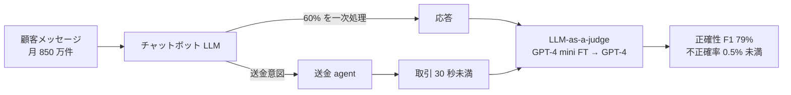

# Nubank: Building an AI Private Banker with Agentic Systems for Customer Service and Financial Operations

- **Company/Organization**: Nubank（ブラジル・メキシコ・コロンビアのデジタル銀行。顧客約 1 億 2,000 万人）
- **Industry**: 金融（リテール銀行のカスタマーサービス・送金）
- **Date**: 2025（ZenML LLMOps Database の掲載年。原典は社員の講演）
- **Link**: https://www.zenml.io/llmops-database/building-an-ai-private-banker-with-agentic-systems-for-customer-service-and-financial-operations
- **Type**: Business Case（講演の第三者まとめ。動画は未視聴）
- **用途**: 金融 / カスタマーサポート（チャットボット、送金 agent、LLM-as-a-judge）
- **手法タグ**: `fine-tuning`（GPT-4 mini の fine-tuning。**蒸留の記載なし**）
- **証拠タグ**: `二次`（講演を ZenML がまとめたもの。数値は講演者の発言）
- **（2026-10-22 追記）** 第 2 回収集で追加。金融の **本番数値を伴う唯一の資料** だが蒸留ではない（H3 の検証用・金融の空白の確認用）

## Overview

C5 の第 2 回収集では、銀行・保険・フィンテック（JPMorgan / Capital One / Morgan Stanley / Bloomberg / Stripe / Klarna / Intuit / Ant Group / 国内メガバンク）の「蒸留で小型化した本番モデル」の一次資料は見つかりませんでした。Nubank の本事例は **金融の本番で数値が出ている数少ない資料** ですが、使っているのは OpenAI の GPT-4 mini / GPT-4 で、小型化の手段は fine-tuning とプロンプト改良です。蒸留事例として引用してはいけませんが、「金融の本番は商用 API + fine-tuning が中心」という H3・H2 の補強材料になります。

## Problem & Context

- 月 850 万件の顧客接点を、1,800 のサービス・3,000 画面のアプリで処理。
- 送金は 9 画面・70 秒かかり、会話型にしたい。
- LLM の回答の正確性を、人手と同等の精度で自動評価したい。

## Solution

| 構成要素 | 内容 |
|---------|------|
| カスタマーサービスのチャットボット | 顧客接点の 60% を LLM が最初に処理 |
| 送金 agent | 会話で送金を完了。取引時間 70 秒 → 30 秒未満 |
| LLM-as-a-judge | GPT-4 mini（prompt → fine-tuning → prompt v2）→ GPT-4 の 6 回の反復で F1 51% → 79% |

### LLM-as-a-judge の反復

| Test | 構成 | F1 |
|------|------|----|
| 1 | GPT-4 mini、プロンプトのみ | 51% |
| 2 | GPT-4 mini を fine-tuning | 59% |
| 3 | プロンプト v2 | 70% |
| 4 | GPT-4 | 増分（値なし） |
| 5 | – | 80% |
| 6 | fine-tuning 再調整 | 79%（不正確情報の検出が良く採用） |
| 人手 | ベンチマーク | 80% |

```
LLM-as-a-judge F1
Test 1 |█████████████████████████ 51%
Test 2 |█████████████████████████████ 59%
Test 3 |███████████████████████████████████ 70%
Test 5 |████████████████████████████████████████ 80%
Test 6 |███████████████████████████████████████ 79%
人手   |████████████████████████████████████████ 80%
```

## Results

| 指標 | 値 |
|------|----|
| 顧客接点 | 月 850 万件、60% を LLM が最初に処理 |
| 送金時間 | 70 秒（9 画面）→ 30 秒未満 |
| CSAT | 90% 超 |
| 不正確率 | 0.5% 未満 |
| judge F1 | 79%（人手 80%） |
| 開発 | 6 回の反復、約 2 週間、開発者 2 名程度 |
| 日次処理 | 数十万〜数百万トランザクション |
| コスト | 金額なし（GPT-4 mini を選んだ理由として「コスト効率」のみ） |

## Architecture / Process Flow



## 業務上の示唆（C5 の観点）

| 観点 | 示唆 |
|------|------|
| 金融の空白 | 本番数値はあるが蒸留ではない。金融の「蒸留で小型化した本番モデル」は第 2 回収集でも 0 件 |
| H3 | 「小型モデル（GPT-4 mini）を fine-tuning」は蒸留と混同されやすい典型。GPT-4 mini 自体はベンダーが蒸留したとされるが、Nubank 側の行為は fine-tuning |
| H2 / H5 | 商用 API への依存が強く、教師の規約問題より「ベンダーの小型版を直接使う」形が金融で主流と読める |
| 価値式 | 推論コストの金額なし。精度は judge F1 と不正確率で報告 |

## Limitations

- 第三者まとめで、講演動画は未視聴。
- モデルの規模・コスト・推論量あたり単価が無い。
- 「60% を一次処理」を「first-contact resolution」と書くのはまとめ側の表現で、講演本文では未確認。

## Notes

- 金融の他の追加資料: BNY のシニアデータサイエンティストによる AI Summit New York 2025-12-11 の講演「蒸留と fine-tuning で金融取引理解の小型モデルを作る」は、議題ページが取得できず（404）内容未確認。Intuit の金融 LLM（2023-06）は「カスタム金融データで学習」とのみで蒸留・数値の記載なし（gather ビジネス #13）。Ping An Technology による金融 LLM 蒸留の総説（FITEE 2025、gather 学術 #28）は、産業事例として Snorkel の銀行チャットボットと Bedrock を挙げるのみで自社数値は無い。
