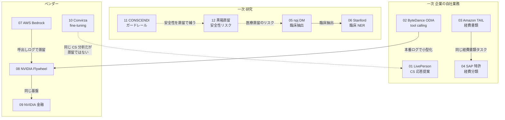
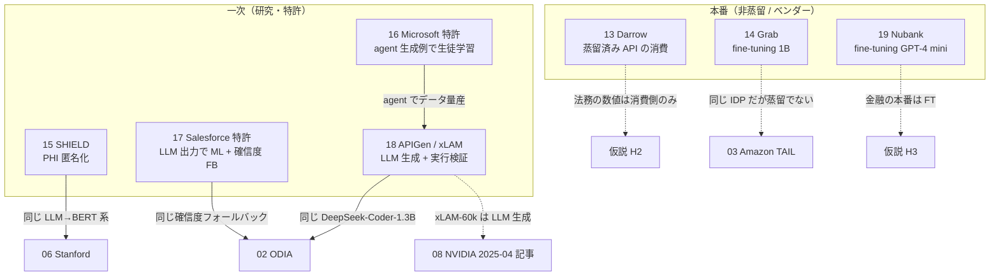

# C5 業務・業界別ユースケース（enterprise_workflows）— Detailed Reports

## Parameters

- **Resources analyzed**: 12 → 19（（2026-10-22 追記）第 2 回収集分から 7 件を追加。累計: 学術論文 9 / 特許 3 / 技術情報 3 / ビジネス事例 4。うち企業の一次資料 8 件）
- **Resource types**: Paper / Patent / Technical / Business
- **Generated on**: 2026-10-21（13–19 は 2026-10-22）
- **Input source**: [gather 出力 resources-enterprise-workflows.md](../../../gather/20261021/enterprise_workflows/resources-enterprise-workflows.md)（54 件から、定量的な本番・業務証拠を持つものを優先して選定。（2026-10-22 追記）76 件に拡張）
- **取得方法**: すべて WebFetch で原典（arXiv HTML / PMC / Google Patents / 公式ブログ / 事例ページ）を取得して作成。図版画像は取得せず、表は Markdown、図は Mermaid / ASCII で再構成。（2026-10-22 追記）特許 16・17 は Google Patents が 503 を返したため USPTO 公報 PDF（1 ページ目と請求項ページ）を読んで作成
- **制約**: セッション共有の WebSearch 上限に達したため、retrieval 段階の追加検索（補足情報の検索）は実施していません。（2026-10-22 追記）第 2 回は WebSearch 33 回で空白領域を補ったうえで、01・02・03・05 の主要数値を原典で再検証しました（03 は WACV 2025 採択を訂正、05 は本文と表の数値の揺れを追記、01・02 は一致）

## Report List

### Academic Papers

| # | Title | Year | Venue | Summary | Report |
|---|-------|------|-------|---------|--------|
| 1 | The economic trade-offs of large language models: A case study | 2023 | ACL 2023 Industry | LivePerson の agent-assist。蒸留 GPT-2 は単価が GPT-3 の約 1/1000 だが年間純節約額の差は約 3,000 ドル | [Details](01-liveperson-economic-tradeoffs.md) |
| 2 | ODIA: Oriented Distillation for Inline Acceleration of LLM-based Function Calling | 2025 | arXiv | ByteDance 音楽アプリ。本番の簡単な問合せ約 60% を 1.3B へ、中央値遅延 −78% | [Details](02-bytedance-odia-function-calling.md) |
| 3 | Information Extraction from Heterogeneous Documents without Ground Truth Labels using Synthetic Label Generation and Knowledge Distillation | 2024 | arXiv | Amazon 社内経費書類。Claude 3 Sonnet → LLaVA-Net 7B、約 85% 安価・5 倍高速で教師以上 | [Details](03-amazon-tail-expense-documents.md) |
| 5 | Synthetic data distillation enables the extraction of clinical information at scale | 2025 | npj Digital Medicine | Llama 70B 教師の合成 QA で 8B が教師超え（89.1% vs 76.1%）、推論費 約 77% 減 | [Details](05-npj-synthetic-data-distillation-clinical.md) |
| 6 | Distilling Large Language Models for Efficient Clinical Information Extraction | 2024 | arXiv | Stanford。LLM ラベルで BERT を学習、最大 101 倍安価・12 倍高速 | [Details](06-stanford-clinical-ner-distillation.md) |
| 11 | CONSCENDI: A Contrastive and Scenario-Guided Distillation Approach to Guardrail Models for Virtual Assistants | 2023 | NAACL 2024 | GPT-4 生成の対照データで ada〜davinci。GPT-4 を精度で上回り推論 86 倍以上安価 | [Details](11-conscendi-guardrail-distillation.md) |
| 12 | Black-Box Behavioral Distillation Breaks Safety Alignment in Medical LLMs | 2025 | arXiv | 約 12 ドルの黒箱蒸留で危険応答率 66% → 86%。機能は移るが整合は移らない | [Details](12-blackbox-distillation-medical-safety.md) |
| 15（2026-10-22 追記） | SHIELD: A Diverse Clinical Note Dataset and Distilled Small Language Models for Enterprise-Scale De-identification | 2026 | arXiv | PHI 匿名化をクラウド LLM → DeBERTa v3 へ蒸留。micro P/R 0.89 / 0.88、macro 再現率は教師 0.90 vs 生徒 0.81。研究段階 | [Details](15-shield-clinical-deidentification-distillation.md) |
| 18（2026-10-22 追記） | APIGen: Automated Pipeline for Generating Verifiable and Diverse Function-Calling Datasets（xLAM 1B / 7B） | 2024 | arXiv | Salesforce。DeepSeek-V2-Chat / Mixtral-8x22B が生成し実行検証した 60k 件で 1B / 7B を学習。BFCL で 7B 85.65（GPT-4o 超）、1B 74.41（GPT-3.5 超） | [Details](18-apigen-xlam-function-calling-data.md) |

### Patents

| # | Title | Patent No. | Assignee | Year | Report |
|---|-------|-----------|----------|------|--------|
| 4 | Robust documentation understanding using large language model knowledge distillation and joint training | US12475175B1 | SAP SE | 2025 | [Details](04-sap-patent-document-understanding-kd.md) |
| 16（2026-10-22 追記） | Training a Student Model Based on Agent-Generated Examples and Direct Application of Preferences | US20250322255A1 | Microsoft Technology Licensing | 2024 出願 / 2025 公開 | [Details](16-microsoft-patent-agent-generated-student-training.md) |
| 17（2026-10-22 追記） | Machine Learning Model Generated Using Large Language Model (LLM) | US20260024009A1 | Salesforce, Inc. | 2024 出願 / 2026 公開 | [Details](17-salesforce-patent-llm-generated-ml-model.md) |

### Technical Articles

| # | Title | Source | Date | Report |
|---|-------|--------|------|--------|
| 7 | Amazon Bedrock Model Distillation: Boost function calling accuracy while reducing cost and latency | AWS | 2025-04-30 | [Details](07-aws-bedrock-function-calling-distillation.md) |
| 8 | Build Efficient AI Agents Through Model Distillation With the NVIDIA Data Flywheel Blueprint（+ 2025-04 記事・Chanl 二次記事との比較） | NVIDIA | 2025-06-11 | [Details](08-nvidia-data-flywheel-tool-calling.md) |
| 9 | Build Efficient Financial Data Workflows with AI Model Distillation | NVIDIA | 2025-12-01 | [Details](09-nvidia-financial-distillation.md) |

### Business Cases

| # | Title | Company | Date | Report |
|---|-------|---------|------|--------|
| 10 | Optimizing Call Center Analytics with Small Language Models and Multi-Adapter Serving | Convirza / Predibase | 2024 | [Details](10-convirza-predibase-call-analytics.md) |
| 13（2026-10-22 追記） | Distilled LLMs: large-scale legal research at a fraction of the cost | Darrow | 2025-02-09 | [Details](13-darrow-legal-distilled-llms.md) |
| 14（2026-10-22 追記） | Custom Vision LLM for Document Processing at Scale | Grab | 2025-11-04 | [Details](14-grab-custom-vision-llm-document-processing.md) |
| 19（2026-10-22 追記） | Building an AI Private Banker with Agentic Systems for Customer Service and Financial Operations | Nubank（ZenML まとめ） | 2025 | [Details](19-nubank-ai-private-banker.md) |

## ユースケース × 証拠の質

本クラスタの主目的である「用途ごとに、蒸留の定量的な証拠がどの質で存在するか」を 1 枚にまとめました。

| 用途 | 事例（レポート） | 手法タグ | 証拠タグ | 本番 or 研究 | コスト | 遅延・速度 | 精度 |
|------|---------------|---------|---------|------------|-------|----------|------|
| カスタマーサポート（応答提案） | LivePerson（01） | 蒸留（GPT-2 層削減） | 一次 | 本番ブランドでの評価 | 0.0011 セント/推論、年間 ENCS 53,653 ドル | A100 12ms | 使用率 57%（GPT-3 69%） |
| カスタマーサポート（通話分析） | Convirza（10） | **fine-tuning** | ベンダー | 本番 | OpenAI 比 約 1/10 | 約 0.1 秒 | F1 +8% |
| Agent / tool calling | ByteDance ODIA（02） | 蒸留 + ルーティング | 一次 | **本番** | – | 期待 −45%、中央値 −78% | 「ごくわずかな低下」（数値なし） |
| Agent / tool calling | AWS Bedrock（07） | 蒸留 | ベンダー | ベンチ（約 200 件） | 価格の数値なし | −72%（引用値） | simple 0.478 → 0.826 |
| Agent / tool calling | NVIDIA Flywheel（08） | 蒸留 | ベンダー | 模擬トラフィック | GPU 2 → 1 | – | 70B の 98%（絶対値なし） |
| 文書処理（経費書類） | Amazon TAIL（03） | 蒸留 | 一次 | 社内業務データ | 約 85% 減 | 5 倍 | 日付 ANLS 83%（教師 76%） |
| 文書処理（経費分類） | SAP 特許（04） | 蒸留 | 一次（特許） | 権利化 | – | – | – |
| 金融（ニュース分類） | NVIDIA 金融（09） | 蒸留 | ベンダー | サンプルデータ | – | – | 教師比 F1 0.95（8B / 3B、25k） |
| 医療（臨床試験適格性） | npj DM（05） | 蒸留 | 一次（査読） | 研究 | 約 77% 減（929 vs 4,066 ドル） | 0.535 vs 2.34 秒 | 89.1%（教師 76.1%） |
| 医療（臨床 NER） | Stanford（06） | 蒸留 | 一次 | 研究 | 2.5〜101 倍安価 | 4〜12 倍 | 薬剤 F1 0.87（教師 0.84） |
| 安全性（ガードレール） | CONSCENDI（11） | 蒸留 | 一次（査読） | 研究 | 86 倍以上安価 | 27 倍 | OOD 93.4〜96.1%（GPT-4 58.1〜84.7%） |
| 医療（リスク） | 黒箱蒸留（12） | 蒸留（攻撃） | 一次 | 研究 | 攻撃費 約 12 ドル | – | 危険応答 86%（教師 66%） |
| 法務 | （該当なし）→（2026-10-22 追記）Darrow（13） | 蒸留（**ベンダーが蒸留した API モデルの消費**） | ベンダー | 本番 | 5,000 件超を 3 ドル未満 | 第三者値の引用のみ | **数値なし**。Robin AI は蒸留の記載なし |
| 文書処理（eKYC）（2026-10-22 追記） | Grab（14） | **fine-tuning**（部品再構成で約 1B） | 一次 | **本番** | 数値なし | 「大幅短縮」（絶対値なし） | 2B 比 3pp 以内（表は画像） |
| 医療（PHI 匿名化）（2026-10-22 追記） | SHIELD（15） | 蒸留 | 一次 | 研究 | 「件数課金なし」 | – | micro P/R 0.89 / 0.88、macro 再現率 −0.09 |
| Agent / tool calling（2026-10-22 追記） | Microsoft 特許（16） | 蒸留（agent 生成例 + 選好最適化） | 一次（特許） | 権利化 | – | – | – |
| CRM 推薦（2026-10-22 追記） | Salesforce 特許（17） | 蒸留 + ルーティング（確信度） | 一次（特許） | 権利化 | – | – | – |
| Agent / tool calling（2026-10-22 追記） | APIGen / xLAM（18） | 蒸留（LLM 生成 + 実行検証データ） | 一次 | 公開ベンチ | – | – | BFCL 7B 85.65 / 1B 74.41 |
| 金融（CS・送金）（2026-10-22 追記） | Nubank（19） | **fine-tuning**（GPT-4 mini） | 二次 | **本番** | 金額なし | 送金 70 秒 → 30 秒未満 | judge F1 79%（人手 80%）、不正確率 0.5% 未満 |

### 証拠の質の分布

```
              一次(本番)  一次(研究)  ベンダー  二次
CS            ██ 1        .           █ 1       .
Agent         ██ 1        .           ██ 2      (Chanl 逸話)
文書          ██ 2        .           .         .
金融          .           .           █ 1       .
医療          .           ███ 3       .         .
安全性        .           █ 1         .         .
法務          .           .           .         .
```

- **本番で定量化された一次証拠は 4 件**（LivePerson・ByteDance・Amazon・SAP 特許）にとどまり、いずれも **企業が自社業務を論文・特許として出したもの** です。
- **医療は研究段階の一次資料が厚い** が、病院での本番運用の報告は無い。
- **金融・法務は一次の本番数値がゼロ**。金融はベンダーのリファレンス実装、法務は顧客名のみ。

#### （2026-10-22 追記）第 2 回収集後の分布

```
              一次(本番)  一次(研究)  一次(特許)  ベンダー  二次
CS / CRM      ██ 1        .           █ 1         █ 1       .
Agent         ██ 1        █ 1         █ 1         ██ 2      (Chanl 逸話)
文書          ██ 1 + FT 1 .           █ 1         .         .
金融          .           .           .           █ 1       FT 1
医療          .           ████ 4      .           .         .
安全性        .           █ 1         .           .         .
法務          .           .           .           █ 1       .
```

- **蒸留で小型化した本番の一次証拠は 4 件のまま増えず**（第 2 回で増えた本番事例 Grab・Nubank はいずれも fine-tuning）。
- 特許が 1 → 3 件（SAP・Microsoft・Salesforce）に増え、「agent でデータ量産 → 生徒学習」「LLM 出力で ML 学習 + 確信度フォールバック」が権利化されていることが分かりました。
- 法務は Darrow（ベンダー・蒸留済み API の消費）のみ、金融は蒸留の本番数値が **依然ゼロ** です。

## Cross-Resource Insights



### （2026-10-22 追記）13–19 と既存レポートの関係



### 共通テーマ

1. **「本番ログ → 小型化 → 評価 → 昇格」の flywheel 型が収束形**: ODIA（本番トラフィック）、Bedrock（呼出しログ + メタデータ）、NVIDIA（Elasticsearch のログ）が同じ構造。Azure の stored completions も同じ発想だったが、**2026-10-15 に提供終了**（gather 参照）。
2. **蒸留 + ルーティング（カスケード）が tool calling の実務形**: ODIA は 60% のみ小型へ、SafeRoute・SynConfRoute も「難しい入力だけ大型」。全面置換ではない。
3. **生徒が教師を超えるのは「狭いタスク + 形式の制約 + 教師の誤りが平均化される」場合**: Amazon（日付 83% vs 76%）、npj DM（89.1% vs 76.1%）、CONSCENDI（OOD +9〜36 ポイント）。
4. **数値の「最大値」に注意**: Stanford の「101 倍」は最も高い教師（o1-mini）との比較で、Gemini Flash とは 2.5 倍。AWS の「500% / 75%」も「up to」。
5. **安全性は二面性**: 蒸留でガードレールを安く作れる（11）一方、教師の応答だけの蒸留は整合を失う（12）。
6. **（2026-10-22 追記）「教師の出力を検証してから学ぶ」が業務蒸留の共通設計**: Amazon TAIL（形式制約で拒否・形式違反ゼロ）、APIGen（実行 + 意味検証、18）、金融 TAT-QA のプログラム蒸留（gather 学術 #27: 実行してゴールド一致のみ採用）、Microsoft 特許（教師が候補を採点、16）。教師の誤りを素通しにしない工夫が、生徒が教師を超える条件（テーマ 3）を作っている。
7. **（2026-10-22 追記）「蒸留済みモデルの消費」と「自社での蒸留」を区別する**: Darrow（13）や Nubank（19）は GPT-4o mini / GPT-4 mini という **ベンダーが蒸留したとされる小型モデル** を API で使うだけで、自社データでの教師 → 生徒は行っていない。業務側の数値（3 ドル / 5,000 件、judge F1 79%）は蒸留の効果ではなく、小型 API モデル + 運用設計の効果として読む必要がある。

## Comparison Table

| 項目 | 01 LivePerson | 02 ODIA | 03 Amazon TAIL | 05 npj DM | 06 Stanford | 07 AWS | 08 NVIDIA | 09 NVIDIA 金融 | 10 Convirza | 11 CONSCENDI |
|------|--------------|---------|---------------|-----------|-------------|--------|-----------|---------------|-------------|-------------|
| 教師 | GPT-2 12 層 | 非公開の大型 LLM | Claude 3 Sonnet | Llama-3.1-70B | GPT-4o / o1-mini / Gemini Flash + オントロジー | Llama 405B 等 | Llama-3.3-70B | Llama-3.3-70B / 49B | なし | GPT-4 |
| 生徒 | GPT-2 6 層 81M | deepseek-coder-1.3B | LLaVA-Net 7B | Llama 8B / 3B / 1B | BioBERT 等 | Llama 3B | Llama 1B | Llama 1B / 3B / 8B | Llama 8B + LoRA | ada〜davinci |
| 圧縮比 | 約 1.4 倍 | 不明 | 不明 | 約 9〜70 倍 | 約 1000 倍 | 約 135 倍 | 約 70 倍 | 約 9〜70 倍 | – | 不明 |
| 学習データ | ブランド 10 万会話 | 本番ログ（バッチ 8〜10 万） | 1 万文書 | 約 63 万 QA | 2,096 文書 | 約 200 件 | 件数非公開 | 5k〜25k | 非公開 | 2,784 件 |
| 人手ラベル | 評価のみ | なし | なし（ノイズのみ） | 評価 1,000 件 | 評価用正解 | なし | なし | 教師検証 1,000 件 | あり（キュレーション） | 検証のみ |
| 学習方式 | KD（HF） | 非公開 | LoRA | QLoRA | 全層 FT | SFT + 独自合成 | LoRA SFT | LoRA SFT | LoRA FT | OpenAI FT |
| 運用形 | 単体 | ルーター + フォールバック | 単体 | 単体（院内） | 単体 | 単体 | flywheel | flywheel | マルチアダプタ | 毎ターン判定 |
| 報告したコスト | ◎ 金額 | – | ○ 相対 | ◎ 金額 | ◎ 金額 | – | △ GPU 枚数 | – | ○ 相対 | ◎ 金額 |
| 報告した精度 | ◎ 使用率 | ✕ 数値なし | ◎ | ◎ | ◎ | ○ | △ 相対 | △ 相対 | ○ 相対 | ◎ |

（◎ 絶対値で報告、○ 相対値で報告、△ 部分的、✕ なし）

### （2026-10-22 追記）13–19 の比較

| 項目 | 13 Darrow | 14 Grab | 15 SHIELD | 16 Microsoft 特許 | 17 Salesforce 特許 | 18 APIGen / xLAM | 19 Nubank |
|------|----------|---------|-----------|------------------|-------------------|-----------------|-----------|
| 教師 / 生成元 | ベンダー側（非公開） | なし | クラウド LLM（非公開） | 教師 LLM（サイズ S1） | LLM | DeepSeek-V2-Chat, Mixtral-8x22B | なし（GPT-4 mini を FT） |
| 生徒 | GPT-4o mini 等（消費） | 約 1B（Qwen2-VL 2B + Qwen2.5 0.5B） | DeBERTa v3 | 生徒 LLM（S2 < S1） | 「機械学習モデル」 | DeepSeek-Coder 1.3B / 7B | GPT-4 mini |
| 手法タグ | 蒸留（消費） | fine-tuning | 蒸留 | 蒸留 | 蒸留 + ルーティング | 蒸留（生成 + 検証） | fine-tuning |
| 学習データ | – | 合成 OCR + 自社ラベル | 教師擬似ラベル | agent 生成タスク | LLM の推薦結果 | 60k（実行検証済み） | 非公開 |
| 運用形 | バルク API + 人手レビュー | 単体（本番） | 院内配置（研究） | 反復更新 | 確信度カスケード + 即時再学習 | 単体 | チャット + 送金 agent + judge |
| 報告したコスト | ◎ 金額（3 ドル未満 / 5,000 件） | ✕ | △ 定性 | ✕ | ✕ | ✕ | ✕ |
| 報告した精度 | ✕ | △ 相対（画像） | ◎ | ✕ | ✕ | ◎ BFCL | ◎ judge F1 |

### ドメイン index の価値式に対する報告状況

$$
\text{価値} \approx \underbrace{(C_T - C_S)Q}_{\text{推論コスト削減}} - \underbrace{(C_{data} + C_{train})}_{\text{初期投資}} - \underbrace{\Delta\text{Acc}\cdot V_{err}}_{\text{精度損失}}
$$

| 事例 | 推論コスト削減 | 初期投資 | 精度損失 |
|------|-------------|---------|---------|
| 01 LivePerson | ◎ | ◎（R&D 50,100 ドル、損益分岐 0.24 か月） | ◎（使用率） |
| 02 ODIA | △（遅延のみ） | ✕ | ✕ |
| 03 Amazon TAIL | ○（相対） | ○（ラベル 1 万件 + 8 GPU × 10 時間） | ◎（改善） |
| 05 npj DM | ◎ | ○（8 GPU × 12 時間未満） | ◎（改善） |
| 06 Stanford | ◎ | △ | ◎ |
| 07 AWS | ✕ | ✕ | ○ |
| 08 NVIDIA | △ | ✕ | △ |
| 09 NVIDIA 金融 | ✕ | ✕ | △ |
| 10 Convirza | ○ | ✕ | ○（改善） |
| 11 CONSCENDI | ◎ | ◎（データ生成 58.93 ドル） | ◎（改善） |
| 13 Darrow（2026-10-22 追記） | ◎（3 ドル未満 / 5,000 件） | ○（API 利用で実質ゼロ） | ✕（定性のみ） |
| 14 Grab（2026-10-22 追記） | ✕ | ✕ | △（2B 比 3pp 以内） |
| 15 SHIELD（2026-10-22 追記） | △（件数課金なし） | ✕ | ◎（macro 再現率 −0.09） |
| 18 APIGen（2026-10-22 追記） | ✕ | △（60k 生成 + 検証） | ◎（BFCL） |
| 19 Nubank（2026-10-22 追記） | ✕ | ○（6 反復・約 2 週間・2 名） | ◎（F1 79% vs 人手 80%） |

→ **3 項すべてを金額で報告しているのは LivePerson と CONSCENDI のみ**。（2026-10-22 追記）第 2 回で追加した 7 件にも、3 項を金額で揃えたものはありません。

## 仮説の検証結果

| # | 仮説 | 判定 | 根拠 |
|---|------|------|------|
| H1 | 定量成果が公開されている本番事例は検索・推薦に集中 | **部分的に支持** | C5 で本番の定量一次事例は 4 件（LivePerson・ByteDance・Amazon・SAP）のみ。医療は研究段階。C4 との件数比較は C4 の結果待ち。（2026-10-22 追記）第 2 回収集で金融・法務・医療・CS・コード・IDP を重点的に探したが、**蒸留の本番一次事例は増えず 4 件のまま**。増えた本番事例（Grab・Nubank）は fine-tuning |
| H2 | ベンダー数値は集計値で顧客別成果は非公開 | **支持** | AWS は顧客名ゼロ・価格数値ゼロ。NVIDIA は Amdocs / EY 等の名前のみ。金融ブループリントも教師比 F1 のみ。（2026-10-22 追記）AWS News Blog の発表記事（2024-12-03）にも顧客引用はなく、Robin AI / Moody's / PwC の名前は報道側の記述。Robin AI の AWS 事例ページは Claude 3 の利用のみで蒸留の記載なし。Abridge も「playbook に蒸留」と述べるだけで数値なし |
| H3 | 「90% コスト削減」等の SLM 事例の多くは fine-tuning | **部分的に支持（「多く」ではなく約 4 分の 1）** →（2026-10-22 追記）**約 3 分の 1 に上方修正** | gather の実務資料 24 件中 6 件（25%）が非蒸留。代表例: Convirza（10 倍安価 = LoRA FT）、NVIDIA 2025-04（70 倍小型 = xLAM で FT）、SoftBank（Swallow-70b FT）、Tunguz（プロンプト最適化）、e-commerce SLM（QLoRA + 量子化）。一方「1B が 70B の 98%」（NVIDIA 2025-06）は本物の蒸留。「90%」の出典とされる Mistral 7B 事例は確認できず、Chanl の「月 4,200 → 84 ドル」は裏付けの無い逸話。（2026-10-22 追記）第 2 回で実務資料 35 件中 13 件（37%）が非蒸留。**「Mistral 7B で GPT-3.5 を置換し 90% 削減」は 2 回の追加検索でも一次資料が無く、辿れた原典は HN での OpenPipe 社員のコメント（2024-02-27、数値なし・fine-tuning）**。引用不可と結論。なお NVIDIA 2025-04 が「正解データ」とした xLAM-60k は LLM 生成データ（APIGen、18）で、手法タグの境界事例 |
| H6 | 推論蒸留以降、Agent・tool calling 用途の蒸留が増えている | **支持** | 2025 年に Bedrock の GA 目玉、NVIDIA Blueprint、ByteDance 本番、Agent Distillation（NeurIPS 2025）、SCoRe（ICML 2026: 7B が 72B に匹敵）が集中。ただし本番数値は ByteDance のみ。（2026-10-22 追記）Microsoft が 2024-04 に「agent 生成例で生徒を学習」を出願（16）、Salesforce が 2024-07 に「LLM 出力で ML + 確信度フォールバック」を出願（17）、APIGen（2024-06）が 1B の tool calling モデルを公開しており、2024 年から出願・公開が始まっていることを補強 |

（H4・H5 は C7・C8 の検証対象。C5 からの補足: 国内のコールセンター事例は fine-tuning で蒸留の事例は見つからず（H4 と整合）。Amazon が Claude を、npj DM が Llama を教師にした点は、教師の規約選択（H5）が業務設計に効くことを示す。（2026-10-22 追記）国内は NEDO 医療 LLM（2026-05）も fine-tuning で蒸留の記載なし、金融（MUFG / JDD / みずほ / SMBC / 野村）・コールセンター・帳票の日本語検索でも蒸留の業務事例は 0 件（H4 を補強）。APIGen は生成元をオープンモデル（DeepSeek / Mixtral）にして商用 API の規約を回避したが、公開ライセンスは CC-BY-NC-4.0（H5 の論点は生徒側にも及ぶ））

## Further Investigation Candidates

| 候補 | 理由 | 出典 |
|------|------|------|
| Distilling Large Language Models for Biomedical Knowledge Extraction（arXiv 2307.06439、Microsoft） | GPT-3.5 → PubMedBERT で GPT-4 を F1 5 点超上回る。医療抽出の蒸留の先行例 | gather 学術 #17 |
| DocKD（arXiv 2410.03061、EMNLP 2024） | 文書理解の蒸留でデータ品質を上げる手法。Amazon TAIL の補完 | gather 学術 #4 |
| Using Advanced LLMs to Enhance Smaller LLMs（arXiv 2408.07238 v3、Yale） | CS で「重みを変えない」指針ライブラリ型の蒸留。LLaMA-2-7b の対 GPT-4 勝率 3% → 34% | gather 学術 #2 |
| Agent Distillation（arXiv 2505.17612）/ SCoRe（arXiv 2509.14257） | Agent 蒸留の主要論文。業務 agent への適用可能性 | gather 学術 #6, #7 |
| ThinkGuard（arXiv 2502.13458）/ SafeRoute（arXiv 2502.12464） | CONSCENDI 後のガードレール蒸留 | gather 学術 #21, #22 |
| Zscaler DLP 特許（US12711255B2） | 蒸留モデルを本番 DLP 分類に使う特許。セキュリティ業務での一次証拠 | gather 特許 #1 |
| Genesys 特許（US12333254B2） | コンタクトセンター NLP の蒸留特許 | gather 特許 #4 |
| Convirza 講演動画（https://youtu.be/0A6crU_HRT4） | 事例の原典。比較した OpenAI モデルの確認 | 10 |
| GOV.UK AI Insights: Model Distillation | 公共部門の蒸留指針（教師品質の 80–95%、生徒 1–7B 推奨） | gather 技術 #12 |
| **未収集**: 日本語の業務蒸留事例（金融・医療・製造・コールセンター）、J-PlatPat 特許、法務（Robin AI / Harvey）の一次資料、OpenAI 蒸留 API の顧客事例 | 検索上限で未実施。C5 で最も大きな空白 | gather カバレッジギャップ |
| （2026-10-22 追記）上記のうち日本語 3 系統・法務ベンダー・OpenAI 蒸留 API 顧客は第 2 回で検索済みで **該当なし**。残る候補: J-PlatPat 直接検索、Google WO2025038091A1（Specificity aware teacher / student）と日立 / NEC / 富士通の JP 公報（Google Patents 503 で未確認）、BNY 講演（AI Summit NY 2025-12-11）の資料、Predibase / Arcee / Together の顧客事例、Waterloo 修士論文 LegalSynth（403 で未取得）、AceAttorney（AI and Law 2025、ログイン壁） | 第 2 回収集で取得できなかった一次資料 | gather 検証ログ（第 2 回） |
| （2026-10-22 追記）金融の蒸留論文 2 件（arXiv 2607.14709 プログラム蒸留 TAT-QA、FITEE 2025 総説）、法務の蒸留論文 2 件（arXiv 2608.29884、2609.24177）、LlamaDuo（ACL 2025） | 研究段階だが、金融・法務で「蒸留が機能する条件」を示す | gather 学術 #25–28, #31 |
