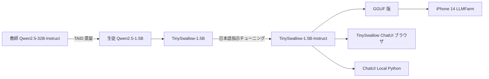
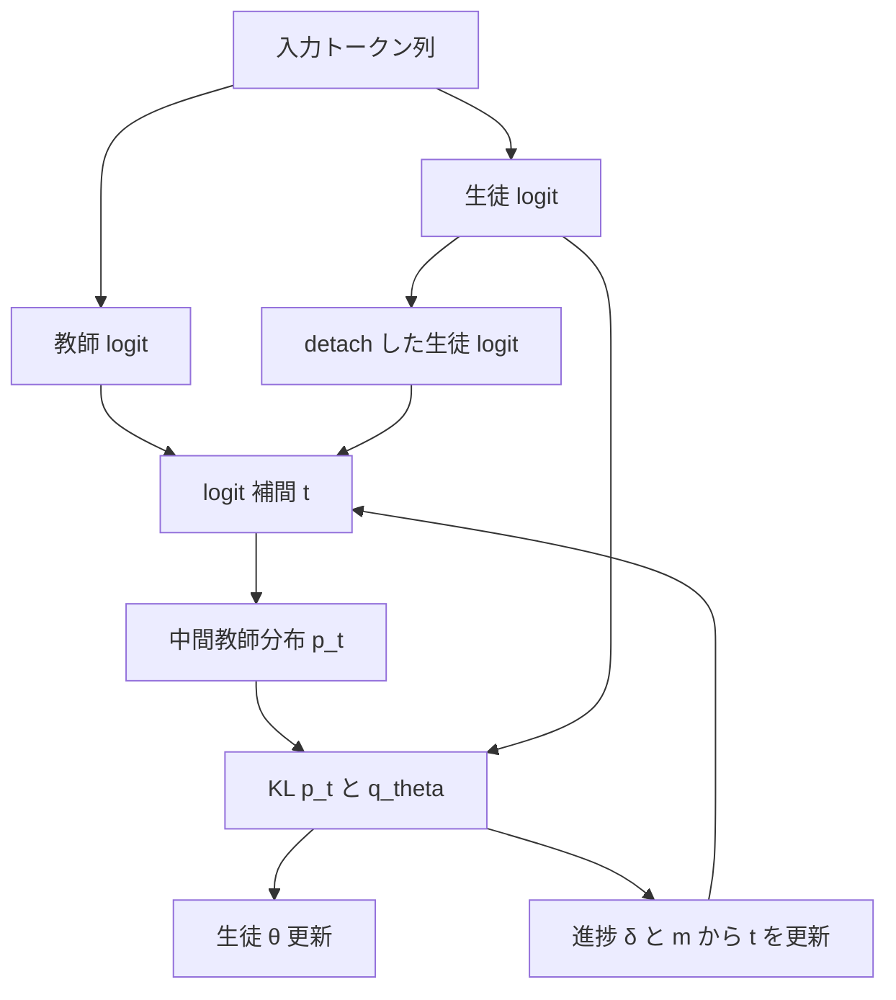

# TAID: Temporally Adaptive Interpolated Distillation と TinySwallow-1.5B（Sakana AI × 東京科学大学 Swallow）

- **Authors**: Makoto Shing, Kou Misaki, Takuya Akiba（Sakana AI）, Han Bao（京都大学）, Sho Yokoi（国立国語研究所 / 東北大学 / 理研）
- **Model team**: Sakana AI（Makoto Shing, Taishi Nakamura, Kou Misaki, Takuya Akiba）+ Swallow チーム（Naoki Okazaki, Youmi Ma, Kakeru Hattori, Kazuki Fujii, Sakae Mizuki）
- **Venue**: ICLR 2025（Spotlight）
- **Date**: arXiv v1 2025-01-28 / v4 2025-02-27、公式ブログ 2025-01-30
- **Links**: [arXiv 2501.16937](https://arxiv.org/abs/2501.16937) / [HTML 版](https://arxiv.org/html/2501.16937v4) / [Sakana AI 公式ブログ（日本語）](https://sakana.ai/taid-jp/) / [TinySwallow-1.5B-Instruct モデルカード](https://huggingface.co/SakanaAI/TinySwallow-1.5B-Instruct)
- **Type**: 学術論文 + 公開モデル（技術情報）
- **蒸留判定**: **白箱蒸留**（教師と生徒の logit を補間した分布への KL）
- **エビデンス品質**: 論文・モデルカードは **一次資料**。ベンチマーク順位（「3B 未満で最高平均」）は **ベンダー申告**（ブログ上は図のみで数値なし）

## Abstract

The paper proposes TAID, a knowledge distillation method for compressing causal language models. It addresses challenges that arise when a small student learns from a much larger teacher — the capacity gap, mode averaging, and mode collapse. TAID gradually shifts an intermediate target distribution from the student's initial distribution toward the teacher's. The authors provide theoretical analysis of how this prevents mode collapse and report experiments on instruction tuning and pre-training across model sizes and architectures. They also release two compact models built with the method: TAID-LLM-1.5B and TAID-VLM-2B.

（arXiv 抄録の要旨。WebFetch で取得した内容を英語のまま要約して記載）

## Abstract (Japanese Translation)

TAID は、因果言語モデルを圧縮するための知識蒸留手法です。小さな生徒がはるかに大きな教師から学ぶときに起きる **能力差（capacity gap）・モード平均化・モード崩壊** に対処します。TAID は中間の目標分布を、生徒の初期分布から教師の分布へ **時間とともに徐々に移動** させます。著者らはこれがモード崩壊を防ぐことを理論的に分析し、指示チューニングと事前学習の両方で、さまざまなモデルサイズ・アーキテクチャで実験しています。また、この手法で作った小型モデル TAID-LLM-1.5B と TAID-VLM-2B を公開しています。

## Overview

TAID は **国内発の LLM 蒸留手法として唯一トップ会議（ICLR）に採択** されたもので、国内事例の起点です。Sakana AI は TAID を使い、東京科学大学 Swallow チームと **Qwen2.5-32B-Instruct（教師）→ Qwen2.5-1.5B（生徒）** の日本語小型モデル **TinySwallow-1.5B** を作りました。サイズは約 1/20 で、iPhone やブラウザ上でオフライン動作します。研究は経産省・NEDO の GENIAC（JPNP20017）の支援を受けています。

ただし、**商用導入の事例は確認できません**。モデルカードは「研究開発目的の実験的プロトタイプであり、商用利用やミッションクリティカルな環境での利用を意図していない」と明記しています（ライセンス上は Apache-2.0 と Gemma 規約の両方を守れば商用利用可能、と併記されており、両者が食い違っています）。



## Problem

従来の KD が大きな教師で失敗する理由を、論文は次の 3 つに整理しています。

1. **Capacity gap（能力差）**: 生徒の表現力が足りず、教師の分布を再現できない。教師が大きいほど生徒の性能がむしろ下がることがある。
2. **Mode averaging（モード平均化）**: 前向き KL（$\mathrm{KL}(p\|q)$）は教師の全モードを覆おうとして、生徒の分布が平板になる。
3. **Mode collapse（モード崩壊）**: 逆 KL（$\mathrm{KL}(q\|p)$）は一つのモードに集中し、多様性を失う。

公式ブログは、Sakana AI の例文「Sakana AI は効率的な ___ の手法を開発する」で教師が AI 35%・ML 25%・LLM 15% と確率を割り振る図を使い、**正解だけでなく確率分布そのものを移す** のが蒸留だと説明しています。

## Proposed Method

### 中間分布（式 1）

$$
p_t(y_s \mid y^{<s}) = \mathrm{softmax}\Big((1-t)\cdot \mathrm{logit}_{q'_\theta}(y_s \mid y^{<s}) + t\cdot \mathrm{logit}_{p}(y_s \mid y^{<s})\Big)
$$

- $t \in [0,1]$: 時間依存の補間係数。$t=0$ で生徒自身、$t=1$ で教師
- $q'_\theta$: 勾配を止めた（detach した）生徒
- $p$: 教師
- 補間は **確率ではなく logit の段階** で行う

### 目的関数（式 2）

$$
J^{(t)}_{\mathrm{TAID}}(p, q_\theta) = J_{\mathrm{KL}}(p_t, q_\theta) = \frac{1}{S}\sum_{s}\sum_{y_s} p_t(y_s\mid y^{<s}) \log \frac{p_t(y_s\mid y^{<s})}{q_\theta(y_s\mid y^{<s})}
$$

- $S$: 系列長
- 生徒 $q_\theta$ は「少しだけ先にいる自分」を追いかける形になり、能力差が小さく保たれる

### $t$ の適応的更新（3.2 節）

$$
\delta_n = \frac{J^{(t_{n-1})} - J^{(t_n)}}{J^{(t_{n-1})} + \epsilon}, \qquad
m_n = \beta m_{n-1} + (1-\beta)\,\delta_n
$$

$$
t_n \leftarrow \min\Big(1.0,\ \max\big(t_{\mathrm{linear}},\ t_{n-1} + \alpha\cdot \sigma(m_n)\cdot(1-t_{n-1})\big)\Big)
$$

- $\delta_n$: 目的関数の相対変化（学習が進んでいるか）
- $m_n$: モメンタムで平滑化した進捗
- $\alpha$: $t$ のステップ幅、$\beta$: モメンタム係数、$\sigma$: シグモイド
- $t_{\mathrm{linear}}$: 線形スケジュール（下限として機能）

学習が順調なら $t$ を速く上げ（より教師に近づける）、停滞すればゆっくり上げます。

### ハイパーパラメータ

| 記号 | 値 | 意味 |
|------|----|------|
| $\beta$ | 0.99 | モメンタム |
| $\alpha$ | 5e-4 | $t$ のステップ幅 |
| $t_{\mathrm{start}}$ | 0.2–0.4 | 生徒と教師の初期類似度で決める。図 2 の分析では 0.4 |
| $t_{\mathrm{end}}$ | 1.0 | 最終的に教師分布へ一致 |

## Algorithm (Pseudocode)

論文付録 A の Algorithm 1 を再構成したものです。

```text
入力: 学習率 η, 補間学習率 α, モメンタム β, 反復数 N, t_start, t_end
初期化: θ（生徒）, t_1 = t_start, m_0 = 0, J^(t_0) = ∞
for n = 1 .. N:
    t_linear = t_start + (t_end - t_start) * n / N
    バッチをサンプル
    p_{t_n} を式 1 で計算（教師 logit と detach した生徒 logit を補間）
    J^(t_n) を式 2 で計算
    θ ← θ - η ∇_θ J^(t_n)
    δ_n = (J^(t_{n-1}) - J^(t_n)) / (J^(t_{n-1}) + ε)
    m_n = β m_{n-1} + (1-β) δ_n
    Δt = α * sigmoid(m_n) * (1 - t_n)
    t_{n+1} = min(t_end, max(t_linear, t_n + Δt))
```

## Architecture / Process Flow



TinySwallow の学習工程（モデルカード・ブログより）は次のとおりです。

1. **TAID 蒸留**: Qwen2.5-32B-Instruct → Qwen2.5-1.5B（日本語データで継続事前学習を兼ねる、とブログに記載）
2. **指示チューニング**: Gemma-2-LMSYS-Chat-1M-Synth、swallow-magpie-ultra-v0.1、swallow-gemma-magpie-v0.1
3. **配布**: Hugging Face（ベース / Instruct / GGUF）、Web アプリ、ローカル Python 版

## Figures & Tables

> 公式ブログの図はプレースホルダ（data URI）で画像 URL を取得できませんでした。arXiv HTML 版の図 1 は `overview.png`（`https://arxiv.org/html/2501.16937v4/overview.png`）として参照されています。


### 表 1: 指示チューニングでの MT-Bench スコア

組合せ (A) Phi-3-mini 3.8B → TinyLlama 1.1B、(B) Llama-2 6.7B → TinyLlama 1.1B、(C) StableLM Zephyr 2.8B → Pythia 0.4B

| 手法 | A | B | C |
|------|---|---|---|
| SFT | 2.00 | 3.94 | 2.57 |
| KL (Hinton et al., 2015) | 2.71 | 3.99 | 2.74 |
| RKL | 3.48 | 3.92 | 2.53 |
| TVD | 3.27 | 3.64 | 2.57 |
| Adaptive KL | 3.27 | 3.77 | 2.64 |
| GKD | 2.24 | 3.82 | 2.59 |
| DistiLLM | 3.23 | 3.97 | 2.97 |
| CTKD | 1.78 | 2.84 | 1.39 |
| DKD | 2.70 | 4.14 | 2.90 |
| TAID（適応更新なし） | 3.44 | 4.18 | 2.88 |
| **TAID** | **4.05** | **4.27** | **3.05** |

### 表 2: 継続事前学習での Open LLM Leaderboard

| 手法 | ARC | HellaSwag | MMLU | TruthfulQA | Winogrande | GSM8K | 平均 |
|------|-----|-----------|------|------------|------------|-------|------|
| SFT | 41.38 | 63.66 | 25.89 | 35.64 | 61.25 | 1.21 | 38.17 |
| KL | 44.97 | 65.43 | 25.11 | 37.95 | 63.22 | 2.80 | 39.91 |
| TVD | 43.52 | 64.50 | 25.95 | 36.38 | 63.14 | 2.96 | 39.41 |
| Adaptive KL | 43.77 | 63.09 | 26.04 | 36.42 | 63.22 | 2.12 | 39.11 |
| GJS | 44.71 | 65.67 | 25.27 | 37.76 | 62.12 | 3.34 | 39.81 |
| Skew KL | 44.62 | 65.25 | 25.79 | 37.45 | 62.51 | 3.41 | 39.84 |
| Skew RKL | 44.11 | 64.80 | 26.07 | 36.76 | 62.83 | 3.03 | 39.60 |
| **TAID** | **45.48** | 65.43 | 25.43 | 37.92 | **63.38** | 2.96 | **40.10** |

（論文の表ヘッダは「TrustfulQA」と誤記）

### 表 3: 確率質量（head = 教師の上位 10 トークン、tail = 80–100 パーセンタイル）

| 手法 | Head | Tail |
|------|------|------|
| KL | 0.216 | 40.2 × 10⁻⁷ |
| RKL | 0.227 | 8.1 × 10⁻⁷ |
| TAID | 0.218 | 39.0 × 10⁻⁷ |

> TAID は KL に近い tail を保ちつつ（モード崩壊を避けつつ）、head も確保していることを示します。

### 表 4: TAID-LLM-1.5B（LightEval）

| モデル | スコア |
|--------|--------|
| Qwen2-1.5B | 46.19 |
| Phi-1.5B | 50.39 |
| StableLM-2-1.6B | 51.24 |
| SmolLM-1.7B | 51.31 |
| **TAID-LLM-1.5B** | **52.27** |

### 表 5: TAID-VLM-2B（Open-VLM-LB）

| モデル | スコア |
|--------|--------|
| PaliGemma | 46.56 |
| MiniCPM-V-2 | 47.93 |
| Phi-3-Vision | 53.60 |
| InternVL2-2B | 53.96 |
| **TAID-VLM-2B** | **56.43** |

### 図（教師サイズ実験）の要旨

公式ブログの図では、Pythia 70M を生徒にして教師サイズを変えると、**KL・RKL は教師が大きくなるほど LAMBADA の精度が下がる** のに対し、**TAID は教師が大きいほど精度が上がる** と示しています（数値はテキストに記載なし）。

```
教師サイズ →   小 ─────────────── 大
KL / RKL     ▁▂▃▂▁  （大きい教師で劣化）
TAID         ▁▂▃▄▅  （単調に改善）
※ ブログ図の傾向を模式化。実数値は未公開
```

### 公開物一覧

| 公開物 | サイズ | 内容 |
|--------|--------|------|
| TinySwallow-1.5B | 1.5B | 日本語ベース（教師 32B） |
| TinySwallow-1.5B-Instruct | 1.5B（カード表記 2B params） | 指示チューニング版 |
| TinySwallow-1.5B-Instruct GGUF | — | ローカル実行用 |
| TAID-LLM-1.5B | 1.5B | 英語 |
| TAID-VLM-2B | 2B | 英語 VLM |
| TinySwallow ChatUI | — | `pub.sakana.ai/tinyswallow`。ダウンロード後は完全オフライン |
| TinySwallow ChatUI Local | — | Python。ネットワーク不要 |

## Experiments & Evaluation

### Setup

- 指示チューニング: 3 組の教師→生徒、評価は MT-Bench
- 事前学習: 継続事前学習、評価は Open LLM Leaderboard 6 タスク
- 日本語: Swallow LLM 評価ベンチマーク（日本語理解・生成）で 3B 未満の最高平均（ブログ申告、数値は図のみ）

### Main Results

- 指示チューニングの 3 組すべてで TAID が最高（A: 4.05、B: 4.27、C: 3.05）
- 事前学習でも平均 40.10 で最高

### Ablation Study

- 適応更新なし（線形スケジュールのみ）は A で 3.44 → 適応ありで 4.05。**適応的な $t$ の更新が主な寄与**

## Business Perspective（国内事例としての評価）

| 観点 | 評価 | 根拠 |
|------|------|------|
| 技術の新規性 | 高い | ICLR 2025 Spotlight（一次資料） |
| 国内での商用導入 | **確認できず** | 顧客名・価格・提携の記述なし（公式ブログ） |
| ライセンス | 曖昧 | Apache-2.0 と「商用を意図しない」の併記（モデルカード） |
| 想定用途 | 社内文書で個人化した AI アシスタント、端末内で完結する業務支援、オフラインゲーム、小型エージェント | 公式ブログ |
| 資金 | GENIAC（NEDO JPNP20017） | 公式ブログ |

ドメインのビジネス価値式に当てはめると、TinySwallow は $C_{\text{student}}$ を「端末上・API 不要」まで下げる例です。ただし $Q$（推論回数）を持つ顧客がまだ見えず、価値は **潜在的** にとどまります。

$$
\text{価値} \approx (C_{\text{teacher}} - C_{\text{student}})\cdot Q - (C_{\text{data}} + C_{\text{train}}) - \Delta\text{Acc}\cdot V_{\text{err}}
$$

## Notes

- 後続の国内研究（[07 三菱電機](07-mitsubishi-teacher-size-japanese.md)、CyberAgent NLP2026 B9-18）は、TAID と同じ **「大きな教師ほど良いとは限らない」** という問題を、日本語・黒箱蒸留で再検証しています。
- 国内の解説記事（AIsmiley、二次報道・検索結果の要約のみ確認）は、Sakana AI が 2025 年に事業開発本部を立ち上げたと伝えています。ただし TAID / TinySwallow の顧客導入との関係は確認できませんでした。
