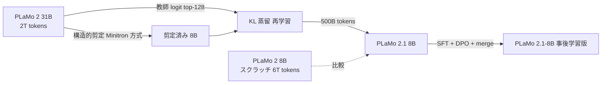
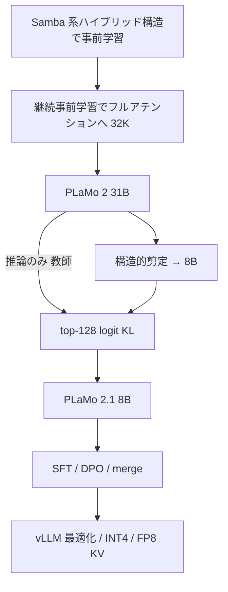

# PLaMo 2 Technical Report — 31B から 8B への剪定 + 知識蒸留（Preferred Networks）

- **Authors**: Preferred Networks（Pre-train: Yuta Hirokawa, Kentaro Imajo, Hiroaki Mikami, Shogo Murai, Daisuke Nishino, Toru Ogawa, Shuji Suzuki, Kuniyuki Takahashi, Tianqi Xu / Post-train: Kaizaburo Chubachi ほか / Project Management: Daisuke Okanohara, Shotaro Sano, Daisuke Tanaka）
- **Venue**: arXiv（テクニカルレポート）
- **Date**: arXiv v2 2025-09-25
- **Link**: [arXiv 2509.04897](https://arxiv.org/abs/2509.04897) / [HTML 版](https://arxiv.org/html/2509.04897v2)
- **Type**: 学術論文（テクニカルレポート）
- **蒸留判定**: **白箱蒸留**（教師 logit の top-128 への KL）+ 構造的剪定（Minitron 方式）
- **エビデンス品質**: **一次資料**（開発元のテクニカルレポート）。ただし表 1 と表 6 で数値が入れ替わっている箇所があり、レポート内で説明されていない（2026-10-22 に原文で再確認。本レポートの転記ミスではなく原文側の不整合）

## Abstract

PLaMo 2 is a Japanese-focused model family with a hybrid Samba-based architecture that transitions to full attention via continual pre-training to support 32K-token contexts. Training uses synthetic corpora, and efficiency comes from weight reuse and structured pruning; the pruning methodology "produces an 8B model that achieves performance comparable to our previous 100B model." Post-training combines SFT and DPO with synthetic Japanese instruction data and model merging. The models are optimized with vLLM and quantization.

（WebFetch で取得した抄録を要約。引用部分は原文）

## Abstract (Japanese Translation)

PLaMo 2 は日本語に重点を置いたモデル群で、Samba 系のハイブリッド構造から継続事前学習でフルアテンションへ移行し、32K トークンの文脈長に対応します。学習には合成コーパスを使い、**重みの再利用** と **構造的剪定** で効率化しています。剪定によって **前世代の 100B モデルに匹敵する 8B モデル** を得ました。事後学習は SFT と DPO、合成した日本語指示データ、モデルマージを組み合わせています。推論は vLLM と量子化で最適化しています。

## Overview

国内の国産 LLM ベンダーで、**蒸留を製品モデルの作り方として明記した一次資料** は、今回の調査では PFN のこのレポートと富士通（[03](03-fujitsu-takane-specialized-distillation.md)）だけでした。PFN は NVIDIA の **Minitron**（剪定 + 蒸留による再学習）を自社のハイブリッド構造に適用し、**PLaMo 2 31B から PLaMo 2.1 8B** を作りました。

ビジネス上の要点は **学習コスト** です。8B を一から 6T トークンで学習した場合（PLaMo 2 8B）と比べ、31B から剪定・蒸留した 8B（PLaMo 2.1 8B）は **500B トークン・約 1/5 の計算量** で、より高い JMMLU を得ています。



## Problem

- 8B クラスを一から学習すると、6T トークン・$2.88\times10^{23}$ FLOPs 規模の計算が必要になる。
- 大きなモデルの能力を小さなモデルに安く移したいが、蒸留時に教師の全語彙（10 万トークン）の logit を保持するとメモリが膨大になる。

## Proposed Method

### 剪定（2.3.2 節）

1. Minitron（Sreenivas et al., 2024）の手法に基づき、**構造的剪定** で重要な重みを残す。軽量な手順であり、**元のアーキテクチャを維持できる** ことが採用理由。
2. 剪定後のモデルを、**元のモデル（31B）を教師とした知識蒸留** で再学習する。

> レポートは、剪定の対象次元（幅・深さ）、重要度の推定方法、再学習データの中身を明記していません（WebFetch で確認）。

### 蒸留の損失

$$
\mathcal{L}_{\mathrm{KD}} = \sum_{s} \mathrm{KL}\big(\tilde p_{\mathrm{31B}}(\cdot \mid y^{<s}) \,\|\, q_{\mathrm{8B}}(\cdot \mid y^{<s})\big)
$$

- $\tilde p_{\mathrm{31B}}$: 教師の確率分布を **上位 128 トークンに制限** したもの（語彙 100,000 中）
- $q_{\mathrm{8B}}$: 剪定済み生徒
- レポートは「上位 128 の logit だけでも性能に大きな影響はない」と述べている

top-k に絞るメモリ削減率は、語彙を $V$、保持数を $k$ とすると次のとおりです。

$$
\frac{k}{V} = \frac{128}{100{,}000} \approx 0.13\%
$$

### 関連する効率化手法（同レポート内）

| 手法 | 内容 | 蒸留との関係 |
|------|------|-------------|
| Weight reusing（2.3.1） | 小さいモデルの重みで大きいモデルを初期化 | 別技術（蒸留ではない） |
| Pruning + KD（2.3.2） | 31B → 8B | **蒸留** |
| INT4 GPTQ 量子化 | モデルサイズ 70% 削減（17GB） | 量子化（蒸留ではない） |
| FP8 KV キャッシュ | トークンあたり KV メモリ約 110KB → 54KB | 量子化 |

## Algorithm (Pseudocode)

```text
入力: 教師 M_T = PLaMo 2 31B, 目標サイズ 8B, データ D（500B tokens）
1. M_T 上で各構造単位の重要度を推定（Minitron 方式）
2. 重要度の低い単位を削除し、同じアーキテクチャの 8B モデル M_S を得る
3. for batch in D:
       logits_T = M_T(batch) の上位 128 トークン（それ以外は無視）
       logits_S = M_S(batch)
       loss = KL(softmax(logits_T) || softmax(logits_S))   # top-128 上で計算
       M_S を更新
4. M_S に SFT + DPO + モデルマージを施して PLaMo 2.1-8B とする
```

## Architecture / Process Flow



## Figures & Tables

### 表 1: JMMLU / MMLU（5-shot, acc）

| モデル | JMMLU | MMLU |
|--------|-------|------|
| Qwen/Qwen2.5-7B | 0.681 | 0.742 |
| Qwen/Qwen3-8B-Base | 0.714 | 0.765 |
| tokyotech-llm/Llama-3.1-Swallow-8B-v0.2 | 0.600 | 0.622 |
| sbintuitions/sarashina2-7b | 0.400 | 0.425 |
| PLaMo 2 8B | 0.572 | 0.573 |
| **PLaMo 2.1 8B** | **0.635** | **0.635** |
| Qwen/Qwen2.5-32B | 0.786 | 0.832 |
| abeja/ABEJA-Qwen2.5-32b-Japanese-v0.1 | 0.802 | 0.826 |
| PLaMo 2 31B | 0.672 | 0.681 |
| pfnet/plamo-100b | 0.575 | 0.603 |

### 表 6: 計算資源と性能（Computing Resource vs Model Performance）

| モデル | 学習トークン | 計算資源（$10^{18}$ FLOPs） | JMMLU |
|--------|-------------|---------------------------|-------|
| PLaMo 2 8B | 6T | 288,000 | 0.572 |
| PLaMo 2.1 8B | 500B | 55,000 | 0.672 |
| PLaMo 2 31B | 2T | 372,000 | 0.635 |

> **注意**: 表 6 の PLaMo 2.1 8B（0.672）と PLaMo 2 31B（0.635）は、表 1 と値が逆です。表 1 の値（8B が 0.635、31B が 0.672）のほうが「教師を超えない」という蒸留の通常の挙動と整合しますが、レポートは説明していません。いずれの表でも **PLaMo 2.1 8B は スクラッチの PLaMo 2 8B（0.572）を上回る** ことは一致しています。
>
> PLaMo 2.1 8B の計算資源には、元の 31B の事前学習分は含まれず、**蒸留中の 31B 推論分は含まれます**。
>
> **（2026-10-22 訂正・確認）** 一次資料（arXiv 2509.04897v2 の HTML）を再取得し、表 1・表 6 の値を 1 行ずつ照合しました。本レポートの転記に誤りはなく、**値が入れ替わっているのは原文側** です（表 1: PLaMo 2.1 8B = 0.635、PLaMo 2 31B = 0.672 / 表 6: PLaMo 2.1 8B = 0.672、PLaMo 2 31B = 0.635）。原文の表 6 の本文説明は「PLaMo 2.1 8B は 3 モデルの中で最も高い性能を示す」と述べており、これは表 6 の（入れ替わった）値に依拠した記述です。本レポートは表 1 の値（8B = 0.635）を採用します。表 6 に plamo-100b の行はなく、MMLU 列もありません。蒸留に使ったトークン数は表 6 の「500B」以外に記載がなく、そのうち何トークンが蒸留かは明記されていません。

### 計算量の比較（ASCII）

```
学習計算量（10^18 FLOPs）
PLaMo 2 31B  |██████████████████████████████████████ 372,000
PLaMo 2 8B   |█████████████████████████████ 288,000   （スクラッチ 6T）
PLaMo 2.1 8B |██████ 55,000                            （剪定+蒸留 500B）
```

$$
\frac{55{,}000}{288{,}000} \approx 0.19 \quad (\text{スクラッチ 8B の約 1/5 の計算量})
$$

### 推論最適化（同レポート）

| 項目 | 値 |
|------|----|
| PLaMo 2.0-31B 16bit の重み | 約 63GB（L40S / A40 に載らない） |
| INT4 GPTQ | 70% 削減 → 17GB、精度劣化は「最小限」 |
| FP8 KV キャッシュ | 約 110KB → 54KB / トークン |
| 再計算の同時実行しきい値 | 128 → 256 リクエスト |
| L40S スループット比較 | 8B を使用 |

## Experiments & Evaluation

### Setup

- 教師: PLaMo 2 31B（2T トークンで事前学習）
- 生徒: 剪定済み 8B、500B トークンで蒸留再学習
- 評価: JMMLU / MMLU（5-shot）

### Main Results

- スクラッチ 8B に対し JMMLU +0.063（表 1 基準: 0.572 → 0.635）
- 前世代 PLaMo 100B（0.575）を 8B で上回る（抄録の「100B に匹敵」の根拠）

### Ablation Study

- top-128 logit 制限は「性能に大きな影響なし」と記載（数値は未提示）

## Business Perspective

| 観点 | 内容 | エビデンス |
|------|------|-----------|
| 誰のための蒸留か | **自社製品ラインナップの作成**（顧客向けの蒸留サービスではない） | 一次資料 |
| 経済効果 | 8B を作る学習計算量が約 1/5 | 一次資料（表 6） |
| 資金 | NEDO JPNP20017（GENIAC） | 一次資料 |
| ライセンス・価格 | レポートに記載なし | — |

H4（国内は公開モデル型中心）に対しては、**「ベンダーが自社モデルを作るための内部工程として蒸留を使う」** という第 3 の型を示しています。事業会社が蒸留する事例ではありません。

## Notes

- 同じ「Minitron 方式」は NVIDIA の Llama-3.1-Minitron（C3 クラスタ）と同系統です。
- PFN は金融特化 PLaMo-fin なども展開していますが（報道、本文未確認）、それらに蒸留を使ったという記述は確認できませんでした。
- **（2026-10-22 追記）蒸留で作った 8B の下流利用**: PFN は 2025-12-16 に自律稼働デバイス向け VLM「PLaMo 2.1-8B-VL」を発表し（MONOist 報道）、2026-04 に 2B 版と合わせて公開しました。[PLaMo 2.1-VL Technical Report（arXiv 2604.19324、2026-04-21）](https://arxiv.org/abs/2604.19324) を確認したところ、基盤 LLM は **PLaMo 2.1-8B / 2B**（DPO 済み）で、その作り方は本レポート（arXiv 2509.04897）を参照するのみです。**2B の作成方法（剪定 + 蒸留か、スクラッチか）は VL レポートに記載がありません**。VLM 学習自体は LLaVA 型（SigLIP2 + MLP アダプタ）の 2 段階学習で、合成データは Qwen3-VL-235B-A22B / Qwen2.5-VL-32B / Qwen3-32B で生成していますが、レポートはこれを蒸留とは呼んでいません。主な結果: JA-VG-VQA-500 ROUGE-L 8B 61.5 / 2B 60.7（Qwen3-VL-8B-Instruct 41.6）、Ref-L4 日本語 8B 85.2 / 2B 82.4（Qwen3-VL-235B-A22B-Instruct 81.6）、工場作業 10 クラス zero-shot 8B 53.9% / 2B 40.9%（一次資料、開発元評価）。剪定 + 蒸留で作った 8B が **エッジ向け製品ラインの土台** になった点は、「学習コスト削減」の価値が製品に波及した例です。
