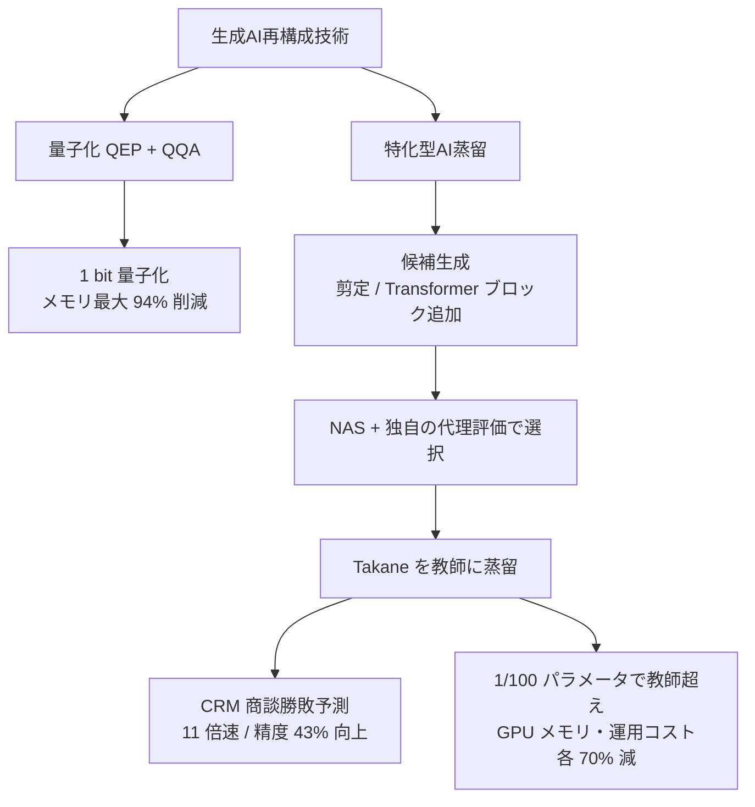
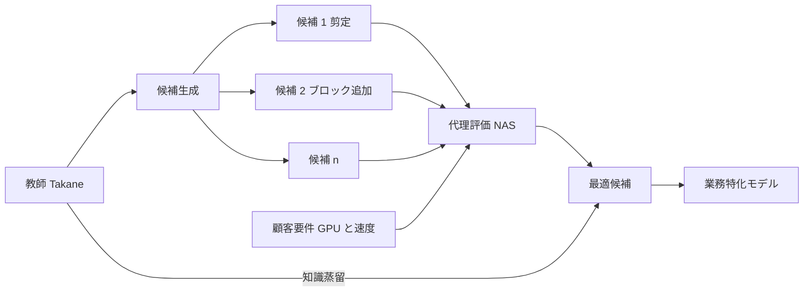
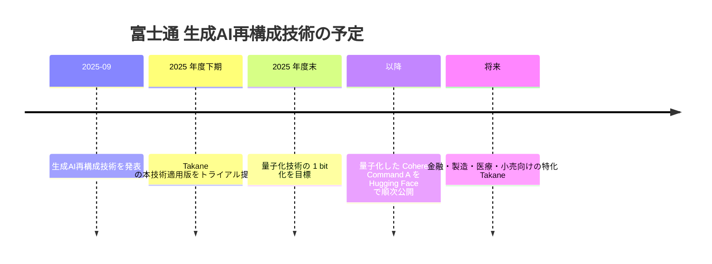

# 富士通「生成AI再構成技術」— Takane を教師とする特化型AI蒸留（NAS + 知識蒸留）

- **Company/Organization**: 富士通株式会社（Fujitsu Research）
- **Industry**: IT サービス / 国産 LLM ベンダー（Takane は Cohere との共同開発 LLM）
- **Date**: 2025-09-08（プレスリリース）
- **Links**: [プレスリリース原文](https://global.fujitsu/ja-jp/pr/news/2025/09/08-01)（**HTTP 429 で取得不可**） / [クラウド Watch](https://cloud.watch.impress.co.jp/docs/news/2045596.html) / [マイナビ TECH+](https://news.mynavi.jp/techplus/article/20250908-3442664/) / [EE Times Japan](https://eetimes.itmedia.co.jp/ee/articles/2509/10/news027.html)
- **Type**: Business Case（ベンダーの技術発表 + 社内データでの実証）
- **蒸留判定**: **蒸留（方式の詳細は非公開）**。NAS で生徒の構造を探索し、Takane を教師として知識を移す
- **エビデンス品質**: **ベンダー申告**（報道 3 本で確認。プレスリリース原文は取得できず、第三者検証なし）
- **（2026-10-22 追記）原文の再取得を 6 経路で試行し、すべて失敗**: `global.fujitsu/ja-jp/pr/news/2025/09/08-01` と `global.fujitsu/en-global/pr/news/2025/09/08-01` は HTTP 429（curl でも Vercel Security Checkpoint の JavaScript 検証ページが返る）、`pr.fujitsu.com/jp/news/2025/09/8.html` と `fujitsu.com/global/.../2025/0908-01.html` は `info.archives.global.fujitsu` へ 301 後に 404、`fujitsu.com/jp/...` も同様、Web Archive は本環境から取得不可。したがって数値はクラウド Watch・マイナビ TECH+・EE Times Japan の 3 報道（プレスリリース準拠）に依拠したままで、**報道 3 本の数値は相互に一致** しています。

## Overview

富士通は、LLM を軽くする 2 つのコア技術を「生成AI再構成技術」として発表しました。

1. **量子化**: 1 ビット量子化で Takane のメモリを最大 94% 削減
2. **特化型AI蒸留**: NAS（Neural Architecture Search）で業務に合った小型構造を探し、Takane を教師に蒸留

国内で **事業会社の業務データ（富士通自身の CRM データ）を使い、蒸留後の生徒モデルの精度・速度・コストを数値で公表した** のは、今回の調査ではこの 1 件だけです。ただし実証は富士通社内の CRM データで、外部顧客の導入事例ではありません。



## Problem & Context

- 大規模 LLM の推論には **ハイエンド GPU 4 基** が必要で、エッジや顧客のオンプレ環境に置けない。
- 富士通は「多くの AI エージェントのタスクは LLM の汎用能力のごく一部しか使わない」という前提に立ち（EE Times。根拠データは示されていない）、**タスクに必要な知識だけを抜き出した特化モデル** を作る方針をとった。
- 長期目標として、生成 AI の精度を保ったまま **メモリを最大 1/1000** にすることを掲げている（クラウド Watch）。背景として「深層学習の計算量は 12 年で約 $10^{10}$ 倍、ムーアの法則は 50 年で約 $10^{7}$ 倍」と説明している。

## Solution

### 1. 量子化（参考: 蒸留ではない）

| 要素 | 内容 |
|------|------|
| QEP（Quantization Error Propagation） | 量子化誤差を層をまたいで伝搬させ、層間の誤差を補正。深いネットワークで GPTQ の誤差が指数的に増える問題を抑える |
| QQA（Quasi-Quantum Annealing） | 富士通の既存最適化アルゴリズム。他手法の 1/10 の時間で 1.5 倍の精度とされる。Fujitsu Kozuchi に搭載済み |
| 適用範囲 | 学習済みモデルに後から適用できる（学習時から適用が必要な BitNet と対比） |

### 2. 特化型AI蒸留（本レポートの主題）

手順は 3 段階です（マイナビ TECH+・クラウド Watch・EE Times で一致）。

1. **候補生成**: ベースモデルから **不要な知識の剪定** や **Transformer ブロックの追加** を行い、多様な構造の候補を作る
2. **選択**: NAS の中で富士通独自の **代理評価（proxy evaluation）** を使い、顧客の要件（GPU リソース・速度）と精度のバランスが最もよい候補を選ぶ
3. **蒸留**: 選んだ構造に、**Takane などの教師モデル** から必要な知識を移す

富士通はこの「NAS と体系的な蒸留の組合せ」を **世界初** と称しています（ベンダー申告）。

## Algorithm (Pseudocode)

発表内容から再構成した手順です。損失関数・探索空間の詳細は公開されていません。

```text
入力: 教師 T = Takane, タスクデータ D_task, 顧客制約 C = {GPU メモリ, 速度}
1. 候補集合 S = {}
2. for 変換 in {剪定(不要知識), Transformer ブロック追加, ...}:
       S に T から派生した構造候補を追加
3. for s in S:
       score(s) = 代理評価(s, D_task)   # 富士通独自。学習前に精度を推定
4. s* = argmax_{s が C を満たす} score(s)
5. s* を T から蒸留して学習（D_task 上で教師の出力を模倣）
6. 出力: タスク特化の小型モデル s*
```

## Results & Impact

| Metric | Before（教師 / 従来） | After（蒸留後） | 出典 |
|--------|----------------------|----------------|------|
| 推論速度（CRM 商談勝敗予測） | 1× | **11×** | クラウド Watch / マイナビ / EE Times |
| 精度（CRM 商談勝敗予測） | 基準 | **+43%**（EE Times は「43 ポイント」と表記） | 同上 |
| パラメータ数 | 教師 | **約 1/100** | 同上 |
| 精度（1/100 モデル） | 教師 | **教師を上回る** | 同上 |
| GPU メモリ | 基準 | **−70%** | 同上 |
| 運用コスト | 基準 | **−70%** | 同上 |
| 画像認識（未学習物体の検出精度） | 既存の蒸留手法 | **+10%**（EE Times は「10 ポイント超」） | 同上 |

量子化側の数値も並べておきます（蒸留とは別の成果）。

| Metric | 値 | 備考 |
|--------|----|------|
| メモリ削減（FP16 → Int1） | 最大 94% | Takane |
| 精度維持率 | 89% | GPTQ は 20% 未満 |
| 推論速度 | 最大 3 倍 | 量子化前比 |
| 必要 GPU | ハイエンド 4 基 → ローエンド 1 基 | — |

## Figures & Tables

> プレスリリース原文の図（「量子化技術」「特化型AI蒸留技術」の説明図）は、マイナビ TECH+ でキャプションのみ確認できました。画像 URL は取得できていません。以下はテキストから再構成した図です。

### 特化型AI蒸留のパイプライン



### 効果の比較（ASCII）

```
                    蒸留前   蒸留後
推論速度            1x  ▏    11x ███████████
パラメータ数        100 ███  1   ▏
GPU メモリ          100 ███  30  █
運用コスト          100 ███  30  █
※ 指数ではなく相対値。富士通の発表値
```

### スケジュール



## ビジネス価値式への当てはめ

$$
\text{価値} \approx \underbrace{(C_{\text{teacher}} - C_{\text{student}})\cdot Q}_{\text{GPU・運用コスト 70\% 減}} - \underbrace{(C_{\text{data}} + C_{\text{train}})}_{\text{NAS 探索 + 蒸留の費用 (非公開)}} - \underbrace{\Delta\text{Acc}\cdot V_{\text{err}}}_{\text{精度は向上と申告 } (\Delta\text{Acc} < 0)}
$$

富士通の申告どおりなら第 3 項がマイナス（精度が上がる）になり、価値は推論コスト削減分をそのまま上回ります。ただし **NAS 探索と蒸留の費用（第 2 項）は公表されていません**。

## Lessons Learned

1. **「特化 + 蒸留」は精度を上げ得る**: 汎用の教師より、狭いタスクに絞った小型生徒が上回ることがある、という C5 クラスタの仮説と一致する（ただしベンダー申告）。
2. **構造探索と蒸留の組合せ**: 生徒の構造を固定せず、顧客の GPU 制約から逆算して選ぶ点が、Bedrock 等のマネージド蒸留（生徒は既製モデルから選ぶ）と異なる。
3. **評価の透明性が課題**: EE Times は「89% の基準が不明」「11 倍と 43% が同一実験か不明」「公開ベンチマークがない」と指摘している。

## Notes

- **国内事業会社の導入事例ではない**: 実証データは富士通自身の CRM（OneCRM、クラウド Watch）。外部顧客での導入数値は未発表。
- H2（ベンダー数値は集計値で顧客別成果は非公開）を国内で再確認する事例です。
- 同時期に NTT（tsuzumi 2）も「1 GPU で動く軽量 LLM」を打ち出していますが、こちらは蒸留の記述がありません（[10](10-non-distillation-lightweight-llms.md)）。
