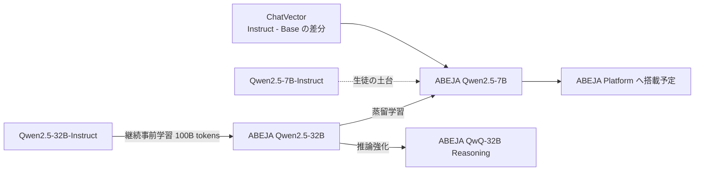
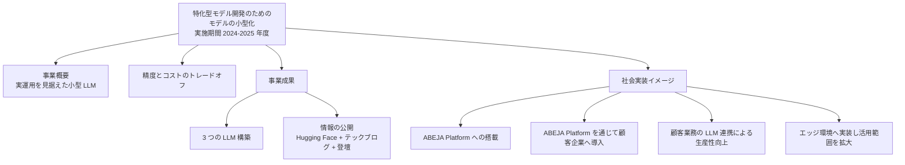

# ABEJA Qwen2.5-7B — GENIAC 2 期での 32B → 7B 蒸留による「実運用向け小型 LLM」

- **Company/Organization**: 株式会社 ABEJA
- **Industry**: AI プラットフォーム（ABEJA Platform）/ DX 支援
- **Date**: 2025-02（登壇）/ 2025-04（7B モデルの成果公表）/ NEDO 事業期間 2024–2025 年度
- **Links**: [モデルカード ABEJA-Qwen2.5-7b-Japanese-v0.1](https://huggingface.co/abeja/ABEJA-Qwen2.5-7b-Japanese-v0.1) / [NEDO 成果概要 PDF「特化型モデル開発のためのモデルの小型化」](https://www.nedo.go.jp/content/800036434.pdf) / [登壇資料「GENIAC2期におけるABEJAの取り組み」](https://speakerdeck.com/ryo1443/zhu-shi-hui-she-abeja-geniac2qi-niokeruabejanoqu-rizu-mi) / [ABEJA Tech Blog](https://tech-blog.abeja.asia/) / （2026-10-22 追記）[7B 公開記事](https://tech-blog.abeja.asia/entry/geniac2-qwen25-7b-v0.1) / [蒸留のパイプライン並列化](https://tech-blog.abeja.asia/entry/geniac2-distillation-pipeline-parallel) / [NVIDIA Spotlight 記事](https://developer.nvidia.com/ja-jp/blog/spotlight-pipeline-parallelism-of-the-distillation-for-abeja-qwen-2-5-7b-using-nvidia-nemo/)
- **Type**: Technical Article + Business Case（政府助成による公開モデル）
- **蒸留判定**: **白箱蒸留**（2026-10-22 訂正。初回は「方式は非公開」としていたが、ABEJA Tech Blog 2 本と NVIDIA 記事で **教師の最終層 logit への KL（NeMo + nvidia-modelopt `LogitsKLLoss`）** と確認。詳細は [11](11-abeja-nemo-distillation-pipeline-parallel.md)）。モデルカードは「通常の継続事前学習ではなく、32B を教師とした蒸留学習」と明記
- **エビデンス品質**: モデルカード・NEDO 資料・技術ブログは **一次資料**。「GPT-3.5 Turbo 超え」「同規模で最高水準」は **ベンダー申告**

## Overview

ABEJA は経済産業省・NEDO の GENIAC（ポスト 5G 情報通信システム基盤強化研究開発事業）で、テーマ **「特化型モデル開発のためのモデルの小型化」** に取り組みました。事業概要は「特定タスクで高性能かつ実用可能でありながら、パラメータ規模を抑えた **実運用を見据えた LLM** を開発する」です。

3 つのモデルを作り、そのうち **ABEJA Qwen2.5-7B** を **自社の ABEJA Qwen2.5-32B から蒸留** しました。社会実装のイメージとして **ABEJA Platform への搭載と顧客企業への導入**、**エッジ環境への実装** を掲げています（NEDO 資料）。



## Problem & Context

NEDO 資料は課題を **「精度とコストのトレードオフ」** と表現しています。

- LLM は大きいほど計算資源とコストが増え、実運用では精度とコストのトレードオフが問題になる。
- そこで、実運用で必要な特定タスクの性能を上げつつ、小型化した LLM を作る。

## Solution

### 学習の構成（モデルカード）

| 項目 | 内容 |
|------|------|
| ベースモデル | Qwen/Qwen2.5-7B-Instruct（Qwen/Qwen2.5-7B 由来） |
| 教師モデル | abeja/ABEJA-Qwen2.5-32b-Japanese-v0.1 |
| 学習方法 | **通常の継続事前学習ではなく、蒸留学習** |
| 指示追従の補強 | ChatVector（Qwen2.5-7B-Instruct − Qwen2.5-7B の差分ベクトルを加算） |
| 事後学習 | なし |
| 学習データ | 記載なし |
| パラメータ | 8B（BF16） |
| ライセンス | Apache-2.0 |
| 開発者 | Hiroshi Kiyota, Keisuke Fujimoto, Kentaro Nakanishi, Kyo Hattori, Shinya Otani, Shogo Muranushi, Takuma Kume, Tomoki Manabe |

### 教師（32B）側の学習基盤（登壇資料、2025-02-19）

| 項目 | 内容 |
|------|------|
| ベース選定 | Qwen2.5（精度・ライセンス・構造）。Llama-3 / gemma-2 / Phi-4 は不採用 |
| データ量 | 約 100B トークン、日本語:英語 ≈ 7:3 |
| データ選別 | Qwen2.5 でスコア・カテゴリ付け → そのラベルで DeBERTa を学習して計算コストを削減 |
| 合成データ | 指示形式の QA、海外データの日本語訳、数学データへの推論過程の付与 |
| 計算基盤 | Azure CycleCloud + Slurm + Singularity（Apptainer）、**H100 × 8 / ノード × 8 ノード** |
| フレームワーク | NeMo（Megatron-LM ベース） |
| 既知の問題 | transformer-engine / apex のバージョン不整合で NeMo が失敗、中国語の混入 |

登壇時点（2025-02）の記述は「**蒸留にも挑戦中**」のみで、蒸留の手法（logit を使う白箱か、生成文を使う黒箱か）は資料にもモデルカードにも書かれていません。クラスタ定義に記載のあった技術ブログ「蒸留のパイプライン並列化」は、ABEJA Tech Blog の最新ページ（2026-08〜10）からは見つけられませんでした。

**（2026-10-22 訂正）** 技術ブログの URL を特定し本文を確認しました（[11](11-abeja-nemo-distillation-pipeline-parallel.md)）。要点は次のとおりです。

| 項目 | 確認内容（一次資料） |
|------|--------------------|
| 方式 | **白箱蒸留**。教師の最終層 logit に対する KL（`LogitsKLLoss`）。中間層マッチングは教師と生徒の基盤が異なるため不使用 |
| 教師 / 生徒 | ABEJA Qwen2.5 32B-Japanese v0.1 / Qwen2.5-7B-Instruct を初期値とする 7B（剪定ではなく別モデル。剪定すると ChatVector が使えないため） |
| 比較実験 | 同じデータ・設定で **CPT 版 7B** も学習し、Japanese-MT-Bench で蒸留版 **7.26** vs CPT 版 **7.21** vs 元の Qwen2.5-7B-Instruct **6.86**（GPT-4o-0513 判定、3 回平均） |
| 計算基盤 | H100×8 × 8 ノード（64 GPU）、NeMo + NeMo-Aligner。トークン数・学習時間は非公開 |
| 実装上の課題 | NeMo の蒸留がパイプライン並列に未対応だったため、Megatron-Core のスケジューラを書き換え（2025-05 に本家が追随） |

### 量の比較

$$
\text{パラメータ比} = \frac{7\text{B}}{32\text{B}} \approx 0.22
$$

## Results & Impact

### NEDO 成果概要（ベンダー申告）

| モデル | 性能（申告） |
|--------|-------------|
| ABEJA Qwen2.5-32B Model | OpenAI GPT-4 超え（2025-01 時点） |
| ABEJA QwQ-32B Reasoning Model | OpenAI GPT-4o および o1-preview 超え（2025-04 時点）。目標 MT-Bench Japanese 8.278 に対し **8.669** |
| **ABEJA Qwen2.5-7B Model** | **同規模モデルの最高水準かつ OpenAI GPT-3.5 Turbo 超え（2025-04 時点）** |

対外評価として、日本経済新聞社「NIKKEI Digital Governance」の AI モデルスコア化ランキング（2025-03）で **日経首位・グローバル 16 位**（32B）、W&B の Nejumi Leaderboard 3 で **50B 以下 1 位** を挙げています。

### 登壇資料のベンチマーク（2025-02 時点）

| モデル | Japanese-MT-Bench | Elyza-tasks-100 |
|--------|------------------|-----------------|
| Qwen2.5-72B-Instruct | 8.006 | 4.39 |
| Qwen2.5-32B-Instruct | 7.919 | 4.34 |
| **ABEJA-Qwen2.5-32B** | **8.294** | 4.37 |
| Qwen2.5-7B-Instruct | 6.619 | 3.47 |
| **ABEJA-Qwen2.5-7B** | **6.919** | **3.92** |

> 登壇資料の 7B が蒸留版か継続事前学習版かは資料からは判別できません（「蒸留にも挑戦中」と同時に記載）。
>
> **（2026-10-22 追記）** 2025-04-22 の公開記事では蒸留版 7B の Japanese-MT-Bench は **7.26**（CPT 版 7.21、Qwen2.5-7B-Instruct 6.86）で、登壇資料の 6.919 より高い値です。評価時期・Judge（GPT-4o-0513）・比較表の出所（Nejumi Leaderboard 3）が異なるため、両者は直接比較できません。全行は [11](11-abeja-nemo-distillation-pipeline-parallel.md) の表 2 を参照。

### 第三者表（PFN の PLaMo 2 Technical Report、表 1）

| モデル | JMMLU | MMLU |
|--------|-------|------|
| abeja/ABEJA-Qwen2.5-32b-Japanese-v0.1 | 0.802 | 0.826 |
| Qwen/Qwen2.5-32B | 0.786 | 0.832 |

ABEJA の 32B（= 7B の教師）は、PFN による比較でも Qwen2.5-32B を JMMLU で上回っています（[02](02-pfn-plamo2-pruning-distillation.md)）。

## Figures & Tables

### NEDO 成果概要の構成（PDF 1 ページを再構成）



### 性能の位置付け（ASCII、Japanese-MT-Bench）

```
Qwen2.5-72B-Instruct |████████████████████████████████████████ 8.006
ABEJA-Qwen2.5-32B    |█████████████████████████████████████████ 8.294
Qwen2.5-32B-Instruct |███████████████████████████████████████ 7.919
ABEJA-Qwen2.5-7B     |██████████████████████████████████ 6.919
Qwen2.5-7B-Instruct  |█████████████████████████████████ 6.619
```

## Lessons Learned

1. **「自社大モデル → 自社小モデル」の蒸留**: 外部 API を教師にしないため、利用規約上の制約（H5）を回避できる構成です。教師の Qwen2.5 は Apache-2.0。
2. **ChatVector との組合せ**: 蒸留で日本語知識を移し、指示追従は差分ベクトル加算で補う、という低コストの組合せ。
3. **社会実装は「予定」**: ABEJA Platform 経由の顧客導入は NEDO 資料で「イメージ」として書かれているだけで、導入企業名・成果は公表されていません。

## Notes

- **H4 を支持**: 政府助成 → 公開モデル → 自社プラットフォーム搭載予定、という国内の典型パターン。
- ABEJA Tech Blog の 2026 年 8–10 月の記事は、NVIDIA Nemotron 3 Nano への汎用・金融特化 SFT、ロボット学習などで、蒸留をテーマにした記事は見当たりませんでした（2026-10-21 時点の一覧ページ）。**（2026-10-22 訂正）** 蒸留の記事は 2025-04〜05 に 2 本あり（上記 Links）、一覧ページの最新分に載っていなかっただけでした。
- **（2026-10-22 追記）** 32B の事後学習記事（[geniac2-qwen25-32b-v1.0](https://tech-blog.abeja.asia/entry/geniac2-qwen25-32b-v1.0)、2025-05）は SFT + DPO（各 2 万件弱、Qwen2.5-72B-Instruct で合成 + 人手アノテーション）で、蒸留には触れていません。7B の事後学習済み版の公開は確認できていません。
