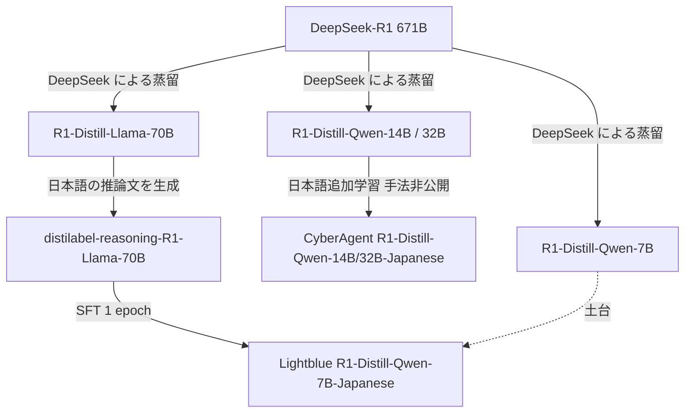
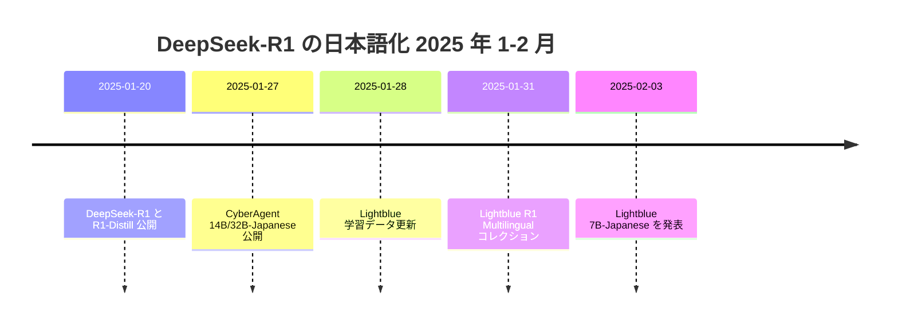

# DeepSeek-R1-Distill の日本語版 — サイバーエージェント（14B / 32B）と Lightblue（7B）

- **Source**: 株式会社サイバーエージェント（著者表記 Ryosuke Ishigami）/ 株式会社 Lightblue（Peter Devine）
- **Date**: CyberAgent 2025-01-27 公開 / Lightblue 2025-02-03 発表（データセット更新 2025-01-28、コレクション 2025-01-31）
- **Links**: [cyberagent/DeepSeek-R1-Distill-Qwen-14B-Japanese](https://huggingface.co/cyberagent/DeepSeek-R1-Distill-Qwen-14B-Japanese) / [lightblue/DeepSeek-R1-Distill-Qwen-7B-Japanese](https://huggingface.co/lightblue/DeepSeek-R1-Distill-Qwen-7B-Japanese) / [GIGAZINE（CyberAgent）](https://gigazine.net/news/20250128-cyberagent-deepseek-r1-japanese) / [IT Leaders（Lightblue）](https://it.impress.co.jp/articles/-/27417)
- **Type**: Technical Article（公開モデル + 報道）
- **蒸留判定**:
  - CyberAgent: **蒸留モデルへの追加学習**（手法・データ非公開）
  - Lightblue: **黒箱蒸留（系列レベル）** — R1-Distill-Llama-70B の生成文で 7B を SFT。土台も蒸留モデルなので「蒸留 × 蒸留」
- **エビデンス品質**: モデルカードは **一次資料**。報道は **二次報道**

## Overview

2025 年 1 月の DeepSeek-R1 公開から **1–2 週間** で、国内 2 社が R1 の蒸留モデル（DeepSeek-R1-Distill-Qwen）を日本語化して公開しました。目的はどちらも、R1 系が **日本語で質問しても英語や中国語で考え・答えてしまう** 問題の解消です。

両社のモデルカードを読み比べると、手法の開示度に大きな差があります。

| 観点 | CyberAgent 14B / 32B | Lightblue 7B |
|------|----------------------|--------------|
| 土台 | DeepSeek-R1-Distill-Qwen-14B / 32B | DeepSeek-R1-Distill-Qwen-7B |
| 学習 | 「日本語データで追加学習」とのみ記載 | フル SFT（LLaMA-Factory） |
| 教師データの出所 | 非公開 | **DeepSeek-R1-Distill-Llama-70B の生成文** |
| データ件数・内容 | 非公開 | 公開（`lightblue/distilabel-reasoning-R1-Llama-70B`） |
| 評価 | なし | gsm8k-ja、日本語 `<think>` の妥当率 |
| 計算コスト | 非公開 | **8×L20 で 10 分未満**（Alibaba Cloud） |
| ライセンス | MIT | Apache-2.0 |



## Key Technical Content

### Lightblue のデータ生成パイプライン（モデルカード）

1. `argilla/distilabel-reasoning-prompts` から英語の推論系プロンプトを抽出
2. `BAAI/bge-m3` の埋め込みで類似プロンプトを除去
3. `gpt-4o-mini-2024-07-18` でプロンプトを日本語に翻訳
4. `deepseek-ai/DeepSeek-R1-Distill-Llama-70B` で回答を生成（**教師**）
5. 次の応答を除外: 2048 トークン以内に終わらない / 有効な `<think>` がない / `<think>` が日本語でない

> 手順 3 で OpenAI の API を翻訳に使っていますが、回答（教師信号）は DeepSeek 系のオープンモデルから生成しています。商用 API の出力を教師にしない設計は、利用規約の制約（H5）に関係します。

### Lightblue の学習設定

| 項目 | 値 |
|------|----|
| 手法 | フル SFT（LLaMA-Factory）、DeepSpeed ZeRO-2 |
| 系列パッキング | 4500 トークンで切断 |
| 学習率 | 1e-5（cosine、warmup 0.01） |
| バッチ | 1 / デバイス × 8 デバイス = 8 |
| エポック | 1.0 |
| 最適化 | adamw_torch（β = 0.9 / 0.999、ε = 1e-8） |
| 精度 | bf16 |
| seed | 42 |
| 計算 | 8 × L20（ecs.gn8is-8x.32xlarge）で 10 分未満 |
| 検証損失 | ステップ 5 で約 0.59 → ステップ 45（約 0.98 epoch）で約 0.45 |
| フレームワーク | Transformers 4.46.1, PyTorch 2.5.1+cu124, Datasets 3.1.0, Tokenizers 0.20.3 |

### 系列レベル蒸留としての定式化

Lightblue の学習は、教師 $p_{70\mathrm{B}}$ の生成文 $\hat y$ を正解にした SFT（Kim & Rush の系列レベル KD）です。

$$
\mathcal{L} = -\sum_{x \in \mathcal{D}_{\mathrm{ja}}} \log q_\theta(\hat y \mid x), \qquad \hat y \sim p_{70\mathrm{B}}(\cdot \mid x),\ \hat y \in \mathcal{F}
$$

- $\mathcal{D}_{\mathrm{ja}}$: 日本語に翻訳したプロンプト
- $\mathcal{F}$: フィルタ条件（2048 トークン以内・`<think>` あり・日本語）

### CyberAgent の記述

モデルカードは使い方（`AutoModelForCausalLM`、`max_new_tokens=4096`、`temperature=0.7`、DeepSeek のプロンプト形式）だけで、**学習方法・データは非公開** です。GIGAZINE は CyberAgent の発表文「DeepSeek-R1-Distill-Qwen-14B/32B をベースに日本語データで追加学習を行った LLM を公開いたしました」を引用しています。

## Figures & Tables

### 表 1: gsm8k-ja-test（先頭 50 問、Lightblue モデルカード）

| モデル | repetition penalty | 正答率 (%) | 日本語 `<think>` 妥当率 (%) |
|--------|-------------------|-----------|---------------------------|
| DeepSeek-R1-Distill-Qwen-7B | 1.0 | 60 | 94 |
| DeepSeek-R1-Distill-Qwen-7B | 1.1 | 62 | 96 |
| R1-Distill-Qwen-7B-Japanese | 1.0 | 66 | 92 |
| **R1-Distill-Qwen-7B-Japanese** | **1.1** | **70** | **98** |

### 表 2: Tengentoppa-sft-reasoning-ja（先頭 50 プロンプト、日本語 `<think>` 妥当率）

| モデル | repetition penalty | 妥当率 (%) |
|--------|-------------------|-----------|
| DeepSeek-R1-Distill-Qwen-7B | 1.0 | 48 |
| DeepSeek-R1-Distill-Qwen-7B | 1.1 | 48 |
| R1-Distill-Qwen-7B-Japanese | 1.0 | 84 |
| **R1-Distill-Qwen-7B-Japanese** | **1.1** | **94** |

```
日本語で考える割合（Tengentoppa、penalty 1.1）
R1-Distill-Qwen-7B          |████████████ 48%
R1-Distill-Qwen-7B-Japanese |███████████████████████ 94%
```

> 評価は先頭 50 問・50 プロンプトだけで、サンプルが小さい点に注意が必要です。

### 推奨推論設定（Lightblue）

| 設定 | 値 | 理由 |
|------|----|------|
| temperature | 0.5–0.7 | — |
| repetition_penalty | 1.1 以上 | 元の R1 より繰り返しが起きやすい |

### タイムライン



（DeepSeek-R1 の公開日は C3 クラスタの既知情報。本レポートの取得資料には日付の記載なし）

## Practical Takeaways

1. **蒸留モデルの「言語の再蒸留」は極めて安い**: 7B で 10 分未満の SFT。蒸留の初期投資 $C_{\text{data}} + C_{\text{train}}$ が事実上ゼロに近い例。
2. **教師に大きい蒸留モデルを使える**: 70B の R1-Distill を教師にして 7B を作る「2 段蒸留」が実用的。
3. **評価の開示に差がある**: CyberAgent は評価なし。事業で使う場合は自前の評価が必要。

## Notes

- **ビジネス上の位置付け**: どちらも **公開モデル** で、顧客導入の記述はありません（IT Leaders は「ローカル PC でも動く」点のみ）。H4 を支持。
- CyberAgent の研究者（本多右京・高瀬翔）は NLP2026 で **「実用的観点から見た CoT 蒸留における教師–生徒能力差の影響」**（B9-18）を発表し、「蒸留後に蒸留前より改善したかを必ず確認する」「候補教師の性能差が大きければ高性能教師を優先する」と提言しています。2025 年の公開モデル作りを、2026 年に方法論として整理した形です（[index](index.md) 参照）。
- GIGAZINE は、元の DeepSeek-R1 が天安門・台湾・ウイグル等の話題で中国政府の方針に沿った回答をする点に触れていますが、日本語版でその挙動が残るかは記載がありません。業務利用では安全性評価が必要です。
- **（2026-10-22 追記）国内 3 社目・4 社目**: rinna は 2025-02-13 に `rinna/deepseek-r1-distill-qwen2.5-bakeneko-32b` を公開（R1-Distill-Qwen-32B の ChatVector を日本語 CPT 済み bakeneko-32b に加算し、DeepSeek-R1 生成の 1.2k 件で ORPO。**蒸留モデルへの追加学習**。Japanese MT-Bench 1st turn 8.58 / multi-turn 8.19、土台の R1-Distill-Qwen-32B は 7.39 / 6.88、一次資料）。ELYZA は 2025-05-01 に ELYZA-Thinking-1.0（R1 と Qwen2.5-72B で生成した約 15 万件で SFT + R1-Distill-Qwen-32B とマージ）を公開。両者の全ベンチマーク表と、ELYZA の評価に含まれる **CyberAgent 32B-Japanese の第三者比較値**（MATH-500 0.8245 / JMMLU_small 0.6759 / Japanese MT-Bench 9.20 / ELYZA-tasks-100 4.05。土台の R1-Distill-Qwen-32B は 0.8100 / 0.7478 / 9.30 / 3.95）は [12](12-elyza-rinna-r1-japanese-reasoning-models.md) を参照。CyberAgent 版は日本語化で MT-Bench と ELYZA-tasks がわずかに動く一方、**JMMLU_small が 0.07 低下** しており、「評価なし」のまま業務に使うリスクを示しています。
