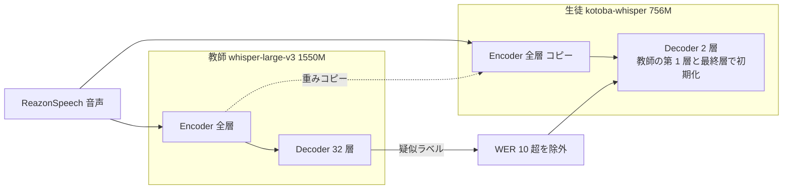

# Kotoba-Whisper — Whisper large-v3 を教師とする日本語音声認識の蒸留（Kotoba Technologies）

- **Source**: Asahi Ushio / Kotoba Technologies（2023 年 10 月創業。経営陣は Dealroom のプロフィールで CEO Tomohiro Kennedy、CTO Jungo Kasai と記載。AI 生成の可能性があるページで信頼度は低い）
- **Date**: v1.0 / v2.0 は 2024 年（学習データの更新 2024-08-31〜09-03）
- **Links**: [kotoba-whisper-v2.0](https://huggingface.co/kotoba-tech/kotoba-whisper-v2.0) / [kotoba-whisper-v1.0](https://huggingface.co/kotoba-tech/kotoba-whisper-v1.0)
- **Type**: Technical Article（OSS モデル）
- **蒸留判定**: **蒸留（Distil-Whisper 方式: 大規模疑似ラベルによる頑健な知識蒸留）**。LLM ではなく音声認識（エンコーダ–デコーダ Transformer）
- **エビデンス品質**: モデルカードは **一次資料**。速度・誤り率は開発者自身の評価

## Overview

LLM ではありませんが、**国内で最も早く・最も具体的に「蒸留で日本語特化の小型モデルを作り、教師を超えた」ことを数値で示した OSS** です。コールセンター・議事録など国内の音声業務で使われる Whisper 系モデルの、日本語版の基盤になっています。

| 指標 | whisper-large-v3（教師） | kotoba-whisper-v2.0（生徒） |
|------|------------------------|---------------------------|
| パラメータ | 1,550M | 756M |
| 相対速度 | 1.0 | **6.3** |
| CER ReazonSpeech（ドメイン内） | 14.9 | **11.6** |
| CER JSUT Basic 5000（ドメイン外） | **7.1** | 8.4 |

ドメイン内（ReazonSpeech）では教師を上回り、ドメイン外では教師にやや劣ります。**「特化すると教師を超えるが、汎用性は落ちる」** という蒸留の典型的なトレードオフを、きれいに示しています。

## Key Technical Content

### Architecture / Design

- **エンコーダ**: large-v3 のエンコーダを **そのまま全層保持**
- **デコーダ**: **2 層** に削減。large-v3 の **最初と最後の層** で初期化
- 手法は Distil-Whisper（"Robust Knowledge Distillation via Large-Scale Pseudo Labelling", arXiv 2311.00430）に準拠



> 教師デコーダの層数（32）は Whisper large 系の公開仕様に基づく補足で、モデルカード自体には書かれていません。

### Implementation Steps

1. **疑似ラベル生成**: 教師 large-v3 で ReazonSpeech の音声を書き起こす
2. **フィルタ**: 書き起こしの WER が 10 を超えるサンプルを除外
3. **生徒の初期化**: エンコーダ全層 + デコーダ 2 層（第 1 層と最終層）を教師からコピー
4. **蒸留学習**: 8 エポック、バッチ 256、16 kHz
5. **長文推論**: チャンク分割アルゴリズムで、OpenAI の逐次実装より最大 9 倍高速（Distil-Whisper 論文 表 7 の引用）

### Key Formulas / Metrics

Distil-Whisper の損失は、疑似ラベルへの交差エントロピーと教師分布への KL の重み付き和です（モデルカードは重みを明記していないため、一般形のみ示します）。

$$
\mathcal{L} = \alpha_{\mathrm{KL}}\,\mathrm{KL}\big(p_{\mathrm{T}} \,\|\, q_{\mathrm{S}}\big) + \alpha_{\mathrm{PL}}\,\mathcal{L}_{\mathrm{CE}}\big(\hat y_{\mathrm{T}}, q_{\mathrm{S}}\big)
$$

- $p_{\mathrm{T}}$, $q_{\mathrm{S}}$: 教師・生徒のトークン分布
- $\hat y_{\mathrm{T}}$: 教師の書き起こし（疑似ラベル）
- $\alpha_{\mathrm{KL}}, \alpha_{\mathrm{PL}}$: 重み（Kotoba のモデルカードでは非公開）

| 項目 | v1.0 | v2.0 |
|------|------|------|
| 学習データ | ReazonSpeech `large`、**1,253 時間**、16,861,235 文字（フィルタ後） | ReazonSpeech `all`、**7,203,957 クリップ**（1 クリップ約 5 秒、平均 18 トークン） |
| WER フィルタ | 10 超を除外 | 10 超を除外 |
| エポック / バッチ | 8 / 256 | 8 / 256 |
| ライセンス | Apache-2.0 | Apache-2.0 |

v2.0 の学習音声量は、$7{,}203{,}957 \times 5\ \text{秒} \approx 10{,}000$ 時間と概算できます（モデルカードは総時間を明記していません）。

## Figures & Tables

### 表 1: CER（%、低いほど良い）

| モデル | CommonVoice 8（ja test） | JSUT Basic 5000 | ReazonSpeech（held-out） |
|--------|-------------------------|-----------------|------------------------|
| **kotoba-whisper-v2.0** | **9.2** | **8.4** | **11.6** |
| kotoba-whisper-v1.0 | 9.4 | 8.5 | 12.2 |
| whisper-large-v3 | 8.5 | 7.1 | 14.9 |
| whisper-large-v2 | 9.7 | 8.2 | 28.1 |
| whisper-large | 10 | 8.9 | 34.1 |
| whisper-medium | 11.5 | 10 | 33.2 |
| whisper-base | 28.6 | 24.9 | 70.4 |
| whisper-small | 15.1 | 14.2 | 41.5 |
| whisper-tiny | 53.7 | 36.5 | 137.9 |

### 表 2: WER（%、低いほど良い）

| モデル | CommonVoice 8（ja test） | JSUT Basic 5000 | ReazonSpeech（held-out） |
|--------|-------------------------|-----------------|------------------------|
| **kotoba-whisper-v2.0** | **58.8** | **63.7** | **55.6** |
| kotoba-whisper-v1.0 | 59.2 | 64.3 | 56.4 |
| whisper-large-v3 | 55.1 | 59.2 | 60.2 |
| whisper-large-v2 | 59.3 | 63.2 | 74.1 |
| whisper-large | 61.1 | 66.4 | 74.9 |
| whisper-medium | 63.4 | 69.5 | 76 |
| whisper-base | 87.2 | 93 | 91.8 |
| whisper-small | 74.2 | 81.9 | 83 |
| whisper-tiny | 93.8 | 97.6 | 94.9 |

> 日本語は分かち書きがないため WER は高く出ます。比較は CER が実態に近い指標です。

### 速度と精度の関係（ASCII）

```
ReazonSpeech CER（%、低いほど良い）
whisper-large-v3    |███████████████ 14.9   速度 1.0x
kotoba-whisper-v1.0 |████████████ 12.2      速度 6.3x
kotoba-whisper-v2.0 |████████████ 11.6      速度 6.3x
whisper-medium      |█████████████████████████████████ 33.2
```

### 教師との差（ドメイン内 vs ドメイン外）

| データ | 教師との CER 差（v2.0 − large-v3） | 解釈 |
|--------|----------------------------------|------|
| ReazonSpeech（ドメイン内） | −3.3 | 教師を上回る |
| CommonVoice 8（ドメイン外） | +0.7 | ほぼ同等 |
| JSUT Basic 5000（ドメイン外） | +1.3 | やや劣る |

## Practical Takeaways

1. **エンコーダは残し、デコーダを削る**: 自己回帰の逐次処理はデコーダ側にあるため、デコーダ削減が速度に最も効く。LLM の蒸留でも「どこを削るか」が速度を決める。
2. **疑似ラベルの品質フィルタ**: 教師の誤りを WER で除外するだけで、生徒が教師を超え得る。
3. **ドメイン特化の効果**: 学習データの分布（ReazonSpeech = テレビ音声）では教師超え、それ以外では劣化。業務適用時は自社音声での評価が必須。

## Notes

- **ビジネス利用**: モデルカードに顧客や業務利用の記述はありません。NVIDIA NGC の Riva カタログにも掲載されています（検索結果で確認、本文未取得）。
- v2.2 では話者分離と句読点付与がパイプラインに追加され、TensorRT-LLM 向けに最適化されたと報じられています（二次情報）。
- 国内の LLM 蒸留（TAID 等）より前の 2024 年に、**OSS の日本語蒸留モデルが教師超えを数値で示した** 先行例として位置付けられます。
