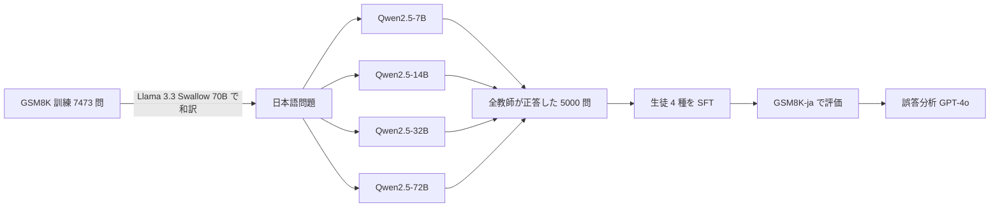

# 大きなモデルは小さなモデルの良い教師となり得るか? —日本語算術タスクにおける検証—（三菱電機, NLP2026）

- **Authors**: 山下修平, 内出隼人, 斉藤辰彦（三菱電機株式会社）
- **Venue**: 言語処理学会 第32回年次大会（NLP2026）C8-7（査読なし、CC BY 4.0）
- **Date**: 2026-03
- **Link**: [予稿 PDF](https://www.anlp.jp/proceedings/annual_meeting/2026/pdf_dir/C8-7.pdf)
- **Type**: 学術論文（事業会社の研究発表）
- **蒸留判定**: **黒箱蒸留（推論過程の系列レベル蒸留）** — 教師の CoT 生成文を正解ラベルにしたフルパラメータ SFT
- **エビデンス品質**: **一次資料**（著者自身の実験。査読なし）

## Abstract

大規模言語モデル（LLM）の出力した推論過程を用いた知識蒸留は、小型モデルに高度な推論能力を付与する有力な手法の一つである。英語を対象とした既存研究では、教師モデルのサイズ・精度が蒸留の効果に単調に反映されないことが指摘されているが、日本語でも同様の傾向が成立するかは明らかでない。本研究では日本語の算術タスクを対象に、教師モデルのサイズが蒸留に与える影響を検証した。その結果、英語と同様に蒸留の効果は教師のサイズや精度に比例せず、**7B モデルを教師とした生徒が 72B モデルを教師とした生徒より平均 3.16 ポイント高い正答率** を示した。さらに分析により、大規模な教師の下では一貫して計算ミスが増加する傾向があり、教師の推論過程の形式差が蒸留後の性能に影響する可能性が示唆された。

（予稿の概要を本文から要約。原文は日本語）

## Abstract (Japanese Translation)

原文が日本語のため、上記の要約をそのまま日本語訳とします。

## Overview

製造業の大手である三菱電機が、**エッジで動く小型モデルに推論能力を持たせるための教師選び** を、日本語で検証した研究です。同社は 2025 年 6 月に「エッジデバイスで動作する製造業向け言語モデル」を発表しており（[10](10-non-distillation-lightweight-llms.md)）、そこでは蒸留の記述がありませんでした。本研究は、その延長として蒸留を検討していることを示す一次資料です。

結論は **「教師は大きければよいわけではない」** で、TAID（[01](01-sakana-taid-tinyswallow.md)）が白箱蒸留で扱った能力差問題を、黒箱（推論文）蒸留・日本語で再確認しています。

## Problem

- 推論能力の高い LLM は大規模で、計算資源の制約から **適用範囲が限られる**。
- 教師の推論過程を学習させる蒸留が有望だが、先行研究（Li et al. 2025、Chen et al. ACL 2025 Findings）は **教師サイズと蒸留効果が比例しない** と報告している。
- これらは英語のみで、**日本語での検証がない**。

## Proposed Method

### 実験設計

| 要素 | 設定 |
|------|------|
| タスク | GSM8K（算術）の日本語訳 |
| 学習問題 | GSM8K 訓練データ 7,473 問を **Llama 3.3 Swallow 70B Instruct v0.4** で和訳 |
| 教師 | Qwen2.5-{7B, 14B, 32B, 72B}-Instruct（同一の CoT プロンプト、0-shot、greedy） |
| 学習データ | **全サイズの教師が正答した 5,000 問**（教師間で問題を揃える） |
| 生徒 | Qwen2.5-0.5B, Qwen2.5-1.5B, sarashina2.2-1b, llm-jp-3.1-1.8b（いずれも **ベースモデル**） |
| 学習 | 教師の生成文を正解ラベルにした **フルパラメータ SFT** |
| 評価 | GPT-4o で和訳した GSM8K 評価データ（SakanaAI/gsm8k-ja-test_250-1319）、末尾の数値を正規表現で抽出し絶対誤差 $10^{-5}$ 以下を正解 |
| 学習前の基準 | ベースモデルの 4-shot（repetition penalty 1.1） |
| 計算機 | NVIDIA A100。教師データ生成と和訳のみ 4 枚、他は 1 枚 |

### 損失

$$
\mathcal{L}(\theta) = -\sum_{(x,\hat y_{T}) \in \mathcal{D}} \sum_{s} \log q_\theta(\hat y_{T,s} \mid x, \hat y_{T,<s})
$$

- $\hat y_T$: 教師 $T \in \{7\text{B},14\text{B},32\text{B},72\text{B}\}$ の推論過程 + 解答
- $\mathcal{D}$: 全教師が正答した 5,000 問

### プロンプト（付録 B、教師・生徒で共通）

```text
問題: {問題文}
ステップごとに考えて答えを導いてください。
解答を [answer] とするとき以下のフォーマットで出力してください。
解答: [answer]
```

### ハイパーパラメータ（付録 表 2）

| 項目 | 値 |
|------|----|
| bfloat16 | true |
| 学習率 | 1.0 × 10⁻⁵ |
| スケジューラ | linear |
| エポック | 2 |
| per device batch size | 8 |
| gradient accumulation | 1 |
| max gradient norm | 1.0 |

## Algorithm (Pseudocode)

```text
1. GSM8K 訓練 7,473 問を Llama 3.3 Swallow 70B で和訳
2. for T in {7B, 14B, 32B, 72B}:
       T で CoT 回答を生成（0-shot, greedy）
3. 全 T が正答した 5,000 問を抽出し、教師ごとの学習セット D_T を作る
4. for 生徒 S in {Qwen2.5-0.5B, Qwen2.5-1.5B, sarashina2.2-1b, llm-jp-3.1-1.8b}:
       for T in 教師:
           S_T = SFT(S, D_T)
           正答率(S_T) を GSM8K-ja で評価
5. 7B 教師と 72B 教師の生徒について、誤答を GPT-4o で 3 分類
6. 教師データのトークン長を比較
```

## Architecture / Process Flow



## Figures & Tables

### 表 1: 教師別・生徒別の正答率（%、GSM8K 日本語評価データ）

| 教師 \ 生徒 | Qwen2.5-0.5B | Qwen2.5-1.5B | sarashina2.2-1b | llm-jp-3.1-1.8b | 平均 |
|------------|--------------|--------------|-----------------|-----------------|------|
| **Qwen2.5-7B** | **33.30** | **59.12** | **47.71** | **59.77** | **49.98** |
| Qwen2.5-14B | 32.09 | 55.75 | 46.49 | 58.84 | 48.29 |
| Qwen2.5-32B | 30.21 | 55.94 | 44.15 | 56.97 | 46.82 |
| Qwen2.5-72B | 30.96 | 57.53 | 41.35 | 57.44 | 46.82 |
| 4-shot（学習前） | 4.12 | 11.69 | 46.77 | 43.12 | — |

- 7B 教師が全生徒で最良。72B 教師より平均 **+3.16pt**（49.98 − 46.82）
- sarashina2.2-1b は学習前 4-shot（46.77）からの改善がほぼない（47.71）
- sarashina2.2-1b と llm-jp-3.1-1.8b は、学習前でも repetition penalty で 40pt 以上改善した（脚注）

### 表 3: 教師自身の正答率（%）

| 教師 | 正答率 |
|------|--------|
| Qwen2.5-7B | 79.98 |
| Qwen2.5-14B | 84.47 |
| Qwen2.5-32B | 86.16 |
| Qwen2.5-72B | 89.43 |

```
教師の正答率 vs その生徒の平均正答率
           教師            生徒平均
7B   |████████ 79.98   |█████ 49.98  ← 最良
14B  |████████ 84.47   |█████ 48.29
32B  |█████████ 86.16  |█████ 46.82
72B  |█████████ 89.43  |█████ 46.82
→ 教師は単調に良くなるが、生徒は単調に悪くなる
```

### 図 1: 生徒別の正答率（図の再現）

予稿の図 1 は表 1 と同じ値を棒グラフにしたものです（教師 4 種 × 生徒 4 種）。数値は表 1 を参照してください。

### 図 2: 誤答の内訳（件数、7B 教師 vs 72B 教師）

誤答を GPT-4o で (A) Semantic Misunderstanding（意味理解の誤り）、(B) Step Missing Error（中間ステップの欠落）、(C) Calculation Error（計算ミス）に分類しています（複数あれば最も早い段階の誤りを A > B > C の優先順で採用）。

| 生徒 | 教師 | A | B | C | 誤答総数 |
|------|------|---|---|---|---------|
| Qwen2.5-0.5B | 7B | 532 | 143 | 36 | 711 |
| Qwen2.5-0.5B | 72B | 570 | 118 | 49 | 737 |
| Qwen2.5-1.5B | 7B | 317 | 90 | 27 | 434 |
| Qwen2.5-1.5B | 72B | 312 | 100 | 40 | 452 |
| sarashina2.2-1b | 7B | 368 | 132 | 54 | 554 |
| sarashina2.2-1b | 72B | 396 | 138 | 89 | 623 |
| llm-jp-3.1-1.8b | 7B | 270 | 95 | 57 | 422 |
| llm-jp-3.1-1.8b | 72B | 273 | 102 | 70 | 445 |

> 図中の数値を PDF のテキスト層から読み取り、合計が N_err と一致することを確認しました（例: 532 + 143 + 36 = 711）。

- **計算ミス（C）は 72B 教師の下で全生徒で増加**（36→49、27→40、54→89、57→70）
- 意味理解の誤り（A）は生徒によって増減が分かれる

### 図 3: 教師データのトークン長

- 7B 教師の生成文が最も長く、72B より **平均約 30 トークン多い**（Qwen2.5 トークナイザ。sarashina2.2 / llm-jp-3.1 のトークナイザでも同傾向）
- 7B 教師は中間計算を省略しにくい形式で書いている可能性

### 表 4: 典型例（付録 E）

| 教師 | 生徒の解き方 | 結果 |
|------|-------------|------|
| 72B | 1 個分を 5 + 3 + 0.25 = 8.25 と合算し、16 × 8.25 = 130 と計算 | **誤答**（正解 132） |
| 7B | 材料ごとに 16 倍（80, 48, 4）してから合計 132 | **正答** |

> 72B 教師の簡潔な解き方は小数の計算を生み、小さな生徒が計算を誤る。7B 教師の冗長な解き方は整数だけで済み、ミスしにくい。

## Experiments & Evaluation

### Setup

上記「実験設計」のとおり。

### Main Results

- 教師サイズを上げると、教師の正答率は 79.98 → 89.43 と単調に上がる
- しかし生徒の平均正答率は 49.98 → 46.82 と **単調に下がる**

### Ablation Study

- 教師間で学習問題を揃えた（全教師正答の 5,000 問）ことで、データ量の差ではなく **推論過程の書き方の差** を比べている
- API コストの制約から、誤答分析は 7B と 72B の 2 教師のみ

## Business Perspective

| 観点 | 示唆 |
|------|------|
| 教師コスト | 72B より 7B の教師が良いなら、教師データの生成コスト $C_{\text{data}}$ は大幅に下がる |
| エッジ用途 | 0.5B–1.8B の生徒でも、4-shot の 4.12% → 33.30%（Qwen2.5-0.5B）など大きく改善 |
| 国産小型モデル | sarashina2.2-1b（SB Intuitions）・llm-jp-3.1-1.8b（NII）を生徒に使っており、国産 SLM の蒸留土台としての比較になっている |

$$
C_{\text{data}} \propto (\text{教師の推論コスト}) \times (\text{生成件数}) \Rightarrow \text{小さい教師ほど} C_{\text{data}} \text{ が小さく、本研究では精度も高い}
$$

## Notes

- **事業会社の社内導入事例ではない**: 公開ベンチマーク（GSM8K）上の研究。業務データでの検証ではありません。
- 同じ NLP2026 で CyberAgent（B9-18）は、先行研究の設定には「教師間でのデータフィルタ」「生徒が教師より大きい設定」などの問題があり、**候補教師の性能差が大きいときは高性能教師の利点が能力差の影響を上回る** と、逆向きの指針を示しています。三菱電機の設計は、まさに CyberAgent が「実運用では非現実的」と批判する **教師間フィルタ（全教師が正答した 5,000 問に限定）** を採用しています。強い教師だけが解ける難問の CoT が学習から除かれるため、大きい教師の利点が出にくい条件です。また教師間の正答率差は最大 9.45pt で、CyberAgent の言う「候補教師の性能差が大きい」条件にも当たりません。両研究を合わせると、**教師選びは自社タスクで小規模に比較して決めるべき** というのが実務上の結論です。
