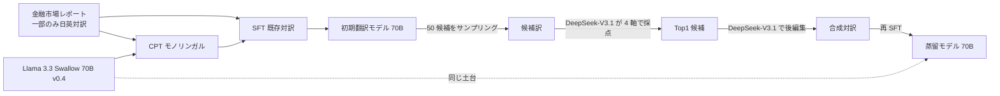
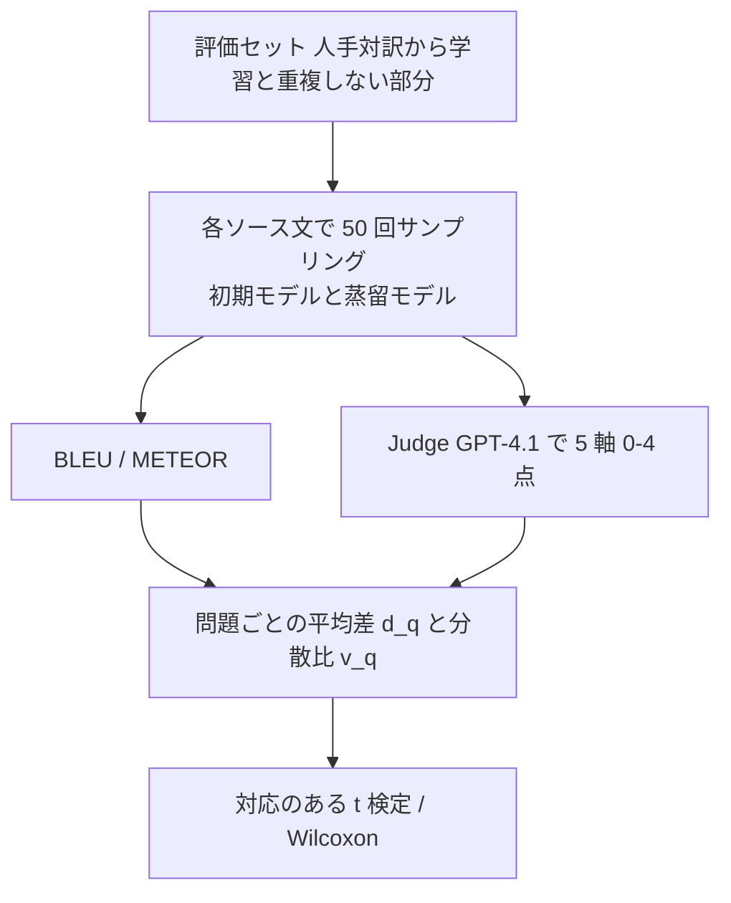

# 金融市場翻訳に特化した LLM に対する LLM-as-a-Judge ベース蒸留学習（Japan Digital Design, NLP2026）

- **Authors**: 井本稔也, 伊藤敬彦, 川原一修（Japan Digital Design 株式会社）
- **Venue**: 言語処理学会 第32回年次大会（NLP2026）C9-7（査読なし、CC BY 4.0）
- **Date**: 2026-03
- **Link**: [予稿 PDF](https://www.anlp.jp/proceedings/annual_meeting/2026/pdf_dir/C9-7.pdf)
- **Type**: 学術論文（金融機関グループ企業の実務研究）
- **蒸留判定**: **データ蒸留（同サイズ）** — 70B の候補訳を別の大モデル（DeepSeek-V3.1）で採点・後編集し、その合成対訳で **同じ 70B** を再 SFT。**モデルの小型化はしていない**
- **エビデンス品質**: **一次資料**（著者自身の実験。査読なし）

> Japan Digital Design は三菱 UFJ フィナンシャル・グループ（MUFG）系のデジタル子会社として知られていますが、予稿には資本関係の記載がありません（関係は一般に知られた情報として補足）。

## Abstract

金融市場レポートは、為替・金利・株式など多様な資産クラスの動向や見通しを高頻度で報告する実務文書であり、専門用語・略語や市場参加者特有の言い回し、機関投資家向けの文体といったドメイン固有の特徴を持つ。したがって文単位の意味対応だけでなく、レポート全体で一貫した用語選択と自然な市場コメントとしての表現が求められる。近年の機械翻訳や LLM の性能向上にもかかわらず、金融市場レポートでは用語の不自然さや不統一が残り、人手による修正が依然として不可欠である。本研究は、(1) 高頻度更新かつ厳格な文体制約を持つ金融市場レポートを対象とし、(2) LLM-as-a-Judge と LLM ベース・ポストエディットを組み合わせて高品質な合成対訳を自動構築して金融特化 LLM を蒸留し、(3) 翻訳品質の平均だけでなく分散（安定性）にも着目して Judge ベース評価と統計的検定で効果を分析した。

（予稿の概要・貢献の要約。原文は日本語）

## Abstract (Japanese Translation)

原文が日本語のため、上記をそのまま日本語の要約とします。

## Overview

国内の **金融機関グループ企業が、実務の金融市場レポート（自社レポートと日本銀行のレポート）を使って「蒸留」を行い、統計的に効果を検証した** 一次資料です。事業会社の社内業務に最も近い国内の蒸留事例ですが、次の 2 点に注意が必要です。

1. ここでの「蒸留」は **データ蒸留**（大モデルによる選別・後編集で教師データを作る）で、生徒は初期モデルと同じ Llama 3.3 Swallow 70B です。**推論コストは下がりません**。
2. 研究発表であり、本番運用・業務削減時間などの成果は書かれていません。



## Problem

- 金融市場レポートは **専門用語・略語・市場特有の言い回し・機関投資家向けの文体** を持つ。
- 汎用の機械翻訳・LLM では、金融の観点から見ると **不自然・不統一な用語選択** が起き、人手修正が欠かせない。
- 人手の日英対訳は **一部にしかない**（残りは日本語のみ・英語のみ）。
- 初期翻訳モデルは金融用語の再現には強いが、**自然さと品質のばらつき** に課題があった。

## Proposed Method

### 3.1 対象データとベースモデル

| データ | 用途 |
|--------|------|
| 金融機関による為替・金利・マクロ経済の市場レポート | 対訳部分は SFT、単言語部分は CPT と合成対訳の原文 |
| 日本銀行（BOJ）の金融経済レポート | 同上 |

初期翻訳モデル = Llama 3.3 Swallow 70B v0.4 を単言語データで CPT → 金融対訳で SFT

### 3.2–3.5 データ蒸留パイプライン

1. **多様な候補生成**: 各セグメント $x$ について、初期翻訳モデルから温度 $T$・top-p $p$ 付きサンプリングで $n = 50$ 本の候補 $\{y^{(1)},\dots,y^{(n)}\}$ を生成
2. **LLM-as-a-Judge による採点**: DeepSeek-V3.1 が各候補を 4 軸（100 点満点）で採点しリランキング
   - Accuracy（意味の正確さ）
   - Terminology（市場慣行・専門用語の適切さ）
   - Fluency（読みやすさ・説得力）
   - Overall（全体）
3. **LLM ベース・ポストエディット**: Top1 候補 $y^\star$ を、再び DeepSeek-V3.1 で後編集し $\tilde y$ を得る
4. **合成対訳**: $(x, \tilde y)$
5. **蒸留モデルの SFT**: 合成対訳で Llama 3.3 Swallow 70B v0.4 を再び SFT

$$
y^\star = \arg\max_{k \in \{1..50\}} \mathrm{Judge}_{\mathrm{DS\text{-}V3.1}}\big(x, y^{(k)}\big), \qquad \tilde y = \mathrm{PostEdit}_{\mathrm{DS\text{-}V3.1}}(x, y^\star)
$$

$$
\mathcal{L}_{\mathrm{SFT}} = -\sum_{(x,\tilde y)} \log q_\theta(\tilde y \mid x)
$$

## Algorithm (Pseudocode)

```text
入力: 単言語レポート X, 初期翻訳モデル M0 (70B), Judge/Editor J = DeepSeek-V3.1
for x in X（セグメント単位）:
    Y = [M0.sample(x, T, top_p) for _ in range(50)]
    scores = [J.score(x, y, axes=[Accuracy, Terminology, Fluency, Overall]) for y in Y]
    y_star = Y[argmax(scores)]
    y_tilde = J.post_edit(x, y_star)
    D.append((x, y_tilde))
M_dist = SFT(Llama-3.3-Swallow-70B-v0.4, D)
評価: M0 と M_dist から各評価文に 50 回サンプリング → 平均と分散を比較
```

## Architecture / Process Flow



### 評価指標の定義（式 1, 2）

$$
\mu_{m,q} = \frac{1}{N}\sum_{i=1}^{N} s_{m,q,i}, \qquad \sigma^2_{m,q} = \mathrm{Var}\big(s_{m,q,1:N}\big)
$$

$$
d_q = \mu_{\text{蒸留},q} - \mu_{\text{初期},q}, \qquad v_q = \log \sigma^2_{\text{蒸留},q} - \log \sigma^2_{\text{初期},q}
$$

- $m \in \{\text{初期}, \text{蒸留}\}$、$q$: 評価問題、$i = 1..N$（$N = 50$）
- $\mathrm{Var}$: 不偏分散
- $v_q < 0$ なら蒸留モデルのほうがばらつきが小さい

Judge（評価用）は **ChatGPT-4.1**（学習データ作成用の DeepSeek-V3.1 とは別）で、5 軸を 0–4 の整数で採点します: Fluency / Adequacy / Market Style / Coverage / Overall。評価は日英・英日の両方向です。

## Figures & Tables

### 付録 表 1: 平均スコアの比較（蒸留モデル vs 初期モデル）

| 指標 | 蒸留 平均 | 初期 平均 | 問題数 | mean($d_q$) | median($d_q$) | 95% CI | Cohen's d | t 検定 p | Wilcoxon p | 符号検定 p |
|------|----------|----------|-------|------------|--------------|--------|-----------|---------|-----------|-----------|
| fluency | 3.793 | 3.713 | 1025 | 0.080 | 0.060 | [0.066, 0.093] | 0.366 | 0.000 | 0.000 | 0.000 |
| adequacy | 3.842 | 3.631 | 1025 | 0.211 | 0.180 | [0.194, 0.228] | 0.768 | 0.000 | 0.000 | 0.000 |
| style | 3.865 | 3.799 | 1025 | 0.066 | 0.040 | [0.053, 0.080] | 0.297 | 0.000 | 0.000 | 0.000 |
| coverage | 3.953 | 3.865 | 1025 | 0.088 | 0.040 | [0.076, 0.099] | 0.471 | 0.000 | 0.000 | 0.000 |
| overall | 3.785 | 3.607 | 1026 | 0.178 | 0.160 | [0.161, 0.195] | 0.632 | 0.000 | 0.000 | 0.000 |
| METEOR | 0.519 | 0.580 | 1043 | −0.062 | −0.055 | [−0.069, −0.055] | −0.509 | 0.000 | 0.000 | 0.000 |
| BLEU | 29.685 | 36.500 | 1043 | −6.816 | −5.281 | [−7.668, −6.016] | −0.496 | 0.000 | 0.000 | 0.000 |

本文で示された勝率: Fluency 64.7%、Adequacy 80.9%、Overall 75.7%（蒸留モデルの勝ち）。

### 付録 表 2: 分散・安定性の比較

| 指標 | mean($v_q$) | median($v_q$) | 95% CI | Cohen's d | win | loss | tie | 分散比（本文） |
|------|------------|--------------|--------|-----------|-----|------|-----|---------------|
| fluency | −2.101 | −0.301 | [−2.641, −1.575] | −0.239 | 0.265 | 0.674 | 0.060 | $e^{-2.10} \approx 0.12$（約 1/8） |
| adequacy | −4.642 | −0.714 | [−5.299, −4.010] | −0.442 | 0.175 | 0.780 | 0.046 | $e^{-4.64} \approx 0.01$（約 1/100） |
| style | −3.804 | −0.573 | [−4.507, −3.093] | −0.334 | 0.269 | 0.627 | 0.103 | $e^{-3.80} \approx 0.02$（約 1/50） |
| coverage | −9.272 | −1.608 | [−10.139, −8.406] | −0.649 | 0.146 | 0.667 | 0.186 | — |
| overall | −2.887 | −0.491 | [−3.425, −2.347] | −0.331 | 0.214 | 0.738 | 0.048 | $e^{-2.89} \approx 0.056$（約 1/18） |
| METEOR | −0.424 | −0.519 | [−0.564, −0.276] | −0.182 | 0.264 | 0.734 | 0.002 | 0.65（CI [0.57, 0.76]） |
| BLEU | −0.499 | −0.632 | [−0.692, −0.291] | −0.150 | 0.247 | 0.752 | 0.001 | 0.61（CI [0.50, 0.75]） |

> 表 2 の win / loss の定義（どちらが「勝ち」か）は抽出テキストからは判別できません。分散比の列は本文の記述から補いました。全指標で t 検定・Wilcoxon 検定ともに $p < 0.01$。

### 平均と分散のトレードオフ（ASCII）

```
                平均の変化            分散の変化（蒸留/初期）
Judge Overall   ▲ +0.178（3.607→3.785）  ▼ 約 1/18
Judge Adequacy  ▲ +0.211               ▼ 約 1/100
BLEU            ▼ −6.82（36.50→29.69）   ▼ 0.61
METEOR          ▼ −0.062               ▼ 0.65
```

## Experiments & Evaluation

### Setup

- 比較対象: 初期翻訳モデル vs 蒸留モデル（どちらも 70B）
- 評価データ: 人手作成の金融市場レポート対訳の一部（学習と重複なし）、日英・英日
- 各ソース文で両モデルから 50 回サンプリング、同一デコード設定

### Main Results

- **参照ベース指標では初期モデルが優位**（BLEU 36.50 vs 29.69）
- **Judge ベース評価では全 5 軸で蒸留モデルが平均・分散とも優位**
- 結論として「品質の下振れを大幅に抑制しつつ安定した翻訳品質を出力する」

### Ablation Study

予稿にはアブレーション（後編集の有無、候補数の変更など）はありません。

## Business Perspective

| 観点 | 評価 |
|------|------|
| 業務データ | **実務の金融市場レポート + 日銀レポート**（事業会社の業務データ） |
| 狙い | 人手修正の削減（下振れの抑制） |
| 推論コスト | **変わらない**（70B → 70B） |
| 教師の扱い | DeepSeek-V3.1（オープンウェイト）を Judge・編集者に使い、商用 API の出力を学習に使っていない。評価のみ GPT-4.1 |
| 本番化 | 予稿に記載なし |

ドメインのビジネス価値式では、この事例は第 1 項（推論コスト削減）がゼロで、価値は **第 3 項（精度低下の損失 $\Delta\mathrm{Acc}\cdot V_{\mathrm{err}}$）の改善**、特に **分散の縮小による人手修正の削減** から生まれます。

$$
\text{価値} \approx \underbrace{0}_{\text{同サイズ}} - (C_{\text{data}} + C_{\text{train}}) + \underbrace{\Delta\text{Var} \cdot V_{\text{修正}}}_{\text{下振れ減による修正工数削減}}
$$

## Notes

- **H3 との関係**: 「蒸留」という言葉が **小型化を伴わない合成データ作成** にも使われている例です。国内事例の集計では「蒸留＝小型化」と数えない注意が必要です。
- 参照ベース指標（BLEU）が下がるのに Judge 評価が上がる点は、評価方法の選び方次第で結論が逆になることを示しています。業務適用では人手評価との照合が要ります。
